# [A Visual Guide to Multimodal Generation][link-001]

*Exploring Image, Audio, and Video Generation in Multimodal LLMs*

## Table of Contents

- [Introduction](#introduction)
- [Generating Modalities](#generating-modalities)
  - [Generating Images](#generating-images)
    - [Stable Diffusion](#stable-diffusion)
      - [What is Diffusion?](#what-is-diffusion)
      - [How does diffusion work?](#how-does-diffusion-work)
      - [U-Net](#u-net)
      - [Latent Space](#latent-space)
      - [Text Encoder](#text-encoder)
    - [Diffusion Transformer](#diffusion-transformer)
  - [Generating Audio](#generating-audio)
    - [Acoustic Tokens](#acoustic-tokens)
    - [Semantic Tokens](#semantic-tokens)
    - [Hierarchical Transformers](#hierarchical-transformers)
    - [From Audio Generation to Real-Time Dialogue](#from-audio-generation-to-real-time-dialogue)
  - [Generating Videos](#generating-videos)
- [Creating Generative Multimodal LLMs](#creating-generative-multimodal-llms)
  - [Late Fusion](#late-fusion)
  - [Early Fusion](#early-fusion)
  - [Real-Time Speech Agents: Phonic-1](#real-time-speech-agents-phonic-1)
    - [What Is Publicly Documented?](#phonic-public-disclosures)
    - [A Conceptual System Architecture](#phonic-conceptual-architecture)
    - [Overlapping Listening and Tool Execution](#phonic-overlapping-execution)
    - [Training and Serving](#phonic-training-and-serving)
    - [Lessons and Limitations](#phonic-lessons-and-limitations)
- [Conclusion](#conclusion)
- [References](#references)

Most Multimodal LLMs today are only multimodal in one direction: they can **understand** images, audio, and video as *input*, but they still only generate text as *output*.

Enabling an LLM to actually **generate** images, audio, and video requires quite a different set of architectures!

[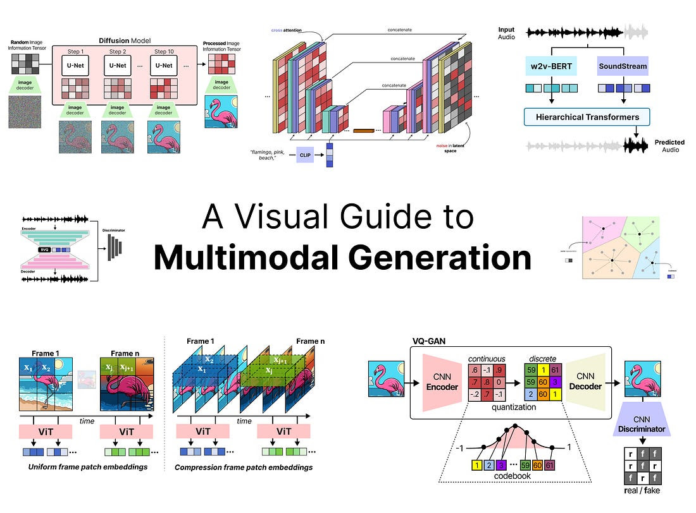][link-002]

With over **50** custom visuals in this guide, we will explore how modern AI generates images, audio, and video from scratch, and how LLMs are being architected to decode them.

> **A Free Bonus Chapter!**   
> This is a chapter of the recently released book, *[An Illustrated Guide to AI Agents][link-003]*.  

[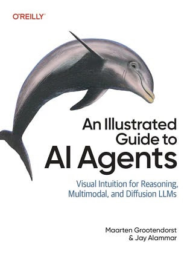][link-005]

[Official website][link-003] of the book. [Amazon][link-006]. Code on [GitHub][link-007].

## Introduction

Multimodal LLMs generally focus on **encoding** information (*input*) rather than **generating** information (*output*). It is a much cheaper operation without necessarily requiring large architectural changes

[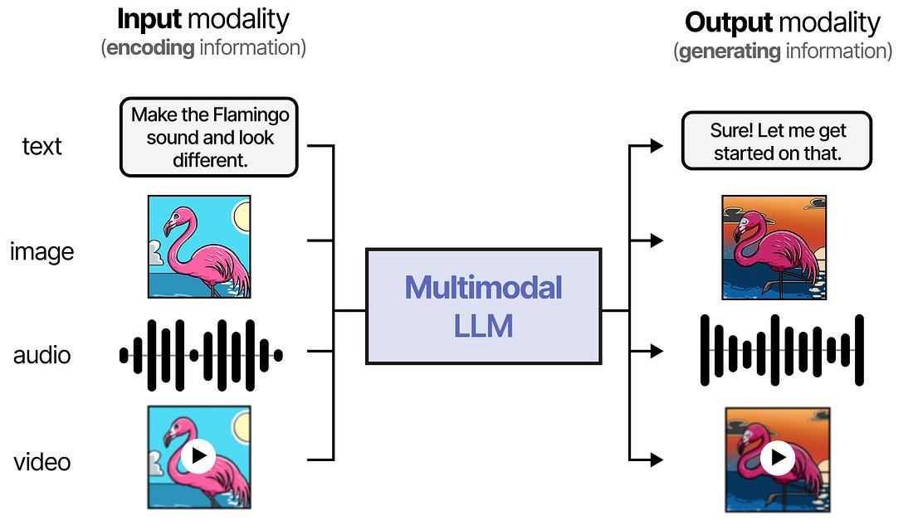][link-008]

However, LLMs are not the only type of models that have gained significant attention in 2024 and 2025. Generative image and audio models, specifically, have developed significantly in those years with techniques like Stable Diffusion.

These models take in some text and output their respective modality.

[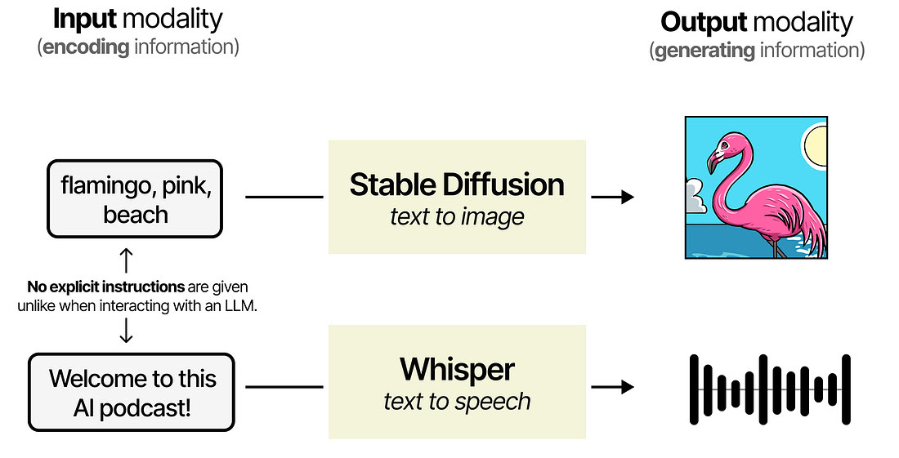][link-009]

These models, although highly capable, are quite one-dimensional in how you interact with them. Typically, a text-to-image needs a description of what you want in the image. So you are not saying “please give an image of a cute flamingo” but rather “flamingo, pink, beach”. Newer techniques, such Qwen-Image¹ and Z-Image², use an LLM-backend to process more extensive descriptions of the visuals.

As such, you are not interacting with these models as you would with an LLM. These models, assuming they also have generative capabilities, are exceptionally interesting as they allow you to “reason” about the input and output of the non-text modalities.

These models that can process and generate both text and images allow you to use more complex prompting to create, edit, and improve images. For instance, such a model can take any prompt detailing changes to a given image and generate this updated image.

[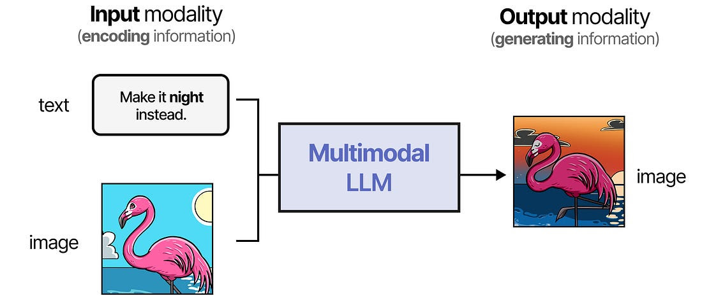][link-010]

By combining both multimodal understanding and multimodal generation, these models are quite capable and useful for chat sessions that involve understanding and generating many different modalities.

[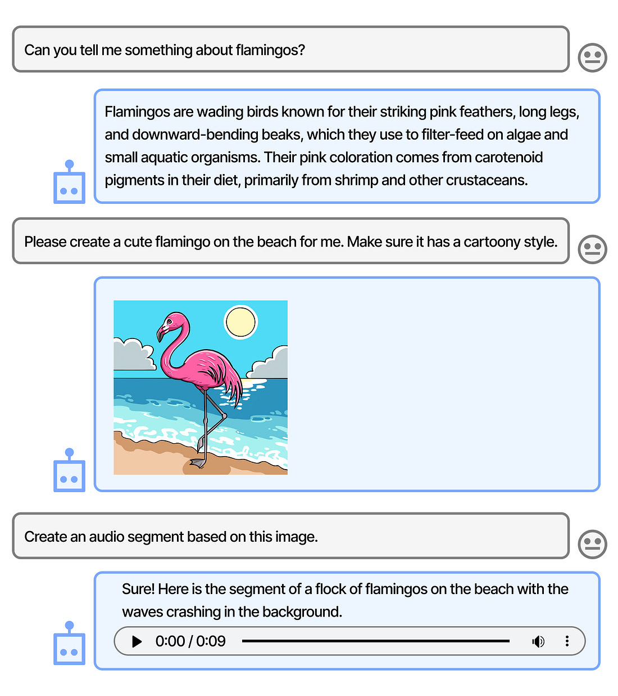][link-011]

To gain these kinds of capabilities, a Multimodal LLM needs to understand different modalities and generate multiple modalities. This is part of the optional fourth component in Multimodal LLMs, the **generator**.

[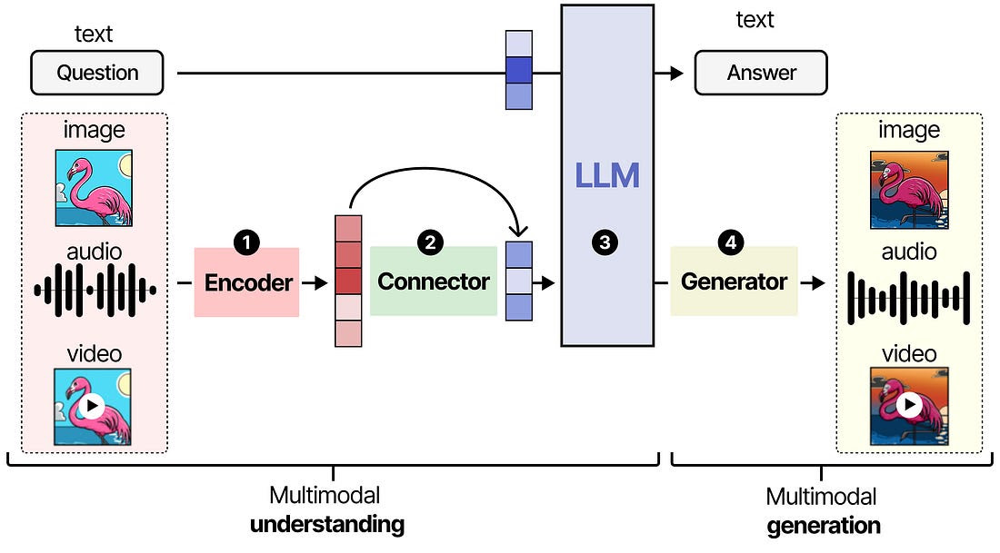][link-012]

This generator can be either a standalone model, such as a text-to-image or text-to-audio model, or a fundamental update to LLM architecture that enables it to generate more than just text. When it is a standalone model, the LLM itself is not multimodal, but its internal embeddings are projected to the same vector space so that they can be the input of an independent generative model.

[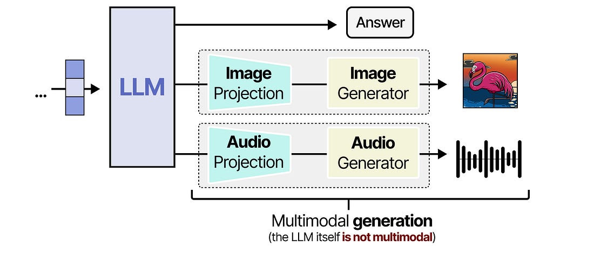][link-013]

In some cases, the architecture of the LLM is updated, making it capable of multimodal generation by itself. That typically means that all generators need to have some alignment on their architecture.

[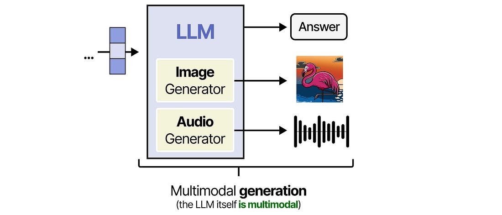][link-014]

We will explore both methodologies and how they affect their underlying architectures. We will explore how LLMs can be made into models that generate modalities other than text by leveraging their multimodal understanding.

The ability to instruct the process of both multimodal understanding and multimodal generation is going to be a vital principle in how we interact with Multimodal LLMs. Especially with the way the field is progressing, we are seeing more and more models that have a degree of multimodality to interact with the world more easily.

## **Generating Modalities**

To understand how LLMs can be extended to generate modalities other than text, let us first explore how these modalities can be generated. Typically, these are text-to-*N* models, where N is any given modality.

[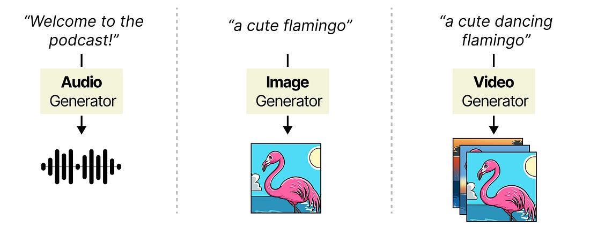][link-015]

Let’s go over some of the main methods of generating the most common non-text modalities: audio, images, and video.

### **Generating Images**

Like text generation, image generation has seen tremendous improvements in 2022 through 2025. It is uncanny how close the generated images are to what a human would create.

In this section, we will explore two major concepts in generating images:

- Latent Diffusion Models
- Diffusion Transformers

#### **Stable Diffusion**

This influx of models and techniques all started with [Stable Diffusion][link-016], a text-to-image model that arguably had the same impact on image generation as the original ChatGPT did in text generation. Stable Diffusion is not limited to text-to-image and can also run text/image-to-image tasks.³

[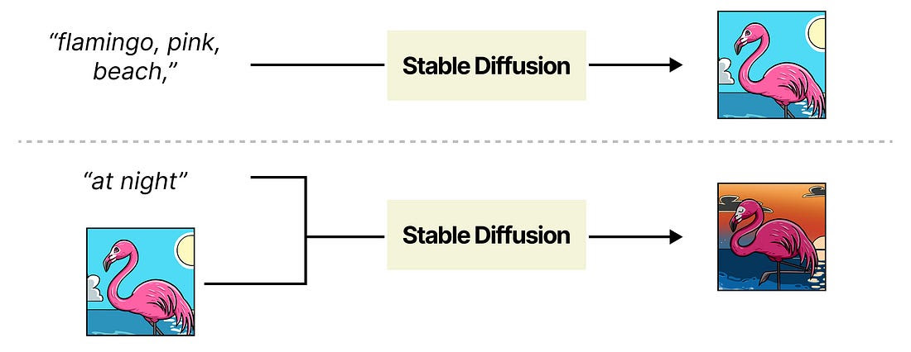][link-017]

Stable Diffusion consists of five main components:

- **Text Encoder** — Used to convert text to embeddings
- **Diffusion Model** — Used to gradually process/diffuse image information in the latent space. As such, its main goal is to predict the noise that might exist in the input.
- **Noisy input image** — Used as the base image from which to create the output
- **Image Encoder** — Converts images to latent representations
- **Image Decoder**— Converts latent representations to images

[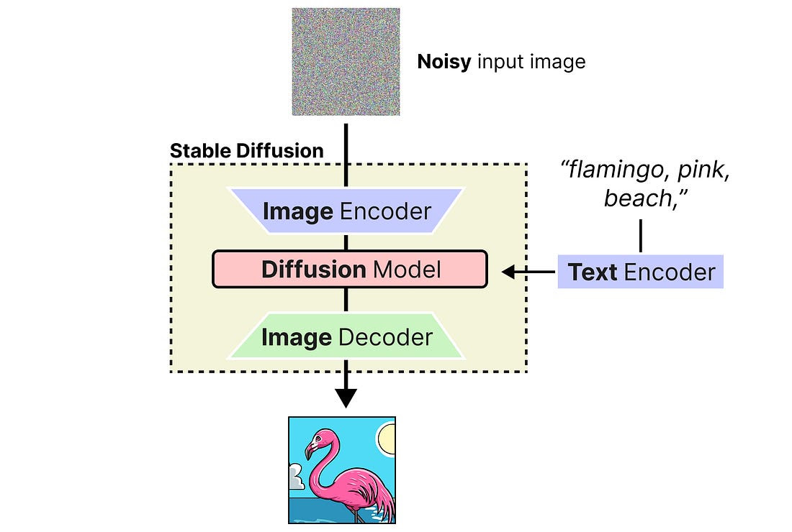][link-018]

Let’s go over each of these, starting with the two most vital components: noisy images and the diffusion model.

##### **What is Diffusion?**

Diffusion is the process of iteratively adding and removing noise to a given image. Using token embeddings that represent the input text and a random starting image information tensor (noisy image), this process continuously updates the information tensor for the image decoder to convert to an image. This tensor is a numerical representation of the input image, much like embeddings are for input text. Compared to embeddings, tensors tend to have more dimensions than just one.

[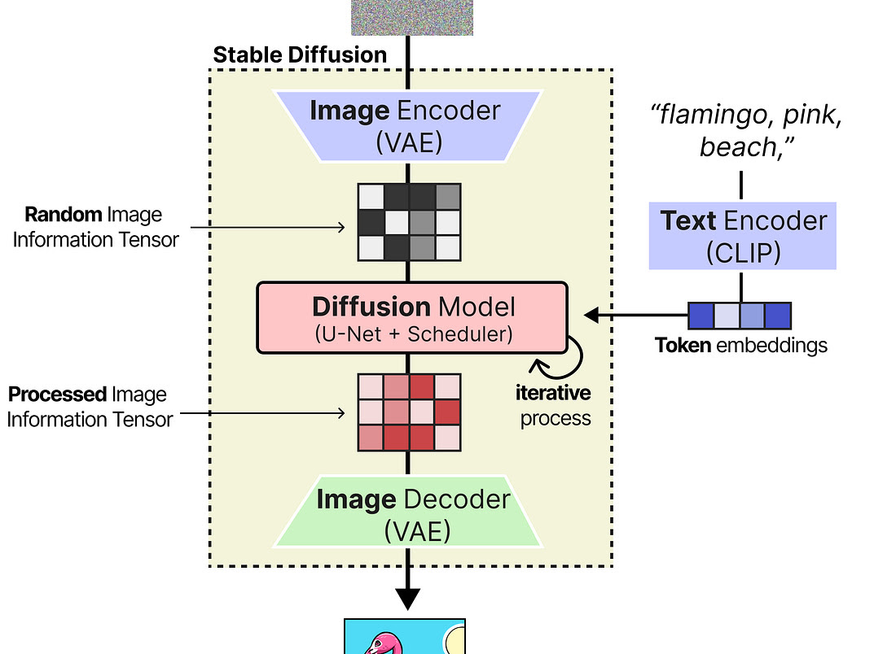][link-019]

If we were to decode the random image information tensor into an image, we would see nothing more than noise. Diffusion starts from noise because, as we will cover later on, the model is trained to remove noise, and pure noise is therefore the only starting point it understands. As you will discover, noise is actually what makes these models so powerful!

[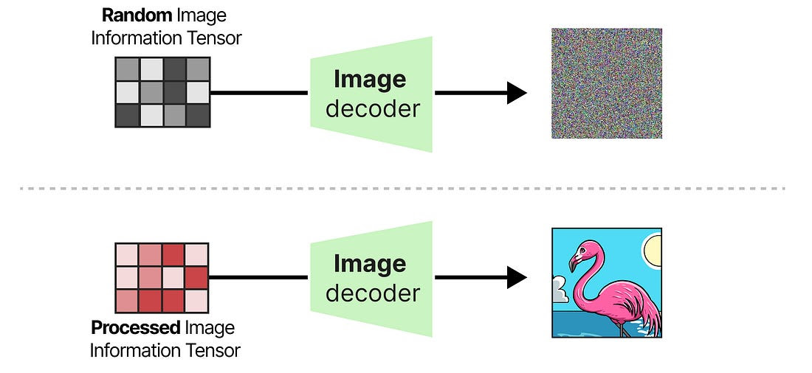][link-020]

So, how do we get from that initial noise to that nicely generated image?

Diffusion is an iterative, sequential process where the image information tensor is updated each step to better resemble the input text and all visual information the model learned during training. Visualizing a given number of steps shows how the initial noisy tensor contains less noise with each step. This is called **denoising** the image.

[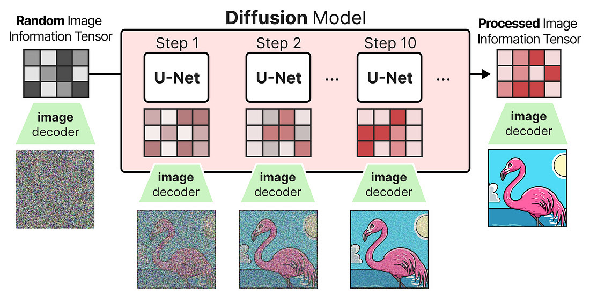][link-021]

Note how each step operates on this tensor and not the image itself. The image decoders are merely added to showcase what these intermediate tensors would look like if decoded into an image. As we will explore later, this speeds up computation quite a bit.

##### **How does diffusion work?**

Let’s dive a bit deeper into how this denoising process actually works.

We start with a dataset that contains image/text pairs that we want to train the model on. For each image, we can choose the amount of noise to add. This is called **forward diffusion**.

[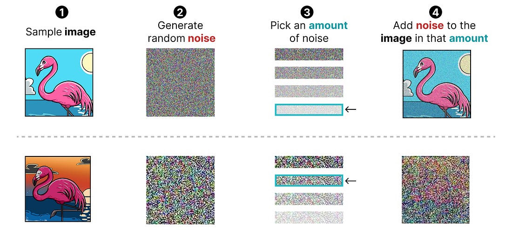][link-022]

This creates a processed dataset, one where all images have a certain degree of noise. As a result, we can generate dozens of new training examples for each image, all with a different amount of added noise.

##### **U-Net**

U-Net is a convolutional neural network (CNN) that removes noise step by step while attempting to preserve structure and details.⁴ It does so by predicting the noise from the training examples that were created in the previous step.

[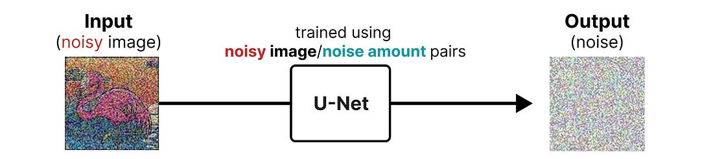][link-023]

It roughly consists of two sections containing convulational blocks for deriving and creating features, namely an encoder and decoder section.

U-Net was named for the U-shape its architecture follows. It has two important components:

- **Encoder** — Extract relevant features from an input image using convolution and layers to compress these features.
- **Decoder** — Takes the relevant features and reconstructs a segmentation mask (noise)

Note that some of the outputs are fed (via residual connections) into the processing later in the network. Moreover, the **timestep** (the current step) is added to each block and layer.

[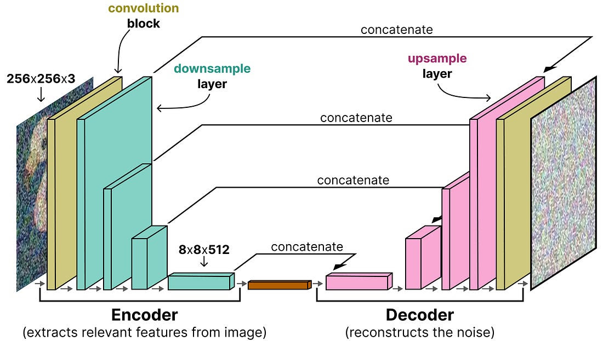][link-024]

So why would we want to introduce noise into the images and then attempt to predict it?

We can subtract the predicted noise from an image (random tensor) to get it closer to the images the model was trained on. It will not produce the exact same images as seen during training, but it attempts to reproduce their distribution, like arrangements where the sea is usually blue, cars have four wheels, and hands have five fingers.

This is an iterative process where noise is predicted at each step until a predefined number of steps is reached. More steps tend to improve quality and stability, but they also cost time. In contrast, fewer steps are faster, but they risk artifacts in the image since each step must do more work than the model was trained for.

[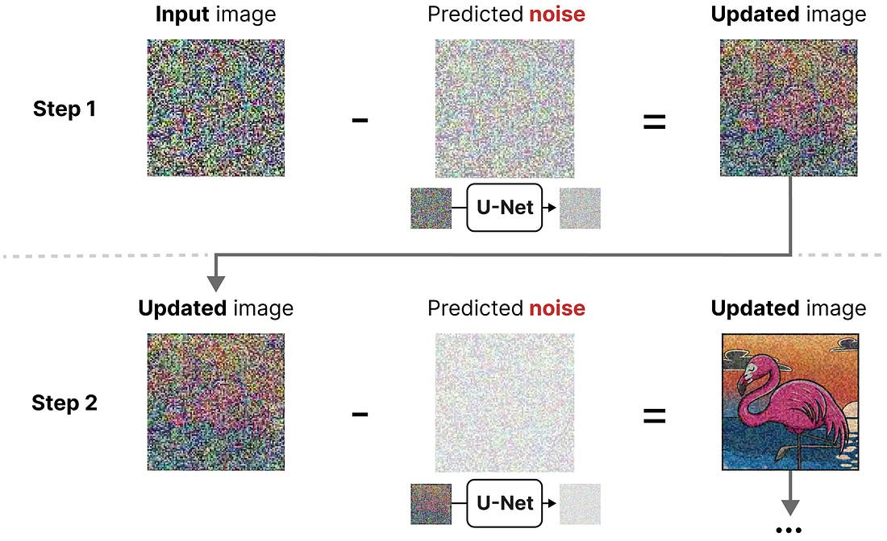][link-025]

This process is called **reverse denoising** or **reverse diffusion** and is the second step of training a diffusion model:

- **Forward diffusion** — Generating noisy training data
- **Reverse diffusion** — Denoising noisy images

[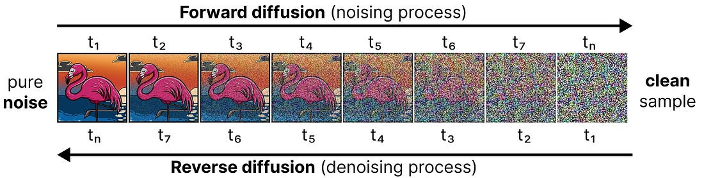][link-026]

The number of steps chosen is user-defined and typically depends on how the model was trained. The current timestep (t) is also tracked in the U-Net model, so it knows where in the denoising process it currently is.

##### **Latent Space**

To speed up this diffusion process, Stable Diffusion does not run this diffusion on the images themselves but on the tensors that we explored previously.

To convert these tensors back into images, Stable Diffusion makes use of a Variational Autoencoder (VAE), which is trained to compress an image into a latent space (tensor) using its encoder.⁵ Then it reconstructs it from the latent space back into an image.

[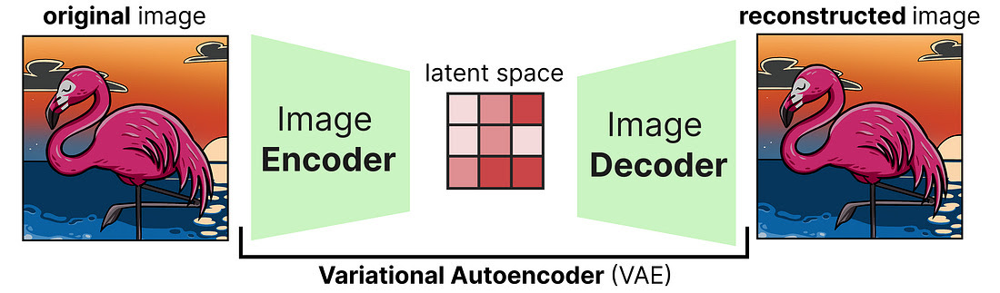][link-027]

The forward diffusion process we explored earlier is therefore done on the compressed latents and not the images themselves. As such, U-Net is actually trained to predict noise in the latent space. Both the forward diffusion (image encoder) and backward diffusion (image decoder) processes are not directly based on the image but on its compressed representation instead.

[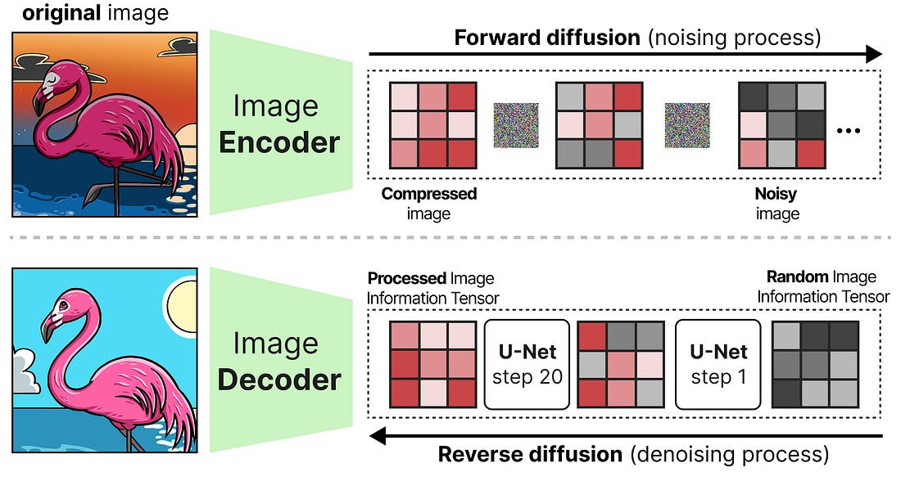][link-028]

##### **Text Encoder**

There is a vital component still missing. How is the model guided during its denoising process? The random image tensor doesn’t contain any information yet about what we expect the generated image to be.

The text encoder is the final missing piece of the puzzle. It is a pre-trained CLIP model that allows both images and text to be embedded. To make the text embedding a part of the image generation process, U-Net is updated to use the text as input by adding a CLIP encoder for the text.

[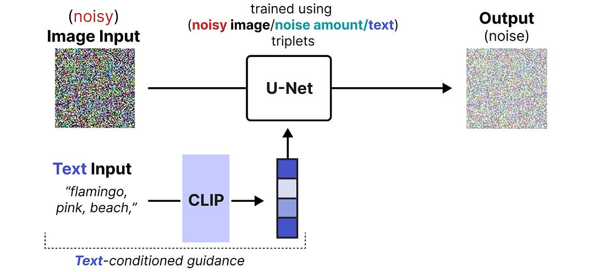][link-029]

This is called **text-conditioned guidance** and steers the detection of noise. Everything that is not related to the text input is identified as noise and is eventually removed from the image.

CLIP was trained to represent both text and images in latent space well. As a result, CLIP is a great solution for adding text embeddings during the training process of U-Net.

To add CLIP embeddings to U-Net, cross-attention layers were added that could process both the image tensor and the incoming CLIP embeddings. Like all other components of U-Net, these cross-attention layers process the images in latent space and are encoded and decoded through the VAE.

[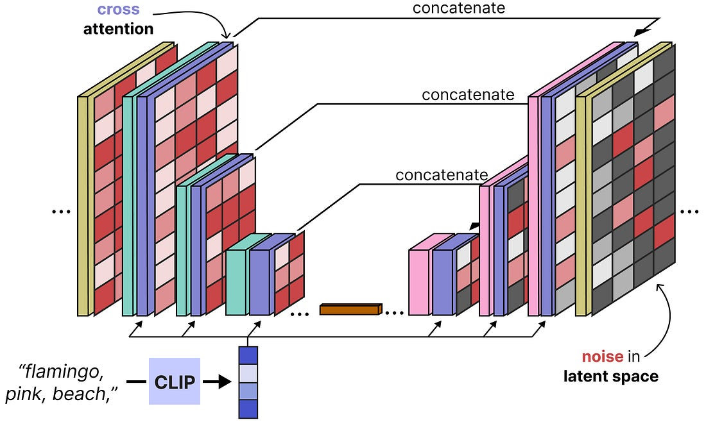][link-030]

Note that the blocks do not directly look at the text. But the attention layers merge those text representations in the latents. And now the next block can utilize the incorporated text information in its processing.

Combining all of these processes allows for an image to be generated from both a noisy image and guided text.

[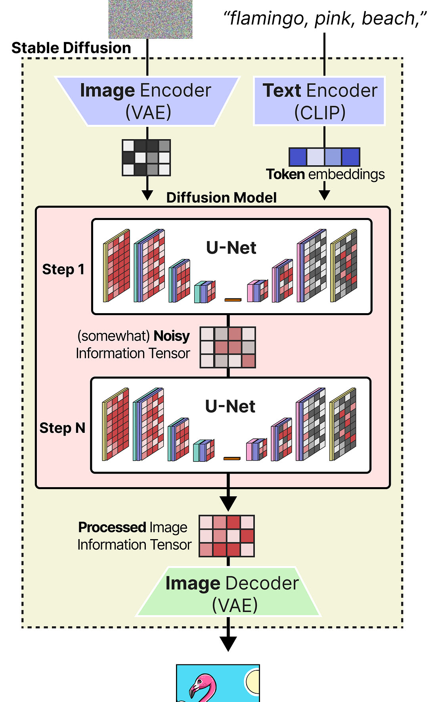][link-031]

And that is it! Stable Diffusion, and in particular, latent diffusion models, were a fundamental shift in the quality of image generation.

#### **Diffusion Transformer**

The success of Transformers in text has made its way to other fields. Transformers are not limited to text but can be used successfully for representing other modalities like images and audio.

Likewise, there has been a tremendous effort in using Transformers for generating other modalities. A great example is the Diffusion Transformer (DiT), a model that combines both Latent Diffusion and the Transformer architecture.⁶

[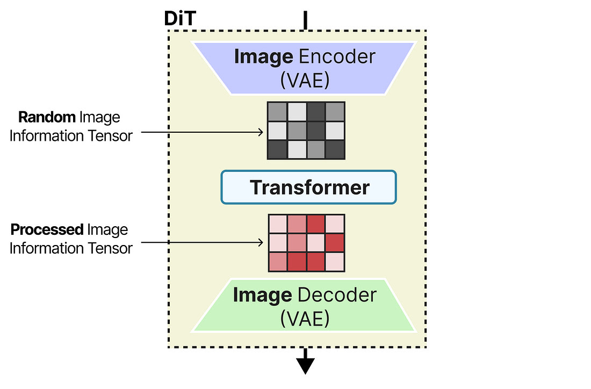][link-032]

This Transformer, also called the Latent Diffusion Transformer, consists of the following components:

- **Patchify** — Convert a latent image into patches (tokens).
- **Embeddings** — Labels (image captions) and timesteps (step in the denoising process) are embedded.
- **DiT Block** — The core processor of the input patches and embeddings.
- **Layer normalization** — Normalizes the output embeddings.
- **Linear and Reshape** — Reshapes the embeddings back into the input shape.
- **Predicted noise** — The distribution of noise in the original image is predicted.
- **Uncertainty estimation** — How uncertain it is about its noise prediction at each pixel/location.

The noisy input image is converted into patches (tokens) so that the DiT block can process it along with information about the timestep and the label.

After processing in the blocks, normalization is applied to the embeddings, which are then converted back into the shape of the input noisy image. Then, it is used to predict the noise and how certain the model is about the predicted noise at different locations of the image/latent space.

[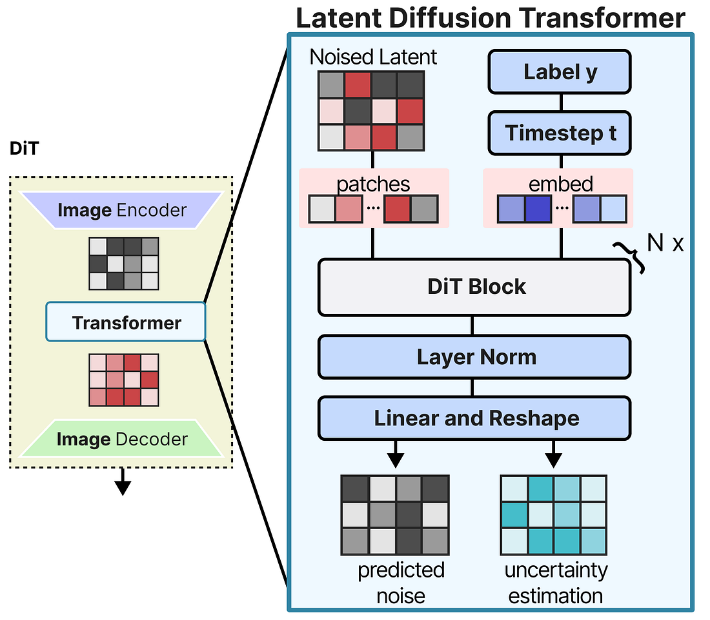][link-033]

The DiT blocks follow the same pattern as with regular LLMs; they are stacked and processed one at a time through self-attention. There are a couple of differences worth noting.

Aside from the expected layer normalization and self-attention mechanisms, there are additional conditioning layers that allow layer normalization to become adaptive based on the timestep and label embeddings.

There are two main reasons why we want to condition how the transformer processes the image tokens:

- **Timestep conditioning** — Different timesteps need different processing strategies. At early timesteps, when the image is highly noisy, the model should focus on capturing global structure. At later timesteps, when the noise is low, the model should shift its attention toward fine details.
- **Label conditioning** — Different classes of objects need different attention patterns. Generating a “flamingo” versus “house” requires focusing on different spatial relationships and features.

This conditioning through the layer normalization layer is called Adaptive Layer Normalization (adaLN).

[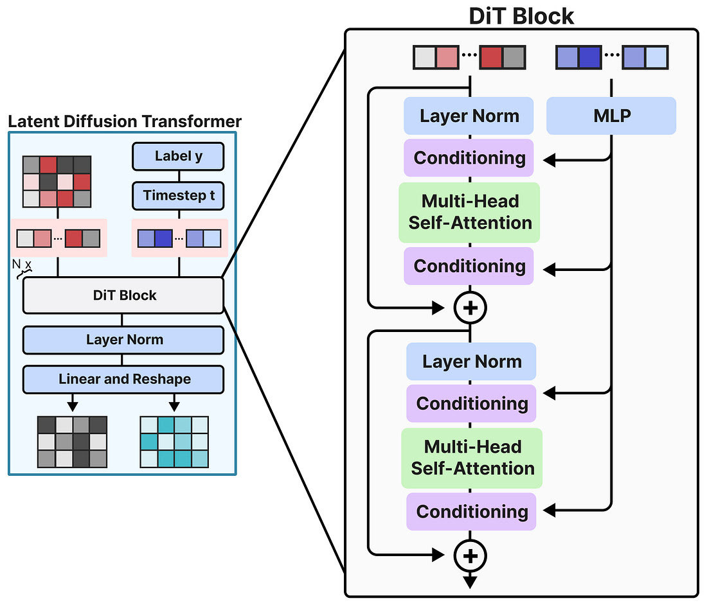][link-034]

A huge benefit of using transformers in diffusion is that we can make use of all the advancements that the transformer architecture has seen in the textual domain. In contrast, U-Net relies on deep hierarchical convolutional structures with skip connections, which become increasingly memory-intensive, harder to optimize, and less efficient to parallelize as model size grows.

At first glance, diffusion and transformers seem like quite different techniques to use. It is interesting to see how these fields are coming together and create these powerful models. For instance, newer image generation techniques, like [PIXART-α][link-035]⁷ and [FLUX.1 Dev][link-036], make use of this Diffusion Transformer to generate high-quality and high-resolution images.

### **Generating Audio**

We are seeing Transformers continue to dominate many generative fields, including those of generating Audio and Speech. An impactful audio generation technique is AudioLM, which demonstrates the power of Transformers in generating audio.⁸

Conventional language models are trained to predict text given a piece of text. AudioLM, in contrast, is trained to predict audio given a portion of audio. It attempts to predict audio while maintaining both the acoustic (pitch, timbre, intonation, etc.) and semantic (spoken words, speaker intent, etc.) features of the input. It was designed to handle a variety of sounds, including both human speech and music.

To do so, it contains three important components.

- Generating **acoustic tokens** with SoundStream
- Generating **semantic tokens** with w2v-BERT
- **Processing** and **generating** **audio** with Hierarchical Transformers

[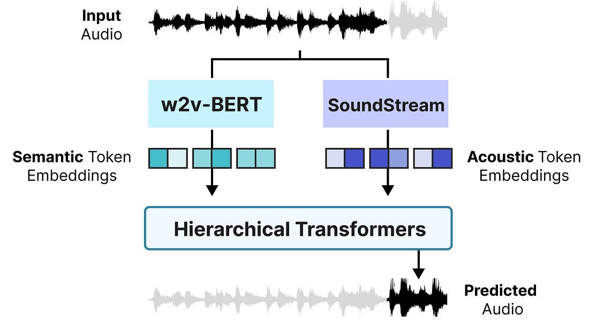][link-037]

#### **Acoustic Tokens**

In AudioLM, given an input audio, acoustic tokens are extracted using a neural codec called SoundStream. A codec is a technique that compresses (encodes) and decompresses (decodes) digital data like audio or video to reduce their file size. A neural codec is a more advanced technique that uses neural networks for this compression/decompression. Compared to traditional codecs, neural codecs learn compression strategies directly from the data through training, which allows them to better preserve important features with fewer audible distortions.

Neural codecs typically use autoencoders, which are neural networks (VAE) that consist of two components:

- **Encoder** — Compress audio into vector representations to capture features
- **Decoder** — Reconstructs audio from the vector representations

As we have explored before, encoder-decoder architectures are great at generating intermediate vector representations.

[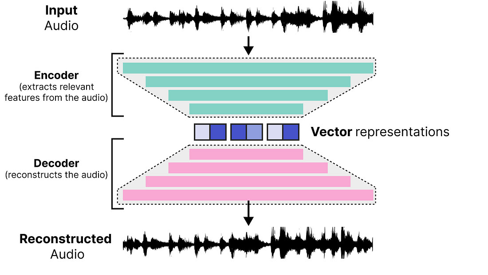][link-038]

These continuous vector representations, like most others, are extremely useful in a wide variety of tasks. However, they cannot easily be used in Transformer models, which require discrete vector representations.

To create these discrete representations, vector quantization (VQ) is used. VQ is a technique that allows any given continuous signal to be mapped to a fixed set of levels. This fixed set is called a codebook and allows many vector representations to be mapped to a select few.

[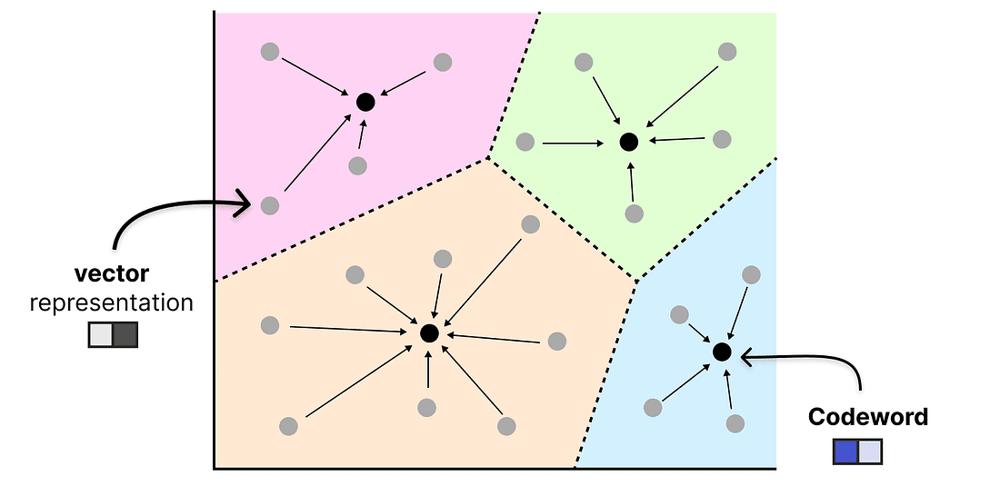][link-039]

As such, VQ can be applied to the latent space, converting it to a codebook of vector representations. This codebook can be seen as discrete acoustic token embeddings and is exactly the type of representation that a Transformer might expect. This modified version is known as a **VQ-VAE.**

A variant of VQ-VAE is used in SoundStream, a neural codec that is used in AudioLM to extract the necessary acoustic representation.

Compared to VQ-VAE, it uses Residual Vector Quantization (RVQ) to compress and represent audio. RVQ is a more advanced technique for quantization and iteratively refines the residual errors from each quantization step for more accuracy.

Let’s now dive a little deeper into the architecture of SoundStream. Although, like other neural codecs, it has an encoder-decoder architecture, it is not the same as the encoder-decoder architecture of Transformers. Like U-Net, it uses convolutional blocks instead of the well-known attention blocks to process the audio (encoder) and recreate it (decoder).

There is additional timestep conditioning (as with the latent diffusion transformer). This enables the model to adapt to different levels of noise or reverb in audio.

[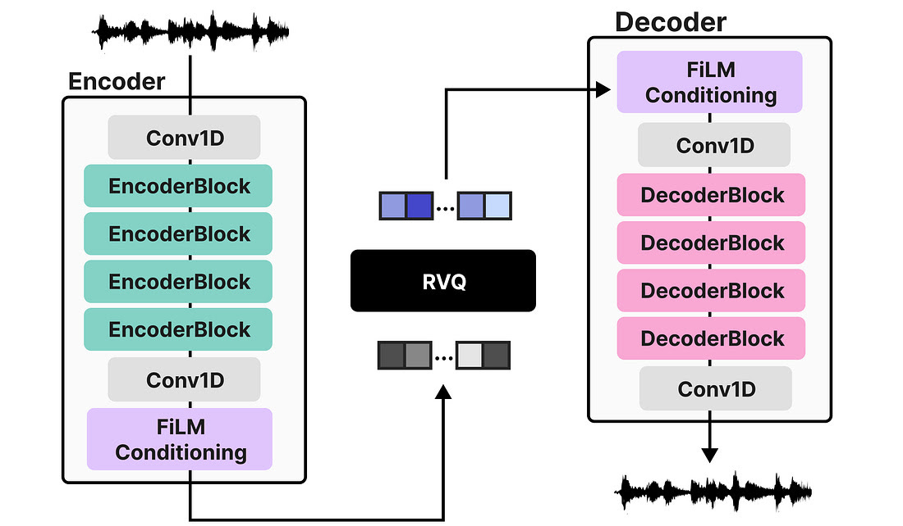][link-040]

This model is trained by using a discriminator, with an architecture similar to a small encoder, to predict how distinct the input signal is from the reconstructed signal. The resulting adversarial loss is used to update the encoder and decoder to improve on the compression/decompression of the original signal. The discriminator’s architecture is much like the encoder and attempts to find differences between the input and output.

[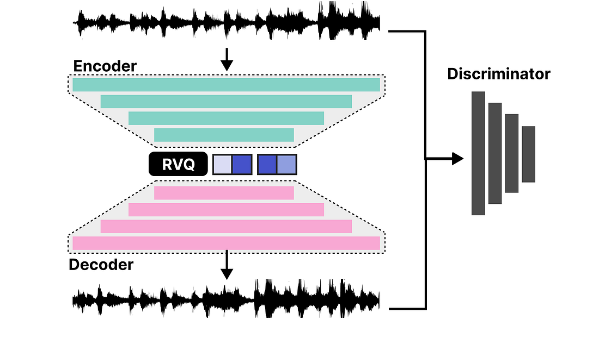][link-041]

The intermediate discrete vector representations are the acoustic tokens that will eventually be passed to the hierarchical transformers.

#### **Semantic Tokens**

Aside from the acoustic tokens, semantic tokens are also extracted to give more information about the semantic content of the audio. Semantic content is the high-level meaning of the audio, such as what words are being spoken or the linguistic content of speech, rather than low-level information such as pitch or timbre.

These are extracted using [w2v-BERT][link-042]⁹, which is an extension of the Wav2Vec 2.0 model. Remember that Wav2Vec 2.0 used contrastive learning to create quantized embeddings, which could be used for representing input audio.

w2v-BERT takes that idea and goes one step further by adding a Masked Language Modeling task, much like is done in encoder-only models, to further enhance the embeddings with contextual information.

[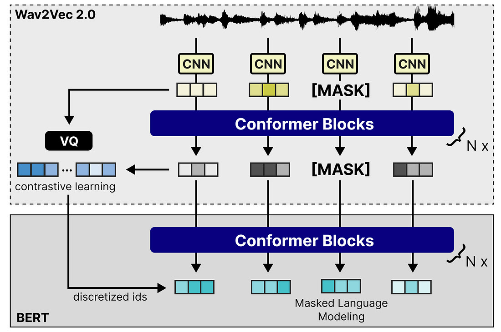][link-043]

Note that [Conformer Blocks][link-044] are used instead of your regular Transformer Blocks.¹⁰ These are similar but have a few differences. Conformer blocks have an additional convolution module wrapped in feed-forward neural networks to process the audio features.

[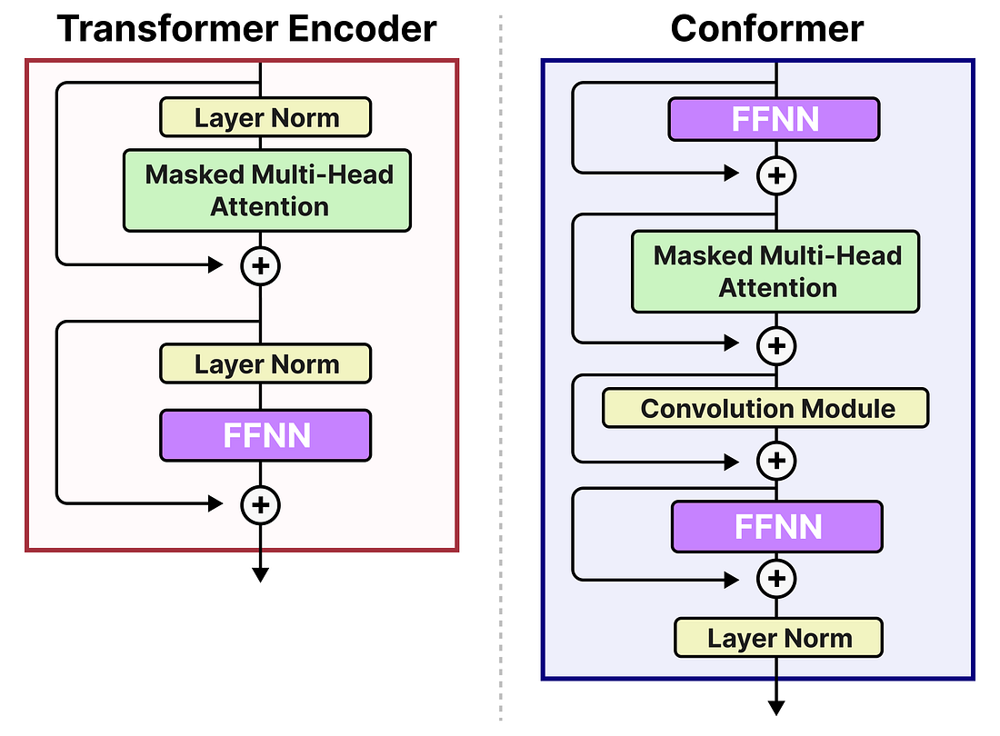][link-045]

#### **Hierarchical Transformers**

Using the previously explored semantic and acoustic tokens, AudioLM generates audio by passing them through a set of chained transformers. At each stage, the Transformer Decoder is trained for next token prediction based on past tokens.

In the first stage, the semantic tokens are processed and generated using a Transformer Decoder. This is done to model the high-level structure of the audio sequence.

[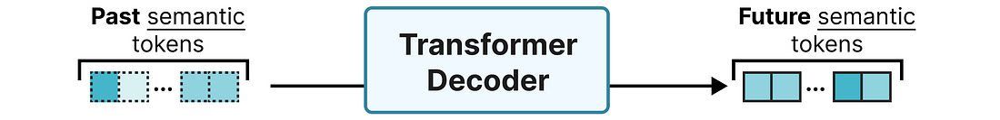][link-046]

In the second stage, the predicted (future) semantic tokens are concatenated with the past acoustic tokens and fed to a model. This produces tokens that represent coarser features, like speaker characteristics.

[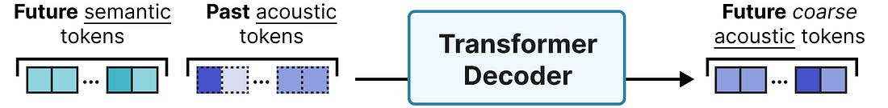][link-047]

In the final stage, the predicted coarse acoustic tokens are further processed to add more detail to the final audio. The resulting acoustic tokens (both coarse and fine) are fed to the previously explored SoundStream decoder to create the audio from the tokens.

[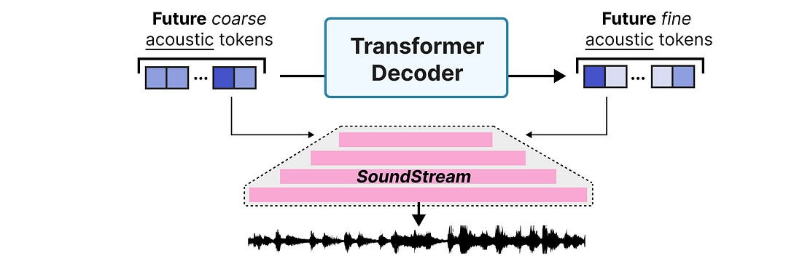][link-048]

AudioLM was used for various use cases of audio generation, including speech continuation and piano continuation, taking into account the original audio examples. Since AudioLM, there have been many incredible techniques that use similar architectures. Common amongst those are the following components:

- **VQ-VAE** - Some variant of VQ-VAE to create a codebook of audio codes
- **Transformer** - To transform text/audio into audio.
- **Neural Codec**- A decoder (also called a vocoder) for converting latent representations (embeddings) back into waveforms.

#### **From Audio Generation to Real-Time Dialogue**

Continuing an audio sample and conducting a conversation are different problems. Audio continuation asks what sound should come next. A conversational agent must also decide whether the user has finished, whether a pause invites a reply, and how to react when the user interrupts.

Four concepts help explain this shift:

- **Streaming** processes incoming audio and produces outgoing audio incrementally, without waiting for an entire recording.
- **Full-duplex dialogue** allows listening and speaking to overlap.
- **Turn-taking** determines when to speak, pause, or yield the conversational floor.
- **Interruption handling**, also called barge-in handling, adapts playback and response generation when the user speaks over the assistant.

A traditional cascade performs **speech-to-text (STT) → language-model reasoning → text-to-speech (TTS)**. Streaming can overlap parts of this pipeline, but a plain transcript does not fully represent timing, emotion, or vocal delivery. Native speech-to-speech models process and generate audio without requiring that external three-stage cascade. This does not imply that they have no internal text representations.

[Moshi](https://arxiv.org/abs/2410.00037) provides an openly documented example: it models user and assistant speech as parallel streams, generates neural-codec audio tokens, and predicts aligned text tokens to help guide speech generation. It connects the audio-token concepts above to interactive dialogue. This is Moshi's disclosed design, **not evidence that Phonic uses the same architecture**.

Conversation also involves actions beyond generating sound. The [Phonic-1 case study](#real-time-speech-agents-phonic-1) explores how native speech, supervisor reasoning, and external tools can work together.

### **Generating Videos**

Video generation does not differ much from image generation, the same way video understanding does not differ much from image understanding.

The main differences between them, assuming we ignore audio for now, is that video has an additional temporal dimension that needs to be modelled when generating each frame at a time. The foundation of generative videos, like images, lies in their diffusion process; its ability to start from noise and iteratively reduce it.

[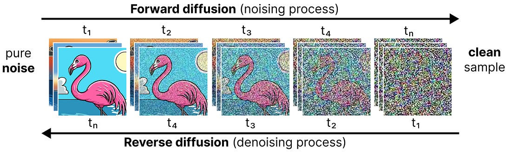][link-049]

Early advancements like ImageGen Video¹¹ and Stable Diffusion Video¹² use diffusion-only to generate videos. However, new techniques, like image generation, use Diffusion Transformers (DiT) as the main component for generating individual frames.

A great example is [Latte][link-050], an early video-to-video model that uses a video-focused DiT for generating videos.¹³ Its architecture is similar to what we have seen in the DiT for image generation. What makes this architecture a great example is that the authors of Latte explored various common techniques for video generation, including methods for tokenizing the video sequence and modeling the Transformer blocks.

Latte uses the Transformers architecture wrapped in VAE to create the same diffusion process we have explored before with Stable Diffusion and Diffusion Transformers.

[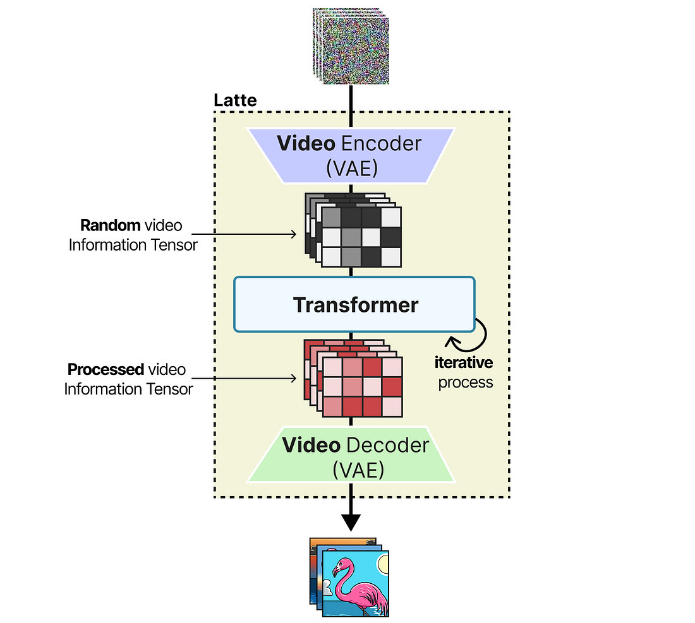][link-051]

To tokenize and embed the input video sequences, the authors explore two techniques:

- **Uniform frame patch embeddings** — Create patches of each frame individually (spatial) and concatenate the embeddings
- **Compression frame patch** — Create patches of each set of frames on (tubelet embeddings; temporal) and concatenate the embeddings

These techniques are similar to the ones explored in chapter 9 of “[An Illustrated Guide to AI Agents][link-003]”, specifically in the Video Vision Transformer (ViViT) section.

[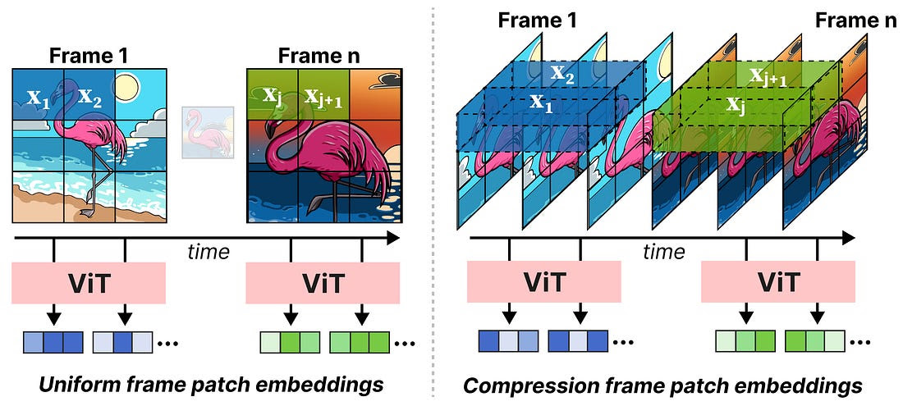][link-052]

Interestingly, the authors of Latte found that the compression frame patch embeddings performed worse than the uniform frame patch embeddings. They speculate that the compression frame patch embeddings lose spatio-temporal information as a result of the compression that is needed to create the tubelets.

The embeddings are then passed to a similar structure we have explored with DiT, namely through a Transformer model, layer normalized, and linearly mapped and reshaped to predict both the noise and the uncertainty estimation.

Remember that Latte is a video-to-video model and has no text conditioning and instead attempts to continue the rest of an input video.

[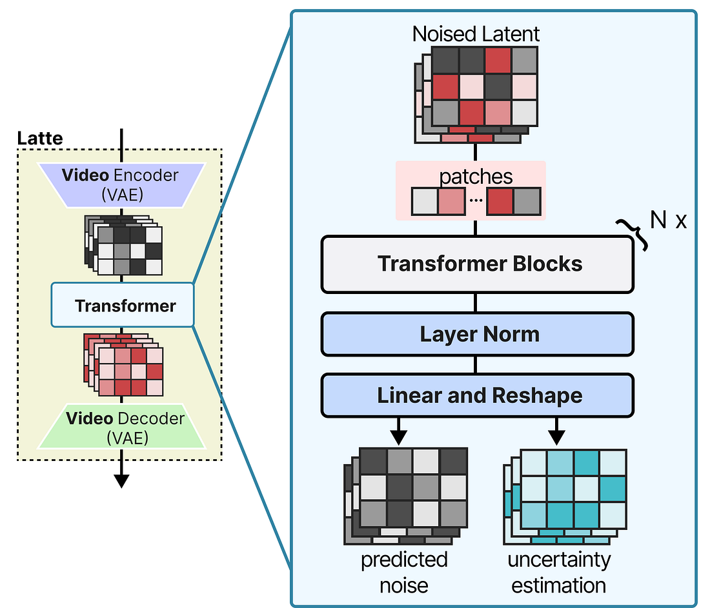][link-053]

However, to inject timestep information, they explored both passing that information as tokens and a variant of Adaptive Layer Normalization (AdaLN) that was used in DiT. The authors found that their slight variant of AdaLN outperformed treating the timestep information as tokens by encoding the timestep information into the model in a more adaptive manner for each Transformer block. Their analysis was based on the Fréchet Video Distance, which evaluates the realism of generated video by measuring how closely its visual quality and motion consistency match that of a dataset of real videos.

The best-performing architecture of the Transformer blocks was to interleave spatial and temporal blocks, which attend to spatial and temporal information, respectively. They call this “*interleaved fusion*” and is similar to the two-step spatial/temporal architecture of ViVit.

[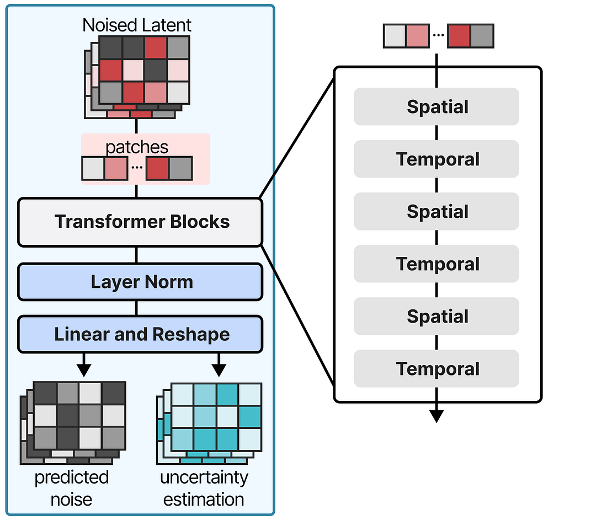][link-054]

This DiT-like architecture has become quite popular in 2025 for open-source video generation models, like [LTX-Video][link-055]¹⁴, [WAN][link-056]¹⁵, and [Hanyuan Video][link-057]¹⁶. Although each of these models has architectural differences, they all use Diffusion Transformers to generate videos.

## **Creating Generative Multimodal LLMs**

Now that we have explored several methods for generating various modalities, we can investigate how we can connect them to LLMs to make them truly multimodal.

There are two ways to enable multimodal generation:

- **Late Fusion** *(Output projection)* — An MLP that connects the textual output of the LLM to the input of other-modality generators.
- **Early Fusion** *(Unified generation)* — The architecture of the LLM is updated to contain other-modality generators.

[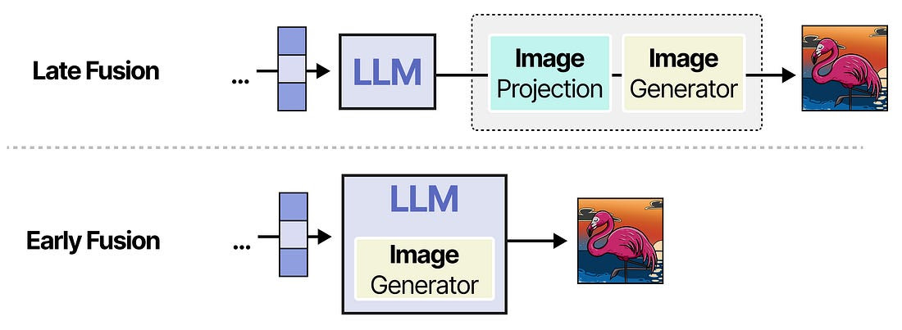][link-058]

### **Late Fusion**

A common method for creating Multimodal Large Language Models is to connect other-modality generators to them. This is generally done in one of two ways: either using the text output of the LLM to guide the generator, or using an MLP projection of the tokens/embeddings as the input to the generator.

Using the text output is quite straightforward; you only need to ask the LLM to create a prompt for your generator. For instance, you can ask the LLM to create an image prompt for your stable diffusion model and then run the stable diffusion model separately.

Although an elegant method, you can hardly think of the LLM as a single multimodal entity. We could think of this methodology more like an agent that uses other generative tools to create non-text output.

A more native method for creating multimodal LLMs is to use the output embeddings of the LLM to guide the process of the other-modality generator.

[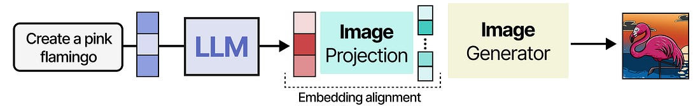][link-059]

A great example for this process is [NExT-GPT][link-060], an any-to-any Multimodal LLM. NExT-GPT is capable of understanding and generating many different modalities through projectors, including images and sound.¹⁷ Note that only the input and output projectors are trained; all other models remain frozen.

[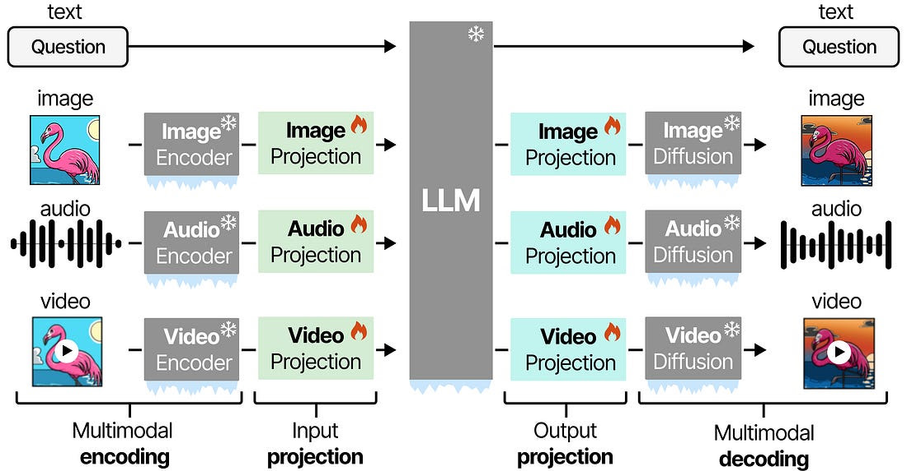][link-061]

To align the multimodal input encodings with the text encodings that the LLM expects, NExT-GPT projects their respective input embeddings by aggregating features into semantic concepts through a grouping mechanism. This is handled by a small Transformer that projects the input embeddings to the representations the LLM expects.

During training, captions are generated for each of the input modalities to help the small Transformer model align its projection with the text representations.

[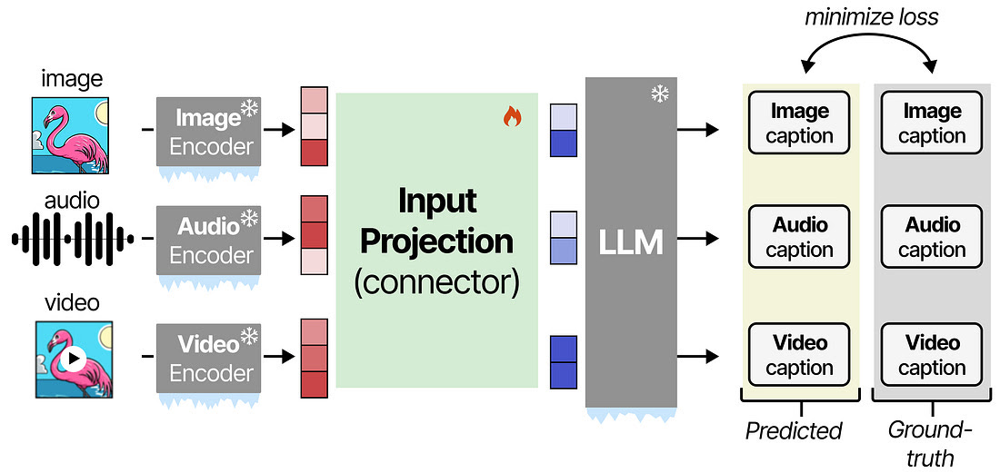][link-062]

The input projection is done through a trainable connector leveraging a combination of Transformer blocks and Grouping blocks.

The input patch embeddings from the encoders (ImageBind) are first passed through a Transformer encoder before being grouped together. This is done by finding similar embeddings and grouping them before passing them through an MLP.

This is a hierarchical process and can be understood intuitively like this:

- **Stage 1**: Group similar pixels/patches (e.g., all “sky” patches together)
- **Stage 2**: Group related concepts (e.g., “sky” and “clouds” into “weather”)

This hierarchical grouping helps the LLM focus on semantic concepts rather than being overwhelmed by low-level patch details, leading to better multimodal understanding and reasoning.

[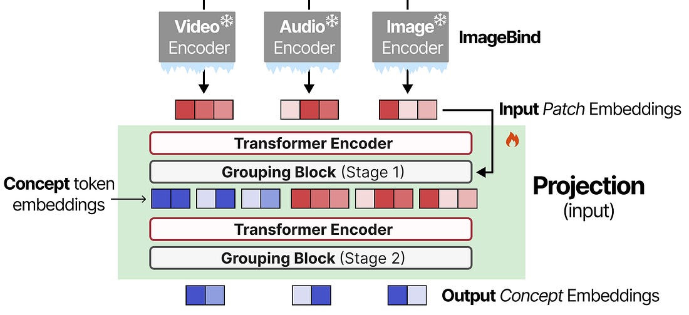][link-063]

To then align the generation process, NExT-GPT leverages existing decoder techniques, which are all pre-trained diffusion models, like Stable Diffusion for image generation.

A Transformer-based output projector is then used to map the token representations into ones understandable by the decoders.For each modality, special tokens are created, each carrying rich instructions for the downstream diffusion model (*\[IMG\]*, *\[AUD\]*, *\[VID\]* for image, audio, and video, respectively).The pre-trained diffusion models are then conditioned on these special tokens in the denoising process to guide them to generate the appropriate images, videos, or audio.

[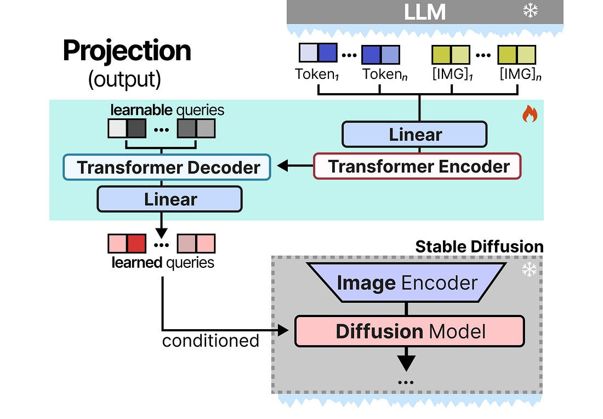][link-064]

Note that the special tokens that the LLM generates will indicate which type of generative model will be used.

The key benefit of using projections for both the input and output embeddings is that only a small number of parameters need to be trained. Instead of models with billions of parameters, “only” millions of parameters in the projectors need to be trained.

More recent examples of this projection-based technique are [OmniGen2][link-065]¹⁸ and [BLIP-3o][link-066]¹⁹, both models that decouple the autoregressive transformer for text generation with the diffusion model for image generation. Both condition the diffusion model on the visual tokens generated by the autoregressive transformer, which helps guide the image generation process.

### **Early Fusion**

Compared to late fusion, early fusion aims to put all understanding and generation of multiple modalities early in the generative process. This typically means a unified architecture that is capable of generating multiple modalities rather than connecting several models together.

The LLM itself is then tasked to create another modality in addition to the text it creates. The method by which it does remains very similar to its text-based generation, namely the generation of embeddings, which are detokenized into text or any other modality. The LLM would generate both **text** and **image** token embeddings, which are then converted into their respective modality. Like text token embeddings, the image token embeddings contain rich information about the images.

[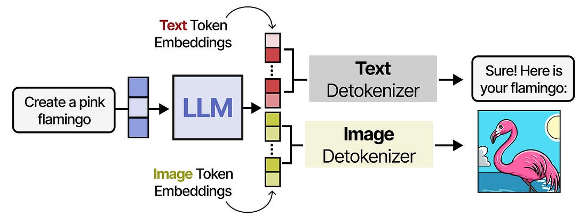][link-067]

A great, and quite elegant, example of this unified early fusion architecture is DeepSeek’s [Janus][link-068] multimodal LLM.²⁰ This LLM uses a unified approach to create token-based representations for both images and text. The resulting representations are fed to the LLM, which in turn generates updated representations. These are then decoded by their respective modality to either generate text or an image.

The advantage of Janus is that different encoders are used when training the model for image understanding and image generation tasks. This allows the representations to be specific to their task, as each requires various levels of information granularity:

- **Understanding** — Requires abstract, high-level semantic representations.
- **Generation** — Requires concrete, detailed information.

[][link-069]

This is a nice example of early fusion, where all modalities are projected into a shared representational space before being fed to the LLM. To create these image representations, two different models are used for understanding and generation. SigLIP, for image understanding, is an image encoder very similar to CLIP but employs a pairwise sigmoid loss on image-text pairs during training.

[VQ-GAN][link-070], for image generation and much like VQ-VAE, is an encoder-decoder model that uses vector quantization to create a codebook of discrete image tokens in latent space and reconstructs an image from them.²¹

Specifically, the encoder and decoder modules use a CNN to efficiently embed the images into latent space and reconstruct them. During training, a discriminator (also a CNN) is used to detect how close the reconstructed image is to the original.

VQ-GAN also uses vector quantization to create a codebook of discrete representations.

[][link-071]

The discrete representations that are created in latent space are much like token embeddings. Both have a fixed vocabulary and can be processed by the Transformer as a sequence of discrete representations.

[][link-072]

The output of the LLM is then decoded into an image.

The model was trained in three separate stages:

1. **Training Adaptors and Image Head** — Create conceptual connections between visual and linguistic elements by only training the adaptors and image head.
2. **Unified Pretraining** — Enable Janus to learn both multimodal understanding and generation. Many sources of data are used: pure text data, multimodal understanding data, and visual generation data.
3. **Supervised Fine-tuning** — Additional instruction tuning data to enhance its instruction-following and dialogue capabilities.

[][link-073]

Compared to late fusion, early fusion is much more costly to train, as most of the parameters need to be updated. However, it tends to be a more accurate technique as all capabilities are trained in a unified way.

Janus, like many other native multimodal LLMs, gained popularity in 2025 due to its unified architecture. As these native multimodal LLMs start to become popular, Agentic systems get more multimodal capabilities, thereby extending their control over their environments.

### **Real-Time Speech Agents: Phonic-1**

The fusion approaches above describe how models connect understanding and generation. A deployed voice agent adds another question: how does generation interact with reasoning, external services, and conversational timing? Phonic-1 offers a useful case study at this system level.

*Research date: October 31, 2026. The account below separates public disclosures from conceptual interpretation.*

#### **What Is Publicly Documented?**

Phonic describes Phonic-1 as a native speech-to-speech model. Its [homepage](https://phonic.ai/) explicitly states that frontier models serve as supervisor agents assisting with reasoning and tool calling. Its [launch article](https://phonic.ai/blog/phonic-1) demonstrates tool calls during caller speech and reports multilingual conversation and turn-taking capabilities. These are company-reported capabilities, rather than independent verification of every claim.

The [tool documentation](https://docs.phonic.ai/docs/build/tools/tools_overview) provides more concrete application behavior: agents can use webhooks, WebSocket tools, context tools, transfers, and connected MCP servers. However, these interfaces do not reveal the underlying neural network or its internal coordination mechanisms.

The resulting **hybrid system** interpretation is useful: native audio generation can coexist with assistance from other models. Public disclosures do not establish the supervisors' identities, inputs, routing rules, scheduling, or communication format. They also do not specify Phonic-1's audio tokenizer or exact model architecture. We therefore cannot assign it confidently to the guide's early- or late-fusion categories.

#### **A Conceptual System Architecture**

The diagram separates audio interaction, reasoning assistance, and external execution. Solid arrows show publicly described audio transport and tool interactions; dashed arrows propose logical relationships inside the service. They do not specify a hidden-state interface, transcript handoff, or particular supervisor schedule.

*Conceptual architecture based on public disclosures. Internal boxes are logical roles, not a disclosed deployment diagram; dashed connections are inferred.*

For example, [WebSocket conversations](https://docs.phonic.ai/docs/build/with-web-sockets/via-web-sockets) forward audio chunks between the client interface and Phonic. Separately, [WebSocket tools](https://docs.phonic.ai/docs/build/tools/websocket_tools) send a `tool_call` to application code, which returns a `tool_call_output` with the matching call ID. Audio transport and tool execution are distinct responsibilities, even when both use WebSockets.

| System pattern | Audio handling | Reasoning support | Tool orchestration |
| --- | --- | --- | --- |
| STT → LLM → TTS cascade | Explicit transcription and synthesis stages | Text LLM | Application coordinates calls; streaming stages can overlap |
| Native speech-to-speech | Model processes and generates audio | Depends on model design | Depends on model interfaces and application |
| Native speech with supervisor assistance | Native audio interaction | Additional models assist reasoning | Coordinates speech, assistance, and tools; Phonic discloses this combination |

These patterns describe different design choices. Native audio alone does not guarantee effective tool use, and a cascade need not execute every operation sequentially.

#### **Overlapping Listening and Tool Execution**

Consider an illustrative request: “Check flight AB123 tomorrow, and the weather at its destination, Paris. I would also like advice about packing.” Once the date and destination are sufficiently clear, flight and weather lookups can proceed independently while the caller adds preferences.

*Illustrative execution pattern, not a trace of Phonic's internals. The system participant deliberately leaves supervisor responsibilities unspecified. One result arrives after caller speech ends.*

Three behaviors must be distinguished. **Early dispatch** starts a tool before the caller finishes. **Parallel execution** overlaps independent tool calls. **Asynchronous execution** lets conversation continue without waiting for a tool. None automatically implies the other two.

Phonic's [tool overview](https://docs.phonic.ai/docs/build/tools/tools_overview) documents selectable `sync` and `async` execution for custom webhook and WebSocket tools. Sync execution waits for completion and can be interrupted by caller speech, subject to configuration. Async execution continues the conversation and is not interrupted by caller speech. Its result enters context but normally does **not** immediately trigger a spoken response. The optional `wait_for_response` behavior changes this by waiting, holding other tools, and informing the user; it cannot be combined with tool chaining. Context, transfer, and built-in tools use sync mode; do not assume custom-tool mode choices apply to MCP.

In the [launch demonstration](https://phonic.ai/blog/phonic-1), Phonic reports a reply **1.1 seconds after caller speech ends**, compared with **15.7 seconds** for the demonstrated GPT-Live setup. This measures a specific interaction, including work overlapped with caller speech. It is neither a general latency guarantee nor proof that other architectures cannot overlap work.

#### **Training and Serving**

Phonic's [company description](https://phonic.ai/about) reports pre-training from scratch, mid-training for conversational intelligence, and post-training for naturalness, instruction following, and reliability. The [launch article](https://phonic.ai/blog/phonic-1) also mentions reinforcement learning. These disclosures establish broad training activities, without specifying datasets, loss functions, reward design, or a reproducible recipe.

The [inference engineering article](https://phonic.ai/blog/concurrency-limits-the-hidden-tax-in-voice-ai-and-how-we-solved-it) reports a separate serving improvement: model/container cold starts fell from **5.6 minutes to 26 seconds**. The reported steps were:

1. Persist CUDA, Triton, and PyTorch Inductor compilation caches so containers can reuse artifacts.
2. Reduce recompilation caused by invalidated tensor-shape guards.
3. Move to ahead-of-time deployment using `torch.export`, externalize KV caches into a service, and remove CPU↔GPU communication during model inference.

[PyTorch's documentation](https://docs.pytorch.org/docs/stable/user_guide/torch_compiler/torch.compiler_aot_inductor.html) distinguishes exporting a computation graph from compiling and packaging a deployable artifact. Phonic also reports [custom kernels](https://phonic.ai/about) and builds for different deployment targets. These are serving-stack disclosures, not a specification of every Phonic-1 component.

Cold-start time measures readiness of additional capacity. Conversational response latency measures delay within an interaction. Faster capacity expansion can help absorb traffic spikes, but **26 seconds is not a per-turn response time**.

#### **Lessons and Limitations**

The transferable lesson is to examine **when work becomes possible and what blocks the answer**. An independent lookup can overlap listening; a dependent lookup must wait for its prerequisite. A useful conceptual approximation is:

**Post-speech waiting ≈ unfinished work on the response's critical path + remaining response-startup overhead.**

This is a scheduling intuition, not Phonic's latency formula. Network delay, available capacity, conversational decisions, and audio buffering also affect what the caller experiences.

Early execution introduces general engineering questions. An incomplete request may lack required arguments. A caller correction may invalidate an earlier lookup. A late result may refer to an abandoned request. Implementations need ways to associate results with current intent and avoid using stale information. These are design considerations, **not documented descriptions of Phonic's cancellation or reconciliation algorithms**. Interrupting a conversation also does not establish that an external side effect was undone.

Readers should leave with a system-level distinction: native audio generation, supervisor assistance, and execution scheduling contribute different capabilities. Public evidence supports studying their combination, while leaving Phonic-1's exact neural architecture and orchestration algorithm unknown.

## **Conclusion**

This concludes the journey in multimodal generation! Who knows what kind of models we will see in the future?!

To see more on this, check out the book on *[official website][link-003]. On [Amazon][link-006]. Code in [GitHub][link-007].*!

[][link-005]

## References

1. Wu, Chenfei, et al. "Qwen-image technical report." *arXiv preprint arXiv:2508.02324* (2025)

2. Cai, Huanqia, et al. "Z-Image: An Efficient Image Generation Foundation Model with Single-Stream Diffusion Transformer." *arXiv preprint arXiv:2511.22699* (2025).

3. Rombach, Robin, et al. "High-resolution image synthesis with latent diffusion models." *Proceedings of the IEEE/CVF conference on computer vision and pattern recognition*. 2022.

4. Ronneberger, Olaf, Philipp Fischer, and Thomas Brox. "U-net: Convolutional networks for biomedical image segmentation." *International Conference on Medical image computing and computer-assisted intervention*. Cham: Springer international publishing, 2015.

5. Kingma, Diederik P., and Max Welling. “Auto-encoding varareiational bayes.” 20 Dec. 2013,

6. Peebles, William, and Saining Xie. "Scalable diffusion models with transformers." *Proceedings of the IEEE/CVF international conference on computer vision*. 2023.

7. Chen, Junsong, et al. "Pixart-$\\alpha $: Fast training of diffusion transformer for photorealistic text-to-image synthesis." *arXiv preprint arXiv:2310.00426* (2023).

8. Borsos, Zalán, et al. "Audiolm: a language modeling approach to audio generation." *IEEE/ACM transactions on audio, speech, and language processing* 31 (2023): 2523-2533.

9. Chung, Yu-An, et al. "W2v-bert: Combining contrastive learning and masked language modeling for self-supervised speech pre-training." *2021 IEEE Automatic Speech Recognition and Understanding Workshop (ASRU)*. IEEE, 2021.

10. Gulati, Anmol, et al. "Conformer: Convolution-augmented transformer for speech recognition." *arXiv preprint arXiv:2005.08100* (2020).

11. Ho, Jonathan, et al. "Imagen video: High definition video generation with diffusion models." *arXiv preprint arXiv:2210.02303* (2022).

12. Blattmann, Andreas, et al. "Stable video diffusion: Scaling latent video diffusion models to large datasets." *arXiv preprint arXiv:2311.15127* (2023).

13. Ma, Xin, et al. "Latte: Latent diffusion transformer for video generation." *arXiv preprint arXiv:2401.03048* (2024).

14. HaCohen, Yoav, et al. "Ltx-video: Realtime video latent diffusion." *arXiv preprint arXiv:2501.00103* (2024).

15. Wan, Team, et al. "Wan: Open and advanced large-scale video generative models." *arXiv preprint arXiv:2503.20314* (2025).

16. Kong, Weijie, et al. "Hunyuanvideo: A systematic framework for large video generative models." *arXiv preprint arXiv:2412.03603* (2024).

17. Wu, Shengqiong, et al. "Next-gpt: Any-to-any multimodal llm." *Forty-first International Conference on Machine Learning*. 2024.

18. Wu, Chenyuan, et al. "OmniGen2: Exploration to Advanced Multimodal Generation." *arXiv preprint arXiv:2506.18871* (2025).

19. Chen, Jiuhai, et al. "Blip3-o: A family of fully open unified multimodal models-architecture, training and dataset." *arXiv preprint arXiv:2505.09568* (2025).

20. Wu, Chengyue, et al. "Janus: Decoupling visual encoding for unified multimodal understanding and generation." *Proceedings of the Computer Vision and Pattern Recognition Conference*. 2025.

21. Esser, Patrick, Robin Rombach, and Bjorn Ommer. "Taming transformers for high-resolution image synthesis." *Proceedings of the IEEE/CVF conference on computer vision and pattern recognition*. 2021.

22. Défossez, Alexandre, et al. ["Moshi: a speech-text foundation model for real-time dialogue."](https://arxiv.org/abs/2410.00037) *arXiv preprint arXiv:2410.00037* (2024).

23. Phonic. ["The speech-to-speech model company."](https://phonic.ai/) Company homepage. Accessed October 31, 2026.

24. Phonic team. ["Introducing Phonic-1 and our $27.5M Series A."](https://phonic.ai/blog/phonic-1) October 29, 2026. Accessed October 31, 2026.

25. Phonic. ["Tools Overview."](https://docs.phonic.ai/docs/build/tools/tools_overview) Developer documentation. Accessed October 31, 2026.

26. Phonic. ["Conversations via WebSockets."](https://docs.phonic.ai/docs/build/with-web-sockets/via-web-sockets) Developer documentation. Accessed October 31, 2026.

27. Phonic. ["WebSocket Tools."](https://docs.phonic.ai/docs/build/tools/websocket_tools) Developer documentation. Accessed October 31, 2026.

28. Phonic. ["About Phonic."](https://phonic.ai/about) Company description. Accessed October 31, 2026.

29. Phonic team. ["Concurrency Limits: The Hidden Tax in Voice AI (and how we solved it!)"](https://phonic.ai/blog/concurrency-limits-the-hidden-tax-in-voice-ai-and-how-we-solved-it) Engineering article. Accessed October 31, 2026.

30. PyTorch. ["AOTInductor: Ahead-Of-Time Compilation for Torch.Export-ed Models."](https://docs.pytorch.org/docs/stable/user_guide/torch_compiler/torch.compiler_aot_inductor.html) Developer documentation. Accessed October 31, 2026.

[link-001]: <https://substack.com/app-link/post?publication_id=1741130&post_id=220364616&utm_source=post-email-title&utm_campaign=email-post-title&isFreemail=true&r=5g228f&token=eyJ1c2VyX2lkIjozMjkzMDA5NDMsInBvc3RfaWQiOjIyMDM2NDYxNiwiaWF0IjoxNzkzMjg5OTU1LCJleHAiOjE3OTU4ODE5NTUsImlzcyI6InB1Yi0xNzQxMTMwIiwic3ViIjoicG9zdC1yZWFjdGlvbiJ9.eQ8n8ihFsQ4CK59W3KyqrD167sjn3-AUV97Bq9vEuBs>
[link-002]: <https://substack.com/redirect/d88bd595-245b-46d1-a795-d683a196da84?j=eyJ1IjoiNWcyMjhmIn0.8CksELbKE5H87vRbvb-LNocdDhBOT_WqcZWW7bXMgsg>
[link-003]: <https://substack.com/redirect/8536cd6a-086b-4cf9-8b1d-c5e664262336?j=eyJ1IjoiNWcyMjhmIn0.8CksELbKE5H87vRbvb-LNocdDhBOT_WqcZWW7bXMgsg>
[link-004]: <https://substack.com/redirect/6d6a00e2-15ef-4fde-b4bd-74f24850a403?j=eyJ1IjoiNWcyMjhmIn0.8CksELbKE5H87vRbvb-LNocdDhBOT_WqcZWW7bXMgsg>
[link-005]: <https://substack.com/redirect/4dd49dd6-1933-483a-9089-ebfa9a4819f5?j=eyJ1IjoiNWcyMjhmIn0.8CksELbKE5H87vRbvb-LNocdDhBOT_WqcZWW7bXMgsg>
[link-006]: <https://substack.com/redirect/68b2d7ea-e7d4-48ce-9d79-0ffed74fdd67?j=eyJ1IjoiNWcyMjhmIn0.8CksELbKE5H87vRbvb-LNocdDhBOT_WqcZWW7bXMgsg>
[link-007]: <https://substack.com/redirect/f103def1-f476-47ec-995e-06599d08c02d?j=eyJ1IjoiNWcyMjhmIn0.8CksELbKE5H87vRbvb-LNocdDhBOT_WqcZWW7bXMgsg>
[link-008]: <https://substack.com/redirect/aa59c6d2-5dd4-4dcb-bd57-50ed59489566?j=eyJ1IjoiNWcyMjhmIn0.8CksELbKE5H87vRbvb-LNocdDhBOT_WqcZWW7bXMgsg>
[link-009]: <https://substack.com/redirect/274b7a98-3837-44c2-8c9b-d154c18850fd?j=eyJ1IjoiNWcyMjhmIn0.8CksELbKE5H87vRbvb-LNocdDhBOT_WqcZWW7bXMgsg>
[link-010]: <https://substack.com/redirect/37c7f9a9-26ae-482a-8f30-b46b2066a3ec?j=eyJ1IjoiNWcyMjhmIn0.8CksELbKE5H87vRbvb-LNocdDhBOT_WqcZWW7bXMgsg>
[link-011]: <https://substack.com/redirect/4cfc83b3-53ea-4b26-861f-5aa651226543?j=eyJ1IjoiNWcyMjhmIn0.8CksELbKE5H87vRbvb-LNocdDhBOT_WqcZWW7bXMgsg>
[link-012]: <https://substack.com/redirect/bb8b263f-2534-4f5b-ad9b-db2f05f1a3a8?j=eyJ1IjoiNWcyMjhmIn0.8CksELbKE5H87vRbvb-LNocdDhBOT_WqcZWW7bXMgsg>
[link-013]: <https://substack.com/redirect/d9b1aabf-dcf7-4598-ae75-37e2f9ba1c00?j=eyJ1IjoiNWcyMjhmIn0.8CksELbKE5H87vRbvb-LNocdDhBOT_WqcZWW7bXMgsg>
[link-014]: <https://substack.com/redirect/8500b3f2-b293-41e7-aa6a-c9a7ead1909b?j=eyJ1IjoiNWcyMjhmIn0.8CksELbKE5H87vRbvb-LNocdDhBOT_WqcZWW7bXMgsg>
[link-015]: <https://substack.com/redirect/8ffee371-af59-4015-8f73-dbb4ee066469?j=eyJ1IjoiNWcyMjhmIn0.8CksELbKE5H87vRbvb-LNocdDhBOT_WqcZWW7bXMgsg>
[link-016]: <https://substack.com/redirect/f76cedb9-b626-4bbf-93be-b546beda14b0?j=eyJ1IjoiNWcyMjhmIn0.8CksELbKE5H87vRbvb-LNocdDhBOT_WqcZWW7bXMgsg>
[link-017]: <https://substack.com/redirect/f3d63c86-669b-41bc-95b2-04fb5a85970e?j=eyJ1IjoiNWcyMjhmIn0.8CksELbKE5H87vRbvb-LNocdDhBOT_WqcZWW7bXMgsg>
[link-018]: <https://substack.com/redirect/eda25252-2d4f-46ab-971b-daebf22c26ed?j=eyJ1IjoiNWcyMjhmIn0.8CksELbKE5H87vRbvb-LNocdDhBOT_WqcZWW7bXMgsg>
[link-019]: <https://substack.com/redirect/e4e5a41b-1904-47ec-8f57-db006bedf578?j=eyJ1IjoiNWcyMjhmIn0.8CksELbKE5H87vRbvb-LNocdDhBOT_WqcZWW7bXMgsg>
[link-020]: <https://substack.com/redirect/5663c366-2e43-406e-b271-96dd0bf0bbdd?j=eyJ1IjoiNWcyMjhmIn0.8CksELbKE5H87vRbvb-LNocdDhBOT_WqcZWW7bXMgsg>
[link-021]: <https://substack.com/redirect/5fdfc7cd-91e3-4ff3-9623-7cc3029798eb?j=eyJ1IjoiNWcyMjhmIn0.8CksELbKE5H87vRbvb-LNocdDhBOT_WqcZWW7bXMgsg>
[link-022]: <https://substack.com/redirect/f8fe9c5e-2832-4746-95e3-135e3643a01d?j=eyJ1IjoiNWcyMjhmIn0.8CksELbKE5H87vRbvb-LNocdDhBOT_WqcZWW7bXMgsg>
[link-023]: <https://substack.com/redirect/847f2dd0-4ace-4c5c-926d-849c2d6870a7?j=eyJ1IjoiNWcyMjhmIn0.8CksELbKE5H87vRbvb-LNocdDhBOT_WqcZWW7bXMgsg>
[link-024]: <https://substack.com/redirect/2a0ed956-1c7e-413c-a4d7-b756cec648c6?j=eyJ1IjoiNWcyMjhmIn0.8CksELbKE5H87vRbvb-LNocdDhBOT_WqcZWW7bXMgsg>
[link-025]: <https://substack.com/redirect/62d788a6-1a6f-4160-9f85-f4afaa960620?j=eyJ1IjoiNWcyMjhmIn0.8CksELbKE5H87vRbvb-LNocdDhBOT_WqcZWW7bXMgsg>
[link-026]: <https://substack.com/redirect/c06a1256-35c4-476c-b190-655d87a5329a?j=eyJ1IjoiNWcyMjhmIn0.8CksELbKE5H87vRbvb-LNocdDhBOT_WqcZWW7bXMgsg>
[link-027]: <https://substack.com/redirect/aa616a4f-228d-4ce4-a5d8-be05f53839b2?j=eyJ1IjoiNWcyMjhmIn0.8CksELbKE5H87vRbvb-LNocdDhBOT_WqcZWW7bXMgsg>
[link-028]: <https://substack.com/redirect/7da003c4-7051-4a87-a38f-21fde24b941e?j=eyJ1IjoiNWcyMjhmIn0.8CksELbKE5H87vRbvb-LNocdDhBOT_WqcZWW7bXMgsg>
[link-029]: <https://substack.com/redirect/8abe6cde-73fd-4fa0-884f-6d6de96635b1?j=eyJ1IjoiNWcyMjhmIn0.8CksELbKE5H87vRbvb-LNocdDhBOT_WqcZWW7bXMgsg>
[link-030]: <https://substack.com/redirect/ee4b4b9e-8946-4ff6-9669-21933663958d?j=eyJ1IjoiNWcyMjhmIn0.8CksELbKE5H87vRbvb-LNocdDhBOT_WqcZWW7bXMgsg>
[link-031]: <https://substack.com/redirect/e9f4de94-d0b4-4824-9568-c788b83b7801?j=eyJ1IjoiNWcyMjhmIn0.8CksELbKE5H87vRbvb-LNocdDhBOT_WqcZWW7bXMgsg>
[link-032]: <https://substack.com/redirect/1ee3da51-3923-4dca-b8c3-39b53e48361d?j=eyJ1IjoiNWcyMjhmIn0.8CksELbKE5H87vRbvb-LNocdDhBOT_WqcZWW7bXMgsg>
[link-033]: <https://substack.com/redirect/767d1787-6f5e-4f7e-9105-a47b45949d29?j=eyJ1IjoiNWcyMjhmIn0.8CksELbKE5H87vRbvb-LNocdDhBOT_WqcZWW7bXMgsg>
[link-034]: <https://substack.com/redirect/aab76cfc-f4b3-4a18-b536-c985e47785a9?j=eyJ1IjoiNWcyMjhmIn0.8CksELbKE5H87vRbvb-LNocdDhBOT_WqcZWW7bXMgsg>
[link-035]: <https://substack.com/redirect/7f063b82-7864-493a-96c5-c9a275a21470?j=eyJ1IjoiNWcyMjhmIn0.8CksELbKE5H87vRbvb-LNocdDhBOT_WqcZWW7bXMgsg>
[link-036]: <https://substack.com/redirect/64e87816-5352-4e6b-b63e-63be07a07b35?j=eyJ1IjoiNWcyMjhmIn0.8CksELbKE5H87vRbvb-LNocdDhBOT_WqcZWW7bXMgsg>
[link-037]: <https://substack.com/redirect/7258307c-113a-4484-bb82-1e0489f49df7?j=eyJ1IjoiNWcyMjhmIn0.8CksELbKE5H87vRbvb-LNocdDhBOT_WqcZWW7bXMgsg>
[link-038]: <https://substack.com/redirect/f8666a82-0e05-409d-9d19-89be6113308d?j=eyJ1IjoiNWcyMjhmIn0.8CksELbKE5H87vRbvb-LNocdDhBOT_WqcZWW7bXMgsg>
[link-039]: <https://substack.com/redirect/ed319f0c-1ba9-4c15-b428-dafce472293a?j=eyJ1IjoiNWcyMjhmIn0.8CksELbKE5H87vRbvb-LNocdDhBOT_WqcZWW7bXMgsg>
[link-040]: <https://substack.com/redirect/6c47ac6a-742b-433d-864a-cc26e5fb0c2a?j=eyJ1IjoiNWcyMjhmIn0.8CksELbKE5H87vRbvb-LNocdDhBOT_WqcZWW7bXMgsg>
[link-041]: <https://substack.com/redirect/1792dde7-de74-480b-b57e-75c1b4b807f0?j=eyJ1IjoiNWcyMjhmIn0.8CksELbKE5H87vRbvb-LNocdDhBOT_WqcZWW7bXMgsg>
[link-042]: <https://substack.com/redirect/2f111ecb-1a68-49c3-9bd0-3f33492eb1f2?j=eyJ1IjoiNWcyMjhmIn0.8CksELbKE5H87vRbvb-LNocdDhBOT_WqcZWW7bXMgsg>
[link-043]: <https://substack.com/redirect/29d68ec5-af1d-405d-907b-96bf20ae16a1?j=eyJ1IjoiNWcyMjhmIn0.8CksELbKE5H87vRbvb-LNocdDhBOT_WqcZWW7bXMgsg>
[link-044]: <https://substack.com/redirect/7ffb4551-57b5-4ccf-b870-227af1db98ef?j=eyJ1IjoiNWcyMjhmIn0.8CksELbKE5H87vRbvb-LNocdDhBOT_WqcZWW7bXMgsg>
[link-045]: <https://substack.com/redirect/32cde552-f656-48d7-a546-d48201732ff3?j=eyJ1IjoiNWcyMjhmIn0.8CksELbKE5H87vRbvb-LNocdDhBOT_WqcZWW7bXMgsg>
[link-046]: <https://substack.com/redirect/0cf6b456-52b2-458f-942d-27a6bfcb2dfb?j=eyJ1IjoiNWcyMjhmIn0.8CksELbKE5H87vRbvb-LNocdDhBOT_WqcZWW7bXMgsg>
[link-047]: <https://substack.com/redirect/47866930-cea4-4ee5-a624-187ed9709dc5?j=eyJ1IjoiNWcyMjhmIn0.8CksELbKE5H87vRbvb-LNocdDhBOT_WqcZWW7bXMgsg>
[link-048]: <https://substack.com/redirect/863104da-c78a-4a20-a123-17817ec8a956?j=eyJ1IjoiNWcyMjhmIn0.8CksELbKE5H87vRbvb-LNocdDhBOT_WqcZWW7bXMgsg>
[link-049]: <https://substack.com/redirect/50409eac-7ebe-4f24-a945-69f0eb018051?j=eyJ1IjoiNWcyMjhmIn0.8CksELbKE5H87vRbvb-LNocdDhBOT_WqcZWW7bXMgsg>
[link-050]: <https://substack.com/redirect/b6b4b63b-96cb-4cda-babb-2b11280e69b4?j=eyJ1IjoiNWcyMjhmIn0.8CksELbKE5H87vRbvb-LNocdDhBOT_WqcZWW7bXMgsg>
[link-051]: <https://substack.com/redirect/00c1f0f8-b6d0-4bbf-b542-7aa3f48112e3?j=eyJ1IjoiNWcyMjhmIn0.8CksELbKE5H87vRbvb-LNocdDhBOT_WqcZWW7bXMgsg>
[link-052]: <https://substack.com/redirect/d6cd7218-2d46-4bae-95bc-1d72deecc308?j=eyJ1IjoiNWcyMjhmIn0.8CksELbKE5H87vRbvb-LNocdDhBOT_WqcZWW7bXMgsg>
[link-053]: <https://substack.com/redirect/e057101e-e270-4ea2-abb0-4b66f6134c20?j=eyJ1IjoiNWcyMjhmIn0.8CksELbKE5H87vRbvb-LNocdDhBOT_WqcZWW7bXMgsg>
[link-054]: <https://substack.com/redirect/5e169e9f-34c7-434f-9625-c5ad8ecf34b1?j=eyJ1IjoiNWcyMjhmIn0.8CksELbKE5H87vRbvb-LNocdDhBOT_WqcZWW7bXMgsg>
[link-055]: <https://substack.com/redirect/b4322e31-6c50-441b-ad69-3d899d0ac1fb?j=eyJ1IjoiNWcyMjhmIn0.8CksELbKE5H87vRbvb-LNocdDhBOT_WqcZWW7bXMgsg>
[link-056]: <https://substack.com/redirect/46495164-8ca1-4f1d-930d-30e25fc947ed?j=eyJ1IjoiNWcyMjhmIn0.8CksELbKE5H87vRbvb-LNocdDhBOT_WqcZWW7bXMgsg>
[link-057]: <https://substack.com/redirect/3586f7ab-b917-4998-86b4-6866f852d4d4?j=eyJ1IjoiNWcyMjhmIn0.8CksELbKE5H87vRbvb-LNocdDhBOT_WqcZWW7bXMgsg>
[link-058]: <https://substack.com/redirect/fa26f95f-6b6b-4d71-a881-5004e861f96b?j=eyJ1IjoiNWcyMjhmIn0.8CksELbKE5H87vRbvb-LNocdDhBOT_WqcZWW7bXMgsg>
[link-059]: <https://substack.com/redirect/0da82b8a-0d59-4b8a-bca7-333acbca8131?j=eyJ1IjoiNWcyMjhmIn0.8CksELbKE5H87vRbvb-LNocdDhBOT_WqcZWW7bXMgsg>
[link-060]: <https://substack.com/redirect/6120c4e3-6252-4734-8d2b-23e9a276704c?j=eyJ1IjoiNWcyMjhmIn0.8CksELbKE5H87vRbvb-LNocdDhBOT_WqcZWW7bXMgsg>
[link-061]: <https://substack.com/redirect/5c6e93f3-2f09-4780-bc53-11d420f9a7f8?j=eyJ1IjoiNWcyMjhmIn0.8CksELbKE5H87vRbvb-LNocdDhBOT_WqcZWW7bXMgsg>
[link-062]: <https://substack.com/redirect/762a6728-223b-4be9-86bf-281b74c9c3fb?j=eyJ1IjoiNWcyMjhmIn0.8CksELbKE5H87vRbvb-LNocdDhBOT_WqcZWW7bXMgsg>
[link-063]: <https://substack.com/redirect/ff4e7348-4951-40c5-a1c7-ef568551ff9e?j=eyJ1IjoiNWcyMjhmIn0.8CksELbKE5H87vRbvb-LNocdDhBOT_WqcZWW7bXMgsg>
[link-064]: <https://substack.com/redirect/1ea02f8f-0f75-47a9-8ffa-aa8f46ef65e2?j=eyJ1IjoiNWcyMjhmIn0.8CksELbKE5H87vRbvb-LNocdDhBOT_WqcZWW7bXMgsg>
[link-065]: <https://substack.com/redirect/f3064d2a-d6da-4a01-84da-23918e0426c6?j=eyJ1IjoiNWcyMjhmIn0.8CksELbKE5H87vRbvb-LNocdDhBOT_WqcZWW7bXMgsg>
[link-066]: <https://substack.com/redirect/2ab89d90-3a5f-4647-8826-56e6b3cc5b16?j=eyJ1IjoiNWcyMjhmIn0.8CksELbKE5H87vRbvb-LNocdDhBOT_WqcZWW7bXMgsg>
[link-067]: <https://substack.com/redirect/caaadc74-24f5-48d4-9d07-17576b3c216f?j=eyJ1IjoiNWcyMjhmIn0.8CksELbKE5H87vRbvb-LNocdDhBOT_WqcZWW7bXMgsg>
[link-068]: <https://substack.com/redirect/d1bf8570-5fe8-4eb1-ae16-74c955e9e12f?j=eyJ1IjoiNWcyMjhmIn0.8CksELbKE5H87vRbvb-LNocdDhBOT_WqcZWW7bXMgsg>
[link-069]: <https://substack.com/redirect/09f873d7-f541-47b7-be8b-b0c6ba9cb57f?j=eyJ1IjoiNWcyMjhmIn0.8CksELbKE5H87vRbvb-LNocdDhBOT_WqcZWW7bXMgsg>
[link-070]: <https://substack.com/redirect/c012ec22-c7e1-4d08-bc71-1df0fe302c4b?j=eyJ1IjoiNWcyMjhmIn0.8CksELbKE5H87vRbvb-LNocdDhBOT_WqcZWW7bXMgsg>
[link-071]: <https://substack.com/redirect/0eab3d1d-4188-40cf-94c9-02089081cd90?j=eyJ1IjoiNWcyMjhmIn0.8CksELbKE5H87vRbvb-LNocdDhBOT_WqcZWW7bXMgsg>
[link-072]: <https://substack.com/redirect/1e3c29a5-add3-46d0-a752-ef2889b682a0?j=eyJ1IjoiNWcyMjhmIn0.8CksELbKE5H87vRbvb-LNocdDhBOT_WqcZWW7bXMgsg>
[link-073]: <https://substack.com/redirect/03ce7ec4-e733-4da8-94ac-220013438ba7?j=eyJ1IjoiNWcyMjhmIn0.8CksELbKE5H87vRbvb-LNocdDhBOT_WqcZWW7bXMgsg>
