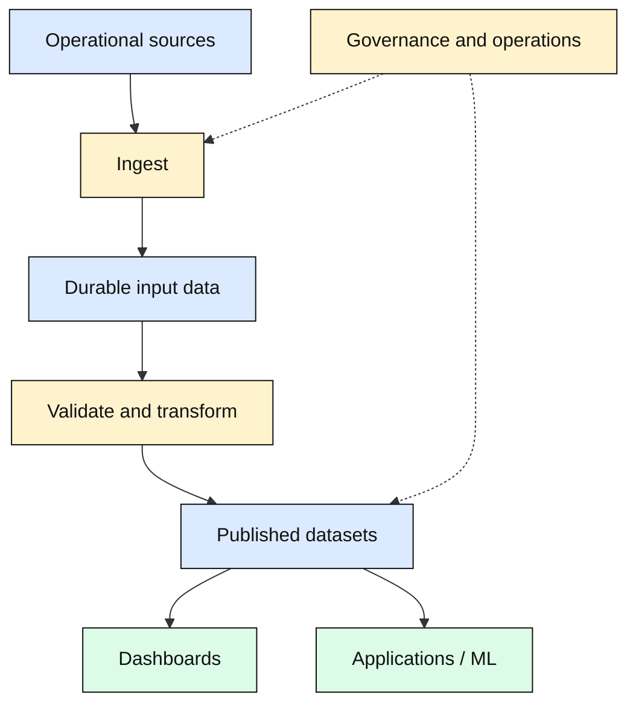
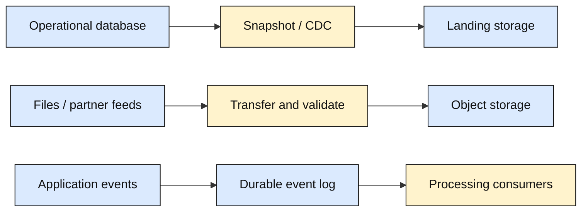
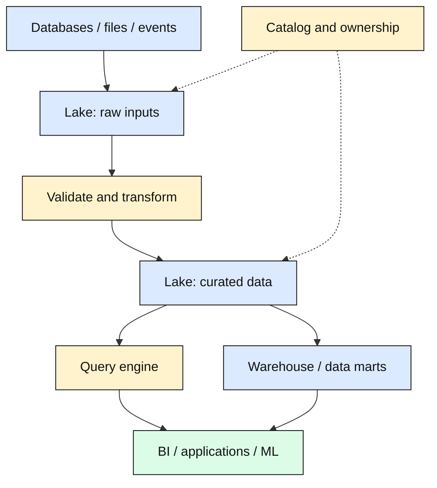
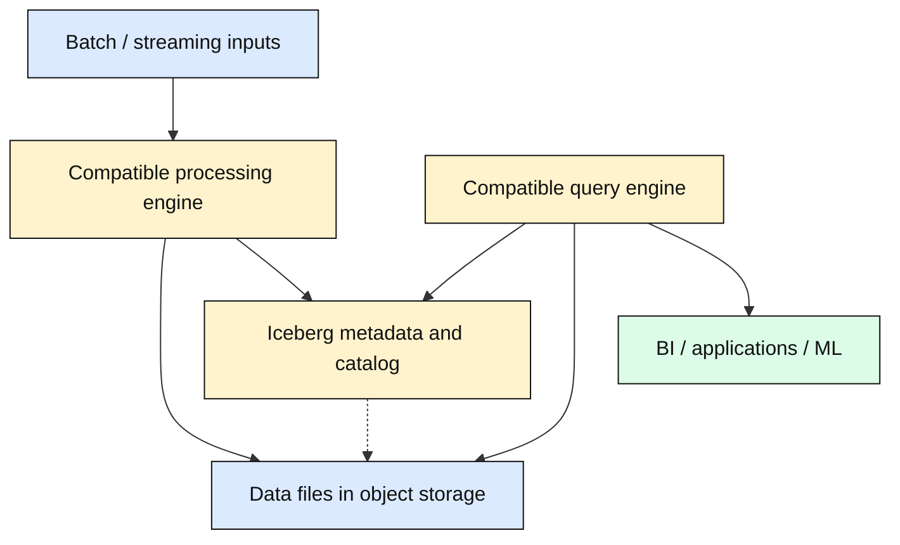
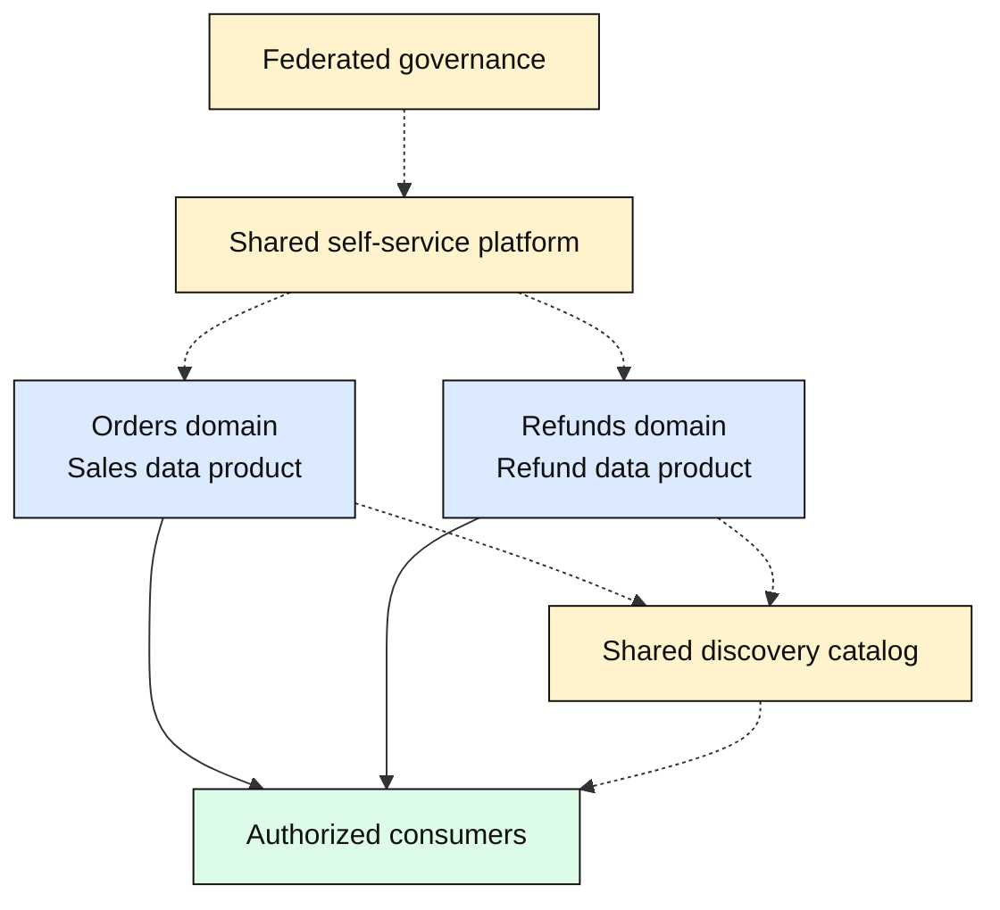
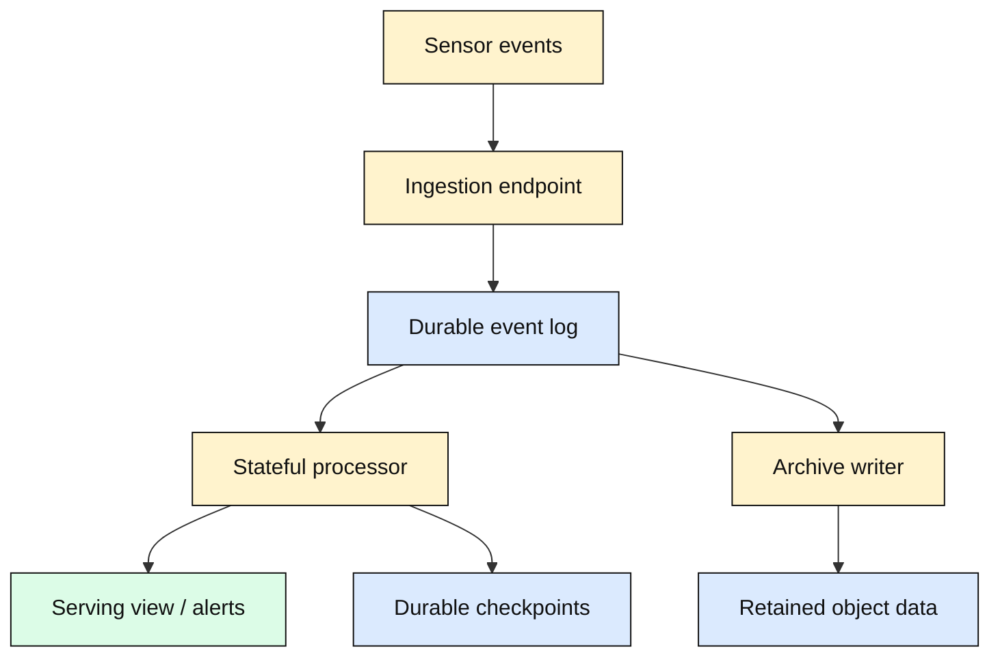
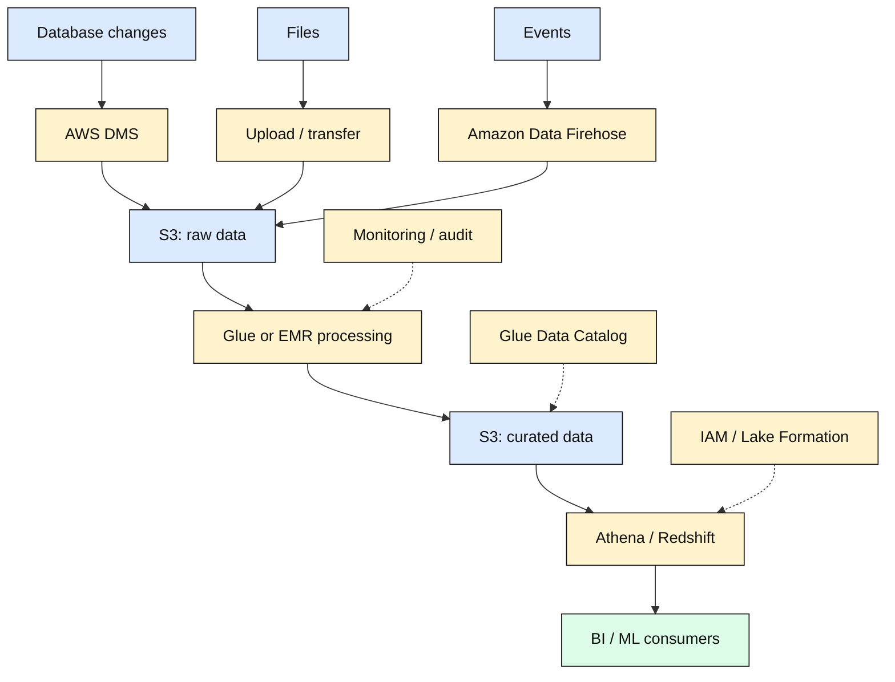

# Data Engineering for Solution Architecture

## Table of Contents

- [Overview and Core Mental Model](#overview-and-core-mental-model)
  - [From Data to Useful Outputs](#from-data-to-useful-outputs)
- [Designing a Data Pipeline](#designing-a-data-pipeline)
  - [Start with Requirements](#start-with-requirements)
  - [Data Shapes](#data-shapes)
  - [Decoupling and Durable Intermediate Outputs](#decoupling-and-durable-intermediate-outputs)
  - [FLAIR Study Checklist and FAIR Principles](#flair-study-checklist-and-fair-principles)
- [Data Ingestion](#data-ingestion)
  - [Ingestion Patterns](#ingestion-patterns)
  - [Snapshots, CDC, and Replay](#snapshots-cdc-and-replay)
  - [Ingestion Tools and Their Roles](#ingestion-tools-and-their-roles)
- [Storage and Serving Choices](#storage-and-serving-choices)
  - [Choose by Access Pattern](#choose-by-access-pattern)
  - [Layouts, Formats, and Partitioning](#layouts-formats-and-partitioning)
  - [Hot, Warm, and Cold Data](#hot-warm-and-cold-data)
  - [Specialized Ledgers and Blockchains](#specialized-ledgers-and-blockchains)
- [Processing, Analytics, and Visualization](#processing-analytics-and-visualization)
  - [ETL and ELT](#etl-and-elt)
  - [Batch, Streaming, and Interactive Queries](#batch-streaming-and-interactive-queries)
  - [Time, State, and Flow Control](#time-state-and-flow-control)
  - [Processing and Consumption Tools](#processing-and-consumption-tools)
  - [Publishing Trustworthy Outputs](#publishing-trustworthy-outputs)
- [Data Architecture Patterns](#data-architecture-patterns)
  - [Warehouse and Data Lake](#warehouse-and-data-lake)
  - [Lakehouse](#lakehouse)
  - [Data Mesh](#data-mesh)
  - [Streaming Architecture](#streaming-architecture)
  - [Comparing and Combining the Patterns](#comparing-and-combining-the-patterns)
- [Technology Examples and an AWS Reference Architecture](#technology-examples-and-an-aws-reference-architecture)
  - [AWS Examples](#aws-examples)
  - [Google Cloud Examples](#google-cloud-examples)
  - [Azure Examples](#azure-examples)
  - [AWS Reference Walkthrough](#aws-reference-walkthrough)
  - [Historical Names and Retired Examples](#historical-names-and-retired-examples)
- [Reliability, Governance, and Operations](#reliability-governance-and-operations)
  - [Data Contracts, Quality, and Lineage](#data-contracts-quality-and-lineage)
  - [Access, Privacy, and Lifecycle](#access-privacy-and-lifecycle)
  - [Recovery, Backfills, and Exactly-Once Claims](#recovery-backfills-and-exactly-once-claims)
  - [Operational Measures and Cost](#operational-measures-and-cost)
- [Choosing an Architecture](#choosing-an-architecture)
- [Summary](#summary)
- [Related Notes](#related-notes)
- [References](#references)

## Overview and Core Mental Model

**Data engineering builds the paths that turn source data into usable, dependable datasets.** Solution architecture places those paths within the wider system: applications, infrastructure, security, business processes, and operating constraints.

| Discipline | Main responsibility | Sales example |
| --- | --- | --- |
| **Data architecture** | Define data models, ownership, movement, interfaces, and policies | Decide how orders, refunds, and regions relate across systems |
| **Data engineering** | Build and operate ingestion, transformation, storage, and delivery | Maintain the pipeline producing daily regional sales |
| **Analytics / business intelligence (BI)** | Answer business questions through metrics, queries, and reports | Compare regional sales with last month |
| **Data science / ML** | Develop and evaluate statistical or learned models | Forecast demand from historical sales and other evidence |

These responsibilities overlap. A pipeline can supply a dashboard, a fraud-review application, an ML training dataset, or a search index. Visualization is one possible destination.

**Big data is a workload challenge, not a mandatory architecture.** Volume, arrival rate, variety, or computational demands may justify distributed processing. A daily export, a SQL transformation, and a small report can also constitute a useful data pipeline. Start with the simplest design that meets the requirements.

### From Data to Useful Outputs

The solid arrows represent data moving through a simplified lifecycle. The dotted links indicate responsibilities that apply across the pipeline, including intermediate stages. Processing can produce further durable datasets and repeat; streaming systems can process records continuously rather than waiting for a complete collection.

> **Mental model:** Operational systems record what happens. Data pipelines prepare information for particular consumers. Governance defines who owns it, what it means, and how it may be used.

## Designing a Data Pipeline

### Start with Requirements

| Question | Why it changes the design |
| --- | --- |
| **Which decision or application needs the data?** | Defines useful outputs and success criteria |
| **Who consumes it, and what do they query?** | Determines granularity, joins, metrics, and access policies |
| **Where does it originate?** | Determines connectors, ownership, permissions, and extraction load |
| **How fresh must the answer be?** | Distinguishes a nightly report from a continuously updated operational view |
| **What are normal and peak arrival rates?** | Determines throughput, buffering, and recovery capacity |
| **How much history is needed?** | Determines retention, storage growth, and reprocessing requirements |
| **What correctness and security rules apply?** | Determines validation, reconciliation, isolation, and audit requirements |
| **What can the team operate and afford?** | Constrains complexity, service choices, and total cost |

**Running example:** An online shop wants yesterday's paid sales by region, including qualifying refunds, available by 08:00. Agree on the business time zone, what counts as a sale, which refund date applies, and how late corrections are published. A daily pipeline may meet this need without a continuously running stream processor.

Freshness is measured from a relevant source event to the consumer-visible result. Fast processing alone does not guarantee a fresh dashboard if extraction or dashboard refresh runs only once a day. Lower latency can require more continuously available capacity, but cost also depends on efficiency, scanned data, and operations; there is no universal cost-versus-latency law.

### Data Shapes

| Shape | Meaning | Example |
| --- | --- | --- |
| **Structured** | Fields and relationships follow an explicit model | Orders with typed IDs, amounts, and dates |
| **Semi-structured** | Records have organization but may contain variable or nested fields | JSON application events |
| **Unstructured** | Content is not naturally represented as a fixed set of business fields | Audio, images, or free-form documents |

The boundary depends on the representation and intended use. CSV often contains highly structured tabular data; a log can follow a strict schema. An image has technical structure and metadata even when its visual meaning is unstructured for an analytical task.

### Decoupling and Durable Intermediate Outputs

Separating ingestion, storage, processing, and serving can let consumers evolve and capacity scale independently. A retained input dataset also allows a failed transformation to restart without re-reading the operational database.

This requires **durable inputs, known progress, reproducible transformations, and safe output publication**. Merely separating services does not make recovery automatic. Retaining more intermediate copies introduces storage, security, deletion, and consistency responsibilities.

One platform can perform several roles. Use separate tools where their benefits justify integration and operating costs; avoid building a large platform solely to match a reference diagram.

### FLAIR Study Checklist and FAIR Principles

Use **FLAIR** here as a study mnemonic:

| Concern | Practical question |
| --- | --- |
| **Findability** | Can a consumer discover the dataset, its owner, and its meaning? |
| **Lineage** | Can we trace the source versions and transformations behind an output? |
| **Accessibility** | Can authorized consumers obtain it through documented interfaces? |
| **Interoperability** | Can systems interpret its formats, identifiers, units, and conventions? |
| **Reusability** | Are quality, provenance, permitted uses, and compatibility documented? |

The established **FAIR** principles are **Findable, Accessible, Interoperable, and Reusable**. FLAIR adds an explicit lineage reminder; it is not a replacement standard. Accessible does not mean publicly available: authentication and authorization can be required. See the [GO FAIR Foundation's principles](https://www.gofair.foundation/fair-principles).

## Data Ingestion

### Ingestion Patterns

| Pattern | Typical input | Main concern |
| --- | --- | --- |
| **Batch import** | A bounded export or scheduled extract | Know the covered interval and detect incomplete deliveries |
| **API collection** | Pages of records from another application | Respect limits, pagination, changing records, and retry behavior |
| **File transfer** | CSV, JSON, images, or partner submissions | Detect completion, validate format, and identify duplicate files |
| **Logs / events** | Application activity or sensor observations | Handle bursts, partitions, duplicate delivery, and late arrival |
| **Change data capture (CDC)** | Database inserts, updates, and deletes | Preserve required change semantics and track source progress |

These are alternative intake patterns that can coexist. Devices can publish events or upload files; transactional databases can be extracted in batches or through CDC. The source does not dictate one universal ingestion method.

### Snapshots, CDC, and Replay

A common database intake starts with an **initial snapshot**, then consumes changes from a recorded source position. Snapshot consistency and the handoff must be coordinated so concurrent updates are not silently missed. Connector and database capabilities determine the supported approach.

CDC is not just repeated full-table copying. Log-based connectors read a database's change log; other techniques poll changes. Updates and deletions must reach downstream views when required. Track source positions, schema changes, transaction boundaries, and retained-log limits. A pipeline that falls behind beyond available history may need a new snapshot.

**Replay** reads retained inputs again, for example after fixing refund logic. It does not automatically mean applying every event as a new sale. Consumers need stable identifiers or source positions and a defined update/deduplication strategy. Monitor extraction load so analytics does not exhaust the operational system's resources. [Debezium's architecture](https://debezium.io/documentation/reference/stable/architecture.html) illustrates CDC connectors and downstream delivery.

### Ingestion Tools and Their Roles

| Tool or service | Role in a pipeline | Boundary to remember |
| --- | --- | --- |
| **Apache Kafka** | Retain partitioned event records for consuming applications | Retention and replication require deliberate configuration |
| **Kafka Connect** | Run source and sink connectors between Kafka and external systems | Connector-specific semantics still matter |
| **Fluentd** | Collect, parse, and route logs through plugins | A logging collector is not an analytical database |
| **AWS DMS** | Perform supported database loads and ongoing replication | Source/target support and CDC behavior vary |
| **Amazon Data Firehose** | Buffer and deliver incoming data to supported destinations | Delivery buffering affects freshness |
| **Google Cloud Pub/Sub / Azure Event Hubs** | Managed event intake and asynchronous delivery | Ordering, retention, and acknowledgment models differ |

**Transport, durable storage, and computation are different responsibilities**, even when a product combines some of them. Flink and Spark process streams; they do not replace a retained input log simply by running continuously. See [Kafka Connect](https://kafka.apache.org/41/kafka-connect/overview/), [Fluentd](https://docs.fluentd.org/), and [Flink's architecture](https://flink.apache.org/what-is-flink/flink-architecture/).

## Storage and Serving Choices

### Choose by Access Pattern

| Role | What it supports | Sales example |
| --- | --- | --- |
| **Operational database** | Application reads/writes and required transaction guarantees | Record orders and refunds |
| **Data warehouse** | Analytical joins, history, and aggregations | Query sales by region and month |
| **Object storage** | Retain named objects and metadata through storage APIs | Keep source exports and curated analytical files |
| **Search index** | Indexed term/filter searches and supported aggregations | Find failed checkout messages |
| **Cache / in-memory store** | Fast access to selected values or computed results | Serve a frequently requested summary |
| **Vector index / database** | Similarity retrieval over embeddings, often with metadata filters | Retrieve related product descriptions |
| **Durable event log** | Retain event sequences for independent consumption and replay | Feed sales events to several processors |

These roles overlap, and each copy creates a freshness and ownership question. A search index, cache, or embedding index is often a derived view; it should not silently replace the authoritative order record.

For database families, transactions, and selection criteria, see [Databases and Storage](Databases-and-Storage.md#databases). [Greenplum](Databases-and-Storage.md#greenplum-relational-analytics-with-mpp) is a relational analytical example with distributed MPP execution. Vector search and grounded AI answers are discussed in [Knowledge Ingestion and Retrieval](AI-Systems-Design.md#knowledge-ingestion-and-retrieval).

Object storage can contain structured tables as files as well as images or documents. Its object abstraction does not describe the provider's physical disk layout or make every object operation a multi-record database transaction. See the [Amazon S3 overview](https://docs.aws.amazon.com/AmazonS3/latest/userguide/Welcome.html).

### Layouts, Formats, and Partitioning

| Concept | Meaning and trade-off |
| --- | --- |
| **Row-oriented layout** | Keeps a record's fields together; useful for many record-oriented operations |
| **Column-oriented layout** | Groups values by column; can reduce reads and improve compression for suitable analytical scans |
| **CSV / JSON** | Widely exchanged text representations; parsing, field types, nulls, nesting, and schema conventions need agreement |
| **Parquet / ORC** | Typed columnar file formats designed for analytical storage and selective reading |
| **Partitioning** | Organizes data into subsets, such as order date, so suitable queries can skip irrelevant subsets |
| **Compression** | Trades encoding/decoding work for fewer stored and transferred bytes |

Formats are not complete database engines. A collection of Parquet files does not by itself supply coordinated commits or access governance. Conversely, relational systems can use columnar storage. Do not confuse [wide-column models with analytical columnar layout](Databases-and-Storage.md#wide-column-vs-analytical-columnar-storage).

For a daily report, partitioning curated orders by date may reduce scanning. Overly granular partitions or many tiny files can increase metadata and scheduling costs; skew can leave some workers overloaded. Choose based on queries and measurements rather than assuming more partitions always help. See [Parquet](https://parquet.apache.org/docs/overview/) and [ORC](https://orc.apache.org/docs/).

### Hot, Warm, and Cold Data

| Data temperature | Typical access need | Illustrative placement |
| --- | --- | --- |
| **Hot** | Frequent reads/writes or tight response targets | Recent operational records, a serving index, or selected cached results |
| **Warm** | Regular analysis with less urgent access | Recent history in analytical tables or queryable object storage |
| **Cold** | Infrequent retrieval with longer acceptable access times | Older retained files in an appropriate archival tier |

Temperature describes **usage**, not one fixed database family. Recent data can be rarely queried; old reference data can be accessed constantly. Object storage can serve active analytics, and an in-memory cache need not contain every hot record. Retrieval charges, restore delays, minimum retention, and query costs depend on the selected service and tier.

### Specialized Ledgers and Blockchains

A ledger can preserve a verifiable history of changes. A blockchain can coordinate a shared ledger among participants under a specified trust and consensus model. These are specialized requirements, not prerequisites for analytics.

Tamper evidence does not prove that an input was factually correct, keep every record confidential, or remove the need for access control. Retaining sensitive records indefinitely can also conflict with deletion obligations. Compare the [BFT and AI reliability distinction](Distributed-Systems-Theorems-and-Data-Structures.md#bft-and-aillm-based-systems): agreement and justified information are separate concerns.

## Processing, Analytics, and Visualization

### ETL and ELT

| Approach | Sequence | Example |
| --- | --- | --- |
| **ETL — extract, transform, load** | Prepare data before loading the intended target | Validate and aggregate an export before loading warehouse tables |
| **ELT — extract, load, transform** | Load into a target, then transform there | Load staging tables and use SQL to build reporting tables |

The distinction depends on **which target** is under discussion. A pipeline can land raw files in object storage, transform them, and load a warehouse; it contains more than one storage boundary. Neither order excuses missing validation or unrestricted access to raw sensitive data.

For the sales dataset, transformations might standardize timestamps, validate amounts and currencies, apply status/refund rules, join a versioned region mapping, and aggregate totals. Preserve the information needed to explain or reproduce the result under the retention policy.

### Batch, Streaming, and Interactive Queries

| Mode | What triggers the work | Example |
| --- | --- | --- |
| **Batch** | A bounded dataset or covered interval is ready | Compute yesterday's regional sales |
| **Streaming** | Records arrive in a potentially unbounded input | Incrementally update a recent-sales view |
| **Micro-batch** | Small batches run repeatedly | Update an aggregate from newly arrived records every interval |
| **Interactive query** | A consumer submits a question | Investigate a regional drop through SQL |

Batch does not necessarily mean hours or cold data; streaming does not necessarily mean immediate final answers. Scheduled and interactive queries can read the same prepared dataset. A warehouse can ingest streams: [Redshift streaming ingestion](https://docs.aws.amazon.com/redshift/latest/dg/materialized-view-streaming-ingestion.html) is one example.

### Time, State, and Flow Control

| Concept | Simple explanation |
| --- | --- |
| **Event time** | When the source says something happened |
| **Processing time** | When a processor handles the record |
| **Window** | A defined grouping interval, such as sales per five minutes |
| **Late event** | A record arriving after the processing system has advanced past its expected interval |
| **Watermark** | A progress estimate used to decide when event-time results can advance; it is not proof that no earlier event will arrive |
| **State** | Retained information such as current totals or previously seen event IDs |
| **Checkpoint** | Recoverable progress/state used by the processing framework |
| **Backpressure** | A slower downstream stage limits upstream progress or causes buffered work to grow |

Define whether late events update earlier results, go to a correction path, or are rejected under an explicit policy. Buffers are finite: a durable log buys recovery time, not infinite capacity. See [Flink's time and state terminology](https://nightlies.apache.org/flink/flink-docs-master/docs/concepts/glossary/); the linked master documentation can evolve.

### Processing and Consumption Tools

| Category | Illustrative technology | Responsibility |
| --- | --- | --- |
| **Distributed processing** | Apache Spark, Apache Flink | Execute transformations and stateful computations across workers |
| **SQL query engine** | Amazon Athena or a warehouse's query engine | Execute analytical queries over supported datasets |
| **Workflow orchestration** | Apache Airflow | Schedule tasks, dependencies, and workflow recovery |
| **Interactive exploration** | Notebooks and SQL clients | Investigate data and develop analyses |
| **BI / reporting** | Power BI, Tableau, or another integrated BI tool | Present governed metrics, reports, and dashboards |

Spark supports batch and streaming computation; [Structured Streaming](https://spark.apache.org/docs/latest/streaming/index.html) commonly executes incrementally through micro-batches. Flink supports bounded and unbounded inputs. [Airflow](https://airflow.apache.org/docs/apache-airflow/stable/core-concepts/overview.html) coordinates workflows; it is not the durable event log or the engine performing every distributed transformation.

Distributed execution introduces network transfers, skew, and resource management. Adding workers does not guarantee proportional speedup. Hadoop/HDFS remains useful background for understanding storage and compute coupling, but Hadoop is not a necessary component of every data platform.

### Publishing Trustworthy Outputs

Publish a dataset with its **owner, definition, covered time range, update time, schema version, and quality status**. Consumers need to know whether a total is provisional, corrected, or final under a defined policy.

A successful dashboard query may still display stale or incomplete data. A shared definition of “net sales” prevents different teams from silently subtracting refunds differently. Apply row/column restrictions where required, and consider exports and dashboard caches as further copies with their own access and deletion responsibilities.

ML consumers also need reproducible source versions and appropriate train/test separation; future information leaking into historical training examples can invalidate an evaluation. A reliable pipeline supplies evidence and provenance, not a guarantee that a prediction or generated answer is correct. See [AI evaluation](AI-Systems-Design.md#evaluating-quality).

## Data Architecture Patterns

### Warehouse and Data Lake

A **data warehouse** organizes analytical data for queries, reporting, and historical analysis. A **data mart** serves a particular subject or consumer group. Modern warehouse products can support semi-structured data and several ingestion modes; they are not limited to nightly loading of fixed relational rows.

A **data lake** retains datasets, often in object storage, for multiple processing and consumption needs. It can include both original inputs and validated, transformed datasets. Schema-on-read means a reader interprets the stored data using a schema; it does not mean field meaning and compatibility can be ignored.

In this example, source orders and refunds land in a raw area, transformations publish curated sales, and consumers either query those datasets or use warehouse tables. The solid arrows show data dependencies and optional publication paths; they do not mean every query copies all the data. Dotted arrows show metadata relationships.

The catalog helps describe and discover datasets; it does not automatically validate their contents or capture every transformation. A lake is not automatically a single trustworthy truth for every business question. Specify authoritative sources, owners, metric definitions, and correction processes. For another architectural view, see [Microsoft's data-lake explanation](https://learn.microsoft.com/en-us/azure/architecture/data-guide/scenarios/data-lake).

### Lakehouse

A **lakehouse** combines lake-oriented storage with managed analytical tables and query capabilities. **Apache Iceberg** is a concrete table-format example: metadata tracks files and snapshots, and atomic commits publish table changes. Supported engines and catalogs must cooperate correctly. See [Iceberg reliability](https://iceberg.apache.org/docs/latest/reliability/).

The engines write/read data files and consult table metadata; the catalog resolves the table's current metadata. The query arrows indicate access, while the output arrow represents returned results. This is not a physical deployment diagram.

An Iceberg snapshot identifies a consistent table version. Catalogs, engines, and table operations determine the supported guarantees; do not infer a transaction across arbitrary tables and external systems. A file format such as Parquet represents file contents; Iceberg manages tables composed of files and metadata. A discovery catalog may be integrated with the table catalog, but the responsibilities differ.

A lakehouse can reduce some duplicate pipelines and support multiple consumers. It still needs governance, performance tuning, maintenance, and integration testing; it does not guarantee lower cost or eliminate every warehouse.

### Data Mesh

**Data mesh distributes responsibility for analytical data products across business domains.** Its four principles are domain ownership, data as a product, a self-service platform, and federated computational governance. See [Zhamak Dehghani's original principles](https://martinfowler.com/articles/data-mesh-principles.html).

The Orders team publishes documented sales data; the Refunds team owns its refund dataset. Shared identifiers and policies allow consumers to combine them. Dotted links represent platform, governance, and discovery relationships, not a requirement to copy all data through one central server.

Each product needs an accountable owner, usable interfaces, quality expectations, and controlled access. Domain autonomy requires common interoperability and security rules. A mesh can use lakes, lakehouses, or warehouses; it is not simply several buckets or a new storage engine. Its organizational overhead may be unjustified for a small team.

### Streaming Architecture

For wind-turbine monitoring, measurements enter a retained log. One consumer calculates recent temperature/vibration summaries; another archives observations. Checkpoints support processor recovery, while retained events support replay. A serving view can update before archival finishes; define the required recovery and loss behavior for each path.

An alert can be provisional if measurements arrive late or disappear. A remote analytics pipeline is not a substitute for local, time-critical equipment protection. “Near real time” requires a measured latency target and an explicit policy for stale or unavailable data.

### Comparing and Combining the Patterns

| Pattern | Main purpose | Main design responsibility |
| --- | --- | --- |
| **Warehouse** | Curated analytical tables and reporting | Model useful datasets and manage freshness/query workloads |
| **Data lake** | Retain diverse datasets for multiple uses | Maintain discoverability, quality, ownership, and access |
| **Lakehouse** | Add managed table behavior over lake storage | Validate engine/catalog compatibility and transaction scope |
| **Data mesh** | Scale ownership and consumption across domains | Provide data products, shared infrastructure, and federated policies |
| **Streaming** | Continuously update results from arriving events | Manage time, state, retention, recovery, and output semantics |

A domain-owned data product can live in a lakehouse, receive streaming updates, and supply a warehouse mart. These are different design dimensions, not mutually exclusive steps on a universal maturity ladder.

## Technology Examples and an AWS Reference Architecture

The examples below illustrate **roles, not equivalent feature sets or product recommendations**. Availability, capabilities, limits, and names change. Check current documentation for a real deployment; managed infrastructure still requires data modeling, permissions, capacity decisions, and recovery design.

### AWS Examples

| Role | Examples and responsibility |
| --- | --- |
| **Database intake** | [AWS DMS](https://docs.aws.amazon.com/dms/latest/userguide/Welcome.html): supported initial loads and ongoing changes |
| **Event intake / delivery** | [Kinesis Data Streams](https://docs.aws.amazon.com/streams/latest/dev/introduction.html): retained stream records; [Amazon Data Firehose](https://docs.aws.amazon.com/firehose/latest/dev/): buffered destination delivery |
| **Lake storage** | [Amazon S3](https://docs.aws.amazon.com/AmazonS3/latest/userguide/Welcome.html): objects and stored datasets |
| **Integration / processing** | [AWS Glue](https://docs.aws.amazon.com/glue/latest/dg/what-is-glue.html): integration and transformation jobs; [Amazon EMR](https://docs.aws.amazon.com/emr/latest/ManagementGuide/emr-what-is-emr.html): managed processing frameworks |
| **SQL consumption** | [Athena](https://docs.aws.amazon.com/athena/latest/ug/what-is.html): query supported lake datasets; Redshift: warehouse analytics and supported external queries |
| **Metadata / access** | Glue Data Catalog: metadata; [Lake Formation](https://docs.aws.amazon.com/lake-formation/latest/dg/what-is-lake-formation.html): data-lake permissions integrated with supported services |

### Google Cloud Examples

| Role | Examples and responsibility |
| --- | --- |
| **Messaging** | [Pub/Sub](https://docs.cloud.google.com/pubsub/docs/overview): decouple event producers and consumers |
| **Object storage** | [Cloud Storage](https://docs.cloud.google.com/storage/docs/introduction): store objects and analytical files |
| **Processing** | [Dataflow](https://docs.cloud.google.com/dataflow/docs/overview): managed batch/stream processing using the Apache Beam model |
| **Analytical queries** | [BigQuery](https://docs.cloud.google.com/bigquery/docs/introduction): analytical storage and queries with supported batch/streaming intake |

The Dataflow documentation illustrates a Pub/Sub → Dataflow → BigQuery → BI path. It is one composition, not a requirement that all Google Cloud analytics use those services.

### Azure Examples

| Role | Examples and responsibility |
| --- | --- |
| **Integration / orchestration** | [Azure Data Factory](https://learn.microsoft.com/en-us/azure/data-factory/introduction): data movement and ETL/ELT workflow coordination |
| **Event intake** | [Azure Event Hubs](https://learn.microsoft.com/en-us/azure/event-hubs/event-hubs-about): retained event streams |
| **Lake storage** | [Blob Storage / Data Lake Storage Gen2](https://learn.microsoft.com/en-us/azure/architecture/data-guide/technology-choices/data-storage): object storage and associated lake capabilities |
| **Analytics** | [Azure Synapse Analytics](https://learn.microsoft.com/en-us/azure/synapse-analytics/overview-what-is): SQL, Spark, and integration capabilities |

These are illustrative Azure services, not an exhaustive catalogue. Microsoft's Data Factory documentation also points to Data Factory in Microsoft Fabric; that does not make every Azure or Fabric component interchangeable.

### AWS Reference Walkthrough

1. **Collect:** A supported DMS task captures source database data; files use a transfer path; events use Firehose's buffered delivery. These are separate input paths. A retained event stream can precede Firehose if independent consumers and replay are required.
2. **Retain:** Raw S3 datasets preserve authorized inputs for the chosen retention period. Keep source identity and progress metadata.
3. **Prepare:** Glue or EMR jobs apply validation, business rules, and aggregation before publishing curated datasets. They are alternatives here, not two mandatory sequential steps.
4. **Consume:** Athena can query supported S3 datasets. Redshift can load selected data or query external S3 data using Spectrum; the arrow does not prescribe both. BI/ML consumers use approved query results or prepared datasets.
5. **Govern and operate:** The dotted arrows show representative metadata, permissions, and monitoring relationships. These controls apply across the architecture; they are not data-copying stages or a complete security deployment.

**Redshift Spectrum queries external files without requiring a copy into Redshift tables.** That capability alone does not guarantee atomic updates to arbitrary lake files or every lakehouse property. See [Spectrum's documented role](https://docs.aws.amazon.com/redshift/latest/dg/c-using-spectrum.html).

Lake Formation augments IAM through its permissions model and supported integrations; access must also be controlled on any alternative route to the underlying data. Audit logs and operational metrics must be configured and reviewed. A catalog entry is not evidence that every consumer is authorized or every dataset is correct.

### Historical Names and Retired Examples

Older diagrams are useful for learning roles but should not be treated as a current deployment recipe:

- **Apache Sqoop** is a historical Hadoop bulk-transfer example; it [retired in 2021](https://attic.apache.org/projects/sqoop.html).
- **Amazon Kinesis Data Firehose** was [renamed Amazon Data Firehose](https://aws.amazon.com/about-aws/whats-new/2024/02/amazon-data-firehose-formerly-kinesis-data-firehose/).
- **Kinesis Data Analytics for SQL applications** was [discontinued, with application deletion starting 27 January 2026](https://docs.aws.amazon.com/kinesisanalytics/latest/dev/). Do not reproduce it as a current streaming component; AWS documents migration to Amazon Managed Service for Apache Flink.

## Reliability, Governance, and Operations

### Data Contracts, Quality, and Lineage

A **data contract** records expectations between producers and consumers: field meaning and types, identifiers, units, nullability, compatibility, delivery behavior, ownership, and quality targets. It is useful only when changes and violations are managed.

| Concern | Sales-pipeline check |
| --- | --- |
| **Schema evolution** | Detect a changed amount representation before old consumers misinterpret it |
| **Completeness** | Compare expected source coverage and delivered records for the reporting interval |
| **Validity** | Check supported currencies, statuses, and timestamp formats |
| **Uniqueness** | Detect repeated event IDs or repeated delivery of the same file |
| **Reconciliation** | Compare source and output totals after applying the same documented rules |
| **Lineage** | Record source versions/positions, transformation version, and published dataset version |

Quarantine invalid records with a defined correction path rather than silently dropping them. A schema-compatible record can still be wrong—for example, a valid decimal amount assigned to the wrong currency. Catalog discovery and automatic schema inference do not replace semantic validation or explicit lineage capture.

### Access, Privacy, and Lifecycle

Assign owners and scoped workload identities. Enforce permissions on source reads, raw storage, derived tables, query engines, notebooks, exports, and dashboards. Apply tenant, row, and column boundaries where required. Administrators do not automatically need unrestricted routine access to all business data. See [IAM authorization](Identity-and-Access-Management.md#authorization-in-practice).

Protect data in transit with TLS and at rest with appropriate encryption/key management. Classify sensitive information, minimize collection, redact logs, and define allowed uses and storage locations. Encryption alone does not enforce business authorization.

Retention and deletion must account for raw and curated copies, indexes, caches, exports, historical snapshots, and backups. Define how recovery avoids reintroducing data that should remain deleted. Keep only the history justified by operational and applicable requirements; a raw area is not a reason to retain everything forever.

### Recovery, Backfills, and Exactly-Once Claims

| Situation | Required design response |
| --- | --- |
| **A job stops halfway** | Resume or restart from known inputs/progress and publish outputs safely |
| **A retry repeats a write** | Use idempotent replacement/upsert, deduplication, or a supported transactional strategy |
| **A business rule is fixed** | Backfill the defined historical range with versioned logic and reconcile results |
| **Source history expires** | Detect the recovery gap; restore/re-snapshot rather than pretend it was consumed |
| **A bad dataset is published** | Withdraw or replace it, notify affected consumers, and retain permitted diagnostic evidence |

**Example:** If a daily sales job retries after publishing totals, appending the same totals again would double the report. Replacing that day's output as a controlled publication, or using an appropriate transactional write, makes the retry safe. A backfill must also handle conflicts with live updates and late corrections.

**Exactly-once is a scoped claim.** A processor can recover its state consistently while a destination still receives repeated writes. End-to-end effects depend on replayable inputs, checkpoints, source/sink integrations, and destination behavior. External API calls need their own safe retry semantics. Framework guarantees must be checked for the actual execution mode and connectors.

> **A green job status means the program completed. It does not prove that the data is complete, fresh, correctly interpreted, or safe to use.**

### Operational Measures and Cost

| Measure | What it reveals |
| --- | --- |
| **Consumer-visible freshness** | How far the published answer lags relevant source activity |
| **Ingestion / processing lag** | Whether extraction or computation is falling behind |
| **Throughput and backlog** | Whether capacity handles normal, peak, and recovery workloads |
| **Completeness and quality failures** | Missing intervals, rejected records, and failed reconciliation |
| **Failures and recovery time** | Whether retries and restores meet operating targets |
| **Query / scan cost** | Cost of repeated scans, inefficient layouts, or excessive concurrency |
| **Total operating cost** | Storage copies, compute, transfer, orchestration, support, and staff time |

Define alerts and ownership for missed freshness deadlines or quality failures. Test recovery and backfills, not just normal execution. Version pipeline logic and infrastructure definitions, review changes, and deploy compatible updates.

Optimize by measuring: useful partitioning and compression, sensible file sizes, selective queries, bounded retention, and right-sized compute can help. Independent storage/compute scaling and managed services can reduce some work, but may add request, transfer, idle-capacity, or coordination costs.

## Choosing an Architecture

1. Define the business output, consumers, metric meanings, and acceptable freshness.
2. Identify authoritative sources, permissions, extraction options, and expected data growth.
3. Choose batch or streaming from the actual deadline and event semantics.
4. Select storage and serving paths for the queries, recovery needs, and retention policy.
5. Define ownership, contracts, quality checks, and a traceable publication process.
6. Plan retries, duplicate handling, late corrections, backfills, and recovery gaps.
7. Add shared catalogs, lakehouse capabilities, or domain platforms when they solve identified problems.
8. Measure correctness, freshness, cost, and operating effort before expanding the architecture.

For the daily sales report, a relational database plus scheduled extraction and SQL reporting may suffice. An independently replayable stream can become useful when several consumers need prompt event updates. A mesh becomes relevant when ownership across many domains is itself a bottleneck—not merely because the dataset grows.

## Summary

Data engineering connects operational sources to prepared datasets and useful outputs. Ingestion captures data; storage retains it; processing applies transformations and business rules; serving makes results usable by people and software.

Warehouses, lakes, lakehouses, mesh, and streaming address different concerns and can coexist. Choose them from access patterns, freshness, ownership, correctness, recovery, and operating constraints. Technology labels and successful job execution do not establish trustworthy information.

> **Recall:** Collect deliberately, retain appropriately, transform reproducibly, publish with clear meaning, and verify the result. Scale the pipeline when the requirements justify it.

## Related Notes

- [System design at different scales](Understanding-System-Design.md#system-design-at-different-scales)
- [Databases and Storage](Databases-and-Storage.md)
- [Greenplum and relational analytics](Databases-and-Storage.md#greenplum-relational-analytics-with-mpp)
- [Distributed consistency](Distributed-System-Attributes.md#consistency) and [durability](Distributed-System-Attributes.md#durability)
- [Identity and Access Management](Identity-and-Access-Management.md#authorization-in-practice)
- [AI knowledge ingestion and retrieval](AI-Systems-Design.md#knowledge-ingestion-and-retrieval)
- [AI evaluation and observability](AI-Systems-Design.md#evaluation-and-observability)

## References

- [GO FAIR Foundation: FAIR Principles](https://www.gofair.foundation/fair-principles)
- [Zhamak Dehghani: Data Mesh Principles and Logical Architecture](https://martinfowler.com/articles/data-mesh-principles.html)
- [Apache Kafka: Kafka Connect Overview](https://kafka.apache.org/41/kafka-connect/overview/)
- [Debezium: CDC Architecture](https://debezium.io/documentation/reference/stable/architecture.html)
- [Fluentd: Introduction](https://docs.fluentd.org/)
- [Apache Parquet: Overview](https://parquet.apache.org/docs/overview/)
- [Apache ORC: Format Background](https://orc.apache.org/docs/)
- [Apache Iceberg: Reliability and Atomic Table Commits](https://iceberg.apache.org/docs/latest/reliability/)
- [Apache Flink: Architecture](https://flink.apache.org/what-is-flink/flink-architecture/)
- [Apache Flink: Concepts Glossary — Evolving Master Documentation](https://nightlies.apache.org/flink/flink-docs-master/docs/concepts/glossary/)
- [Apache Spark: Structured Streaming](https://spark.apache.org/docs/latest/streaming/index.html)
- [Apache Airflow: Architecture Overview](https://airflow.apache.org/docs/apache-airflow/stable/core-concepts/overview.html)
- [Microsoft: Data Lake Architecture](https://learn.microsoft.com/en-us/azure/architecture/data-guide/scenarios/data-lake)
- [AWS: Amazon S3 Overview](https://docs.aws.amazon.com/AmazonS3/latest/userguide/Welcome.html)
- [AWS: Database Migration Service](https://docs.aws.amazon.com/dms/latest/userguide/Welcome.html)
- [AWS: Kinesis Data Streams](https://docs.aws.amazon.com/streams/latest/dev/introduction.html)
- [AWS: Amazon Data Firehose](https://docs.aws.amazon.com/firehose/latest/dev/)
- [AWS: Glue Overview](https://docs.aws.amazon.com/glue/latest/dg/what-is-glue.html)
- [AWS: Amazon EMR Overview](https://docs.aws.amazon.com/emr/latest/ManagementGuide/emr-what-is-emr.html)
- [AWS: Amazon Athena Overview](https://docs.aws.amazon.com/athena/latest/ug/what-is.html)
- [AWS: Redshift Spectrum](https://docs.aws.amazon.com/redshift/latest/dg/c-using-spectrum.html)
- [AWS: Redshift Streaming Ingestion](https://docs.aws.amazon.com/redshift/latest/dg/materialized-view-streaming-ingestion.html)
- [AWS: Lake Formation](https://docs.aws.amazon.com/lake-formation/latest/dg/what-is-lake-formation.html)
- [Google Cloud: Pub/Sub](https://docs.cloud.google.com/pubsub/docs/overview)
- [Google Cloud: Cloud Storage](https://docs.cloud.google.com/storage/docs/introduction)
- [Google Cloud: Dataflow](https://docs.cloud.google.com/dataflow/docs/overview)
- [Google Cloud: BigQuery](https://docs.cloud.google.com/bigquery/docs/introduction)
- [Microsoft: Azure Data Factory](https://learn.microsoft.com/en-us/azure/data-factory/introduction)
- [Microsoft: Azure Event Hubs](https://learn.microsoft.com/en-us/azure/event-hubs/event-hubs-about)
- [Microsoft: Analytical Storage Choices](https://learn.microsoft.com/en-us/azure/architecture/data-guide/technology-choices/data-storage)
- [Microsoft: Azure Synapse Analytics](https://learn.microsoft.com/en-us/azure/synapse-analytics/overview-what-is)
- [Apache Attic: Sqoop Retirement](https://attic.apache.org/projects/sqoop.html)
- [AWS: Data Firehose Rename](https://aws.amazon.com/about-aws/whats-new/2024/02/amazon-data-firehose-formerly-kinesis-data-firehose/)
- [AWS: Kinesis Data Analytics for SQL Discontinuation](https://docs.aws.amazon.com/kinesisanalytics/latest/dev/)
