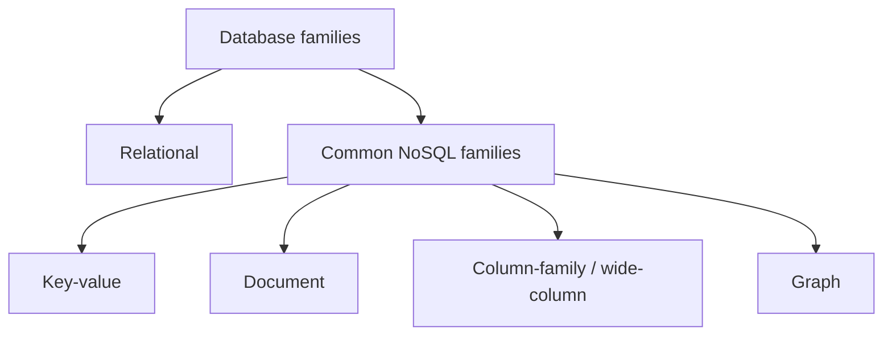
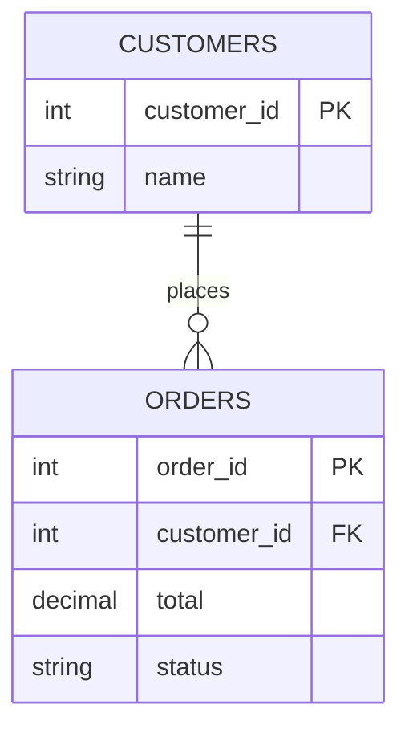
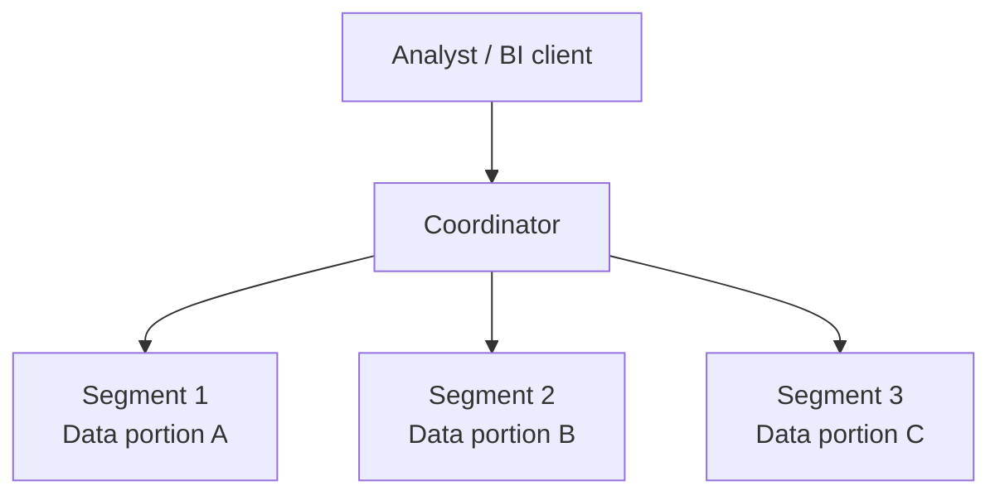
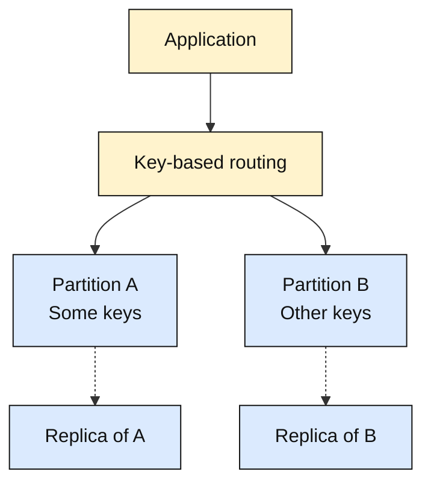

# Databases and Storage

## Table of Contents

- [Overview](#overview)
- [Databases](#databases)
  - [Why Applications Use Databases](#why-applications-use-databases)
  - [Types of Databases](#types-of-databases)
  - [Relational Databases](#relational-databases)
    - [Customers and Orders Example](#customers-and-orders-example)
    - [Normalization and Indexes](#normalization-and-indexes)
    - [Greenplum: Relational Analytics with MPP](#greenplum-relational-analytics-with-mpp)
  - [Transactions and ACID](#transactions-and-acid)
    - [Account Transfer Example](#account-transfer-example)
    - [What ACID Does Not Promise](#what-acid-does-not-promise)
  - [NoSQL Databases](#nosql-databases)
    - [Schemas, Transactions, and Consistency](#schemas-transactions-and-consistency)
    - [Wide-Column vs. Analytical Columnar Storage](#wide-column-vs-analytical-columnar-storage)
  - [Relational and NoSQL Trade-Offs](#relational-and-nosql-trade-offs)
    - [Database Selection Checklist](#database-selection-checklist)
- [Key-Value Stores](#key-value-stores)
  - [What Is a Key-Value Store?](#what-is-a-key-value-store)
  - [Why Use Key-Value Stores in Distributed Systems?](#why-use-key-value-stores-in-distributed-systems)
  - [Functional Requirements and a Simple API](#functional-requirements-and-a-simple-api)
  - [Non-Functional Requirements and Trade-Offs](#non-functional-requirements-and-trade-offs)
  - [Design Topics to Study Next](#design-topics-to-study-next)
- [Amazon DynamoDB](#amazon-dynamodb)
- [Column-Family Databases](#column-family-databases)
- [Apache HBase](#apache-hbase)
- [Graph Databases](#graph-databases)
- [Neo4j](#neo4j)
- [Summary](#summary)
- [Related Notes](#related-notes)
- [Further Reading](#further-reading)

## Overview

Applications need to retain information, find it efficiently, and modify it without violating required rules. **Databases and storage support these needs at different levels.**

| Term | Meaning | Example |
| --- | --- | --- |
| **Database** | An organized collection of application data | Customers, orders, and payment records |
| **Database management system (DBMS)** | Software that manages data, queries, concurrency, and supported guarantees | PostgreSQL or MongoDB |
| **Storage infrastructure** | Resources and services used to retain bytes | Local SSDs, network-attached block volumes, or object storage used by a system |

A DBMS can run within an application process, on one server, or across multiple nodes. Its data model is separate from its physical deployment. Different engines use different storage resources; an object-storage service is not automatically a transactional application database.

Choose from **access patterns, correctness requirements, workload, growth, and operating constraints**, not simply the labels “SQL” and “NoSQL.” A small application and a globally distributed service can need different architectures while both using relational data.

> **Mental model:** The data model organizes information; the DBMS implements operations and guarantees; storage infrastructure retains the underlying bytes. Correct application behavior requires all three to fit the workload.

## Databases

### Why Applications Use Databases

| Need | What a DBMS can contribute | Design responsibility |
| --- | --- | --- |
| **Organization and retrieval** | Data structures, indexes, query processing, and aggregation | Model actual queries and measure their cost |
| **Integrity and concurrency** | Constraints, atomic operations, transactions, and isolation | Define invariants and select adequate guarantees |
| **Security and sharing** | Authentication, authorization, and supported encryption controls | Configure least privilege, network access, key handling, and application authorization |
| **Growth** | Vertical scaling, replication, partitioning, or distributed execution | Account for hot keys, data movement, coordination, and cost |
| **Recovery** | Logging, backups, restore tools, and replication | Define acceptable loss/downtime and test recovery |
| **Analysis and history** | Reporting queries and optional audit, temporal, or change-tracking features | Decide what history to record and how long to retain it |

These are **capabilities, not automatic promises made by every database**. Constraints, encryption, audit features, backup coverage, and scaling behavior depend on the product and configuration. Not all database models organize application data as relational tables.

**Replication is not backup.** Replicas can improve availability or read capacity, but may also copy an accidental deletion or bad update. Backups retain recoverable data under a separate retention strategy; their usefulness still depends on completeness, accessibility, and successful restores. Neither replication nor merely creating backup files establishes recoverability without a tested recovery process. See the [PostgreSQL backup overview](https://www.postgresql.org/docs/current/backup.html).

### Types of Databases

A useful introductory classification separates **relational databases** from common **NoSQL families**:

This is **not an exhaustive or mutually exclusive taxonomy**. Products can support several models, and query language does not uniquely determine storage architecture. For example, a relational database can store and query JSON; [PostgreSQL's JSON types](https://www.postgresql.org/docs/current/datatype-json.html) illustrate that overlap.

### Relational Databases

Relational databases organize data into **relations**, commonly represented as tables. SQL implementations offer schemas, queries, constraints, and transactions with product-specific details.

| Concept | Meaning |
| --- | --- |
| **Table** | A named structure representing an entity or relationship, such as Customers or Orders |
| **Row / record** | One entry in that table; a suitable key identifies it |
| **Column / attribute** | A named field with a declared type and applicable rules |
| **Primary key** | Column or columns chosen to uniquely identify rows; values cannot be null |
| **Foreign key** | A constraint requiring non-null reference values to match an eligible referenced key |
| **SQL** | A language for defining structures and querying/modifying data; dialects and extensions differ |
| **Transaction** | A group of operations managed as one transaction boundary |

Foreign keys can reference **suitable unique keys, not only primary keys**. Null handling and eligible referenced keys follow the engine's rules. A table name or column ending in `_id` does not create referential integrity by itself: the constraint must be declared and enforced. See [PostgreSQL constraints](https://www.postgresql.org/docs/current/ddl-constraints.html).

#### Customers and Orders Example

**Customers** — `customer_id` is the primary key:

| customer_id | name |
| --- | --- |
| 1 | Mina |
| 2 | Rashad |

**Orders** — `order_id` is the primary key; `customer_id` is a non-null foreign key to Customers:

| order_id | customer_id | total | status |
| --- | --- | --- | --- |
| 101 | 1 | 20.00 | paid |
| 102 | 1 | 5.00 | pending |
| 103 | 2 | 15.00 | paid |

Each order belongs to **exactly one existing customer** in this example; a customer can have **zero or many orders**. Mina has two orders, connected by `customer_id = 1`. Joining the tables can retrieve her name alongside each order without copying her current name into every order. Diagram types are illustrative, not an executable schema.

#### Normalization and Indexes

**Normalization** organizes relations to reduce avoidable duplication and update anomalies. Keeping customer details separately can avoid having to change the same current address in many order rows. It does not eliminate every repeated value: foreign-key values intentionally repeat, and historical order details may need deliberate snapshots.

**Denormalization** deliberately duplicates or precomputes information for a requirement such as read performance or historical accuracy. It introduces an explicit maintenance or freshness responsibility.

**Indexes** provide additional access paths. They can accelerate suitable lookups and joins but consume storage and add write/maintenance work. Joins are **not inherently slow**: cost depends on query shape, indexes, cardinality estimates, data size/distribution, and the execution plan. Inspect and measure actual plans rather than assuming one data model is faster. See [PostgreSQL query-plan documentation](https://www.postgresql.org/docs/current/using-explain.html).

Examples of relational DBMSs include **MySQL, PostgreSQL, Oracle Database, Microsoft SQL Server, SQLite, and IBM Db2**. These differ in deployment, concurrency, extensions, and operational characteristics; the list is not a ranking.

#### Greenplum: Relational Analytics with MPP

**Greenplum is a PostgreSQL-based relational/SQL DBMS designed for distributed analytics**, including data warehousing, reporting, and large aggregations. Its **MPP (massively parallel processing)** architecture illustrates why relational databases need not run on one server. It is not a NoSQL column-family database. See the [Greenplum project repository (archived historical material)](https://github.com/greenplum-db/gpdb-archive).

| Workload | Typical pattern and example |
| --- | --- |
| **OLTP — online transaction processing** | Many short operational transactions, such as recording individual purchases |
| **OLAP — online analytical processing** | Larger scans and aggregations, such as annual sales totals by region |

These are **workload categories, not rigid product boundaries**. PostgreSQL also supports analytical queries; a system's suitability depends on its architecture and workload.

**MPP mental model:** The coordinator accepts SQL and plans/distributes work. Segment instances process their data portions in parallel; results are combined and returned through the coordinator. See the [archived Greenplum architecture documentation](https://github.com/greenplum-db/gpdb-archive/blob/main/gpdb-doc/markdown/admin_guide/intro/arch_overview.html.md).

The arrows show query-work distribution. These segments process **different portions of a distributed table**, rather than merely identical replicas. Segment instances are database processes; multiple instances can share a host.

**Example:** To calculate annual sales totals by region across a large orders dataset, each segment filters its portion to the requested year and computes partial totals. Combining those totals produces the final regional totals. Depending on data distribution and the query plan, intermediate results may move between segments.

**Storage layout is a separate choice:** Greenplum supports row-oriented heap tables and append-optimized tables with row or column orientation. Columnar storage does not make a database NoSQL. See the [provider's Greenplum storage explanation](https://yandex.cloud/en/docs/managed-greenplum/concepts/tables).

**Trade-offs:** Distribution-key choices affect balance and data movement. Skew can leave one segment doing much more work; joins and aggregations may require inter-segment transfers. Network costs and cluster operations also matter, so adding nodes does not guarantee linear speedup. See the [provider's data-distribution explanation](https://yandex.cloud/en/docs/managed-greenplum/concepts/sharding).

> **Relational describes the data model; columnar describes a storage layout; MPP describes parallel processing across instances.**

### Transactions and ACID

A transaction groups related database operations so the application can commit them or abandon their uncommitted effects. ACID describes four important properties:

| Property | Meaning | Transfer example |
| --- | --- | --- |
| **Atomicity** | The transaction's changes take effect together or not at all | Do not retain only the debit without the corresponding credit |
| **Consistency** | Correct transaction logic and enforced rules preserve defined invariants | Preserve the combined balance and any required balance constraints |
| **Isolation** | Controls how concurrent transactions interact and what they can observe | Concurrent transfers must not produce forbidden outcomes under the chosen isolation strategy |
| **Durability** | Committed changes survive the failures covered by the configured guarantee | Retain the committed transfer through the covered crash/recovery scenario |

#### Account Transfer Example

For a simplified transfer of **20 units from A to B**, with no fees or other balance changes:

| Account | Before | After a successful commit |
| --- | --- | --- |
| A | 100 | 80 |
| B | 50 | 70 |
| **Combined** | **150** | **150** |

The application checks the relevant rules and groups the debit and credit within one transaction. On rollback, those uncommitted changes do not become the completed transfer. A database transaction does not automatically make unrelated external API calls atomic. See the [transaction introduction](https://www.postgresql.org/docs/current/tutorial-transactions.html).

#### What ACID Does Not Promise

- **ACID consistency is not distributed read consistency.** Preserving business/data invariants differs from whether a replica read reflects the latest write. See [Consistency](Distributed-System-Attributes.md#consistency).
- **ACID does not invent correct business logic.** A transaction can commit the wrong amount if neither its logic nor the enforced constraints prevent it.
- **Isolation levels matter.** Weaker levels permit outcomes that serializable execution rules out. Even serializable transactions may need safe retries after conflicts; a default isolation level is not automatically sufficient. See [PostgreSQL isolation levels](https://www.postgresql.org/docs/current/transaction-iso.html).
- **Durability has a failure scope.** Logging, flush/acknowledgment settings, replication, and recovery procedures determine what a deployment actually promises.
- **Error handling is engine-specific.** A failing statement, deadlock, explicit rollback, and disconnected client need not have identical effects. Do not assume every SQL error automatically rolls back the whole transaction. For example, [MySQL InnoDB documents different rollback scopes](https://dev.mysql.com/doc/refman/8.4/en/innodb-error-handling.html).

> **Recall:** Transactions are a tool for enforcing specified rules. Choose transaction boundaries, isolation, and durability deliberately; “supports ACID” is not a complete application-correctness design.

### NoSQL Databases

**NoSQL**, often expanded as *Not Only SQL*, is an umbrella label for several non-relational approaches. It does not mean “no structure,” “no relationships,” or “no transactions.” A database may store structured and semi-structured records or binary values depending on its model; not every engine is equally suited to every data shape.

| Family | Main organization | Simple access-pattern example | Representative systems |
| --- | --- | --- | --- |
| **Key-value** | Look up a value using a key; values may have rich supported types | Retrieve a session by its ID | Redis, Amazon DynamoDB |
| **Document** | Store records as documents with fields and nested structures | Read a product's description and variable attributes together | MongoDB, Apache CouchDB |
| **Column-family / wide-column** | Organize records around row/partition keys and related columns | Fetch device measurements within a modeled key/time range | Apache Cassandra, Apache HBase |
| **Graph** | Represent entities and explicit relationships for traversal | Follow account-to-device connections in a fraud investigation | Neo4j, Amazon Neptune |

These examples describe common use patterns, not exclusive product capabilities. Redis supports multiple [data types](https://redis.io/docs/latest/develop/data-types/); DynamoDB supports key-value and document patterns. See [CouchDB's document overview](https://docs.couchdb.org/en/stable/intro/overview.html), [Cassandra's architecture](https://cassandra.apache.org/doc/latest/cassandra/architecture/overview.html), and [Neo4j graph concepts](https://neo4j.com/docs/getting-started/appendix/graphdb-concepts/).

#### Schemas, Transactions, and Consistency

**Flexible schema is not absence of schema.** Applications still rely on field meanings, types, indexes, and relationships. Existing readers may not understand a new field format; mixed versions, backfills, validation, and index changes need planning. See [MongoDB data-modeling guidance](https://www.mongodb.com/docs/manual/data-modeling/).

NoSQL does **not inherently mean weak consistency or absent transactions**. [MongoDB supports multi-document transactions](https://www.mongodb.com/docs/manual/core/transactions/), including supported distributed deployments; [DynamoDB provides transactional APIs](https://docs.aws.amazon.com/amazondynamodb/latest/developerguide/transactions.html). Scope, limits, isolation, deployment, and cost must be checked for the specific operation.

Read guarantees can also differ within one product: for example, DynamoDB documents [strongly consistent and eventually consistent read options](https://docs.aws.amazon.com/amazondynamodb/latest/developerguide/HowItWorks.ReadConsistency.html), with differences between tables and index types. A family name alone does not identify the consistency of every read.

#### Wide-Column vs. Analytical Columnar Storage

The terms sound similar but describe different ideas:

- **Wide-column / column-family model:** A logical organization around keyed rows and column families, with product-specific rules. HBase is an example; row-key design strongly affects access patterns.
- **Analytical columnar storage:** Physically stores values by column to support workloads such as scanning and aggregating selected columns.

Do not infer an analytical columnar layout merely from the label “column-family.” These model and storage-layout concepts can overlap in some systems, but are not synonyms. Compare [HBase's data model](https://hbase.apache.org/docs/datamodel/) with the [ClickHouse column-oriented overview](https://clickhouse.com/docs/get-started/about/intro).

The relational [Greenplum example](#greenplum-relational-analytics-with-mpp) shows the distinction: its append-optimized tables can use columnar storage while retaining the relational/SQL model.

### Relational and NoSQL Trade-Offs

| Dimension | Relational approaches | NoSQL approaches | Question to ask |
| --- | --- | --- | --- |
| **Queries and relationships** | SQL, joins, and constraints suit many interconnected workloads | Key, document, wide-column, or graph operations fit different access patterns | Which queries, traversals, and aggregations must be efficient? |
| **Transactions** | Commonly support multi-statement transactions; guarantees vary | Atomic/transaction scope varies; some support multi-record ACID transactions | Which changes must commit together? |
| **Schema evolution** | Explicit schemas and migrations; JSON support is possible | Often flexible records, but compatibility and indexes still matter | Can old and new application versions coexist? |
| **Scaling** | Vertical scaling, replicas, partitioning, sharding, or distributed relational designs | Many systems offer distributed partitioning, with model-specific restrictions | Where are the hot spots and cross-node coordination costs? |
| **Consistency** | Depends on isolation, replication, read routing, and settings | Depends on product, operation, topology, and settings | What may each read observe during concurrency or failure? |
| **Storage** | Normalization can reduce duplication; indexes and row layout affect size | Embedding/denormalization may reduce lookups but duplicate data | What are the actual memory, disk, and write-amplification costs? |
| **Security and operations** | Engine/deployment controls require correct configuration | Same responsibility, with different features and service boundaries | Who handles access, keys, upgrades, backups, and recovery? |
| **Portability** | SQL provides common foundations, but dialects and extensions differ | APIs and models vary significantly; some expose SQL-like query languages | What migration or interoperability constraints matter? |

**Relational does not mean “cannot scale horizontally.”** Distributed relational systems exist; [Spanner's schema and data-model documentation](https://docs.cloud.google.com/spanner/docs/schema-and-data-model) describes relational tables and distribution. Conventional deployments can also use read replicas or application sharding, with different coordination and maintenance costs. Conversely, distributing a NoSQL system is not automatically seamless or appropriate.

For distributed analytical workloads, [Greenplum's MPP architecture](#greenplum-relational-analytics-with-mpp) provides another relational scaling example.

**Null storage is implementation-dependent.** Do not assume every null reserves a full column value or makes relational databases inherently memory-intensive. PostgreSQL, for example, documents a [null bitmap in its row layout](https://www.postgresql.org/docs/current/storage-page-layout.html). Measure the chosen engine and schema.

**Schema changes are not automatically disruption-free in either category.** Security, availability, and scalability likewise require deliberate design and operation, rather than following automatically from a database label.

#### Database Selection Checklist

1. What are the main reads, writes, searches, traversals, and aggregations?
2. Which invariants and multi-record transaction boundaries must hold?
3. What freshness and concurrency guarantees does each operation require?
4. What are the data size, growth, throughput, latency, and geographic requirements?
5. Which partition keys, indexes, or joins could become bottlenecks?
6. How will schema changes, backups, restores, and failures be handled?
7. Which security controls, operational skills, and costs can the team support?

Use [CAP](Distributed-Systems-Theorems-and-Data-Structures.md#cap-theorem) and [PACELC](Distributed-Systems-Theorems-and-Data-Structures.md#pacelc-theorem) to reason about relevant distributed trade-offs—not to assign every product a permanent SQL/NoSQL consistency category. For a small workload, a simpler deployment can be a sound design.

> **Choose the data model and guarantees for the workload, then validate the engine and deployment. Neither “relational” nor “NoSQL” is a universal winner.**

## Key-Value Stores

### What Is a Key-Value Store?

A **key-value store** associates a unique **key** with a **value** within a defined namespace. The key identifies what to retrieve or change, much like a dictionary:

| Key | Value | Meaning |
| --- | --- | --- |
| `cart:42` | `book` | A simplified shopping-cart value |
| `theme:42` | `dark` | A user's display preference |
| `product:7` | `{"name":"Notebook","price":5}` | A serialized product record |

The key is the lookup identifier; the value may be text, bytes, a serialized document, or a product-supported data structure. The application must still define formats, validation, and compatibility. Flexible values do not remove the need for a data model.

**A key-value store is not necessarily distributed.** It can be embedded, run on one server, or span several servers. A **distributed hash table (DHT)** distributes key-based lookup and ownership using hashing; it is one approach to building a distributed key-value system, not a synonym for every key-value database.

The basic mental model exposes one current value per key. Replication and concurrent updates can introduce internal copies or competing versions; the store's consistency and conflict rules determine what a read returns. [Redis strings](https://redis.io/docs/latest/develop/data-types/strings/) illustrate basic key-based storage and retrieval, while Redis also supports richer types.

> **Mental model:** You know the key and ask for its value. How the system locates, stores, replicates, and protects that value is a separate design problem.

### Why Use Key-Value Stores in Distributed Systems?

| Benefit | How it can help | Important limit |
| --- | --- | --- |
| **Scalability** | Partition different keys across nodes to spread storage and traffic | Hot keys, skew, and rebalancing can still limit scaling |
| **Performance** | Direct key access can avoid unnecessary scans or joins | Network hops, value size, storage, load, and coordination affect latency |
| **Flexible values** | Store records with different payload shapes | Readers and writers must agree on their meaning and format |
| **Fault tolerance** | Keep replicas so another node may serve a key after a failure | Partitioning alone does not create a backup copy; failover needs adequate replicas and a defined protocol |

Typical uses include sessions, preferences, shopping carts, and cached objects. Suitability depends on required durability, consistency, expiry, and access controls. Key lookup alone does not provide arbitrary searches, joins, or multi-key transactions; additional capabilities depend on the engine.

The routing arrows show alternative destinations for a key, not a broadcast to every partition. Dotted arrows show replication relationships; they do not prescribe synchronous or asynchronous acknowledgments. Routing can reside in a client or service. **Partitioning divides data; replication copies it.** The diagram does not define a complete failover protocol.

### Functional Requirements and a Simple API

For an illustrative design, define these operations explicitly:

| Operation | Intended behavior | Illustrative result |
| --- | --- | --- |
| **`Put(key, value)`** | Insert a new key or replace its current value | Success under the chosen write-acknowledgment policy, or an operation error |
| **`Get(key)`** | Retrieve the value visible under the selected read guarantee | Value, `NotFound`, or an operation error |
| **`Delete(key)`** | Remove the key's logical value | `Deleted`, `NotFound`, or an operation error |

These names describe a conceptual API, not commands shared by every database. Here a put replaces the whole value; field updates, conditional writes, and multi-key operations need separate contracts. Missing-key deletion behavior varies: an API may report `NotFound` or treat an already-absent key as successful deletion.

**Sequential walkthrough**, with no concurrent writers and reads that observe completed writes:

| Request | Result |
| --- | --- |
| `Put("cart:42", "book")` | Success; create the key |
| `Get("cart:42")` | `"book"` |
| `Put("cart:42", "book, pen")` | Success; replace the value |
| `Get("cart:42")` | `"book, pen"` |
| `Delete("cart:42")` | `Deleted` |
| `Get("cart:42")` | `NotFound` |

`NotFound` is distinct from a stored empty value, a timeout, or an authorization failure. A timeout does not prove that the key is absent or that a write failed; the request may have completed before its reply was lost. Define safe retry behavior accordingly.

### Non-Functional Requirements and Trade-Offs

| Requirement | What to specify | Design implication |
| --- | --- | --- |
| **Scalability** | Data size, growth, key distribution, and peak traffic | Plan capacity, partitioning, hot-key handling, and rebalancing |
| **Performance** | Read/write latency percentiles at a stated load and value size | Measure routing, storage, network, and coordination costs; do not promise constant latency as the system grows |
| **Durability** | Which acknowledged writes survive which failures | Define persistence, replication acknowledgments, recovery, and backup procedures |
| **Consistency** | What each read may observe and how concurrent writes are ordered or reconciled | Choose a read/write protocol and explicit conflict semantics |
| **Availability** | Which operations must complete during covered failures | Provide healthy capacity and replicas; some failures can still prevent progress |
| **Partition behavior** | How each side behaves when nodes cannot communicate | Decide which operations wait, fail, or proceed with weaker coordination |

If a per-key operation is **linearizable**, a read observes the latest write in a single order consistent with real-time completion; concurrent operations can be ordered within their overlap. This is a possible requirement, not an inherent key-value-store property. Eventually consistent reads may return an older value; [DynamoDB documents different read options and their scope](https://docs.aws.amazon.com/amazondynamodb/latest/developerguide/HowItWorks.ReadConsistency.html).

**These requirements cannot all be unconditional.** During a network partition, a system cannot guarantee both linearizable behavior and successful completion of every request at every reachable node. It may reject or delay operations that cannot coordinate, or allow operations under weaker consistency rules. See [CAP](Distributed-Systems-Theorems-and-Data-Structures.md#cap-theorem) and [PACELC](Distributed-Systems-Theorems-and-Data-Structures.md#pacelc-theorem).

Replication does not automatically establish durable storage or consistent reads, and it is not a substitute for backup. Likewise, “low latency” is a workload target, not a guarantee under arbitrary network delays and failures.

### Design Topics to Study Next

The introductory requirements lead to these design questions:

| Topic | Question to resolve |
| --- | --- |
| **Partitioning and scalability** | Which node owns a key, and what moves when membership changes? See [consistent hashing](Distributed-Systems-Theorems-and-Data-Structures.md#consistent-hashing). |
| **Replication** | How many copies are kept, where, and which acknowledgments are required? See [quorum reads and writes](Distributed-System-Attributes.md#quorum-reads-and-writes). |
| **Versioning and conflicts** | How are concurrent changes detected, ordered, merged, or exposed to the application? |
| **Configurability** | Which consistency, replication, and durability choices are supported, and which combinations are valid? |
| **Fault tolerance and failure detection** | How does the store suspect failures, route around them, recover data, and safely rejoin nodes? A timeout can indicate delay as well as failure. |

The original [Dynamo paper](https://www.allthingsdistributed.com/files/amazon-dynamo-sosp2007.pdf) is a concrete example combining partitioning, replication, versioning, and application-assisted conflict handling. **Dynamo is the historical system described in that paper; Amazon DynamoDB is a separate managed product.** These techniques and their guarantees must be evaluated together rather than assumed from the key-value model.

> **Recall:** A simple key-based API can hide a complex distributed design. Specify what success, missing data, concurrent updates, and failures mean before choosing the mechanisms.

## Amazon DynamoDB

> Study notes to be added.

## Column-Family Databases

> Study notes to be added.

## Apache HBase

> Study notes to be added.

## Graph Databases

> Study notes to be added.

## Neo4j

> Study notes to be added.

## Summary

Databases organize application information; DBMSs supply operations and configurable guarantees; storage resources retain the underlying bytes. Relational, key-value, document, column-family, and graph models emphasize different ways to represent and access data.

Transactions, constraints, indexes, partitioning, and recovery mechanisms must be selected for the actual workload. Relational systems can scale beyond one node and store semi-structured data; NoSQL systems can provide strong consistency and transactions within documented boundaries. Neither category removes the need for modeling, compatibility planning, access control, and tested recovery.

The later sections above reserve space for deeper study of particular families and implementations; their internals are not covered by this introduction.

> **Recall:** Start with the queries and invariants. Then choose the model, guarantees, engine, and operating strategy—not the other way around.

## Related Notes

- [Data engineering pipelines and analytical architectures](Data-Engineering-for-Solution-Architecture.md)
- [System design at different scales](Understanding-System-Design.md#system-design-at-different-scales)
- [Distributed consistency](Distributed-System-Attributes.md#consistency)
- [CAP theorem](Distributed-Systems-Theorems-and-Data-Structures.md#cap-theorem)
- [PACELC theorem](Distributed-Systems-Theorems-and-Data-Structures.md#pacelc-theorem)
- [IAM and authorization](Identity-and-Access-Management.md#authorization-in-practice)

## Further Reading

- [PostgreSQL: Constraints and Keys](https://www.postgresql.org/docs/current/ddl-constraints.html)
- [PostgreSQL: Transactions](https://www.postgresql.org/docs/current/tutorial-transactions.html)
- [PostgreSQL: Transaction Isolation](https://www.postgresql.org/docs/current/transaction-iso.html)
- [PostgreSQL: JSON Types](https://www.postgresql.org/docs/current/datatype-json.html)
- [PostgreSQL: Query Plans](https://www.postgresql.org/docs/current/using-explain.html)
- [PostgreSQL: Backup and Restore](https://www.postgresql.org/docs/current/backup.html)
- [PostgreSQL: Physical Row Layout and Null Bitmap](https://www.postgresql.org/docs/current/storage-page-layout.html)
- [MySQL: InnoDB Error Handling and Rollback Scope](https://dev.mysql.com/doc/refman/8.4/en/innodb-error-handling.html)
- [MongoDB: Data Modeling](https://www.mongodb.com/docs/manual/data-modeling/)
- [MongoDB: Transactions](https://www.mongodb.com/docs/manual/core/transactions/)
- [DynamoDB: Transactions](https://docs.aws.amazon.com/amazondynamodb/latest/developerguide/transactions.html)
- [DynamoDB: Read Consistency](https://docs.aws.amazon.com/amazondynamodb/latest/developerguide/HowItWorks.ReadConsistency.html)
- [Redis: Data Types](https://redis.io/docs/latest/develop/data-types/)
- [Redis: String Values and Key-Based Operations](https://redis.io/docs/latest/develop/data-types/strings/)
- [Dynamo: Amazon's Highly Available Key-Value Store — Original 2007 Paper](https://www.allthingsdistributed.com/files/amazon-dynamo-sosp2007.pdf)
- [Apache CouchDB: Technical Overview](https://docs.couchdb.org/en/stable/intro/overview.html)
- [Apache Cassandra: Architecture Overview](https://cassandra.apache.org/doc/latest/cassandra/architecture/overview.html)
- [Apache HBase: Data Model](https://hbase.apache.org/docs/datamodel/)
- [ClickHouse: Column-Oriented Database Overview](https://clickhouse.com/docs/get-started/about/intro)
- [Neo4j: Graph Database Concepts](https://neo4j.com/docs/getting-started/appendix/graphdb-concepts/)
- [Spanner: Schemas and Data Distribution](https://docs.cloud.google.com/spanner/docs/schema-and-data-model)
- [Greenplum Project Repository — Archived Historical Material](https://github.com/greenplum-db/gpdb-archive)
- [Greenplum Architecture — Archived Historical Documentation](https://github.com/greenplum-db/gpdb-archive/blob/main/gpdb-doc/markdown/admin_guide/intro/arch_overview.html.md)
- [Yandex Cloud: Greenplum Storage Layouts](https://yandex.cloud/en/docs/managed-greenplum/concepts/tables)
- [Yandex Cloud: Greenplum Data Distribution](https://yandex.cloud/en/docs/managed-greenplum/concepts/sharding)
