# Databases and Storage

## Table of Contents

- [Overview](#overview)
- [Databases](#databases)
  - [Why Applications Use Databases](#why-applications-use-databases)
  - [Types of Databases](#types-of-databases)
  - [Relational Databases](#relational-databases)
    - [Customers and Orders Example](#customers-and-orders-example)
    - [Normalization and Indexes](#normalization-and-indexes)
    - [Greenplum: Relational Analytics with MPP](#greenplum-relational-analytics-with-mpp)
      - [Parallelism: Business-Card Analogy](#parallelism-business-card-analogy)
      - [Cluster Components and Shared-Nothing Architecture](#cluster-components-and-shared-nothing-architecture)
      - [Query Walkthrough](#query-walkthrough)
      - [Availability and Practical Limits](#availability-and-practical-limits)
      - [When Greenplum Is a Good Fit](#when-greenplum-is-a-good-fit)
      - [Greenplum vs. ClickHouse](#greenplum-vs-clickhouse)
      - [Quick Selection: PostgreSQL, Greenplum, or ClickHouse](#quick-selection-postgresql-greenplum-or-clickhouse)
  - [Transactions and ACID](#transactions-and-acid)
    - [Account Transfer Example](#account-transfer-example)
    - [What ACID Does Not Promise](#what-acid-does-not-promise)
  - [NoSQL Databases](#nosql-databases)
    - [Schemas, Transactions, and Consistency](#schemas-transactions-and-consistency)
    - [Wide-Column vs. Analytical Columnar Storage](#wide-column-vs-analytical-columnar-storage)
  - [MongoDB: Document Modeling and Queries](#mongodb-document-modeling-and-queries)
    - [Documents, Collections, and BSON](#documents-collections-and-bson)
    - [The Same Profile in Two Models](#the-same-profile-in-two-models)
    - [MongoDB Query Language: A Short Walkthrough](#mongodb-query-language-a-short-walkthrough)
    - [Embedding, References, and Practical Selection](#embedding-references-and-practical-selection)
    - [Schemas, Atomicity, and Design Limits](#schemas-atomicity-and-design-limits)
  - [Relational and NoSQL Trade-Offs](#relational-and-nosql-trade-offs)
    - [Database Selection Checklist](#database-selection-checklist)
- [Database Selection by Requirements](#database-selection-by-requirements)
  - [Separate the Design Dimensions](#separate-the-design-dimensions)
  - [Database Types, Requirements, and Examples](#database-types-requirements-and-examples)
  - [Worked Example: Banking Platform with an AI Assistant](#worked-example-banking-platform-with-an-ai-assistant)
  - [Worked Example: Global Autonomous Delivery Platform](#worked-example-global-autonomous-delivery-platform)
    - [Storage Roles in the Delivery Platform](#storage-roles-in-the-delivery-platform)
    - [Follow One Package Through the System](#follow-one-package-through-the-system)
    - [Combine Roles Before Adding Engines](#combine-roles-before-adding-engines)
  - [How to Justify the Choice](#how-to-justify-the-choice)
- [Query Performance and Database Access](#query-performance-and-database-access)
  - [Practical Indexing and Query Plans](#practical-indexing-and-query-plans)
    - [Worked Orders Access Pattern](#worked-orders-access-pattern)
    - [Reading a Query Plan](#reading-a-query-plan)
  - [Efficient Queries and Pagination](#efficient-queries-and-pagination)
    - [Offset vs. Keyset Pagination](#offset-vs-keyset-pagination)
  - [Connection Pools, Caches, and Precomputed Results](#connection-pools-caches-and-precomputed-results)
    - [Reusing Database Connections](#reusing-database-connections)
    - [Cached Results vs. Materialized Views](#cached-results-vs-materialized-views)
- [Partitioning and Sharding](#partitioning-and-sharding)
  - [Partition and Shard Key Strategies](#partition-and-shard-key-strategies)
  - [PostgreSQL Monthly Range Partitions](#postgresql-monthly-range-partitions)
  - [Connecting Placement to the Existing Examples](#connecting-placement-to-the-existing-examples)
- [Distributed Transactions](#distributed-transactions)
  - [Two-Phase Commit: Orders and Inventory](#two-phase-commit-orders-and-inventory)
  - [Failure, Blocking, and Uncertain Outcomes](#failure-blocking-and-uncertain-outcomes)
  - [Atomic Commit vs. Paxos and Raft](#atomic-commit-vs-paxos-and-raft)
- [Key-Value Stores](#key-value-stores)
  - [What Is a Key-Value Store?](#what-is-a-key-value-store)
  - [Why Use Key-Value Stores in Distributed Systems?](#why-use-key-value-stores-in-distributed-systems)
  - [Why Key-Value Lookups Can Be Fast: Complexity, RAM, and Disk](#why-key-value-lookups-can-be-fast-complexity-ram-and-disk)
  - [Functional Requirements and a Simple API](#functional-requirements-and-a-simple-api)
  - [Non-Functional Requirements and Trade-Offs](#non-functional-requirements-and-trade-offs)
  - [Design Topics to Study Next](#design-topics-to-study-next)
  - [Scalability: Partitioning and Consistent Hashing](#scalability-partitioning-and-consistent-hashing)
  - [Replication Models and Replica Placement](#replication-models-and-replica-placement)
    - [Multi-Leader Replication](#multi-leader-replication)
    - [Replication Lag and Read-Your-Writes](#replication-lag-and-read-your-writes)
  - [Coordinating Reads and Writes](#coordinating-reads-and-writes)
  - [Temporary Failures: Sloppy Quorums and Hinted Handoff](#temporary-failures-sloppy-quorums-and-hinted-handoff)
  - [Replica Repair and Merkle Trees](#replica-repair-and-merkle-trees)
    - [What the Hashes Represent](#what-the-hashes-represent)
    - [Building the Tree](#building-the-tree)
    - [Finding and Repairing a Difference](#finding-and-repairing-a-difference)
    - [Complexity and Practical Uses](#complexity-and-practical-uses)
    - [C++ Teaching Example](#c-teaching-example)
  - [Membership, Gossip, and Failure Detection](#membership-gossip-and-failure-detection)
  - [Design Review and Interview Checklist](#design-review-and-interview-checklist)
- [Amazon DynamoDB](#amazon-dynamodb)
  - [DynamoDB Overview and Responsibilities](#dynamodb-overview-and-responsibilities)
  - [When to Choose DynamoDB](#when-to-choose-dynamodb)
  - [Tables, Items, Attributes, and Flexible Schema](#tables-items-attributes-and-flexible-schema)
  - [Partitioning and Primary Keys](#partitioning-and-primary-keys)
    - [Horizontal and Vertical Partitioning](#horizontal-and-vertical-partitioning)
    - [Partition Keys and Sort Keys](#partition-keys-and-sort-keys)
  - [API Operations and Query Patterns](#api-operations-and-query-patterns)
    - [Worked Requests: Customer Orders](#worked-requests-customer-orders)
    - [GetItem, Query, and Scan](#getitem-query-and-scan)
  - [Secondary Indexes: GSI and LSI](#secondary-indexes-gsi-and-lsi)
  - [Capacity, Bursting, and Hot Partitions](#capacity-bursting-and-hot-partitions)
    - [On-Demand and Provisioned Capacity](#on-demand-and-provisioned-capacity)
    - [Read and Write Capacity Units](#read-and-write-capacity-units)
    - [Burst, Adaptive, and Warm Throughput](#burst-adaptive-and-warm-throughput)
  - [Architecture, Availability, and Read Guarantees](#architecture-availability-and-read-guarantees)
    - [Published DynamoDB Architecture (2022)](#published-dynamodb-architecture-2022)
    - [Admission Control and Splitting (2022)](#admission-control-and-splitting-2022)
    - [Failure Handling and Gray Failures (2022)](#failure-handling-and-gray-failures-2022)
    - [Current Read Consistency and Transactions](#current-read-consistency-and-transactions)
    - [Availability, Freshness, Durability, and Recovery](#availability-freshness-durability-and-recovery)
  - [DynamoDB Design Checklist](#dynamodb-design-checklist)
- [Column-Family Databases](#column-family-databases)
  - [Column-Family Concepts and Terminology](#column-family-concepts-and-terminology)
  - [Cassandra: Keys, Partitions, and Clustering](#cassandra-keys-partitions-and-clustering)
  - [Worked CQL Example: Robot Telemetry](#worked-cql-example-robot-telemetry)
    - [Create the Telemetry Table](#create-the-telemetry-table)
    - [Insert and Query Readings](#insert-and-query-readings)
    - [Correct and Delete a Reading](#correct-and-delete-a-reading)
  - [How Cassandra Stores and Retrieves Data](#how-cassandra-stores-and-retrieves-data)
  - [Distribution, Replication, and Tunable Consistency](#distribution-replication-and-tunable-consistency)
  - [Modeling, Operations, and Common Pitfalls](#modeling-operations-and-common-pitfalls)
  - [When to Choose a Column-Family Database](#when-to-choose-a-column-family-database)
- [Apache HBase](#apache-hbase)
  - [HBase Overview and Core Mental Model](#hbase-overview-and-core-mental-model)
  - [HBase Rows, Families, Qualifiers, and Versions](#hbase-rows-families-qualifiers-and-versions)
  - [Regions and HBase Cluster Components](#regions-and-hbase-cluster-components)
  - [Finding the Region: First and Subsequent Requests](#finding-the-region-first-and-subsequent-requests)
  - [Worked HBase Shell Example: Robot Telemetry](#worked-hbase-shell-example-robot-telemetry)
    - [Create and Populate the HBase Table](#create-and-populate-the-hbase-table)
    - [Get a Row and Scan a Bounded Range](#get-a-row-and-scan-a-bounded-range)
    - [Correct a Cell, Read Versions, and Delete a Row](#correct-a-cell-read-versions-and-delete-a-row)
  - [HBase Writes, Flushes, Reads, and Compaction](#hbase-writes-flushes-reads-and-compaction)
    - [Inside a RegionServer](#inside-a-regionserver)
    - [Write and Persistence Path](#write-and-persistence-path)
    - [Read and Merge Path](#read-and-merge-path)
  - [HBase Consistency, Availability, and Recovery](#hbase-consistency-availability-and-recovery)
  - [HBase Modeling, Operations, and Selection](#hbase-modeling-operations-and-selection)
- [Graph Databases](#graph-databases)
  - [Graph Concepts and Terminology](#graph-concepts-and-terminology)
  - [Social-Network Example](#social-network-example)
  - [Relational Modeling vs. Graph Modeling](#relational-modeling-vs-graph-modeling)
    - [One Edge Row and Two Indexes](#one-edge-row-and-two-indexes)
    - [Optional Reverse Rows](#optional-reverse-rows)
  - [Traversal, Use Cases, and Trade-Offs](#traversal-use-cases-and-trade-offs)
  - [Neo4j](#neo4j)
    - [Worked Cypher Example: Following and Recommendations](#worked-cypher-example-following-and-recommendations)
    - [E-commerce Recommendations: Collaborative Filtering](#e-commerce-recommendations-collaborative-filtering)
    - [Investment Recommendations: Similar Portfolios](#investment-recommendations-similar-portfolios)
    - [Fraud Investigation: Shared Device and Recipient](#fraud-investigation-shared-device-and-recipient)
    - [Network and Infrastructure: Failure Impact Analysis](#network-and-infrastructure-failure-impact-analysis)
    - [How Storage Supports Traversal](#how-storage-supports-traversal)
      - [Illustrative Relationship Chains](#illustrative-relationship-chains)
      - [Adding Node 4 and Relationship D](#adding-node-4-and-relationship-d)
    - [Transactions, History, Scaling, and Operations](#transactions-history-scaling-and-operations)
    - [When to Choose Neo4j](#when-to-choose-neo4j)
- [ClickHouse](#clickhouse)
  - [Overview: What ClickHouse Is For](#overview-what-clickhouse-is-for)
  - [Column-Oriented Storage and Analytical Execution](#column-oriented-storage-and-analytical-execution)
  - [MergeTree: Parts, Sorting, Indexes, and Partitions](#mergetree-parts-sorting-indexes-and-partitions)
  - [Worked SQL Example: Robot Telemetry](#worked-sql-example-robot-telemetry)
    - [Create and Insert the Starting Readings](#create-and-insert-the-starting-readings)
    - [Query a History and Calculate Aggregates](#query-a-history-and-calculate-aggregates)
    - [Add a Reading and Inspect Index Use](#add-a-reading-and-inspect-index-use)
  - [Ingestion, Materialized Views, and Data Correctness](#ingestion-materialized-views-and-data-correctness)
  - [Scaling, Changes, Reliability, and Selection](#scaling-changes-reliability-and-selection)
- [Object Storage and Amazon S3](#object-storage-and-amazon-s3)
  - [What Is Object Storage?](#what-is-object-storage)
  - [What Is Typically Stored There?](#what-is-typically-stored-there)
  - [Object Storage vs. File Storage, Block Storage, and Databases](#object-storage-vs-file-storage-block-storage-and-databases)
  - [Amazon S3: Responsibilities and Operations](#amazon-s3-responsibilities-and-operations)
    - [Worked Object Operations](#worked-object-operations)
    - [Large Transfers and Checksums](#large-transfers-and-checksums)
  - [Worked Application Example: Product Details and Images](#worked-application-example-product-details-and-images)
  - [Consistency, Security, Lifecycle, and Recovery](#consistency-security-lifecycle-and-recovery)
  - [Prominent Object-Storage Solutions](#prominent-object-storage-solutions)
    - [Major Cloud Platforms](#major-cloud-platforms)
    - [Additional Managed Services](#additional-managed-services)
    - [Self-Hosted and Open-Source Projects](#self-hosted-and-open-source-projects)
    - [Commercial Self-Hosted Platforms](#commercial-self-hosted-platforms)
  - [When to Choose Object Storage](#when-to-choose-object-storage)
- [Summary](#summary)
- [Related Notes](#related-notes)
- [Further Reading](#further-reading)

## Overview

Applications need to retain information, find it efficiently, and modify it without violating required rules. **Databases and storage support these needs at different levels.**

| Term | Meaning | Example |
| --- | --- | --- |
| **Database** | An organized collection of application data | Customers, orders, and payment records |
| **Database management system (DBMS)** | Software that manages data, queries, concurrency, and supported guarantees | PostgreSQL or MongoDB |
| **Storage infrastructure** | Resources and services used to retain bytes | Local SSDs, network-attached block volumes, or [object storage](#object-storage-and-amazon-s3) used by a system |

A DBMS can run within an application process, on one server, or across multiple nodes. Its data model is separate from its physical deployment. Different engines use different storage resources; an object-storage service is not automatically a transactional application database.

Choose from **access patterns, correctness requirements, workload, growth, and operating constraints**, not simply the labels “SQL” and “NoSQL.” A small application and a globally distributed service can need different architectures while both using relational data.

> **Mental model:** The data model organizes information; the DBMS implements operations and guarantees; storage infrastructure retains the underlying bytes. Correct application behavior requires all three to fit the workload.

## Databases

### Why Applications Use Databases

| Need | What a DBMS can contribute | Design responsibility |
| --- | --- | --- |
| **Organization and retrieval** | Data structures, indexes, query processing, and aggregation | Model actual queries and measure their cost |
| **Integrity and concurrency** | Constraints, atomic operations, transactions, and isolation | Define invariants and select adequate guarantees |
| **Security and sharing** | Authentication, authorization, and supported encryption controls | Configure least privilege, network access, key handling, and application authorization |
| **Growth** | Vertical scaling, replication, partitioning, or distributed execution | Account for hot keys, data movement, coordination, and cost |
| **Recovery** | Logging, backups, restore tools, and replication | Define acceptable loss/downtime and test recovery |
| **Analysis and history** | Reporting queries and optional audit, temporal, or change-tracking features | Decide what history to record and how long to retain it |

These are **capabilities, not automatic promises made by every database**. Constraints, encryption, audit features, backup coverage, and scaling behavior depend on the product and configuration. Not all database models organize application data as relational tables.

**Replication is not backup.** Replicas can improve availability or read capacity, but may also copy an accidental deletion or bad update. Backups retain recoverable data under a separate retention strategy; their usefulness still depends on completeness, accessibility, and successful restores. Neither replication nor merely creating backup files establishes recoverability without a tested recovery process. See the [PostgreSQL backup overview](https://www.postgresql.org/docs/current/backup.html).

### Types of Databases

A useful introductory classification separates **relational databases** from common **NoSQL families**:

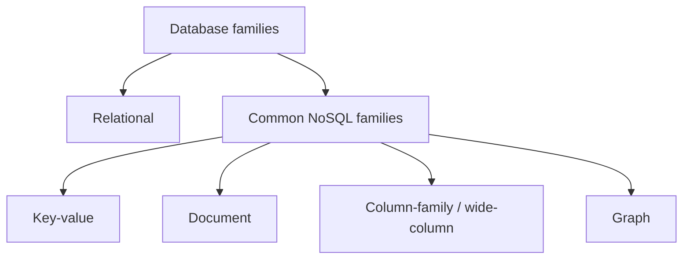

This is **not an exhaustive or mutually exclusive taxonomy**. Products can support several models, and query language does not uniquely determine storage architecture. For example, a relational database can store and query JSON; [PostgreSQL's JSON types](https://www.postgresql.org/docs/current/datatype-json.html) illustrate that overlap.

For a practical mapping from requirements to database candidates, see [Database Selection by Requirements](#database-selection-by-requirements).

### Relational Databases

Relational databases organize data into **relations**, commonly represented as tables. SQL implementations offer schemas, queries, constraints, and transactions with product-specific details.

| Concept | Meaning |
| --- | --- |
| **Table** | A named structure representing an entity or relationship, such as Customers or Orders |
| **Row / record** | One entry in that table; a suitable key identifies it |
| **Column / attribute** | A named field with a declared type and applicable rules |
| **Primary key** | Column or columns chosen to uniquely identify rows; values cannot be null |
| **Foreign key** | A constraint requiring non-null reference values to match an eligible referenced key |
| **SQL** | A language for defining structures and querying/modifying data; dialects and extensions differ |
| **Transaction** | A group of operations managed as one transaction boundary |

Foreign keys can reference **suitable unique keys, not only primary keys**. Null handling and eligible referenced keys follow the engine's rules. A table name or column ending in `_id` does not create referential integrity by itself: the constraint must be declared and enforced. See [PostgreSQL constraints](https://www.postgresql.org/docs/current/ddl-constraints.html).

#### Customers and Orders Example

**Customers** — `customer_id` is the primary key:

| customer_id | name |
| --- | --- |
| 1 | Mina |
| 2 | Rashad |

**Orders** — `order_id` is the primary key; `customer_id` is a non-null foreign key to Customers:

| order_id | customer_id | total | status |
| --- | --- | --- | --- |
| 101 | 1 | 20.00 | paid |
| 102 | 1 | 5.00 | pending |
| 103 | 2 | 15.00 | paid |

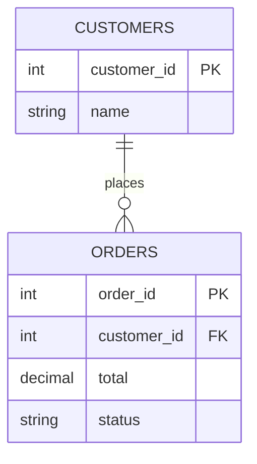

Each order belongs to **exactly one existing customer** in this example; a customer can have **zero or many orders**. Mina has two orders, connected by `customer_id = 1`. Joining the tables can retrieve her name alongside each order without copying her current name into every order. Diagram types are illustrative, not an executable schema.

#### Normalization and Indexes

**Normalization** organizes relations to reduce avoidable duplication and update anomalies. Keeping customer details separately can avoid having to change the same current address in many order rows. It does not eliminate every repeated value: foreign-key values intentionally repeat, and historical order details may need deliberate snapshots.

**Denormalization** deliberately duplicates or precomputes information for a requirement such as read performance or historical accuracy. It introduces an explicit maintenance or freshness responsibility.

**Indexes** provide additional access paths. They can accelerate suitable lookups and joins but consume storage and add write/maintenance work. Joins are **not inherently slow**: cost depends on query shape, indexes, cardinality estimates, data size/distribution, and the execution plan. Inspect and measure actual plans rather than assuming one data model is faster. See [PostgreSQL query-plan documentation](https://www.postgresql.org/docs/current/using-explain.html).

Examples of relational DBMSs include **MySQL, PostgreSQL, Oracle Database, Microsoft SQL Server, SQLite, and IBM Db2**. These differ in deployment, concurrency, extensions, and operational characteristics; the list is not a ranking.

For worked index choices, query plans, pagination, and connection pools, see [Query Performance and Database Access](#query-performance-and-database-access).

#### Greenplum: Relational Analytics with MPP

**Greenplum is a PostgreSQL-based relational/SQL DBMS designed for distributed analytics**, including data warehousing, reporting, and large aggregations. Its **MPP (massively parallel processing)** architecture illustrates why relational databases need not run on one server. It is not a NoSQL column-family database. See the [Greenplum project repository (archived historical material)](https://github.com/greenplum-db/gpdb-archive).

| Workload | Typical pattern and example |
| --- | --- |
| **OLTP — online transaction processing** | Many short operational transactions, such as recording individual purchases |
| **OLAP — online analytical processing** | Larger scans and aggregations, such as annual sales totals by region |

These are **workload categories, not rigid product boundaries**. PostgreSQL also supports analytical queries; a system's suitability depends on its architecture and workload.

**MPP mental model:** The coordinator accepts SQL and plans/distributes work. Segment instances process their data portions in parallel; results are combined and returned through the coordinator. See the [archived Greenplum architecture documentation](https://github.com/greenplum-db/gpdb-archive/blob/main/gpdb-doc/markdown/admin_guide/intro/arch_overview.html.md).

##### Parallelism: Business-Card Analogy

Suppose you must inspect **1,200 business cards** and find everyone working for one company. At one card per second, one worker needs **1,200 seconds = 20 minutes**. Divide the cards into ten equal piles and let ten workers inspect them simultaneously:

| Workers | Cards per worker | Ideal inspection time |
| --- | --- | --- |
| 1 | 1,200 | 1,200 seconds = 20 minutes |
| 10 | 120 | 120 seconds = 2 minutes |

This is an **ideal tenfold speedup**, assuming independent work at the same rate and ignoring the time to distribute cards, coordinate workers, and collect matches. Unequal piles or slower workers change the result.

In the regional-sales example, primary segments similarly process different portions of the orders dataset. Their partial results must then be combined; real queries also incur storage, network, and coordination costs.

##### Cluster Components and Shared-Nothing Architecture

These notes use **coordinator**; older Greenplum material calls it the **master**. A cluster combines PostgreSQL-derived database instances with Greenplum's distributed planning and execution.

| Component | Responsibility |
| --- | --- |
| **Coordinator** | Client entry point; authenticates connections, handles SQL planning, coordinates execution, and returns results. Its global catalog contains metadata; user-table data resides on segments. |
| **Standby coordinator** | Optional coordinator redundancy, maintained through log replication and activated through the deployment's recovery procedure. It is distinct from a segment mirror. |
| **Segment host** | Traditionally a server or VM running segment instances. In supported containerized deployments, instances can run inside containers or Kubernetes pods, using the underlying host's resources and configured persistent storage. Several instances can share host resources. |
| **Primary segment** | A database instance that stores and processes its assigned user-data portion. Different primaries normally work on different portions of a distributed table. |
| **Mirror segment** | A redundant copy of a corresponding primary segment, placed on another host and eligible to take over under the supported failover conditions. |
| **Interconnect** | The networking/communication layer used by the distributed execution system, including intermediate data exchange between segments. |

**Shared-nothing** describes separate host resources and distributed data ownership. It does not require a separate physical computer, operating system, or disk for every segment instance. A host contributes execution, memory, and storage resources that its segment instances share. The number of instances per host is a configuration decision based on resources and workload.

**Containerized deployments:** A segment instance can run in a container, including within a Kubernetes pod, when supported by the selected Greenplum deployment. The layers are:

```text
Physical server or VM (Kubernetes worker node)
  -> Pod
     -> Container
        -> Greenplum segment instance(s)
```

A pod contains one or more containers and runs on a worker node. **Separate pods on the same worker node share that node's failure risk.** Primary/mirror placement must therefore consider the underlying nodes and failure domains, not just different pod names. See the vendor's [Greenplum on Kubernetes explanation](https://blogs.vmware.com/tanzu/greenplum-on-kubernetes/).

The following **illustrative layout** has two primary data portions and cross-host mirrors:

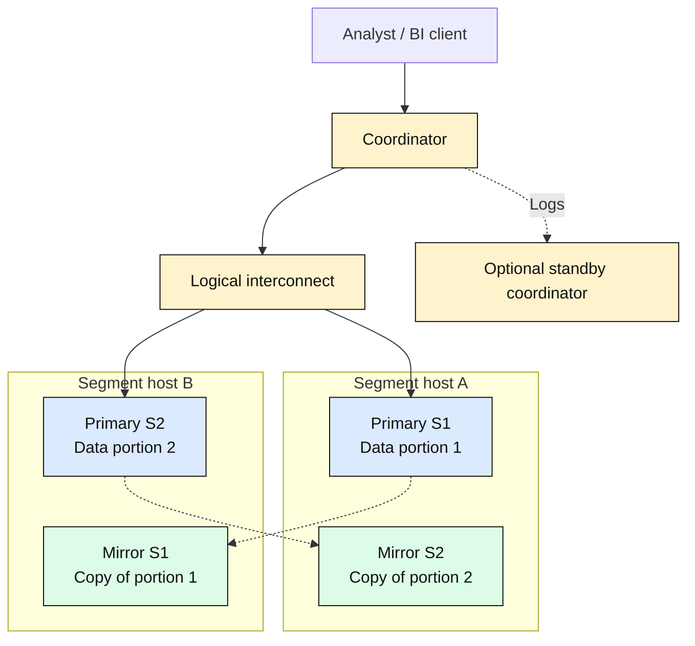

Solid arrows show the client/query-work path; dotted arrows show coordinator-log or segment-data replication. **Primary S1 and Primary S2 process different data portions; Mirror S1 and Mirror S2 hold redundant copies.** The standby is shown separately from the segment hosts; an actual deployment must choose its host and failure domain.

The interconnect box represents a communication layer, not necessarily one dedicated switch. Segment-to-segment exchanges and replication also use networking; the diagram simplifies those paths. Network capacity and isolation affect performance, but there is no single Ethernet speed appropriate to every deployment. See the [archived Greenplum architecture documentation (historical)](https://github.com/greenplum-db/gpdb-archive/blob/main/gpdb-doc/markdown/admin_guide/intro/arch_overview.html.md).

##### Query Walkthrough

1. **Connect:** An application or BI tool connects to the coordinator using a supported interface, such as JDBC, ODBC, or the `psql` client.
2. **Authenticate and plan:** The coordinator authenticates the connection, processes the SQL, and handles planning and distribution of query work. Its global catalog describes the database; it does not replace the user-table data on segments.
3. **Process in parallel:** Primary segments scan and compute over their assigned portions. The plan may require intermediate data exchange between segments, such as redistributing rows for a join or aggregation.
4. **Combine and return:** Intermediate results are combined according to the plan, and the coordinator presents the final result to the client. Not every computation must happen on the coordinator.

**Example:** To calculate annual sales totals by region across a large orders dataset, each segment filters its portion to the requested year and computes partial totals. Combining those totals produces the final regional totals. Depending on data distribution and the query plan, intermediate results may move between segments.

##### Availability and Practical Limits

Coordinator redundancy and segment redundancy protect different roles:

| Failure | Recovery role and condition |
| --- | --- |
| **Coordinator failure** | A configured, suitably synchronized standby can be activated through the supported recovery procedure. Activation and client reconnection are deployment-dependent; they are not universally automatic. |
| **Primary-segment or segment-host failure** | A healthy, eligible mirror on another host can take over the affected data portion through segment failover. Continued service requires the needed data portions, coordinator, and communication paths to remain available. |

In the diagram, if **Host A fails**, Mirror S1 on Host B can become the active copy of portion 1, while Primary S2 still holds portion 2. Host B then carries more active work and redundancy is reduced until recovery restores the missing copies. This assumes the remaining infrastructure and capacity support continued operation. Losing both copies of a required portion prevents normal access to that portion.

Mirrors must reside on different hosts from their corresponding primaries. A standby coordinator protects the coordinator role; it does not hold backup copies of every segment's user data. Treat standby capacity as part of the recovery design rather than assuming it is spare ETL capacity. See [Broadcom's coordinator-activation guidance](https://knowledge.broadcom.com/external/article/296354/failover-to-standby.html) for a vendor example of an explicit activation procedure.

**Storage layout is a separate choice:** Greenplum supports row-oriented heap tables and append-optimized tables with row or column orientation. Columnar storage does not make a database NoSQL. See the [provider's Greenplum storage explanation](https://yandex.cloud/en/docs/managed-greenplum/concepts/tables).

Greenplum can participate in a larger data platform and process data used for reporting or analytical models. That participation does not make the relational DBMS a data lake by itself. Capacity depends on the deployment, data layout, and workload; a fixed “hundreds of TB” ceiling is not a general definition.

**Trade-offs:** Distribution-key choices affect balance and data movement. Skew can leave one segment doing much more work; joins and aggregations may require inter-segment transfers. Network costs and cluster operations also matter, so adding nodes does not guarantee linear speedup. See the [provider's data-distribution explanation](https://yandex.cloud/en/docs/managed-greenplum/concepts/sharding).

##### When Greenplum Is a Good Fit

Greenplum is a candidate when distributed SQL analytics fits the workload and the team can operate the resulting system:

| Workload | Illustrative use | What to validate |
| --- | --- | --- |
| **Enterprise warehouses** | Combine historical orders, customers, and refunds from several operational systems | Source integration, history, ingestion windows, and consistent business definitions |
| **Complex SQL analytics** | Run joins, regional aggregations, reports, and exploratory queries over distributed datasets | Query plans, distribution keys, data movement, and concurrent users |
| **Predictive-analytics preparation** | Prepare historical datasets and features for forecasting, risk analysis, or fraud-model development | Data quality, reproducibility, processing deadlines, and integration with modeling tools |
| **Financial analytics** | Produce reconciled financial reports and analytical risk calculations | Correct rules, suitable transaction boundaries, traceability, and access controls |

Financial reporting and model preparation are different workloads from processing payments or maintaining transactional account balances. Neither SQL transaction support nor handling financial data automatically makes an analytical DBMS the right operational transaction system.

**Suitability is workload-dependent.** Query patterns, concurrency, ingestion, freshness, distribution/skew, operating skills, and total cost matter. There is no universal **“larger than 1 TB”** rule that establishes the best performance or ownership cost. Capacity alone does not select an architecture.

**PostgreSQL compatibility helps integration, but is not universal compatibility.** Familiar SQL and supported drivers can simplify BI/ETL connections. Check the selected tool's driver, SQL dialect, data types, authentication, and supported Greenplum version rather than assuming every PostgreSQL integration works unchanged.

##### Greenplum vs. ClickHouse

**[ClickHouse](#clickhouse) is a column-oriented SQL analytical DBMS** used for OLAP queries; see its [official overview](https://clickhouse.com/docs/get-started/about/intro). Its workloads overlap with Greenplum's. The following comparison identifies evaluation questions rather than declaring a universal winner.

Greenplum references here include the **archived historical documentation** cited above. ClickHouse references describe evolving documented capabilities. Validate the exact release, table engine, settings, and deployment when applying the comparison.

| Dimension | Greenplum | ClickHouse |
| --- | --- | --- |
| **Workload emphasis** | Often evaluated for enterprise warehouses, multi-table analysis, and reporting | Often evaluated for analytical serving, event aggregation, and frequently refreshed dashboards; can also support warehouse workloads |
| **Storage and execution** | MPP execution with supported row-oriented and append-optimized row/column storage | Column-oriented analytical execution; schema, sorting, and indexing influence the work required |
| **SQL and joins** | Supports SQL joins across distributed data; placement and data movement affect plans | Supports [SQL joins](https://clickhouse.com/docs/reference/statements/select/join), with algorithms offering different memory, disk, and execution trade-offs |
| **Transactions and concurrency** | Supports SQL transactions; check isolation and operation/table-type boundaries for the selected release | Provides documented insert guarantees and restricted experimental multi-statement transactions; these are different scopes |
| **Updates and deletes** | Supports changes through SQL; table layout, version, concurrency, and maintenance affect behavior and cost | Supports [updates](https://clickhouse.com/docs/reference/statements/update) and [deletes](https://clickhouse.com/docs/reference/statements/delete); mechanism, visibility, and physical cleanup differ |
| **Ingestion and freshness** | Evaluate loading and correction workflows alongside analytical query concurrency | Evaluate insert batching, merging, corrections, and query concurrency against freshness targets |
| **Scaling and operations** | Segment placement, expansion/rebalancing, skew, interconnect traffic, and recovery need planning | Shard/data placement, replica strategy, redistribution, capacity, and background maintenance need planning |
| **Security and recovery** | Configure database permissions and recovery; standby/mirroring do not replace backups and tested restoration | Supports [RBAC](https://clickhouse.com/docs/concepts/features/security/access-rights) and [backup/restore](https://clickhouse.com/docs/concepts/features/backup-restore/overview); replication and encryption choices depend on deployment |

**Transaction scope matters:** ClickHouse documents transactional properties for qualifying inserts into a single partition of a MergeTree-family table; an insert into a distributed table is not transactional across all shards as a whole. Its documented multi-statement transaction support is **experimental and restricted**, not a general replacement for transactional application requirements. Check [ClickHouse's transaction documentation](https://clickhouse.com/docs/concepts/features/operations/insert/transactions) for conditions and limits.

For Greenplum, do not assume every transaction always runs at Serializable isolation. Isolation behavior is release-dependent and must be selected and verified for the operation. The vendor's [historical explanation of transaction snapshots](https://blogs.vmware.com/tanzu/improving-backup-performance-and-reliability-with-distributed-snapshots/) illustrates distinct isolation behaviors. See [Transactions and ACID](#transactions-and-acid) for the broader guarantees and application responsibilities.

**Changing a value and physically removing bytes are different events.** ClickHouse's documented lightweight updates use patch parts that queries can read before physical consolidation; lightweight deletes can hide rows before later storage cleanup. Supported engines/settings and synchronization behavior matter. Do not interpret either capability as identical to every OLTP update/delete implementation, or assume that a row hidden from queries has already disappeared from all retained copies.

Both systems require deliberate permissions, TLS/encryption decisions, recovery procedures, and restore testing. Greenplum's [availability explanation](#availability-and-practical-limits) covers coordinator/segment redundancy; that is one part of recovery, not proof that backups or disaster recovery are unnecessary.

**Two illustrative workload questions:**

| Scenario | Questions to evaluate |
| --- | --- |
| **Prepare a multi-source financial report** | How are source cutoffs, transaction boundaries, corrections, joins, and reconciliation handled? What must be reproducible and auditable? |
| **Serve frequently refreshed event dashboards** | What freshness and query-latency targets must hold at the expected ingestion rate and concurrency? How do late events, updates, and background work affect them? |

Both are evaluation scenarios, not guaranteed product winners. Check representative queries, changes, concurrency, and failure behavior on the intended version and deployment; product labels alone do not establish correctness or performance.

**Using both: retailer example**

A retailer could evaluate:

- **Greenplum** for monthly profitability reports combining orders, returns, suppliers, and accounting data.
- **[ClickHouse](#clickhouse)** for frequently refreshed clickstream and telemetry dashboards.

Shared [data pipelines](Data-Engineering-for-Solution-Architecture.md) can feed different datasets into each system. Define update lag, corrections, access controls, and recovery for each analytical view. Operating both adds synchronization and maintenance work; one database may already satisfy the requirements.

##### Quick Selection: PostgreSQL, Greenplum, or ClickHouse

| Choose | When you need | Simple example |
| --- | --- | --- |
| **PostgreSQL** | An application database with frequent record changes and multi-step transactions | Process orders, update inventory, and transfer account balances |
| **Greenplum** | A large analytical warehouse combining related datasets through complex SQL and joins | Analyze yearly profit using orders, customers, products, and refunds |
| **[ClickHouse](#clickhouse)** | Frequently refreshed analytical queries over large event datasets | Show website clicks, application errors, or sensor metrics (IoT, robotics, etc.) on dashboards |

**Start with PostgreSQL when it meets your operational and reporting requirements.** Evaluate specialized analytical systems when the workload justifies them.

These are starting points with overlapping capabilities. ClickHouse supports joins, updates, deletes, and [scoped transaction guarantees](https://clickhouse.com/docs/concepts/features/operations/insert/transactions). **Correctness matters in all three; transaction scope and workload fit differ.**

> **Relational describes the data model; columnar describes a storage layout; MPP describes parallel processing across instances.**

### Transactions and ACID

A **database transaction** groups one or more operations, such as SQL `INSERT`, `UPDATE`, or `DELETE`, into a **single logical unit of work**. Its transactional data changes are committed together or discarded on rollback. **Rollback cancels this transaction's uncommitted changes**; other transactions may still change the database.

ACID describes four important properties:

| Property | Meaning | Transfer example |
| --- | --- | --- |
| **Atomicity — all or nothing** | Commit the transaction's data changes together, or commit none of them | Do not retain only the debit without the corresponding credit |
| **Consistency — preserve rules** | Correct transaction logic and enforced constraints keep the data within defined rules | Preserve the combined balance and any required balance constraints |
| **Isolation — control concurrency** | The isolation level determines how simultaneous transactions interact and what they can see | Concurrent transfers must not produce forbidden outcomes under the chosen isolation strategy |
| **Durability — keep committed changes** | Committed changes survive the failures covered by the configured guarantee | Retain the committed transfer through the covered crash/recovery scenario |

#### Account Transfer Example

For a simplified transfer of **20 units from A to B**, with no fees or other balance changes:

The transfer has two steps:

1. **Deduct 20** from Account A.
2. **Add 20** to Account B.

Grouping them in one transaction prevents committing only half of the transfer.

| Account | Before | After a successful commit |
| --- | --- | --- |
| A | 100 | 80 |
| B | 50 | 70 |
| **Combined** | **150** | **150** |

**Short PostgreSQL example:** Assume the table is `accounts(account_id, balance)`, A and B each identify one existing account, and the application correctly enforces the required funds and authorization rules.

```sql
BEGIN;  -- Start one transaction

UPDATE accounts
SET balance = balance - 20
WHERE account_id = 'A';

UPDATE accounts
SET balance = balance + 20
WHERE account_id = 'B';

COMMIT; -- Commit both balance changes together
```

After a successful commit, **A = 80 and B = 70**. To cancel the open transaction, execute **`ROLLBACK;` instead of `COMMIT;`**. The uncommitted balance changes are discarded, leaving **A = 100 and B = 50**, assuming no other transactions changed them. Rollback does not undo an already committed transfer.

The application checks the relevant rules and groups the debit and credit within one transaction. On rollback, those uncommitted changes do not become the completed transfer. A database transaction does not automatically make unrelated external API calls atomic. See the [transaction introduction](https://www.postgresql.org/docs/current/tutorial-transactions.html).

#### What ACID Does Not Promise

- **ACID consistency is not distributed read consistency.** Preserving business/data invariants differs from whether a replica read reflects the latest write. See [Consistency](Distributed-System-Attributes.md#consistency).
- **ACID does not invent correct business logic.** A transaction can commit the wrong amount if neither its logic nor the enforced constraints prevent it.
- **Isolation levels matter.** Weaker levels permit outcomes that serializable execution rules out. Even serializable transactions may need safe retries after conflicts; a default isolation level is not automatically sufficient. See [PostgreSQL isolation levels](https://www.postgresql.org/docs/current/transaction-iso.html).
- **Durability has a failure scope.** Logging, flush/acknowledgment settings, replication, and recovery procedures determine what a deployment actually promises.
- **Error handling is engine-specific.** A failing statement, deadlock, explicit rollback, and disconnected client need not have identical effects. Do not assume every SQL error automatically rolls back the whole transaction. For example, [MySQL InnoDB documents different rollback scopes](https://dev.mysql.com/doc/refman/8.4/en/innodb-error-handling.html).

> **Recall:** Transactions are a tool for enforcing specified rules. Choose transaction boundaries, isolation, and durability deliberately; “supports ACID” is not a complete application-correctness design.

When one logical operation spans separate databases, see [Distributed Transactions](#distributed-transactions) for the additional commit and recovery requirements.

### NoSQL Databases

**NoSQL**, often expanded as *Not Only SQL*, is an umbrella label for several non-relational approaches. It does not mean “no structure,” “no relationships,” or “no transactions.” A database may store structured and semi-structured records or binary values depending on its model; not every engine is equally suited to every data shape.

| Family | Main organization | Simple access-pattern example | Representative systems |
| --- | --- | --- | --- |
| **Key-value** | Look up a value using a key; values may have rich supported types | Retrieve a session by its ID | Redis, [Amazon DynamoDB](#amazon-dynamodb) |
| **Document** | Store records as documents with fields and nested structures | Read a product's description and variable attributes together | [MongoDB](#mongodb-document-modeling-and-queries), Apache CouchDB |
| **[Column-family / wide-column](#column-family-databases)** | Organize records around row/partition keys and related columns | Fetch device measurements within a modeled key/time range | Apache Cassandra, [Apache HBase](#apache-hbase) |
| **[Graph](#graph-databases)** | Represent entities and explicit relationships for traversal | Follow account-to-device connections in a fraud investigation | [Neo4j](#neo4j), Amazon Neptune |

These examples describe common use patterns, not exclusive product capabilities. Redis supports multiple [data types](https://redis.io/docs/latest/develop/data-types/); DynamoDB supports key-value and document patterns. See [CouchDB's document overview](https://docs.couchdb.org/en/stable/intro/overview.html), [Cassandra's architecture](https://cassandra.apache.org/doc/latest/cassandra/architecture/overview.html), and [Neo4j graph concepts](https://neo4j.com/docs/getting-started/appendix/graphdb-concepts/).

#### Schemas, Transactions, and Consistency

**Flexible schema is not absence of schema.** Applications still rely on field meanings, types, indexes, and relationships. Existing readers may not understand a new field format; mixed versions, backfills, validation, and index changes need planning. See [MongoDB data-modeling guidance](https://www.mongodb.com/docs/manual/data-modeling/).

NoSQL does **not inherently mean weak consistency or absent transactions**. [MongoDB supports multi-document transactions](https://www.mongodb.com/docs/manual/core/transactions/), including supported distributed deployments; [DynamoDB provides transactional APIs](https://docs.aws.amazon.com/amazondynamodb/latest/developerguide/transactions.html). Scope, limits, isolation, deployment, and cost must be checked for the specific operation.

Read guarantees can also differ within one product: for example, DynamoDB documents [strongly consistent and eventually consistent read options](https://docs.aws.amazon.com/amazondynamodb/latest/developerguide/HowItWorks.ReadConsistency.html), with differences between tables and index types. A family name alone does not identify the consistency of every read.

#### Wide-Column vs. Analytical Columnar Storage

The terms sound similar but describe different ideas:

- **Wide-column / column-family model:** A logical organization around keyed rows and column families, with product-specific rules. [HBase](#apache-hbase) is an example; row-key design strongly affects access patterns.
- **Analytical columnar storage:** Physically stores values by column to support workloads such as scanning and aggregating selected columns.

Do not infer an analytical columnar layout merely from the label “column-family.” These model and storage-layout concepts can overlap in some systems, but are not synonyms. Compare [HBase's data model](https://hbase.apache.org/docs/datamodel/) with the [ClickHouse column-oriented overview](https://clickhouse.com/docs/get-started/about/intro).

The relational [Greenplum example](#greenplum-relational-analytics-with-mpp) shows the distinction: its append-optimized tables can use columnar storage while retaining the relational/SQL model.

### MongoDB: Document Modeling and Queries

**MongoDB is a document database.** Its document model is useful when a record's nested structure matches how the application reads and updates it. Compare the same user profile in two possible designs before choosing a model.

#### Documents, Collections, and BSON

| Concept | Meaning | Profile example |
| --- | --- | --- |
| **Document** | A record made of fields and values, including nested documents and arrays | Jane's name, address, and hobbies |
| **Collection** | A group of documents | A `users` collection containing user profiles |
| **BSON — Binary JSON** | MongoDB's binary document representation, with types beyond plain JavaScript Object Notation (JSON), such as dates and ObjectIds | The stored representation of a profile |
| **`_id`** | A document's identifier | Use numeric `1` for Jane in this example |

In this unsharded example, `_id` is unique within the collection. When it is omitted on insertion, MongoDB commonly uses an automatically generated **ObjectId**. BSON is not simply a JSON text file; the JSON below is a readable illustration of document contents. See [MongoDB documents](https://www.mongodb.com/docs/manual/core/document/).

Documents in a collection can have different fields, but the application still depends on their meanings and types. Plan the model and validation deliberately.

#### The Same Profile in Two Models

Suppose an e-commerce application displays Jane's profile, including her current address and hobbies.

**Relational design:** Use three tables, with `user_id` foreign keys referring to `Users.id`. This example has one current address per profile and multiple hobbies. An appropriate unique constraint on `Addresses.user_id` can prevent multiple address rows for the same user; other requirements could instead allow several addresses.

**Users**

| id | first_name | last_name | email |
| --- | --- | --- | --- |
| 1 | Jane | Doe | jane@example.com |

**Addresses**

| id | user_id (FK) | street | city | zipcode |
| --- | --- | --- | --- | --- |
| 101 | 1 | 123 Main St | New York | 10001 |

**UserHobbies**

| id | user_id (FK) | hobby_name |
| --- | --- | --- |
| 501 | 1 | Hiking |
| 502 | 1 | Reading |

Here **FK** means foreign key. The address and hobby row identifiers are relational bookkeeping; the nested profile below represents the same business information without needing separate child-row identifiers.

A Structured Query Language (SQL) query can combine the rows:

```sql
SELECT u.id, u.first_name, u.last_name, u.email,
       a.street, a.city, a.zipcode, h.hobby_name
FROM Users AS u
JOIN Addresses AS a ON a.user_id = u.id
JOIN UserHobbies AS h ON h.user_id = u.id
WHERE u.id = 1
ORDER BY h.hobby_name;
```

**Result:**

| id | first_name | last_name | email | street | city | zipcode | hobby_name |
| --- | --- | --- | --- | --- | --- | --- | --- |
| 1 | Jane | Doe | jane@example.com | 123 Main St | New York | 10001 | Hiking |
| 1 | Jane | Doe | jane@example.com | 123 Main St | New York | 10001 | Reading |

The join produces **one row per hobby**. Application code can assemble these rows into a nested profile. This inner-join example assumes the related address and hobby rows exist; profiles with optional related records may need outer joins or separate reads.

**MongoDB design:** Store the bounded profile information together in one document within `users`:

```json
{
  "_id": 1,
  "first_name": "Jane",
  "last_name": "Doe",
  "email": "jane@example.com",
  "address": {
    "street": "123 Main St",
    "city": "New York",
    "zipcode": "10001"
  },
  "hobbies": ["Hiking", "Reading"]
}
```

Jane's address is an **embedded document**, and her hobbies are an **array**. Postal codes remain strings so leading zeros can be preserved.

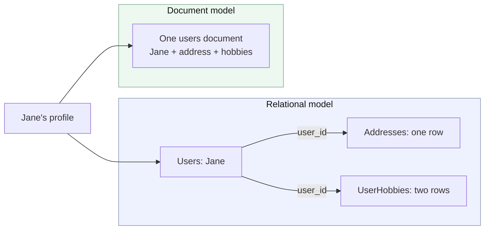

These are **modeling choices, not mandatory layouts**. Relational databases do not force every design to be normalized, and MongoDB does not require every relationship to be embedded. Normalization addresses particular redundancies and update anomalies, not every repeated value or empty cell. Relational systems can denormalize and store JSON, as [PostgreSQL's JSON types](https://www.postgresql.org/docs/current/datatype-json.html) demonstrate.

#### MongoDB Query Language: A Short Walkthrough

**MongoDB Query Language (MQL)** expresses operations through filter documents, operators, and aggregation stages. **MongoDB Shell (`mongosh`)** exposes JavaScript-style methods such as `db.users.findOne(...)`. The surrounding shell syntax is not SQL or plain JSON; drivers expose corresponding operations in other programming languages.

The following illustrative snippets assume `db` refers to an example database with an **initially empty `users` collection**. Follow them in order, with deletion last. Result excerpts show the relevant fields; other metadata or shell formatting can vary.

**1. Create Jane's profile.**

```javascript
db.users.insertOne({
  _id: 1,
  first_name: "Jane",
  last_name: "Doe",
  email: "jane@example.com",
  address: {
    street: "123 Main St",
    city: "New York",
    zipcode: "10001"
  },
  hobbies: ["Hiking", "Reading"]
});
```

Relevant result:

```json
{ "insertedId": 1 }
```

This inserts one complete document; inserting the same `_id` again into this collection would conflict with its identifier constraint. [`insertOne` reference](https://www.mongodb.com/docs/manual/reference/method/db.collection.insertOne/)

**2. Read one profile.**

```javascript
db.users.findOne({ _id: 1 });
```

This returns Jane's complete document shown above. If no document matches, `findOne` returns `null`. [`findOne` reference](https://www.mongodb.com/docs/manual/reference/method/db.collection.findOne/)

**3. Filter nested fields and arrays, then select fields.**

```javascript
db.users.find(
  { "address.city": "New York", hobbies: "Reading" },
  { _id: 0, first_name: 1 }
).toArray();
```

Result:

```json
[{ "first_name": "Jane" }]
```

The filter requires **both conditions**. Dot notation addresses the nested `city` field; `hobbies: "Reading"` matches an array containing that value. The second argument is a **projection**: return `first_name` and explicitly exclude `_id`.

`find()` ordinarily returns a **cursor**, rather than an array. Here `.toArray()` collects the small result for illustration; large result sets may need incremental cursor processing. [`find` reference](https://www.mongodb.com/docs/manual/reference/method/db.collection.find/)

**4. Update the address and add a hobby.**

```javascript
db.users.updateOne(
  { _id: 1 },
  {
    $set: {
      "address.city": "Boston",
      "address.zipcode": "02108"
    },
    $addToSet: { hobbies: "Cycling" }
  }
);
```

Relevant result for this first update:

```json
{ "matchedCount": 1, "modifiedCount": 1 }
```

`$set` changes the named fields rather than replacing the whole document. `$addToSet` adds Cycling only if it is absent; it does not remove pre-existing duplicates or promise array ordering. Repeating this same update matches Jane but makes no further change. See [`updateOne`](https://www.mongodb.com/docs/manual/reference/method/db.collection.updateOne/) and [`$addToSet`](https://www.mongodb.com/docs/manual/reference/operator/update/addToSet/).

**5. Verify the changed profile.**

```javascript
db.users.findOne({ _id: 1 });
```

Jane's identity fields and street remain unchanged. The result now contains:

| Field | Value after the update |
| --- | --- |
| `address.city` | `"Boston"` |
| `address.zipcode` | `"02108"` |
| `hobbies` | Hiking, Reading, and Cycling; array order is not asserted here |

**6. Aggregate profiles by hobby.**

```javascript
db.users.aggregate([
  { $unwind: "$hobbies" },
  { $group: { _id: "$hobbies", profiles: { $sum: 1 } } },
  { $sort: { _id: 1 } }
]).toArray();
```

Result:

```json
[
  { "_id": "Cycling", "profiles": 1 },
  { "_id": "Hiking", "profiles": 1 },
  { "_id": "Reading", "profiles": 1 }
]
```

`$unwind` produces a working record per hobby, `$group` counts them, and `$sort` orders the result by hobby name. These are computed results, not changes to Jane's stored document.

This dataset contains each hobby once per profile, so the counts also represent profiles. If input arrays contain duplicates, this pipeline counts those occurrences too; deduplicate per profile when distinct-profile counts are required. [Aggregation pipelines](https://www.mongodb.com/docs/manual/core/aggregation-pipeline/)

**7. Add a lookup index.**

```javascript
db.users.createIndex({ "address.city": 1 });
```

The default index name is `"address.city_1"`; `1` requests ascending index order. It provides an additional access path for suitable city queries, not a guarantee that every query becomes faster. Indexes consume storage and add write work; selectivity and query plans matter. See [`createIndex`](https://www.mongodb.com/docs/manual/reference/method/db.collection.createIndex/) and the existing [index explanation](#normalization-and-indexes).

**8. Delete Jane's example document last.**

```javascript
db.users.deleteOne({ _id: 1 });
```

Relevant result:

```json
{ "deletedCount": 1 }
```

A subsequent `db.users.findOne({ _id: 1 })` returns `null`. Deleting an embedded profile removes its embedded address and hobbies with that document; separate referenced records would require an explicit lifecycle policy. [`deleteOne` reference](https://www.mongodb.com/docs/manual/reference/method/db.collection.deleteOne/)

#### Embedding, References, and Practical Selection

| Requirement | Modeling direction | Concrete example |
| --- | --- | --- |
| **Bounded information accessed and updated together** | Consider embedding in one document | Jane's current address and small hobby list |
| **Shared or independently changing entities** | Consider references and separate records | Many profiles refer to the same organization, whose details change independently |
| **Continuously growing related data** | Keep separate records or another bounded design | Store order history as separate orders rather than an indefinitely growing profile array |
| **Interconnected data with database-enforced foreign keys and substantial cross-entity querying** | Consider relational modeling | Customers, orders, payments, and accounting relationships with explicit constraints |
| **Aggregate-shaped records benefiting from nested representation** | Consider a document model | Product descriptions with category-specific nested attributes, accessed as a product record |

MongoDB supports references and **`$lookup`**, an aggregation stage that can join related collection data. Embedding can avoid that extra lookup for a particular read; it does not make joins impossible or unnecessary for every workload. Shared duplicated data still needs an update policy. See [modeling best practices](https://www.mongodb.com/docs/manual/data-modeling/best-practices/) and [`$lookup`](https://www.mongodb.com/docs/manual/reference/operator/aggregation/lookup/).

Relational foreign keys can enforce referenced-row existence. A MongoDB reference field does not automatically supply the equivalent constraint; transactions alone do not create that rule. Define the application workflows and checks needed to preserve such relationships.

#### Schemas, Atomicity, and Design Limits

- **Schema validation:** MongoDB can validate types, required fields, and other rules. Flexible documents still require compatibility, validation, and migration planning; schema changes are not automatically disruption-free. [Schema validation](https://www.mongodb.com/docs/manual/core/schema-validation/)
- **Atomic writes:** A single-document write is atomic, including updates to several fields. This does not mean a sequence of separate application operations is automatically one transaction. [Atomicity and transactions](https://www.mongodb.com/docs/manual/core/write-operations-atomicity/)
- **Multi-document transactions:** Supported deployments provide them, subject to documented boundaries and costs. Choose appropriate transaction scope and read/write settings; do not infer every guarantee from the word NoSQL. See [MongoDB transactions](https://www.mongodb.com/docs/manual/core/transactions/), [ACID](#transactions-and-acid), and [consistency considerations](#schemas-transactions-and-consistency).
- **Document growth:** The maximum BSON document size is **16 MiB**. Avoid unbounded embedding even before reaching that limit. [MongoDB limits](https://www.mongodb.com/docs/manual/reference/limits/)
- **Scaling and selection:** Relational systems can scale horizontally; MongoDB's sharding also requires appropriate design and operation. Neither model universally guarantees better speed, consistency, scalability, or financial-system suitability. Use the [database selection checklist](#database-selection-checklist).

> **Recall:** Choose the record boundaries from the reads, writes, relationships, and invariants. One document can simplify an aggregate-shaped operation; linked tables or referenced documents can better fit other requirements.


### Relational and NoSQL Trade-Offs

| Dimension | Relational approaches | NoSQL approaches | Question to ask |
| --- | --- | --- | --- |
| **Queries and relationships** | SQL, joins, and constraints suit many interconnected workloads | Key, document, wide-column, or graph operations fit different access patterns | Which queries, traversals, and aggregations must be efficient? |
| **Transactions** | Commonly support multi-statement transactions; guarantees vary | Atomic/transaction scope varies; some support multi-record ACID transactions | Which changes must commit together? |
| **Schema evolution** | Explicit schemas and migrations; JSON support is possible | Often flexible records, but compatibility and indexes still matter | Can old and new application versions coexist? |
| **Scaling** | Vertical scaling, replicas, partitioning, sharding, or distributed relational designs | Many systems offer distributed partitioning, with model-specific restrictions | Where are the hot spots and cross-node coordination costs? |
| **Consistency** | Depends on isolation, replication, read routing, and settings | Depends on product, operation, topology, and settings | What may each read observe during concurrency or failure? |
| **Storage** | Normalization can reduce duplication; indexes and row layout affect size | Embedding/denormalization may reduce lookups but duplicate data | What are the actual memory, disk, and write-amplification costs? |
| **Security and operations** | Engine/deployment controls require correct configuration | Same responsibility, with different features and service boundaries | Who handles access, keys, upgrades, backups, and recovery? |
| **Portability** | SQL provides common foundations, but dialects and extensions differ | APIs and models vary significantly; some expose SQL-like query languages | What migration or interoperability constraints matter? |

**Relational does not mean “cannot scale horizontally.”** Distributed relational systems exist; [Spanner's schema and data-model documentation](https://docs.cloud.google.com/spanner/docs/schema-and-data-model) describes relational tables and distribution. Conventional deployments can also use read replicas or application sharding, with different coordination and maintenance costs. Conversely, distributing a NoSQL system is not automatically seamless or appropriate.

For distributed analytical workloads, [Greenplum's MPP architecture](#greenplum-relational-analytics-with-mpp) provides another relational scaling example.

**Null storage is implementation-dependent.** Do not assume every null reserves a full column value or makes relational databases inherently memory-intensive. PostgreSQL, for example, documents a [null bitmap in its row layout](https://www.postgresql.org/docs/current/storage-page-layout.html). Measure the chosen engine and schema.

**Schema changes are not automatically disruption-free in either category.** Security, availability, and scalability likewise require deliberate design and operation, rather than following automatically from a database label.

#### Database Selection Checklist

Use these questions with the [practical selection guide](#database-selection-by-requirements) below.

1. What are the main reads, writes, searches, traversals, and aggregations?
2. Which invariants and multi-record transaction boundaries must hold?
3. What freshness and concurrency guarantees does each operation require?
4. What are the data size, growth, throughput, latency, and geographic requirements?
5. Which partition keys, indexes, or joins could become bottlenecks?
6. How will schema changes, backups, restores, and failures be handled?
7. Which security controls, operational skills, and costs can the team support?

Use [CAP](Distributed-Systems-Theorems-and-Data-Structures.md#cap-theorem) and [PACELC](Distributed-Systems-Theorems-and-Data-Structures.md#pacelc-theorem) to reason about relevant distributed trade-offs—not to assign every product a permanent SQL/NoSQL consistency category. For a small workload, a simpler deployment can be a sound design.

> **Choose the data model and guarantees for the workload, then validate the engine and deployment. Neither “relational” nor “NoSQL” is a universal winner.**

## Database Selection by Requirements

**Choose a database by the operations and guarantees you need, not simply by application size or the SQL/NoSQL label.** Use the [Database Selection Checklist](#database-selection-checklist) to gather requirements, then use the mapping below to identify candidates.

### Separate the Design Dimensions

These labels answer different questions:

| Dimension | Question | Examples |
| --- | --- | --- |
| **Data model** | How is information represented and related? | Relational tables, documents, key-value pairs, graphs |
| **Workload or capability** | What operations must the system support? | Transactions, analytics, time-series, text search, vector search |
| **Storage layout** | How are values arranged for storage and processing? | Row-oriented, column-oriented |
| **Deployment** | Where does the engine run and how is work distributed? | Embedded in an application, single-server, distributed |

> **Both relational and NoSQL databases can be distributed. “Distributed,” “columnar,” and “NoSQL” are not interchangeable labels.**

For example, SQLite is relational and embedded; Greenplum is relational and distributed; PostgreSQL can support documents and specialized indexes without becoming a different physical database for every capability. “Embedded” and “distributed SQL” are deployment/architecture descriptions, not additional non-relational data models.

Compare the existing [horizontal-scaling explanation](#relational-and-nosql-trade-offs), [Greenplum MPP example](#greenplum-relational-analytics-with-mpp), and [wide-column versus analytical columnar distinction](#wide-column-vs-analytical-columnar-storage).

### Database Types, Requirements, and Examples

**These are evaluation candidates, not automatic recommendations.** Rows overlap, and product capabilities depend on versions, configuration, deployment, and operations. No row promises a particular latency, scale, availability, or level of correctness.

| Family or capability | Requirement | Concrete example | Representative implementations |
| --- | --- | --- | --- |
| **Relational approaches** | | | |
| **Relational SQL / OLTP** | Related records, constraints, and changes that must commit together | Transfer $100: debit one account and credit another in one transaction | PostgreSQL, MySQL, SQL Server, Oracle Database |
| **Distributed SQL** | Transactional SQL with required distribution, partitioning, and geographic placement | Keep account operations consistent across the regions the service must support | CockroachDB, [TiDB](https://docs.pingcap.com/tidb/stable/overview/), YugabyteDB, Google Spanner |
| **Embedded SQL** | Local relational storage without a separate database server | A mobile app keeps offline preferences and locally saved data | SQLite |
| **Common NoSQL models** | | | |
| **Key-value** | Retrieve or update a value using a known key | Look up a user session by its unique session ID | Redis, [Amazon DynamoDB](#amazon-dynamodb), Aerospike |
| **Document** | Nested records and field queries suited to the access pattern | Laptops have RAM and CPU fields; shoes have size and material fields | MongoDB, Couchbase, [Amazon DynamoDB](#amazon-dynamodb) |
| **[Wide-column](#column-family-databases)** | Distributed keyed writes and range reads designed around partition/row keys | Retrieve one sensor's readings for a bounded time period | Apache Cassandra, [Apache HBase](#apache-hbase), Google Bigtable |
| **[Graph](#graph-databases)** | Follow relationships across multiple hops | Investigate customers sharing devices, accounts, and transaction connections | [Neo4j](#neo4j), Amazon Neptune, TigerGraph |
| **Specialized workloads and capabilities** | | | |
| **Time-series** | Timestamped ingestion, time-window queries, and retention rules | Calculate hourly temperature and CPU-usage trends from a robot fleet | InfluxDB, TimescaleDB, OpenTSDB |
| **Search** | Keyword matching, filters, and relevance ranking | Search product descriptions or application logs for matching terms | Elasticsearch, OpenSearch, Apache Solr |
| **Vector** | Similarity retrieval over embeddings, with appropriate metadata filters | Retrieve approved documents related to an AI assistant's question | Qdrant, Milvus, Weaviate, Pinecone, PostgreSQL + pgvector |
| **Analytical SQL / OLAP, often columnar** | Larger scans and aggregations over historical data | Calculate revenue by country across a billion historical sales records | [ClickHouse](#clickhouse), DuckDB, BigQuery, Snowflake |
| **Geospatial** | Spatial indexes and geographic predicates such as distance or containment | Find available drivers within five kilometres of a customer | PostgreSQL + PostGIS, MongoDB geospatial capabilities |
| **Event store** | Retain ordered business events and replay them using application rules | Reconstruct an order from its created, paid, and dispatched events | KurrentDB (formerly EventStoreDB) |
| **Tamper-evident history / ledger** | Verify recorded history against cryptographic evidence and retained trusted state | Check whether an audit-history record has been altered | immudb |

**Read the table with these distinctions:**

- **Transactions and consistency:** SQL does not automatically mean every read sees the latest state; NoSQL does not mean transactions are absent. Check the required operation and deployment. See [Transactions and ACID](#transactions-and-acid) and [Schemas, Transactions, and Consistency](#schemas-transactions-and-consistency).
- **Distribution:** More regions or replicas introduce coordination, latency, and failure trade-offs. Distributed SQL does not make cross-region transactions free; [Spanner's schema documentation](https://docs.cloud.google.com/spanner/docs/schema-and-data-model) illustrates relational data distributed across nodes.
- **Embedded:** SQLite runs inside the application process; it does not need a separate database-server process. See [SQLite's explanation](https://www.sqlite.org/serverless.html).
- **Wide-column:** Model the queries and keep partitions bounded. For sensor history, a device-and-time-bucket key can prevent one device's lifetime history becoming one ever-growing partition. See [Cassandra's partition-modeling guidance](https://cassandra.apache.org/doc/latest/cassandra/developing/data-modeling/data-modeling_refining.html). Wide-column is not the same as analytical columnar storage.
- **Capabilities overlap:** [PostgreSQL + pgvector](https://github.com/pgvector/pgvector) and [PostgreSQL + PostGIS](https://postgis.net/documentation/) mean PostgreSQL with extensions, not separate database products named pgvector or PostGIS. PostgreSQL also supports JSON and [full-text search](https://www.postgresql.org/docs/current/textsearch.html); [Elasticsearch](https://www.elastic.co/docs/products/elasticsearch) supports vector search as well as text search.
- **Events versus evidence:** An event store supports reconstructing state from retained events; a tamper-evident store supports detecting inconsistent history under its verification assumptions. Neither makes the original information true, guarantees it can never be deleted, or automatically supplies a complete accounting ledger. [KurrentDB's documentation](https://docs.kurrent.io/getting-started/kurrent-ecosystem) confirms the EventStoreDB rename; [immudb](https://github.com/codenotary/immudb) illustrates verifiable history. Compare the [Merkle-tree limitations](#finding-and-repairing-a-difference).

For existing worked comparisons, see [MongoDB document modeling](#mongodb-document-modeling-and-queries) and [PostgreSQL, Greenplum, or ClickHouse selection](#quick-selection-postgresql-greenplum-or-clickhouse). These categories are a study map, not an exhaustive or mutually exclusive taxonomy.

### Worked Example: Banking Platform with an AI Assistant

**One application can have different storage needs.** Here is an illustrative allocation of roles—not a production banking design or a requirement to install six databases.

| Role | Candidate | Why consider it? |
| --- | --- | --- |
| **Authoritative accounts and transactions** | PostgreSQL | Record approved account changes with the required transactions, constraints, and access controls |
| **Optional cache and sessions** | Redis | Reuse selected results and look up session state by key |
| **Optional keyword search** | Elasticsearch | Search approved documents or permitted operational records by terms and filters |
| **Optional semantic retrieval** | Qdrant **or** PostgreSQL + pgvector | Find relevant approved knowledge for an AI answer |
| **Optional relationship analysis** | [Neo4j](#neo4j) | Explore connections during fraud review; connections alone do not prove fraud |
| **Optional analytical reporting** | [ClickHouse](#clickhouse) | Run historical aggregations without placing every report on the operational database |

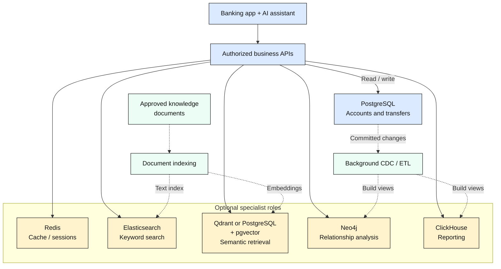

**Solid arrows show application access; dotted arrows show background data updates.** Query results return to the caller; arrows are not broadcasts. The optional group names roles: PostgreSQL + pgvector may run in the same database as other tables, rather than requiring another installation.

1. **A customer asks for their balance:** The authorized business API reads the authoritative account state with the required read guarantees. The AI assistant does not infer a live balance from similar documents or treat a stale cache as authoritative.
2. **A customer asks about an approved policy:** Retrieve permitted documents using keywords, vectors, or both. Enforce access before giving evidence to the model; retrieval does not guarantee that its final answer is correct.
3. **An analyst requests a historical report or relationship investigation:** Query the prepared views, knowing their freshness and completeness. These views can lag behind operational changes.

**CDC** means *change data capture*; **ETL** means *extract, transform, load*. The background arrows stand for designed pipelines, not automatic cross-product replication. They need update/deletion propagation, replay or rebuilding, recovery, and access-control policies. Caches need explicit expiration or invalidation; sessions need their own security and lifecycle rules. See [data ingestion](Data-Engineering-for-Solution-Architecture.md#data-ingestion), [AI retrieval](AI-Systems-Design.md#knowledge-ingestion-and-retrieval), and [authorization enforcement](Identity-and-Access-Management.md#authorization-in-practice).

**Separate databases do not automatically share one transaction.** Committing a transfer in PostgreSQL does not make Redis, Neo4j, and ClickHouse change atomically with it. Define which store is authoritative and how other views catch up; do not imply that an uncoordinated sequence of writes is one atomic operation.

Using different storage technologies for different needs is called **polyglot persistence**. It can help, but every extra system adds synchronization, access control, backup/recovery, upgrades, monitoring, and cost. A simpler deployment may satisfy several roles with PostgreSQL, JSON, full-text search, and suitable extensions. Introduce another engine when the measured workload and operating requirements justify it.

### Worked Example: Global Autonomous Delivery Platform

Imagine a service where customers order goods, warehouses prepare parcels, robots deliver them, and operators supervise the fleet with an AI assistant. Follow **order D4821**, carrying a fragile parcel from warehouse W2 using robot R17.

**The goal is to understand fourteen storage roles within one solution—not to install fourteen databases.** Some choices are alternatives; several capabilities can share one engine.

#### Storage Roles in the Delivery Platform

| Database type or capability | Where it fits in this platform | Candidate and reason to evaluate it |
| --- | --- | --- |
| **Relational SQL / OLTP** | Store D4821, its customer, payment records, and related operational changes | **PostgreSQL:** transactions and constraints for changes that must commit together within this database |
| **Distributed SQL** | Coordinate stock reservations if the required transaction spans regions | **CockroachDB, [TiDB](https://docs.pingcap.com/tidb/stable/overview/), or Spanner:** evaluate distributed transactional SQL; this may replace the core relational deployment rather than duplicate it |
| **Embedded SQL** | R17 retains its assigned task and local progress during a disconnection | **SQLite:** local storage without a separate database-server process |
| **Key-value** | Retrieve a session by ID or reuse a cached result | **Redis:** known-key access with defined expiration/invalidation; cached stock is not authority to promise a parcel |
| **Document** | Store differing package attributes: fragile glass, refrigerated food, or items with different dimensions | **MongoDB or PostgreSQL JSONB:** nested records when their shape and queries fit; a separate document engine is optional |
| **[Wide-column](#column-family-databases)** | Retain a large history of R17's readings, queried by robot and bounded time range | **Cassandra or [HBase](#apache-hbase):** model partition/row keys for those queries; compare the [R17 CQL walkthrough](#worked-cql-example-robot-telemetry) with the [HBase Shell walkthrough](#worked-hbase-shell-example-robot-telemetry) |
| **[Graph](#graph-databases)** | Investigate customers, accounts, devices, and orders connected to suspicious delivery activity | **[Neo4j](#neo4j):** traverse relationships; a shared device is a signal to investigate, not proof of fraud |
| **Time-series** | Monitor battery and temperature trends across the fleet | **InfluxDB or TimescaleDB:** time-window queries and retention suited to monitoring |
| **Search** | Search free-text incident reports using terms, filters, and relevance | **Elasticsearch:** evaluate richer text retrieval; an exact lookup of D4821 alone does not justify another search engine |
| **Vector** | Retrieve maintenance-manual passages related to an operator's question about R17 | **Qdrant or PostgreSQL + pgvector:** similarity retrieval over approved, access-controlled knowledge |
| **Analytical SQL / OLAP** | Aggregate delivery cost, delays, and revenue across historical orders | **[ClickHouse](#clickhouse):** evaluate larger analytical scans without placing every report on the live order database |
| **Geospatial** | Find nearby available robots and test whether an address lies inside a delivery zone | **PostgreSQL + PostGIS:** spatial predicates and indexes; robot assignment still needs a valid reservation |
| **Event store** | Reconstruct D4821's lifecycle from created, reserved, dispatched, and delivered events | **KurrentDB:** an option when adopting event sourcing; ordinary SQL state/history may be enough instead |
| **Tamper-evident history / ledger** | Verify recorded delivery confirmations and selected audit history against retained trusted evidence | **immudb:** detect inconsistent history under its verification assumptions; it cannot prove a parcel physically arrived |

The [general selection table](#database-types-requirements-and-examples) explains the categories. This table applies them to **one platform**, without claiming that each role requires a separate installation.

**Alternative: DynamoDB for customer-order storage**

Suppose the order service mainly creates/updates individual orders and lists one customer's orders. Evaluate **[Amazon DynamoDB](#amazon-dynamodb)** when these key-based access patterns fit and AWS-managed infrastructure is desired.

Reuse the keys from the [worked DynamoDB requests](#worked-requests-customer-orders):

| Application need | DynamoDB access pattern |
| --- | --- |
| Read customer 42's order D4821 | `GetItem` with `PK = CUSTOMER#42` and `SK = ORDER#D4821` |
| List customer 42's orders | `Query` with `PK = CUSTOMER#42`; continue through result pages as needed |
| Change D4821's status | `UpdateItem` using the full key and appropriate conditions |

**Why it fits:** The required lookups map directly to table keys, while AWS operates the underlying database infrastructure. These order records are persistent application data, unlike a disposable cached copy. See [AWS's core components](https://docs.aws.amazon.com/amazondynamodb/latest/developerguide/HowItWorks.CoreComponents.html).

**Trade-off:** Additional searches may need indexes or another prepared view. Evaluate hot customers, item sizes, read consistency, capacity, and recovery. If the service depends heavily on joins, database-enforced relationships, or changes that must commit with existing SQL records, the PostgreSQL design may fit better.

This is an **alternative design for the order-service role**, not a mandatory additional database. Choose which store owns the authoritative orders; do not maintain independent authoritative copies in PostgreSQL and DynamoDB or assume they share one transaction.

#### Follow One Package Through the System

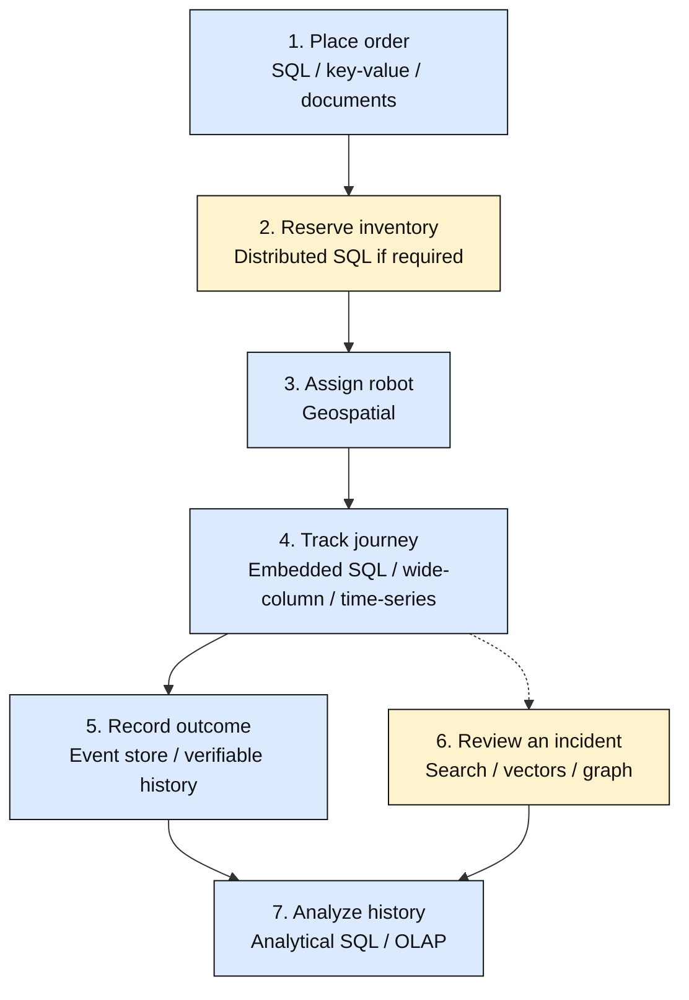

**This is a learning journey, not a database-write protocol.** The incident branch is optional and may occur during or after a delivery. The labels name candidate storage roles, not mandatory products.

1. **Checkout:** The customer signs in; a key-value lookup may retrieve the session. The order service records D4821 and its related operational data transactionally. Package attributes can remain in PostgreSQL JSONB or use a document model when justified. A transaction in the order database does not automatically include an external payment provider.
2. **Reserve stock:** The service checks and reserves actual inventory using the required concurrency rules. If reservations need distributed transactions across regions, evaluate a distributed SQL deployment. Merely having customers in several countries does not require it.
3. **Assign R17:** A geospatial query finds suitable nearby candidates. The application checks availability, capacity, and permissions, then reserves the chosen robot so two orders cannot claim it incompatibly. Proximity alone is not an assignment.
4. **Track the journey:** R17 keeps local task progress in SQLite; disconnection does not erase it. Incoming readings can feed keyed history storage and time-series monitoring. On reconnection, local progress must be reconciled with central state; local storage alone does not resolve conflicting assignments or replace control/safety mechanisms.
5. **Record delivery:** Retain the relevant lifecycle changes. With event sourcing, an event stream can be authoritative and current-state tables are projections. With ordinary SQL state, events/history can be recorded as supporting outputs. **Choose the authority; do not maintain two independently authoritative order histories.** Verifiable audit records can help detect later changes to recorded evidence, without proving its physical truth.
6. **Investigate an incident:** Suppose R17 reported a temperature warning. Keyword search finds related incident reports; vector retrieval finds relevant manual passages for the operator's AI assistant. Separately, graph queries can investigate suspicious customer/device/order relationships. Retrieved text or a graph match does not automatically authorize a physical action or establish fraud.
7. **Review results:** Analytical queries summarize cost and delay by warehouse, country, and month. These prepared copies can lag; they are not the source for deciding whether D4821 is currently paid, reserved, or delivered.

#### Combine Roles Before Adding Engines

**Media content is another storage role:** Delivery photographs and recordings can reside in [object storage](#object-storage-and-amazon-s3), with keys and access-related references in operational records. A stored photograph does not by itself prove that a delivery occurred.

A modest first version might use **PostgreSQL centrally and SQLite on robots**, evaluating JSONB, full-text search, PostGIS, or pgvector within PostgreSQL as requirements arise. This is a possible starting point, not a guarantee that it satisfies every workload.

- **Relational versus distributed SQL:** Choose the deployment needed for the transaction and geography requirements. Do not add a second authoritative database just to demonstrate both labels.
- **Wide-column versus time-series:** Their roles overlap. One engine may satisfy both historical-reading and monitoring queries; use two only when distinct requirements justify the extra pipeline and storage.
- **Event store versus SQL history:** Adopt event sourcing deliberately. It is not a mandatory extra copy for every order service.
- **Specialized copies:** Caches, search/vector indexes, graphs, and analytical views need ownership, access controls, update/deletion propagation, retention, and recovery. Retries must not duplicate business side effects; copying data between stores does not create a shared transaction.

Use the [data-pipeline notes](Data-Engineering-for-Solution-Architecture.md#reliability-governance-and-operations), [AI retrieval explanation](AI-Systems-Design.md#knowledge-ingestion-and-retrieval), and [choice-justification template](#how-to-justify-the-choice) to evaluate each proposed addition.

> **Recall:** One delivery creates many query patterns. Cover the required roles with as few independently operated systems as practical.

### How to Justify the Choice

Write down five things:

1. **Requirement:** What must the application do, and what must remain correct?
2. **Candidate:** Which engine and deployment will you evaluate?
3. **Why it fits:** Which capabilities match the requirement?
4. **Trade-off:** What coordination, freshness, maintenance, or cost burden comes with it?
5. **Evidence needed:** What measurements and failure/recovery checks would justify the decision?

| Justification | Atomic account transfer | Historical analytical reporting |
| --- | --- | --- |
| **Requirement** | Debit and credit commit together; concurrent transfers preserve defined account rules | Aggregate historical transactions by country/month without unacceptable impact on live requests |
| **Candidate** | PostgreSQL, with isolation, constraints, read routing, and recovery chosen for the workload | [ClickHouse](#clickhouse), compared against the existing PostgreSQL solution and the reporting requirements |
| **Why it fits** | Multi-statement transactions, relational constraints, and SQL support the modeled operations | Column-oriented analytical execution can suit larger scans and aggregations |
| **Trade-off** | Write capacity, replication/failover, transaction contention, and operational work still need design | A separate analytical copy adds ingestion lag, synchronization, storage, and maintenance |
| **Evidence needed** | Realistic transfers under concurrency; latency targets; rollback/retry behavior; failover; tested restore | Representative queries and concurrent ingestion; latency/freshness targets; reconciliation; failed-pipeline recovery |

For both candidates, validate the expected data sizes, throughput, indexes or partitioning, security, backup/restore, team expertise, and total operating cost. Set measurable latency targets—for example, a required 95th-percentile response time—instead of assuming a product is “fast.” Include resource contention and relevant failures, not just an isolated successful query.

Use the [existing checklist](#database-selection-checklist) and [database operating questions](#why-applications-use-databases) to record the supporting evidence. For a normal business application, a familiar general-purpose relational engine is a sensible starting candidate; it is not a universal winner or a reason to ignore requirements for other models.

> **Choose by required operations and guarantees. Add another database when its benefit justifies another system to synchronize and operate.**

## Query Performance and Database Access

**Start with a slow or expensive access pattern, then measure why it costs work.** A different database is not always the first remedy: query shape, indexes, excessive round trips, and uncontrolled concurrency may be the actual problem.

The PostgreSQL snippets below are a self-contained teaching sequence. Assume an isolated illustrative database, absent example objects, sufficient permissions, successful sequential statements, and no concurrent writers. Results are logical values; timestamps are shown in UTC. The earlier Customers/Orders example is unchanged.

### Practical Indexing and Query Plans

An **index** is an additional structure that helps find qualifying records or produce useful ordering. It costs storage and must be maintained when indexed data changes.

| Access path | Useful question | Important limit |
| --- | --- | --- |
| **B-tree** | Find an exact value, a range, or suitably ordered rows | A large match can still require substantial scanning and row retrieval |
| **Hash** | Find records equal to a key | PostgreSQL hash indexes support equality, not ordered range retrieval |
| **Full-text indexing** | Find documents matching words or language-aware search expressions | Needs suitable text processing and query semantics; not an ordinary scalar equality index |

Full-text search is a capability implemented through suitable structures: PostgreSQL commonly uses **GIN (Generalized Inverted Index)** structures over text-search values. It is not simply a third universally identical storage layout. **Composite** means multiple key columns; **covering** means the index contains the values a query needs. These describe index design, not competing physical types. See [PostgreSQL index types](https://www.postgresql.org/docs/current/indexes-types.html) and [text-search indexes](https://www.postgresql.org/docs/current/textsearch-indexes.html).

**Selectivity** describes how much data a condition matches. A rare customer lookup and a condition matching most rows can favor different plans. More indexes do not guarantee faster operation: they increase storage, cache pressure, and write/maintenance work. Changes to non-indexed fields need not maintain every index in the same way.

#### Worked Orders Access Pattern

Extend the existing order story using a separate table. Customer 1 is Mina; customer 2 is Rashad. The customer IDs are illustrative references here, without a dependency on an existing Customers table.

```sql
CREATE TABLE orders_access_example (
    order_id BIGINT PRIMARY KEY,
    customer_id INTEGER NOT NULL,
    total NUMERIC(12, 2) NOT NULL,
    status TEXT NOT NULL,
    created_at TIMESTAMPTZ NOT NULL
);

INSERT INTO orders_access_example
    (order_id, customer_id, total, status, created_at)
VALUES
    (101, 1, 20.00, 'paid',    '2026-11-06 10:00:00+00'),
    (102, 1,  5.00, 'pending', '2026-11-06 10:01:00+00'),
    (103, 2, 15.00, 'paid',    '2026-11-06 10:00:00+00'),
    (104, 1, 12.00, 'paid',    '2026-11-06 10:01:00+00'),
    (105, 1,  8.00, 'paid',    '2026-11-06 10:02:00+00');
```

| Order | Customer | Total | Status | Created at, UTC |
| --- | --- | --- | --- | --- |
| 101 | 1 | 20.00 | paid | 2026-11-06 10:00 |
| 102 | 1 | 5.00 | pending | 2026-11-06 10:01 |
| 103 | 2 | 15.00 | paid | 2026-11-06 10:00 |
| 104 | 1 | 12.00 | paid | 2026-11-06 10:01 |
| 105 | 1 | 8.00 | paid | 2026-11-06 10:02 |

The main request is **“return one customer's latest orders.”** A candidate index is:

```sql
CREATE INDEX orders_access_customer_time_idx
ON orders_access_example
    (customer_id, created_at DESC, order_id DESC)
INCLUDE (total, status);
```

Equality on `customer_id` narrows the customer range. The following keys support ordering by creation time and order ID. Column order should follow the required access patterns; separate single-column indexes do not automatically provide the same filtering and ordering.

The `INCLUDE` values are **payload**, not additional search-order keys. They let this index contain all columns returned by the upcoming query. However, a **covering index does not guarantee an index-only scan without heap visits**: PostgreSQL also considers row visibility, the access method, and cost. See [multicolumn indexes](https://www.postgresql.org/docs/current/indexes-multicolumn.html) and [covering/index-only scans](https://www.postgresql.org/docs/current/indexes-index-only-scans.html).

#### Reading a Query Plan

```sql
EXPLAIN
SELECT order_id, created_at, total, status
FROM orders_access_example
WHERE customer_id = 1
ORDER BY created_at DESC, order_id DESC
LIMIT 2;
```

`EXPLAIN` shows the selected plan, not the query's returned orders. Read its operators from the underlying data access toward the final result:

| Plan element | What to ask |
| --- | --- |
| **Sequential scan** | How much of the table is read, and how many rows survive filtering? |
| **Index scan** | Which conditions bound the index search, and how many table rows must be fetched? |
| **Index-only scan** | Are required values in the index, and are heap fetches still needed for visibility? |
| **Sort** | Is sorting necessary, how many rows are sorted, and can it exceed available memory? |
| **Estimated rows / cost** | Do the estimates fit the data distribution? Costs are planner units, not milliseconds |
| **Actual rows / time / buffers** | Under measured execution, where did time, repeated loops, and I/O accumulate? |

**A sequential scan can be correct for five rows.** The presence of an index does not require the optimizer to use it. Larger representative data, statistics, parameter values, and concurrency can change the plan.

`EXPLAIN ANALYZE` **executes the statement** and adds observed execution information; `BUFFERS` can add buffer-usage detail. Use suitable test conditions, especially for statements that modify data. Planner estimates, actual execution, and end-to-end application latency are different measurements. No fixed plan or timing is assumed here. See [PostgreSQL EXPLAIN](https://www.postgresql.org/docs/current/using-explain.html).

### Efficient Queries and Pagination

First reduce unnecessary work and round trips:

| Pattern | Simple improvement | Limit to remember |
| --- | --- | --- |
| **N+1 queries** | Fetching a page and then one query per result can become one bounded join or batched lookup | A huge join or batch can be expensive too; measure row multiplication and payload |
| **Unbounded loading** | Fetch the needed page and selected columns | A small response does not prove the database examined little data |
| **Oversized batches** | Bound rows, bytes, parameter counts, and transaction time | One enormous batch can create lock, memory, and retry pressure |
| **Values embedded in SQL text** | Pass values through the driver's parameter-binding interface | Parameterization helps separate code from values; plan reuse and plan quality are engine/driver-dependent |

Do not remove joins merely because they are joins. Inspect the actual query and plan. For application request latency, also count database calls, pool waiting, network round trips, and result serialization.

#### Offset vs. Keyset Pagination

**First page:**

```sql
SELECT order_id, created_at, total, status
FROM orders_access_example
WHERE customer_id = 1
ORDER BY created_at DESC, order_id DESC
LIMIT 2;
```

The order IDs are **105, 104**. Both 104 and 102 have timestamp **10:01**, so the unique `order_id` breaks the tie.

**Offset pagination** skips the first two results:

```sql
SELECT order_id, created_at, total, status
FROM orders_access_example
WHERE customer_id = 1
ORDER BY created_at DESC, order_id DESC
LIMIT 2 OFFSET 2;
```

This returns **102, 101** for the unchanged dataset. Large offsets require processing skipped rows; concurrent changes can also shift positions.

**Keyset pagination** continues after the last ordering pair from page one:

```sql
SELECT order_id, created_at, total, status
FROM orders_access_example
WHERE customer_id = 1
  AND (created_at, order_id)
      < (TIMESTAMPTZ '2026-11-06 10:01:00+00', 104)
ORDER BY created_at DESC, order_id DESC
LIMIT 2;
```

This also returns **102, 101**. The pair comparison checks time first, then ID on a tie. Because both sort keys are descending, “after this cursor” uses **less than**. Using only the timestamp would skip order 102.

| Choice | Suitable behavior | Trade-off |
| --- | --- | --- |
| **Offset** | Request a numbered position/page | Deep offsets can cost more; changing rows can shift pages |
| **Keyset** | Continue from a known ordering tuple | Efficient access needs a suitable index; jumping to an arbitrary numbered page is less direct |

The cursor must retain the full ordering values and be used with the same filters. These columns are non-null here; nullable sort keys require additional design.

**Stable ordering is not a snapshot guarantee.** Concurrent inserts, edits to ordering values, or deletes can change what later pages see. A consistent export may need an appropriate snapshot or a defined cutoff. See [LIMIT/OFFSET](https://www.postgresql.org/docs/current/queries-limit.html) and [row comparisons](https://www.postgresql.org/docs/current/functions-comparisons.html).

### Connection Pools, Caches, and Precomputed Results

#### Reusing Database Connections

A **connection pool** keeps database connections available for reuse. A request borrows a connection, performs its work, and returns it; it need not create a fresh connection for every query.

| Pool location | Role | Example |
| --- | --- | --- |
| **Application-side pool** | Manages a bounded set of connections within each application process | A driver's pool or HikariCP for Java/JDBC applications |
| **External pooler** | Accepts application connections and manages a bounded set of backend database connections | PgBouncer for PostgreSQL |

For direct application pools, **three application replicas with a maximum of ten connections each can collectively open thirty**. Other services, jobs, migrations, and administration also need capacity. An external pooler can change the mapping between client and server connections, according to its mode and configured limits.

Choose bounded pool sizes and acquisition timeouts. Monitor wait time, active connections, query latency, and database saturation. Return connections reliably, keep transactions short, and avoid holding a transaction open while waiting for an unrelated remote service. Adding connections can increase contention instead of throughput.

PgBouncer's **session pooling** assigns a backend for the client session; **transaction pooling** can reuse it for another client after the transaction. Session-dependent features therefore need compatibility checks. A pooled connection is not a user identity or a guarantee of read/write affinity. See [PgBouncer's mode/feature comparison](https://www.pgbouncer.org/features.html).

#### Cached Results vs. Materialized Views

| Mechanism | What is retained? | Freshness responsibility |
| --- | --- | --- |
| **Query-result cache** | A result or application representation under a cache key | Design invalidation, expiration, and ownership of refreshes |
| **Materialized view** | Stored results of a defined database query | Decide when to refresh and what staleness consumers can accept |

Cache keys and reuse rules must respect tenant, user, permissions, and query parameters where relevant. A **TTL—time to live—bounds intended retention, not transactional freshness**. Prevent many simultaneous misses from overwhelming the database, for example through request coalescing and controlled refreshes. A cache hit must not bypass required authorization or authoritative checks.

Using the original five-row dataset, precompute paid totals:

```sql
CREATE MATERIALIZED VIEW paid_totals_access_example AS
SELECT customer_id, SUM(total) AS paid_total
FROM orders_access_example
WHERE status = 'paid'
GROUP BY customer_id;

SELECT customer_id, paid_total
FROM paid_totals_access_example
ORDER BY customer_id;
```

| customer_id | paid_total |
| --- | --- |
| 1 | 40.00 |
| 2 | 15.00 |

Now mark order 102 paid, then query the materialized view again:

```sql
UPDATE orders_access_example
SET status = 'paid'
WHERE order_id = 102;

SELECT customer_id, paid_total
FROM paid_totals_access_example
ORDER BY customer_id;
```

The view still returns **40.00 and 15.00**. Its stored result is not automatically changed by that source update.

```sql
REFRESH MATERIALIZED VIEW paid_totals_access_example;

SELECT customer_id, paid_total
FROM paid_totals_access_example
ORDER BY customer_id;
```

After refresh, the totals are **45.00 and 15.00**. These are sums of the example's paid order amounts, not a complete accounting definition of revenue.

A refresh consumes resources; the ordinary refresh shown can block readers. PostgreSQL's concurrent-refresh option has prerequisites and restrictions, so “materialized view” does not mean free or automatically nonblocking maintenance. See [materialized views](https://www.postgresql.org/docs/current/rules-materializedviews.html) and [refresh behavior](https://www.postgresql.org/docs/current/sql-refreshmaterializedview.html).

> **Measure → inspect the plan → reduce unnecessary work → choose indexes → control concurrency → measure again.**

## Partitioning and Sharding

**Partitioning divides data into subsets; sharding distributes subsets across database instances or nodes.** The terminology varies by product. A local partition is not automatically another server, and a shard need not map one-to-one to a physical machine.

| Technique | What changes? | Example |
| --- | --- | --- |
| **Indexing** | Adds an access path | Find one customer's latest orders |
| **Partitioning** | Divides a logical dataset into pieces | Store each month's orders in a separate table partition |
| **Sharding** | Distributes subsets across instances/nodes | Route different customers' orders to different database instances |
| **Replication** | Retains copies of a subset or dataset | Maintain replicas of each shard for the chosen failure scope |

These techniques can coexist. A shard can contain locally partitioned tables and have its own replicas.

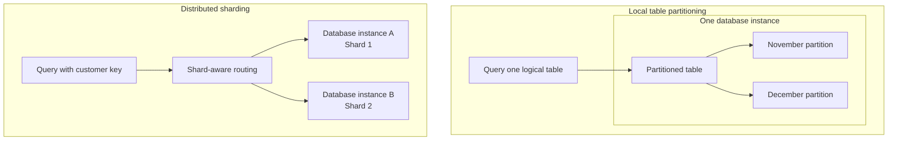

The routing branches are alternatives for a targeted key; some cross-shard queries contact several destinations. Replicas are omitted to focus on placement. This illustrates two deployments, not a rule requiring every database product to use these components.

### Partition and Shard Key Strategies

| Strategy | Simple rule | Benefit and trade-off |
| --- | --- | --- |
| **Range** | Group rows by time or another ordered range | Can localize range reads and retention operations; a busy newest range can become hot |
| **List** | Group explicit values, such as region codes | Supports known groupings; groups can differ greatly in size or traffic |
| **Hash** | Hash a customer key into a placement scheme | Can spread many distinct keys; range locality is reduced and one hot key remains hot |

**Partition pruning** skips partitions the database can exclude using their bounds and suitable query predicates. It is different from an index locating rows inside a chosen partition. Without a useful partition predicate, a query can still examine many partitions.

For shards, determine where routing metadata lives and what happens when ownership changes. A missing shard key can require **fan-out**, contacting multiple shards and combining results. Cross-shard joins, transactions, and aggregates may require additional coordination.

Rebalancing must transfer data, catch concurrent writes, update routing safely, and handle retries or failures. Replication and fencing protect different aspects of that process. Hashing does not guarantee perfectly balanced traffic, and a geographic key alone does not establish compliance or correct residency for every copy.

### PostgreSQL Monthly Range Partitions

This separate example shows **local declarative partitioning**, not a sharded PostgreSQL cluster. It does not depend on or change `orders_access_example`.

```sql
CREATE TABLE orders_partition_example (
    order_id BIGINT NOT NULL,
    customer_id INTEGER NOT NULL,
    total NUMERIC(12, 2) NOT NULL,
    created_at TIMESTAMPTZ NOT NULL,
    PRIMARY KEY (order_id, created_at)
) PARTITION BY RANGE (created_at);

CREATE TABLE orders_partition_2026_11
PARTITION OF orders_partition_example
FOR VALUES FROM ('2026-11-01 00:00:00+00')
             TO ('2026-12-01 00:00:00+00');

CREATE TABLE orders_partition_2026_12
PARTITION OF orders_partition_example
FOR VALUES FROM ('2026-12-01 00:00:00+00')
             TO ('2027-01-01 00:00:00+00');
```

Bounds are **start-inclusive and end-exclusive**:

| Created at, UTC | Destination |
| --- | --- |
| 2026-11-01 00:00 | November |
| 2026-11-30 23:59:59 | November |
| 2026-12-01 00:00 | December |
| 2027-01-01 00:00 | No matching partition in this example |

The November upper bound and December lower bound meet without overlap. An insert outside both ranges fails unless another suitable partition exists. Future partitions need a deliberate lifecycle.

The composite primary key includes `created_at`, the partition key, as PostgreSQL requires for this partitioned-table constraint. It enforces uniqueness of the **pair**, not independent global uniqueness of `order_id` across all timestamps.

A query that can exclude December is:

```sql
EXPLAIN
SELECT order_id, total
FROM orders_partition_example
WHERE created_at >= TIMESTAMPTZ '2026-11-01 00:00:00+00'
  AND created_at <  TIMESTAMPTZ '2026-12-01 00:00:00+00';
```

With partition pruning enabled, these bounds allow the planner to exclude December. The tables are empty here, so this illustrates access planning rather than useful result rows or measured performance.

Queries within November may still need suitable indexes. Time partitions can simplify archival or removal of old data, but dropping a partition also removes its records; retention, dependent copies, backups, and restore requirements must be considered. See [PostgreSQL partitioning and pruning](https://www.postgresql.org/docs/current/ddl-partitioning.html).

### Connecting Placement to the Existing Examples

| Existing explanation | What it adds |
| --- | --- |
| [Consistent hashing](#scalability-partitioning-and-consistent-hashing) | Stable key placement and movement when membership changes |
| [DynamoDB partition keys](#partition-keys-and-sort-keys) | Application key design with AWS-managed physical partitions |
| [Cassandra partitions](#cassandra-keys-partitions-and-clustering) | Hash-based partition placement and ordered rows within each partition |
| [HBase regions](#regions-and-hbase-cluster-components) | Ordered key ranges served by RegionServers |
| [Greenplum MPP](#greenplum-relational-analytics-with-mpp) | Distributed analytical processing and inter-segment data movement |
| [Replica placement](#replication-models-and-replica-placement) | Independent copies and failure domains, separate from partition ownership |

> **Indexes help find data; partitions divide it; shards distribute it; replicas copy it. Choose each mechanism for the requirement it actually serves.**

## Distributed Transactions

**A local transaction and an operation spanning separate databases have different boundaries.** One application's `BEGIN` does not automatically include a remote database, an HTTP service, a message broker, or object storage.

| Mechanism | Question answered | What it does not establish alone |
| --- | --- | --- |
| **Local transaction** | Which changes commit together within the database's supported scope? | Atomic updates across arbitrary external systems |
| **Distributed atomic commit** | Do the enlisted participants commit or abort this transaction together? | Complete application correctness or global serializable isolation |
| **Consensus among replicas** | Which decision/history do participating replicas agree to? | Automatic enlistment and atomic commit across all independent services |

Use the [local ACID explanation](#transactions-and-acid) first. Distributed protocols build on specific participant and recovery capabilities; they do not remove transaction or business-invariant design.

### Two-Phase Commit: Orders and Inventory

Suppose an order database stages **confirmation of order 105**, and an inventory database stages **a stock reduction for product P100**. The desired transaction outcome is that both changes commit or both abort.

This is a separate conceptual scenario, not another step of the SQL access example. Assume the databases support participation in a distributed transaction and an appropriate transaction manager coordinates them. Ordinary API calls to arbitrary services do not acquire these properties automatically.

**Two-phase commit (2PC)** has two stages:

1. **Prepare:** Ask each participant whether it can commit. A participant voting yes records the required recovery state and retains the locks/resources needed to honor that promise.
2. **Decision:** Commit only when all participants have voted yes; otherwise choose abort. The coordinator durably records the decision and communicates it. Participants record/complete that outcome and release the relevant resources.

Recovery continues an interrupted decision using the durable records. A participant is not free to change its mind after promising to follow the final decision.

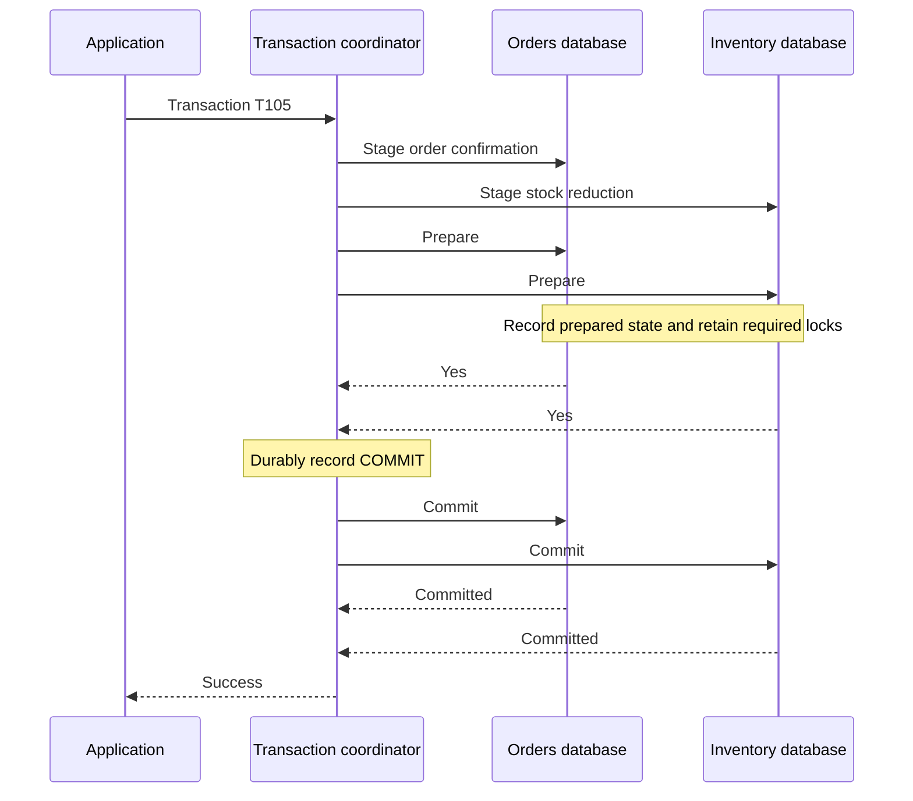

The successful path shown waits for both confirmations before replying to the application. Participants can finish processing messages at different times; this diagram does not promise simultaneous visibility to unrelated reads across both databases.

### Failure, Blocking, and Uncertain Outcomes

| Event | Required reasoning |
| --- | --- |
| **Inventory votes no** | The transaction must abort; prepared participants learn and complete the abort decision |
| **Coordinator fails after preparation, before a known decision** | A prepared participant may have to wait for recovery or another valid way to learn the outcome; unilateral timeout-abort can be unsafe |
| **Coordinator fails after durably deciding commit** | Recovery must continue commit, even if some participants have not received it yet |
| **Commit message or acknowledgment is lost** | Retry decision delivery using transaction identity and the protocol's recovery rules; do not create a second business order |
| **Application times out** | The transaction may have committed. Recover/query the outcome rather than treating timeout as proof of abort |

Prepared transactions can hold resources and obstruct other work while uncertain. Operational procedures must resolve outstanding transactions correctly; abandoning them is not recovery.

PostgreSQL supports prepared transactions for use with an external transaction manager. This capability is not the same as independently opening transactions on two connections and hoping both commits succeed. See [PostgreSQL two-phase transactions](https://www.postgresql.org/docs/current/two-phase.html) and [prepared-state behavior](https://www.postgresql.org/docs/current/sql-prepare-transaction.html).

### Atomic Commit vs. Paxos and Raft

**2PC and consensus solve related but different coordination problems.** A transaction manager needs an atomic outcome across enlisted participants. Paxos/Raft can establish agreement within a replica group and protect replicated state or decision records.

They can be combined. Gray and Lamport's **Paxos Commit** uses consensus within an atomic-commit design; it is not simply a matter of replacing a 2PC call with an ordinary Raft write. Likewise, replicating each database does not automatically make two databases share one transaction.

See [Paxos](Distributed-Systems-Theorems-and-Data-Structures.md#paxos), [Raft](Distributed-Systems-Theorems-and-Data-Structures.md#raft), and [Consensus on Transaction Commit](https://lamport.azurewebsites.net/video/consensus-on-transaction-commit.pdf). Crash-fault consensus does not by itself cover arbitrary malicious participants.

Choose the **smallest transaction boundary that preserves the required invariant**. When the boundary spans systems, define supported participation, isolation, durable outcomes, recovery ownership, and idempotent retries. A lost response must not silently turn one intended order or charge into two.

> **A timeout means “outcome uncertain,” not necessarily “aborted.” Atomic commit needs a recoverable decision; replication alone does not create a cross-system transaction.**

## Key-Value Stores

### What Is a Key-Value Store?

A **key-value store** associates a unique **key** with a **value** within a defined namespace. The key identifies what to retrieve or change, much like a dictionary:

| Key | Value | Meaning |
| --- | --- | --- |
| `cart:42` | `book` | A simplified shopping-cart value |
| `theme:42` | `dark` | A user's display preference |
| `product:7` | `{"name":"Notebook","price":5}` | A serialized product record |

The key is the lookup identifier; the value may be text, bytes, a serialized document, or a product-supported data structure. The application must still define formats, validation, and compatibility. Flexible values do not remove the need for a data model.

**A key-value store is not necessarily distributed.** It can be embedded, run on one server, or span several servers. A **distributed hash table (DHT)** distributes key-based lookup and ownership using hashing; it is one approach to building a distributed key-value system, not a synonym for every key-value database.

The basic mental model exposes one current value per key. Replication and concurrent updates can introduce internal copies or competing versions; the store's consistency and conflict rules determine what a read returns. [Redis strings](https://redis.io/docs/latest/develop/data-types/strings/) illustrate basic key-based storage and retrieval, while Redis also supports richer types.

> **Mental model:** You know the key and ask for its value. How the system locates, stores, replicates, and protects that value is a separate design problem.

### Why Use Key-Value Stores in Distributed Systems?

| Benefit | How it can help | Important limit |
| --- | --- | --- |
| **Scalability** | Partition different keys across nodes to spread storage and traffic | Hot keys, skew, and rebalancing can still limit scaling |
| **Performance** | Direct key access can avoid unnecessary scans or joins | Network hops, value size, storage, load, and coordination affect latency |
| **Flexible values** | Store records with different payload shapes | Readers and writers must agree on their meaning and format |
| **Fault tolerance** | Keep replicas so another node may serve a key after a failure | Partitioning alone does not create a backup copy; failover needs adequate replicas and a defined protocol |

Typical uses include sessions, preferences, shopping carts, and cached objects. Suitability depends on required durability, consistency, expiry, and access controls. Key lookup alone does not provide arbitrary searches, joins, or multi-key transactions; additional capabilities depend on the engine.

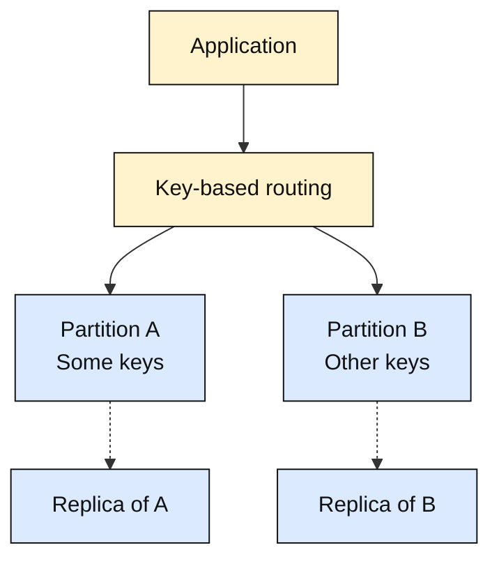

The routing arrows show alternative destinations for a key, not a broadcast to every partition. Dotted arrows show replication relationships; they do not prescribe synchronous or asynchronous acknowledgments. Routing can reside in a client or service. **Partitioning divides data; replication copies it.** The diagram does not define a complete failover protocol.

### Why Key-Value Lookups Can Be Fast: Complexity, RAM, and Disk

A key-value store retrieves a value using its key:

```text
GET("customer:42") → "Alice"
```

**A hash-table-based implementation can locate a key in expected O(1) time:** roughly constant lookup work as the number of stored entries grows. This describes the lookup algorithm—not the complete database request or every key-value implementation.

**1. Why does hashing give expected O(1) lookup?**

Imagine a cabinet with numbered drawers. A hash function calculates which drawer to open directly:

```text
"customer:42" → hash calculation → bucket 17
```

The store checks bucket 17 rather than searching every stored key.

As more entries arrive, the hash table increases its number of buckets to keep the average bucket occupancy small:

| Stored entries | Buckets | Average entries per bucket |
| --- | --- | --- |
| 100 | 100 | 1 |
| 1,000 | 1,000 | 1 |
| 10,000 | 10,000 | 1 |

These numbers are illustrative. Implementations choose their own growth rules. Here, buckets are positions in a local hash table, not the storage-server partitions discussed elsewhere.

Different keys can map to the same bucket—a **hash collision**. The store must compare the actual keys to find the correct entry. Good hash distribution and controlled occupancy keep the number of entries examined small on average.

**O(1) does not mean exactly one instruction or a guaranteed response time.** It means lookup work does not normally grow in proportion to the total entry count.

**2. What physically happens in RAM?**

In a simplified implementation, RAM contains a bucket array and stored entries:

```text
CPU hashes "customer:42"
          ↓
Calculates bucket 17
          ↓
Reads bucket 17 from the array
          ↓
Follows a pointer to the stored entry
          ↓
Checks the key and returns "Alice"
```

A **pointer** is a stored memory address.

Because array slots have a fixed size, the processor can calculate a slot's address:

```text
Slot address = starting address + bucket number × slot size
```

For example:

```text
Starting address = 1000
Bucket number    = 17
Slot size        = 8 bytes

Slot address = 1000 + 17 × 8 = 1136
```

These are illustrative program addresses; the operating system maps them to physical memory.

**The processor accesses the calculated location rather than scanning every preceding memory address.** CPU caches may satisfy some accesses before RAM is needed.

**3. What is the space complexity?**

| Measure | Typical complexity |
| --- | --- |
| Store N fixed-size key-value entries and their hash index | **O(N) total space** |
| Perform one ordinary lookup | **O(1) additional space** |
| Locate a key with well-distributed hashing and controlled occupancy | **Expected O(1) time** |

More entries require more memory even when locating one entry remains fast. With variable-size keys and values, also account for their total bytes: hashing a longer key and transferring a larger value require more work.

Growing the bucket array can require redistributing existing entries. **Resizing is occasionally expensive; constant-time lookup does not mean every maintenance operation is constant-time.**

**4. What changes when data is stored on disk?**

One possible disk-backed design keeps an index in RAM that identifies where a value is stored:

```text
Key → RAM index → file location → read storage page → value
```

A cached page may already be in memory. Otherwise, the database must request it from SSD/HDD, adding storage latency.

Other designs use different structures. For example, RocksDB combines in-memory structures with sorted files on storage; its key-value interface does not imply a simple O(1) hash-table lookup. [RocksDB overview](https://github.com/meta/rocksdb/wiki/RocksDB-Overview)

RAM is volatile. An in-memory database can additionally write logs or snapshots to disk for recovery, depending on its configuration. [Redis persistence](https://redis.io/docs/latest/operate/oss_and_stack/management/persistence/)

**5. Are key-value stores always faster than relational databases?**

No. Compare the access structure and requested operation:

| Approach | Typical work to locate an entry among N entries |
| --- | --- |
| **Hash table** | Expected **O(1)** |
| **Balanced tree index** | **O(log N)** |
| **Full scan** | **O(N)** |

> **O(1) scales better than O(log N):** With constant-time lookup, the expected amount of work stays roughly unchanged as more entries are stored. With logarithmic lookup, the work grows slowly.
>
> For illustration, a binary search over **1,024 entries** needs about **10 steps**; over **1,048,576 entries**, about **20 steps**. A well-maintained hash table still examines roughly a constant number of entries on average.
>
> **This describes growth in work, not guaranteed elapsed time.** An O(1) lookup requiring a disk read can take longer than an O(log N) lookup served entirely from RAM. Constant factors and hardware still matter.

Redis documents `GET` as O(1). PostgreSQL supports both B-tree and hash indexes, so hashing is not exclusive to key-value databases. An indexed relational lookup can also be very fast. [Redis GET](https://redis.io/docs/latest/commands/get/), [PostgreSQL index types](https://www.postgresql.org/docs/current/indexes-types.html)

Actual response time also depends on network latency, caching, storage I/O, concurrency, replication, and durability requirements.

> **Recall:** Hashing calculates where to look. RAM or disk holds the bytes. Expected O(1) lookup can coexist with O(N) storage; the key-value label alone does not guarantee either constant-time access or better performance.

### Functional Requirements and a Simple API

For an illustrative design, define these operations explicitly:

| Operation | Intended behavior | Illustrative result |
| --- | --- | --- |
| **`Put(key, value)`** | Insert a new key or replace its current value | Success under the chosen write-acknowledgment policy, or an operation error |
| **`Get(key)`** | Retrieve the value visible under the selected read guarantee | Value, `NotFound`, or an operation error |
| **`Delete(key)`** | Remove the key's logical value | `Deleted`, `NotFound`, or an operation error |

These names describe a conceptual API, not commands shared by every database. Here a put replaces the whole value; field updates, conditional writes, and multi-key operations need separate contracts. Missing-key deletion behavior varies: an API may report `NotFound` or treat an already-absent key as successful deletion.

**Sequential walkthrough**, with no concurrent writers and reads that observe completed writes:

| Request | Result |
| --- | --- |
| `Put("cart:42", "book")` | Success; create the key |
| `Get("cart:42")` | `"book"` |
| `Put("cart:42", "book, pen")` | Success; replace the value |
| `Get("cart:42")` | `"book, pen"` |
| `Delete("cart:42")` | `Deleted` |
| `Get("cart:42")` | `NotFound` |

`NotFound` is distinct from a stored empty value, a timeout, or an authorization failure. A timeout does not prove that the key is absent or that a write failed; the request may have completed before its reply was lost. Define safe retry behavior accordingly.

### Non-Functional Requirements and Trade-Offs

| Requirement | What to specify | Design implication |
| --- | --- | --- |
| **Scalability** | Data size, growth, key distribution, and peak traffic | Plan capacity, partitioning, hot-key handling, and rebalancing |
| **Performance** | Read/write latency percentiles at a stated load and value size | Measure routing, storage, network, and coordination costs; do not promise constant latency as the system grows |
| **Durability** | Which acknowledged writes survive which failures | Define persistence, replication acknowledgments, recovery, and backup procedures |
| **Consistency** | What each read may observe and how concurrent writes are ordered or reconciled | Choose a read/write protocol and explicit conflict semantics |
| **Availability** | Which operations must complete during covered failures | Provide healthy capacity and replicas; some failures can still prevent progress |
| **Partition behavior** | How each side behaves when nodes cannot communicate | Decide which operations wait, fail, or proceed with weaker coordination |

If a per-key operation is **linearizable**, a read observes the latest write in a single order consistent with real-time completion; concurrent operations can be ordered within their overlap. This is a possible requirement, not an inherent key-value-store property. Eventually consistent reads may return an older value; [DynamoDB documents different read options and their scope](https://docs.aws.amazon.com/amazondynamodb/latest/developerguide/HowItWorks.ReadConsistency.html).

**These requirements cannot all be unconditional.** During a network partition, a system cannot guarantee both linearizable behavior and successful completion of every request at every reachable node. It may reject or delay operations that cannot coordinate, or allow operations under weaker consistency rules. See [CAP](Distributed-Systems-Theorems-and-Data-Structures.md#cap-theorem) and [PACELC](Distributed-Systems-Theorems-and-Data-Structures.md#pacelc-theorem).

Replication does not automatically establish durable storage or consistent reads, and it is not a substitute for backup. Likewise, “low latency” is a workload target, not a guarantee under arbitrary network delays and failures.

### Design Topics to Study Next

The introductory requirements lead to these design questions:

| Topic | Question to resolve |
| --- | --- |
| **Partitioning and scalability** | [Place keys and handle membership changes](#scalability-partitioning-and-consistent-hashing). |
| **Replication** | [Choose copies, physical owners, and replication behavior](#replication-models-and-replica-placement). |
| **Versioning and conflicts** | [Interpret concurrent versions](#coordinating-reads-and-writes); detailed reconciliation algorithms remain further study. |
| **Configurability** | [Specify R/W thresholds and their limits](#coordinating-reads-and-writes). |
| **Fault tolerance and failure detection** | [Handle temporary failures](#temporary-failures-sloppy-quorums-and-hinted-handoff), [repair replicas](#replica-repair-and-merkle-trees), and [manage membership](#membership-gossip-and-failure-detection). |

The original [Dynamo paper](https://www.allthingsdistributed.com/files/amazon-dynamo-sosp2007.pdf) is a concrete example combining partitioning, replication, versioning, and application-assisted conflict handling. **Dynamo is the historical system described in that paper; [Amazon DynamoDB](#amazon-dynamodb) is a separate managed product.** These techniques and their guarantees must be evaluated together rather than assumed from the key-value model.

> **Recall:** A simple key-based API can hide a complex distributed design. Specify what success, missing data, concurrent updates, and failures mean before choosing the mechanisms.

### Scalability: Partitioning and Consistent Hashing

**Partitioning assigns different keys to different storage nodes.** Hash-based placement can spread keys, but the mapping must remain understandable to clients and coordinators when membership changes.

**Modulo routing:** For `m` nodes with zero-based indexes `0` through `m - 1`, select `index = hash(key) % m`:

| Hash result | Node count | Calculation | Selected index |
| --- | --- | --- | --- |
| 10 | 4 | `10 % 4 = 2` | 2 |
| 10 | 5 | `10 % 5 = 0` | 0 |

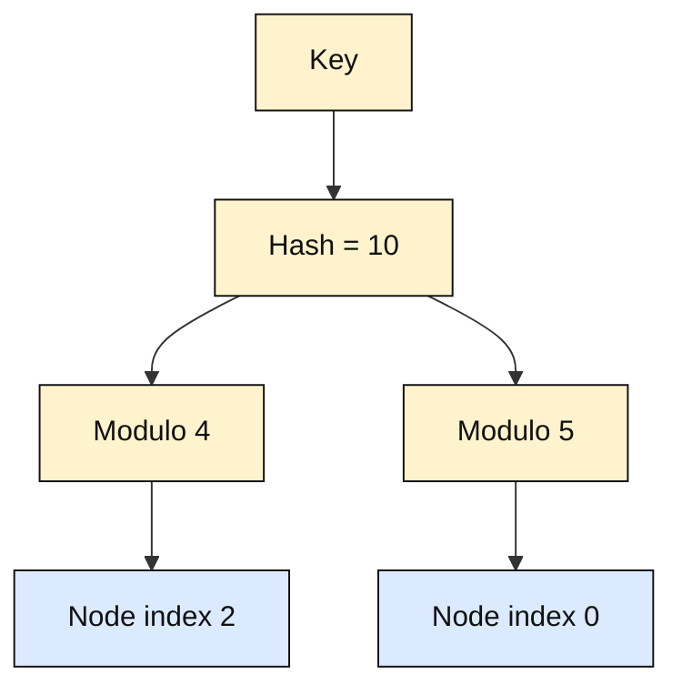

The hash stays the same; changing the divisor changes placement. Many other keys can also move, including keys whose old owners remain healthy. A uniform hash can spread **keys** approximately evenly, but does not make four nodes receive exactly 25% of requests each: some keys may be much more popular or larger than others.

**Worked example: four servers become three.** Start with Server 0, Server 1, Server 2, and Server 3. Remove Server 3 and keep the other server labels unchanged:

| `Hash(key)` | Four servers: `% 4` | Three servers: `% 3` | Mapping changed? |
| --- | --- | --- | --- |
| 10 | Server 2 | Server 1 | Yes |
| 11 | Server 3 | Server 2 | Yes |
| 12 | Server 0 | Server 0 | No |
| 13 | Server 1 | Server 1 | No |
| 14 | Server 2 | Server 2 | No |
| 15 | Server 3 | Server 0 | Yes |

**Three of these six keys now map to different servers.** This is an illustrative sample, not a fixed percentage for every dataset. Notice that hash `10` moves even though its original owner, Server 2, remains available.

**Why does this matter?** Suppose a customer's account record has a key whose hash is `10`:

1. With four servers, `10 % 4 = 2`, so the record is stored on Server 2.
2. With three servers, `10 % 3 = 1`, so the new routing rule sends requests to Server 1.
3. **Changing the calculation does not physically move the record.** It is still on Server 2 until transferred.
4. The system must transfer the record and coordinate the routing change so requests can still find it during migration.

Across millions of keys, these transfers consume network bandwidth, CPU, and storage I/O. For a **planned removal**, transfer the departing server's data before shutting it down. For a **sudden failure**, recovery needs surviving replicas, backups, or another recovery source; changing the hash rule cannot restore lost data.

Consistent hashing reduces this disruption by changing ownership only for affected hash ranges. The amount moved depends on token placement and balance; it is not always a tiny fixed fraction.

> **Recall:** Modulo routing changes many mappings when the server count changes. Consistent hashing limits reassignment. Both still need safe data transfer and routing updates.

**Consistent hashing:** Place node tokens and key hashes in the same circular hash space. Select the first eligible token clockwise, wrapping around when necessary. In this illustrative ring, the key hash `60` belongs to N3 at token `70`:

**Diagram legend:**

| Label | Simple meaning |
| --- | --- |
| **N1–N4** | Four storage nodes (servers) that hold key-value records. |
| **Token** | A number marking a node's position on the ring. Here, N3 has token `70`. A server can have several tokens, as explained below. |
| **Key** | An identifier such as `customer:123`, used to find its stored value. |
| **Key hash 60** | The key's hash result places it at position `60` on the ring. It is not the stored value or the server number. |

**Example:** If `hash("customer:123") = 60`, move clockwise to the next token, `70`. Its owner, **N3**, stores the record in this example.

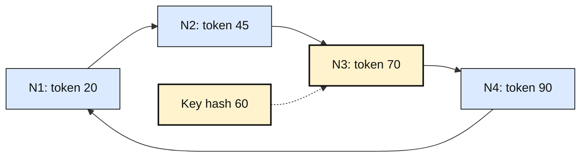

The arrows represent logical clockwise token order, not a network topology or a required circular rendering. If N5 joins at token `65`, keys in `(45, 65]` move from N3 to N5 in this **single-token, primary-placement example**. Other primary ranges remain unchanged. Virtual nodes and replication can involve additional ranges and replica transfers; do not generalize this example into “only one physical neighbor is ever affected.”

**After adding N5 at token 65:**

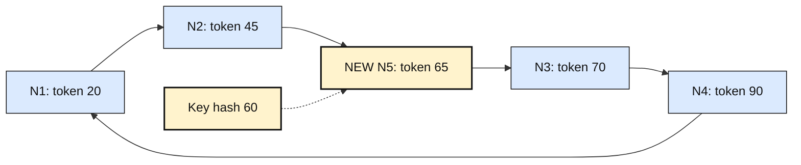

> **Before:** Hash `60` → N3 at `70`.
>
> **After:** Hash `60` → N5 at `65`, now the first token clockwise.
>
> N5 takes over keys with hashes **greater than `45` and up to `65`, including `65`**. N3 keeps `(65, 70]`; the other nodes keep their ranges.

**Circular view: before and after adding N5.** Both rings use the same illustrative hash positions `0–99`. Dots mark server tokens; yellow highlights new N5. The orange diamond marks the key's hash. Follow the orange arrow clockwise to find its owner.

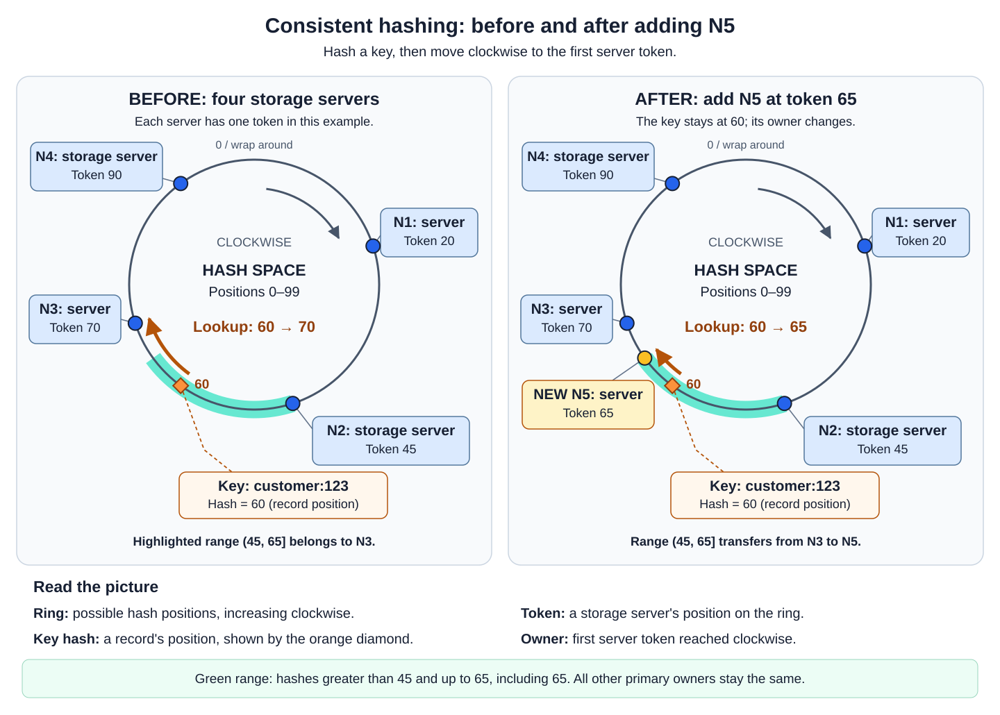

> **Ring:** Possible hash positions. **Token:** A server's position. **Key hash:** A record's position. **Owner:** The first server token reached clockwise.

The green band marks the transferred range. This shows one token per server and primary ownership only; the new owner still needs the actual data transferred safely.

**Virtual nodes: several positions, one physical server.** A virtual node is an extra position representing the same server on the ring—not another machine. Instead of owning one large range, each server can own several smaller ranges at different positions.

For example, give each of three physical servers three tokens:

| Physical server | Token positions on the ring | Actual machines |
| --- | --- | ---: |
| A | `10`, `50`, `80` | 1 |
| B | `20`, `40`, `90` | 1 |
| C | `30`, `60`, `70` | 1 |

**How are the positions created?** One hash function is sufficient: hash different server identifiers such as `hash("A#0")`, `hash("A#1")`, and `hash("A#2")`. The table's positions are illustrative outputs. The suffix creates another token for A; it does not create another physical server. Multiple hash functions are not required, and the request key is not hashed once per virtual node.

**Request walkthrough:**

1. Hash the key once: suppose `hash("customer:123") = 55`.
2. Move clockwise from `55` to the next token, **60**.
3. Token 60 belongs to **C**, so physical **Server C** handles the request.

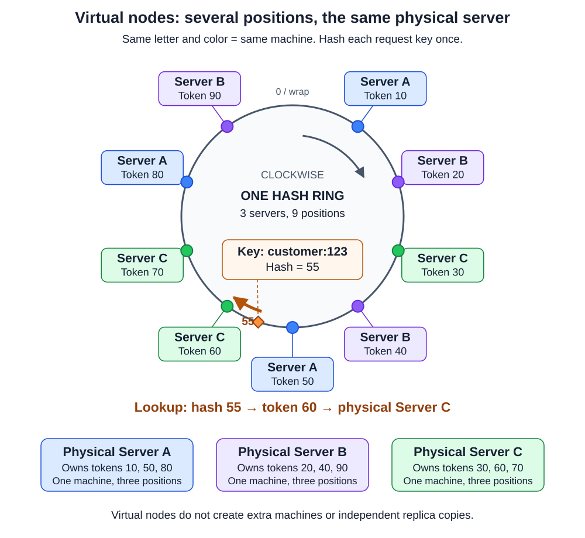

All tokens with the **same letter and color** represent the same physical server. There are **nine ring positions but only three machines**. The arrows show lookup direction, not network links.

**Why use virtual nodes?**

| Benefit | Simple explanation |
| --- | --- |
| **Better range balance** | Several smaller ranges per server can reduce the uneven ownership caused by a few randomly placed tokens. Balance is approximate, not guaranteed. |
| **Spread reassignment** | When A leaves this example, its ranges pass to B at tokens `20` and `90`, and C at `60`. One remaining server need not take all of A's ranges. |
| **Account for capacity** | The placement policy can give a more-capable server more tokens or weight. Twice as many tokens does not guarantee twice the useful throughput. |

More tokens also add metadata and maintenance work. Balanced ranges do not guarantee equal request traffic: one key may be much more popular than others. Virtual nodes do not add hardware, create independent replicas, or split a single hot key across servers by themselves.

Membership changes still need data transfer and a safe routing transition. Planned maintenance allows transfer before shutdown; after a failure, recovery needs surviving copies. Adding virtual nodes cannot recreate lost data.

> **Recall:** Many positions can belong to one server. Hash the key once, find the next token clockwise, and send the request to that token's physical owner.

See [Consistent Hashing](Distributed-Systems-Theorems-and-Data-Structures.md#consistent-hashing), [Virtual Nodes](Distributed-Systems-Theorems-and-Data-Structures.md#virtual-nodes-multiple-tokens-per-server), and the existing [C++ teaching example](examples/consistent_hashing/README.md). [Cassandra's architecture](https://cassandra.apache.org/doc/latest/cassandra/architecture/dynamo.html) illustrates token-based placement; its implementation is not a universal specification for every key-value store.

### Replication Models and Replica Placement

**Replication keeps copies of the same data.** A distributed store can partition data first and then replicate each partition; it need not copy every key to every server.

| Model | Where client writes are handled | Main design questions |
| --- | --- | --- |
| **Primary-secondary / single-leader** | The current primary for that partition orders writes; secondaries apply replicated changes | Replication lag, acknowledgment rules, promotion, and preventing competing primaries |
| **Multi-leader** | Multiple designated leaders accept writes for overlapping data | Concurrent changes, conflict rules, cross-region coordination, and routing |
| **Peer-to-peer (leaderless in this example)** | A coordinator sends operations to the key's replica set without a permanent per-key write leader | Response thresholds, concurrent versions, reconciliation, and replica repair |

**Primary-secondary example:**

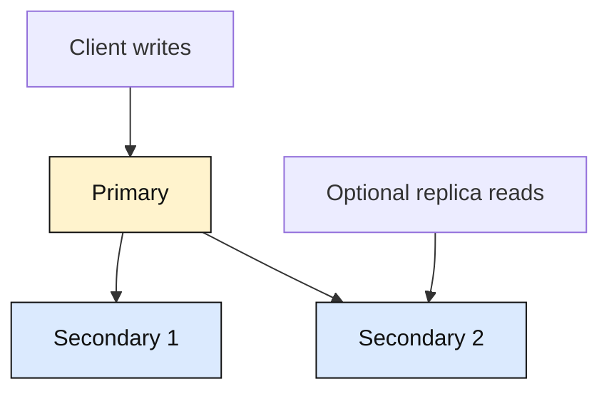

The primary-to-secondary arrows carry replication updates. A secondary applies those updates but does not normally accept independent client writes in this single-leader model. The primary can also serve reads; secondary reads depend on product capabilities and can be stale when replication lags.

With **asynchronous replication**, the primary may acknowledge before secondaries have the update. A failure can therefore lose acknowledged updates not yet protected elsewhere. **Synchronous replication** waits for the configured replica acknowledgment condition; whether that means received, persisted, or applied must be specified. Waiting improves the covered guarantee but introduces coordination costs and can block progress.

A failed primary can be replaced through a designed failover process; primary-secondary replication is not inherently limited to permanent loss of write service. Promotion must select an eligible replica, redirect clients, and prevent the old primary from continuing as a writer—often through **fencing**, which blocks an obsolete writer. See [PostgreSQL replication](https://www.postgresql.org/docs/current/warm-standby.html) and [failover guidance](https://www.postgresql.org/docs/current/warm-standby-failover.html). Consensus-based designs such as [Raft](Distributed-Systems-Theorems-and-Data-Structures.md#raft) provide another context for safe leadership and replicated history.

**Peer-to-Peer (Leaderless) Replication**

These names answer different questions. **Peer-to-peer** describes nodes acting as peers; **leaderless** means writes do not pass through a permanent leader for each key. This Dynamo-style example has both properties. Peer-to-peer is a broader term, so it does not always mean leaderless replication. See [Cassandra's architecture](https://cassandra.apache.org/doc/latest/cassandra/architecture/dynamo.html).

**Overall architecture: peers communicate without a permanent primary.**

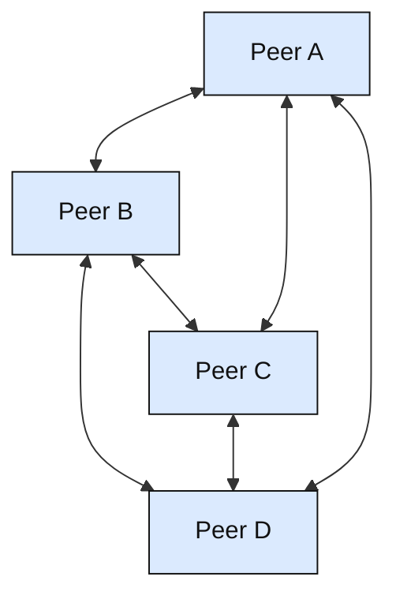

Each peer can handle requests and hold replicas for its assigned keys. The arrows show possible peer communication—not a requirement to broadcast every write to every node or store every key everywhere. For example, a key with intended replicas A, B, and C does not also need a copy on D.

**One request's flow: a coordinator contacts the key's replicas.**

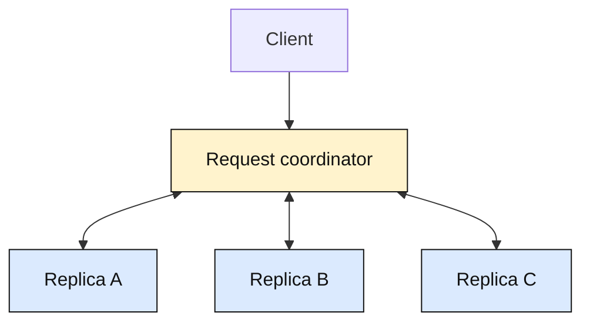

The coordinator is a **request-handling role**, not necessarily a permanent leader or a separate machine. A storage node can coordinate a request and hold a replica. Different requests may use different coordinators. The diagram shows request/reply paths; it does not require all cluster nodes to exchange every write.

The two diagrams show **the same model at different levels**: the first shows peer relationships; the second follows one request. Leaderless replication avoids dependence on a permanent primary for that key, but does not eliminate failures or guarantee lower latency. Progress still depends on reachable replicas, response thresholds, and conflict handling.

Let **N** be the total intended replicas of a key, including its first owner. It differs from **m**, the total physical-node count used in the modulo example. For `N = 3`, a clockwise preference scan such as `A#0 → A#1 → B#0 → C#0 → D#0` selects intended physical owners **A, B, C**: A's second token does not count as another copy. Later candidates such as D can be considered by a fallback policy.

Place replicas across suitable failure domains, such as racks or availability zones, where the deployment supports it. Three copies in one rack do not protect against loss of that rack. Neither replication model automatically provides unlimited availability or durability; persistence, routing, failure assumptions, and recovery remain necessary.

#### Multi-Leader Replication

**Multi-leader replication allows more than one designated leader to accept writes for overlapping data.** It differs from the leaderless example above, where a request coordinator contacts a replica set without a permanent per-key write leader.

For example, two regional leaders both start with customer 1's address as `Old address`. Before they exchange updates, Region A accepts `Address A` and Region B accepts `Address B`:

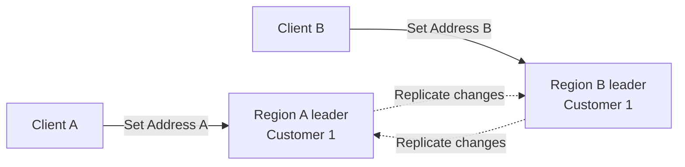

These are concurrent alternatives for the **same field**. Replication transports the conflict; it does not decide which address the customer intended.

| Policy | Trade-off |
| --- | --- |
| **Last-write-wins by timestamp** | Selects one value and can discard another accepted change; wall-clock skew can misrepresent which happened later |
| **Domain-specific reconciliation** | Uses application rules or preserves versions for resolution; two addresses usually need a choice rather than concatenation |
| **Assign one writer for a particular customer** | Reduces conflicts for that customer, while changing routing, failover, and local-write availability |

Multi-leader is not automatically supported by a normal PostgreSQL primary/standby setup. Product support, replication mode, constraints, and conflict rules must be checked. Local writes can reduce some geographic round trips, but coordinating invariants or resolving conflicts adds work and may restrict availability. See [the replication-solution comparison](https://www.postgresql.org/docs/current/different-replication-solutions.html).

#### Replication Lag and Read-Your-Writes

**Read-your-writes** means a client's subsequent reads observe its completed write or a later valid state. It is a session-level requirement, not a claim that every client sees every write immediately.

Consider the first creation of order **105**: the primary commits it and replies successfully. A read replica has not applied that update yet, so an immediate order lookup there may return “not found.” This is a separate timing illustration, not another mutation in the earlier SQL sequence.

| Approach | What must be true |
| --- | --- |
| **Read from the current primary** | Route to the authoritative writer and use an appropriately fresh read/snapshot; an old transaction snapshot can still hide later commits |
| **Wait for replica progress** | Use a supported position/token tied to the write, and wait until the selected replica has replayed it; define timeout and fallback behavior |
| **Use a supported session/bookmark mechanism** | Carry the required causal progress between related requests; support depends on the database and client |
| **Serve ordinary stale-tolerant reads from replicas** | Accept that these reads may omit recent writes; do not use them for a decision requiring current authoritative state |

**Sticky routing alone is not a universal guarantee.** Failover, connection pooling, a changed primary, or a replica that has not caught up can invalidate assumptions about “the same server.”

Distinguish replication stages: **received → persisted → replayed/applied**. A synchronous acknowledgment can wait for different stages, so it does not automatically make every replica read current. PostgreSQL's `remote_apply` setting waits for application on the required synchronous standbys; it is not a promise about all asynchronous replicas or old snapshots. See [synchronous replication](https://www.postgresql.org/docs/current/warm-standby.html) and [commit acknowledgment settings](https://www.postgresql.org/docs/current/runtime-config-wal.html).

Monitor replay progress/lag and read latency, not just whether the replica process is running. Use documented history/topology-aware mechanisms after failover; elapsed wall time alone is not proof that a specific write has been applied.

> **A replica can be healthy and still be behind. Route each read according to its freshness requirement, and distinguish acknowledged receipt from applied data.**

### Coordinating Reads and Writes

Clients can reach the storage system through different paths:

| Approach | Benefit | Responsibility |
| --- | --- | --- |
| **Generic router / load balancer** | Keeps placement knowledge out of the client | The selected node may need to forward to the key's replicas |
| **Partition-aware client** | Can avoid an unnecessary forwarding hop | Must refresh placement information and handle stale routes and failures |

For this **Dynamo-style teaching model**, the coordinator contacts intended replicas in parallel and waits for configured response thresholds. These are conceptual operations, not a complete implementation protocol.

- **N:** Intended replica count for the key.
- **W:** Distinct replica acknowledgments required for write success.
- **R:** Distinct valid replica responses required for a read.

For ordinary fixed-set operations, assume `1 <= R, W <= N`. Count physical replicas once, not repeated replies or multiple virtual nodes on one host. A read must interpret returned versions according to the protocol; receiving R responses alone does not establish which value to return.

**Example: N = 3, R = 2, W = 2, intended replicas A/B/C.**

1. A coordinator sends a versioned put to A, B, and C.
2. A and B acknowledge under the configured persistence policy. The coordinator can report write success after those two acknowledgments; C may complete later or require repair.
3. A subsequent read requests the replicas in parallel. Suppose B and C provide the first two valid responses.
4. B can report the completed write even if C is stale. The coordinator must select or reconcile versions correctly rather than return an arbitrary response.
5. Outstanding propagation and repair are separate from the client's completed response.

For subsets of the **same fixed N-replica set**, `R + W > N` guarantees that every qualifying read set intersects every qualifying write set:

| N | R | W | Read/write overlap guaranteed? | Completion requirement and trade-off |
| --- | --- | --- | --- | --- |
| 3 | 2 | 1 | **No:** `2 + 1 = 3` | A read can miss the sole acknowledged writer; smaller write threshold |
| 3 | 2 | 2 | **Yes:** `2 + 2 = 4` | Both operations need two responses; one unreachable replica need not prevent completion |
| 3 | 3 | 1 | **Yes:** `3 + 1 = 4` | Reads need all three; writes need one |
| 3 | 1 | 3 | **Yes:** `1 + 3 = 4` | Writes need all three; reads need one |

“Guaranteed overlap” is a set-intersection property, **not a standalone guarantee of linearizability**. Correct version selection, concurrent-write handling, incomplete-operation behavior, and operation ordering still matter. Even overlapping write sets do not resolve concurrent updates by arithmetic alone. Compare [Quorum Reads and Writes](Distributed-System-Attributes.md#quorum-reads-and-writes), including its consistency caveat.

**Latency and availability:** With parallel fan-out to all N eligible replicas, the waiting component is typically determined by the R-th valid read response or W-th qualifying write acknowledgment, plus coordination and processing. It is not necessarily the slowest of all replicas contacted. Increasing R or W generally requires more reachable responses and can increase latency or reduce operation availability; there is no configuration that tolerates arbitrary failures.

**Conflict example:** Two writers read the same cart version, then independently add `book` and `pen`. Returning one later-timestamped replacement could discard the other addition. The system needs an explicit ordering, conditional-update, or reconciliation policy. Version metadata can identify relevant relationships, but automatic merging is application-dependent. Replica counts alone do not solve this problem.

### Temporary Failures: Sloppy Quorums and Hinted Handoff

A **strict replica-set quorum** requires qualifying responses from a key's designated replicas. In a **sloppy quorum**, a Dynamo-style system may substitute other eligible healthy nodes from its preference list when intended replicas are unreachable. This can allow more operations to complete, but changes the participating sets.

**Example:** Intended replicas are **A, B, C**, with `N = 3` and `W = 2`. A is unreachable, C is slow, and D is an eligible fallback. Q is the request coordinator, shown separately for clarity.

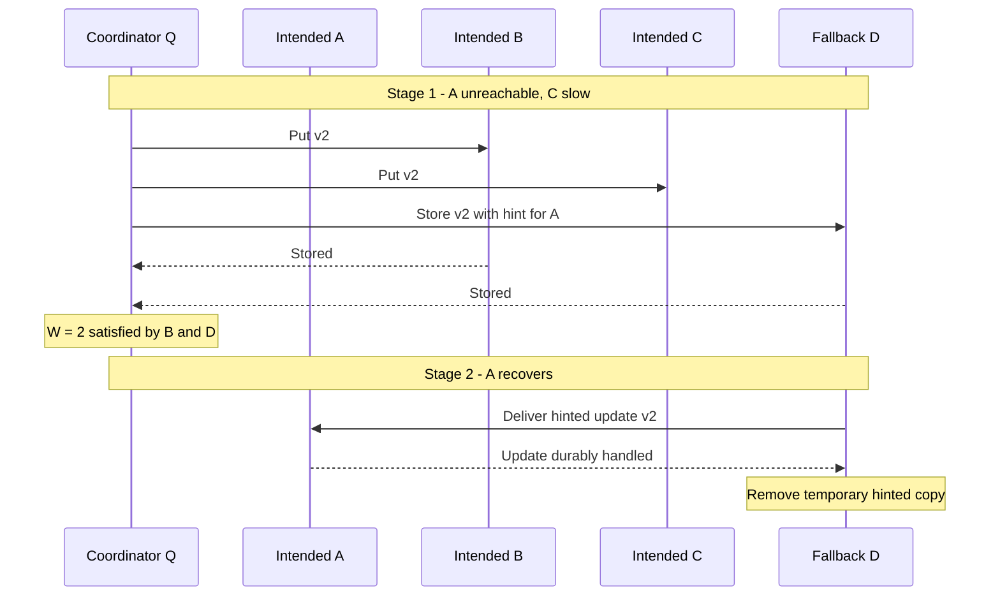

D stores the **key, value/update, version metadata, and intended destination A** under the fallback policy—not merely a request ID. After A recovers, D delivers the update. Once A has safely handled it, D removes the corresponding temporary copy. D must not discard unrelated data it owns. The request to C may still be pending; the diagram does not assume C has stored v2.

**Why overlap can fail:** Before handoff completes, A could return with its old value while C is still stale. A read receiving replies from **A and C** can miss the successful write acknowledged by **B and D**. Although `R + W = 4 > 3` numerically, those two sets are disjoint because D lies outside the intended A/B/C set.

Hints require safe replay so retries do not duplicate logical effects or overwrite newer versions incorrectly. Deletion/version information must survive the required recovery window. Hint storage, retention, and reachability are finite; D can also fail. Hinted handoff therefore **does not guarantee that every read/write succeeds or that every missed update is repaired**. Additional replica synchronization is needed when hints cannot finish.

This example follows the **historical Dynamo-style fallback placement** described in the [Dynamo paper](https://www.allthingsdistributed.com/files/amazon-dynamo-sosp2007.pdf). [Cassandra's documented hints](https://cassandra.apache.org/doc/latest/cassandra/managing/operating/hints.html) are stored by coordinators for unavailable replicas; they are not an identical implementation of temporary replica substitution. Cassandra describes hints as best effort and not a replacement for repair.

### Replica Repair and Merkle Trees

**Anti-entropy repair** compares replica state and transfers missing or differing data. It is useful after prolonged outages, incomplete propagation, or replacement; it is not limited to permanently failed nodes. A replacement needs data from surviving replicas or a suitable backup.

#### What the Hashes Represent

**A Merkle tree is a tree of hashes that helps replicas find where their data differs.**

| Term | Simple meaning |
| --- | --- |
| **Data block** | The content being summarized: a record, file chunk, or a range of records. |
| **Hash** | A fixed-size fingerprint calculated from bytes. The same bytes and hash function produce the same result. Different inputs can collide, so a hash is not a guaranteed unique ID. |
| **Leaf hash** | The fingerprint of one block or range at the bottom of the tree. |
| **Parent hash** | A hash calculated from its children's hashes in a defined order. |
| **Root hash** | The top hash, summarizing the whole ordered dataset represented by the tree. |

For security-sensitive integrity checks, use a suitable **cryptographic hash**, such as SHA-256, and a trustworthy reference root. An ordinary fast hash is not interchangeable with a cryptographic one. Even with cryptographic hashing, matching roots provide assurance under the hash assumptions—not a mathematical guarantee that collisions are impossible.

**Replicas must compare the same thing:** equivalent key ranges, ordering, byte encoding, tree construction, and compatible snapshots/version rules. Record hashes must cover the **key, value, and relevant version/deletion state**, not only key names. Equal keys with different values must be distinguishable.

#### Building the Tree

Use four blocks in this fixed order: **Alice, Bob, Carol, Dave**. Here, each block is just a string so the structure is easy to see.

1. Hash each block: `h1 = H(Alice)`, `h2 = H(Bob)`, `h3 = H(Carol)`, `h4 = H(Dave)`.
2. Combine adjacent hashes in order: `h12 = H(h1 || h2)` and `h34 = H(h3 || h4)`.
3. Hash the parents: `root = H(h12 || h34)`.

`||` means **concatenate the bytes in order**, not add the numbers. Real implementations define unambiguous encodings and distinguish leaves from internal nodes; the [C++ example](examples/merkle_tree/README.md#core-state-and-hash-encoding) makes those rules explicit. Merkle trees need not all use this exact binary shape or padding policy. See [RFC 9162's construction](https://www.rfc-editor.org/rfc/rfc9162.html#section-2.1) for one cryptographic variant.

Changing Carol to Carl changes that leaf's input. In this example, its leaf hash, its right-side parent, and the root change; the left subtree remains unchanged. **A point update only needs to recalculate the affected path**, not rebuild every node.

#### Finding and Repairing a Difference

Suppose two replicas initially match, then block 3 changes in B:

| Block | Replica A | Replica B after modification |
| --- | --- | --- |
| 1 | Alice | Alice |
| 2 | Bob | Bob |
| 3 | Carol | Carl |
| 4 | Dave | Dave |

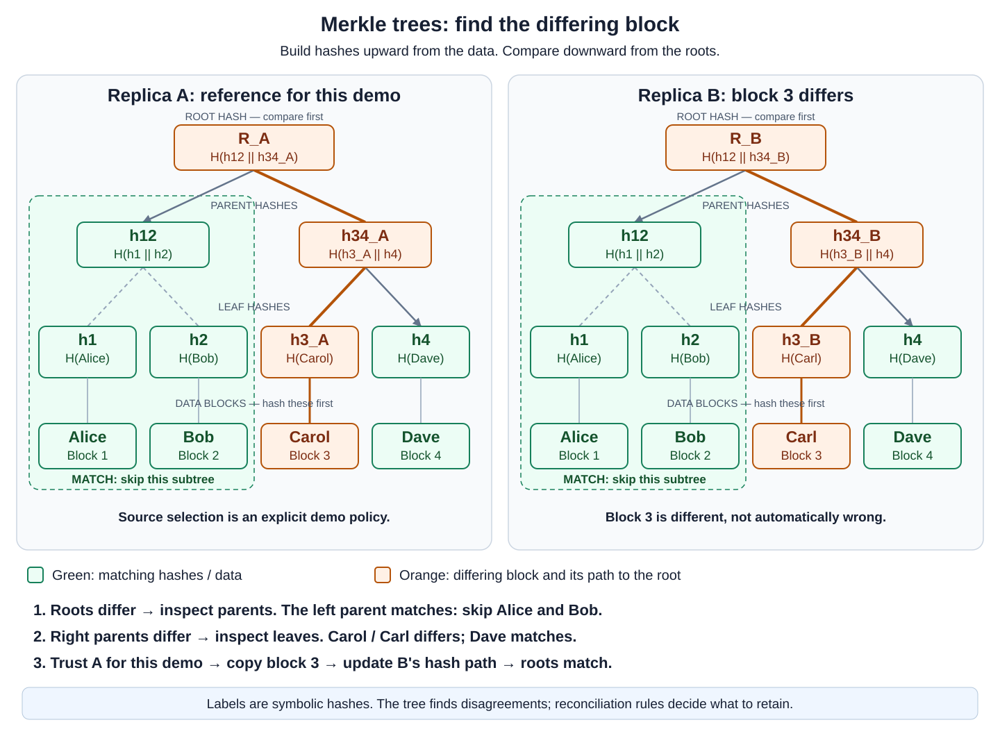

The diagram uses **symbolic hash names**, not actual SHA-256 outputs. Build the hashes upward from the data; compare downward from the roots.

| Comparison | Observation | Next action |
| --- | --- | --- |
| Whole-range roots | Different | Compare the two subranges |
| Left subtree: blocks 1–2 | Equal | Skip this subtree under the hash assumptions |
| Right subtree: blocks 3–4 | Different | Compare its children |
| Block 3: Carol / Carl | Different | Exchange state and apply reconciliation rules |
| Block 4: Dave / Dave | Equal | No repair needed for this block |

For this demonstration, **we explicitly choose A as the trusted source**. Copy only block 3 from A to B, update B's leaf-to-root path, and compare the roots again.

**The tree detects disagreement; it does not decide that Carl is wrong.** Either replica might be stale, or both versions might be legitimate concurrent updates. Reconciliation rules determine the retained state; a newer deletion marker may need to suppress an older value. Merkle trees cannot establish business correctness or recover a value whose every copy is gone.

> **Recall:** Compare roots → skip matching branches → locate differing blocks → reconcile → check again.

#### Complexity and Practical Uses

For **N constant-size blocks**, a balanced binary tree, and **K differing blocks**, with trees already built where applicable:

| Operation | Computational cost |
| --- | --- |
| Build all hashes | O(N) time and hash storage |
| Compare compatible roots | O(1) |
| Update one block's hash path | O(log N) |
| Locate one differing block | O(log N) hash comparisons |
| Locate K differences | O(min(N, 1 + K log N)) hash comparisons |
| Comparison auxiliary space | O(log N) recursion plus O(K) returned indexes |

Interpret logarithms as `log2(max(2, N))`; empty trees take constant work. These bounds assume usable hash comparisons. **A matching teaching hash can hide a difference**, so the non-cryptographic example is not a security verifier.

For variable-size blocks, building also hashes all input bytes; updating hashes the changed block's bytes plus its ancestors. Hash storage is O(N), but it does **not necessarily double data storage**: overhead depends on digest size, block size, and tree layout.

**Network cost is separate:** comparing trees exchanges hash information; repairing then transfers the differing payload bytes and any required metadata. Sparse differences can save substantial traffic, while extensive differences can approach a full transfer. Alternatives include exchanging per-block checksums, so “without Merkle trees, always transfer the entire dataset” is too strong.

| Use | What the tree helps with |
| --- | --- |
| **Database replica repair** | Find out-of-sync ranges and transfer differences; [Cassandra](https://cassandra.apache.org/doc/latest/cassandra/managing/operating/repair.html) uses this during repair. A range may contain many records. |
| **Bitcoin transaction inclusion** | Check that a transaction is included under a particular Merkle root; this alone does not establish transaction validity or consensus. See the [Bitcoin developer guide](https://developer.bitcoin.org/devguide/block_chain.html#merkle-trees). |
| **BitTorrent v2** | Verify file-block content using SHA-256 Merkle trees; see [BEP 52](https://www.bittorrent.org/beps/bep_0052.html). |
| **Certificate Transparency** | Use Merkle proofs for log-entry inclusion and append-only consistency; see [RFC 9162](https://www.rfc-editor.org/rfc/rfc9162.html#section-2.1). |

An inclusion proof and comparing two whole trees are different operations. This example implements tree comparison, not proof generation. Production repair also involves CPU, disk I/O, snapshot coordination, and recovery rules; changed ownership ranges may require rebuilding affected trees.

#### C++ Teaching Example

See the [DSA-style Merkle tree example](examples/merkle_tree/README.md) for **Build**, **Update**, **FindDifferences**, language-neutral pseudocode, and the Carol → Carl → repair walkthrough.

It uses a fixed **64-bit FNV-1a teaching hash**, not SHA-256. It compares ordered string blocks in memory and relies on an explicit source-selection policy for the repair. It does not implement Cassandra repair, Bitcoin, BitTorrent, or Certificate Transparency protocols.

### Membership, Gossip, and Failure Detection

Keep these concepts separate:

| Concept | What it describes |
| --- | --- |
| **Token ownership** | Which physical nodes own particular hash ranges and their replicas |
| **Membership** | Which nodes belong to the cluster, including controlled additions and removals |
| **Reachability / liveness estimate** | Which peers a node currently believes it can contact |

**Gossip** spreads selected cluster information through repeated peer exchanges. For example, A exchanges membership information with B; B later exchanges with C, allowing C to learn about A. Bootstrap contacts or seed nodes help a joining node discover the existing cluster. Token assignment and ownership policy are distinct from merely choosing peers to contact.

This is control information, **not automatic replication of every application write**. Message contents, persisted membership records, and liveness detectors depend on the system. The Dynamo paper, for example, separates explicit membership changes from local reachability judgments. Do not assume every gossip design has one globally agreed failure view.

A timeout means “no acceptable response arrived in time.” The node could be slow, partitioned, or unreachable only from one observer. Two healthy nodes can therefore disagree about a third node's liveness. During a partition, gossip cannot instantly reconcile views across the broken link.

A brief outage need not trigger permanent removal and full redistribution. Define when to keep placement stable and route around a suspected failure, when to rebuild replicas, and when to change membership. Planned joins/removals need controlled data movement, routing updates, and adequate copies throughout the transition. Returning nodes may need repair before their stale data can safely participate in particular operations.

> **Failure detection guides a response; it does not prove a node is permanently dead. Membership changes and data recovery require their own rules.**

### Design Review and Interview Checklist

1. **Requirements:** Define key/value sizes, operations, growth, workload skew, latency targets, and required failure behavior.
2. **Placement:** Explain routing, partition ownership, membership changes, and hot-key handling.
3. **Replication:** Choose N, distinct physical owners, failure domains, and persistence/acknowledgment semantics.
4. **Consistency:** Define what reads may observe, how R/W are used, and which operations must stop when coordination is unavailable.
5. **Concurrency:** Explain version handling and what happens to competing writes; do not claim quorum overlap supplies a complete protocol.
6. **Temporary failures:** Describe routing, fallback policy, hint limits, retry safety, and client-visible uncertainty.
7. **Recovery:** Explain anti-entropy, replacement, deletion handling, backup, and what happens if no copy survives.
8. **Membership and operations:** Cover discovery, suspicion, controlled changes, safe rejoining, and monitoring of lag, hints, capacity, and repair.
9. **Justification:** State why this design fits the workload, what it cannot guarantee, and how requirements or configuration may evolve.

> **Recall:** Hashing places keys; replication preserves copies; response thresholds control participation; version rules interpret writes; hints and repair restore missed state; membership and failure detection guide routing and recovery. The guarantees come from the complete design.

## Amazon DynamoDB

### DynamoDB Overview and Responsibilities

**Amazon DynamoDB is an AWS-managed, serverless key-value and document database.** Applications use its APIs without operating the underlying database servers. Serverless does not remove the need to model data, plan access, or manage costs and permissions.

| AWS manages | Application designers decide |
| --- | --- |
| Server infrastructure, physical partitions, and replication | Keys, item structure, indexes, and access patterns |
| Service maintenance and infrastructure failure handling | Capacity mode, workload testing, and application failure behavior |
| Managed database facilities | Permissions, business rules, backup/restore configuration, and recovery checks |

DynamoDB stores partitions on SSD-backed infrastructure and replicates them across multiple **Availability Zones (AZs)** within a Region. An AZ can contain more than one data centre. Multi-AZ replication and replication across **Regions** are different scopes. See [DynamoDB partitions](https://docs.aws.amazon.com/amazondynamodb/latest/developerguide/HowItWorks.Partitions.html) and [AWS AZ definitions](https://docs.aws.amazon.com/global-infrastructure/latest/regions/aws-regions-availability-zones.html).

**DynamoDB is a separate service from the historical Dynamo system.** Do not assume the earlier leaderless teaching design describes DynamoDB's internals. Compare the [original Dynamo explanation](#design-topics-to-study-next) and the [published DynamoDB architecture](#published-dynamodb-architecture-2022) below.

### When to Choose DynamoDB

**Evaluate DynamoDB when your important queries are known in advance and map well to keys or indexes, and you want AWS to operate the database infrastructure.**

| Good fit | Simple example | What still needs design |
| --- | --- | --- |
| **Known key/range queries** | Read one customer's order or list that customer's orders | Partition/sort keys, indexes, pagination, and read consistency |
| **High-traffic operational access** | Read/update shopping carts, sessions, or player state | Traffic distribution, conditional writes, latency targets, and cost |
| **AWS serverless applications** | An API Gateway/Lambda application stores user profiles | Permissions, retries, capacity choices, and recovery; these integrations are optional |
| **Device state and modeled history** | Retrieve a device's latest state or readings for a bounded period | Hot devices, time-based keys, retention, and item sizes |
| **Flexible records and content metadata** | Store different profile attributes or references to uploaded media | Validation and compatible readers; large media can live in [object storage](#object-storage-and-amazon-s3) |

A gaming leaderboard can also be modeled, but score ordering, ranking, updates, and hot-key behavior need deliberate design; it is not automatically provided by a generic key lookup. See [AWS's DynamoDB introduction and use cases](https://docs.aws.amazon.com/amazondynamodb/latest/developerguide/Introduction.html) and [access-pattern modeling guidance](https://docs.aws.amazon.com/amazondynamodb/latest/developerguide/bp-general-nosql-design.html).

**When another primary store or a complementary service may fit better:**

| Requirement | What to evaluate instead or alongside DynamoDB |
| --- | --- |
| **Frequent joins, database-enforced relationships, or changing ad-hoc queries** | A relational database such as PostgreSQL; DynamoDB has no native SQL JOIN operator |
| **Heavy historical reporting and large cross-dataset aggregations** | An analytical warehouse or engine; copying/querying data through an appropriate pipeline may be preferable to repeated operational scans |
| **Full-text search, relevance ranking, and broad text exploration** | A search engine or a database with suitable full-text indexes; a post-read filter is not a full-text index |

DynamoDB can support documents with varying attributes. **Flexible data is supported; constantly changing query requirements are the harder issue.** It also supports transactions within its [documented scope](#current-read-consistency-and-transactions); do not interpret these selection rules as “NoSQL has no transactions.”

**Performance needs qualification.** AWS describes single-digit-millisecond performance for operational access, not a guarantee for every request or complete application response. Measure realistic queries, item sizes, concurrency, network paths, and tail latency.

On-demand capacity can accommodate changing traffic, but quotas, configured limits, hot keys, and sudden growth beyond prepared capacity can still cause throttling. Avoid “unlimited scale without performance degradation.” See [on-demand scaling behavior](https://docs.aws.amazon.com/amazondynamodb/latest/developerguide/on-demand-capacity-mode.html).

For a concrete choice, revisit the [customer-order alternative in the delivery platform](#storage-roles-in-the-delivery-platform) and the [worked DynamoDB API requests](#worked-requests-customer-orders).

> **Recall:** Choose DynamoDB for well-modeled operational access and managed infrastructure. Evaluate relational querying, analytics, and search separately when those requirements dominate.

### Tables, Items, Attributes, and Flexible Schema

Use a fictional table named **Orders**:

| Component | Meaning in this example |
| --- | --- |
| **Table** | The collection named `Orders` |
| **Item** | One order record |
| **Attribute** | A field such as `Status`, `OrderId`, or `CreatedAt` |
| **Primary key** | The `PK` and `SK` values together identify one item |

Both key attributes are strings. The starting data is:

| PK: partition key | SK: sort key | OrderId | Status | CreatedAt |
| --- | --- | --- | --- | --- |
| `CUSTOMER#42` | `ORDER#D4821` | D4821 | CREATED | 2026-01-10T10:00:00Z |
| `CUSTOMER#42` | `ORDER#D4822` | D4822 | DELIVERED | 2026-01-09T09:00:00Z |
| `CUSTOMER#99` | `ORDER#D9001` | D9001 | CREATED | 2026-01-10T11:00:00Z |

`PK` and `SK` are names chosen by the application, not mandatory DynamoDB attribute names.

**Flexible schema means non-key attributes can vary.** One order might include a nested delivery address; another might include special handling instructions. Table/index key definitions and their supported types are explicit. Applications still need validation, compatible readers, and migration planning. Not all NoSQL databases store documents or automatically outperform relational databases.

The documented maximum item size is **400 KB**, including attribute names and values. DynamoDB uses `1 KB = 1024 bytes`. Flexible attributes do not allow unlimited-size items. See [core components](https://docs.aws.amazon.com/amazondynamodb/latest/developerguide/HowItWorks.CoreComponents.html) and [item constraints](https://docs.aws.amazon.com/amazondynamodb/latest/developerguide/Constraints.html).

### Partitioning and Primary Keys

#### Horizontal and Vertical Partitioning

| Approach | What is divided? | Simple example |
| --- | --- | --- |
| **Horizontal partitioning** | Rows/items | Put student rows 1–2 in one group and row 3 in another |
| **Vertical partitioning** | Attributes | Separate names from subjects/grades, retaining the student ID |

**Visual overview:** Both methods start from the same table. The left branch divides rows; the right branch separates columns while keeping `ID` in both pieces.

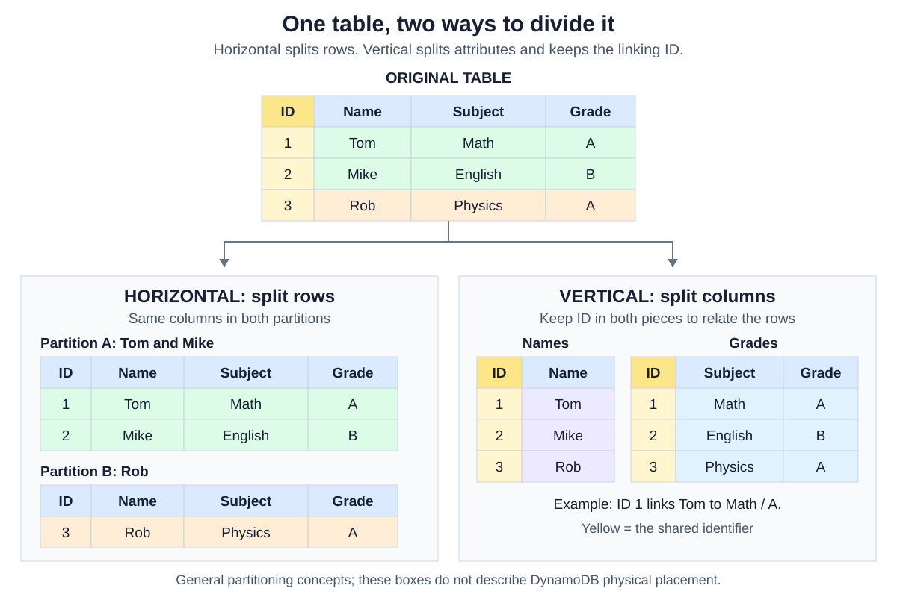

**Original table**

| ID | Name | Subject | Grade |
| --- | --- | --- | --- |
| 1 | Tom | Math | A |
| 2 | Mike | English | B |
| 3 | Rob | Physics | A |

**Horizontal partitioning — split the rows; keep the same columns.**

Partition A:

| ID | Name | Subject | Grade |
| --- | --- | --- | --- |
| 1 | Tom | Math | A |
| 2 | Mike | English | B |

Partition B:

| ID | Name | Subject | Grade |
| --- | --- | --- | --- |
| 3 | Rob | Physics | A |

**Vertical partitioning — split the columns; retain an identifier connecting the pieces.**

Names:

| ID | Name |
| --- | --- |
| 1 | Tom |
| 2 | Mike |
| 3 | Rob |

Grades:

| ID | Subject | Grade |
| --- | --- | --- |
| 1 | Math | A |
| 2 | English | B |
| 3 | Physics | A |

> **Horizontal = different rows. Vertical = different attributes linked by ID.**

**This is a general modeling illustration, not actual DynamoDB placement.** Horizontal grouping here is arbitrary, not a claim about hash results. Vertical modeling remains possible with flexible attributes—for example, separating information into related items. It is also different from a physical column-oriented storage layout.

DynamoDB automatically manages physical partition allocation, movement, and splitting. Customers do not manually assign items to storage servers or split physical partitions. Designers can change application-level key patterns or introduce write-sharding keys when justified; those are different decisions from AWS's physical management.

For the general distinction between local partitioning, distributed sharding, indexes, and replicas, see [Partitioning and Sharding](#partitioning-and-sharding).

#### Partition Keys and Sort Keys

| Primary-key design | What must be unique? | Direct item lookup |
| --- | --- | --- |
| **Partition key only** | Each partition-key value | Supply the partition key |
| **Partition key + sort key** | Each complete pair; partition-key values may repeat | Supply both key values |

For the Orders table, `CUSTOMER#42` alone describes a group of orders. The pair `CUSTOMER#42 / ORDER#D4821` identifies one order.

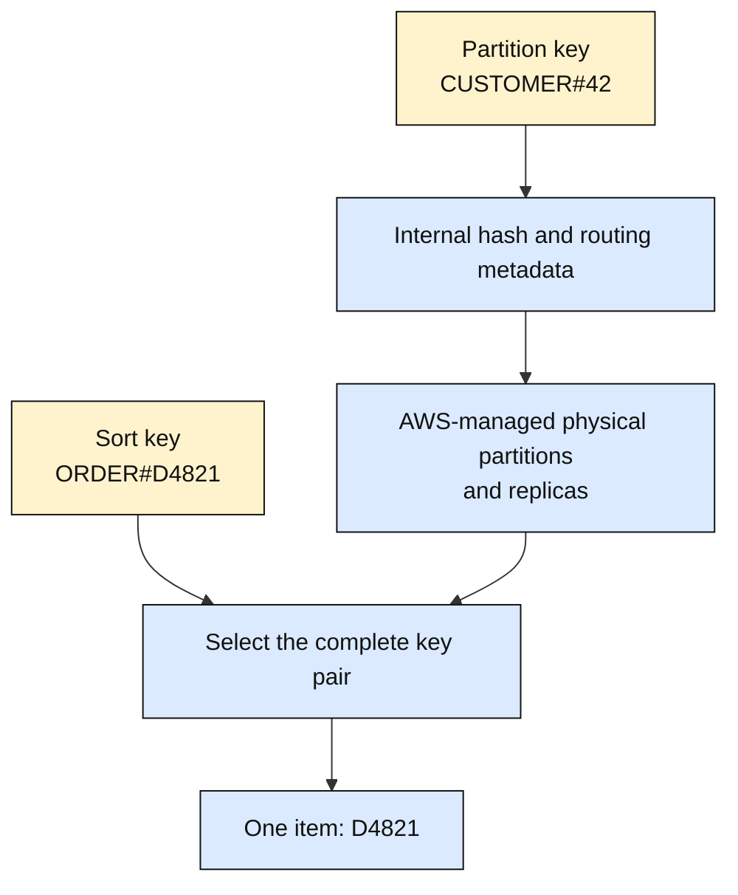

The **partition key** participates in hash-based routing; the **sort key** distinguishes and orders items within the logical item collection. The sort key is not simply another value hashed together with the partition key.

An **item collection** means items sharing a partition-key value. Do not equate it permanently with one physical partition: collections can be split when supported; an LSI introduces additional restrictions. See [partition and sort-key distribution](https://docs.aws.amazon.com/amazondynamodb/latest/developerguide/HowItWorks.Partitions.html).

Choose keys for real queries and traffic distribution. A single popular key can remain a bottleneck even when the table has ample total capacity. Cross-link: [partitioning and hashing foundations](#scalability-partitioning-and-consistent-hashing).

### API Operations and Query Patterns

| Operation | Main behavior | Important default |
| --- | --- | --- |
| **PutItem** | Create or replace a complete item with its full key | An existing item with that key is replaced unless a condition prevents it |
| **UpdateItem** | Change selected attributes | Can create an item if it is missing |
| **GetItem** | Read one item using its complete primary key | Eventual consistency unless strong consistency is requested |
| **DeleteItem** | Delete one item using its complete primary key | Deleting an absent item without conditions succeeds |
| **Query** | Read items matching one partition-key value, optionally restricting the sort key | Results are ordered by sort key; pagination can apply |

See the official [PutItem](https://docs.aws.amazon.com/amazondynamodb/latest/APIReference/API_PutItem.html), [UpdateItem](https://docs.aws.amazon.com/amazondynamodb/latest/APIReference/API_UpdateItem.html), [GetItem](https://docs.aws.amazon.com/amazondynamodb/latest/APIReference/API_GetItem.html), and [DeleteItem](https://docs.aws.amazon.com/amazondynamodb/latest/APIReference/API_DeleteItem.html) references.

#### Worked Requests: Customer Orders

**These are language-neutral API-style examples, not executable SDK syntax.** Names such as `Condition`, `Set`, and `KeyCondition` below describe intent. Real SDK requests use exact expression syntax, attribute aliases, and value encoding.

Assume the three starting items above, no concurrent writes, and a small result fitting one page. The new order is D4823.

**1. Create it without replacing an existing item.**

```text
PutItem(
    Table = "Orders",
    Item = {
        PK: "CUSTOMER#42", SK: "ORDER#D4823",
        OrderId: "D4823", Status: "CREATED",
        CreatedAt: "2026-01-10T12:00:00Z"
    },
    Condition = attribute_not_exists(PK)
)
Expected: success; D4823 is created.
```

The condition checks the targeted item identified by the full key. It does not prevent other orders sharing `CUSTOMER#42`. Repeating this create while D4823 exists produces a conditional-check failure instead of overwriting it.

**2. Update an existing item.**

```text
UpdateItem(
    Table = "Orders",
    Key = {PK: "CUSTOMER#42", SK: "ORDER#D4823"},
    Set = {Status: "DISPATCHED"},
    Condition = attribute_exists(PK),
    ReturnValues = "ALL_NEW"
)
Expected attributes:
    {PK: "CUSTOMER#42", SK: "ORDER#D4823", OrderId: "D4823",
     Status: "DISPATCHED", CreatedAt: "2026-01-10T12:00:00Z"}
```

The condition prevents an accidental upsert when the item is missing. Existence alone does not validate a business transition; a real workflow may also require an expected status or version.

**3. Read the updated item.**

```text
GetItem(
    Table = "Orders",
    Key = {PK: "CUSTOMER#42", SK: "ORDER#D4823"},
    ConsistentRead = true
)
Expected Item:
    {PK: "CUSTOMER#42", SK: "ORDER#D4823", OrderId: "D4823",
     Status: "DISPATCHED", CreatedAt: "2026-01-10T12:00:00Z"}
```

**4. Query customer 42's orders.**

```text
Query(
    Table = "Orders",
    KeyCondition = PK equals "CUSTOMER#42",
    ConsistentRead = true,
    Projection = [SK, Status]
)
Expected Items, in ascending sort-key order:
    [{SK: "ORDER#D4821", Status: "CREATED"},
     {SK: "ORDER#D4822", Status: "DELIVERED"},
     {SK: "ORDER#D4823", Status: "DISPATCHED"}]
```

String sort keys follow their byte ordering. These order IDs do **not** imply chronological order: D4822's `CreatedAt` is earlier than D4821's. If time-ordered access is required, model an appropriate time-based key or index.

**5. Delete D4823.**

```text
DeleteItem(
    Table = "Orders",
    Key = {PK: "CUSTOMER#42", SK: "ORDER#D4823"}
)
Expected: success; the item is removed.
Deleting the already absent key again, without conditions, also succeeds.
```

**6. Check the deletion.**

```text
GetItem(
    Table = "Orders",
    Key = {PK: "CUSTOMER#42", SK: "ORDER#D4823"},
    ConsistentRead = true
)
Expected: no Item element in the response.
```

A failed condition produces a conditional-check error; it is not the same as a successful read finding no item. These examples describe documented behavior; they do not contact AWS.

#### GetItem, Query, and Scan

| Need | Operation | Design implication |
| --- | --- | --- |
| One known full key | **GetItem** | Direct item access |
| One partition-key value, possibly a sort-key range | **Query** | Design table or index keys for this access pattern |
| Examine items across a table/index | **Scan** | Can read substantial data; a filter does not turn it into a key lookup |

`Query` pages are up to **1 MB of evaluated data**. Continue with the returned `LastEvaluatedKey` as the next request's `ExclusiveStartKey` until no continuation key remains. A filtered page can contain zero matches and still require continuation.

Filters apply after items are read; they do not save the read capacity already consumed. Choosing fewer projected attributes also does not make base-table reads cheaper merely because the response is smaller. See [query pagination](https://docs.aws.amazon.com/amazondynamodb/latest/developerguide/Query.Pagination.html), [filter expressions](https://docs.aws.amazon.com/amazondynamodb/latest/developerguide/Query.FilterExpression.html), and [capacity accounting](https://docs.aws.amazon.com/amazondynamodb/latest/developerguide/read-write-operations.html).

### Secondary Indexes: GSI and LSI

A secondary index adds an alternate key-based access pattern. **Projection** means the attributes copied into that index.

| Question | Global secondary index (GSI) | Local secondary index (LSI) |
| --- | --- | --- |
| **Key definition** | Can use a different partition key and optional sort key | Same partition key as the table, with an alternate sort key |
| **Example** | Query by `OrderId` without knowing the customer | Query one customer's orders by `CreatedAt` rather than order-ID sort order |
| **Read consistency** | Eventual only | Eventual or strong |
| **When created?** | With the table or later; can be removed | Must be created with the table; cannot later be added or removed |
| **Capacity** | Separate index capacity in provisioned mode; writes maintaining the index add work | Uses the table's capacity |
| **Storage and scope** | Stored separately; queries return projected attributes, including base primary keys | Adds index storage and a 10 GB item-collection limit for each partition-key value, including relevant table/index data |

Suppose an illustrative **OrderLookup** GSI has partition key `OrderId` and projects the needed attributes:

```text
Query(
    Table = "Orders",
    Index = "OrderLookup",
    KeyCondition = OrderId equals "D4821"
)
Expected after index propagation: the item for CUSTOMER#42 / ORDER#D4821.
```

**GSI keys need not be unique.** The application must enforce any required uniqueness separately; a query might return multiple items. This index query may lag behind a recent base-table write. It cannot request a strongly consistent GSI read, and `GetItem` is not an operation for querying a GSI.

Adding indexes increases storage and write work and can introduce additional throttling constraints. This subsection covers **the two secondary-index types**, not every indexing capability DynamoDB may offer. See [AWS's secondary-index comparison](https://docs.aws.amazon.com/amazondynamodb/latest/developerguide/SecondaryIndexes.html).

### Capacity, Bursting, and Hot Partitions

#### On-Demand and Provisioned Capacity

| Mode | What the application configures | What to consider |
| --- | --- | --- |
| **On-demand** | No provisioned RCU/WCU target; requests drive capacity use | Scaling readiness, configured/service limits, hot keys, and request cost still matter |
| **Provisioned** | Read capacity units (RCUs) and write capacity units (WCUs), with optional scaling policies | Forecast demand, observe throttling, and maintain suitable headroom |

On-demand is not infinite throughput on every key at every instant. Provisioned capacity is not a fixed count of arbitrary-size items. See [capacity modes](https://docs.aws.amazon.com/amazondynamodb/latest/developerguide/capacity-mode.html) and [on-demand scaling considerations](https://docs.aws.amazon.com/amazondynamodb/latest/developerguide/on-demand-capacity-mode.html).

#### Read and Write Capacity Units

A **capacity unit** describes supported work per second in provisioned mode. On-demand uses **read/write request units** rather than a provisioned per-second allocation. Both require the appropriate item-size and operation accounting.

For existing items and ordinary single-item operations:

| Item read size | Strong read: RCUs for one read/second | Eventual read: RCUs for one read/second | Transactional read: RCUs for one read/second |
| --- | ---: | ---: | ---: |
| Up to 4 KB | 1 | 0.5 | 2 |
| 8 KB | 2 | 1 | 4 |

| Item written size | Ordinary write: WCUs for one write/second | Transactional write: WCUs for one write/second |
| --- | ---: | ---: |
| Up to 1 KB | 1 | 2 |
| 1.5 KB | 2 | 4 |
| 2 KB | 2 | 4 |

Reads round up in **4 KB blocks**; writes round up in **1 KB blocks**. For an ordinary strongly consistent `GetItem`, use `ceil(itemBytes / 4096)` read units; for an ordinary put creating a new item, use `ceil(itemBytes / 1024)` write units. Replacement/update accounting uses the larger applicable old/new item size, not just the changed bytes.

**Nominal provisioned-capacity examples:**

- **20,000 RCUs:** 20,000 strong reads/second for items up to 4 KB, or 10,000 for 8 KB items.
- **5,000 WCUs:** 5,000 ordinary puts/second for items up to 1 KB, or 2,500 for 2 KB items.

These are unit calculations, not guaranteed request rates. They exclude extra index work and assume no other bottleneck, quota, competing workload, or hot partition limits progress. API-specific accounting also matters for multi-item operations. See [read/write accounting](https://docs.aws.amazon.com/amazondynamodb/latest/developerguide/read-write-operations.html) and [capacity constraints](https://docs.aws.amazon.com/amazondynamodb/latest/developerguide/Constraints.html).

#### Burst, Adaptive, and Warm Throughput

| Mechanism | Simple meaning | Practical limit |
| --- | --- | --- |
| **Burst capacity** | Some unused capacity is saved and may serve temporary spikes | Savings can run out or be used for maintenance; not a permanent increase |
| **Adaptive capacity** | AWS accommodates uneven traffic across partitions within the applicable limits | It does not remove the table's total constraints or every hot-item limit |
| **Warm throughput** | The table/index has prepared throughput it can support when appropriately configured | Readiness is distinct from burst savings and does not override other constraints |

**How the saved-capacity bank works**

In provisioned mode, DynamoDB automatically saves some unused read/write capacity and may use it for later spikes. There is no separate burst switch to enable. AWS currently documents retention of up to **five minutes (300 seconds) of unused capacity**.

**Five minutes describes the amount saved, not a fixed maximum burst duration.** The duration depends on the available savings and how quickly excess demand consumes them.

**Illustrative calculation:** Assume a 150-RCU baseline, a hypothetical full bank after complete idleness, and no competing use of the savings:

| Quantity | Calculation |
| --- | --- |
| Hypothetical saved read units | `150 × 300 = 45,000` |
| Demand during the spike | 200 read units/second |
| Extra demand above the baseline | `200 − 150 = 50` read units/second |
| Time until this hypothetical bank empties | `45,000 ÷ 50 = 900 seconds = 15 minutes` |

This is arithmetic for the teaching model, **not guaranteed DynamoDB throughput or a freely shared table-wide credit balance**. Partition placement, available savings, and other limits affect actual behavior.

Bursting can temporarily help a hot partition exceed its allocation, but cannot bypass its maximum capacity or other limits. Requests can still throttle. AWS may also consume savings for maintenance; size steady demand without relying on burst capacity. See [AWS's burst and adaptive capacity guidance](https://docs.aws.amazon.com/amazondynamodb/latest/developerguide/burst-adaptive-capacity.html).

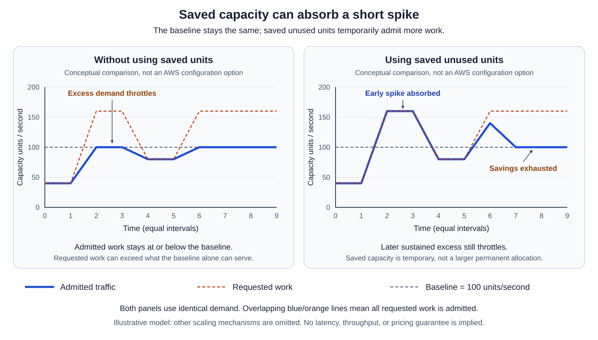

The dashed line is a **100-unit/second illustrative baseline**, not an arbitrary item count. Both panels use the same demand. The right panel saves unused units, serves the first spike, then exhausts its savings during later excess demand. It is a simplified teaching model, not an AWS benchmark or an exposed “enable bursting” setting. Actual behavior includes other capacity-management mechanisms.

Do not describe bursting simply as borrowing neighbouring partitions' spare allocations. Current AWS documentation explains saved unused capacity; historical node-level resource controls are discussed [separately below](#admission-control-and-splitting-2022).

**Adaptive capacity example: one busy partition**

Suppose a table has **400 WCUs**, initially illustrated as four partitions with an allowance of 100 WCUs each:

| Partition | Initial allowance | Current demand |
| --- | ---: | ---: |
| P1 | 100 WCUs | 50 write units/second |
| P2 | 100 WCUs | 50 write units/second |
| P3 | 100 WCUs | 50 write units/second |
| P4: hot partition | 100 WCUs | 150 write units/second |
| **Total** | **400 WCUs** | **300 write units/second** |

P4 needs more than its initial allowance, while total demand is still below the table's provisioned capacity. **Adaptive capacity can increase P4's allowance to sustain 150 write units/second without increasing the table's 400-WCU total.** This is not simply spending saved burst units.

The requests remain unevenly distributed: P4 still receives more traffic. DynamoDB accommodates the imbalance by adjusting available capacity. Table and partition limits still apply, and these units are not arbitrary-size write counts. This simplified example follows [AWS's adaptive-capacity illustration](https://docs.aws.amazon.com/amazondynamodb/latest/developerguide/burst-adaptive-capacity.html).

Do not teach adaptive capacity as universally a slow learning process. AWS describes automatic, immediate adjustment within its documented bounds; that is not a promise that every workload surge, physical split, or single-item hot spot is resolved instantly. For an expected large peak, assess warm throughput and the appropriate mode/limits in advance. Users can request more warm throughput; they do not manually split physical partitions.

Observe throttling and latency, use appropriate retry/backoff behavior, and evaluate cache, partition-key distribution, or application write sharding when required. See [burst/adaptive capacity](https://docs.aws.amazon.com/amazondynamodb/latest/developerguide/burst-adaptive-capacity.html), [warm throughput](https://docs.aws.amazon.com/amazondynamodb/latest/developerguide/warm-throughput.html), and [write-sharding patterns](https://docs.aws.amazon.com/amazondynamodb/latest/developerguide/bp-partition-key-sharding.html).

### Architecture, Availability, and Read Guarantees

#### Published DynamoDB Architecture (2022)

**2022 design:** The [AWS-authored paper](https://www.usenix.org/conference/atc22/presentation/elhemali) describes metadata-based routing, Multi-Paxos groups, leader leases, replicated write-ahead logs, and optional log-only replicas.

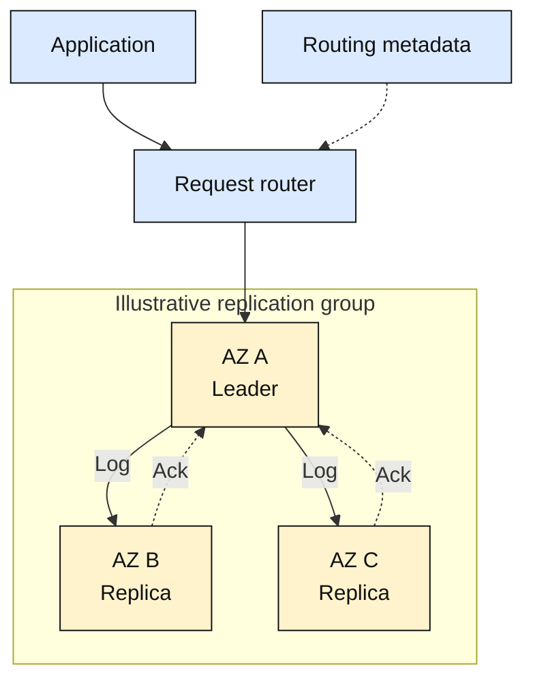

Illustration only; log-only members lack a full item index and are omitted here. Leaders handle writes/strong reads; storage replicas can serve eventual reads. Writes await quorum log persistence. Compare [Paxos](Distributed-Systems-Theorems-and-Data-Structures.md#paxos) and [replication](#replication-models-and-replica-placement).

**Write walkthrough: three storage replicas A, B, and C**

Assume A is leader:

1. A router sends order D4821's status update to A.
2. A creates a write-ahead-log record and replicates it.
3. Acknowledgment requires persisted logs from a quorum—two of three in this illustration.

Storage replicas apply log records to maintain their own B-tree. Ordinary replication does not broadcast the whole index for every write. See **Section 3** of the [2022 paper](https://www.usenix.org/system/files/atc22-elhemali.pdf).

**Read example: availability versus freshness**

Assume a base-table write changes D4821 from `CREATED` to `DISPATCHED` and succeeds, with no later writes:

| Successful read | Possible result |
| --- | --- |
| **Strongly consistent read** | `DISPATCHED` |
| **Eventually consistent read** | `CREATED` or `DISPATCHED` until the read reflects the update |

Returning an older committed value can satisfy the eventual-read contract. **A successful read is available; its consistency option determines the freshness guarantee.** See [current AWS read guarantees](https://docs.aws.amazon.com/amazondynamodb/latest/developerguide/HowItWorks.ReadConsistency.html).

#### Admission Control and Splitting (2022)

The paper describes an evolution:

| Mechanism | Purpose |
| --- | --- |
| Partition/node token buckets | Allocation and workload isolation |
| Global admission control | Table-wide request-router token coordination |
| Automatic splitting for consumed load | Divide eligible hot ranges; single hot items remain constrained |

**Token buckets: how requests were admitted**

A **token** represents permission to consume throughput. A request spends tokens according to its capacity cost.

The earlier storage-node design described in the paper used **two buckets per partition plus one shared node bucket**:

| Bucket | What it controls |
| --- | --- |
| **Partition allocated bucket** | The partition's regular throughput allowance |
| **Partition burst bucket** | Saved allowance for temporary excess traffic |
| **Shared node bucket** | Capacity available on the storage server hosting multiple partitions |

1. **Regular allowance available:** Admit the request using the partition's allocated tokens and charge the node bucket.
2. **Regular allowance exhausted:** Allow bursting only when both the partition's burst bucket and the node bucket have sufficient tokens.
3. **Required tokens unavailable:** Throttle the request. Saved burst tokens alone do not guarantee admission.

Burst writes also checked capacity at the other replica nodes. This protected shared servers and replicated writes from overload. See **Section 4.1.1** of the [2022 DynamoDB paper](https://www.usenix.org/system/files/atc22-elhemali.pdf).

**Global admission control (GAC): the table's admitted workload**

In the 2022 design:

1. Request routers receive local token allowances coordinated by GAC.
2. Requests consume tokens according to their capacity cost.
3. Routers request replenishment as tokens are consumed or expire.

GAC coordinates the **table-wide budget**; it does not make traffic equal across partitions. Partition safeguards still apply.

**Automatic splitting: spreading eligible hot data**

DynamoDB monitored consumed throughput and automatically split eligible partitions when thresholds were crossed. It selected split points using observed key/access distribution rather than always choosing the midpoint.

**Illustration:** If busy items lie on both sides of a chosen split, two resulting partitions can share their workload. If all traffic targets one item, that item remains in one resulting partition; splitting does not divide the item. Some sequential access patterns also cannot benefit.

These mechanisms are described in **Sections 4.2 and 4.4** of the [2022 DynamoDB paper](https://www.usenix.org/system/files/atc22-elhemali.pdf).

**Customers do not manually split or merge DynamoDB physical partitions.** Application write sharding changes logical keys; it is a separate choice. See [AWS partition management](https://docs.aws.amazon.com/amazondynamodb/latest/developerguide/HowItWorks.Partitions.html).

**Keep the timeframes separate:** This is historical architecture. Current [AWS guidance](https://docs.aws.amazon.com/amazondynamodb/latest/developerguide/burst-adaptive-capacity.html) describes adaptive capacity as automatic and immediate within its limits; do not teach it as only a slow, long-term mechanism. Compare [burst, adaptive, and warm throughput](#burst-adaptive-and-warm-throughput).

“Global” here is table-wide, not necessarily multi-Region. These are historical internals; current “adaptive capacity” is customer-facing terminology.

#### Failure Handling and Gray Failures (2022)

Peers can initiate elections. Replacements respect the old lease before serving protected operations. Gray failures involve partial reachability; peer cross-checks reduce spurious elections. Leader loss can interrupt service; recovery remains possible. See [failure detection](#membership-gossip-and-failure-detection).

**Leader failover**

1. Leader A fails.
2. B or C can initiate an election; the old leader need not coordinate it.
3. A replacement waits for the old lease to expire before serving writes/strong reads. A healthy quorum remains necessary.

Leader failure can interrupt service; it does not permanently prevent another quorum.

**Replacing an unhealthy replica**

A leader can recruit a **log replica**, copying recent logs without first copying the full B-tree. This restores log redundancy quickly while storage-replica rebuilding proceeds. Log-only replicas cannot serve ordinary item reads. See **Sections 5.1 and 6.1–6.2** of the [2022 paper](https://www.usenix.org/system/files/atc22-elhemali.pdf).

#### Current Read Consistency and Transactions

**Current public API guarantees are separate from the historical implementation sketch.**

| Read source | Available read guarantee |
| --- | --- |
| **Base table** | Eventual by default; strong reads can be requested |
| **Local secondary index** | Eventual or strong |
| **Global secondary index** | Eventual only |
| **DynamoDB Streams** | Eventual; not a strongly consistent table read |

A strong read reflects previously completed successful writes within the applicable scope. It is not a lock preventing a subsequent write, nor does making several strong reads automatically create a multi-item snapshot.

**Global tables** replicate across Regions. **MREC** means *multi-Region eventual consistency*: cross-Region propagation is asynchronous. **MRSC** means *multi-Region strong consistency*: supported strong reads provide the corresponding cross-Region guarantee. The modes have different supported configurations and restrictions; see [global-table consistency modes](https://docs.aws.amazon.com/amazondynamodb/latest/developerguide/V2globaltables_HowItWorks.html).

DynamoDB supports transactional APIs within documented boundaries. Standard transaction scope is within one AWS account and Region; do not assume a transaction is replicated atomically as a cross-Region unit. MRSC does not support transaction operations under the current documented restrictions. Compare [DynamoDB transactions](https://docs.aws.amazon.com/amazondynamodb/latest/developerguide/transaction-apis.html), [global-table transaction restrictions](https://docs.aws.amazon.com/amazondynamodb/latest/developerguide/V2globaltables_HowItWorks.html), and [ACID concepts](#transactions-and-acid).

See [AWS's read-consistency documentation](https://docs.aws.amazon.com/amazondynamodb/latest/developerguide/HowItWorks.ReadConsistency.html). Eventual consistency is not the absence of durability, and a successful response is not necessarily a fresh read.

#### Availability, Freshness, Durability, and Recovery

| Concern | Question it answers |
| --- | --- |
| **Availability** | Can the requested operation complete successfully? |
| **Freshness / consistency** | Which completed changes may the read observe? |
| **Durability** | Are acknowledged writes retained under the specified failure assumptions? |
| **Backup / recovery** | Can we restore an appropriate state after deletion, corruption, or other loss? |

An eventual read can succeed while returning an older committed value. Replication can improve availability and durability but also propagate an accidental deletion. Configure and test suitable backup/restore and [point-in-time recovery](https://docs.aws.amazon.com/amazondynamodb/latest/developerguide/Point-in-time-recovery.html). Neither multi-AZ (Availability Zone) replication nor an availability claim replaces application-level correctness and recovery planning.

### DynamoDB Design Checklist

1. **Access patterns:** Which full-key lookups, partition queries, ranges, and alternate indexes are needed?
2. **Keys and sizes:** Are hot keys, growing collections, item sizes, and index limits understood?
3. **Writes:** Should a put replace, an update upsert, or a condition reject a conflicting action?
4. **Reads:** What freshness is needed, and does the chosen table/index/Region mode support it?
5. **Capacity:** Account for item sizes, consistency, transactions, indexes, peaks, and throttling.
6. **Operations:** Define permissions, retries, monitoring, backup/restore, and the team's recovery process.

> **Recall:** Keys shape access; indexes add access paths; capacity units measure sized work; replication supports resilience; the read option determines freshness. AWS manages the infrastructure, while the application still defines correct behavior.

## Column-Family Databases

### Column-Family Concepts and Terminology

**Column-family databases, also called wide-column stores, organize keyed data with related columns and product-specific grouping rules.** They are often used for distributed operational workloads whose reads and writes can be modeled around suitable keys.

“Wide” does not require every record to contain thousands of columns. Some models allow many sparse attributes; Cassandra can group many ordered CQL rows within one partition.

**HBase-style conceptual example:** The families `profile` and `sensors` are defined explicitly; qualifiers such as `model` or `battery` identify values within them.

| Row key | profile:model | sensors:battery | sensors:temperature | sensors:payload |
| --- | --- | --- | --- | --- |
| robot:R17 | Courier | 80 | 22.5 | — |
| robot:R18 | Inspector | 90 | — | Camera |

Here **— means no stored value for that qualifier**, not a literal dash or a requirement to store an empty placeholder. This illustrates sparse records, not the Cassandra schema used below.

| HBase-style term | Simple meaning |
| --- | --- |
| **Row key** | Identifies and orders a row |
| **Column family** | A defined group of related columns |
| **Qualifier** | Identifies a column within a family, such as `battery` in `sensors:battery` |
| **Cell** | A value addressed by row, family, and qualifier |
| **Version** | A timestamp distinguishes a retained version of that value |

See [HBase's data model](https://hbase.apache.org/docs/datamodel/). Version retention is configurable; this example is not a full HBase tutorial.

**Cassandra and HBase do not expose identical models:**

| Concept | Cassandra | HBase |
| --- | --- | --- |
| **Organization** | Keyspace → table → partitions → ordered CQL rows | Table → keyed rows → families and qualifiers |
| **Schema** | Modern CQL declares column names and types; columns can be added through schema changes | Families are explicit; qualifiers can vary between rows |
| **Key design** | Partition key plus optional clustering columns | Ordered row key |
| **“Column family”** | Historical terminology commonly corresponding to a table | An explicit group within a table |

**Modern Cassandra CQL declares column names and types explicitly.** The schema can be changed using supported schema operations. See [Cassandra table and column definitions](https://cassandra.apache.org/doc/latest/cassandra/developing/cql/ddl.html).

Also distinguish the **logical model** from [analytical columnar storage](#wide-column-vs-analytical-columnar-storage). Cassandra's wide-column classification does not imply ClickHouse-style column scanning or make it an analytical warehouse.

### Cassandra: Keys, Partitions, and Clustering

**CQL means Cassandra Query Language.** Its tables and statements resemble SQL, while modeling and query capabilities differ. A **keyspace** contains tables and defines options such as replication.

Our telemetry table uses:

```text
Table: robotics.readings_by_robot_day

Partition key: (robot_id, reading_day)
Clustering columns: observed_at, sample_no
Other columns: battery_percent, temperature_c
```

| Key component | Responsibility | Example |
| --- | --- | --- |
| **Partition key** | Groups rows and participates in hash-based placement | `(R17, 2026-11-06)` |
| **Clustering columns** | Order rows within a partition and complete row identity | `(10:01:00Z, 2)` |
| **Full primary key** | Identifies one CQL row | Robot, day, observation timestamp, and sample number |

`sample_no` distinguishes readings with the same timestamp. `reading_day` is an application-supplied UTC date bucket; Cassandra does not automatically derive or validate its relationship to `observed_at`. See [CQL keys](https://cassandra.apache.org/doc/latest/cassandra/developing/cql/ddl.html) and [date/timestamp types](https://cassandra.apache.org/doc/latest/cassandra/developing/cql/types.html).

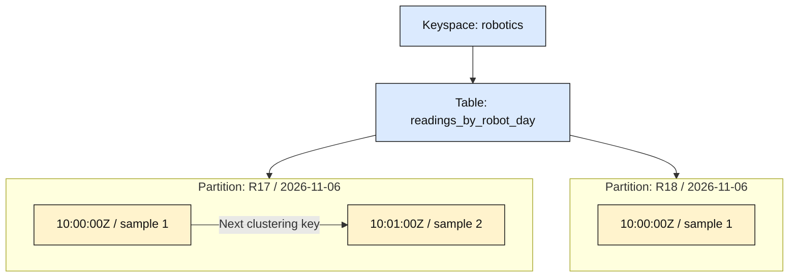

This shows **logical grouping and ordering**, not network traffic. There is no promised global time order across partitions. A logical partition is not a physical server: a node stores many partitions and replica copies.

A day bucket bounds history relative to storing a robot's entire lifetime together. It does not guarantee a suitably sized partition: high-frequency robots may need shorter intervals or additional sharding. Evaluate row counts, bytes, access frequency, and queries using [Cassandra's partition-sizing guidance](https://cassandra.apache.org/doc/latest/cassandra/developing/data-modeling/data-modeling_refining.html).

### Worked CQL Example: Robot Telemetry

These illustrative statements use **Cassandra 5.0-compatible CQL**, following the cited documentation's 5.0 model; this is not a claim that 5.0 is the latest release. No installation or live database is required to read the example.

**Assumptions:** An illustrative `robotics` keyspace already exists, with replication factor three in one datacenter. The example table does not yet exist. Requests succeed sequentially, there are no concurrent writers, and later corrections have newer mutation timestamps. The client uses `LOCAL_QUORUM` for reads and writes.

Consistency is a **request/client setting**, not a clause in these CQL statements. The expected outputs below show logical values with timestamps normalized to UTC, not exact `cqlsh` formatting.

#### Create the Telemetry Table

```cql
CREATE TABLE robotics.readings_by_robot_day (
    robot_id text,
    reading_day date,
    observed_at timestamp,
    sample_no int,
    battery_percent int,
    temperature_c double,
    PRIMARY KEY ((robot_id, reading_day), observed_at, sample_no)
) WITH CLUSTERING ORDER BY (observed_at ASC, sample_no ASC);
```

The inner parentheses group the two partition-key columns. The remaining primary-key columns define clustering order. A different reading at the same time needs a different `sample_no`.

#### Insert and Query Readings

**Insert three readings:**

```cql
INSERT INTO robotics.readings_by_robot_day
    (robot_id, reading_day, observed_at, sample_no, battery_percent, temperature_c)
VALUES ('R17', '2026-11-06', '2026-11-06T10:00:00Z', 1, 80, 22.5);

INSERT INTO robotics.readings_by_robot_day
    (robot_id, reading_day, observed_at, sample_no, battery_percent, temperature_c)
VALUES ('R17', '2026-11-06', '2026-11-06T10:01:00Z', 2, 79, 23.0);

INSERT INTO robotics.readings_by_robot_day
    (robot_id, reading_day, observed_at, sample_no, battery_percent, temperature_c)
VALUES ('R18', '2026-11-06', '2026-11-06T10:00:00Z', 1, 90, 21.0);
```

The starting data has **two partitions and three rows**:

| robot_id | reading_day | observed_at, UTC | sample_no | battery_percent | temperature_c |
| --- | --- | --- | --- | --- | --- |
| R17 | 2026-11-06 | 2026-11-06T10:00:00Z | 1 | 80 | 22.5 |
| R17 | 2026-11-06 | 2026-11-06T10:01:00Z | 2 | 79 | 23.0 |
| R18 | 2026-11-06 | 2026-11-06T10:00:00Z | 1 | 90 | 21.0 |

**Query one robot/day partition:**

```cql
SELECT observed_at, sample_no, battery_percent, temperature_c
FROM robotics.readings_by_robot_day
WHERE robot_id = 'R17' AND reading_day = '2026-11-06';
```

Expected rows, in clustering order:

| observed_at, UTC | sample_no | battery_percent | temperature_c |
| --- | --- | --- | --- |
| 2026-11-06T10:00:00Z | 1 | 80 | 22.5 |
| 2026-11-06T10:01:00Z | 2 | 79 | 23.0 |

**Query a bounded time range within that partition:**

```cql
SELECT observed_at, sample_no, battery_percent, temperature_c
FROM robotics.readings_by_robot_day
WHERE robot_id = 'R17' AND reading_day = '2026-11-06'
  AND observed_at >= '2026-11-06T10:00:30Z'
  AND observed_at < '2026-11-06T10:02:00Z';
```

Expected: only **sample 2 at 10:01:00Z**, with battery `79` and temperature `23.0`.

**Look up one row by its complete primary key:**

```cql
SELECT battery_percent, temperature_c
FROM robotics.readings_by_robot_day
WHERE robot_id = 'R17' AND reading_day = '2026-11-06'
  AND observed_at = '2026-11-06T10:00:00Z' AND sample_no = 1;
```

Expected: battery `80` and temperature `22.5`. The partition key locates the group; the clustering values identify the reading.

#### Correct and Delete a Reading

**Correct sample 2's battery value, then verify:**

```cql
UPDATE robotics.readings_by_robot_day
SET battery_percent = 78
WHERE robot_id = 'R17' AND reading_day = '2026-11-06'
  AND observed_at = '2026-11-06T10:01:00Z' AND sample_no = 2;

SELECT battery_percent, temperature_c
FROM robotics.readings_by_robot_day
WHERE robot_id = 'R17' AND reading_day = '2026-11-06'
  AND observed_at = '2026-11-06T10:01:00Z' AND sample_no = 2;
```

| battery_percent | temperature_c |
| --- | --- |
| 78 | 23.0 |

Ordinary `INSERT` and `UPDATE` do not require a row to exist first: they can **upsert**. Reusing a full primary key updates supplied values instead of creating a duplicate row. This is not the same as a default SQL insert rejecting an existing primary key.

**Delete sample 1, then query R17's partition again:**

```cql
DELETE FROM robotics.readings_by_robot_day
WHERE robot_id = 'R17' AND reading_day = '2026-11-06'
  AND observed_at = '2026-11-06T10:00:00Z' AND sample_no = 1;

SELECT observed_at, sample_no, battery_percent, temperature_c
FROM robotics.readings_by_robot_day
WHERE robot_id = 'R17' AND reading_day = '2026-11-06';
```

| observed_at, UTC | sample_no | battery_percent | temperature_c |
| --- | --- | --- | --- |
| 2026-11-06T10:01:00Z | 2 | 78 | 23.0 |

R18's reading is unchanged. Deletion writes a **tombstone** so replicas and storage files can reconcile the removal; it does not immediately erase every older physical copy.

See [CQL data manipulation](https://cassandra.apache.org/doc/latest/cassandra/developing/cql/dml.html). These snippets were documentation-checked; the displayed results are a worked state sequence, not a claim of execution against a Cassandra server.

### How Cassandra Stores and Retrieves Data

Cassandra uses a **log-structured merge-tree (LSM)** storage approach. At one replica, a mutation is recorded in the **commit log** and applied to a **memtable** in RAM. Memtable contents later flush into immutable **SSTables—Sorted String Tables** on persistent storage. See the [storage-engine overview](https://cassandra.apache.org/doc/latest/cassandra/architecture/storage-engine.html).

```mermaid
flowchart TB
    W["Mutation at one replica"] --> LOG
    W --> MEM
    subgraph RAM["RAM"]
        MEM["Memtable"]
    end
    subgraph DISK["Persistent storage"]
        LOG["Commit log"]
        SST["Existing SSTables"]
        NEW["New merged SSTables"]
    end
    subgraph BACKGROUND["Background work"]
        COMPACT["Compaction"]
    end
    MEM -->|"Flush"| SST
    SST -->|"Inputs"| COMPACT
    COMPACT -->|"New files"| NEW

    classDef volatile fill:#dbeafe,stroke:#111,color:#111
    classDef stored fill:#fff3cd,stroke:#111,color:#111
    class MEM volatile
    class W,LOG,SST,NEW,COMPACT stored
```

The arrows show storage relationships, not a complete acknowledgment protocol. **Acknowledgment durability depends on commit-log synchronization settings:** batch synchronization waits for the required disk sync, while periodic synchronization can acknowledge before the next sync. A successful response must not automatically be interpreted as an immediate `fsync` on every replica. See [commit-log durability settings](https://cassandra.apache.org/doc/latest/cassandra/architecture/storage-engine.html).

**Reading:** A replica may need memory plus several relevant SSTables to assemble the visible values. Indexes locate relevant data; Bloom filters can skip files that definitely lack a queried partition, while false positives can still cause extra reads. See [Cassandra Bloom filters](https://cassandra.apache.org/doc/latest/cassandra/managing/operating/bloom_filters.html) and the existing [Bloom-filter explanation](Distributed-Systems-Theorems-and-Data-Structures.md#bloom-filters).

**Compaction** merges immutable files and reconciles older values and tombstones under the applicable rules. It consumes disk bandwidth, CPU, and temporary space; obsolete data is removed only when safe. See [compaction](https://cassandra.apache.org/doc/latest/cassandra/managing/operating/compaction/overview.html).

This design can support efficient writes, but does not guarantee fast arbitrary queries or O(1) operations. Disk reads, partition size, cache behavior, replication, and background work affect response time. Compare [lookup complexity versus hardware latency](#why-key-value-lookups-can-be-fast-complexity-ram-and-disk).

### Distribution, Replication, and Tunable Consistency

The **coordinator** is the node handling a request. It routes work to the relevant replicas and gathers responses. For ordinary operations, this role is not a permanent per-partition leader; the coordinator can itself be one of the replicas. See [Cassandra's architecture](https://cassandra.apache.org/doc/latest/cassandra/architecture/overview.html).

```mermaid
flowchart TB
    CLIENT["Client"] --> COORD["Coordinator role"]
    COORD -->|"Write"| A["Replica A"]
    COORD -->|"Write"| B["Replica B"]
    COORD -->|"Write"| C["Replica C"]
    A -.->|"Ack"| COORD
    B -.->|"Ack"| COORD
    C -.->|"Ack"| COORD

    classDef request fill:#dbeafe,stroke:#111,color:#111
    classDef replica fill:#fff3cd,stroke:#111,color:#111
    class CLIENT,COORD request
    class A,B,C replica
```

This is illustrative **write fan-out**, not a requirement to wait for every arrow. The diagram separates roles; it does not require a fourth physical node. Read requests can use data/digest requests and different fan-out behavior.

With **replication factor three in one datacenter**, ordinary operation requirements include:

| Requested consistency level | Required replica responses | One replica unavailable |
| --- | --- | --- |
| `ONE` / `LOCAL_ONE` | One in the applicable scope | Can still complete if an appropriate replica responds |
| `QUORUM` / `LOCAL_QUORUM` | Two in the applicable scope | Can still complete if both remaining replicas respond |
| `ALL` | Three | Cannot satisfy this requirement |

For multiple datacenters, global and local levels have different scopes. Higher response requirements need more reachable replicas and can increase latency; lower levels can permit older observations. The setting controls responses required, not how many copies the system intends to maintain. See [replication and consistency levels](https://cassandra.apache.org/doc/latest/cassandra/architecture/dynamo.html).

Ordinary conflicts are reconciled using mutation timestamps and the documented tie rules. **`observed_at` is application event time; it is separate from those mutation timestamps.** Clock and timestamp discipline therefore matter.

Quorum overlap alone is not a general linearizable transaction protocol. In the 5.0 model used here, **lightweight transactions (LWT)** provide conditional compare-and-set behavior using Paxos, with additional coordination. Do not treat arbitrary batches as unrestricted SQL transactions or assume later releases have identical transaction capabilities. See [Cassandra guarantees](https://cassandra.apache.org/doc/latest/cassandra/architecture/guarantees.html), [Paxos](Distributed-Systems-Theorems-and-Data-Structures.md#paxos), and [the quorum explanation](#coordinating-reads-and-writes).

Reuse the existing explanations of [hashing](#scalability-partitioning-and-consistent-hashing), [replica placement](#replication-models-and-replica-placement), [hinted handoff](#temporary-failures-sloppy-quorums-and-hinted-handoff), [repair and Merkle trees](#replica-repair-and-merkle-trees), and [failure detection](#membership-gossip-and-failure-detection). Replication does not remove the need for repair or tested backups.

**Cassandra and HBase consistency are not interchangeable:**

| System | Read/availability distinction |
| --- | --- |
| **Cassandra** | Required responses depend on the operation's consistency level; operations can fail when that requirement cannot be met |
| **HBase** | Default `STRONG` reads use primary regions; optional `TIMELINE` reads with region replicas may return older data to improve read availability |

HBase's default strong behavior does not mean every failure makes the entire database unavailable. Conversely, Cassandra's distributed architecture does not mean every operation always succeeds. Consider the operation, affected data, failure, and configured guarantee. See [HBase read consistency](https://hbase.apache.org/docs/architecture/timeline-consistent-reads/) and [CAP's partition-time trade-off](Distributed-Systems-Theorems-and-Data-Structures.md#cap-theorem). See the [HBase architecture and Shell walkthrough](#apache-hbase) for its keyed-row model.

### Modeling, Operations, and Common Pitfalls

Start from required queries. This telemetry primary key efficiently supports **one robot/day and a clustering-key time range**. It does not by itself efficiently answer “find every robot with battery below 20 across all history.”

| Concern | Practical guidance |
| --- | --- |
| **Query-specific tables** | Duplicate selected data deliberately when different queries need different keys; define how copies stay correct |
| **Indexes** | Evaluate suitable indexes, including **Storage-Attached Indexing (SAI)** in supported versions; measure selectivity, fan-out, storage, and write work |
| **`ALLOW FILTERING`** | May permit expensive filtering/scanning; it is not a general performance fix |
| **Partitions and hot keys** | Bound history and measure per-key traffic; day buckets are a starting point, not a universal size |
| **Retention / TTL** | **Time to live (TTL)** expires data according to policy, but does not mean all physical bytes disappear immediately |
| **Tombstones and repair** | Coordinate safe cleanup and repair; careless retention settings can allow stale data to reappear |
| **Operations and recovery** | Allow capacity for compaction and failures; monitor latency, partition growth, repair, disk usage, and tested restores |
| **Scaling out** | New nodes require data movement and balancing; more nodes do not guarantee linear speedup |

CQL's familiar syntax does not supply native relational joins or remove query-modeling constraints. See [query-first modeling](https://cassandra.apache.org/doc/latest/cassandra/developing/data-modeling/intro.html), [SAI](https://cassandra.apache.org/doc/latest/cassandra/developing/cql/indexing/sai/sai-overview.html), [filtering and TTL syntax](https://cassandra.apache.org/doc/latest/cassandra/developing/cql/dml.html), [tombstone handling](https://cassandra.apache.org/doc/latest/cassandra/managing/operating/compaction/overview.html), and [repair operations](https://cassandra.apache.org/doc/latest/cassandra/managing/operating/repair.html).

### When to Choose a Column-Family Database

| Requirement | What to evaluate |
| --- | --- |
| **Device or sensor history by device and bounded time** | Cassandra-style partition/clustering keys; test volume, skew, and retention |
| **Event feeds and high-volume operational access** | A query-specific wide-column model with suitable replication and consistency |
| **Join-heavy relationships and database-enforced constraints** | A relational model may reduce duplication and application coordination |
| **Exploratory analytics over large historical datasets** | An analytical engine or warehouse may fit better than repeated operational scans |
| **Full-text relevance search** | A suitable search engine or full-text indexing capability, rather than assuming primary-key filtering supplies it |

These are evaluation directions, not product rankings. Workload design, consistency, storage, and operation determine actual performance—not the database-family label alone.

> **Choose the queries first. Partition keys group and place data; clustering keys order it; replication and consistency settings determine how requests complete.**

## Apache HBase

### HBase Overview and Core Mental Model

> **HBase keeps rows ordered by their keys. RegionServers serve portions of that key space, while distributed storage retains the underlying files.**

**Apache HBase is an open-source, distributed, sparse wide-column database inspired by Google's Bigtable.** This section uses a conventional deployment backed by **HDFS—Hadoop Distributed File System**.

HDFS stores files as distributed blocks. HBase adds keyed records, cell versions, and read/write services over its storage files. An application asks HBase for a row or key range; it does not normally locate and edit HDFS blocks itself.

HBase is useful when an application needs direct access to records within a large dataset. **A bounded scan means reading a selected key range**, not performing arbitrary SQL joins or warehouse analytics. Actual latency depends on keys, caches, storage, load, and failures; “real-time access” is not a response-time guarantee.

### HBase Rows, Families, Qualifiers, and Versions

Recall the [column-family terminology](#column-family-concepts-and-terminology). An HBase column name combines a **defined family** with a **qualifier**, such as `m:battery_percent`. Qualifiers can vary between rows without defining a new family.

One R17 reading can be represented as follows:

| Part | Example |
| --- | --- |
| **Table** | `robot_readings` |
| **Row key** | `R17#2026-11-06T10:01:00Z#0002` |
| **Column family** | `m`, grouping this example's measurements |
| **Qualifiers** | `battery_percent`, `temperature_c` |
| **Battery cell versions** | Value `79` at version timestamp `1793962800000`; correction `78` at `1793963100000` |
| **Temperature cell** | Value `23.0` at version timestamp `1793962800000` |
| **Absent qualifier** | No `m:humidity` value is stored; no empty placeholder is required |

A stored version has this address:

`row key + family + qualifier + timestamp → value`

**Row keys, qualifiers, and values are bytes.** Applications choose their encoding. Here, keys and measurement values use readable text; the value `"78"` is not automatically a database integer. Row keys are ordered lexicographically by their bytes.

The version timestamp is a long integer conventionally expressed as milliseconds since the Unix epoch. In this example, `1793962800000` means **2026-11-06 11:00 UTC**, and `1793963100000` means **11:05 UTC**. These are write/correction times; the **10:01 event time in the row key is separate**.

A normal read selects the visible value with the greatest cell-version timestamp. That is not necessarily the last request to arrive if applications supply timestamps out of order. Version retention is configured per family; it is not an unlimited audit history or a backup. See [HBase's data model and versions](https://hbase.apache.org/docs/datamodel/).

### Regions and HBase Cluster Components

A **region** holds a contiguous range of a table's row keys. Its start key is inclusive and its end key is exclusive. For illustration, a split at `R18#` could give:

| Illustrative region | Key range | Example rows |
| --- | --- | --- |
| **Region A** | Beginning of table up to, but excluding, `R18#` | Both R17 readings |
| **Region B** | `R18#` through the end of the table | The R18 reading |

The open ends mean “no lower/upper bound,” not literal keys. This is a placement illustration, not a promise that creating the example table produces these regions.

| Component | Responsibility |
| --- | --- |
| **Client** | Locates regions, caches their locations, and sends read/write requests |
| **RegionServer** | Hosts regions and serves their data |
| **HMaster** | Coordinates region assignment, balancing, and administrative operations |
| **ZooKeeper** | Supports coordination, including server membership and master election in the illustrated deployment |
| **`hbase:meta`** | An HBase catalog table recording regions and their locations |
| **HDFS NameNode** | Manages the filesystem namespace and block-location metadata |
| **HDFS DataNodes** | Store file blocks and their configured replicas |

```mermaid
flowchart TB
    C["HBase client"]
    HM["HMaster<br/>Assignment and administration"]
    ZK["ZooKeeper<br/>Coordination"]
    META["hbase:meta<br/>Hosted by a RegionServer"]
    R1["RegionServer 1<br/>Region A"]
    R2["RegionServer 2<br/>Region B"]

    C -->|"Data RPC"| R1
    C -->|"Data RPC"| R2
    C -.->|"Locate regions"| META
    HM -.->|"Assign / balance"| R1
    HM -.->|"Assign / balance"| R2
    ZK -.->|"Cluster state"| HM
    R1 -.->|"Liveness"| ZK
    R2 -.->|"Liveness"| ZK

    subgraph FS["HDFS: persistent storage"]
        NN["NameNode<br/>File and block metadata"]
        DN["DataNodes<br/>WAL and HFile blocks"]
    end

    R1 -.->|"File metadata"| NN
    R2 -.->|"File metadata"| NN
    R1 -->|"Block I/O"| DN
    R2 -->|"Block I/O"| DN
```

**Solid arrows show data access; dotted arrows show lookup, management, or coordination.** The catalog is served by a RegionServer; its separate box emphasizes its role, not another mandatory server type. This map omits detailed bootstrap messages, which appear below.

A region is a **logical key range**; a RegionServer is a **software process**. A host can run several related processes, and one RegionServer can serve many regions. RegionServer/DataNode co-location is common for data locality, but the roles remain separate and storage blocks can also be remote.

Regions can split and move as the system grows. Region sizes, split policies, and safe region counts depend on the deployment; they are not fixed universal capacities. See [regions](https://hbase.apache.org/docs/architecture/regions/) and [HDFS integration](https://hbase.apache.org/docs/architecture/hdfs/).

### Finding the Region: First and Subsequent Requests

**A small `hbase:meta` example:** The catalog lets the client map a table and key range to the RegionServer currently serving it.

| Table | Region | Start key (inclusive) | End key (exclusive) | Serving RegionServer |
| --- | --- | --- | --- | --- |
| `robot_readings` | A | Beginning of table | `R18#` | RegionServer 1 |
| `robot_readings` | B | `R18#` | End of table | RegionServer 2 |

R17's reading keys fall in **Region A**, so the client contacts **RegionServer 1**. R18's keys fall in **Region B**, served by **RegionServer 2**.

This is a readable summary, not the catalog's literal column layout. Actual catalog entries identify the table, region start key, and region ID; fields include region information and the serving server's address. A move can change the serving server without changing the row key. See [catalog structure](https://hbase.apache.org/docs/architecture/catalog-tables/).

The client needs to find **which RegionServer currently serves the requested row**:

1. Obtain bootstrap metadata through the configured **connection registry**.
2. Locate and query `hbase:meta` when the desired region location is not cached.
3. Cache the location for that key range.
4. Send the row request directly to its RegionServer.
5. Refresh stale information and retry appropriately after a split, move, or server failure.

```mermaid
sequenceDiagram
    participant C as HBase client
    participant G as Connection registry
    participant M as RegionServer serving meta
    participant R as RegionServer serving the row
    rect rgb(238, 242, 255)
        Note over C,R: Initial lookup or cache miss
        C->>G: 1. Bootstrap
        G-->>C: 2. Meta location
        C->>M: 3. Locate key range
        M-->>C: 4. Region location
        Note over C: Cache the location
        C->>R: 5. Get or Put
        R-->>C: 6. Result
    end
    rect rgb(236, 248, 240)
        Note over C,R: Later request with a valid cache entry
        C->>R: 7. Get or Put
        R-->>C: 8. Result
    end
```

The traditional registry obtains bootstrap information from ZooKeeper. Newer **RPC—remote procedure call—based registries** are also available; their endpoints and defaults depend on version and configuration. Direct client contact with ZooKeeper is therefore not a universal requirement.

The master does not normally proxy application row data, although connection bootstrap, reassignment, and recovery can depend on management services. A cached location is an optimization, not permanent ownership information. See [client discovery and registries](https://hbase.apache.org/docs/architecture/client/) and [catalog tables](https://hbase.apache.org/docs/architecture/catalog-tables/).

### Worked HBase Shell Example: Robot Telemetry

This example uses **HBase 2.6-compatible Shell syntax**, not SQL. The Shell uses Ruby-style command arguments; applications can instead use supported client APIs.

Assume an existing illustrative environment, an absent `robot_readings` table, valid permissions, default strong reads, successful sequential requests, and no concurrent writers. No family TTL is configured. The server clock at deletion is later than the explicit version timestamps below. Outputs show **logical results**, not exact Shell formatting.

Use the same three readings as the [Cassandra walkthrough](#worked-cql-example-robot-telemetry), with a different key and cell model:

`robot_id#UTC_timestamp#zero_padded_sample`

| Row key | m:battery_percent | m:temperature_c |
| --- | --- | --- |
| `R17#2026-11-06T10:00:00Z#0001` | 80 | 22.5 |
| `R17#2026-11-06T10:01:00Z#0002` | 79 | 23.0 |
| `R18#2026-11-06T10:00:00Z#0001` | 90 | 21.0 |

These fixed-width UTC timestamps sort chronologically **within the same robot prefix**; the padded sample distinguishes readings sharing a timestamp. Arbitrary timestamp formats or unpadded numbers need not sort as intended. Keys beginning with different robot identifiers are grouped by that identifier, not globally by time.

#### Create and Populate the HBase Table

**Create family `m` with up to two retained versions per cell:**

```ruby
create 'robot_readings', {NAME => 'm', VERSIONS => 2}
```

**Insert the readings.** The final argument is an explicit cell-version timestamp, here the shared ingestion time **2026-11-06 11:00 UTC**:

```ruby
put 'robot_readings', 'R17#2026-11-06T10:00:00Z#0001', 'm:battery_percent', '80', 1793962800000
put 'robot_readings', 'R17#2026-11-06T10:00:00Z#0001', 'm:temperature_c', '22.5', 1793962800000

put 'robot_readings', 'R17#2026-11-06T10:01:00Z#0002', 'm:battery_percent', '79', 1793962800000
put 'robot_readings', 'R17#2026-11-06T10:01:00Z#0002', 'm:temperature_c', '23.0', 1793962800000

put 'robot_readings', 'R18#2026-11-06T10:00:00Z#0001', 'm:battery_percent', '90', 1793962800000
put 'robot_readings', 'R18#2026-11-06T10:00:00Z#0001', 'm:temperature_c', '21.0', 1793962800000
```

The three rows now contain the values in the starting table. Each line is a separate mutation. **Two independent Shell puts do not demonstrate an atomic update of both measurements.** An application can place multiple cell changes for one row into one supported atomic mutation.

#### Get a Row and Scan a Bounded Range

**Read the second R17 reading:**

```ruby
get 'robot_readings', 'R17#2026-11-06T10:01:00Z#0002'
```

| Column | Value | Version timestamp |
| --- | --- | --- |
| `m:battery_percent` | `79` | 1793962800000 |
| `m:temperature_c` | `23.0` | 1793962800000 |

**Read R17's readings for 6 November:**

```ruby
scan 'robot_readings', {STARTROW => 'R17#2026-11-06', STOPROW => 'R17#2026-11-07', COLUMNS => ['m:battery_percent', 'm:temperature_c']}
```

The start is **inclusive**, and the stop is **exclusive**. With the stated key format, this returns:

| Row key | Battery | Temperature |
| --- | --- | --- |
| `R17#2026-11-06T10:00:00Z#0001` | 80 | 22.5 |
| `R17#2026-11-06T10:01:00Z#0002` | 79 | 23.0 |

R18 falls outside this range. The Shell lists cells; the table above groups them into rows for readability.

#### Correct a Cell, Read Versions, and Delete a Row

**Correct the second battery value using the newer version timestamp, 11:05 UTC:**

```ruby
put 'robot_readings', 'R17#2026-11-06T10:01:00Z#0002', 'm:battery_percent', '78', 1793963100000

get 'robot_readings', 'R17#2026-11-06T10:01:00Z#0002', {COLUMN => 'm:battery_percent'}

get 'robot_readings', 'R17#2026-11-06T10:01:00Z#0002', {COLUMN => 'm:battery_percent', VERSIONS => 2}
```

The ordinary get returns **78**. The versioned get returns:

| Column | Value | Version timestamp |
| --- | --- | --- |
| `m:battery_percent` | `78` | 1793963100000 |
| `m:battery_percent` | `79` | 1793962800000 |

The temperature remains **23.0**. Repeating a put at a **different** version timestamp can retain another value; writing the same row, column, and version replaces that version's value. The family limit and retention rules bound what remains retrievable.

**Delete the first R17 row and repeat the day scan:**

```ruby
deleteall 'robot_readings', 'R17#2026-11-06T10:00:00Z#0001'

scan 'robot_readings', {STARTROW => 'R17#2026-11-06', STOPROW => 'R17#2026-11-07', COLUMNS => ['m:battery_percent', 'm:temperature_c']}
```

| Remaining row key | Battery | Temperature |
| --- | --- | --- |
| `R17#2026-11-06T10:01:00Z#0002` | 78 | 23.0 |

R18 is unchanged. A delete records **deletion markers**, also called tombstones; ordinary reads stop showing the covered cells before all their physical bytes are necessarily removed. Later compaction can reclaim eligible data.

See the [Shell guide](https://hbase.apache.org/docs/shell/), [2.6 Get command help](https://github.com/apache/hbase/blob/rel/2.6.0/hbase-shell/src/main/ruby/shell/commands/get.rb), and [2.6 Put command help](https://github.com/apache/hbase/blob/rel/2.6.0/hbase-shell/src/main/ruby/shell/commands/put.rb).

### HBase Writes, Flushes, Reads, and Compaction

| Component | Simple role |
| --- | --- |
| **WAL—write-ahead log** | Records mutations for recovery on persistent storage |
| **MemStore** | Keeps recent mutations in memory; each region has a Store per family, with its own MemStore |
| **HFiles** | Immutable sorted files containing stored cells |
| **BlockCache** | Caches file blocks to avoid repeated storage reads |
| **Indexes and Bloom filters** | Help seek relevant blocks and skip files that cannot contain the requested key |

#### Inside a RegionServer

**A RegionServer can host several regions. Each region has one Store per column family; each Store manages a MemStore and HFiles.** The BlockCache is shared across the RegionServer's regions.

```mermaid
flowchart TB
    subgraph RS["One RegionServer process: generic structure"]
        BC["Shared BlockCache<br/>Cached HFile blocks"]
        WW["WAL writer"]

        subgraph RX["Region X"]
            subgraph SX["Store for family m"]
                MX["MemStore<br/>RAM"]
                HX["HFile references"]
            end
        end

        subgraph RY["Region Y"]
            subgraph SY["Store for family m"]
                MY["MemStore<br/>RAM"]
                HY["HFile references"]
            end
        end
    end

    subgraph STORAGE["HDFS: persistent files outside the process"]
        WF["WAL files<br/>Replicated blocks"]
        HF["HFiles for the Stores<br/>Replicated blocks"]
    end

    WW -->|"Append"| WF
    HX -->|"File access"| HF
    HY -->|"File access"| HF
    MX -.->|"Flush"| HF
    MY -.->|"Flush"| HF
    HF -.->|"Cache eligible blocks"| BC

    style RS fill:#eef2ff,stroke:#8795b5,color:#111
    style STORAGE fill:#fff3d6,stroke:#b69b58,color:#111
```

**Read the boxes as containment:** process → regions → family Stores. Region X and Region Y illustrate the internal structure of one process; they are not the A/B assignments in the earlier routing example.

The HFile boxes inside the Stores are **references to files**, not file bytes held entirely in RAM. Actual HFiles and WAL files reside in HDFS; their blocks can be local or remote. The diagram groups persistent files by role without implying that both Stores share the same HFile. Only family `m` is shown; another family would have its own Store and MemStore within each region.

The shared WAL writer box summarizes logging; deployments can use more than one WAL group. See [the region/Store hierarchy](https://hbase.apache.org/docs/architecture/regions/) and [RegionServer caching](https://hbase.apache.org/docs/architecture/regionserver/).

#### Write and Persistence Path

For an ordinary WAL-enabled write, the RegionServer records the mutation, updates memory, and completes the required publication and WAL synchronization before acknowledging it. The simplified path is:

```mermaid
flowchart TB
    P["Client Put"]
    W["Append to WAL<br/>HDFS-backed log"]
    M["MemStore<br/>RAM"]
    G["Publish mutation<br/>and meet WAL policy"]
    A["Client acknowledgment"]

    P --> W
    W --> M
    M --> G
    G --> A

    subgraph BG["Background persistence"]
        F["Flush snapshot"]
        H["Immutable HFiles<br/>HDFS"]
        C["Compaction"]
        N["Merged HFiles"]
        F --> H
        H --> C
        C --> N
    end

    M -.->|"Flush"| F
```

An acknowledgment does **not** wait for the MemStore to become an HFile. Its durability depends on the selected policy. In HBase 2.6, `SYNC_WAL` synchronizes to the filesystem; for HDFS, this reaches the designated DataNodes but does not necessarily force every device to physical media. `FSYNC_WAL` requests stronger disk synchronization, while `ASYNC_WAL` and `SKIP_WAL` have weaker recovery guarantees. Storage and failure assumptions still matter. See [the 2.6 durability definitions](https://hbase.apache.org/2.6/devapidocs/org/apache/hadoop/hbase/client/Durability.html).

A flush writes a snapshot of sorted in-memory cells to new files while subsequent writes can continue in memory. **Flush progress and sequence metadata identify which edits are already represented in stored files.** During recovery, WAL replay restores relevant edits not yet safely flushed.

Compaction merges stored files and can remove obsolete versions or deletion-covered cells when retention and safety rules permit. It consumes CPU and storage I/O. Compression can save space and I/O while adding computation; performance depends on the storage system and workload, including SSD-based systems.

#### Read and Merge Path

A read combines relevant in-memory cells with stored cells. The BlockCache supplies cached **HFile blocks**; on a cache miss, the system reads relevant blocks from storage.

```mermaid
flowchart TB
    Q["Get or Scan"]
    M["Relevant MemStore cells<br/>RAM"]
    I["Indexes and Bloom filters"]
    B["BlockCache lookup"]
    H["Read relevant HFile blocks<br/>HDFS"]
    F["Stored cells<br/>Cached or fetched"]
    V["Merge cells<br/>Apply versions and deletions"]
    R["Result"]

    Q --> M
    Q --> I
    I --> B
    B -->|"Hit"| F
    B -->|"Miss"| H
    H --> F
    H -.->|"Cache eligible blocks"| B
    M --> V
    F --> V
    V --> R
```

This is a responsibility map, not a mandatory instruction-by-instruction order. The BlockCache is an acceleration layer, not a separate authoritative row store. HBase need not read an entire HFile to find one row; indexes and [Bloom filters](Distributed-Systems-Theorems-and-Data-Structures.md#bloom-filters) reduce unnecessary work. Cache implementations and eviction policies vary.

See [RegionServer storage and caching](https://hbase.apache.org/docs/architecture/regionserver/) and [Stores, MemStores, HFiles, and compaction](https://hbase.apache.org/docs/architecture/regions/).

### HBase Consistency, Availability, and Recovery

**Strong reads are the default.** They use the primary region. With configured region replicas, optional `TIMELINE` reads can use secondary regions and return older values. Secondary regions do not become independent ordinary write leaders merely because they can serve reads.

| Guarantee or mechanism | What it means |
| --- | --- |
| **Single-row mutation** | A supported mutation is atomic within one row, including changes across families |
| **Multi-row batch** | Several rows can have different outcomes; a batch is not automatically one atomic transaction |
| **Ordinary scan** | Rows can reflect different moments during the scan; it is not a table-wide snapshot transaction |
| **Write durability** | Depends on the write policy, functioning storage, and surviving copies |
| **RegionServer recovery** | Detection, reassignment, and WAL recovery can temporarily interrupt affected requests |
| **Request timeout** | The result may be uncertain; the mutation might already have succeeded |

A repeatable put to the same row, column, version, and value can help safe retries. Increment-like operations need their documented retry mechanisms; a timeout does not justify blindly applying the business action twice.

Keep the different forms of replication separate:

| Mechanism | Primary purpose |
| --- | --- |
| **HDFS block replication** | Retain copies of underlying file blocks |
| **HBase region replicas** | Provide additional read-serving instances; secondary reads may lag |
| **Cross-cluster replication** | Copy edits between clusters under the configured mode and guarantees |
| **Snapshots and backups** | Preserve recovery points; require suitable retention, protection, and tested restoration |

These are complementary mechanisms, not substitutes for application correctness or a complete recovery plan. A snapshot in the same storage system is not automatically an independent backup.

Compare [Cassandra's request consistency](#distribution-replication-and-tunable-consistency): HBase does not expose the same ordinary-read/write `R/W` quorum choices. Neither product guarantees every operation succeeds through every partition or failure. See [HBase operation guarantees](https://hbase.apache.org/acid-semantics/), [timeline-consistent reads](https://hbase.apache.org/docs/architecture/timeline-consistent-reads/), and [ACID's scope](#transactions-and-acid).

### HBase Modeling, Operations, and Selection

Start from the query: **“Find R17's readings during this day.”** A robot-first row key keeps those rows near each other. It does not efficiently answer every other query, such as all robots with a high temperature across their entire histories.

| Concern | Design guidance |
| --- | --- |
| **Row-key locality** | Put values together when they are commonly read together; test actual key encoding and ranges |
| **Hot ranges** | Monotonically growing keys or a busy robot can concentrate writes; splitting does not eliminate an indivisible hot row |
| **Salting or sharding** | A prefix can spread writes, but a range query may need multiple scans and result merging |
| **Families** | Keep a small, deliberate set with suitable storage and retention policies; qualifiers provide flexible attributes |
| **Scans and extra queries** | Bound key ranges; filtering is not a universal secondary index. Plan additional tables or supported indexing layers |
| **Versions and TTL** | Set retention deliberately. Expiration/deletion visibility and physical cleanup happen at different stages |
| **Operations** | Monitor request latency, hot regions, cache effectiveness, WAL/flush pressure, compaction, disk space, and recovery |
| **Security and recovery** | Configure authentication, least privilege, protected transport, backups, and restore tests; distribution supplies none of these automatically |

**TTL means time to live.** Cell retention uses version timestamps, so application-supplied timestamps must be consistent with the intended retention policy.

Region splitting and balancing distribute ranges, but moving ranges requires work and cannot guarantee uniform traffic or linear scaling. For integrations with Hadoop processing, Spark, Hive, or SQL layers such as Phoenix, verify the particular connector, supported versions, and semantics. HBase's native keyed APIs do not supply relational joins or full-text relevance search.

| Requirement | Good fit or alternative to evaluate |
| --- | --- |
| **Large keyed histories and device readings** | Evaluate HBase when ordered keys and bounded scans match the workload |
| **Hadoop-based data platform needing operational row access** | Evaluate HBase with the existing storage, processing, and operational skills |
| **Multi-row relational transactions and many joins** | Evaluate a relational DBMS and its documented transaction guarantees |
| **Exploratory analytics over historical data** | Evaluate a warehouse or analytical engine rather than repeated unbounded operational scans |
| **Keyword relevance and full-text search** | Evaluate a suitable search engine or dedicated indexing capability |

Link the operational store to [data-processing pipelines](Data-Engineering-for-Solution-Architecture.md) when a separate analytical view is useful. Use [the database-selection checklist](#database-selection-checklist) to validate workload, concurrency, failure behavior, recovery, and operating cost.

> **Design the row key around the reads. Regions divide its ordered range; RegionServers serve requests; WALs, memory, and HFiles support persistence and recovery.**

## Graph Databases

### Graph Concepts and Terminology

**A graph database represents entities and their connections so applications can query relationship patterns and paths.** Begin with the question: “Which entities are connected, and how?”

| Concept | Simple meaning | Social-network example |
| --- | --- | --- |
| **Node / vertex** | An entity | Alice's user record |
| **Relationship / edge** | A connection between entities | Alice follows Bob |
| **Property** | A value describing an entity or connection | User name; date a follow began |
| **Node label** | A category in a property graph | `User` |
| **Relationship type** | The kind of connection | `FOLLOWS` |
| **Path** | A sequence of connected nodes and relationships | Alice → Bob → Carol |
| **Traversal** | Expanding selected connections from a starting entity | Find people followed by Alice's follows |

This section uses a **property graph**, with properties on nodes and relationships. Another graph model is **RDF—Resource Description Framework**, which represents statements as subject–predicate–object triples. Graph products differ in their models and query languages; not every graph database uses Cypher. See [RDF concepts](https://www.w3.org/TR/rdf11-concepts/).

In **Neo4j**, a node can have zero or more labels. A relationship connects a source and target, has one type and a stored direction, and can have properties. Queries can follow outgoing or incoming relationships, or ignore direction when the question permits it. **Reading an incoming connection does not require storing a second reverse relationship.** See [Neo4j's graph concepts](https://neo4j.com/docs/getting-started/appendix/graphdb-concepts/).

### Social-Network Example

Use these application identifiers throughout:

| User ID | Name | When present |
| --- | --- | --- |
| 1 | Alice | Initially |
| 2 | Bob | Initially |
| 3 | Carol | Initially |
| 4 | Dan | Added later |

Initially, **Alice follows Bob and Carol; Bob follows Carol**:

```mermaid
flowchart TB
    A(("1: Alice"))
    B(("2: Bob"))
    C(("3: Carol"))

    A -->|"FOLLOWS"| B
    A -->|"FOLLOWS"| C
    B -->|"FOLLOWS"| C
```

The numbers are **application user IDs**, not Neo4j's internal record IDs. In the later queries, they are stored in `userId` properties.

| Relationship | Source | Type | Destination |
| --- | --- | --- | --- |
| A | 1: Alice | `FOLLOWS` | 2: Bob |
| B | 1: Alice | `FOLLOWS` | 3: Carol |
| C | 2: Bob | `FOLLOWS` | 3: Carol |

A, B, and C are teaching labels for the connections, not database-assigned identifiers. The same graph has these adjacency lists:

| User | Outgoing: follows | Incoming: followed by |
| --- | --- | --- |
| 1: Alice | 2, 3 | None |
| 2: Bob | 3 | 1 |
| 3: Carol | None | 1, 2 |

**Following is directional.** `1 → 2` does not imply `2 → 1`, and neither direction alone means mutual friendship.

### Relational Modeling vs. Graph Modeling

A relational database can represent exactly the same information.

**Users**

| id | name |
| --- | --- |
| 1 | Alice |
| 2 | Bob |
| 3 | Carol |

#### One Edge Row and Two Indexes

**Follows**

| src | dst |
| --- | --- |
| 1 | 2 |
| 1 | 3 |
| 2 | 3 |

Here, `Users.id` is a primary key. `Follows.src` and `Follows.dst` reference users, and a composite key `(src, dst)` can prevent duplicate follows.

An index beginning with `src` supports finding whom Alice follows. An index beginning with `dst` supports finding who follows Carol. Both lookups use the same relationship rows; no inverse `followed_by` row is required.

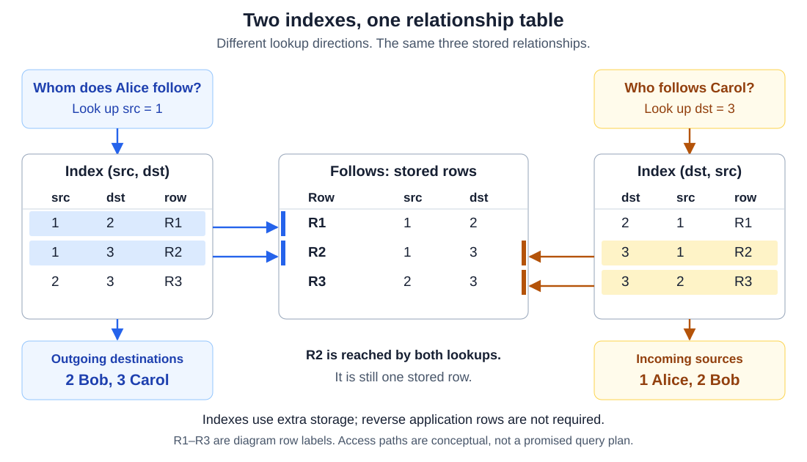

- **Outgoing from Alice:** match `src = 1`; the destinations are **2 Bob and 3 Carol**.
- **Incoming to Carol:** match `dst = 3`; the sources are **1 Alice and 2 Bob**.

Illustrative B-tree key orders are `(src, dst)` and `(dst, src)`. The composite primary key may already provide the first index. Indexes retain additional keys/references and require storage and write maintenance; they do not require duplicate application relationship rows. The diagram shows possible access paths, not a promised execution plan. See [PostgreSQL's multicolumn-index explanation](https://www.postgresql.org/docs/current/indexes-multicolumn.html).

**SQL can express a two-hop recommendation using a self-join:**

```sql
SELECT DISTINCT candidate.id AS user_id, candidate.name
FROM Follows AS first_hop
JOIN Follows AS second_hop ON second_hop.src = first_hop.dst
JOIN Users AS candidate ON candidate.id = second_hop.dst
WHERE first_hop.src = 1
  AND candidate.id <> 1
  AND NOT EXISTS (
      SELECT 1
      FROM Follows AS direct
      WHERE direct.src = 1 AND direct.dst = candidate.id
  )
ORDER BY user_id;
```

Initially, this returns **no rows**: `1 → 2 → 3` reaches Carol, but Alice already follows her. After adding user 4 and `2 → 4`, the equivalent query can recommend user 4.

#### Optional Reverse Rows

Storing reverse relationships separately is an optional **denormalization** strategy, with extra writes and synchronization rules. It is not a requirement of relational modeling.

The same three facts can instead be represented by six application rows:

| src | dst | relationship |
| --- | --- | --- |
| 1 | 2 | follows |
| 1 | 3 | follows |
| 2 | 1 | followed_by |
| 2 | 3 | follows |
| 3 | 1 | followed_by |
| 3 | 2 | followed_by |

For example, `(1, 2, follows)` means **Alice follows Bob**; `(2, 1, followed_by)` means **Bob is followed by Alice**. These are two views of one fact, not two independent follows. Filter the relationship term when interpreting a row.

The forward and reverse rows must stay consistent when a follow is added, changed, or removed. A transaction can keep the paired changes together. These are illustrative design choices, not the only possible relational schemas. Compare this logical representation with the [reference-chain storage illustration](#illustrative-relationship-chains).

Graph modeling expresses the relationship pattern directly; relational modeling expresses it through tables and joins. Either can work. Query depth, indexes, data distribution, concurrency, and execution plans determine performance—not the label “graph” or “SQL” alone. Compare [normalization and indexes](#normalization-and-indexes).

### Traversal, Use Cases, and Trade-Offs

Separate two tasks:

1. **Locate a starting entity**, such as Alice by `userId = 1`.
2. **Expand relevant relationships**, such as two outgoing `FOLLOWS` hops, then filter and return candidates.

| Use case | Relationship question | Interpretation |
| --- | --- | --- |
| **Recommendations** | Who is connected through people I follow, [shared purchases](#e-commerce-recommendations-collaborative-filtering), or [overlapping portfolios](#investment-recommendations-similar-portfolios)? | Generate candidates; ranking and eligibility are separate decisions |
| **[Fraud investigation](#fraud-investigation-shared-device-and-recipient)** | Which customers share devices, accounts, or transaction connections? | Find investigation signals, not proof of fraud |
| **[Service dependencies](#network-and-infrastructure-failure-impact-analysis)** | Which applications depend on a failed service? | Follow modeled dependencies; missing or outdated links affect the answer |
| **Knowledge graphs** | Which entities and claims connect this topic to another? | A stored connection does not prove a claim is true; provenance and verification matter |

A **high-degree node** has many connections. Expanding several hops from such nodes can produce many candidate paths, including several paths to the same result. Bound traversal depth, choose types and directions deliberately, filter appropriately, and control returned results.

A result `LIMIT` bounds output, but does not by itself guarantee little work; sorting, filtering, or deduplication may still examine many candidates. Neither an entire graph query nor every traversal has a universal O(1) cost. Query planning, data layout, memory/page caches, and storage I/O matter.

### Neo4j

**Neo4j is a transactional property-graph database management system.** Its **Cypher query language** describes graph patterns using syntax that resembles the shape of a connection:

`(node)-[relationship]->(node)`

For example, `(u:User)-[:FOLLOWS]->(v:User)` matches a user following another user. `u` and `v` are query variables; `User` is a label; `FOLLOWS` is a relationship type.

The statements below are Cypher, independent of Neo4j Browser's interface commands or a driver's programming-language calls. An application supplies statements and parameters through a supported API; the database evaluates the patterns.

#### Worked Cypher Example: Following and Recommendations

Use **Neo4j 5-compatible syntax**. Assume an initially empty illustrative database with no conflicting schema definitions, sufficient permissions, successful sequential statements, and no concurrent writers. Execute statements in the shown order; variables do not carry between statements.

The results below are **logical values**, not exact Browser or Shell formatting. Each statement runs in its own automatically committed transaction for this walkthrough.

**1. Define application identity.**

```cypher
CREATE CONSTRAINT user_id_unique IF NOT EXISTS
FOR (u:User) REQUIRE u.userId IS UNIQUE;
```

This prevents duplicate `userId` values among `User` nodes that have the property. **Uniqueness alone does not require every User to have a userId.** Existence/key constraints and their availability must be checked separately. The uniqueness constraint also has a backing index that can help locate users. See [constraint definitions](https://neo4j.com/docs/cypher-manual/current/schema/constraints/create-constraints/).

**2. Create the three users and their follows in one statement.**

```cypher
CREATE (alice:User {userId: 1, name: 'Alice'}),
       (bob:User {userId: 2, name: 'Bob'}),
       (carol:User {userId: 3, name: 'Carol'}),
       (alice)-[:FOLLOWS {since: date('2026-11-06')}]->(bob),
       (alice)-[:FOLLOWS {since: date('2026-11-06')}]->(carol),
       (bob)-[:FOLLOWS {since: date('2026-11-06')}]->(carol);
```

The database now contains **three User nodes and three FOLLOWS relationships**. `since` is an illustrative relationship property, not an automatic history mechanism.

**3. Read whom Alice follows.**

```cypher
MATCH (:User {userId: 1})-[:FOLLOWS]->(followed:User)
RETURN followed.userId AS userId, followed.name AS name
ORDER BY userId;
```

| userId | name |
| --- | --- |
| 2 | Bob |
| 3 | Carol |

**4. Read who follows Carol.**

```cypher
MATCH (follower:User)-[:FOLLOWS]->(:User {userId: 3})
RETURN follower.userId AS userId, follower.name AS name
ORDER BY userId;
```

| userId | name |
| --- | --- |
| 1 | Alice |
| 2 | Bob |

No duplicate reverse relationship was needed.

**5. Find new people Alice could follow through exactly two hops.**

```cypher
MATCH (u:User {userId: 1})-[:FOLLOWS]->(:User)-[:FOLLOWS]->(candidate:User)
WHERE candidate <> u
  AND NOT EXISTS {
      MATCH (u)-[:FOLLOWS]->(candidate)
  }
RETURN DISTINCT candidate.userId AS userId, candidate.name AS name
ORDER BY userId;
```

**Result: no rows.** The two-hop path reaches Carol, whom Alice already follows. `candidate <> u` excludes Alice herself, and `NOT EXISTS` excludes direct follows. `DISTINCT` prevents multiple matching paths from producing repeated candidates.

**6. Add Dan and Bob's follow in one statement.**

```cypher
MATCH (bob:User {userId: 2})
CREATE (dan:User {userId: 4, name: 'Dan'}),
       (bob)-[:FOLLOWS {since: date('2026-11-06')}]->(dan)
RETURN dan.userId AS userId, dan.name AS name;
```

**Result:** userId `4`, name `Dan`. There are now **four users and four follows**.

```mermaid
flowchart TB
    A(("1: Alice"))
    B(("2: Bob"))
    C(("3: Carol"))
    D(("4: Dan"))

    A -->|"FOLLOWS"| B
    A -->|"FOLLOWS"| C
    B -->|"FOLLOWS"| C
    B -->|"FOLLOWS"| D

    classDef added fill:#dbeafe,stroke:#2563eb,stroke-width:3px,color:#111
    class D added
    linkStyle 3 stroke:#2563eb,stroke-width:3px
```

**Blue highlights the new user and connection.** Alice can now reach Dan through `1 → 2 → 4`.

**7. Repeat the recommendation query.**

```cypher
MATCH (u:User {userId: 1})-[:FOLLOWS]->(:User)-[:FOLLOWS]->(candidate:User)
WHERE candidate <> u
  AND NOT EXISTS {
      MATCH (u)-[:FOLLOWS]->(candidate)
  }
RETURN DISTINCT candidate.userId AS userId, candidate.name AS name
ORDER BY userId;
```

| userId | name |
| --- | --- |
| 4 | Dan |

**8. Update Dan's name and read it back.**

```cypher
MATCH (u:User {userId: 4})
SET u.name = 'Daniel';

MATCH (u:User {userId: 4})
RETURN u.userId AS userId, u.name AS name
ORDER BY userId;
```

**Result:** userId `4`, name `Daniel`. The relationship remains connected to the same user; changing the name does not change `userId`.

**9. Remove the added relationship, then the isolated user.**

```cypher
MATCH (:User {userId: 2})-[r:FOLLOWS]->(:User {userId: 4})
DELETE r;

MATCH (u:User {userId: 4})
DELETE u;
```

Ordinary node `DELETE` requires its relationships to be removed first. A broader `DETACH DELETE` also removes attached relationships, but is unnecessary for this targeted example.

**Verify the remaining users and connections:**

```cypher
MATCH (u:User)
RETURN u.userId AS userId, u.name AS name
ORDER BY userId;

MATCH (source:User)-[:FOLLOWS]->(target:User)
RETURN source.userId AS src, target.userId AS dst
ORDER BY src, dst;
```

| userId | name |
| --- | --- |
| 1 | Alice |
| 2 | Bob |
| 3 | Carol |

| src | dst |
| --- | --- |
| 1 | 2 |
| 1 | 3 |
| 2 | 3 |

The graph is back to **three users and three follows**; the uniqueness constraint remains. Alice's two-hop recommendation query would again return no rows.

**CREATE vs. MERGE:** `CREATE` adds the specified entities; repeating the initial statement here would violate the user-ID constraint rather than safely re-import the graph. `MERGE` matches or creates its specified pattern. Model identity and use suitable constraints; merging an entire pattern is not the same as independently matching every part, and concurrent writes still need the documented guarantees.

See [MATCH](https://neo4j.com/docs/cypher-manual/5/clauses/match/), [EXISTS subqueries](https://neo4j.com/docs/cypher-manual/5/subqueries/existential/), [CREATE](https://neo4j.com/docs/cypher-manual/5/clauses/create/), [MERGE](https://neo4j.com/docs/cypher-manual/5/clauses/merge/), [SET](https://neo4j.com/docs/cypher-manual/5/clauses/set/), and [DELETE](https://neo4j.com/docs/cypher-manual/5/clauses/delete/).

#### E-commerce Recommendations: Collaborative Filtering

**Collaborative filtering uses overlapping behavior to discover candidates.** Here, Alice and Bob bought some of the same products:

| Shopper | Application ID | Purchased products |
| --- | --- | --- |
| Alice | `SHOP-A` | Laptop, Headphones |
| Bob | `SHOP-B` | Laptop, Headphones, Monitor |

Assume the illustrated graph contains one `Shopper` per `shopperId` and one `Product` per `productId`, each with a `name` property. These identifiers and labels are independent of the earlier `User`/`FOLLOWS` example. The following query reads this illustrative dataset; it does not create it.

```mermaid
flowchart TB
    A(("Alice<br/>SHOP-A"))
    B(("Bob<br/>SHOP-B"))
    L["Laptop<br/>P-LAPTOP"]
    H["Headphones<br/>P-HEADPHONES"]
    M["Monitor<br/>P-MONITOR"]

    A -->|PURCHASED| L
    A -->|PURCHASED| H
    B -->|PURCHASED| L
    B -->|PURCHASED| H
    B -->|PURCHASED| M

    classDef person fill:#dbeafe,stroke:#3b82f6,color:#111
    classDef product fill:#f1f5f9,stroke:#94a3b8,color:#111
    classDef candidate fill:#d1fae5,stroke:#059669,stroke-width:3px,color:#111
    class A,B person
    class L,H product
    class M candidate
```

**Green marks Monitor as the candidate for Alice.** All arrows record a shopper purchasing a product.

1. Find products Alice purchased: Laptop and Headphones.
2. Find other shoppers who purchased those products: Bob.
3. Find additional products those shoppers purchased: Monitor.
4. Exclude Alice's existing purchases and remove duplicate candidates.

One matching path is **Alice → Laptop ← Bob → Monitor**. Following the incoming purchase relationship from Laptop reaches Bob; no duplicate reverse relationship is needed. Cypher supports these [directed relationship patterns](https://neo4j.com/docs/cypher-manual/5/clauses/match/).

**Read-only Cypher query, using Neo4j 5-compatible syntax:**

```cypher
MATCH (alice:Shopper {shopperId: 'SHOP-A'})-[:PURCHASED]->(shared:Product)
      <-[:PURCHASED]-(peer:Shopper)-[:PURCHASED]->(candidate:Product)
WHERE peer <> alice
  AND NOT EXISTS {
      MATCH (alice)-[:PURCHASED]->(candidate)
  }
RETURN DISTINCT candidate.productId AS productId, candidate.name AS product
ORDER BY productId;
```

| productId | product |
| --- | --- |
| P-MONITOR | Monitor |

Both shared purchases lead through Bob to Monitor, producing two matching paths. `RETURN DISTINCT` returns Monitor **once**; two paths do not mean two different shoppers supported it. `NOT EXISTS` excludes products Alice already purchased.

This generates a candidate, not a guarantee that Alice wants it. Ranking, availability, and eligibility remain separate decisions. The earlier [SQL comparison](#relational-modeling-vs-graph-modeling) also applies: relational queries can express these connections, and graph databases are not automatically faster.

#### Investment Recommendations: Similar Portfolios

The same pattern can generate **stocks to research** from overlapping portfolios. All companies and stock identifiers below are fictional.

| Investor | Application ID | Current holdings |
| --- | --- | --- |
| Alice | `INV-A` | STOCK-A (Company A), STOCK-B (Company B) |
| Bob | `INV-B` | STOCK-A (Company A), STOCK-B (Company B), STOCK-C (Company C) |

Assume one `Investor` per `investorId` and one `Stock` per `stockId`, each with a `name` property. Here, `HOLDS` represents a current portfolio snapshot, not a historical purchase. These entities are separate from both the social-network and shopping examples.

```mermaid
flowchart TB
    A(("Alice<br/>INV-A"))
    B(("Bob<br/>INV-B"))
    S1["STOCK-A<br/>Company A"]
    S2["STOCK-B<br/>Company B"]
    S3["STOCK-C<br/>Company C"]

    A -->|HOLDS| S1
    A -->|HOLDS| S2
    B -->|HOLDS| S1
    B -->|HOLDS| S2
    B -->|HOLDS| S3

    classDef person fill:#dbeafe,stroke:#3b82f6,color:#111
    classDef stock fill:#f1f5f9,stroke:#94a3b8,color:#111
    classDef candidate fill:#d1fae5,stroke:#059669,stroke-width:3px,color:#111
    class A,B person
    class S1,S2 stock
    class S3 candidate
```

Find Alice's holdings, reach another investor through shared stocks, follow that investor's other holdings, then exclude Alice's existing stocks and duplicate candidates. **Alice → STOCK-A ← Bob → STOCK-C** reaches Company C. Here, “similar portfolios” means overlapping holdings; the example does not compare portfolio weights or calculate a similarity score.

**Read-only Cypher query:**

```cypher
MATCH (alice:Investor {investorId: 'INV-A'})-[:HOLDS]->(shared:Stock)
      <-[:HOLDS]-(peer:Investor)-[:HOLDS]->(candidate:Stock)
WHERE peer <> alice
  AND NOT EXISTS {
      MATCH (alice)-[:HOLDS]->(candidate)
  }
RETURN DISTINCT candidate.stockId AS stockId, candidate.name AS company
ORDER BY stockId;
```

| stockId | company |
| --- | --- |
| STOCK-C | Company C |

STOCK-C appears **once**, despite the two shared-holding paths. It is a research candidate, not a decision to buy.

Shared holdings do not establish expected returns, diversification, or suitability. A fuller investment system must separately evaluate objectives, time horizon, risk tolerance, concentration, eligibility, and current information. See [Investor.gov's explanation of asset allocation and diversification](https://www.investor.gov/introduction-investing/getting-started/asset-allocation). Use only authorized portfolio data and keep the holdings snapshot sufficiently current.

> **A graph finds connected candidates. Separate rules decide whether they are relevant, eligible, and suitable to recommend.**

#### Fraud Investigation: Shared Device and Recipient

**A graph can connect activity that looks separate when examined one account at a time.** Consider this fictional dataset on **6 November 2026**, with all times in UTC:

| Account | Login device | Login time | Transfer recipient | Transfer time |
| --- | --- | --- | --- | --- |
| A1 | D1 | 10:00 | B1 | 10:03 |
| A2 | D1 | 10:01 | B1 | 10:05 |
| A3 | D1 | 10:02 | B1 | 10:07 |

Assume one `Account` per `accountId` and one `Device` per `deviceId`. B1 is also an `Account`. Each `USED_DEVICE` relationship represents a recorded login, and each `TRANSFERRED_TO` relationship represents a transfer; both have an `at` property stored as a Neo4j zoned datetime, not a text string. These illustrative entities are independent of the earlier examples.

```mermaid
flowchart LR
    A1["Account A1"]
    A2["Account A2"]
    A3["Account A3"]
    D["Device D1"]
    B["Recipient account B1"]

    A1 -->|USED_DEVICE| D
    A2 -->|USED_DEVICE| D
    A3 -->|USED_DEVICE| D
    A1 -->|TRANSFERRED_TO| B
    A2 -->|TRANSFERRED_TO| B
    A3 -->|TRANSFERRED_TO| B

    classDef account fill:#dbeafe,stroke:#3b82f6,color:#111
    classDef shared fill:#fff3d6,stroke:#b69b58,stroke-width:3px,color:#111
    class A1,A2,A3 account
    class D,B shared
```

**Question:** Which groups of at least three distinct accounts used the same device and transferred to the same recipient during **[10:00, 10:10) UTC**?

1. Find recorded device use within the window.
2. Match those accounts' transfers within the same window.
3. Group by shared device and recipient.
4. Count distinct accounts, then return groups meeting the illustrative threshold.

**Read-only Cypher query, using Neo4j 5-compatible syntax:**

```cypher
WITH datetime('2026-11-06T10:00:00Z') AS windowStart,
     datetime('2026-11-06T10:10:00Z') AS windowEnd
MATCH (account:Account)-[login:USED_DEVICE]->(device:Device),
      (account)-[transfer:TRANSFERRED_TO]->(recipient:Account)
WHERE login.at >= windowStart AND login.at < windowEnd
  AND transfer.at >= windowStart AND transfer.at < windowEnd
WITH DISTINCT device.deviceId AS deviceId,
              recipient.accountId AS recipientId,
              account.accountId AS accountId
ORDER BY accountId
WITH deviceId, recipientId, collect(accountId) AS accountIds
WHERE size(accountIds) >= 3
RETURN deviceId, recipientId, accountIds
ORDER BY deviceId, recipientId;
```

| deviceId | recipientId | accountIds |
| --- | --- | --- |
| D1 | B1 | [A1, A2, A3] |

The start is included and 10:10 is excluded. `DISTINCT` prevents repeated logins or transfers from counting one account several times. Sorting before `collect` makes the displayed account list deterministic. See [WITH and aggregation](https://neo4j.com/docs/cypher-manual/5/clauses/with/), [ordered collection](https://neo4j.com/docs/cypher-manual/5/clauses/order-by/), and [datetime values](https://neo4j.com/docs/cypher-manual/5/functions/temporal/).

**This group is a review signal, not proof of fraud.** Shared devices and recipients can have legitimate explanations, such as family members paying a common merchant. Three accounts and ten minutes are teaching choices, not universal fraud thresholds. Check event quality, timing, context, and authorized access before drawing conclusions. This illustrates [graph-based fraud investigation](https://neo4j.com/use-cases/fraud-detection/), not an automatic account-blocking rule.

#### Network and Infrastructure: Failure Impact Analysis

**A dependency graph helps answer “what could be affected?”** Consider one application path with no alternate host or connection modeled:

| Entity | Label and application identifier | Relationship |
| --- | --- | --- |
| Checkout | `Application`, `appId: 'CHECKOUT'` | Depends on Payments API |
| Payments API | `Service`, `serviceId: 'PAYMENTS'` | Runs on Server S1 |
| Server S1 | `Host`, `hostId: 'S1'` | Connected to Switch SW1 |
| Switch SW1 | `Switch`, `switchId: 'SW1'` | Component being investigated |

Assume each identifier uniquely identifies its illustrated entity. This is a separate example graph.

```mermaid
flowchart LR
    APP["Checkout<br/>CHECKOUT"]
    API["Payments API<br/>PAYMENTS"]
    HOST["Server S1"]
    SW["Switch SW1"]

    APP -->|DEPENDS_ON| API
    API -->|RUNS_ON| HOST
    HOST -->|CONNECTED_TO| SW

    classDef component fill:#dbeafe,stroke:#3b82f6,color:#111
    classDef investigated fill:#fee2e2,stroke:#dc2626,stroke-width:3px,color:#111
    class APP,API,HOST component
    class SW investigated
```

**Question:** If SW1 fails or needs maintenance, which application path might be affected?

1. Identify SW1, highlighted in red.
2. Follow incoming `CONNECTED_TO` relationships to find Server S1.
3. Follow incoming `RUNS_ON` relationships to find Payments API.
4. Follow incoming `DEPENDS_ON` relationships to find Checkout.

The arrows record dependencies toward infrastructure. Following them backward finds potential dependents; it does not require storing duplicate reverse edges.

**Read-only Cypher query:**

```cypher
MATCH (app:Application)-[:DEPENDS_ON]->(service:Service)
      -[:RUNS_ON]->(host:Host)-[:CONNECTED_TO]->(switch:Switch {switchId: 'SW1'})
RETURN DISTINCT host.hostId AS hostId,
                service.serviceId AS serviceId,
                app.appId AS appId
ORDER BY hostId, serviceId, appId;
```

| hostId | serviceId | appId |
| --- | --- | --- |
| S1 | PAYMENTS | CHECKOUT |

The result connects **Server S1 → Payments API → Checkout** as a potentially affected path. It does not establish that Checkout is down or that SW1 caused an observed error. Alternate connections, service replicas, failover, and current health can change the outcome. This fixed-length query covers the displayed chain, not every possible dependency depth.

Monitoring, discovery, and inventory pipelines must keep topology and health information current; Neo4j does not automatically observe the infrastructure. The same graph can support maintenance planning or guide investigation alongside logs, metrics, and traces. See [Neo4j's network and IT operations examples](https://neo4j.com/use-cases/network-and-it-operations/).

> **Fraud graphs connect evidence. Infrastructure graphs connect dependencies. Neither connection alone proves the final conclusion.**

#### How Storage Supports Traversal

A useful mental model separates **finding the starting node** from **following its connections**:

1. An index can locate Alice by `User.userId = 1`; the planner chooses the actual access path.
2. Relationship references or adjacency structures identify her connections.
3. The query expands relevant relationships, reaches neighbors, and applies its conditions.

```mermaid
flowchart LR
    I["Starting-node lookup<br/>User.userId = 1"]
    A["Alice"]
    R["Outgoing FOLLOWS<br/>References / adjacency"]
    B["Bob"]
    C["Carol"]

    I --> A
    A --> R
    R --> B
    R --> C
```

This is a **conceptual access diagram**, not Neo4j's physical file layout. References connect stored records; they do not mean every node is a separate server or every relationship is a network call. Disk pages and caches influence the actual I/O.

##### Illustrative Relationship Chains

**Modeling describes the information; storage describes how an engine arranges records to access it.** The following is an **illustrative implementation, not Neo4j's exact current file format**.

Return to the original social graph:

| Relationship ID | Source | Destination | Meaning |
| --- | --- | --- | --- |
| A | 1 | 2 | Alice follows Bob |
| B | 1 | 3 | Alice follows Carol |
| C | 2 | 3 | Bob follows Carol |

Here, `nid` is a symbolic node-record ID and `rid` is a symbolic relationship-record ID. The numbers match the application user IDs only to make the example easy to follow; they are not actual Neo4j internal IDs or physical addresses.

Each node points to its first **incident relationship**—a relationship touching that node. For this teaching layout, the incident relationships form **NULL-terminated doubly linked chains**:

```text
Node 1 (Alice): A <-> B
Node 2 (Bob):   A <-> C
Node 3 (Carol): B <-> C
```

The first entry's previous reference and the last entry's next reference are `NULL`. There is no wraparound.

**Node references**

| nid | first_rid |
| --- | --- |
| 1 | A |
| 2 | A |
| 3 | B |

**Relationship references**

| rid | src | dst | src_prev_rid | src_next_rid | dst_prev_rid | dst_next_rid |
| --- | --- | --- | --- | --- | --- | --- |
| A | 1 | 2 | NULL | B | NULL | C |
| B | 1 | 3 | A | NULL | NULL | C |
| C | 2 | 3 | A | NULL | B | NULL |

The four previous/next columns hold **relationship IDs**, not neighboring user IDs. When walking a node's chain, use the `src_*` references if that node is the relationship's source; use `dst_*` if it is the destination.

A is stored **once**, but participates in the chains for both nodes 1 and 2. Its source-side references serve node 1; its destination-side references serve node 2. The tables are a readable description of internal references, not SQL tables the application must create.

**Find whom Alice follows:**

1. Locate node 1; its `first_rid` is A.
2. Read A: its source is 1, so return destination 2.
3. Follow A's `src_next_rid` to B; return destination 3.
4. B's `src_next_rid` is `NULL`, so stop.

For Bob, A is incoming: `dst = 2`. Skip it when asking whom Bob follows, but use A's `dst_next_rid` to reach C. C is outgoing from Bob and leads to Carol. Incident chains can therefore contain both incoming and outgoing relationships.

##### Adding Node 4 and Relationship D

Now add **4 Dan** and **D = 2 → 4**. In this illustration, append D to Bob's chain:

```text
Node 2 (Bob): A <-> C <-> D
Node 4 (Dan): D
```

The required changes are:

- Add node 4 with `first_rid = D`.
- Change C's `src_next_rid` from `NULL` to D.
- Add D with source 2, destination 4, and `src_prev_rid = C`. Its other previous/next references are `NULL`.
- Keep node 1's and node 3's chains unchanged. Nodes 1–3 retain their first references; relationship records A and B do not change.

**New/changed relationship records after addition**—these rows replace C and add D to the table above:

| rid | src | dst | src_prev_rid | src_next_rid | dst_prev_rid | dst_next_rid |
| --- | --- | --- | --- | --- | --- | --- |
| C | 2 | 3 | A | D | B | NULL |
| D | 2 | 4 | C | NULL | NULL | NULL |

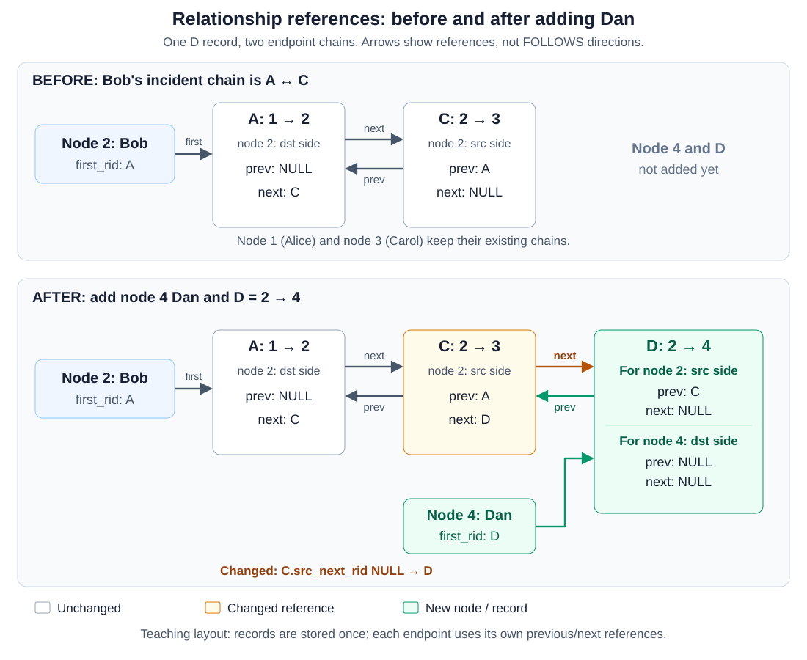

Arrows show first, previous, and next references, not `FOLLOWS` directions. **D is shown once, with separate reference fields for nodes 2 and 4.** Dan's first reference leads to that same record. Green marks additions; amber marks C's changed source-side next reference. Nodes 1 and 3 are omitted from the diagram because their chains do not change.

Bob's outgoing destinations change from **[3]** to **[3, 4]**. The following existing adjacency comparison expresses the same change at the application level.

Adding `2 → 4` changes the relevant adjacency information as follows; the other existing connections remain:

| User | Outgoing before | Outgoing after | Incoming before | Incoming after |
| --- | --- | --- | --- | --- |
| 2: Bob | 3 | 3, 4 | 1 | 1 |
| 4: Dan | Not present | None | Not present | 2 |

An implementation must make the new node, relationship, and affected adjacency information consistent within the chosen transaction. It does not need to recreate every unrelated connection.

Stored references can reduce repeated lookups during traversal; relational indexes can also locate relationships efficiently. Neither guarantees faster complete queries. Use [When to Choose Neo4j](#when-to-choose-neo4j) to connect these mechanics to workload and operating requirements.

Actual Neo4j storage varies by version, edition, and store format. Documented formats include record-oriented layouts and **block** formats that colocate related information. A doubly linked list can illustrate references, but is not a universal graph-storage rule. Use [Neo4j's store-format documentation](https://neo4j.com/docs/operations-manual/current/database-internals/store-formats/) for implementation-specific details rather than assuming one fixed byte layout.

#### Transactions, History, Scaling, and Operations

**Neo4j supports ACID transactions.** A statement that creates several nodes and relationships commits as a unit or rolls back; applications can also use explicit multi-statement transactions. Isolation, constraints, lock conflicts, retry behavior, and business rules still need deliberate design. ACID does not make separately committed statements one transaction. Cross-link [the ACID explanation](#transactions-and-acid) and [Neo4j transaction management](https://neo4j.com/docs/operations-manual/current/database-internals/transaction-management/).

| Concern | What to remember |
| --- | --- |
| **History** | A `since` date or other temporal property does not automatically retain old node values or deleted relationships. Model historical facts/versions and retention explicitly |
| **Clustering** | Qualify by version, edition, and topology. In the documented replicated-database model, one elected writer coordinates writes with other primary allocations |
| **Read scaling** | Secondary database copies can serve reads and may lag. Supported causal-consistency mechanisms/bookmarks can preserve required ordering between related requests |
| **Sharding / distribution** | Splitting a graph is different from replicating a database. Evaluate supported features and cross-partition traversal costs; adding replicas does not automatically shard one graph |
| **Performance** | Test query depth, high-degree nodes, indexes, execution plans, cache behavior, concurrency, and failure capacity |
| **Security** | Apply appropriate permissions and application authorization. Pass application values as parameters rather than constructing queries from untrusted text |
| **Recovery** | Arrange monitoring, backups, retention, and tested restoration. Replication alone is not a backup |

Clustering can improve availability and read throughput, but does not guarantee faster writes or every traversal. See [Neo4j clustering](https://neo4j.com/docs/operations-manual/current/clustering/introduction/), [distributed consistency](Distributed-System-Attributes.md#consistency), and [replication and recovery distinctions](#replication-models-and-replica-placement).

#### When to Choose Neo4j

**Relational databases can solve the graph examples above too.** Neo4j's value is a model and query language centered on connections, plus traversal-oriented execution that may suit the workload. A clearer query is not proof of faster execution.

**PostgreSQL vs. Neo4j**

| Aspect | PostgreSQL | Neo4j |
| --- | --- | --- |
| **Relationships** | Stores connections through foreign keys and relationship tables | Stores nodes and typed relationships |
| **Relationship queries** | Uses joins and recursive common table expressions (CTEs) | Uses graph patterns and path traversal |
| **Simple relationships** | Ordinary indexed joins may already meet the requirement | Can express the same relationships; another engine may add little value |
| **Complex, multi-hop paths** | Recursive SQL can explore paths; queries may become harder to maintain | Path syntax can express the question more directly; exploration can still be expensive |
| **Changing relationship types** | May require schema/query changes; generic edge tables are also possible | New types/properties can be easier to represent, but rules, constraints, and queries still need maintenance |
| **Transactions** | Supports ACID transactions | Also supports ACID transactions; check [isolation and transaction boundaries](#transactions-history-scaling-and-operations) |

A SQL JOIN matches relationships already stored in records; it does not invent connections. For the [shared-device fraud example](#fraud-investigation-shared-device-and-recipient), SQL can join login and transfer records, group by device and recipient, and count distinct accounts. That query alone is not a reason to add Neo4j.

**Why traversal may be efficient**

Neo4j's **index-free adjacency** means it can follow stored links between neighboring graph elements after finding a starting point. It can still use indexes to locate that starting point. See [Neo4j's native graph-processing explanation](https://neo4j.com/blog/cypher-and-gql/native-vs-non-native-graph-technology/) and the existing [storage/traversal walkthrough](#how-storage-supports-traversal).

This does not remove disk access or make an entire query O(1). Indexed SQL joins can also be efficient. Degree, depth, selectivity, caches, data layout, concurrency, and execution plans affect both approaches; Neo4j's [physical storage formats](https://neo4j.com/docs/operations-manual/current/database-internals/store-formats/) also vary.

**Example: accounts connected within five transfer hops**

Using the accounts and transfers from the earlier fraud example, this read-only, Neo4j 5-compatible query finds other accounts connected to A1:

```cypher
MATCH (s:Account {accountId: 'A1'})
      -[:TRANSFERRED_TO*1..5]-(a:Account)
WHERE a <> s
RETURN DISTINCT a.accountId AS accountId
ORDER BY accountId;
```

| accountId |
| --- |
| A2 |
| A3 |
| B1 |

B1 is one hop away; A2 and A3 are two hops away through B1. The limit is **1–5 transfer relationships**, not five intermediate accounts: a five-hop path has at most four intermediate accounts. Five intermediate accounts would allow six hops.

The missing arrowhead allows either direction. To follow outgoing transfers only, use `-[:TRANSFERRED_TO*1..5]->`. This query has no time filter, unlike the earlier ten-minute example. `a <> s` excludes the starting account if a cycle reaches it; `DISTINCT` removes repeated account results, not the work of exploring multiple paths. A connection is an investigation lead, not evidence of wrongdoing.

SQL can answer this question with [a recursive CTE](https://www.postgresql.org/docs/current/queries-with.html#QUERIES-WITH-RECURSIVE); Cypher offers [variable-length path syntax](https://neo4j.com/docs/cypher-manual/5/patterns/variable-length-paths/). Neither guarantees cheap traversal through a densely connected graph.

**Selection by requirement**

| Requirement | What to evaluate |
| --- | --- |
| **Repeated multi-hop operational relationship queries** | A graph model and Cypher patterns can directly express the required paths |
| **Simple relationships and ordinary joins already handled by SQL** | An existing relational database may be sufficient; another engine adds synchronization and operational work |
| **Direct retrieval by one identifier** | Evaluate a suitable key-value or relational lookup rather than assuming a graph is needed |
| **Large historical scans and reporting aggregates** | Evaluate an analytical SQL engine or warehouse |
| **Keyword relevance / full-text search** | Evaluate the required search capability; following graph edges alone does not supply text relevance |

The existing [banking](#worked-example-banking-platform-with-an-ai-assistant) and [delivery-platform](#worked-example-global-autonomous-delivery-platform) examples use graphs to explore customer–device–account or order connections. A shared device is a reason to investigate, not proof of fraud. If the graph is a derived view, define its source, update lag, deletion handling, access controls, and recovery.

**Practical default:** Keep the existing relational database when its queries are clear and meet requirements. Evaluate Neo4j when frequent relationship exploration, simpler modeling/querying, or measured performance justifies its operational cost. Both PostgreSQL and Neo4j can be primary stores; a second database is not mandatory.

Use [the database-selection checklist](#database-selection-checklist) and [data-pipeline notes](Data-Engineering-for-Solution-Architecture.md) to decide whether the relationship-query benefit justifies another store.

> **Use a graph when relationships and paths are central to the queries. Find the starting entities, follow the relevant connections, and control how far the query expands.**

**Simple conclusion**

**SQL can solve the same problems. Neo4j can make complex relationship queries easier to express.**

Imagine asking: **“If this switch fails, which servers, services, and applications could be affected?”**

- **PostgreSQL:** Store the connections in tables and follow them using joins or recursive SQL.
- **Neo4j:** Store the connections as a graph and describe the path you want to follow.

Both can return the answer.

> **Keep PostgreSQL** when its queries are clear and meet your requirements.

> **Consider Neo4j** when exploring many connected entities is a frequent, central task, and simpler queries or measured performance justify using it.

**Neo4j is not automatically faster.**

**Choose the database around the questions your application asks most often.**

- **Relational databases:** A strong fit for application records, transactions, ordinary joins, and reporting.
- **Neo4j:** Worth evaluating when exploring connections—friends of friends, shared-account patterns, or service dependencies—is a frequent, central task.

**The distinction is workload fit, not exclusive capability.** SQL can explore connected data, and Neo4j supports transactions. Performance comparisons need representative benchmarks; no speed multiplier applies universally.

## ClickHouse

### Overview: What ClickHouse Is For

**ClickHouse is a column-oriented SQL database management system for online analytical processing (OLAP).** It is useful when a query must summarize many readings, events, or business records. It can run on one server; distributing data across servers is a separate design choice. See the [official introduction](https://clickhouse.com/docs/get-started/about/intro).

Consider the same robot telemetry used in the [Cassandra](#worked-cql-example-robot-telemetry) and [HBase](#worked-hbase-shell-example-robot-telemetry) examples:

| Requirement | Question |
| --- | --- |
| **Operational lookup** | What was R17's particular reading, or its bounded recent history? |
| **Analytical query** | Across robots and a time window, how many readings arrived, what was the average temperature, and what was the minimum battery? |

These workloads overlap: an analytical database can retrieve individual records, and an operational database can calculate aggregates. Choose around the important queries, concurrency, freshness, and guarantees. The [PostgreSQL / Greenplum / ClickHouse selection table](#quick-selection-postgresql-greenplum-or-clickhouse) gives the broader context.

### Column-Oriented Storage and Analytical Execution

Start with three readings, shown as complete rows:

| Robot | Observed at, UTC | Sample | Battery | Temperature |
| --- | --- | --- | --- | --- |
| R17 | 2026-11-06 10:00 | 1 | 80 | 22.5 |
| R17 | 2026-11-06 10:01 | 2 | 79 | 23.0 |
| R18 | 2026-11-06 10:00 | 1 | 90 | 21.0 |

A simplified storage comparison shows the same values grouped differently:

| Row-oriented view: values grouped by record | Column-oriented view: values grouped by field |
| --- | --- |
| R17, 10:00, 1, 80, 22.5<br/>R17, 10:01, 2, 79, 23.0<br/>R18, 10:00, 1, 90, 21.0 | Robot: R17, R17, R18<br/>Time: 10:00, 10:01, 10:00<br/>Sample: 1, 2, 1<br/>Battery: 80, 79, 90<br/>Temperature: 22.5, 23.0, 21.0 |

Times are abbreviated in this comparison; the date is unchanged.

To calculate an average temperature, a column-oriented engine can read temperature values without reconstructing every complete record. Filtering by time and grouping by robot also require the time and robot columns. Similar values often compress well, while batch/vectorized execution processes groups of values with less per-value overhead. Parallel work can use multiple CPU cores.

Sorting, indexes, pruning, and caches can reduce unnecessary work further. A narrow projection does not guarantee the smallest possible total I/O: filters, storage blocks, data distribution, and the execution plan still matter. This is a storage/execution mental model, not an exact file layout. See [ClickHouse's execution explanation](https://clickhouse.com/docs/get-started/about/why-clickhouse-is-so-fast).

**Column-oriented storage is different from the column-family model.** Compare the existing [wide-column versus analytical columnar explanation](#wide-column-vs-analytical-columnar-storage); Cassandra/HBase terminology does not describe this analytical column-scanning layout.

### MergeTree: Parts, Sorting, Indexes, and Partitions

**MergeTree** is the table-engine family used in this example. It stores incoming data in parts and performs background merges.

| Concept | Meaning |
| --- | --- |
| **Table engine** | Controls how a table stores and manages data |
| **Sorting key: table `ORDER BY`** | Organizes rows within each stored part |
| **Primary index** | Sparse metadata that helps identify granules that may match a query |
| **Granule** | A group of rows considered during indexed reads; the index does not have one entry per row |
| **Partition key: `PARTITION BY`** | Groups data for management and partition-level pruning |
| **Data part** | An immutable stored portion created during ingestion; one part can contain multiple files |
| **Background merge** | Combines eligible parts within the same partition into a replacement part |

In this example, the sorting key also defines the primary index because no separate `PRIMARY KEY` is declared. **A MergeTree primary key does not enforce unique rows** like a PostgreSQL primary-key constraint; see [ClickHouse's primary-key comparison](https://clickhouse.com/blog/postgres-to-clickhouse-data-modeling-tips).

Partitioning, sorting, indexing, sharding, and replication solve different problems. Also, a table's sorting key is not a general result-order guarantee: use a query-level `ORDER BY` for ordered output. See the [MergeTree engine](https://clickhouse.com/docs/reference/engines/table-engines/mergetree-family/mergetree) and [sparse primary-index explanation](https://clickhouse.com/docs/concepts/core-concepts/primary-indexes).

The following diagram shows parts in one illustrative partition:

```mermaid
flowchart LR
    B["Batched inserts"] --> P["Sorted parts<br/>P1, P2, P3"]
    P --> M["Background merge<br/>P1 and P2"]
    M --> N["Replacement part<br/>P12"]
    P -.->|Before merge| A["Active parts<br/>for a query snapshot"]
    N -.->|After publication| A
    Q["SELECT query"] -->|Read| A
```

1. Batches create queryable parts under the synchronous-insert assumptions below; queries do not wait for a background merge.
2. A merge can replace P1 and P2 with P12 while P3 remains separate.
3. A query reads the appropriate active set, not both an old part and its replacement as duplicate rows.

The diagram shows successive states, not all parts being active together. Merges do not promise that every partition eventually becomes one part or one file. Many tiny inserts can create too many parts and excessive merge work. See [data parts](https://clickhouse.com/docs/concepts/core-concepts/parts) and [part merges](https://clickhouse.com/docs/concepts/core-concepts/merges).

### Worked SQL Example: Robot Telemetry

This independent example uses an initially absent table, `robot_readings_clickhouse`, in an existing database. Assume one node, sufficient permissions, successful sequential **synchronous inserts**, and no concurrent writers. The SQL uses established MergeTree syntax checked against the linked documentation; it does not describe every ClickHouse Cloud storage architecture.

#### Create and Insert the Starting Readings

```sql
CREATE TABLE robot_readings_clickhouse
(
    robot_id String,
    observed_at DateTime64(3, 'UTC'),
    sample_no UInt32,
    battery_percent UInt8,
    temperature_c Float64
)
ENGINE = MergeTree
PARTITION BY toYYYYMM(observed_at)
ORDER BY (robot_id, observed_at, sample_no);

INSERT INTO robot_readings_clickhouse
    (robot_id, observed_at, sample_no, battery_percent, temperature_c)
VALUES
    ('R17', '2026-11-06 10:00:00.000', 1, 80, 22.5),
    ('R17', '2026-11-06 10:01:00.000', 2, 79, 23.0),
    ('R18', '2026-11-06 10:00:00.000', 1, 90, 21.0);
```

`String` stores the robot identifier. `DateTime64(3, 'UTC')` gives millisecond precision and UTC interpretation/display. `UInt32` and `UInt8` are unsigned integer types; the battery type alone does not enforce a business range of 0–100. `Float64` is an approximate floating-point type suitable for this temperature illustration. See [DateTime64](https://clickhouse.com/docs/reference/data-types/datetime64).

Monthly partitions group these readings into November 2026. This is a management choice, not a required partition size. The robot-first sorting key suits queries for one robot and a time interval; fleet-wide time queries have a different access pattern. A separate partition for every robot is not implied or required.

#### Query a History and Calculate Aggregates

Retrieve R17's readings within the start-inclusive, end-exclusive interval **[10:00, 11:00) UTC**:

```sql
SELECT robot_id, observed_at, sample_no, battery_percent, temperature_c
FROM robot_readings_clickhouse
WHERE robot_id = 'R17'
  AND observed_at >= toDateTime64('2026-11-06 10:00:00', 3, 'UTC')
  AND observed_at <  toDateTime64('2026-11-06 11:00:00', 3, 'UTC')
ORDER BY observed_at, sample_no;
```

The logical result contains R17's sample 1 at 10:00, then sample 2 at 10:01, with the original values shown above.

Now summarize all robots in the same hour:

```sql
SELECT
    robot_id,
    count() AS reading_count,
    round(avg(temperature_c), 2) AS avg_temperature_c,
    min(battery_percent) AS min_battery_percent
FROM robot_readings_clickhouse
WHERE observed_at >= toDateTime64('2026-11-06 10:00:00', 3, 'UTC')
  AND observed_at <  toDateTime64('2026-11-06 11:00:00', 3, 'UTC')
GROUP BY robot_id
ORDER BY robot_id;
```

| Robot | Reading count | Average temperature, rounded | Minimum battery |
| --- | --- | --- | --- |
| R17 | 2 | 22.75 | 79 |
| R18 | 1 | 21.00 | 90 |

#### Add a Reading and Inspect Index Use

Append R17's next reading:

```sql
INSERT INTO robot_readings_clickhouse
    (robot_id, observed_at, sample_no, battery_percent, temperature_c)
VALUES
    ('R17', '2026-11-06 10:02:00.000', 3, 78, 24.5);
```

Repeat the aggregate query:

```sql
SELECT
    robot_id,
    count() AS reading_count,
    round(avg(temperature_c), 2) AS avg_temperature_c,
    min(battery_percent) AS min_battery_percent
FROM robot_readings_clickhouse
WHERE observed_at >= toDateTime64('2026-11-06 10:00:00', 3, 'UTC')
  AND observed_at <  toDateTime64('2026-11-06 11:00:00', 3, 'UTC')
GROUP BY robot_id
ORDER BY robot_id;
```

| Robot | Reading count | Average temperature, rounded | Minimum battery |
| --- | --- | --- | --- |
| R17 | 3 | 23.33 | 78 |
| R18 | 1 | 21.00 | 90 |

R17's average is `(22.5 + 23.0 + 24.5) / 3`, rounded to 23.33. Display formatting can differ: a client may show 21 rather than 21.00.

**Event identity still needs a policy.** Plain MergeTree does not enforce uniqueness of `(robot_id, observed_at, sample_no)`. Repeating an event insert can create another counted row; background merges do not automatically remove it. Design retries and deduplication deliberately, checking any engine-specific or configured insert-deduplication guarantees.

Inspect how the bounded query can use indexes:

```sql
EXPLAIN indexes = 1
SELECT robot_id, observed_at, sample_no, battery_percent, temperature_c
FROM robot_readings_clickhouse
WHERE robot_id = 'R17'
  AND observed_at >= toDateTime64('2026-11-06 10:00:00', 3, 'UTC')
  AND observed_at <  toDateTime64('2026-11-06 11:00:00', 3, 'UTC')
ORDER BY observed_at, sample_no;
```

[EXPLAIN's index details](https://clickhouse.com/docs/reference/statements/explain) report filtering of parts and granules. A sparse index narrows candidate ranges; it does not promise one direct lookup per event. This tiny dataset demonstrates syntax, not a particular plan, pruning ratio, or speed.

### Ingestion, Materialized Views, and Data Correctness

Batching reduces per-insert overhead and part creation, but waiting for a batch can delay visibility. Choose an acceptable freshness/overhead balance.

**Synchronous inserts** wait for their insert processing to complete. **Asynchronous inserts** buffer data before flushing it into queryable storage. With `wait_for_async_insert = 1`, acknowledgment waits for a successful flush; with `0`, acknowledgment can precede the flush, so subsequent failure may not be reported to that client. These settings change what an acknowledgment means; buffering is not immediate query visibility. See [asynchronous inserts](https://clickhouse.com/docs/concepts/features/operations/insert/asyncinserts).

Precomputed results also need an explicit update model:

| Approach | When work happens | What to remember |
| --- | --- | --- |
| **ClickHouse incremental materialized view** | Processes newly inserted source blocks into a target | Design the target to combine partial results correctly |
| **ClickHouse refreshable materialized view** | Periodically reruns a query over its input | Normally replaces the result; an optional append mode has different semantics |
| **Earlier PostgreSQL example** | Stores a query result and refreshes it explicitly | Source changes remain absent until the chosen refresh occurs |

An [incremental view](https://clickhouse.com/docs/concepts/features/materialized-views/incremental-materialized-view) is not a continually recomputed copy of the entire source. Later source updates or deletions do not automatically retract previous contributions. Existing historical rows need deliberate backfilling; historical events newly inserted through the source can trigger the view, so avoid counting them twice. For averages, combine suitable sums/counts or aggregate states rather than unweighted averages of batch averages.

Compare [refreshable views](https://clickhouse.com/docs/concepts/features/materialized-views/refreshable-materialized-view) with the existing [PostgreSQL materialized-view example](#cached-results-vs-materialized-views). Define validation, freshness, backfill, and correction behavior before relying on a dashboard total.

### Scaling, Changes, Reliability, and Selection

Keep the operational source and its analytical view distinct:

```mermaid
flowchart LR
    ROB["Robot telemetry"] --> ING["Telemetry ingestion"]
    ING -->|Batches| CH["ClickHouse<br/>Analytical table"]
    APP["Application"] -->|Business writes| DB["Authoritative database<br/>Orders and assignments"]
    DB -.->|Changes| PIPE["CDC / ETL"]
    PIPE -.->|Derived data| CH
    DASH["Dashboard"] -->|SQL query| CH
    CH -->|Aggregates| DASH
```

Telemetry supplies the readings; optional background CDC/ETL supplies operational context. The dashboard queries ClickHouse, while the application keeps authoritative orders and robot assignments in its operational database. CDC means **change data capture**; ETL means **extract, transform, load**, as explained in the [data-engineering notes](Data-Engineering-for-Solution-Architecture.md). These feeds can lag; the diagram does not create one transaction across databases or a real-time robot-control system.

| Design concern | Simple rule |
| --- | --- |
| **Distribution** | Shards divide data; replicas retain copies. [Distributed query routing](https://clickhouse.com/docs/reference/engines/table-engines/special/distributed) is separate from this local MergeTree table |
| **Replication and coordination** | Replicated engines use coordination such as ClickHouse Keeper; Keeper is not the telemetry store. Responsibilities differ in managed-cloud architectures |
| **Joins and changes** | ClickHouse supports joins, updates, and deletes; their mechanisms, costs, and visibility differ. Use the existing [Greenplum/ClickHouse comparison](#greenplum-vs-clickhouse) for details |
| **Transactions** | Check documented insert scope and restricted experimental transaction features; do not assume general cross-table/cross-shard transactions |
| **Recovery and security** | Replication does not replace backups and tested restoration. Apply permissions, TLS, and appropriate access isolation |
| **Operations** | Monitor ingestion lag, query latency, active parts/merge pressure, memory, storage, and failures |

See the [replication documentation](https://clickhouse.com/docs/reference/engines/table-engines/mergetree-family/replication), [transaction boundaries](https://clickhouse.com/docs/concepts/features/operations/insert/transactions), and existing [ACID explanation](#transactions-and-acid). Validate features against the actual release, engine, settings, and deployment.

| Requirement | What to evaluate |
| --- | --- |
| **Telemetry/event dashboards** | ClickHouse when repeated filters and aggregations dominate; test freshness and query concurrency |
| **Analytical reporting** | ClickHouse alongside [Greenplum/PostgreSQL alternatives](#quick-selection-postgresql-greenplum-or-clickhouse), using representative joins and scans |
| **Frequent transactional record changes** | An operational relational database when business invariants require its transaction model; analytical copies can serve reporting |
| **Specific readings or bounded keyed histories** | PostgreSQL, [Cassandra](#cassandra-keys-partitions-and-clustering), or [HBase](#apache-hbase), according to required access and guarantees; ClickHouse may also fit if the analytical workload dominates |

Use the [database-selection checklist](#database-selection-checklist); no row guarantees a latency or capacity figure.

> **ClickHouse organizes data for analytical scans and aggregations. Choose columns, sorting keys, partitions, and ingestion patterns around the queries—not merely the dataset size.**

## Object Storage and Amazon S3

### What Is Object Storage?

> **Store a piece of content under a key; retrieve it through a storage API.**

**Object storage** retains content as named objects, with metadata describing that content. Think of a product image stored under a name that the application can request later.

| Concept | Meaning | Product-image example |
| --- | --- | --- |
| **Bucket/container** | A named container for objects; terminology varies by service | `shop-media-example` |
| **Object key** | The object's identifier within its bucket | `products/P100/front.jpg` |
| **Content/payload** | The actual bytes being stored | The JPEG image's bytes |
| **Metadata** | System information and supported descriptive fields | Content type `image/jpeg`, byte size, and a product ID |
| **Version** | A retained revision when versioning is enabled | An earlier image retained after replacement |

An object here is **not an object-oriented programming class** and need not be a JSON document. Its content can be text, an image, or another binary format.

Applications normally address objects through a **service endpoint, bucket, and key**. Storage software manages how the bytes are placed on underlying servers and disks; the key is not a physical server address. The service can be cloud-managed or self-hosted. See the [S3 overview](https://docs.aws.amazon.com/AmazonS3/latest/userguide/Welcome.html) and [Ceph Object Gateway](https://docs.ceph.com/en/latest/radosgw/) as examples of these deployment choices.

```mermaid
flowchart TB
    APP["Application"] -->|"Storage API"| BUCKET["Bucket: shop-media-example"]
    BUCKET --> PHOTO["Object: front.jpg"]
    BUCKET --> PDF["Object: spec.pdf"]
    PHOTO --> KEY["Key: products/P100/front.jpg"]
    PHOTO --> META["Metadata: image/jpeg, size, product ID"]
    PHOTO --> DATA["Content: JPEG bytes"]
    PDF --> PDFKEY["Key: products/P100/spec.pdf"]

    classDef container fill:#dbeafe,stroke:#111,color:#111
    classDef object fill:#fff3cd,stroke:#111,color:#111
    class APP,BUCKET container
    class PHOTO,PDF,KEY,META,DATA,PDFKEY object
```

This is an **object anatomy and naming map**, not a message trace or a requirement to create separate objects for each metadata field. Each object includes its own content and associated metadata.

**Keys can look like paths.** In an ordinary S3 general-purpose bucket, `products/P100/` is a key prefix, not a conventional filesystem directory or nested bucket. Consoles can display prefixes as folders. See [S3 object keys](https://docs.aws.amazon.com/AmazonS3/latest/userguide/object-keys.html). Metadata capabilities also vary: S3 distinguishes system metadata, upload-time user metadata, tags, and other supported metadata features. See [object metadata](https://docs.aws.amazon.com/AmazonS3/latest/userguide/UsingMetadata.html).

### What Is Typically Stored There?

| Content | Illustrative use |
| --- | --- |
| **Images** | Product photographs, avatars, scanned documents |
| **Video** | Uploaded clips, recordings, prepared streaming segments |
| **Audio** | Podcasts, voice recordings, music |
| **Documents** | PDFs, invoices, reports |
| **Application files** | Installers, archives, static assets |
| **Backups and exports** | Database backup files and recovery copies |
| **Logs and analytical files** | JSON, CSV, Parquet, and ORC datasets |
| **AI/ML artifacts** | Training datasets, model weights, checkpoints |
| **IoT and robotic data** | Recorded sensor batches, images, and mission recordings |

Object storage holds **structured, semi-structured, and unstructured content**. A Parquet file can contain structured rows even though the storage service exposes it as an object. See [Azure Blob Storage's use cases](https://learn.microsoft.com/en-us/azure/storage/blobs/storage-blobs-overview) and [Google Cloud Storage](https://docs.cloud.google.com/storage/docs/introduction).

Storing a video or audio file does not itself transcode it, prepare adaptive streaming formats, or provide a complete playback service. Object storage can serve the bytes; processing, players, and delivery infrastructure supply the other functions.

Similarly, storing backup files does not prove that restoration works. Retaining datasets does not automatically establish a catalog, data quality, ownership, or a governed data lake. Continue with [warehouse and data-lake architectures](Data-Engineering-for-Solution-Architecture.md#warehouse-and-data-lake) rather than treating a bucket as the whole data platform.

### Object Storage vs. File Storage, Block Storage, and Databases

| Approach | Access model | Typical operations | Suitable example |
| --- | --- | --- | --- |
| **Block storage** | A volume exposes addressable blocks | Read/write block ranges; a filesystem or engine organizes them | A supported volume for a database server |
| **File storage** | Files and directories through filesystem interfaces, locally or over protocols such as NFS/SMB | Open, read, write, rename, and manage paths | A shared team filesystem |
| **Object storage** | Named content and metadata through object APIs | Put, get, head, list, and delete objects | Product images or analytical files |
| **Database** | Modeled records and supported query interfaces | Query, index, constrain, and transact within the engine's guarantees | Products, orders, and account records |

These layers can coexist. A database may use block storage beneath its files, while the application keeps media in object storage. Databases can also store binary content; separate object storage is a design choice, not a requirement for every small file.

The ordinary object API does not supply all filesystem semantics or automatically provide row-level queries and transactions. A mount adapter can expose objects through file-like paths, but applications must check its supported behavior. Some database and analytical engines are designed to use object storage; that does not mean an arbitrary database engine can safely use any bucket as its normal disk.

> **A database commonly stores what the file means and who may access it; object storage holds the file's content.**

### Amazon S3: Responsibilities and Operations

**S3 means Amazon Simple Storage Service.** It is AWS's managed object-storage service. This introduction uses **ordinary general-purpose buckets**; specialized bucket types and their different APIs are outside the walkthrough.

| AWS manages | Application designers manage |
| --- | --- |
| Underlying storage servers, placement, and service infrastructure | Bucket/location choices, object keys, and access patterns |
| Service facilities for replication and protection | Applicable storage classes, versioning, retention, and recovery requirements |
| Storage APIs and managed capabilities | Permissions, upload validation, application correctness, retries, monitoring, and costs |

The storage class affects resilience and access behavior. For example, S3 Standard spans multiple Availability Zones, while One Zone choices have a different failure scope. Do not assume every object-storage configuration is multi-AZ (Availability Zone). See [S3 storage classes](https://docs.aws.amazon.com/AmazonS3/latest/userguide/storage-class-intro.html).

#### Worked Object Operations

**The following is language-neutral API-style pseudocode, not executable SDK syntax.** The fictional bucket `shop-media-example` already exists, initially contains no objects, and has never had versioning enabled. Assume valid permissions, no concurrent changes, and successful requests. The two payloads below are illustrative JPEG byte sequences, not files supplied by this note.

**1. Upload product P100's image.**

```text
PutObject(
    Bucket = "shop-media-example",
    Key = "products/P100/front.jpg",
    Body = JPEG_BYTES_V1,             // 120000 bytes
    ContentType = "image/jpeg",
    Metadata = {"product-id": "P100"}
)
Expected: success; the object is stored under this key.
```

**2. Read its metadata without downloading the image.**

```text
HeadObject(
    Bucket = "shop-media-example",
    Key = "products/P100/front.jpg"
)
Expected metadata:
    ContentLength = 120000
    ContentType = "image/jpeg"
    Metadata = {"product-id": "P100"}
Expected body: none
```

**3. Download the image.**

```text
GetObject(
    Bucket = "shop-media-example",
    Key = "products/P100/front.jpg"
)
Expected body: JPEG_BYTES_V1 (120000 bytes)
```

**4. List keys under the product's prefix.**

```text
ListObjectsV2(
    Bucket = "shop-media-example",
    Prefix = "products/P100/",
    MaxKeys = 1000
)
Expected relevant response fields:
    Contents = [{Key: "products/P100/front.jpg", Size: 120000}]
    IsTruncated = false
```

For a larger result, when `IsTruncated` is true, pass `NextContinuationToken` as the next request's `ContinuationToken`. Continue until no page remains. General-purpose bucket results are ordered lexicographically by key; a prefix listing is not an arbitrary query over the image's contents. See [ListObjectsV2](https://docs.aws.amazon.com/AmazonS3/latest/API/API_ListObjectsV2.html).

**5. Replace the image using the same key.**

```text
PutObject(
    Bucket = "shop-media-example",
    Key = "products/P100/front.jpg",
    Body = JPEG_BYTES_V2,             // 150000 bytes
    ContentType = "image/jpeg",
    Metadata = {"product-id": "P100"}
)
Expected: success; GetObject now returns JPEG_BYTES_V2.
```

In this unversioned example, the old image is not retained as an addressable previous version. With **versioning enabled**, a successful replacement instead creates a new version; earlier versions remain until deleted according to the applicable rules. These ordinary puts replace the object rather than patching one field inside its content. See [PutObject](https://docs.aws.amazon.com/AmazonS3/latest/API/API_PutObject.html).

**6. Delete the image.**

```text
DeleteObject(
    Bucket = "shop-media-example",
    Key = "products/P100/front.jpg"
)
Expected: success; the unversioned object is removed.
A subsequent GetObject finds no current object.
```

With permission to list the bucket, the missing-object read returns `404 NoSuchKey`. Without that permission, a missing-object read can return `403` instead; error interpretation must account for access policy. See [GetObject](https://docs.aws.amazon.com/AmazonS3/latest/API/API_GetObject.html) and [HeadObject](https://docs.aws.amazon.com/AmazonS3/latest/API/API_HeadObject.html).

**Versioned deletion behaves differently.** In a versioning-enabled bucket, a delete without `VersionId` adds a **delete marker**. Normal reads then treat the key as deleted, while older data versions still exist. Permanently deleting a particular version requires its version ID and permission, subject to retention protections. A suspended-versioning bucket has additional rules. See [DeleteObject](https://docs.aws.amazon.com/AmazonS3/latest/API/API_DeleteObject.html) and [deleting object versions](https://docs.aws.amazon.com/AmazonS3/latest/userguide/DeletingObjectVersions.html).

#### Large Transfers and Checksums

- **Multipart upload:** Upload parts independently, retry failed parts, then complete the upload to assemble one object. Incomplete uploads need completion, abortion, or suitable lifecycle cleanup; uploaded parts are not a finished object. See [multipart upload](https://docs.aws.amazon.com/AmazonS3/latest/userguide/mpuoverview.html).
- **Range reads:** Retrieve a byte range instead of the whole object. For example, `Range = "bytes=0-1023"` requests the first 1024 bytes when they exist. See [GetObject range requests](https://docs.aws.amazon.com/AmazonS3/latest/API/API_GetObject.html).
- **Checksums and ETags:** Use the supported checksum facilities to check transfer integrity. An ETag is **not universally the content's MD5 hash**, especially with multipart uploads or different encryption methods. Checksums detect differences; they do not grant access or replace encryption. See [S3 metadata and ETags](https://docs.aws.amazon.com/AmazonS3/latest/userguide/UsingMetadata.html).

### Worked Application Example: Product Details and Images

Keep the same product and storage identifiers:

| Component | Responsibility |
| --- | --- |
| **PostgreSQL** | Product P100's name, price, owner, and stored image reference |
| **Object storage** | The image bytes in `shop-media-example` under `products/P100/front.jpg` |
| **Application** | Authorize changes and reads, validate uploads, and manage the reference |
| **Optional CDN** | Cache and deliver eligible content; private content still needs appropriate access controls |

The sequence below is a **separate application walkthrough**, starting with a new upload opportunity after the operation examples. It assumes the product exists and the image key is available.

```mermaid
sequenceDiagram
    participant B as Browser
    participant A as Application
    participant S as S3: shop-media-example
    participant D as PostgreSQL
    Note over B,D: Product P100
    Note over B,S: Key: products/P100/front.jpg
    B->>A: Request image upload
    A->>A: Authorize product owner
    A->>D: Record pending upload
    A-->>B: Presigned PUT permission
    B->>S: Upload image directly
    S-->>B: Upload succeeded
    B->>A: Request finalization
    A->>S: Check stored object
    A->>A: Validate content and size
    A->>D: Save image reference as ready
    A-->>B: Image ready
    B->>A: Request image access
    A->>A: Authorize read
    A->>D: Read ready image reference
    A-->>B: Presigned GET permission
    B->>S: Download image
    S-->>B: Image bytes
```

The direct upload avoids carrying the image bytes through the application server. The application still checks that the expected object was uploaded; a browser's success message is not sufficient verification. Content checks may run in a worker, and an object can remain quarantined until approved. Cross-origin browser requests also need appropriate CORS settings; CORS does not grant storage permission.

A **presigned URL** grants time-limited access for a particular object and operation, within the signer's permissions. The bucket can remain private. Anyone possessing the URL can use its granted access, and it can generally be reused until it expires or becomes invalid. Keep it out of sensitive logs. See [AWS's presigned-URL guidance](https://docs.aws.amazon.com/AmazonS3/latest/userguide/using-presigned-url.html).

The diagram omits some failure branches. Use these simple state rules:

| Situation | Application response |
| --- | --- |
| Permission issued but upload fails | Keep the upload pending or failed; do not publish a ready reference |
| Upload succeeds but database update fails | Retry finalization safely; track and later clean abandoned uploads |
| Finalization is repeated | Recognize the same upload and avoid duplicate records or side effects |
| Object changes after validation | Bind readiness to the validated version or otherwise prevent unapproved replacement |
| Old uploads are abandoned | Reconcile pending records and objects before cleanup; avoid deleting active data |

**The database and bucket do not automatically share one transaction.** A practical design records the bucket, key, and, where needed, the verified version or checksum. The fixed key here is for learning; real upload flows need a controlled key/version strategy so a still-valid upload permission cannot silently replace approved content. For production validation, metadata alone does not establish that the bytes are safe or correct.

See [ACID and transaction boundaries](#transactions-and-acid), [application authorization](Identity-and-Access-Management.md#authorization-in-practice), and [pipeline recovery and reconciliation](Data-Engineering-for-Solution-Architecture.md#recovery-backfills-and-exactly-once-claims).

An optional **content delivery network (CDN)** adds an independent cache in front of eligible content. Updating S3 does not automatically remove every cached copy; define cache lifetimes, invalidation, or versioned asset URLs. A presigned S3 URL alone is not a CDN access-control design.

### Consistency, Security, Lifecycle, and Recovery

**Current S3 object operations have strong consistency:** after a successful put, overwrite, or delete, later reads and listings reflect the completed change within S3's documented scope. That does not make a separate database update atomic, force an asynchronous replica to be current, or refresh external caches. Other object-storage systems can offer different guarantees. See [S3 strong consistency](https://aws.amazon.com/s3/consistency/).

| Concern | Simple design rule |
| --- | --- |
| **Private access and least privilege** | Give each identity only the required object/prefix operations; the application still enforces business permissions |
| **Transport and encryption** | Use TLS and suitable at-rest encryption/key controls; encryption does not replace authorization |
| **Upload safety** | Check size and actual content; quarantine or scan when required before publication |
| **Versioning** | Retain earlier revisions for recovery, with policies for old-version retention and cost |
| **Lifecycle rules** | Transition or expire eligible objects; current and noncurrent versions require appropriate rules |
| **Retention / Object Lock** | Protect specified versions using configured retention or legal holds; new versions and delete markers can still be created |
| **Replication** | Provide copies in the configured failure scope; replication is not a substitute for backup or restoration tests |
| **Backup and recovery** | Decide what must be recoverable, who can delete recovery copies, and how restoration will be tested |
| **Cost and performance** | Consider stored bytes, operations, retrieval, transfer, object size, access frequency, concurrency, and recovery needs |
| **Events and integration** | Handle retries, duplicate notifications, and out-of-order events; a notification is not a cross-system commit |

See [S3 security practices](https://docs.aws.amazon.com/AmazonS3/latest/userguide/security-best-practices.html), [lifecycle expiration](https://docs.aws.amazon.com/AmazonS3/latest/userguide/lifecycle-expire-general-considerations.html), [Object Lock](https://docs.aws.amazon.com/AmazonS3/latest/userguide/object-lock.html), and [notification delivery behavior](https://docs.aws.amazon.com/AmazonS3/latest/userguide/notification-how-to-event-types-and-destinations.html).

**Storage classes reflect access and recovery needs:**

| Access pattern | S3 examples | What to check |
| --- | --- | --- |
| **Frequent access** | S3 Standard | Latency, request/transfer costs, and required resilience |
| **Infrequent access** | S3 Standard-IA or One Zone-IA | Retrieval charges, minimum storage rules, and the failure scope |
| **Archive** | S3 Glacier Instant Retrieval, Flexible Retrieval, or Deep Archive | Some offer immediate access; others need a restore request and waiting time |

These are categories, not universal performance or price guarantees. Do not describe every archive class as offline, every object store as cheap, or every class as multi-AZ (Availability Zone). Choose using the current [storage-class documentation](https://docs.aws.amazon.com/AmazonS3/latest/userguide/storage-class-intro.html) and the application's [retention and deletion requirements](Data-Engineering-for-Solution-Architecture.md#access-privacy-and-lifecycle).

### Prominent Object-Storage Solutions

These are **representative implementations**, not an exhaustive list, ranking, or claim that their guarantees are identical. The common object-storage concept matters more than memorizing every product name.

#### Major Cloud Platforms

| Solution | Deployment model | Concept to recognize | Official reference |
| --- | --- | --- | --- |
| **Amazon S3** | AWS-managed | Buckets, keys, objects, and storage-class choices | [S3 overview](https://docs.aws.amazon.com/AmazonS3/latest/userguide/Welcome.html) |
| **Azure Blob Storage** | Microsoft-managed | Blob containers and objects; part of Azure Storage | [Blob Storage overview](https://learn.microsoft.com/en-us/azure/storage/blobs/storage-blobs-overview) |
| **Google Cloud Storage** | Google-managed | Buckets, objects, and location/access choices | [Cloud Storage overview](https://docs.cloud.google.com/storage/docs/introduction) |
| **OCI Object Storage** | Oracle-managed | Object storage separate from compute instances | [OCI overview](https://docs.oracle.com/en-us/iaas/Content/Object/Concepts/objectstorageoverview.htm) |
| **IBM Cloud Object Storage** | IBM-managed | Buckets with configured location and resilience | [IBM overview](https://cloud.ibm.com/docs/cloud-object-storage?topic=cloud-object-storage-about-cloud-object-storage) |
| **Alibaba Cloud OSS** | Alibaba-managed | Object Storage Service with multiple access tiers | [OSS overview](https://www.alibabacloud.com/help/en/oss/user-guide/oss-overview) |
| **Tencent Cloud COS** | Tencent-managed | Cloud Object Storage accessed through service APIs | [COS overview](https://www.tencentcloud.com/document/product/436/6222) |
| **Huawei Cloud OBS** | Huawei-managed | Object Storage Service for named stored content | [OBS overview](https://support.huaweicloud.com/intl/en-us/productdesc-obs/en-us_topic_0045853681.html) |

#### Additional Managed Services

| Solution | Deployment model | Concept to recognize | Official reference |
| --- | --- | --- | --- |
| **Cloudflare R2** | Cloudflare-managed | Object storage with an S3-compatible interface | [R2 documentation](https://developers.cloudflare.com/r2/) |
| **Backblaze B2** | Backblaze-managed | B2 object storage with S3-compatible and native interfaces | [B2 S3 API](https://www.backblaze.com/docs/cloud-storage-call-the-s3-compatible-api) |
| **Wasabi** | Wasabi-managed | Managed object storage with documented S3 API variations | [Wasabi API reference](https://docs.wasabi.com/apidocs/wasabi-api) |
| **DigitalOcean Spaces** | DigitalOcean-managed | S3-compatible object storage with optional CDN delivery | [Spaces documentation](https://docs.digitalocean.com/products/spaces/) |

#### Self-Hosted and Open-Source Projects

| Solution | Deployment model | Concept to recognize | Official reference |
| --- | --- | --- | --- |
| **Ceph Object Gateway** | Operator-managed Ceph cluster | Gateway exposing S3/Swift-compatible object interfaces | [Ceph gateway](https://docs.ceph.com/en/latest/radosgw/) |
| **OpenStack Swift** | Operator-managed distributed service | Object/container/account model and Swift's documented consistency | [Swift documentation](https://docs.openstack.org/swift/latest/) |
| **SeaweedFS** | Operator-managed storage system | Object storage through an S3 interface alongside other interfaces | [SeaweedFS project](https://github.com/seaweedfs/seaweedfs) |
| **Apache Ozone** | Operator-managed distributed storage | An S3 gateway over Ozone's object store | [Ozone S3 interface](https://ozone.apache.org/docs/2.1.2/user-guide/client-interfaces/s3/s3-api/) |

#### Commercial Self-Hosted Platforms

| Solution | Deployment model | Concept to recognize | Official reference |
| --- | --- | --- | --- |
| **MinIO AIStor** | Self-hosted vendor platform | S3 object access; distinct from the legacy community repository | [AIStor documentation](https://docs.min.io/aistor/) |
| **Cloudian HyperStore** | Self-hosted vendor platform | Distributed enterprise object storage with S3 interfaces | [HyperStore overview](https://cloudian.com/products/hyperstore/) |
| **Scality RING / ARTESCA** | Self-hosted vendor platforms | Object-storage offerings with different deployment/workload emphases | [Scality products](https://www.scality.com/products) |

**Historical MinIO clarification:** As checked on **5 November 2026**, the [legacy MinIO community repository](https://github.com/minio/minio) is archived and marked unmaintained. Do not treat its old installation guidance as current AIStor documentation or assume the editions share licensing and support terms.

**S3-compatible does not mean identical to AWS S3.** Check the exact operations, policy model, consistency, versioning, limits, and error behavior the implementation supports. Cloudflare publishes a [feature-by-feature compatibility list](https://developers.cloudflare.com/r2/api/s3/api/); Wasabi also documents variations. Do not assume every object-storage service uses the S3 API.

Self-hosting means the operator must arrange capacity, upgrades, access control, monitoring, and recovery. Open-source availability does not remove those responsibilities; a commercial edition does not automatically supply every capability or guarantee.

### When to Choose Object Storage

| Requirement | What to evaluate | Simple example |
| --- | --- | --- |
| **Large named content, media, backups, or datasets** | Object storage | Keep P100's images and exported analytical files |
| **Shared filesystem operations** | File storage | Several applications need a shared directory with supported file semantics |
| **Filesystem/database-engine volumes** | Block storage | Provide the volume required by a conventional database engine |
| **Record-level queries and transactions** | A suitable database | Change a product's price and related operational records |
| **Fast repeated delivery** | Caching/CDN alongside the authoritative store | Deliver a frequently viewed product image from a nearby cache |

For a small application, local files or database binary fields may be sufficient. Introduce object storage when access, durability, sharing, scale, delivery, or operating requirements justify another service. Check recovery and total cost instead of assuming one storage model is always better.

> **Object storage keeps content by key. Databases organize application records. Use them together when their different responsibilities fit the application.**

## Summary

Databases organize application information; DBMSs supply operations and configurable guarantees; storage resources retain the underlying bytes. Relational, key-value, document, column-family, and graph models emphasize different ways to represent and access data.

Transactions, constraints, indexes, partitioning, and recovery mechanisms must be selected for the actual workload. Relational systems can scale beyond one node and store semi-structured data; NoSQL systems can provide strong consistency and transactions within documented boundaries. Neither category removes the need for modeling, compatibility planning, access control, and tested recovery.

The [performance and access section](#query-performance-and-database-access) works through indexes, query plans, pagination, pools, caches, and materialized results. [Partitioning and sharding](#partitioning-and-sharding) separate data organization from distribution, while [distributed transactions](#distributed-transactions) explain atomic commitment and uncertain outcomes across participants. The [replication expansion](#multi-leader-replication) adds concurrent regional writes and [read-your-writes](#replication-lag-and-read-your-writes) routing.

The [column-family section](#column-family-databases) connects R17's CQL queries to Cassandra's partition keys, storage, replication, and consistency. The [HBase section](#apache-hbase) follows the same readings through ordered row keys, retained cell versions, region discovery, and storage/recovery paths. The [graph section](#graph-databases) compares relationship modeling with SQL, then uses [Neo4j](#neo4j) to follow connections, generate candidates, and explain transactions and storage trade-offs.

The [ClickHouse walkthrough](#clickhouse) reuses R17/R18 telemetry to explain column-oriented execution, MergeTree parts and indexes, bounded reads, and analytical aggregates. It separates ingestion visibility and materialized-view maintenance from operational database responsibilities.

The [object-storage section](#object-storage-and-amazon-s3) explains named content, metadata, and S3 operations. Its product-image example separates file bytes from database records and shows why permissions, lifecycle, and cross-system recovery still need deliberate design.

The [DynamoDB example](#amazon-dynamodb) connects keys, APIs, indexes, sized capacity units, and read guarantees. Its historical architecture discussion is separate from current documented service behavior.

The [selection guide](#database-selection-by-requirements) maps requirements to database candidates and shows how a banking platform can combine authoritative records with optional caches, search, and analytical views. Each added system needs a clear role and a justified operating cost.

> **Recall:** Start with the queries and invariants. Then choose the model, guarantees, engine, and operating strategy—not the other way around.

## Related Notes

- [Data engineering pipelines and analytical architectures](Data-Engineering-for-Solution-Architecture.md)
- [System design at different scales](Understanding-System-Design.md#system-design-at-different-scales)
- [Distributed consistency](Distributed-System-Attributes.md#consistency)
- [CAP theorem](Distributed-Systems-Theorems-and-Data-Structures.md#cap-theorem)
- [PACELC theorem](Distributed-Systems-Theorems-and-Data-Structures.md#pacelc-theorem)
- [IAM and authorization](Identity-and-Access-Management.md#authorization-in-practice)

## Further Reading

- [PostgreSQL: Constraints and Keys](https://www.postgresql.org/docs/current/ddl-constraints.html)
- [PostgreSQL: Transactions](https://www.postgresql.org/docs/current/tutorial-transactions.html)
- [PostgreSQL: Transaction Isolation](https://www.postgresql.org/docs/current/transaction-iso.html)
- [PostgreSQL: JSON Types](https://www.postgresql.org/docs/current/datatype-json.html)
- [PostgreSQL: Query Plans](https://www.postgresql.org/docs/current/using-explain.html)
- [PostgreSQL: Multicolumn Indexes](https://www.postgresql.org/docs/current/indexes-multicolumn.html)
- [PostgreSQL: Covering Indexes and Index-Only Scans](https://www.postgresql.org/docs/current/indexes-index-only-scans.html)
- [PostgreSQL: Full-Text Index Choices](https://www.postgresql.org/docs/current/textsearch-indexes.html)
- [PostgreSQL: LIMIT and OFFSET](https://www.postgresql.org/docs/current/queries-limit.html)
- [PostgreSQL: Row Constructor Comparisons](https://www.postgresql.org/docs/current/functions-comparisons.html)
- [PostgreSQL: Materialized Views](https://www.postgresql.org/docs/current/rules-materializedviews.html)
- [PostgreSQL: Materialized-View Refresh](https://www.postgresql.org/docs/current/sql-refreshmaterializedview.html)
- [PostgreSQL: Table Partitioning and Pruning](https://www.postgresql.org/docs/current/ddl-partitioning.html)
- [PgBouncer: Pooling Modes and Feature Compatibility](https://www.pgbouncer.org/features.html)
- [PostgreSQL: Replication Solution Comparison](https://www.postgresql.org/docs/current/different-replication-solutions.html)
- [PostgreSQL: WAL and Commit-Acknowledgment Settings](https://www.postgresql.org/docs/current/runtime-config-wal.html)
- [PostgreSQL: Two-Phase Transactions](https://www.postgresql.org/docs/current/two-phase.html)
- [PostgreSQL: Prepared-Transaction State and Recovery Responsibilities](https://www.postgresql.org/docs/current/sql-prepare-transaction.html)
- [Gray and Lamport: Consensus on Transaction Commit](https://lamport.azurewebsites.net/video/consensus-on-transaction-commit.pdf)
- [PostgreSQL: Backup and Restore](https://www.postgresql.org/docs/current/backup.html)
- [PostgreSQL: Physical Row Layout and Null Bitmap](https://www.postgresql.org/docs/current/storage-page-layout.html)
- [MySQL: InnoDB Error Handling and Rollback Scope](https://dev.mysql.com/doc/refman/8.4/en/innodb-error-handling.html)
- [MongoDB: Data Modeling](https://www.mongodb.com/docs/manual/data-modeling/)
- [MongoDB: Transactions](https://www.mongodb.com/docs/manual/core/transactions/)
- [MongoDB: Documents, BSON, and Identifiers](https://www.mongodb.com/docs/manual/core/document/)
- [MongoDB: Schema Validation](https://www.mongodb.com/docs/manual/core/schema-validation/)
- [MongoDB: Single-Document Atomicity](https://www.mongodb.com/docs/manual/core/write-operations-atomicity/)
- [MongoDB: insertOne](https://www.mongodb.com/docs/manual/reference/method/db.collection.insertOne/)
- [MongoDB: findOne](https://www.mongodb.com/docs/manual/reference/method/db.collection.findOne/)
- [MongoDB: find and Projections](https://www.mongodb.com/docs/manual/reference/method/db.collection.find/)
- [MongoDB: updateOne](https://www.mongodb.com/docs/manual/reference/method/db.collection.updateOne/)
- [MongoDB: $addToSet](https://www.mongodb.com/docs/manual/reference/operator/update/addToSet/)
- [MongoDB: deleteOne](https://www.mongodb.com/docs/manual/reference/method/db.collection.deleteOne/)
- [MongoDB: Aggregation Pipelines](https://www.mongodb.com/docs/manual/core/aggregation-pipeline/)
- [MongoDB: createIndex](https://www.mongodb.com/docs/manual/reference/method/db.collection.createIndex/)
- [MongoDB: Modeling Best Practices](https://www.mongodb.com/docs/manual/data-modeling/best-practices/)
- [MongoDB: $lookup](https://www.mongodb.com/docs/manual/reference/operator/aggregation/lookup/)
- [MongoDB: Limits and Document Size](https://www.mongodb.com/docs/manual/reference/limits/)
- [DynamoDB: Transactions](https://docs.aws.amazon.com/amazondynamodb/latest/developerguide/transactions.html)
- [DynamoDB: Read Consistency](https://docs.aws.amazon.com/amazondynamodb/latest/developerguide/HowItWorks.ReadConsistency.html)
- [DynamoDB: Tables, Items, Attributes, and Keys](https://docs.aws.amazon.com/amazondynamodb/latest/developerguide/HowItWorks.CoreComponents.html)
- [DynamoDB: Introduction and Use Cases](https://docs.aws.amazon.com/amazondynamodb/latest/developerguide/Introduction.html)
- [DynamoDB: Modeling Around Access Patterns](https://docs.aws.amazon.com/amazondynamodb/latest/developerguide/bp-general-nosql-design.html)
- [DynamoDB: On-Demand Scaling Behavior and Limits](https://docs.aws.amazon.com/amazondynamodb/latest/developerguide/on-demand-capacity-mode.html)
- [DynamoDB: Physical Partitions and Item Collections](https://docs.aws.amazon.com/amazondynamodb/latest/developerguide/HowItWorks.Partitions.html)
- [DynamoDB API: PutItem](https://docs.aws.amazon.com/amazondynamodb/latest/APIReference/API_PutItem.html)
- [DynamoDB API: UpdateItem](https://docs.aws.amazon.com/amazondynamodb/latest/APIReference/API_UpdateItem.html)
- [DynamoDB API: GetItem](https://docs.aws.amazon.com/amazondynamodb/latest/APIReference/API_GetItem.html)
- [DynamoDB API: DeleteItem](https://docs.aws.amazon.com/amazondynamodb/latest/APIReference/API_DeleteItem.html)
- [DynamoDB: Query Pagination](https://docs.aws.amazon.com/amazondynamodb/latest/developerguide/Query.Pagination.html)
- [DynamoDB: Filters and Evaluated Data](https://docs.aws.amazon.com/amazondynamodb/latest/developerguide/Query.FilterExpression.html)
- [DynamoDB: Global and Local Secondary Indexes](https://docs.aws.amazon.com/amazondynamodb/latest/developerguide/SecondaryIndexes.html)
- [DynamoDB: Capacity Modes](https://docs.aws.amazon.com/amazondynamodb/latest/developerguide/capacity-mode.html)
- [DynamoDB: Read/Write Unit Accounting](https://docs.aws.amazon.com/amazondynamodb/latest/developerguide/read-write-operations.html)
- [DynamoDB: Item and Capacity Constraints](https://docs.aws.amazon.com/amazondynamodb/latest/developerguide/Constraints.html)
- [DynamoDB: Burst and Adaptive Capacity](https://docs.aws.amazon.com/amazondynamodb/latest/developerguide/burst-adaptive-capacity.html)
- [DynamoDB: Warm Throughput](https://docs.aws.amazon.com/amazondynamodb/latest/developerguide/warm-throughput.html)
- [DynamoDB: Application-Level Write Sharding](https://docs.aws.amazon.com/amazondynamodb/latest/developerguide/bp-partition-key-sharding.html)
- [DynamoDB: Global Tables and Their Consistency Modes](https://docs.aws.amazon.com/amazondynamodb/latest/developerguide/V2globaltables_HowItWorks.html)
- [DynamoDB: Point-in-Time Backups](https://docs.aws.amazon.com/amazondynamodb/latest/developerguide/Point-in-time-recovery.html)
- [AWS Authors: DynamoDB Architecture and Evolution — USENIX ATC 2022](https://www.usenix.org/conference/atc22/presentation/elhemali)
- [Redis: Data Types](https://redis.io/docs/latest/develop/data-types/)
- [Redis: String Values and Key-Based Operations](https://redis.io/docs/latest/develop/data-types/strings/)
- [Dynamo: Amazon's Highly Available Key-Value Store — Original 2007 Paper](https://www.allthingsdistributed.com/files/amazon-dynamo-sosp2007.pdf)
- [Apache CouchDB: Technical Overview](https://docs.couchdb.org/en/stable/intro/overview.html)
- [Apache Cassandra: Architecture Overview](https://cassandra.apache.org/doc/latest/cassandra/architecture/overview.html)
- [Apache Cassandra: Token Placement, Replication, and Membership](https://cassandra.apache.org/doc/latest/cassandra/architecture/dynamo.html)
- [Apache Cassandra: Hints and Hinted Handoff](https://cassandra.apache.org/doc/latest/cassandra/managing/operating/hints.html)
- [Apache Cassandra: Replica Repair and Merkle Trees](https://cassandra.apache.org/doc/latest/cassandra/managing/operating/repair.html)
- [Apache Cassandra: CQL Tables, Columns, and Primary Keys](https://cassandra.apache.org/doc/latest/cassandra/developing/cql/ddl.html)
- [Apache Cassandra: CQL Queries and Mutations](https://cassandra.apache.org/doc/latest/cassandra/developing/cql/dml.html)
- [Apache Cassandra: CQL Data Types and Timestamps](https://cassandra.apache.org/doc/latest/cassandra/developing/cql/types.html)
- [Apache Cassandra: Query-First Data Modeling](https://cassandra.apache.org/doc/latest/cassandra/developing/data-modeling/intro.html)
- [Apache Cassandra: Storage Engine and Commit-Log Synchronization](https://cassandra.apache.org/doc/latest/cassandra/architecture/storage-engine.html)
- [Apache Cassandra: Consistency and Lightweight-Transaction Guarantees](https://cassandra.apache.org/doc/latest/cassandra/architecture/guarantees.html)
- [Apache Cassandra: Storage-Attached Indexing](https://cassandra.apache.org/doc/latest/cassandra/developing/cql/indexing/sai/sai-overview.html)
- [Apache Cassandra: Compaction and Tombstones](https://cassandra.apache.org/doc/latest/cassandra/managing/operating/compaction/overview.html)
- [Apache Cassandra: Bloom Filters](https://cassandra.apache.org/doc/latest/cassandra/managing/operating/bloom_filters.html)
- [Apache HBase: Strong and Timeline-Consistent Reads](https://hbase.apache.org/docs/architecture/timeline-consistent-reads/)
- [RFC 9162: Merkle Trees and Certificate Transparency](https://www.rfc-editor.org/rfc/rfc9162.html#section-2.1)
- [Bitcoin Developer Guide: Merkle Trees](https://developer.bitcoin.org/devguide/block_chain.html#merkle-trees)
- [BitTorrent BEP 52: Protocol v2 Merkle Trees](https://www.bittorrent.org/beps/bep_0052.html)
- [PostgreSQL: Primary-Standby and Synchronous Replication](https://www.postgresql.org/docs/current/warm-standby.html)
- [PostgreSQL: Failover and Preventing Competing Primaries](https://www.postgresql.org/docs/current/warm-standby-failover.html)
- [Apache HBase: Data Model](https://hbase.apache.org/docs/datamodel/)
- [Apache HBase: Client Discovery and Connection Registries](https://hbase.apache.org/docs/architecture/client/)
- [Apache HBase: Catalog Tables and hbase:meta](https://hbase.apache.org/docs/architecture/catalog-tables/)
- [Apache HBase: Regions, MemStores, HFiles, and Compaction](https://hbase.apache.org/docs/architecture/regions/)
- [Apache HBase: RegionServer Storage and BlockCache](https://hbase.apache.org/docs/architecture/regionserver/)
- [Apache HBase: HDFS Integration](https://hbase.apache.org/docs/architecture/hdfs/)
- [Apache HBase: Shell Guide](https://hbase.apache.org/docs/shell/)
- [Apache HBase 2.6.0: Get Command Help](https://github.com/apache/hbase/blob/rel/2.6.0/hbase-shell/src/main/ruby/shell/commands/get.rb)
- [Apache HBase 2.6.0: Put Command Help](https://github.com/apache/hbase/blob/rel/2.6.0/hbase-shell/src/main/ruby/shell/commands/put.rb)
- [Apache HBase 2.6: Write Durability Policies](https://hbase.apache.org/2.6/devapidocs/org/apache/hadoop/hbase/client/Durability.html)
- [Apache HBase: Atomicity, Visibility, and Scan Guarantees](https://hbase.apache.org/acid-semantics/)
- [ClickHouse: Column-Oriented Database Overview](https://clickhouse.com/docs/get-started/about/intro)
- [ClickHouse: MergeTree Engine](https://clickhouse.com/docs/reference/engines/table-engines/mergetree-family/mergetree)
- [ClickHouse: Sparse Primary Indexes](https://clickhouse.com/docs/concepts/core-concepts/primary-indexes)
- [ClickHouse: Table Parts](https://clickhouse.com/docs/concepts/core-concepts/parts)
- [ClickHouse: Background Part Merges](https://clickhouse.com/docs/concepts/core-concepts/merges)
- [ClickHouse: Columnar and Vectorized Execution](https://clickhouse.com/docs/get-started/about/why-clickhouse-is-so-fast)
- [ClickHouse: DateTime64](https://clickhouse.com/docs/reference/data-types/datetime64)
- [ClickHouse: EXPLAIN and Index Details](https://clickhouse.com/docs/reference/statements/explain)
- [ClickHouse: Asynchronous Inserts and Acknowledgments](https://clickhouse.com/docs/concepts/features/operations/insert/asyncinserts)
- [ClickHouse: Incremental Materialized Views](https://clickhouse.com/docs/concepts/features/materialized-views/incremental-materialized-view)
- [ClickHouse: Refreshable Materialized Views](https://clickhouse.com/docs/concepts/features/materialized-views/refreshable-materialized-view)
- [ClickHouse: Distributed Query Routing](https://clickhouse.com/docs/reference/engines/table-engines/special/distributed)
- [ClickHouse: Replicated Table Engines](https://clickhouse.com/docs/reference/engines/table-engines/mergetree-family/replication)
- [Greenplum Transaction Snapshots — Historical Vendor Explanation](https://blogs.vmware.com/tanzu/improving-backup-performance-and-reliability-with-distributed-snapshots/)
- [ClickHouse: SQL JOIN Support](https://clickhouse.com/docs/reference/statements/select/join)
- [ClickHouse: Transactional Insert Guarantees and Experimental Transactions](https://clickhouse.com/docs/concepts/features/operations/insert/transactions)
- [ClickHouse: UPDATE](https://clickhouse.com/docs/reference/statements/update)
- [ClickHouse: DELETE](https://clickhouse.com/docs/reference/statements/delete)
- [ClickHouse: Access Control and RBAC](https://clickhouse.com/docs/concepts/features/security/access-rights)
- [ClickHouse: Backup and Restore](https://clickhouse.com/docs/concepts/features/backup-restore/overview)
- [Neo4j: Graph Database Concepts](https://neo4j.com/docs/getting-started/appendix/graphdb-concepts/)
- [W3C: RDF Concepts and Abstract Syntax](https://www.w3.org/TR/rdf11-concepts/)
- [Neo4j 5 Cypher: MATCH](https://neo4j.com/docs/cypher-manual/5/clauses/match/)
- [Neo4j 5 Cypher: EXISTS Subqueries](https://neo4j.com/docs/cypher-manual/5/subqueries/existential/)
- [Neo4j 5 Cypher: WITH and Aggregation](https://neo4j.com/docs/cypher-manual/5/clauses/with/)
- [Neo4j 5 Cypher: ORDER BY and Ordered Collection](https://neo4j.com/docs/cypher-manual/5/clauses/order-by/)
- [Neo4j 5 Cypher: Temporal Values](https://neo4j.com/docs/cypher-manual/5/functions/temporal/)
- [Neo4j: Fraud Detection and Investigation Use Cases](https://neo4j.com/use-cases/fraud-detection/)
- [Neo4j: Network and IT Operations Use Cases](https://neo4j.com/use-cases/network-and-it-operations/)
- [Neo4j 5 Cypher: CREATE](https://neo4j.com/docs/cypher-manual/5/clauses/create/)
- [Neo4j 5 Cypher: MERGE](https://neo4j.com/docs/cypher-manual/5/clauses/merge/)
- [Neo4j 5 Cypher: SET](https://neo4j.com/docs/cypher-manual/5/clauses/set/)
- [Neo4j 5 Cypher: DELETE](https://neo4j.com/docs/cypher-manual/5/clauses/delete/)
- [Neo4j: Creating Uniqueness, Existence, and Other Constraints](https://neo4j.com/docs/cypher-manual/current/schema/constraints/create-constraints/)
- [Neo4j: Store Formats and Storage Layouts](https://neo4j.com/docs/operations-manual/current/database-internals/store-formats/)
- [PostgreSQL: Recursive CTEs and Graph Traversal](https://www.postgresql.org/docs/current/queries-with.html#QUERIES-WITH-RECURSIVE)
- [Neo4j 5 Cypher: Variable-Length Paths](https://neo4j.com/docs/cypher-manual/5/patterns/variable-length-paths/)
- [Neo4j: Native Graph Processing and Index-Free Adjacency](https://neo4j.com/blog/cypher-and-gql/native-vs-non-native-graph-technology/)
- [Neo4j: Database Transaction Management](https://neo4j.com/docs/operations-manual/current/database-internals/transaction-management/)
- [Neo4j: Clustering, Replication, and Causal Consistency](https://neo4j.com/docs/operations-manual/current/clustering/introduction/)
- [Investor.gov: Asset Allocation, Risk Tolerance, and Diversification](https://www.investor.gov/introduction-investing/getting-started/asset-allocation)
- [Spanner: Schemas and Data Distribution](https://docs.cloud.google.com/spanner/docs/schema-and-data-model)
- [Greenplum Project Repository — Archived Historical Material](https://github.com/greenplum-db/gpdb-archive)
- [Greenplum Architecture — Archived Historical Documentation](https://github.com/greenplum-db/gpdb-archive/blob/main/gpdb-doc/markdown/admin_guide/intro/arch_overview.html.md)
- [Broadcom: Greenplum Standby Coordinator Activation](https://knowledge.broadcom.com/external/article/296354/failover-to-standby.html)
- [Tanzu: Greenplum on Kubernetes](https://blogs.vmware.com/tanzu/greenplum-on-kubernetes/)
- [Yandex Cloud: Greenplum Storage Layouts](https://yandex.cloud/en/docs/managed-greenplum/concepts/tables)
- [Yandex Cloud: Greenplum Data Distribution](https://yandex.cloud/en/docs/managed-greenplum/concepts/sharding)
- [SQLite: Embedded Operation Without a Separate Server](https://www.sqlite.org/serverless.html)
- [PostgreSQL: Full-Text Search](https://www.postgresql.org/docs/current/textsearch.html)
- [pgvector: Vector Similarity Search Extension for PostgreSQL](https://github.com/pgvector/pgvector)
- [PostGIS: Spatial Capabilities for PostgreSQL](https://postgis.net/documentation/)
- [Google Bigtable: Data Model and Row-Key Access](https://docs.cloud.google.com/bigtable/docs/overview)
- [Apache Cassandra: Partition Sizing and Bucketing](https://cassandra.apache.org/doc/latest/cassandra/developing/data-modeling/data-modeling_refining.html)
- [InfluxDB: Time-Series Data and Use Cases](https://docs.influxdata.com/influxdb3/core/)
- [Elasticsearch: Search, Analytics, and Vector Capabilities](https://www.elastic.co/docs/products/elasticsearch)
- [Qdrant: Vector Similarity Search and Metadata Filtering](https://qdrant.tech/documentation/overview/)
- [KurrentDB: Event Streams and the EventStoreDB Rename](https://docs.kurrent.io/getting-started/kurrent-ecosystem)
- [immudb: Verifiable History](https://github.com/codenotary/immudb)
- [Amazon S3: Overview and Responsibilities](https://docs.aws.amazon.com/AmazonS3/latest/userguide/Welcome.html)
- [Amazon S3: Object Keys and Prefixes](https://docs.aws.amazon.com/AmazonS3/latest/userguide/object-keys.html)
- [Amazon S3: Metadata and ETags](https://docs.aws.amazon.com/AmazonS3/latest/userguide/UsingMetadata.html)
- [Amazon S3: PutObject](https://docs.aws.amazon.com/AmazonS3/latest/API/API_PutObject.html)
- [Amazon S3: HeadObject](https://docs.aws.amazon.com/AmazonS3/latest/API/API_HeadObject.html)
- [Amazon S3: GetObject and Range Reads](https://docs.aws.amazon.com/AmazonS3/latest/API/API_GetObject.html)
- [Amazon S3: ListObjectsV2 and Pagination](https://docs.aws.amazon.com/AmazonS3/latest/API/API_ListObjectsV2.html)
- [Amazon S3: DeleteObject](https://docs.aws.amazon.com/AmazonS3/latest/API/API_DeleteObject.html)
- [Amazon S3: Deleting Versions and Delete Markers](https://docs.aws.amazon.com/AmazonS3/latest/userguide/DeletingObjectVersions.html)
- [Amazon S3: Multipart Uploads](https://docs.aws.amazon.com/AmazonS3/latest/userguide/mpuoverview.html)
- [Amazon S3: Presigned Uploads and Downloads](https://docs.aws.amazon.com/AmazonS3/latest/userguide/using-presigned-url.html)
- [Amazon S3: Strong Consistency](https://aws.amazon.com/s3/consistency/)
- [Amazon S3: Storage Classes](https://docs.aws.amazon.com/AmazonS3/latest/userguide/storage-class-intro.html)
- [Amazon S3: Security Practices](https://docs.aws.amazon.com/AmazonS3/latest/userguide/security-best-practices.html)
- [Amazon S3: Lifecycle Expiration](https://docs.aws.amazon.com/AmazonS3/latest/userguide/lifecycle-expire-general-considerations.html)
- [Amazon S3: Object Lock and Retention](https://docs.aws.amazon.com/AmazonS3/latest/userguide/object-lock.html)
- [Amazon S3: Event Delivery, Ordering, and Duplicates](https://docs.aws.amazon.com/AmazonS3/latest/userguide/notification-how-to-event-types-and-destinations.html)
- [Cloudflare R2: S3 API Compatibility](https://developers.cloudflare.com/r2/api/s3/api/)
- [MinIO Community Repository — Archived, Unmaintained](https://github.com/minio/minio)
- [MinIO AIStor: Current Vendor Documentation](https://docs.min.io/aistor/)
- [Redis: GET and Lookup Complexity](https://redis.io/docs/latest/commands/get/)
- [Redis: Persistence, Snapshots, and Append-Only Logs](https://redis.io/docs/latest/operate/oss_and_stack/management/persistence/)
- [PostgreSQL: B-Tree and Hash Index Types](https://www.postgresql.org/docs/current/indexes-types.html)
- [RocksDB: Storage-Engine Overview](https://github.com/meta/rocksdb/wiki/RocksDB-Overview)
