# Databases and Storage

## Table of Contents

- [Overview](#overview)
- [Databases](#databases)
  - [Why Applications Use Databases](#why-applications-use-databases)
  - [Types of Databases](#types-of-databases)
  - [Relational Databases](#relational-databases)
    - [Customers and Orders Example](#customers-and-orders-example)
    - [Normalization and Indexes](#normalization-and-indexes)
    - [Greenplum: Relational Analytics with MPP](#greenplum-relational-analytics-with-mpp)
      - [Parallelism: Business-Card Analogy](#parallelism-business-card-analogy)
      - [Cluster Components and Shared-Nothing Architecture](#cluster-components-and-shared-nothing-architecture)
      - [Query Walkthrough](#query-walkthrough)
      - [Availability and Practical Limits](#availability-and-practical-limits)
      - [When Greenplum Is a Good Fit](#when-greenplum-is-a-good-fit)
      - [Greenplum vs. ClickHouse](#greenplum-vs-clickhouse)
      - [Quick Selection: PostgreSQL, Greenplum, or ClickHouse](#quick-selection-postgresql-greenplum-or-clickhouse)
  - [Transactions and ACID](#transactions-and-acid)
    - [Account Transfer Example](#account-transfer-example)
    - [What ACID Does Not Promise](#what-acid-does-not-promise)
  - [NoSQL Databases](#nosql-databases)
    - [Schemas, Transactions, and Consistency](#schemas-transactions-and-consistency)
    - [Wide-Column vs. Analytical Columnar Storage](#wide-column-vs-analytical-columnar-storage)
  - [MongoDB: Document Modeling and Queries](#mongodb-document-modeling-and-queries)
    - [Documents, Collections, and BSON](#documents-collections-and-bson)
    - [The Same Profile in Two Models](#the-same-profile-in-two-models)
    - [MongoDB Query Language: A Short Walkthrough](#mongodb-query-language-a-short-walkthrough)
    - [Embedding, References, and Practical Selection](#embedding-references-and-practical-selection)
    - [Schemas, Atomicity, and Design Limits](#schemas-atomicity-and-design-limits)
  - [Relational and NoSQL Trade-Offs](#relational-and-nosql-trade-offs)
    - [Database Selection Checklist](#database-selection-checklist)
- [Database Selection by Requirements](#database-selection-by-requirements)
  - [Separate the Design Dimensions](#separate-the-design-dimensions)
  - [Database Types, Requirements, and Examples](#database-types-requirements-and-examples)
  - [Worked Example: Banking Platform with an AI Assistant](#worked-example-banking-platform-with-an-ai-assistant)
  - [Worked Example: Global Autonomous Delivery Platform](#worked-example-global-autonomous-delivery-platform)
    - [Storage Roles in the Delivery Platform](#storage-roles-in-the-delivery-platform)
    - [Follow One Package Through the System](#follow-one-package-through-the-system)
    - [Combine Roles Before Adding Engines](#combine-roles-before-adding-engines)
  - [How to Justify the Choice](#how-to-justify-the-choice)
- [Key-Value Stores](#key-value-stores)
  - [What Is a Key-Value Store?](#what-is-a-key-value-store)
  - [Why Use Key-Value Stores in Distributed Systems?](#why-use-key-value-stores-in-distributed-systems)
  - [Why Key-Value Lookups Can Be Fast: Complexity, RAM, and Disk](#why-key-value-lookups-can-be-fast-complexity-ram-and-disk)
  - [Functional Requirements and a Simple API](#functional-requirements-and-a-simple-api)
  - [Non-Functional Requirements and Trade-Offs](#non-functional-requirements-and-trade-offs)
  - [Design Topics to Study Next](#design-topics-to-study-next)
  - [Scalability: Partitioning and Consistent Hashing](#scalability-partitioning-and-consistent-hashing)
  - [Replication Models and Replica Placement](#replication-models-and-replica-placement)
  - [Coordinating Reads and Writes](#coordinating-reads-and-writes)
  - [Temporary Failures: Sloppy Quorums and Hinted Handoff](#temporary-failures-sloppy-quorums-and-hinted-handoff)
  - [Replica Repair and Merkle Trees](#replica-repair-and-merkle-trees)
    - [What the Hashes Represent](#what-the-hashes-represent)
    - [Building the Tree](#building-the-tree)
    - [Finding and Repairing a Difference](#finding-and-repairing-a-difference)
    - [Complexity and Practical Uses](#complexity-and-practical-uses)
    - [C++ Teaching Example](#c-teaching-example)
  - [Membership, Gossip, and Failure Detection](#membership-gossip-and-failure-detection)
  - [Design Review and Interview Checklist](#design-review-and-interview-checklist)
- [Amazon DynamoDB](#amazon-dynamodb)
  - [DynamoDB Overview and Responsibilities](#dynamodb-overview-and-responsibilities)
  - [Tables, Items, Attributes, and Flexible Schema](#tables-items-attributes-and-flexible-schema)
  - [Partitioning and Primary Keys](#partitioning-and-primary-keys)
    - [Horizontal and Vertical Partitioning](#horizontal-and-vertical-partitioning)
    - [Partition Keys and Sort Keys](#partition-keys-and-sort-keys)
  - [API Operations and Query Patterns](#api-operations-and-query-patterns)
    - [Worked Requests: Customer Orders](#worked-requests-customer-orders)
    - [GetItem, Query, and Scan](#getitem-query-and-scan)
  - [Secondary Indexes: GSI and LSI](#secondary-indexes-gsi-and-lsi)
  - [Capacity, Bursting, and Hot Partitions](#capacity-bursting-and-hot-partitions)
    - [On-Demand and Provisioned Capacity](#on-demand-and-provisioned-capacity)
    - [Read and Write Capacity Units](#read-and-write-capacity-units)
    - [Burst, Adaptive, and Warm Throughput](#burst-adaptive-and-warm-throughput)
  - [Architecture, Availability, and Read Guarantees](#architecture-availability-and-read-guarantees)
    - [Published DynamoDB Architecture (2022)](#published-dynamodb-architecture-2022)
    - [Admission Control and Splitting (2022)](#admission-control-and-splitting-2022)
    - [Failure Handling and Gray Failures (2022)](#failure-handling-and-gray-failures-2022)
    - [Current Read Consistency and Transactions](#current-read-consistency-and-transactions)
    - [Availability, Freshness, Durability, and Recovery](#availability-freshness-durability-and-recovery)
  - [DynamoDB Design Checklist](#dynamodb-design-checklist)
- [Column-Family Databases](#column-family-databases)
- [Apache HBase](#apache-hbase)
- [Graph Databases](#graph-databases)
- [Neo4j](#neo4j)
- [Object Storage and Amazon S3](#object-storage-and-amazon-s3)
  - [What Is Object Storage?](#what-is-object-storage)
  - [What Is Typically Stored There?](#what-is-typically-stored-there)
  - [Object Storage vs. File Storage, Block Storage, and Databases](#object-storage-vs-file-storage-block-storage-and-databases)
  - [Amazon S3: Responsibilities and Operations](#amazon-s3-responsibilities-and-operations)
    - [Worked Object Operations](#worked-object-operations)
    - [Large Transfers and Checksums](#large-transfers-and-checksums)
  - [Worked Application Example: Product Details and Images](#worked-application-example-product-details-and-images)
  - [Consistency, Security, Lifecycle, and Recovery](#consistency-security-lifecycle-and-recovery)
  - [Prominent Object-Storage Solutions](#prominent-object-storage-solutions)
    - [Major Cloud Platforms](#major-cloud-platforms)
    - [Additional Managed Services](#additional-managed-services)
    - [Self-Hosted and Open-Source Projects](#self-hosted-and-open-source-projects)
    - [Commercial Self-Hosted Platforms](#commercial-self-hosted-platforms)
  - [When to Choose Object Storage](#when-to-choose-object-storage)
- [Summary](#summary)
- [Related Notes](#related-notes)
- [Further Reading](#further-reading)

## Overview

Applications need to retain information, find it efficiently, and modify it without violating required rules. **Databases and storage support these needs at different levels.**

| Term | Meaning | Example |
| --- | --- | --- |
| **Database** | An organized collection of application data | Customers, orders, and payment records |
| **Database management system (DBMS)** | Software that manages data, queries, concurrency, and supported guarantees | PostgreSQL or MongoDB |
| **Storage infrastructure** | Resources and services used to retain bytes | Local SSDs, network-attached block volumes, or [object storage](#object-storage-and-amazon-s3) used by a system |

A DBMS can run within an application process, on one server, or across multiple nodes. Its data model is separate from its physical deployment. Different engines use different storage resources; an object-storage service is not automatically a transactional application database.

Choose from **access patterns, correctness requirements, workload, growth, and operating constraints**, not simply the labels “SQL” and “NoSQL.” A small application and a globally distributed service can need different architectures while both using relational data.

> **Mental model:** The data model organizes information; the DBMS implements operations and guarantees; storage infrastructure retains the underlying bytes. Correct application behavior requires all three to fit the workload.

## Databases

### Why Applications Use Databases

| Need | What a DBMS can contribute | Design responsibility |
| --- | --- | --- |
| **Organization and retrieval** | Data structures, indexes, query processing, and aggregation | Model actual queries and measure their cost |
| **Integrity and concurrency** | Constraints, atomic operations, transactions, and isolation | Define invariants and select adequate guarantees |
| **Security and sharing** | Authentication, authorization, and supported encryption controls | Configure least privilege, network access, key handling, and application authorization |
| **Growth** | Vertical scaling, replication, partitioning, or distributed execution | Account for hot keys, data movement, coordination, and cost |
| **Recovery** | Logging, backups, restore tools, and replication | Define acceptable loss/downtime and test recovery |
| **Analysis and history** | Reporting queries and optional audit, temporal, or change-tracking features | Decide what history to record and how long to retain it |

These are **capabilities, not automatic promises made by every database**. Constraints, encryption, audit features, backup coverage, and scaling behavior depend on the product and configuration. Not all database models organize application data as relational tables.

**Replication is not backup.** Replicas can improve availability or read capacity, but may also copy an accidental deletion or bad update. Backups retain recoverable data under a separate retention strategy; their usefulness still depends on completeness, accessibility, and successful restores. Neither replication nor merely creating backup files establishes recoverability without a tested recovery process. See the [PostgreSQL backup overview](https://www.postgresql.org/docs/current/backup.html).

### Types of Databases

A useful introductory classification separates **relational databases** from common **NoSQL families**:

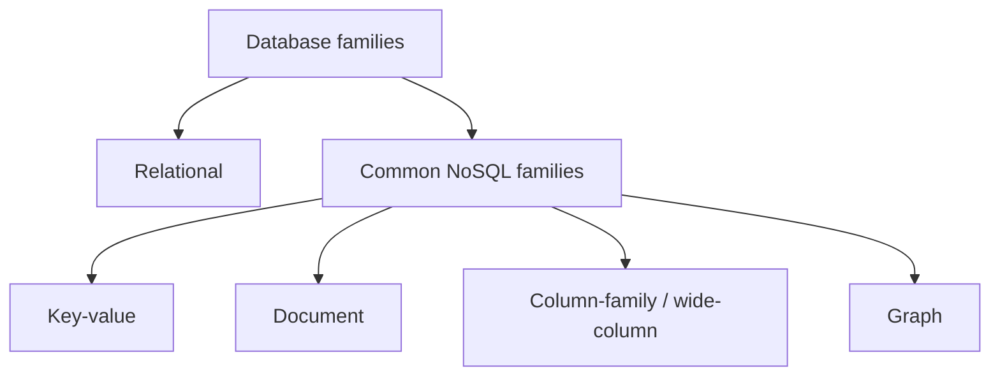

This is **not an exhaustive or mutually exclusive taxonomy**. Products can support several models, and query language does not uniquely determine storage architecture. For example, a relational database can store and query JSON; [PostgreSQL's JSON types](https://www.postgresql.org/docs/current/datatype-json.html) illustrate that overlap.

For a practical mapping from requirements to database candidates, see [Database Selection by Requirements](#database-selection-by-requirements).

### Relational Databases

Relational databases organize data into **relations**, commonly represented as tables. SQL implementations offer schemas, queries, constraints, and transactions with product-specific details.

| Concept | Meaning |
| --- | --- |
| **Table** | A named structure representing an entity or relationship, such as Customers or Orders |
| **Row / record** | One entry in that table; a suitable key identifies it |
| **Column / attribute** | A named field with a declared type and applicable rules |
| **Primary key** | Column or columns chosen to uniquely identify rows; values cannot be null |
| **Foreign key** | A constraint requiring non-null reference values to match an eligible referenced key |
| **SQL** | A language for defining structures and querying/modifying data; dialects and extensions differ |
| **Transaction** | A group of operations managed as one transaction boundary |

Foreign keys can reference **suitable unique keys, not only primary keys**. Null handling and eligible referenced keys follow the engine's rules. A table name or column ending in `_id` does not create referential integrity by itself: the constraint must be declared and enforced. See [PostgreSQL constraints](https://www.postgresql.org/docs/current/ddl-constraints.html).

#### Customers and Orders Example

**Customers** — `customer_id` is the primary key:

| customer_id | name |
| --- | --- |
| 1 | Mina |
| 2 | Rashad |

**Orders** — `order_id` is the primary key; `customer_id` is a non-null foreign key to Customers:

| order_id | customer_id | total | status |
| --- | --- | --- | --- |
| 101 | 1 | 20.00 | paid |
| 102 | 1 | 5.00 | pending |
| 103 | 2 | 15.00 | paid |

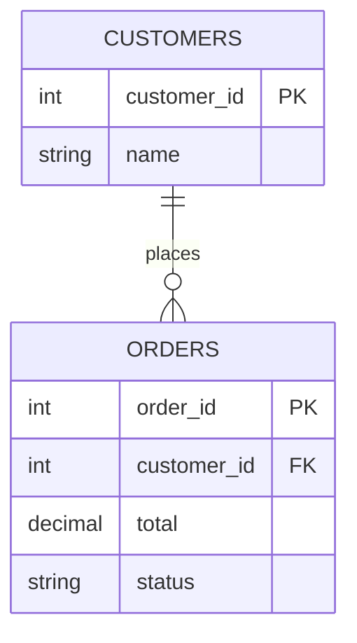

Each order belongs to **exactly one existing customer** in this example; a customer can have **zero or many orders**. Mina has two orders, connected by `customer_id = 1`. Joining the tables can retrieve her name alongside each order without copying her current name into every order. Diagram types are illustrative, not an executable schema.

#### Normalization and Indexes

**Normalization** organizes relations to reduce avoidable duplication and update anomalies. Keeping customer details separately can avoid having to change the same current address in many order rows. It does not eliminate every repeated value: foreign-key values intentionally repeat, and historical order details may need deliberate snapshots.

**Denormalization** deliberately duplicates or precomputes information for a requirement such as read performance or historical accuracy. It introduces an explicit maintenance or freshness responsibility.

**Indexes** provide additional access paths. They can accelerate suitable lookups and joins but consume storage and add write/maintenance work. Joins are **not inherently slow**: cost depends on query shape, indexes, cardinality estimates, data size/distribution, and the execution plan. Inspect and measure actual plans rather than assuming one data model is faster. See [PostgreSQL query-plan documentation](https://www.postgresql.org/docs/current/using-explain.html).

Examples of relational DBMSs include **MySQL, PostgreSQL, Oracle Database, Microsoft SQL Server, SQLite, and IBM Db2**. These differ in deployment, concurrency, extensions, and operational characteristics; the list is not a ranking.

#### Greenplum: Relational Analytics with MPP

**Greenplum is a PostgreSQL-based relational/SQL DBMS designed for distributed analytics**, including data warehousing, reporting, and large aggregations. Its **MPP (massively parallel processing)** architecture illustrates why relational databases need not run on one server. It is not a NoSQL column-family database. See the [Greenplum project repository (archived historical material)](https://github.com/greenplum-db/gpdb-archive).

| Workload | Typical pattern and example |
| --- | --- |
| **OLTP — online transaction processing** | Many short operational transactions, such as recording individual purchases |
| **OLAP — online analytical processing** | Larger scans and aggregations, such as annual sales totals by region |

These are **workload categories, not rigid product boundaries**. PostgreSQL also supports analytical queries; a system's suitability depends on its architecture and workload.

**MPP mental model:** The coordinator accepts SQL and plans/distributes work. Segment instances process their data portions in parallel; results are combined and returned through the coordinator. See the [archived Greenplum architecture documentation](https://github.com/greenplum-db/gpdb-archive/blob/main/gpdb-doc/markdown/admin_guide/intro/arch_overview.html.md).

##### Parallelism: Business-Card Analogy

Suppose you must inspect **1,200 business cards** and find everyone working for one company. At one card per second, one worker needs **1,200 seconds = 20 minutes**. Divide the cards into ten equal piles and let ten workers inspect them simultaneously:

| Workers | Cards per worker | Ideal inspection time |
| --- | --- | --- |
| 1 | 1,200 | 1,200 seconds = 20 minutes |
| 10 | 120 | 120 seconds = 2 minutes |

This is an **ideal tenfold speedup**, assuming independent work at the same rate and ignoring the time to distribute cards, coordinate workers, and collect matches. Unequal piles or slower workers change the result.

In the regional-sales example, primary segments similarly process different portions of the orders dataset. Their partial results must then be combined; real queries also incur storage, network, and coordination costs.

##### Cluster Components and Shared-Nothing Architecture

These notes use **coordinator**; older Greenplum material calls it the **master**. A cluster combines PostgreSQL-derived database instances with Greenplum's distributed planning and execution.

| Component | Responsibility |
| --- | --- |
| **Coordinator** | Client entry point; authenticates connections, handles SQL planning, coordinates execution, and returns results. Its global catalog contains metadata; user-table data resides on segments. |
| **Standby coordinator** | Optional coordinator redundancy, maintained through log replication and activated through the deployment's recovery procedure. It is distinct from a segment mirror. |
| **Segment host** | Traditionally a server or VM running segment instances. In supported containerized deployments, instances can run inside containers or Kubernetes pods, using the underlying host's resources and configured persistent storage. Several instances can share host resources. |
| **Primary segment** | A database instance that stores and processes its assigned user-data portion. Different primaries normally work on different portions of a distributed table. |
| **Mirror segment** | A redundant copy of a corresponding primary segment, placed on another host and eligible to take over under the supported failover conditions. |
| **Interconnect** | The networking/communication layer used by the distributed execution system, including intermediate data exchange between segments. |

**Shared-nothing** describes separate host resources and distributed data ownership. It does not require a separate physical computer, operating system, or disk for every segment instance. A host contributes execution, memory, and storage resources that its segment instances share. The number of instances per host is a configuration decision based on resources and workload.

**Containerized deployments:** A segment instance can run in a container, including within a Kubernetes pod, when supported by the selected Greenplum deployment. The layers are:

```text
Physical server or VM (Kubernetes worker node)
  -> Pod
     -> Container
        -> Greenplum segment instance(s)
```

A pod contains one or more containers and runs on a worker node. **Separate pods on the same worker node share that node's failure risk.** Primary/mirror placement must therefore consider the underlying nodes and failure domains, not just different pod names. See the vendor's [Greenplum on Kubernetes explanation](https://blogs.vmware.com/tanzu/greenplum-on-kubernetes/).

The following **illustrative layout** has two primary data portions and cross-host mirrors:

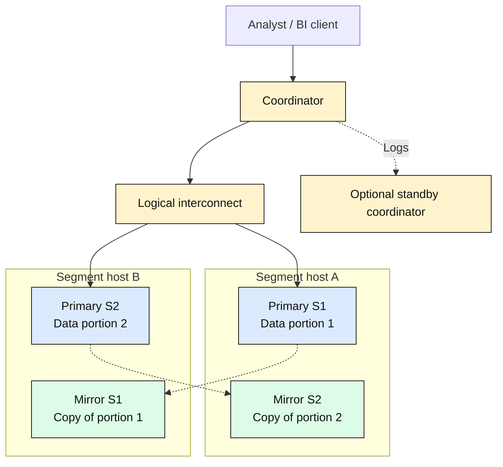

Solid arrows show the client/query-work path; dotted arrows show coordinator-log or segment-data replication. **Primary S1 and Primary S2 process different data portions; Mirror S1 and Mirror S2 hold redundant copies.** The standby is shown separately from the segment hosts; an actual deployment must choose its host and failure domain.

The interconnect box represents a communication layer, not necessarily one dedicated switch. Segment-to-segment exchanges and replication also use networking; the diagram simplifies those paths. Network capacity and isolation affect performance, but there is no single Ethernet speed appropriate to every deployment. See the [archived Greenplum architecture documentation (historical)](https://github.com/greenplum-db/gpdb-archive/blob/main/gpdb-doc/markdown/admin_guide/intro/arch_overview.html.md).

##### Query Walkthrough

1. **Connect:** An application or BI tool connects to the coordinator using a supported interface, such as JDBC, ODBC, or the `psql` client.
2. **Authenticate and plan:** The coordinator authenticates the connection, processes the SQL, and handles planning and distribution of query work. Its global catalog describes the database; it does not replace the user-table data on segments.
3. **Process in parallel:** Primary segments scan and compute over their assigned portions. The plan may require intermediate data exchange between segments, such as redistributing rows for a join or aggregation.
4. **Combine and return:** Intermediate results are combined according to the plan, and the coordinator presents the final result to the client. Not every computation must happen on the coordinator.

**Example:** To calculate annual sales totals by region across a large orders dataset, each segment filters its portion to the requested year and computes partial totals. Combining those totals produces the final regional totals. Depending on data distribution and the query plan, intermediate results may move between segments.

##### Availability and Practical Limits

Coordinator redundancy and segment redundancy protect different roles:

| Failure | Recovery role and condition |
| --- | --- |
| **Coordinator failure** | A configured, suitably synchronized standby can be activated through the supported recovery procedure. Activation and client reconnection are deployment-dependent; they are not universally automatic. |
| **Primary-segment or segment-host failure** | A healthy, eligible mirror on another host can take over the affected data portion through segment failover. Continued service requires the needed data portions, coordinator, and communication paths to remain available. |

In the diagram, if **Host A fails**, Mirror S1 on Host B can become the active copy of portion 1, while Primary S2 still holds portion 2. Host B then carries more active work and redundancy is reduced until recovery restores the missing copies. This assumes the remaining infrastructure and capacity support continued operation. Losing both copies of a required portion prevents normal access to that portion.

Mirrors must reside on different hosts from their corresponding primaries. A standby coordinator protects the coordinator role; it does not hold backup copies of every segment's user data. Treat standby capacity as part of the recovery design rather than assuming it is spare ETL capacity. See [Broadcom's coordinator-activation guidance](https://knowledge.broadcom.com/external/article/296354/failover-to-standby.html) for a vendor example of an explicit activation procedure.

**Storage layout is a separate choice:** Greenplum supports row-oriented heap tables and append-optimized tables with row or column orientation. Columnar storage does not make a database NoSQL. See the [provider's Greenplum storage explanation](https://yandex.cloud/en/docs/managed-greenplum/concepts/tables).

Greenplum can participate in a larger data platform and process data used for reporting or analytical models. That participation does not make the relational DBMS a data lake by itself. Capacity depends on the deployment, data layout, and workload; a fixed “hundreds of TB” ceiling is not a general definition.

**Trade-offs:** Distribution-key choices affect balance and data movement. Skew can leave one segment doing much more work; joins and aggregations may require inter-segment transfers. Network costs and cluster operations also matter, so adding nodes does not guarantee linear speedup. See the [provider's data-distribution explanation](https://yandex.cloud/en/docs/managed-greenplum/concepts/sharding).

##### When Greenplum Is a Good Fit

Greenplum is a candidate when distributed SQL analytics fits the workload and the team can operate the resulting system:

| Workload | Illustrative use | What to validate |
| --- | --- | --- |
| **Enterprise warehouses** | Combine historical orders, customers, and refunds from several operational systems | Source integration, history, ingestion windows, and consistent business definitions |
| **Complex SQL analytics** | Run joins, regional aggregations, reports, and exploratory queries over distributed datasets | Query plans, distribution keys, data movement, and concurrent users |
| **Predictive-analytics preparation** | Prepare historical datasets and features for forecasting, risk analysis, or fraud-model development | Data quality, reproducibility, processing deadlines, and integration with modeling tools |
| **Financial analytics** | Produce reconciled financial reports and analytical risk calculations | Correct rules, suitable transaction boundaries, traceability, and access controls |

Financial reporting and model preparation are different workloads from processing payments or maintaining transactional account balances. Neither SQL transaction support nor handling financial data automatically makes an analytical DBMS the right operational transaction system.

**Suitability is workload-dependent.** Query patterns, concurrency, ingestion, freshness, distribution/skew, operating skills, and total cost matter. There is no universal **“larger than 1 TB”** rule that establishes the best performance or ownership cost. Capacity alone does not select an architecture.

**PostgreSQL compatibility helps integration, but is not universal compatibility.** Familiar SQL and supported drivers can simplify BI/ETL connections. Check the selected tool's driver, SQL dialect, data types, authentication, and supported Greenplum version rather than assuming every PostgreSQL integration works unchanged.

##### Greenplum vs. ClickHouse

**ClickHouse is a column-oriented SQL analytical DBMS** used for OLAP queries; see its [official overview](https://clickhouse.com/docs/get-started/about/intro). Its workloads overlap with Greenplum's. The following comparison identifies evaluation questions rather than declaring a universal winner.

Greenplum references here include the **archived historical documentation** cited above. ClickHouse references describe evolving documented capabilities. Validate the exact release, table engine, settings, and deployment when applying the comparison.

| Dimension | Greenplum | ClickHouse |
| --- | --- | --- |
| **Workload emphasis** | Often evaluated for enterprise warehouses, multi-table analysis, and reporting | Often evaluated for analytical serving, event aggregation, and frequently refreshed dashboards; can also support warehouse workloads |
| **Storage and execution** | MPP execution with supported row-oriented and append-optimized row/column storage | Column-oriented analytical execution; schema, sorting, and indexing influence the work required |
| **SQL and joins** | Supports SQL joins across distributed data; placement and data movement affect plans | Supports [SQL joins](https://clickhouse.com/docs/reference/statements/select/join), with algorithms offering different memory, disk, and execution trade-offs |
| **Transactions and concurrency** | Supports SQL transactions; check isolation and operation/table-type boundaries for the selected release | Provides documented insert guarantees and restricted experimental multi-statement transactions; these are different scopes |
| **Updates and deletes** | Supports changes through SQL; table layout, version, concurrency, and maintenance affect behavior and cost | Supports [updates](https://clickhouse.com/docs/reference/statements/update) and [deletes](https://clickhouse.com/docs/reference/statements/delete); mechanism, visibility, and physical cleanup differ |
| **Ingestion and freshness** | Evaluate loading and correction workflows alongside analytical query concurrency | Evaluate insert batching, merging, corrections, and query concurrency against freshness targets |
| **Scaling and operations** | Segment placement, expansion/rebalancing, skew, interconnect traffic, and recovery need planning | Shard/data placement, replica strategy, redistribution, capacity, and background maintenance need planning |
| **Security and recovery** | Configure database permissions and recovery; standby/mirroring do not replace backups and tested restoration | Supports [RBAC](https://clickhouse.com/docs/concepts/features/security/access-rights) and [backup/restore](https://clickhouse.com/docs/concepts/features/backup-restore/overview); replication and encryption choices depend on deployment |

**Transaction scope matters:** ClickHouse documents transactional properties for qualifying inserts into a single partition of a MergeTree-family table; an insert into a distributed table is not transactional across all shards as a whole. Its documented multi-statement transaction support is **experimental and restricted**, not a general replacement for transactional application requirements. Check [ClickHouse's transaction documentation](https://clickhouse.com/docs/concepts/features/operations/insert/transactions) for conditions and limits.

For Greenplum, do not assume every transaction always runs at Serializable isolation. Isolation behavior is release-dependent and must be selected and verified for the operation. The vendor's [historical explanation of transaction snapshots](https://blogs.vmware.com/tanzu/improving-backup-performance-and-reliability-with-distributed-snapshots/) illustrates distinct isolation behaviors. See [Transactions and ACID](#transactions-and-acid) for the broader guarantees and application responsibilities.

**Changing a value and physically removing bytes are different events.** ClickHouse's documented lightweight updates use patch parts that queries can read before physical consolidation; lightweight deletes can hide rows before later storage cleanup. Supported engines/settings and synchronization behavior matter. Do not interpret either capability as identical to every OLTP update/delete implementation, or assume that a row hidden from queries has already disappeared from all retained copies.

Both systems require deliberate permissions, TLS/encryption decisions, recovery procedures, and restore testing. Greenplum's [availability explanation](#availability-and-practical-limits) covers coordinator/segment redundancy; that is one part of recovery, not proof that backups or disaster recovery are unnecessary.

**Two illustrative workload questions:**

| Scenario | Questions to evaluate |
| --- | --- |
| **Prepare a multi-source financial report** | How are source cutoffs, transaction boundaries, corrections, joins, and reconciliation handled? What must be reproducible and auditable? |
| **Serve frequently refreshed event dashboards** | What freshness and query-latency targets must hold at the expected ingestion rate and concurrency? How do late events, updates, and background work affect them? |

Both are evaluation scenarios, not guaranteed product winners. Check representative queries, changes, concurrency, and failure behavior on the intended version and deployment; product labels alone do not establish correctness or performance.

##### Quick Selection: PostgreSQL, Greenplum, or ClickHouse

| Choose | When you need | Simple example |
| --- | --- | --- |
| **PostgreSQL** | An application database with frequent record changes and multi-step transactions | Process orders, update inventory, and transfer account balances |
| **Greenplum** | A large analytical warehouse combining related datasets through complex SQL and joins | Analyze yearly profit using orders, customers, products, and refunds |
| **ClickHouse** | Frequently refreshed analytical queries over large event datasets | Show website clicks, application errors, or sensor metrics (IoT, robotics, etc.) on dashboards |

**Start with PostgreSQL when it meets your operational and reporting requirements.** Evaluate specialized analytical systems when the workload justifies them.

These are starting points with overlapping capabilities. ClickHouse supports joins, updates, deletes, and [scoped transaction guarantees](https://clickhouse.com/docs/concepts/features/operations/insert/transactions). **Correctness matters in all three; transaction scope and workload fit differ.**

> **Relational describes the data model; columnar describes a storage layout; MPP describes parallel processing across instances.**

### Transactions and ACID

A **database transaction** groups one or more operations, such as SQL `INSERT`, `UPDATE`, or `DELETE`, into a **single logical unit of work**. Its transactional data changes are committed together or discarded on rollback. **Rollback cancels this transaction's uncommitted changes**; other transactions may still change the database.

ACID describes four important properties:

| Property | Meaning | Transfer example |
| --- | --- | --- |
| **Atomicity — all or nothing** | Commit the transaction's data changes together, or commit none of them | Do not retain only the debit without the corresponding credit |
| **Consistency — preserve rules** | Correct transaction logic and enforced constraints keep the data within defined rules | Preserve the combined balance and any required balance constraints |
| **Isolation — control concurrency** | The isolation level determines how simultaneous transactions interact and what they can see | Concurrent transfers must not produce forbidden outcomes under the chosen isolation strategy |
| **Durability — keep committed changes** | Committed changes survive the failures covered by the configured guarantee | Retain the committed transfer through the covered crash/recovery scenario |

#### Account Transfer Example

For a simplified transfer of **20 units from A to B**, with no fees or other balance changes:

The transfer has two steps:

1. **Deduct 20** from Account A.
2. **Add 20** to Account B.

Grouping them in one transaction prevents committing only half of the transfer.

| Account | Before | After a successful commit |
| --- | --- | --- |
| A | 100 | 80 |
| B | 50 | 70 |
| **Combined** | **150** | **150** |

**Short PostgreSQL example:** Assume the table is `accounts(account_id, balance)`, A and B each identify one existing account, and the application correctly enforces the required funds and authorization rules.

```sql
BEGIN;  -- Start one transaction

UPDATE accounts
SET balance = balance - 20
WHERE account_id = 'A';

UPDATE accounts
SET balance = balance + 20
WHERE account_id = 'B';

COMMIT; -- Commit both balance changes together
```

After a successful commit, **A = 80 and B = 70**. To cancel the open transaction, execute **`ROLLBACK;` instead of `COMMIT;`**. The uncommitted balance changes are discarded, leaving **A = 100 and B = 50**, assuming no other transactions changed them. Rollback does not undo an already committed transfer.

The application checks the relevant rules and groups the debit and credit within one transaction. On rollback, those uncommitted changes do not become the completed transfer. A database transaction does not automatically make unrelated external API calls atomic. See the [transaction introduction](https://www.postgresql.org/docs/current/tutorial-transactions.html).

#### What ACID Does Not Promise

- **ACID consistency is not distributed read consistency.** Preserving business/data invariants differs from whether a replica read reflects the latest write. See [Consistency](Distributed-System-Attributes.md#consistency).
- **ACID does not invent correct business logic.** A transaction can commit the wrong amount if neither its logic nor the enforced constraints prevent it.
- **Isolation levels matter.** Weaker levels permit outcomes that serializable execution rules out. Even serializable transactions may need safe retries after conflicts; a default isolation level is not automatically sufficient. See [PostgreSQL isolation levels](https://www.postgresql.org/docs/current/transaction-iso.html).
- **Durability has a failure scope.** Logging, flush/acknowledgment settings, replication, and recovery procedures determine what a deployment actually promises.
- **Error handling is engine-specific.** A failing statement, deadlock, explicit rollback, and disconnected client need not have identical effects. Do not assume every SQL error automatically rolls back the whole transaction. For example, [MySQL InnoDB documents different rollback scopes](https://dev.mysql.com/doc/refman/8.4/en/innodb-error-handling.html).

> **Recall:** Transactions are a tool for enforcing specified rules. Choose transaction boundaries, isolation, and durability deliberately; “supports ACID” is not a complete application-correctness design.

### NoSQL Databases

**NoSQL**, often expanded as *Not Only SQL*, is an umbrella label for several non-relational approaches. It does not mean “no structure,” “no relationships,” or “no transactions.” A database may store structured and semi-structured records or binary values depending on its model; not every engine is equally suited to every data shape.

| Family | Main organization | Simple access-pattern example | Representative systems |
| --- | --- | --- | --- |
| **Key-value** | Look up a value using a key; values may have rich supported types | Retrieve a session by its ID | Redis, [Amazon DynamoDB](#amazon-dynamodb) |
| **Document** | Store records as documents with fields and nested structures | Read a product's description and variable attributes together | [MongoDB](#mongodb-document-modeling-and-queries), Apache CouchDB |
| **Column-family / wide-column** | Organize records around row/partition keys and related columns | Fetch device measurements within a modeled key/time range | Apache Cassandra, Apache HBase |
| **Graph** | Represent entities and explicit relationships for traversal | Follow account-to-device connections in a fraud investigation | Neo4j, Amazon Neptune |

These examples describe common use patterns, not exclusive product capabilities. Redis supports multiple [data types](https://redis.io/docs/latest/develop/data-types/); DynamoDB supports key-value and document patterns. See [CouchDB's document overview](https://docs.couchdb.org/en/stable/intro/overview.html), [Cassandra's architecture](https://cassandra.apache.org/doc/latest/cassandra/architecture/overview.html), and [Neo4j graph concepts](https://neo4j.com/docs/getting-started/appendix/graphdb-concepts/).

#### Schemas, Transactions, and Consistency

**Flexible schema is not absence of schema.** Applications still rely on field meanings, types, indexes, and relationships. Existing readers may not understand a new field format; mixed versions, backfills, validation, and index changes need planning. See [MongoDB data-modeling guidance](https://www.mongodb.com/docs/manual/data-modeling/).

NoSQL does **not inherently mean weak consistency or absent transactions**. [MongoDB supports multi-document transactions](https://www.mongodb.com/docs/manual/core/transactions/), including supported distributed deployments; [DynamoDB provides transactional APIs](https://docs.aws.amazon.com/amazondynamodb/latest/developerguide/transactions.html). Scope, limits, isolation, deployment, and cost must be checked for the specific operation.

Read guarantees can also differ within one product: for example, DynamoDB documents [strongly consistent and eventually consistent read options](https://docs.aws.amazon.com/amazondynamodb/latest/developerguide/HowItWorks.ReadConsistency.html), with differences between tables and index types. A family name alone does not identify the consistency of every read.

#### Wide-Column vs. Analytical Columnar Storage

The terms sound similar but describe different ideas:

- **Wide-column / column-family model:** A logical organization around keyed rows and column families, with product-specific rules. HBase is an example; row-key design strongly affects access patterns.
- **Analytical columnar storage:** Physically stores values by column to support workloads such as scanning and aggregating selected columns.

Do not infer an analytical columnar layout merely from the label “column-family.” These model and storage-layout concepts can overlap in some systems, but are not synonyms. Compare [HBase's data model](https://hbase.apache.org/docs/datamodel/) with the [ClickHouse column-oriented overview](https://clickhouse.com/docs/get-started/about/intro).

The relational [Greenplum example](#greenplum-relational-analytics-with-mpp) shows the distinction: its append-optimized tables can use columnar storage while retaining the relational/SQL model.

### MongoDB: Document Modeling and Queries

**MongoDB is a document database.** Its document model is useful when a record's nested structure matches how the application reads and updates it. Compare the same user profile in two possible designs before choosing a model.

#### Documents, Collections, and BSON

| Concept | Meaning | Profile example |
| --- | --- | --- |
| **Document** | A record made of fields and values, including nested documents and arrays | Jane's name, address, and hobbies |
| **Collection** | A group of documents | A `users` collection containing user profiles |
| **BSON — Binary JSON** | MongoDB's binary document representation, with types beyond plain JavaScript Object Notation (JSON), such as dates and ObjectIds | The stored representation of a profile |
| **`_id`** | A document's identifier | Use numeric `1` for Jane in this example |

In this unsharded example, `_id` is unique within the collection. When it is omitted on insertion, MongoDB commonly uses an automatically generated **ObjectId**. BSON is not simply a JSON text file; the JSON below is a readable illustration of document contents. See [MongoDB documents](https://www.mongodb.com/docs/manual/core/document/).

Documents in a collection can have different fields, but the application still depends on their meanings and types. Plan the model and validation deliberately.

#### The Same Profile in Two Models

Suppose an e-commerce application displays Jane's profile, including her current address and hobbies.

**Relational design:** Use three tables, with `user_id` foreign keys referring to `Users.id`. This example has one current address per profile and multiple hobbies. An appropriate unique constraint on `Addresses.user_id` can prevent multiple address rows for the same user; other requirements could instead allow several addresses.

**Users**

| id | first_name | last_name | email |
| --- | --- | --- | --- |
| 1 | Jane | Doe | jane@example.com |

**Addresses**

| id | user_id (FK) | street | city | zipcode |
| --- | --- | --- | --- | --- |
| 101 | 1 | 123 Main St | New York | 10001 |

**UserHobbies**

| id | user_id (FK) | hobby_name |
| --- | --- | --- |
| 501 | 1 | Hiking |
| 502 | 1 | Reading |

Here **FK** means foreign key. The address and hobby row identifiers are relational bookkeeping; the nested profile below represents the same business information without needing separate child-row identifiers.

A Structured Query Language (SQL) query can combine the rows:

```sql
SELECT u.id, u.first_name, u.last_name, u.email,
       a.street, a.city, a.zipcode, h.hobby_name
FROM Users AS u
JOIN Addresses AS a ON a.user_id = u.id
JOIN UserHobbies AS h ON h.user_id = u.id
WHERE u.id = 1
ORDER BY h.hobby_name;
```

**Result:**

| id | first_name | last_name | email | street | city | zipcode | hobby_name |
| --- | --- | --- | --- | --- | --- | --- | --- |
| 1 | Jane | Doe | jane@example.com | 123 Main St | New York | 10001 | Hiking |
| 1 | Jane | Doe | jane@example.com | 123 Main St | New York | 10001 | Reading |

The join produces **one row per hobby**. Application code can assemble these rows into a nested profile. This inner-join example assumes the related address and hobby rows exist; profiles with optional related records may need outer joins or separate reads.

**MongoDB design:** Store the bounded profile information together in one document within `users`:

```json
{
  "_id": 1,
  "first_name": "Jane",
  "last_name": "Doe",
  "email": "jane@example.com",
  "address": {
    "street": "123 Main St",
    "city": "New York",
    "zipcode": "10001"
  },
  "hobbies": ["Hiking", "Reading"]
}
```

Jane's address is an **embedded document**, and her hobbies are an **array**. Postal codes remain strings so leading zeros can be preserved.

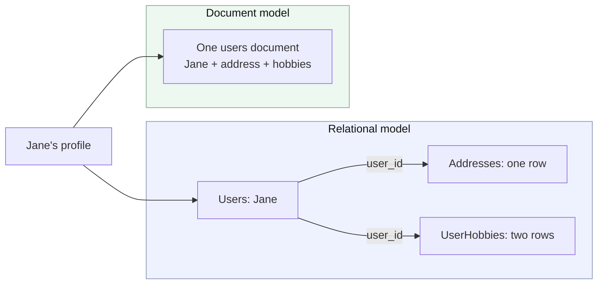

These are **modeling choices, not mandatory layouts**. Relational databases do not force every design to be normalized, and MongoDB does not require every relationship to be embedded. Normalization addresses particular redundancies and update anomalies, not every repeated value or empty cell. Relational systems can denormalize and store JSON, as [PostgreSQL's JSON types](https://www.postgresql.org/docs/current/datatype-json.html) demonstrate.

#### MongoDB Query Language: A Short Walkthrough

**MongoDB Query Language (MQL)** expresses operations through filter documents, operators, and aggregation stages. **MongoDB Shell (`mongosh`)** exposes JavaScript-style methods such as `db.users.findOne(...)`. The surrounding shell syntax is not SQL or plain JSON; drivers expose corresponding operations in other programming languages.

The following illustrative snippets assume `db` refers to an example database with an **initially empty `users` collection**. Follow them in order, with deletion last. Result excerpts show the relevant fields; other metadata or shell formatting can vary.

**1. Create Jane's profile.**

```javascript
db.users.insertOne({
  _id: 1,
  first_name: "Jane",
  last_name: "Doe",
  email: "jane@example.com",
  address: {
    street: "123 Main St",
    city: "New York",
    zipcode: "10001"
  },
  hobbies: ["Hiking", "Reading"]
});
```

Relevant result:

```json
{ "insertedId": 1 }
```

This inserts one complete document; inserting the same `_id` again into this collection would conflict with its identifier constraint. [`insertOne` reference](https://www.mongodb.com/docs/manual/reference/method/db.collection.insertOne/)

**2. Read one profile.**

```javascript
db.users.findOne({ _id: 1 });
```

This returns Jane's complete document shown above. If no document matches, `findOne` returns `null`. [`findOne` reference](https://www.mongodb.com/docs/manual/reference/method/db.collection.findOne/)

**3. Filter nested fields and arrays, then select fields.**

```javascript
db.users.find(
  { "address.city": "New York", hobbies: "Reading" },
  { _id: 0, first_name: 1 }
).toArray();
```

Result:

```json
[{ "first_name": "Jane" }]
```

The filter requires **both conditions**. Dot notation addresses the nested `city` field; `hobbies: "Reading"` matches an array containing that value. The second argument is a **projection**: return `first_name` and explicitly exclude `_id`.

`find()` ordinarily returns a **cursor**, rather than an array. Here `.toArray()` collects the small result for illustration; large result sets may need incremental cursor processing. [`find` reference](https://www.mongodb.com/docs/manual/reference/method/db.collection.find/)

**4. Update the address and add a hobby.**

```javascript
db.users.updateOne(
  { _id: 1 },
  {
    $set: {
      "address.city": "Boston",
      "address.zipcode": "02108"
    },
    $addToSet: { hobbies: "Cycling" }
  }
);
```

Relevant result for this first update:

```json
{ "matchedCount": 1, "modifiedCount": 1 }
```

`$set` changes the named fields rather than replacing the whole document. `$addToSet` adds Cycling only if it is absent; it does not remove pre-existing duplicates or promise array ordering. Repeating this same update matches Jane but makes no further change. See [`updateOne`](https://www.mongodb.com/docs/manual/reference/method/db.collection.updateOne/) and [`$addToSet`](https://www.mongodb.com/docs/manual/reference/operator/update/addToSet/).

**5. Verify the changed profile.**

```javascript
db.users.findOne({ _id: 1 });
```

Jane's identity fields and street remain unchanged. The result now contains:

| Field | Value after the update |
| --- | --- |
| `address.city` | `"Boston"` |
| `address.zipcode` | `"02108"` |
| `hobbies` | Hiking, Reading, and Cycling; array order is not asserted here |

**6. Aggregate profiles by hobby.**

```javascript
db.users.aggregate([
  { $unwind: "$hobbies" },
  { $group: { _id: "$hobbies", profiles: { $sum: 1 } } },
  { $sort: { _id: 1 } }
]).toArray();
```

Result:

```json
[
  { "_id": "Cycling", "profiles": 1 },
  { "_id": "Hiking", "profiles": 1 },
  { "_id": "Reading", "profiles": 1 }
]
```

`$unwind` produces a working record per hobby, `$group` counts them, and `$sort` orders the result by hobby name. These are computed results, not changes to Jane's stored document.

This dataset contains each hobby once per profile, so the counts also represent profiles. If input arrays contain duplicates, this pipeline counts those occurrences too; deduplicate per profile when distinct-profile counts are required. [Aggregation pipelines](https://www.mongodb.com/docs/manual/core/aggregation-pipeline/)

**7. Add a lookup index.**

```javascript
db.users.createIndex({ "address.city": 1 });
```

The default index name is `"address.city_1"`; `1` requests ascending index order. It provides an additional access path for suitable city queries, not a guarantee that every query becomes faster. Indexes consume storage and add write work; selectivity and query plans matter. See [`createIndex`](https://www.mongodb.com/docs/manual/reference/method/db.collection.createIndex/) and the existing [index explanation](#normalization-and-indexes).

**8. Delete Jane's example document last.**

```javascript
db.users.deleteOne({ _id: 1 });
```

Relevant result:

```json
{ "deletedCount": 1 }
```

A subsequent `db.users.findOne({ _id: 1 })` returns `null`. Deleting an embedded profile removes its embedded address and hobbies with that document; separate referenced records would require an explicit lifecycle policy. [`deleteOne` reference](https://www.mongodb.com/docs/manual/reference/method/db.collection.deleteOne/)

#### Embedding, References, and Practical Selection

| Requirement | Modeling direction | Concrete example |
| --- | --- | --- |
| **Bounded information accessed and updated together** | Consider embedding in one document | Jane's current address and small hobby list |
| **Shared or independently changing entities** | Consider references and separate records | Many profiles refer to the same organization, whose details change independently |
| **Continuously growing related data** | Keep separate records or another bounded design | Store order history as separate orders rather than an indefinitely growing profile array |
| **Interconnected data with database-enforced foreign keys and substantial cross-entity querying** | Consider relational modeling | Customers, orders, payments, and accounting relationships with explicit constraints |
| **Aggregate-shaped records benefiting from nested representation** | Consider a document model | Product descriptions with category-specific nested attributes, accessed as a product record |

MongoDB supports references and **`$lookup`**, an aggregation stage that can join related collection data. Embedding can avoid that extra lookup for a particular read; it does not make joins impossible or unnecessary for every workload. Shared duplicated data still needs an update policy. See [modeling best practices](https://www.mongodb.com/docs/manual/data-modeling/best-practices/) and [`$lookup`](https://www.mongodb.com/docs/manual/reference/operator/aggregation/lookup/).

Relational foreign keys can enforce referenced-row existence. A MongoDB reference field does not automatically supply the equivalent constraint; transactions alone do not create that rule. Define the application workflows and checks needed to preserve such relationships.

#### Schemas, Atomicity, and Design Limits

- **Schema validation:** MongoDB can validate types, required fields, and other rules. Flexible documents still require compatibility, validation, and migration planning; schema changes are not automatically disruption-free. [Schema validation](https://www.mongodb.com/docs/manual/core/schema-validation/)
- **Atomic writes:** A single-document write is atomic, including updates to several fields. This does not mean a sequence of separate application operations is automatically one transaction. [Atomicity and transactions](https://www.mongodb.com/docs/manual/core/write-operations-atomicity/)
- **Multi-document transactions:** Supported deployments provide them, subject to documented boundaries and costs. Choose appropriate transaction scope and read/write settings; do not infer every guarantee from the word NoSQL. See [MongoDB transactions](https://www.mongodb.com/docs/manual/core/transactions/), [ACID](#transactions-and-acid), and [consistency considerations](#schemas-transactions-and-consistency).
- **Document growth:** The maximum BSON document size is **16 MiB**. Avoid unbounded embedding even before reaching that limit. [MongoDB limits](https://www.mongodb.com/docs/manual/reference/limits/)
- **Scaling and selection:** Relational systems can scale horizontally; MongoDB's sharding also requires appropriate design and operation. Neither model universally guarantees better speed, consistency, scalability, or financial-system suitability. Use the [database selection checklist](#database-selection-checklist).

> **Recall:** Choose the record boundaries from the reads, writes, relationships, and invariants. One document can simplify an aggregate-shaped operation; linked tables or referenced documents can better fit other requirements.


### Relational and NoSQL Trade-Offs

| Dimension | Relational approaches | NoSQL approaches | Question to ask |
| --- | --- | --- | --- |
| **Queries and relationships** | SQL, joins, and constraints suit many interconnected workloads | Key, document, wide-column, or graph operations fit different access patterns | Which queries, traversals, and aggregations must be efficient? |
| **Transactions** | Commonly support multi-statement transactions; guarantees vary | Atomic/transaction scope varies; some support multi-record ACID transactions | Which changes must commit together? |
| **Schema evolution** | Explicit schemas and migrations; JSON support is possible | Often flexible records, but compatibility and indexes still matter | Can old and new application versions coexist? |
| **Scaling** | Vertical scaling, replicas, partitioning, sharding, or distributed relational designs | Many systems offer distributed partitioning, with model-specific restrictions | Where are the hot spots and cross-node coordination costs? |
| **Consistency** | Depends on isolation, replication, read routing, and settings | Depends on product, operation, topology, and settings | What may each read observe during concurrency or failure? |
| **Storage** | Normalization can reduce duplication; indexes and row layout affect size | Embedding/denormalization may reduce lookups but duplicate data | What are the actual memory, disk, and write-amplification costs? |
| **Security and operations** | Engine/deployment controls require correct configuration | Same responsibility, with different features and service boundaries | Who handles access, keys, upgrades, backups, and recovery? |
| **Portability** | SQL provides common foundations, but dialects and extensions differ | APIs and models vary significantly; some expose SQL-like query languages | What migration or interoperability constraints matter? |

**Relational does not mean “cannot scale horizontally.”** Distributed relational systems exist; [Spanner's schema and data-model documentation](https://docs.cloud.google.com/spanner/docs/schema-and-data-model) describes relational tables and distribution. Conventional deployments can also use read replicas or application sharding, with different coordination and maintenance costs. Conversely, distributing a NoSQL system is not automatically seamless or appropriate.

For distributed analytical workloads, [Greenplum's MPP architecture](#greenplum-relational-analytics-with-mpp) provides another relational scaling example.

**Null storage is implementation-dependent.** Do not assume every null reserves a full column value or makes relational databases inherently memory-intensive. PostgreSQL, for example, documents a [null bitmap in its row layout](https://www.postgresql.org/docs/current/storage-page-layout.html). Measure the chosen engine and schema.

**Schema changes are not automatically disruption-free in either category.** Security, availability, and scalability likewise require deliberate design and operation, rather than following automatically from a database label.

#### Database Selection Checklist

Use these questions with the [practical selection guide](#database-selection-by-requirements) below.

1. What are the main reads, writes, searches, traversals, and aggregations?
2. Which invariants and multi-record transaction boundaries must hold?
3. What freshness and concurrency guarantees does each operation require?
4. What are the data size, growth, throughput, latency, and geographic requirements?
5. Which partition keys, indexes, or joins could become bottlenecks?
6. How will schema changes, backups, restores, and failures be handled?
7. Which security controls, operational skills, and costs can the team support?

Use [CAP](Distributed-Systems-Theorems-and-Data-Structures.md#cap-theorem) and [PACELC](Distributed-Systems-Theorems-and-Data-Structures.md#pacelc-theorem) to reason about relevant distributed trade-offs—not to assign every product a permanent SQL/NoSQL consistency category. For a small workload, a simpler deployment can be a sound design.

> **Choose the data model and guarantees for the workload, then validate the engine and deployment. Neither “relational” nor “NoSQL” is a universal winner.**

## Database Selection by Requirements

**Choose a database by the operations and guarantees you need, not simply by application size or the SQL/NoSQL label.** Use the [Database Selection Checklist](#database-selection-checklist) to gather requirements, then use the mapping below to identify candidates.

### Separate the Design Dimensions

These labels answer different questions:

| Dimension | Question | Examples |
| --- | --- | --- |
| **Data model** | How is information represented and related? | Relational tables, documents, key-value pairs, graphs |
| **Workload or capability** | What operations must the system support? | Transactions, analytics, time-series, text search, vector search |
| **Storage layout** | How are values arranged for storage and processing? | Row-oriented, column-oriented |
| **Deployment** | Where does the engine run and how is work distributed? | Embedded in an application, single-server, distributed |

> **Both relational and NoSQL databases can be distributed. “Distributed,” “columnar,” and “NoSQL” are not interchangeable labels.**

For example, SQLite is relational and embedded; Greenplum is relational and distributed; PostgreSQL can support documents and specialized indexes without becoming a different physical database for every capability. “Embedded” and “distributed SQL” are deployment/architecture descriptions, not additional non-relational data models.

Compare the existing [horizontal-scaling explanation](#relational-and-nosql-trade-offs), [Greenplum MPP example](#greenplum-relational-analytics-with-mpp), and [wide-column versus analytical columnar distinction](#wide-column-vs-analytical-columnar-storage).

### Database Types, Requirements, and Examples

**These are evaluation candidates, not automatic recommendations.** Rows overlap, and product capabilities depend on versions, configuration, deployment, and operations. No row promises a particular latency, scale, availability, or level of correctness.

| Family or capability | Requirement | Concrete example | Representative implementations |
| --- | --- | --- | --- |
| **Relational approaches** | | | |
| **Relational SQL / OLTP** | Related records, constraints, and changes that must commit together | Transfer $100: debit one account and credit another in one transaction | PostgreSQL, MySQL, SQL Server, Oracle Database |
| **Distributed SQL** | Transactional SQL with required distribution, partitioning, and geographic placement | Keep account operations consistent across the regions the service must support | CockroachDB, YugabyteDB, Google Spanner |
| **Embedded SQL** | Local relational storage without a separate database server | A mobile app keeps offline preferences and locally saved data | SQLite |
| **Common NoSQL models** | | | |
| **Key-value** | Retrieve or update a value using a known key | Look up a user session by its unique session ID | Redis, [Amazon DynamoDB](#amazon-dynamodb), Aerospike |
| **Document** | Nested records and field queries suited to the access pattern | Laptops have RAM and CPU fields; shoes have size and material fields | MongoDB, Couchbase, [Amazon DynamoDB](#amazon-dynamodb) |
| **Wide-column** | Distributed keyed writes and range reads designed around partition/row keys | Retrieve one sensor's readings for a bounded time period | Apache Cassandra, Apache HBase, Google Bigtable |
| **Graph** | Follow relationships across multiple hops | Investigate customers sharing devices, accounts, and transaction connections | Neo4j, Amazon Neptune, TigerGraph |
| **Specialized workloads and capabilities** | | | |
| **Time-series** | Timestamped ingestion, time-window queries, and retention rules | Calculate hourly temperature and CPU-usage trends from a robot fleet | InfluxDB, TimescaleDB, OpenTSDB |
| **Search** | Keyword matching, filters, and relevance ranking | Search product descriptions or application logs for matching terms | Elasticsearch, OpenSearch, Apache Solr |
| **Vector** | Similarity retrieval over embeddings, with appropriate metadata filters | Retrieve approved documents related to an AI assistant's question | Qdrant, Milvus, Weaviate, Pinecone, PostgreSQL + pgvector |
| **Analytical SQL / OLAP, often columnar** | Larger scans and aggregations over historical data | Calculate revenue by country across a billion historical sales records | ClickHouse, DuckDB, BigQuery, Snowflake |
| **Geospatial** | Spatial indexes and geographic predicates such as distance or containment | Find available drivers within five kilometres of a customer | PostgreSQL + PostGIS, MongoDB geospatial capabilities |
| **Event store** | Retain ordered business events and replay them using application rules | Reconstruct an order from its created, paid, and dispatched events | KurrentDB (formerly EventStoreDB) |
| **Tamper-evident history / ledger** | Verify recorded history against cryptographic evidence and retained trusted state | Check whether an audit-history record has been altered | immudb |

**Read the table with these distinctions:**

- **Transactions and consistency:** SQL does not automatically mean every read sees the latest state; NoSQL does not mean transactions are absent. Check the required operation and deployment. See [Transactions and ACID](#transactions-and-acid) and [Schemas, Transactions, and Consistency](#schemas-transactions-and-consistency).
- **Distribution:** More regions or replicas introduce coordination, latency, and failure trade-offs. Distributed SQL does not make cross-region transactions free; [Spanner's schema documentation](https://docs.cloud.google.com/spanner/docs/schema-and-data-model) illustrates relational data distributed across nodes.
- **Embedded:** SQLite runs inside the application process; it does not need a separate database-server process. See [SQLite's explanation](https://www.sqlite.org/serverless.html).
- **Wide-column:** Model the queries and keep partitions bounded. For sensor history, a device-and-time-bucket key can prevent one device's lifetime history becoming one ever-growing partition. See [Cassandra's partition-modeling guidance](https://cassandra.apache.org/doc/latest/cassandra/developing/data-modeling/data-modeling_refining.html). Wide-column is not the same as analytical columnar storage.
- **Capabilities overlap:** [PostgreSQL + pgvector](https://github.com/pgvector/pgvector) and [PostgreSQL + PostGIS](https://postgis.net/documentation/) mean PostgreSQL with extensions, not separate database products named pgvector or PostGIS. PostgreSQL also supports JSON and [full-text search](https://www.postgresql.org/docs/current/textsearch.html); [Elasticsearch](https://www.elastic.co/docs/products/elasticsearch) supports vector search as well as text search.
- **Events versus evidence:** An event store supports reconstructing state from retained events; a tamper-evident store supports detecting inconsistent history under its verification assumptions. Neither makes the original information true, guarantees it can never be deleted, or automatically supplies a complete accounting ledger. [KurrentDB's documentation](https://docs.kurrent.io/getting-started/kurrent-ecosystem) confirms the EventStoreDB rename; [immudb](https://github.com/codenotary/immudb) illustrates verifiable history. Compare the [Merkle-tree limitations](#finding-and-repairing-a-difference).

For existing worked comparisons, see [MongoDB document modeling](#mongodb-document-modeling-and-queries) and [PostgreSQL, Greenplum, or ClickHouse selection](#quick-selection-postgresql-greenplum-or-clickhouse). These categories are a study map, not an exhaustive or mutually exclusive taxonomy.

### Worked Example: Banking Platform with an AI Assistant

**One application can have different storage needs.** Here is an illustrative allocation of roles—not a production banking design or a requirement to install six databases.

| Role | Candidate | Why consider it? |
| --- | --- | --- |
| **Authoritative accounts and transactions** | PostgreSQL | Record approved account changes with the required transactions, constraints, and access controls |
| **Optional cache and sessions** | Redis | Reuse selected results and look up session state by key |
| **Optional keyword search** | Elasticsearch | Search approved documents or permitted operational records by terms and filters |
| **Optional semantic retrieval** | Qdrant **or** PostgreSQL + pgvector | Find relevant approved knowledge for an AI answer |
| **Optional relationship analysis** | Neo4j | Explore connections during fraud review; connections alone do not prove fraud |
| **Optional analytical reporting** | ClickHouse | Run historical aggregations without placing every report on the operational database |

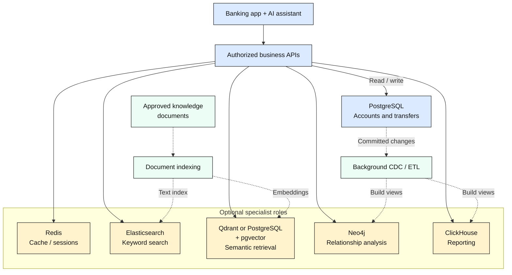

**Solid arrows show application access; dotted arrows show background data updates.** Query results return to the caller; arrows are not broadcasts. The optional group names roles: PostgreSQL + pgvector may run in the same database as other tables, rather than requiring another installation.

1. **A customer asks for their balance:** The authorized business API reads the authoritative account state with the required read guarantees. The AI assistant does not infer a live balance from similar documents or treat a stale cache as authoritative.
2. **A customer asks about an approved policy:** Retrieve permitted documents using keywords, vectors, or both. Enforce access before giving evidence to the model; retrieval does not guarantee that its final answer is correct.
3. **An analyst requests a historical report or relationship investigation:** Query the prepared views, knowing their freshness and completeness. These views can lag behind operational changes.

**CDC** means *change data capture*; **ETL** means *extract, transform, load*. The background arrows stand for designed pipelines, not automatic cross-product replication. They need update/deletion propagation, replay or rebuilding, recovery, and access-control policies. Caches need explicit expiration or invalidation; sessions need their own security and lifecycle rules. See [data ingestion](Data-Engineering-for-Solution-Architecture.md#data-ingestion), [AI retrieval](AI-Systems-Design.md#knowledge-ingestion-and-retrieval), and [authorization enforcement](Identity-and-Access-Management.md#authorization-in-practice).

**Separate databases do not automatically share one transaction.** Committing a transfer in PostgreSQL does not make Redis, Neo4j, and ClickHouse change atomically with it. Define which store is authoritative and how other views catch up; do not imply that an uncoordinated sequence of writes is one atomic operation.

Using different storage technologies for different needs is called **polyglot persistence**. It can help, but every extra system adds synchronization, access control, backup/recovery, upgrades, monitoring, and cost. A simpler deployment may satisfy several roles with PostgreSQL, JSON, full-text search, and suitable extensions. Introduce another engine when the measured workload and operating requirements justify it.

### Worked Example: Global Autonomous Delivery Platform

Imagine a service where customers order goods, warehouses prepare parcels, robots deliver them, and operators supervise the fleet with an AI assistant. Follow **order D4821**, carrying a fragile parcel from warehouse W2 using robot R17.

**The goal is to understand fourteen storage roles within one solution—not to install fourteen databases.** Some choices are alternatives; several capabilities can share one engine.

#### Storage Roles in the Delivery Platform

| Database type or capability | Where it fits in this platform | Candidate and reason to evaluate it |
| --- | --- | --- |
| **Relational SQL / OLTP** | Store D4821, its customer, payment records, and related operational changes | **PostgreSQL:** transactions and constraints for changes that must commit together within this database |
| **Distributed SQL** | Coordinate stock reservations if the required transaction spans regions | **CockroachDB or Spanner:** evaluate distributed transactional SQL; this may replace the core relational deployment rather than duplicate it |
| **Embedded SQL** | R17 retains its assigned task and local progress during a disconnection | **SQLite:** local storage without a separate database-server process |
| **Key-value** | Retrieve a session by ID or reuse a cached result | **Redis:** known-key access with defined expiration/invalidation; cached stock is not authority to promise a parcel |
| **Document** | Store differing package attributes: fragile glass, refrigerated food, or items with different dimensions | **MongoDB or PostgreSQL JSONB:** nested records when their shape and queries fit; a separate document engine is optional |
| **Wide-column** | Retain a large history of R17's readings, queried by robot and bounded time range | **Cassandra or HBase:** model partition/row keys for those queries; use time buckets where needed to bound growth |
| **Graph** | Investigate customers, accounts, devices, and orders connected to suspicious delivery activity | **Neo4j:** traverse relationships; a shared device is a signal to investigate, not proof of fraud |
| **Time-series** | Monitor battery and temperature trends across the fleet | **InfluxDB or TimescaleDB:** time-window queries and retention suited to monitoring |
| **Search** | Search free-text incident reports using terms, filters, and relevance | **Elasticsearch:** evaluate richer text retrieval; an exact lookup of D4821 alone does not justify another search engine |
| **Vector** | Retrieve maintenance-manual passages related to an operator's question about R17 | **Qdrant or PostgreSQL + pgvector:** similarity retrieval over approved, access-controlled knowledge |
| **Analytical SQL / OLAP** | Aggregate delivery cost, delays, and revenue across historical orders | **ClickHouse:** evaluate larger analytical scans without placing every report on the live order database |
| **Geospatial** | Find nearby available robots and test whether an address lies inside a delivery zone | **PostgreSQL + PostGIS:** spatial predicates and indexes; robot assignment still needs a valid reservation |
| **Event store** | Reconstruct D4821's lifecycle from created, reserved, dispatched, and delivered events | **KurrentDB:** an option when adopting event sourcing; ordinary SQL state/history may be enough instead |
| **Tamper-evident history / ledger** | Verify recorded delivery confirmations and selected audit history against retained trusted evidence | **immudb:** detect inconsistent history under its verification assumptions; it cannot prove a parcel physically arrived |

The [general selection table](#database-types-requirements-and-examples) explains the categories. This table applies them to **one platform**, without claiming that each role requires a separate installation.

**Alternative: DynamoDB for customer-order storage**

Suppose the order service mainly creates/updates individual orders and lists one customer's orders. Evaluate **[Amazon DynamoDB](#amazon-dynamodb)** when these key-based access patterns fit and AWS-managed infrastructure is desired.

Reuse the keys from the [worked DynamoDB requests](#worked-requests-customer-orders):

| Application need | DynamoDB access pattern |
| --- | --- |
| Read customer 42's order D4821 | `GetItem` with `PK = CUSTOMER#42` and `SK = ORDER#D4821` |
| List customer 42's orders | `Query` with `PK = CUSTOMER#42`; continue through result pages as needed |
| Change D4821's status | `UpdateItem` using the full key and appropriate conditions |

**Why it fits:** The required lookups map directly to table keys, while AWS operates the underlying database infrastructure. These order records are persistent application data, unlike a disposable cached copy. See [AWS's core components](https://docs.aws.amazon.com/amazondynamodb/latest/developerguide/HowItWorks.CoreComponents.html).

**Trade-off:** Additional searches may need indexes or another prepared view. Evaluate hot customers, item sizes, read consistency, capacity, and recovery. If the service depends heavily on joins, database-enforced relationships, or changes that must commit with existing SQL records, the PostgreSQL design may fit better.

This is an **alternative design for the order-service role**, not a mandatory additional database. Choose which store owns the authoritative orders; do not maintain independent authoritative copies in PostgreSQL and DynamoDB or assume they share one transaction.

#### Follow One Package Through the System

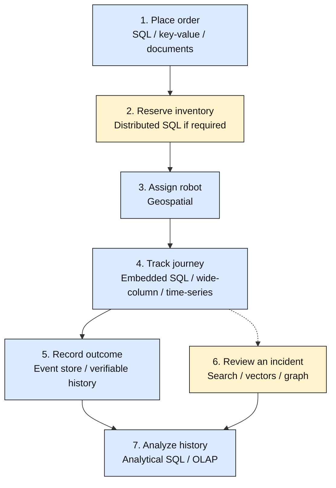

**This is a learning journey, not a database-write protocol.** The incident branch is optional and may occur during or after a delivery. The labels name candidate storage roles, not mandatory products.

1. **Checkout:** The customer signs in; a key-value lookup may retrieve the session. The order service records D4821 and its related operational data transactionally. Package attributes can remain in PostgreSQL JSONB or use a document model when justified. A transaction in the order database does not automatically include an external payment provider.
2. **Reserve stock:** The service checks and reserves actual inventory using the required concurrency rules. If reservations need distributed transactions across regions, evaluate a distributed SQL deployment. Merely having customers in several countries does not require it.
3. **Assign R17:** A geospatial query finds suitable nearby candidates. The application checks availability, capacity, and permissions, then reserves the chosen robot so two orders cannot claim it incompatibly. Proximity alone is not an assignment.
4. **Track the journey:** R17 keeps local task progress in SQLite; disconnection does not erase it. Incoming readings can feed keyed history storage and time-series monitoring. On reconnection, local progress must be reconciled with central state; local storage alone does not resolve conflicting assignments or replace control/safety mechanisms.
5. **Record delivery:** Retain the relevant lifecycle changes. With event sourcing, an event stream can be authoritative and current-state tables are projections. With ordinary SQL state, events/history can be recorded as supporting outputs. **Choose the authority; do not maintain two independently authoritative order histories.** Verifiable audit records can help detect later changes to recorded evidence, without proving its physical truth.
6. **Investigate an incident:** Suppose R17 reported a temperature warning. Keyword search finds related incident reports; vector retrieval finds relevant manual passages for the operator's AI assistant. Separately, graph queries can investigate suspicious customer/device/order relationships. Retrieved text or a graph match does not automatically authorize a physical action or establish fraud.
7. **Review results:** Analytical queries summarize cost and delay by warehouse, country, and month. These prepared copies can lag; they are not the source for deciding whether D4821 is currently paid, reserved, or delivered.

#### Combine Roles Before Adding Engines

**Media content is another storage role:** Delivery photographs and recordings can reside in [object storage](#object-storage-and-amazon-s3), with keys and access-related references in operational records. A stored photograph does not by itself prove that a delivery occurred.

A modest first version might use **PostgreSQL centrally and SQLite on robots**, evaluating JSONB, full-text search, PostGIS, or pgvector within PostgreSQL as requirements arise. This is a possible starting point, not a guarantee that it satisfies every workload.

- **Relational versus distributed SQL:** Choose the deployment needed for the transaction and geography requirements. Do not add a second authoritative database just to demonstrate both labels.
- **Wide-column versus time-series:** Their roles overlap. One engine may satisfy both historical-reading and monitoring queries; use two only when distinct requirements justify the extra pipeline and storage.
- **Event store versus SQL history:** Adopt event sourcing deliberately. It is not a mandatory extra copy for every order service.
- **Specialized copies:** Caches, search/vector indexes, graphs, and analytical views need ownership, access controls, update/deletion propagation, retention, and recovery. Retries must not duplicate business side effects; copying data between stores does not create a shared transaction.

Use the [data-pipeline notes](Data-Engineering-for-Solution-Architecture.md#reliability-governance-and-operations), [AI retrieval explanation](AI-Systems-Design.md#knowledge-ingestion-and-retrieval), and [choice-justification template](#how-to-justify-the-choice) to evaluate each proposed addition.

> **Recall:** One delivery creates many query patterns. Cover the required roles with as few independently operated systems as practical.

### How to Justify the Choice

Write down five things:

1. **Requirement:** What must the application do, and what must remain correct?
2. **Candidate:** Which engine and deployment will you evaluate?
3. **Why it fits:** Which capabilities match the requirement?
4. **Trade-off:** What coordination, freshness, maintenance, or cost burden comes with it?
5. **Evidence needed:** What measurements and failure/recovery checks would justify the decision?

| Justification | Atomic account transfer | Historical analytical reporting |
| --- | --- | --- |
| **Requirement** | Debit and credit commit together; concurrent transfers preserve defined account rules | Aggregate historical transactions by country/month without unacceptable impact on live requests |
| **Candidate** | PostgreSQL, with isolation, constraints, read routing, and recovery chosen for the workload | ClickHouse, compared against the existing PostgreSQL solution and the reporting requirements |
| **Why it fits** | Multi-statement transactions, relational constraints, and SQL support the modeled operations | Column-oriented analytical execution can suit larger scans and aggregations |
| **Trade-off** | Write capacity, replication/failover, transaction contention, and operational work still need design | A separate analytical copy adds ingestion lag, synchronization, storage, and maintenance |
| **Evidence needed** | Realistic transfers under concurrency; latency targets; rollback/retry behavior; failover; tested restore | Representative queries and concurrent ingestion; latency/freshness targets; reconciliation; failed-pipeline recovery |

For both candidates, validate the expected data sizes, throughput, indexes or partitioning, security, backup/restore, team expertise, and total operating cost. Set measurable latency targets—for example, a required 95th-percentile response time—instead of assuming a product is “fast.” Include resource contention and relevant failures, not just an isolated successful query.

Use the [existing checklist](#database-selection-checklist) and [database operating questions](#why-applications-use-databases) to record the supporting evidence. For a normal business application, a familiar general-purpose relational engine is a sensible starting candidate; it is not a universal winner or a reason to ignore requirements for other models.

> **Choose by required operations and guarantees. Add another database when its benefit justifies another system to synchronize and operate.**

## Key-Value Stores

### What Is a Key-Value Store?

A **key-value store** associates a unique **key** with a **value** within a defined namespace. The key identifies what to retrieve or change, much like a dictionary:

| Key | Value | Meaning |
| --- | --- | --- |
| `cart:42` | `book` | A simplified shopping-cart value |
| `theme:42` | `dark` | A user's display preference |
| `product:7` | `{"name":"Notebook","price":5}` | A serialized product record |

The key is the lookup identifier; the value may be text, bytes, a serialized document, or a product-supported data structure. The application must still define formats, validation, and compatibility. Flexible values do not remove the need for a data model.

**A key-value store is not necessarily distributed.** It can be embedded, run on one server, or span several servers. A **distributed hash table (DHT)** distributes key-based lookup and ownership using hashing; it is one approach to building a distributed key-value system, not a synonym for every key-value database.

The basic mental model exposes one current value per key. Replication and concurrent updates can introduce internal copies or competing versions; the store's consistency and conflict rules determine what a read returns. [Redis strings](https://redis.io/docs/latest/develop/data-types/strings/) illustrate basic key-based storage and retrieval, while Redis also supports richer types.

> **Mental model:** You know the key and ask for its value. How the system locates, stores, replicates, and protects that value is a separate design problem.

### Why Use Key-Value Stores in Distributed Systems?

| Benefit | How it can help | Important limit |
| --- | --- | --- |
| **Scalability** | Partition different keys across nodes to spread storage and traffic | Hot keys, skew, and rebalancing can still limit scaling |
| **Performance** | Direct key access can avoid unnecessary scans or joins | Network hops, value size, storage, load, and coordination affect latency |
| **Flexible values** | Store records with different payload shapes | Readers and writers must agree on their meaning and format |
| **Fault tolerance** | Keep replicas so another node may serve a key after a failure | Partitioning alone does not create a backup copy; failover needs adequate replicas and a defined protocol |

Typical uses include sessions, preferences, shopping carts, and cached objects. Suitability depends on required durability, consistency, expiry, and access controls. Key lookup alone does not provide arbitrary searches, joins, or multi-key transactions; additional capabilities depend on the engine.

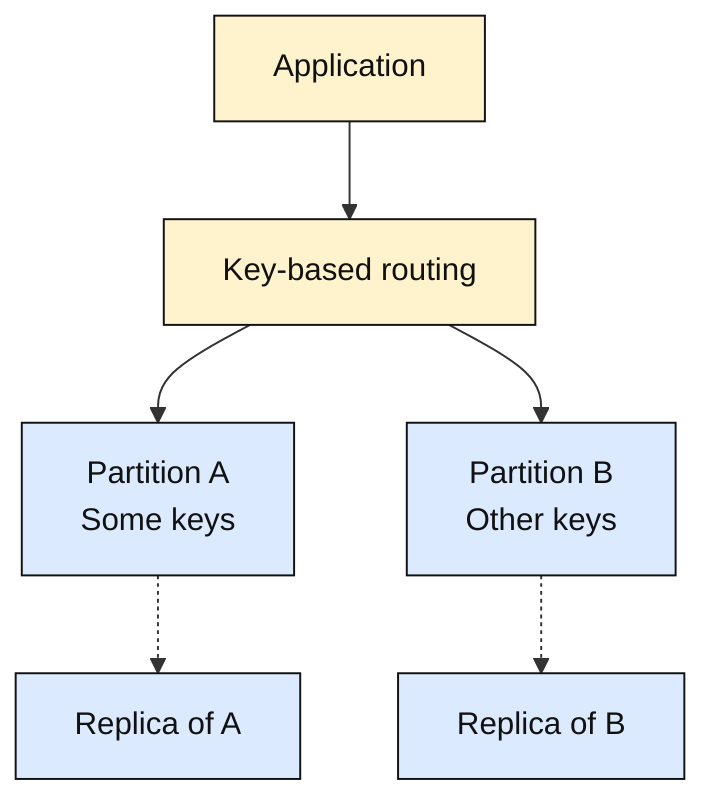

The routing arrows show alternative destinations for a key, not a broadcast to every partition. Dotted arrows show replication relationships; they do not prescribe synchronous or asynchronous acknowledgments. Routing can reside in a client or service. **Partitioning divides data; replication copies it.** The diagram does not define a complete failover protocol.

### Why Key-Value Lookups Can Be Fast: Complexity, RAM, and Disk

A key-value store retrieves a value using its key:

```text
GET("customer:42") → "Alice"
```

**A hash-table-based implementation can locate a key in expected O(1) time:** roughly constant lookup work as the number of stored entries grows. This describes the lookup algorithm—not the complete database request or every key-value implementation.

**1. Why does hashing give expected O(1) lookup?**

Imagine a cabinet with numbered drawers. A hash function calculates which drawer to open directly:

```text
"customer:42" → hash calculation → bucket 17
```

The store checks bucket 17 rather than searching every stored key.

As more entries arrive, the hash table increases its number of buckets to keep the average bucket occupancy small:

| Stored entries | Buckets | Average entries per bucket |
| --- | --- | --- |
| 100 | 100 | 1 |
| 1,000 | 1,000 | 1 |
| 10,000 | 10,000 | 1 |

These numbers are illustrative. Implementations choose their own growth rules. Here, buckets are positions in a local hash table, not the storage-server partitions discussed elsewhere.

Different keys can map to the same bucket—a **hash collision**. The store must compare the actual keys to find the correct entry. Good hash distribution and controlled occupancy keep the number of entries examined small on average.

**O(1) does not mean exactly one instruction or a guaranteed response time.** It means lookup work does not normally grow in proportion to the total entry count.

**2. What physically happens in RAM?**

In a simplified implementation, RAM contains a bucket array and stored entries:

```text
CPU hashes "customer:42"
          ↓
Calculates bucket 17
          ↓
Reads bucket 17 from the array
          ↓
Follows a pointer to the stored entry
          ↓
Checks the key and returns "Alice"
```

A **pointer** is a stored memory address.

Because array slots have a fixed size, the processor can calculate a slot's address:

```text
Slot address = starting address + bucket number × slot size
```

For example:

```text
Starting address = 1000
Bucket number    = 17
Slot size        = 8 bytes

Slot address = 1000 + 17 × 8 = 1136
```

These are illustrative program addresses; the operating system maps them to physical memory.

**The processor accesses the calculated location rather than scanning every preceding memory address.** CPU caches may satisfy some accesses before RAM is needed.

**3. What is the space complexity?**

| Measure | Typical complexity |
| --- | --- |
| Store N fixed-size key-value entries and their hash index | **O(N) total space** |
| Perform one ordinary lookup | **O(1) additional space** |
| Locate a key with well-distributed hashing and controlled occupancy | **Expected O(1) time** |

More entries require more memory even when locating one entry remains fast. With variable-size keys and values, also account for their total bytes: hashing a longer key and transferring a larger value require more work.

Growing the bucket array can require redistributing existing entries. **Resizing is occasionally expensive; constant-time lookup does not mean every maintenance operation is constant-time.**

**4. What changes when data is stored on disk?**

One possible disk-backed design keeps an index in RAM that identifies where a value is stored:

```text
Key → RAM index → file location → read storage page → value
```

A cached page may already be in memory. Otherwise, the database must request it from SSD/HDD, adding storage latency.

Other designs use different structures. For example, RocksDB combines in-memory structures with sorted files on storage; its key-value interface does not imply a simple O(1) hash-table lookup. [RocksDB overview](https://github.com/meta/rocksdb/wiki/RocksDB-Overview)

RAM is volatile. An in-memory database can additionally write logs or snapshots to disk for recovery, depending on its configuration. [Redis persistence](https://redis.io/docs/latest/operate/oss_and_stack/management/persistence/)

**5. Are key-value stores always faster than relational databases?**

No. Compare the access structure and requested operation:

| Approach | Typical work to locate an entry among N entries |
| --- | --- |
| **Hash table** | Expected **O(1)** |
| **Balanced tree index** | **O(log N)** |
| **Full scan** | **O(N)** |

> **O(1) scales better than O(log N):** With constant-time lookup, the expected amount of work stays roughly unchanged as more entries are stored. With logarithmic lookup, the work grows slowly.
>
> For illustration, a binary search over **1,024 entries** needs about **10 steps**; over **1,048,576 entries**, about **20 steps**. A well-maintained hash table still examines roughly a constant number of entries on average.
>
> **This describes growth in work, not guaranteed elapsed time.** An O(1) lookup requiring a disk read can take longer than an O(log N) lookup served entirely from RAM. Constant factors and hardware still matter.

Redis documents `GET` as O(1). PostgreSQL supports both B-tree and hash indexes, so hashing is not exclusive to key-value databases. An indexed relational lookup can also be very fast. [Redis GET](https://redis.io/docs/latest/commands/get/), [PostgreSQL index types](https://www.postgresql.org/docs/current/indexes-types.html)

Actual response time also depends on network latency, caching, storage I/O, concurrency, replication, and durability requirements.

> **Recall:** Hashing calculates where to look. RAM or disk holds the bytes. Expected O(1) lookup can coexist with O(N) storage; the key-value label alone does not guarantee either constant-time access or better performance.

### Functional Requirements and a Simple API

For an illustrative design, define these operations explicitly:

| Operation | Intended behavior | Illustrative result |
| --- | --- | --- |
| **`Put(key, value)`** | Insert a new key or replace its current value | Success under the chosen write-acknowledgment policy, or an operation error |
| **`Get(key)`** | Retrieve the value visible under the selected read guarantee | Value, `NotFound`, or an operation error |
| **`Delete(key)`** | Remove the key's logical value | `Deleted`, `NotFound`, or an operation error |

These names describe a conceptual API, not commands shared by every database. Here a put replaces the whole value; field updates, conditional writes, and multi-key operations need separate contracts. Missing-key deletion behavior varies: an API may report `NotFound` or treat an already-absent key as successful deletion.

**Sequential walkthrough**, with no concurrent writers and reads that observe completed writes:

| Request | Result |
| --- | --- |
| `Put("cart:42", "book")` | Success; create the key |
| `Get("cart:42")` | `"book"` |
| `Put("cart:42", "book, pen")` | Success; replace the value |
| `Get("cart:42")` | `"book, pen"` |
| `Delete("cart:42")` | `Deleted` |
| `Get("cart:42")` | `NotFound` |

`NotFound` is distinct from a stored empty value, a timeout, or an authorization failure. A timeout does not prove that the key is absent or that a write failed; the request may have completed before its reply was lost. Define safe retry behavior accordingly.

### Non-Functional Requirements and Trade-Offs

| Requirement | What to specify | Design implication |
| --- | --- | --- |
| **Scalability** | Data size, growth, key distribution, and peak traffic | Plan capacity, partitioning, hot-key handling, and rebalancing |
| **Performance** | Read/write latency percentiles at a stated load and value size | Measure routing, storage, network, and coordination costs; do not promise constant latency as the system grows |
| **Durability** | Which acknowledged writes survive which failures | Define persistence, replication acknowledgments, recovery, and backup procedures |
| **Consistency** | What each read may observe and how concurrent writes are ordered or reconciled | Choose a read/write protocol and explicit conflict semantics |
| **Availability** | Which operations must complete during covered failures | Provide healthy capacity and replicas; some failures can still prevent progress |
| **Partition behavior** | How each side behaves when nodes cannot communicate | Decide which operations wait, fail, or proceed with weaker coordination |

If a per-key operation is **linearizable**, a read observes the latest write in a single order consistent with real-time completion; concurrent operations can be ordered within their overlap. This is a possible requirement, not an inherent key-value-store property. Eventually consistent reads may return an older value; [DynamoDB documents different read options and their scope](https://docs.aws.amazon.com/amazondynamodb/latest/developerguide/HowItWorks.ReadConsistency.html).

**These requirements cannot all be unconditional.** During a network partition, a system cannot guarantee both linearizable behavior and successful completion of every request at every reachable node. It may reject or delay operations that cannot coordinate, or allow operations under weaker consistency rules. See [CAP](Distributed-Systems-Theorems-and-Data-Structures.md#cap-theorem) and [PACELC](Distributed-Systems-Theorems-and-Data-Structures.md#pacelc-theorem).

Replication does not automatically establish durable storage or consistent reads, and it is not a substitute for backup. Likewise, “low latency” is a workload target, not a guarantee under arbitrary network delays and failures.

### Design Topics to Study Next

The introductory requirements lead to these design questions:

| Topic | Question to resolve |
| --- | --- |
| **Partitioning and scalability** | [Place keys and handle membership changes](#scalability-partitioning-and-consistent-hashing). |
| **Replication** | [Choose copies, physical owners, and replication behavior](#replication-models-and-replica-placement). |
| **Versioning and conflicts** | [Interpret concurrent versions](#coordinating-reads-and-writes); detailed reconciliation algorithms remain further study. |
| **Configurability** | [Specify R/W thresholds and their limits](#coordinating-reads-and-writes). |
| **Fault tolerance and failure detection** | [Handle temporary failures](#temporary-failures-sloppy-quorums-and-hinted-handoff), [repair replicas](#replica-repair-and-merkle-trees), and [manage membership](#membership-gossip-and-failure-detection). |

The original [Dynamo paper](https://www.allthingsdistributed.com/files/amazon-dynamo-sosp2007.pdf) is a concrete example combining partitioning, replication, versioning, and application-assisted conflict handling. **Dynamo is the historical system described in that paper; [Amazon DynamoDB](#amazon-dynamodb) is a separate managed product.** These techniques and their guarantees must be evaluated together rather than assumed from the key-value model.

> **Recall:** A simple key-based API can hide a complex distributed design. Specify what success, missing data, concurrent updates, and failures mean before choosing the mechanisms.

### Scalability: Partitioning and Consistent Hashing

**Partitioning assigns different keys to different storage nodes.** Hash-based placement can spread keys, but the mapping must remain understandable to clients and coordinators when membership changes.

**Modulo routing:** For `m` nodes with zero-based indexes `0` through `m - 1`, select `index = hash(key) % m`:

| Hash result | Node count | Calculation | Selected index |
| --- | --- | --- | --- |
| 10 | 4 | `10 % 4 = 2` | 2 |
| 10 | 5 | `10 % 5 = 0` | 0 |

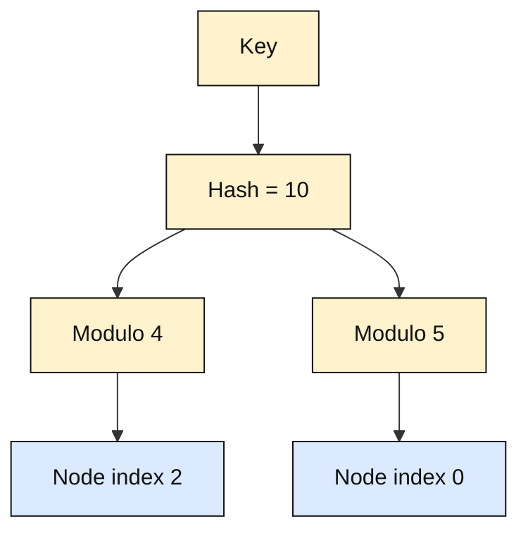

The hash stays the same; changing the divisor changes placement. Many other keys can also move, including keys whose old owners remain healthy. A uniform hash can spread **keys** approximately evenly, but does not make four nodes receive exactly 25% of requests each: some keys may be much more popular or larger than others.

**Worked example: four servers become three.** Start with Server 0, Server 1, Server 2, and Server 3. Remove Server 3 and keep the other server labels unchanged:

| `Hash(key)` | Four servers: `% 4` | Three servers: `% 3` | Mapping changed? |
| --- | --- | --- | --- |
| 10 | Server 2 | Server 1 | Yes |
| 11 | Server 3 | Server 2 | Yes |
| 12 | Server 0 | Server 0 | No |
| 13 | Server 1 | Server 1 | No |
| 14 | Server 2 | Server 2 | No |
| 15 | Server 3 | Server 0 | Yes |

**Three of these six keys now map to different servers.** This is an illustrative sample, not a fixed percentage for every dataset. Notice that hash `10` moves even though its original owner, Server 2, remains available.

**Why does this matter?** Suppose a customer's account record has a key whose hash is `10`:

1. With four servers, `10 % 4 = 2`, so the record is stored on Server 2.
2. With three servers, `10 % 3 = 1`, so the new routing rule sends requests to Server 1.
3. **Changing the calculation does not physically move the record.** It is still on Server 2 until transferred.
4. The system must transfer the record and coordinate the routing change so requests can still find it during migration.

Across millions of keys, these transfers consume network bandwidth, CPU, and storage I/O. For a **planned removal**, transfer the departing server's data before shutting it down. For a **sudden failure**, recovery needs surviving replicas, backups, or another recovery source; changing the hash rule cannot restore lost data.

Consistent hashing reduces this disruption by changing ownership only for affected hash ranges. The amount moved depends on token placement and balance; it is not always a tiny fixed fraction.

> **Recall:** Modulo routing changes many mappings when the server count changes. Consistent hashing limits reassignment. Both still need safe data transfer and routing updates.

**Consistent hashing:** Place node tokens and key hashes in the same circular hash space. Select the first eligible token clockwise, wrapping around when necessary. In this illustrative ring, the key hash `60` belongs to N3 at token `70`:

**Diagram legend:**

| Label | Simple meaning |
| --- | --- |
| **N1–N4** | Four storage nodes (servers) that hold key-value records. |
| **Token** | A number marking a node's position on the ring. Here, N3 has token `70`. A server can have several tokens, as explained below. |
| **Key** | An identifier such as `customer:123`, used to find its stored value. |
| **Key hash 60** | The key's hash result places it at position `60` on the ring. It is not the stored value or the server number. |

**Example:** If `hash("customer:123") = 60`, move clockwise to the next token, `70`. Its owner, **N3**, stores the record in this example.

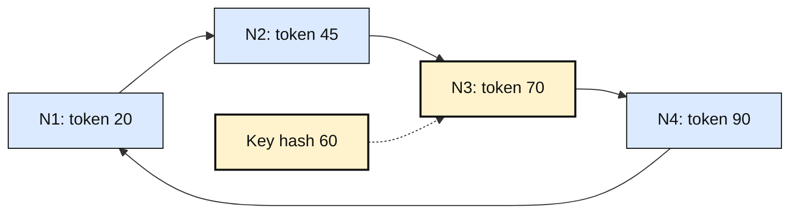

The arrows represent logical clockwise token order, not a network topology or a required circular rendering. If N5 joins at token `65`, keys in `(45, 65]` move from N3 to N5 in this **single-token, primary-placement example**. Other primary ranges remain unchanged. Virtual nodes and replication can involve additional ranges and replica transfers; do not generalize this example into “only one physical neighbor is ever affected.”

**After adding N5 at token 65:**

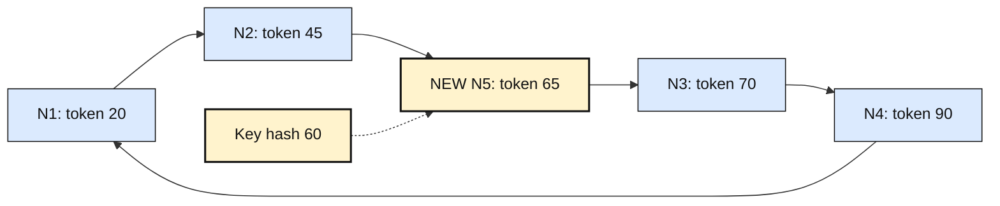

> **Before:** Hash `60` → N3 at `70`.
>
> **After:** Hash `60` → N5 at `65`, now the first token clockwise.
>
> N5 takes over keys with hashes **greater than `45` and up to `65`, including `65`**. N3 keeps `(65, 70]`; the other nodes keep their ranges.

**Circular view: before and after adding N5.** Both rings use the same illustrative hash positions `0–99`. Dots mark server tokens; yellow highlights new N5. The orange diamond marks the key's hash. Follow the orange arrow clockwise to find its owner.


> **Ring:** Possible hash positions. **Token:** A server's position. **Key hash:** A record's position. **Owner:** The first server token reached clockwise.

The green band marks the transferred range. This shows one token per server and primary ownership only; the new owner still needs the actual data transferred safely.

**Virtual nodes: several positions, one physical server.** A virtual node is an extra position representing the same server on the ring—not another machine. Instead of owning one large range, each server can own several smaller ranges at different positions.

For example, give each of three physical servers three tokens:

| Physical server | Token positions on the ring | Actual machines |
| --- | --- | ---: |
| A | `10`, `50`, `80` | 1 |
| B | `20`, `40`, `90` | 1 |
| C | `30`, `60`, `70` | 1 |

**How are the positions created?** One hash function is sufficient: hash different server identifiers such as `hash("A#0")`, `hash("A#1")`, and `hash("A#2")`. The table's positions are illustrative outputs. The suffix creates another token for A; it does not create another physical server. Multiple hash functions are not required, and the request key is not hashed once per virtual node.

**Request walkthrough:**

1. Hash the key once: suppose `hash("customer:123") = 55`.
2. Move clockwise from `55` to the next token, **60**.
3. Token 60 belongs to **C**, so physical **Server C** handles the request.


All tokens with the **same letter and color** represent the same physical server. There are **nine ring positions but only three machines**. The arrows show lookup direction, not network links.

**Why use virtual nodes?**

| Benefit | Simple explanation |
| --- | --- |
| **Better range balance** | Several smaller ranges per server can reduce the uneven ownership caused by a few randomly placed tokens. Balance is approximate, not guaranteed. |
| **Spread reassignment** | When A leaves this example, its ranges pass to B at tokens `20` and `90`, and C at `60`. One remaining server need not take all of A's ranges. |
| **Account for capacity** | The placement policy can give a more-capable server more tokens or weight. Twice as many tokens does not guarantee twice the useful throughput. |

More tokens also add metadata and maintenance work. Balanced ranges do not guarantee equal request traffic: one key may be much more popular than others. Virtual nodes do not add hardware, create independent replicas, or split a single hot key across servers by themselves.

Membership changes still need data transfer and a safe routing transition. Planned maintenance allows transfer before shutdown; after a failure, recovery needs surviving copies. Adding virtual nodes cannot recreate lost data.

> **Recall:** Many positions can belong to one server. Hash the key once, find the next token clockwise, and send the request to that token's physical owner.

See [Consistent Hashing](Distributed-Systems-Theorems-and-Data-Structures.md#consistent-hashing), [Virtual Nodes](Distributed-Systems-Theorems-and-Data-Structures.md#virtual-nodes-multiple-tokens-per-server), and the existing [C++ teaching example](examples/consistent_hashing/README.md). [Cassandra's architecture](https://cassandra.apache.org/doc/latest/cassandra/architecture/dynamo.html) illustrates token-based placement; its implementation is not a universal specification for every key-value store.

### Replication Models and Replica Placement

**Replication keeps copies of the same data.** A distributed store can partition data first and then replicate each partition; it need not copy every key to every server.

| Model | Where client writes are handled | Main design questions |
| --- | --- | --- |
| **Primary-secondary / single-leader** | The current primary for that partition orders writes; secondaries apply replicated changes | Replication lag, acknowledgment rules, promotion, and preventing competing primaries |
| **Peer-to-peer (leaderless in this example)** | A coordinator sends operations to the key's replica set without a permanent per-key write leader | Response thresholds, concurrent versions, reconciliation, and replica repair |

**Primary-secondary example:**

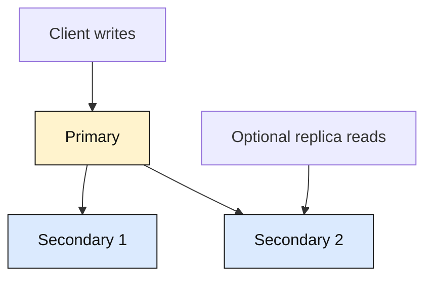

The primary-to-secondary arrows carry replication updates. A secondary applies those updates but does not normally accept independent client writes in this single-leader model. The primary can also serve reads; secondary reads depend on product capabilities and can be stale when replication lags.

With **asynchronous replication**, the primary may acknowledge before secondaries have the update. A failure can therefore lose acknowledged updates not yet protected elsewhere. **Synchronous replication** waits for the configured replica acknowledgment condition; whether that means received, persisted, or applied must be specified. Waiting improves the covered guarantee but introduces coordination costs and can block progress.

A failed primary can be replaced through a designed failover process; primary-secondary replication is not inherently limited to permanent loss of write service. Promotion must select an eligible replica, redirect clients, and prevent the old primary from continuing as a writer—often through **fencing**, which blocks an obsolete writer. See [PostgreSQL replication](https://www.postgresql.org/docs/current/warm-standby.html) and [failover guidance](https://www.postgresql.org/docs/current/warm-standby-failover.html). Consensus-based designs such as [Raft](Distributed-Systems-Theorems-and-Data-Structures.md#raft) provide another context for safe leadership and replicated history.

**Peer-to-Peer (Leaderless) Replication**

These names answer different questions. **Peer-to-peer** describes nodes acting as peers; **leaderless** means writes do not pass through a permanent leader for each key. This Dynamo-style example has both properties. Peer-to-peer is a broader term, so it does not always mean leaderless replication. See [Cassandra's architecture](https://cassandra.apache.org/doc/latest/cassandra/architecture/dynamo.html).

**Overall architecture: peers communicate without a permanent primary.**

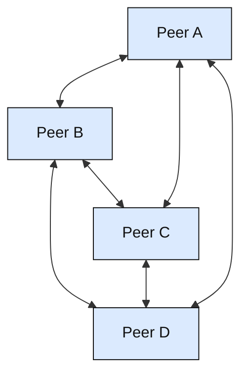

Each peer can handle requests and hold replicas for its assigned keys. The arrows show possible peer communication—not a requirement to broadcast every write to every node or store every key everywhere. For example, a key with intended replicas A, B, and C does not also need a copy on D.

**One request's flow: a coordinator contacts the key's replicas.**

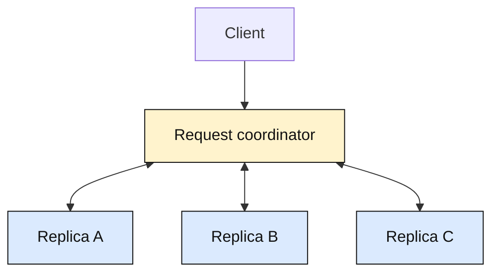

The coordinator is a **request-handling role**, not necessarily a permanent leader or a separate machine. A storage node can coordinate a request and hold a replica. Different requests may use different coordinators. The diagram shows request/reply paths; it does not require all cluster nodes to exchange every write.

The two diagrams show **the same model at different levels**: the first shows peer relationships; the second follows one request. Leaderless replication avoids dependence on a permanent primary for that key, but does not eliminate failures or guarantee lower latency. Progress still depends on reachable replicas, response thresholds, and conflict handling.

Let **N** be the total intended replicas of a key, including its first owner. It differs from **m**, the total physical-node count used in the modulo example. For `N = 3`, a clockwise preference scan such as `A#0 → A#1 → B#0 → C#0 → D#0` selects intended physical owners **A, B, C**: A's second token does not count as another copy. Later candidates such as D can be considered by a fallback policy.

Place replicas across suitable failure domains, such as racks or availability zones, where the deployment supports it. Three copies in one rack do not protect against loss of that rack. Neither replication model automatically provides unlimited availability or durability; persistence, routing, failure assumptions, and recovery remain necessary.

### Coordinating Reads and Writes

Clients can reach the storage system through different paths:

| Approach | Benefit | Responsibility |
| --- | --- | --- |
| **Generic router / load balancer** | Keeps placement knowledge out of the client | The selected node may need to forward to the key's replicas |
| **Partition-aware client** | Can avoid an unnecessary forwarding hop | Must refresh placement information and handle stale routes and failures |

For this **Dynamo-style teaching model**, the coordinator contacts intended replicas in parallel and waits for configured response thresholds. These are conceptual operations, not a complete implementation protocol.

- **N:** Intended replica count for the key.
- **W:** Distinct replica acknowledgments required for write success.
- **R:** Distinct valid replica responses required for a read.

For ordinary fixed-set operations, assume `1 <= R, W <= N`. Count physical replicas once, not repeated replies or multiple virtual nodes on one host. A read must interpret returned versions according to the protocol; receiving R responses alone does not establish which value to return.

**Example: N = 3, R = 2, W = 2, intended replicas A/B/C.**

1. A coordinator sends a versioned put to A, B, and C.
2. A and B acknowledge under the configured persistence policy. The coordinator can report write success after those two acknowledgments; C may complete later or require repair.
3. A subsequent read requests the replicas in parallel. Suppose B and C provide the first two valid responses.
4. B can report the completed write even if C is stale. The coordinator must select or reconcile versions correctly rather than return an arbitrary response.
5. Outstanding propagation and repair are separate from the client's completed response.

For subsets of the **same fixed N-replica set**, `R + W > N` guarantees that every qualifying read set intersects every qualifying write set:

| N | R | W | Read/write overlap guaranteed? | Completion requirement and trade-off |
| --- | --- | --- | --- | --- |
| 3 | 2 | 1 | **No:** `2 + 1 = 3` | A read can miss the sole acknowledged writer; smaller write threshold |
| 3 | 2 | 2 | **Yes:** `2 + 2 = 4` | Both operations need two responses; one unreachable replica need not prevent completion |
| 3 | 3 | 1 | **Yes:** `3 + 1 = 4` | Reads need all three; writes need one |
| 3 | 1 | 3 | **Yes:** `1 + 3 = 4` | Writes need all three; reads need one |

“Guaranteed overlap” is a set-intersection property, **not a standalone guarantee of linearizability**. Correct version selection, concurrent-write handling, incomplete-operation behavior, and operation ordering still matter. Even overlapping write sets do not resolve concurrent updates by arithmetic alone. Compare [Quorum Reads and Writes](Distributed-System-Attributes.md#quorum-reads-and-writes), including its consistency caveat.

**Latency and availability:** With parallel fan-out to all N eligible replicas, the waiting component is typically determined by the R-th valid read response or W-th qualifying write acknowledgment, plus coordination and processing. It is not necessarily the slowest of all replicas contacted. Increasing R or W generally requires more reachable responses and can increase latency or reduce operation availability; there is no configuration that tolerates arbitrary failures.

**Conflict example:** Two writers read the same cart version, then independently add `book` and `pen`. Returning one later-timestamped replacement could discard the other addition. The system needs an explicit ordering, conditional-update, or reconciliation policy. Version metadata can identify relevant relationships, but automatic merging is application-dependent. Replica counts alone do not solve this problem.

### Temporary Failures: Sloppy Quorums and Hinted Handoff

A **strict replica-set quorum** requires qualifying responses from a key's designated replicas. In a **sloppy quorum**, a Dynamo-style system may substitute other eligible healthy nodes from its preference list when intended replicas are unreachable. This can allow more operations to complete, but changes the participating sets.

**Example:** Intended replicas are **A, B, C**, with `N = 3` and `W = 2`. A is unreachable, C is slow, and D is an eligible fallback. Q is the request coordinator, shown separately for clarity.

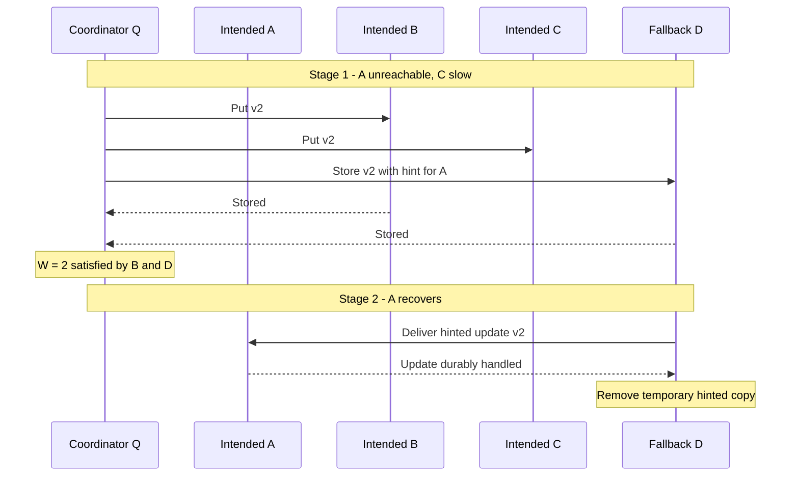

D stores the **key, value/update, version metadata, and intended destination A** under the fallback policy—not merely a request ID. After A recovers, D delivers the update. Once A has safely handled it, D removes the corresponding temporary copy. D must not discard unrelated data it owns. The request to C may still be pending; the diagram does not assume C has stored v2.

**Why overlap can fail:** Before handoff completes, A could return with its old value while C is still stale. A read receiving replies from **A and C** can miss the successful write acknowledged by **B and D**. Although `R + W = 4 > 3` numerically, those two sets are disjoint because D lies outside the intended A/B/C set.

Hints require safe replay so retries do not duplicate logical effects or overwrite newer versions incorrectly. Deletion/version information must survive the required recovery window. Hint storage, retention, and reachability are finite; D can also fail. Hinted handoff therefore **does not guarantee that every read/write succeeds or that every missed update is repaired**. Additional replica synchronization is needed when hints cannot finish.

This example follows the **historical Dynamo-style fallback placement** described in the [Dynamo paper](https://www.allthingsdistributed.com/files/amazon-dynamo-sosp2007.pdf). [Cassandra's documented hints](https://cassandra.apache.org/doc/latest/cassandra/managing/operating/hints.html) are stored by coordinators for unavailable replicas; they are not an identical implementation of temporary replica substitution. Cassandra describes hints as best effort and not a replacement for repair.

### Replica Repair and Merkle Trees

**Anti-entropy repair** compares replica state and transfers missing or differing data. It is useful after prolonged outages, incomplete propagation, or replacement; it is not limited to permanently failed nodes. A replacement needs data from surviving replicas or a suitable backup.

#### What the Hashes Represent

**A Merkle tree is a tree of hashes that helps replicas find where their data differs.**

| Term | Simple meaning |
| --- | --- |
| **Data block** | The content being summarized: a record, file chunk, or a range of records. |
| **Hash** | A fixed-size fingerprint calculated from bytes. The same bytes and hash function produce the same result. Different inputs can collide, so a hash is not a guaranteed unique ID. |
| **Leaf hash** | The fingerprint of one block or range at the bottom of the tree. |
| **Parent hash** | A hash calculated from its children's hashes in a defined order. |
| **Root hash** | The top hash, summarizing the whole ordered dataset represented by the tree. |

For security-sensitive integrity checks, use a suitable **cryptographic hash**, such as SHA-256, and a trustworthy reference root. An ordinary fast hash is not interchangeable with a cryptographic one. Even with cryptographic hashing, matching roots provide assurance under the hash assumptions—not a mathematical guarantee that collisions are impossible.

**Replicas must compare the same thing:** equivalent key ranges, ordering, byte encoding, tree construction, and compatible snapshots/version rules. Record hashes must cover the **key, value, and relevant version/deletion state**, not only key names. Equal keys with different values must be distinguishable.

#### Building the Tree

Use four blocks in this fixed order: **Alice, Bob, Carol, Dave**. Here, each block is just a string so the structure is easy to see.

1. Hash each block: `h1 = H(Alice)`, `h2 = H(Bob)`, `h3 = H(Carol)`, `h4 = H(Dave)`.
2. Combine adjacent hashes in order: `h12 = H(h1 || h2)` and `h34 = H(h3 || h4)`.
3. Hash the parents: `root = H(h12 || h34)`.

`||` means **concatenate the bytes in order**, not add the numbers. Real implementations define unambiguous encodings and distinguish leaves from internal nodes; the [C++ example](examples/merkle_tree/README.md#core-state-and-hash-encoding) makes those rules explicit. Merkle trees need not all use this exact binary shape or padding policy. See [RFC 9162's construction](https://www.rfc-editor.org/rfc/rfc9162.html#section-2.1) for one cryptographic variant.

Changing Carol to Carl changes that leaf's input. In this example, its leaf hash, its right-side parent, and the root change; the left subtree remains unchanged. **A point update only needs to recalculate the affected path**, not rebuild every node.

#### Finding and Repairing a Difference

Suppose two replicas initially match, then block 3 changes in B:

| Block | Replica A | Replica B after modification |
| --- | --- | --- |
| 1 | Alice | Alice |
| 2 | Bob | Bob |
| 3 | Carol | Carl |
| 4 | Dave | Dave |


The diagram uses **symbolic hash names**, not actual SHA-256 outputs. Build the hashes upward from the data; compare downward from the roots.

| Comparison | Observation | Next action |
| --- | --- | --- |
| Whole-range roots | Different | Compare the two subranges |
| Left subtree: blocks 1–2 | Equal | Skip this subtree under the hash assumptions |
| Right subtree: blocks 3–4 | Different | Compare its children |
| Block 3: Carol / Carl | Different | Exchange state and apply reconciliation rules |
| Block 4: Dave / Dave | Equal | No repair needed for this block |

For this demonstration, **we explicitly choose A as the trusted source**. Copy only block 3 from A to B, update B's leaf-to-root path, and compare the roots again.

**The tree detects disagreement; it does not decide that Carl is wrong.** Either replica might be stale, or both versions might be legitimate concurrent updates. Reconciliation rules determine the retained state; a newer deletion marker may need to suppress an older value. Merkle trees cannot establish business correctness or recover a value whose every copy is gone.

> **Recall:** Compare roots → skip matching branches → locate differing blocks → reconcile → check again.

#### Complexity and Practical Uses

For **N constant-size blocks**, a balanced binary tree, and **K differing blocks**, with trees already built where applicable:

| Operation | Computational cost |
| --- | --- |
| Build all hashes | O(N) time and hash storage |
| Compare compatible roots | O(1) |
| Update one block's hash path | O(log N) |
| Locate one differing block | O(log N) hash comparisons |
| Locate K differences | O(min(N, 1 + K log N)) hash comparisons |
| Comparison auxiliary space | O(log N) recursion plus O(K) returned indexes |

Interpret logarithms as `log2(max(2, N))`; empty trees take constant work. These bounds assume usable hash comparisons. **A matching teaching hash can hide a difference**, so the non-cryptographic example is not a security verifier.

For variable-size blocks, building also hashes all input bytes; updating hashes the changed block's bytes plus its ancestors. Hash storage is O(N), but it does **not necessarily double data storage**: overhead depends on digest size, block size, and tree layout.

**Network cost is separate:** comparing trees exchanges hash information; repairing then transfers the differing payload bytes and any required metadata. Sparse differences can save substantial traffic, while extensive differences can approach a full transfer. Alternatives include exchanging per-block checksums, so “without Merkle trees, always transfer the entire dataset” is too strong.

| Use | What the tree helps with |
| --- | --- |
| **Database replica repair** | Find out-of-sync ranges and transfer differences; [Cassandra](https://cassandra.apache.org/doc/latest/cassandra/managing/operating/repair.html) uses this during repair. A range may contain many records. |
| **Bitcoin transaction inclusion** | Check that a transaction is included under a particular Merkle root; this alone does not establish transaction validity or consensus. See the [Bitcoin developer guide](https://developer.bitcoin.org/devguide/block_chain.html#merkle-trees). |
| **BitTorrent v2** | Verify file-block content using SHA-256 Merkle trees; see [BEP 52](https://www.bittorrent.org/beps/bep_0052.html). |
| **Certificate Transparency** | Use Merkle proofs for log-entry inclusion and append-only consistency; see [RFC 9162](https://www.rfc-editor.org/rfc/rfc9162.html#section-2.1). |

An inclusion proof and comparing two whole trees are different operations. This example implements tree comparison, not proof generation. Production repair also involves CPU, disk I/O, snapshot coordination, and recovery rules; changed ownership ranges may require rebuilding affected trees.

#### C++ Teaching Example

See the [DSA-style Merkle tree example](examples/merkle_tree/README.md) for **Build**, **Update**, **FindDifferences**, language-neutral pseudocode, and the Carol → Carl → repair walkthrough.

It uses a fixed **64-bit FNV-1a teaching hash**, not SHA-256. It compares ordered string blocks in memory and relies on an explicit source-selection policy for the repair. It does not implement Cassandra repair, Bitcoin, BitTorrent, or Certificate Transparency protocols.

### Membership, Gossip, and Failure Detection

Keep these concepts separate:

| Concept | What it describes |
| --- | --- |
| **Token ownership** | Which physical nodes own particular hash ranges and their replicas |
| **Membership** | Which nodes belong to the cluster, including controlled additions and removals |
| **Reachability / liveness estimate** | Which peers a node currently believes it can contact |

**Gossip** spreads selected cluster information through repeated peer exchanges. For example, A exchanges membership information with B; B later exchanges with C, allowing C to learn about A. Bootstrap contacts or seed nodes help a joining node discover the existing cluster. Token assignment and ownership policy are distinct from merely choosing peers to contact.

This is control information, **not automatic replication of every application write**. Message contents, persisted membership records, and liveness detectors depend on the system. The Dynamo paper, for example, separates explicit membership changes from local reachability judgments. Do not assume every gossip design has one globally agreed failure view.

A timeout means “no acceptable response arrived in time.” The node could be slow, partitioned, or unreachable only from one observer. Two healthy nodes can therefore disagree about a third node's liveness. During a partition, gossip cannot instantly reconcile views across the broken link.

A brief outage need not trigger permanent removal and full redistribution. Define when to keep placement stable and route around a suspected failure, when to rebuild replicas, and when to change membership. Planned joins/removals need controlled data movement, routing updates, and adequate copies throughout the transition. Returning nodes may need repair before their stale data can safely participate in particular operations.

> **Failure detection guides a response; it does not prove a node is permanently dead. Membership changes and data recovery require their own rules.**

### Design Review and Interview Checklist

1. **Requirements:** Define key/value sizes, operations, growth, workload skew, latency targets, and required failure behavior.
2. **Placement:** Explain routing, partition ownership, membership changes, and hot-key handling.
3. **Replication:** Choose N, distinct physical owners, failure domains, and persistence/acknowledgment semantics.
4. **Consistency:** Define what reads may observe, how R/W are used, and which operations must stop when coordination is unavailable.
5. **Concurrency:** Explain version handling and what happens to competing writes; do not claim quorum overlap supplies a complete protocol.
6. **Temporary failures:** Describe routing, fallback policy, hint limits, retry safety, and client-visible uncertainty.
7. **Recovery:** Explain anti-entropy, replacement, deletion handling, backup, and what happens if no copy survives.
8. **Membership and operations:** Cover discovery, suspicion, controlled changes, safe rejoining, and monitoring of lag, hints, capacity, and repair.
9. **Justification:** State why this design fits the workload, what it cannot guarantee, and how requirements or configuration may evolve.

> **Recall:** Hashing places keys; replication preserves copies; response thresholds control participation; version rules interpret writes; hints and repair restore missed state; membership and failure detection guide routing and recovery. The guarantees come from the complete design.

## Amazon DynamoDB

### DynamoDB Overview and Responsibilities

**Amazon DynamoDB is an AWS-managed, serverless key-value and document database.** Applications use its APIs without operating the underlying database servers. Serverless does not remove the need to model data, plan access, or manage costs and permissions.

| AWS manages | Application designers decide |
| --- | --- |
| Server infrastructure, physical partitions, and replication | Keys, item structure, indexes, and access patterns |
| Service maintenance and infrastructure failure handling | Capacity mode, workload testing, and application failure behavior |
| Managed database facilities | Permissions, business rules, backup/restore configuration, and recovery checks |

DynamoDB stores partitions on SSD-backed infrastructure and replicates them across multiple **Availability Zones (AZs)** within a Region. An AZ can contain more than one data centre. Multi-AZ replication and replication across **Regions** are different scopes. See [DynamoDB partitions](https://docs.aws.amazon.com/amazondynamodb/latest/developerguide/HowItWorks.Partitions.html) and [AWS AZ definitions](https://docs.aws.amazon.com/global-infrastructure/latest/regions/aws-regions-availability-zones.html).

**DynamoDB is a separate service from the historical Dynamo system.** Do not assume the earlier leaderless teaching design describes DynamoDB's internals. Compare the [original Dynamo explanation](#design-topics-to-study-next) and the [published DynamoDB architecture](#published-dynamodb-architecture-2022) below.

### Tables, Items, Attributes, and Flexible Schema

Use a fictional table named **Orders**:

| Component | Meaning in this example |
| --- | --- |
| **Table** | The collection named `Orders` |
| **Item** | One order record |
| **Attribute** | A field such as `Status`, `OrderId`, or `CreatedAt` |
| **Primary key** | The `PK` and `SK` values together identify one item |

Both key attributes are strings. The starting data is:

| PK: partition key | SK: sort key | OrderId | Status | CreatedAt |
| --- | --- | --- | --- | --- |
| `CUSTOMER#42` | `ORDER#D4821` | D4821 | CREATED | 2026-01-10T10:00:00Z |
| `CUSTOMER#42` | `ORDER#D4822` | D4822 | DELIVERED | 2026-01-09T09:00:00Z |
| `CUSTOMER#99` | `ORDER#D9001` | D9001 | CREATED | 2026-01-10T11:00:00Z |

`PK` and `SK` are names chosen by the application, not mandatory DynamoDB attribute names.

**Flexible schema means non-key attributes can vary.** One order might include a nested delivery address; another might include special handling instructions. Table/index key definitions and their supported types are explicit. Applications still need validation, compatible readers, and migration planning. Not all NoSQL databases store documents or automatically outperform relational databases.

The documented maximum item size is **400 KB**, including attribute names and values. DynamoDB uses `1 KB = 1024 bytes`. Flexible attributes do not allow unlimited-size items. See [core components](https://docs.aws.amazon.com/amazondynamodb/latest/developerguide/HowItWorks.CoreComponents.html) and [item constraints](https://docs.aws.amazon.com/amazondynamodb/latest/developerguide/Constraints.html).

### Partitioning and Primary Keys

#### Horizontal and Vertical Partitioning

| Approach | What is divided? | Simple example |
| --- | --- | --- |
| **Horizontal partitioning** | Rows/items | Put student rows 1–2 in one group and row 3 in another |
| **Vertical partitioning** | Attributes | Separate names from subjects/grades, retaining the student ID |

**Visual overview:** Both methods start from the same table. The left branch divides rows; the right branch separates columns while keeping `ID` in both pieces.


**Original table**

| ID | Name | Subject | Grade |
| --- | --- | --- | --- |
| 1 | Tom | Math | A |
| 2 | Mike | English | B |
| 3 | Rob | Physics | A |

**Horizontal partitioning — split the rows; keep the same columns.**

Partition A:

| ID | Name | Subject | Grade |
| --- | --- | --- | --- |
| 1 | Tom | Math | A |
| 2 | Mike | English | B |

Partition B:

| ID | Name | Subject | Grade |
| --- | --- | --- | --- |
| 3 | Rob | Physics | A |

**Vertical partitioning — split the columns; retain an identifier connecting the pieces.**

Names:

| ID | Name |
| --- | --- |
| 1 | Tom |
| 2 | Mike |
| 3 | Rob |

Grades:

| ID | Subject | Grade |
| --- | --- | --- |
| 1 | Math | A |
| 2 | English | B |
| 3 | Physics | A |

> **Horizontal = different rows. Vertical = different attributes linked by ID.**

**This is a general modeling illustration, not actual DynamoDB placement.** Horizontal grouping here is arbitrary, not a claim about hash results. Vertical modeling remains possible with flexible attributes—for example, separating information into related items. It is also different from a physical column-oriented storage layout.

DynamoDB automatically manages physical partition allocation, movement, and splitting. Customers do not manually assign items to storage servers or split physical partitions. Designers can change application-level key patterns or introduce write-sharding keys when justified; those are different decisions from AWS's physical management.

#### Partition Keys and Sort Keys

| Primary-key design | What must be unique? | Direct item lookup |
| --- | --- | --- |
| **Partition key only** | Each partition-key value | Supply the partition key |
| **Partition key + sort key** | Each complete pair; partition-key values may repeat | Supply both key values |

For the Orders table, `CUSTOMER#42` alone describes a group of orders. The pair `CUSTOMER#42 / ORDER#D4821` identifies one order.

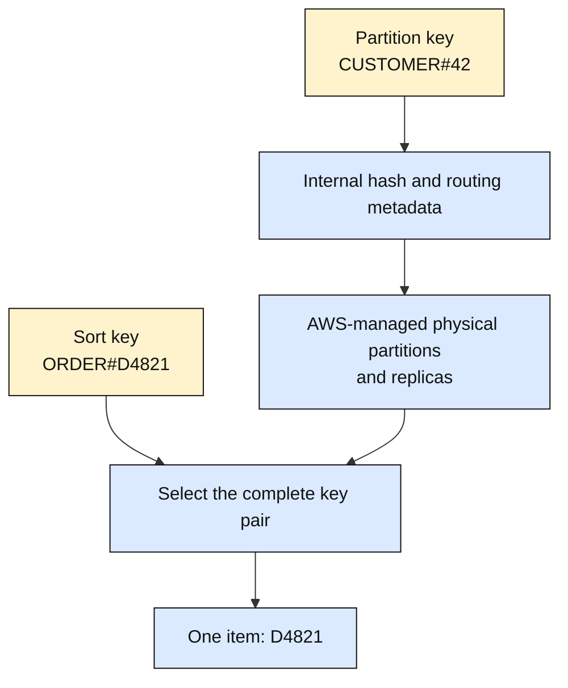

The **partition key** participates in hash-based routing; the **sort key** distinguishes and orders items within the logical item collection. The sort key is not simply another value hashed together with the partition key.

An **item collection** means items sharing a partition-key value. Do not equate it permanently with one physical partition: collections can be split when supported; an LSI introduces additional restrictions. See [partition and sort-key distribution](https://docs.aws.amazon.com/amazondynamodb/latest/developerguide/HowItWorks.Partitions.html).

Choose keys for real queries and traffic distribution. A single popular key can remain a bottleneck even when the table has ample total capacity. Cross-link: [partitioning and hashing foundations](#scalability-partitioning-and-consistent-hashing).

### API Operations and Query Patterns

| Operation | Main behavior | Important default |
| --- | --- | --- |
| **PutItem** | Create or replace a complete item with its full key | An existing item with that key is replaced unless a condition prevents it |
| **UpdateItem** | Change selected attributes | Can create an item if it is missing |
| **GetItem** | Read one item using its complete primary key | Eventual consistency unless strong consistency is requested |
| **DeleteItem** | Delete one item using its complete primary key | Deleting an absent item without conditions succeeds |
| **Query** | Read items matching one partition-key value, optionally restricting the sort key | Results are ordered by sort key; pagination can apply |

See the official [PutItem](https://docs.aws.amazon.com/amazondynamodb/latest/APIReference/API_PutItem.html), [UpdateItem](https://docs.aws.amazon.com/amazondynamodb/latest/APIReference/API_UpdateItem.html), [GetItem](https://docs.aws.amazon.com/amazondynamodb/latest/APIReference/API_GetItem.html), and [DeleteItem](https://docs.aws.amazon.com/amazondynamodb/latest/APIReference/API_DeleteItem.html) references.

#### Worked Requests: Customer Orders

**These are language-neutral API-style examples, not executable SDK syntax.** Names such as `Condition`, `Set`, and `KeyCondition` below describe intent. Real SDK requests use exact expression syntax, attribute aliases, and value encoding.

Assume the three starting items above, no concurrent writes, and a small result fitting one page. The new order is D4823.

**1. Create it without replacing an existing item.**

```text
PutItem(
    Table = "Orders",
    Item = {
        PK: "CUSTOMER#42", SK: "ORDER#D4823",
        OrderId: "D4823", Status: "CREATED",
        CreatedAt: "2026-01-10T12:00:00Z"
    },
    Condition = attribute_not_exists(PK)
)
Expected: success; D4823 is created.
```

The condition checks the targeted item identified by the full key. It does not prevent other orders sharing `CUSTOMER#42`. Repeating this create while D4823 exists produces a conditional-check failure instead of overwriting it.

**2. Update an existing item.**

```text
UpdateItem(
    Table = "Orders",
    Key = {PK: "CUSTOMER#42", SK: "ORDER#D4823"},
    Set = {Status: "DISPATCHED"},
    Condition = attribute_exists(PK),
    ReturnValues = "ALL_NEW"
)
Expected attributes:
    {PK: "CUSTOMER#42", SK: "ORDER#D4823", OrderId: "D4823",
     Status: "DISPATCHED", CreatedAt: "2026-01-10T12:00:00Z"}
```

The condition prevents an accidental upsert when the item is missing. Existence alone does not validate a business transition; a real workflow may also require an expected status or version.

**3. Read the updated item.**

```text
GetItem(
    Table = "Orders",
    Key = {PK: "CUSTOMER#42", SK: "ORDER#D4823"},
    ConsistentRead = true
)
Expected Item:
    {PK: "CUSTOMER#42", SK: "ORDER#D4823", OrderId: "D4823",
     Status: "DISPATCHED", CreatedAt: "2026-01-10T12:00:00Z"}
```

**4. Query customer 42's orders.**

```text
Query(
    Table = "Orders",
    KeyCondition = PK equals "CUSTOMER#42",
    ConsistentRead = true,
    Projection = [SK, Status]
)
Expected Items, in ascending sort-key order:
    [{SK: "ORDER#D4821", Status: "CREATED"},
     {SK: "ORDER#D4822", Status: "DELIVERED"},
     {SK: "ORDER#D4823", Status: "DISPATCHED"}]
```

String sort keys follow their byte ordering. These order IDs do **not** imply chronological order: D4822's `CreatedAt` is earlier than D4821's. If time-ordered access is required, model an appropriate time-based key or index.

**5. Delete D4823.**

```text
DeleteItem(
    Table = "Orders",
    Key = {PK: "CUSTOMER#42", SK: "ORDER#D4823"}
)
Expected: success; the item is removed.
Deleting the already absent key again, without conditions, also succeeds.
```

**6. Check the deletion.**

```text
GetItem(
    Table = "Orders",
    Key = {PK: "CUSTOMER#42", SK: "ORDER#D4823"},
    ConsistentRead = true
)
Expected: no Item element in the response.
```

A failed condition produces a conditional-check error; it is not the same as a successful read finding no item. These examples describe documented behavior; they do not contact AWS.

#### GetItem, Query, and Scan

| Need | Operation | Design implication |
| --- | --- | --- |
| One known full key | **GetItem** | Direct item access |
| One partition-key value, possibly a sort-key range | **Query** | Design table or index keys for this access pattern |
| Examine items across a table/index | **Scan** | Can read substantial data; a filter does not turn it into a key lookup |

`Query` pages are up to **1 MB of evaluated data**. Continue with the returned `LastEvaluatedKey` as the next request's `ExclusiveStartKey` until no continuation key remains. A filtered page can contain zero matches and still require continuation.

Filters apply after items are read; they do not save the read capacity already consumed. Choosing fewer projected attributes also does not make base-table reads cheaper merely because the response is smaller. See [query pagination](https://docs.aws.amazon.com/amazondynamodb/latest/developerguide/Query.Pagination.html), [filter expressions](https://docs.aws.amazon.com/amazondynamodb/latest/developerguide/Query.FilterExpression.html), and [capacity accounting](https://docs.aws.amazon.com/amazondynamodb/latest/developerguide/read-write-operations.html).

### Secondary Indexes: GSI and LSI

A secondary index adds an alternate key-based access pattern. **Projection** means the attributes copied into that index.

| Question | Global secondary index (GSI) | Local secondary index (LSI) |
| --- | --- | --- |
| **Key definition** | Can use a different partition key and optional sort key | Same partition key as the table, with an alternate sort key |
| **Example** | Query by `OrderId` without knowing the customer | Query one customer's orders by `CreatedAt` rather than order-ID sort order |
| **Read consistency** | Eventual only | Eventual or strong |
| **When created?** | With the table or later; can be removed | Must be created with the table; cannot later be added or removed |
| **Capacity** | Separate index capacity in provisioned mode; writes maintaining the index add work | Uses the table's capacity |
| **Storage and scope** | Stored separately; queries return projected attributes, including base primary keys | Adds index storage and a 10 GB item-collection limit for each partition-key value, including relevant table/index data |

Suppose an illustrative **OrderLookup** GSI has partition key `OrderId` and projects the needed attributes:

```text
Query(
    Table = "Orders",
    Index = "OrderLookup",
    KeyCondition = OrderId equals "D4821"
)
Expected after index propagation: the item for CUSTOMER#42 / ORDER#D4821.
```

**GSI keys need not be unique.** The application must enforce any required uniqueness separately; a query might return multiple items. This index query may lag behind a recent base-table write. It cannot request a strongly consistent GSI read, and `GetItem` is not an operation for querying a GSI.

Adding indexes increases storage and write work and can introduce additional throttling constraints. This subsection covers **the two secondary-index types**, not every indexing capability DynamoDB may offer. See [AWS's secondary-index comparison](https://docs.aws.amazon.com/amazondynamodb/latest/developerguide/SecondaryIndexes.html).

### Capacity, Bursting, and Hot Partitions

#### On-Demand and Provisioned Capacity

| Mode | What the application configures | What to consider |
| --- | --- | --- |
| **On-demand** | No provisioned RCU/WCU target; requests drive capacity use | Scaling readiness, configured/service limits, hot keys, and request cost still matter |
| **Provisioned** | Read capacity units (RCUs) and write capacity units (WCUs), with optional scaling policies | Forecast demand, observe throttling, and maintain suitable headroom |

On-demand is not infinite throughput on every key at every instant. Provisioned capacity is not a fixed count of arbitrary-size items. See [capacity modes](https://docs.aws.amazon.com/amazondynamodb/latest/developerguide/capacity-mode.html) and [on-demand scaling considerations](https://docs.aws.amazon.com/amazondynamodb/latest/developerguide/on-demand-capacity-mode.html).

#### Read and Write Capacity Units

A **capacity unit** describes supported work per second in provisioned mode. On-demand uses **read/write request units** rather than a provisioned per-second allocation. Both require the appropriate item-size and operation accounting.

For existing items and ordinary single-item operations:

| Item read size | Strong read: RCUs for one read/second | Eventual read: RCUs for one read/second | Transactional read: RCUs for one read/second |
| --- | ---: | ---: | ---: |
| Up to 4 KB | 1 | 0.5 | 2 |
| 8 KB | 2 | 1 | 4 |

| Item written size | Ordinary write: WCUs for one write/second | Transactional write: WCUs for one write/second |
| --- | ---: | ---: |
| Up to 1 KB | 1 | 2 |
| 1.5 KB | 2 | 4 |
| 2 KB | 2 | 4 |

Reads round up in **4 KB blocks**; writes round up in **1 KB blocks**. For an ordinary strongly consistent `GetItem`, use `ceil(itemBytes / 4096)` read units; for an ordinary put creating a new item, use `ceil(itemBytes / 1024)` write units. Replacement/update accounting uses the larger applicable old/new item size, not just the changed bytes.

**Nominal provisioned-capacity examples:**

- **20,000 RCUs:** 20,000 strong reads/second for items up to 4 KB, or 10,000 for 8 KB items.
- **5,000 WCUs:** 5,000 ordinary puts/second for items up to 1 KB, or 2,500 for 2 KB items.

These are unit calculations, not guaranteed request rates. They exclude extra index work and assume no other bottleneck, quota, competing workload, or hot partition limits progress. API-specific accounting also matters for multi-item operations. See [read/write accounting](https://docs.aws.amazon.com/amazondynamodb/latest/developerguide/read-write-operations.html) and [capacity constraints](https://docs.aws.amazon.com/amazondynamodb/latest/developerguide/Constraints.html).

#### Burst, Adaptive, and Warm Throughput

| Mechanism | Simple meaning | Practical limit |
| --- | --- | --- |
| **Burst capacity** | Some unused capacity is saved and may serve temporary spikes | Savings can run out or be used for maintenance; not a permanent increase |
| **Adaptive capacity** | AWS accommodates uneven traffic across partitions within the applicable limits | It does not remove the table's total constraints or every hot-item limit |
| **Warm throughput** | The table/index has prepared throughput it can support when appropriately configured | Readiness is distinct from burst savings and does not override other constraints |

**How the saved-capacity bank works**

In provisioned mode, DynamoDB automatically saves some unused read/write capacity and may use it for later spikes. There is no separate burst switch to enable. AWS currently documents retention of up to **five minutes (300 seconds) of unused capacity**.

**Five minutes describes the amount saved, not a fixed maximum burst duration.** The duration depends on the available savings and how quickly excess demand consumes them.

**Illustrative calculation:** Assume a 150-RCU baseline, a hypothetical full bank after complete idleness, and no competing use of the savings:

| Quantity | Calculation |
| --- | --- |
| Hypothetical saved read units | `150 × 300 = 45,000` |
| Demand during the spike | 200 read units/second |
| Extra demand above the baseline | `200 − 150 = 50` read units/second |
| Time until this hypothetical bank empties | `45,000 ÷ 50 = 900 seconds = 15 minutes` |

This is arithmetic for the teaching model, **not guaranteed DynamoDB throughput or a freely shared table-wide credit balance**. Partition placement, available savings, and other limits affect actual behavior.

Bursting can temporarily help a hot partition exceed its allocation, but cannot bypass its maximum capacity or other limits. Requests can still throttle. AWS may also consume savings for maintenance; size steady demand without relying on burst capacity. See [AWS's burst and adaptive capacity guidance](https://docs.aws.amazon.com/amazondynamodb/latest/developerguide/burst-adaptive-capacity.html).


The dashed line is a **100-unit/second illustrative baseline**, not an arbitrary item count. Both panels use the same demand. The right panel saves unused units, serves the first spike, then exhausts its savings during later excess demand. It is a simplified teaching model, not an AWS benchmark or an exposed “enable bursting” setting. Actual behavior includes other capacity-management mechanisms.

Do not describe bursting simply as borrowing neighbouring partitions' spare allocations. Current AWS documentation explains saved unused capacity; historical node-level resource controls are discussed [separately below](#admission-control-and-splitting-2022).

Do not teach adaptive capacity as universally a slow learning process. AWS describes automatic, immediate adjustment within its documented bounds; that is not a promise that every workload surge, physical split, or single-item hot spot is resolved instantly. For an expected large peak, assess warm throughput and the appropriate mode/limits in advance. Users can request more warm throughput; they do not manually split physical partitions.

Observe throttling and latency, use appropriate retry/backoff behavior, and evaluate cache, partition-key distribution, or application write sharding when required. See [burst/adaptive capacity](https://docs.aws.amazon.com/amazondynamodb/latest/developerguide/burst-adaptive-capacity.html), [warm throughput](https://docs.aws.amazon.com/amazondynamodb/latest/developerguide/warm-throughput.html), and [write-sharding patterns](https://docs.aws.amazon.com/amazondynamodb/latest/developerguide/bp-partition-key-sharding.html).

### Architecture, Availability, and Read Guarantees

#### Published DynamoDB Architecture (2022)

**2022 design:** The [AWS-authored paper](https://www.usenix.org/conference/atc22/presentation/elhemali) describes metadata-based routing, Multi-Paxos groups, leader leases, replicated write-ahead logs, and optional log-only replicas.

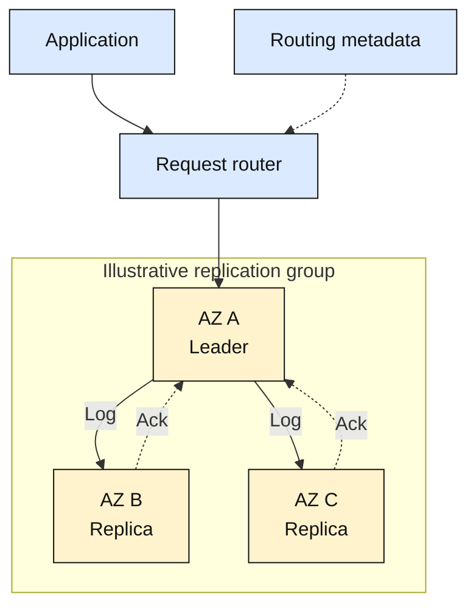

Illustration only; log-only members lack a full item index and are omitted here. Leaders handle writes/strong reads; storage replicas can serve eventual reads. Writes await quorum log persistence. Compare [Paxos](Distributed-Systems-Theorems-and-Data-Structures.md#paxos) and [replication](#replication-models-and-replica-placement).

#### Admission Control and Splitting (2022)

The paper describes an evolution:

| Mechanism | Purpose |
| --- | --- |
| Partition/node token buckets | Allocation and workload isolation |
| Global admission control | Table-wide request-router token coordination |
| Automatic splitting for consumed load | Divide eligible hot ranges; single hot items remain constrained |

**Token buckets: how requests were admitted**

A **token** represents permission to consume throughput. A request spends tokens according to its capacity cost.

The earlier storage-node design described in the paper used **two buckets per partition plus one shared node bucket**:

| Bucket | What it controls |
| --- | --- |
| **Partition allocated bucket** | The partition's regular throughput allowance |
| **Partition burst bucket** | Saved allowance for temporary excess traffic |
| **Shared node bucket** | Capacity available on the storage server hosting multiple partitions |

1. **Regular allowance available:** Admit the request using the partition's allocated tokens and charge the node bucket.
2. **Regular allowance exhausted:** Allow bursting only when both the partition's burst bucket and the node bucket have sufficient tokens.
3. **Required tokens unavailable:** Throttle the request. Saved burst tokens alone do not guarantee admission.

Burst writes also checked capacity at the other replica nodes. This protected shared servers and replicated writes from overload. See **Section 4.1.1** of the [2022 DynamoDB paper](https://www.usenix.org/system/files/atc22-elhemali.pdf).

The paper later describes moving table-budget admission decisions to request routers through **global admission control (GAC)**, while retaining partition token buckets as safeguards.

**Keep the timeframes separate:** This is historical architecture. Current [AWS guidance](https://docs.aws.amazon.com/amazondynamodb/latest/developerguide/burst-adaptive-capacity.html) describes adaptive capacity as automatic and immediate within its limits; do not teach it as only a slow, long-term mechanism. Compare [burst, adaptive, and warm throughput](#burst-adaptive-and-warm-throughput).

“Global” here is table-wide, not necessarily multi-Region. These are historical internals; current “adaptive capacity” is customer-facing terminology.

#### Failure Handling and Gray Failures (2022)

Peers can initiate elections. Replacements respect the old lease before serving protected operations. Gray failures involve partial reachability; peer cross-checks reduce spurious elections. Leader loss can interrupt service; recovery remains possible. See [failure detection](#membership-gossip-and-failure-detection).

#### Current Read Consistency and Transactions

**Current public API guarantees are separate from the historical implementation sketch.**

| Read source | Available read guarantee |
| --- | --- |
| **Base table** | Eventual by default; strong reads can be requested |
| **Local secondary index** | Eventual or strong |
| **Global secondary index** | Eventual only |
| **DynamoDB Streams** | Eventual; not a strongly consistent table read |

A strong read reflects previously completed successful writes within the applicable scope. It is not a lock preventing a subsequent write, nor does making several strong reads automatically create a multi-item snapshot.

**Global tables** replicate across Regions. **MREC** means *multi-Region eventual consistency*: cross-Region propagation is asynchronous. **MRSC** means *multi-Region strong consistency*: supported strong reads provide the corresponding cross-Region guarantee. The modes have different supported configurations and restrictions; see [global-table consistency modes](https://docs.aws.amazon.com/amazondynamodb/latest/developerguide/V2globaltables_HowItWorks.html).

DynamoDB supports transactional APIs within documented boundaries. Standard transaction scope is within one AWS account and Region; do not assume a transaction is replicated atomically as a cross-Region unit. MRSC does not support transaction operations under the current documented restrictions. Compare [DynamoDB transactions](https://docs.aws.amazon.com/amazondynamodb/latest/developerguide/transaction-apis.html), [global-table transaction restrictions](https://docs.aws.amazon.com/amazondynamodb/latest/developerguide/V2globaltables_HowItWorks.html), and [ACID concepts](#transactions-and-acid).

See [AWS's read-consistency documentation](https://docs.aws.amazon.com/amazondynamodb/latest/developerguide/HowItWorks.ReadConsistency.html). Eventual consistency is not the absence of durability, and a successful response is not necessarily a fresh read.

#### Availability, Freshness, Durability, and Recovery

| Concern | Question it answers |
| --- | --- |
| **Availability** | Can the requested operation complete successfully? |
| **Freshness / consistency** | Which completed changes may the read observe? |
| **Durability** | Are acknowledged writes retained under the specified failure assumptions? |
| **Backup / recovery** | Can we restore an appropriate state after deletion, corruption, or other loss? |

An eventual read can succeed while returning an older committed value. Replication can improve availability and durability but also propagate an accidental deletion. Configure and test suitable backup/restore and [point-in-time recovery](https://docs.aws.amazon.com/amazondynamodb/latest/developerguide/Point-in-time-recovery.html). Neither multi-AZ replication nor an availability claim replaces application-level correctness and recovery planning.

### DynamoDB Design Checklist

1. **Access patterns:** Which full-key lookups, partition queries, ranges, and alternate indexes are needed?
2. **Keys and sizes:** Are hot keys, growing collections, item sizes, and index limits understood?
3. **Writes:** Should a put replace, an update upsert, or a condition reject a conflicting action?
4. **Reads:** What freshness is needed, and does the chosen table/index/Region mode support it?
5. **Capacity:** Account for item sizes, consistency, transactions, indexes, peaks, and throttling.
6. **Operations:** Define permissions, retries, monitoring, backup/restore, and the team's recovery process.

> **Recall:** Keys shape access; indexes add access paths; capacity units measure sized work; replication supports resilience; the read option determines freshness. AWS manages the infrastructure, while the application still defines correct behavior.

## Column-Family Databases

> Study notes to be added.

## Apache HBase

> Study notes to be added.

## Graph Databases

> Study notes to be added.

## Neo4j

> Study notes to be added.

## Object Storage and Amazon S3

### What Is Object Storage?

> **Store a piece of content under a key; retrieve it through a storage API.**

**Object storage** retains content as named objects, with metadata describing that content. Think of a product image stored under a name that the application can request later.

| Concept | Meaning | Product-image example |
| --- | --- | --- |
| **Bucket/container** | A named container for objects; terminology varies by service | `shop-media-example` |
| **Object key** | The object's identifier within its bucket | `products/P100/front.jpg` |
| **Content/payload** | The actual bytes being stored | The JPEG image's bytes |
| **Metadata** | System information and supported descriptive fields | Content type `image/jpeg`, byte size, and a product ID |
| **Version** | A retained revision when versioning is enabled | An earlier image retained after replacement |

An object here is **not an object-oriented programming class** and need not be a JSON document. Its content can be text, an image, or another binary format.

Applications normally address objects through a **service endpoint, bucket, and key**. Storage software manages how the bytes are placed on underlying servers and disks; the key is not a physical server address. The service can be cloud-managed or self-hosted. See the [S3 overview](https://docs.aws.amazon.com/AmazonS3/latest/userguide/Welcome.html) and [Ceph Object Gateway](https://docs.ceph.com/en/latest/radosgw/) as examples of these deployment choices.

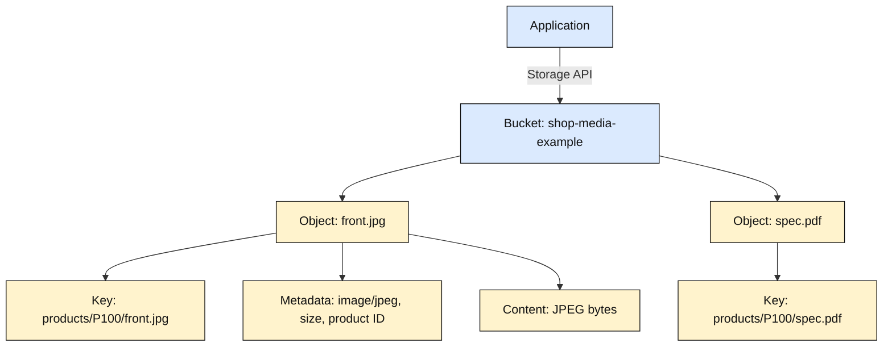

This is an **object anatomy and naming map**, not a message trace or a requirement to create separate objects for each metadata field. Each object includes its own content and associated metadata.

**Keys can look like paths.** In an ordinary S3 general-purpose bucket, `products/P100/` is a key prefix, not a conventional filesystem directory or nested bucket. Consoles can display prefixes as folders. See [S3 object keys](https://docs.aws.amazon.com/AmazonS3/latest/userguide/object-keys.html). Metadata capabilities also vary: S3 distinguishes system metadata, upload-time user metadata, tags, and other supported metadata features. See [object metadata](https://docs.aws.amazon.com/AmazonS3/latest/userguide/UsingMetadata.html).

### What Is Typically Stored There?

| Content | Illustrative use |
| --- | --- |
| **Images** | Product photographs, avatars, scanned documents |
| **Video** | Uploaded clips, recordings, prepared streaming segments |
| **Audio** | Podcasts, voice recordings, music |
| **Documents** | PDFs, invoices, reports |
| **Application files** | Installers, archives, static assets |
| **Backups and exports** | Database backup files and recovery copies |
| **Logs and analytical files** | JSON, CSV, Parquet, and ORC datasets |
| **AI/ML artifacts** | Training datasets, model weights, checkpoints |
| **IoT and robotic data** | Recorded sensor batches, images, and mission recordings |

Object storage holds **structured, semi-structured, and unstructured content**. A Parquet file can contain structured rows even though the storage service exposes it as an object. See [Azure Blob Storage's use cases](https://learn.microsoft.com/en-us/azure/storage/blobs/storage-blobs-overview) and [Google Cloud Storage](https://docs.cloud.google.com/storage/docs/introduction).

Storing a video or audio file does not itself transcode it, prepare adaptive streaming formats, or provide a complete playback service. Object storage can serve the bytes; processing, players, and delivery infrastructure supply the other functions.

Similarly, storing backup files does not prove that restoration works. Retaining datasets does not automatically establish a catalog, data quality, ownership, or a governed data lake. Continue with [warehouse and data-lake architectures](Data-Engineering-for-Solution-Architecture.md#warehouse-and-data-lake) rather than treating a bucket as the whole data platform.

### Object Storage vs. File Storage, Block Storage, and Databases

| Approach | Access model | Typical operations | Suitable example |
| --- | --- | --- | --- |
| **Block storage** | A volume exposes addressable blocks | Read/write block ranges; a filesystem or engine organizes them | A supported volume for a database server |
| **File storage** | Files and directories through filesystem interfaces, locally or over protocols such as NFS/SMB | Open, read, write, rename, and manage paths | A shared team filesystem |
| **Object storage** | Named content and metadata through object APIs | Put, get, head, list, and delete objects | Product images or analytical files |
| **Database** | Modeled records and supported query interfaces | Query, index, constrain, and transact within the engine's guarantees | Products, orders, and account records |

These layers can coexist. A database may use block storage beneath its files, while the application keeps media in object storage. Databases can also store binary content; separate object storage is a design choice, not a requirement for every small file.

The ordinary object API does not supply all filesystem semantics or automatically provide row-level queries and transactions. A mount adapter can expose objects through file-like paths, but applications must check its supported behavior. Some database and analytical engines are designed to use object storage; that does not mean an arbitrary database engine can safely use any bucket as its normal disk.

> **A database commonly stores what the file means and who may access it; object storage holds the file's content.**

### Amazon S3: Responsibilities and Operations

**S3 means Amazon Simple Storage Service.** It is AWS's managed object-storage service. This introduction uses **ordinary general-purpose buckets**; specialized bucket types and their different APIs are outside the walkthrough.

| AWS manages | Application designers manage |
| --- | --- |
| Underlying storage servers, placement, and service infrastructure | Bucket/location choices, object keys, and access patterns |
| Service facilities for replication and protection | Applicable storage classes, versioning, retention, and recovery requirements |
| Storage APIs and managed capabilities | Permissions, upload validation, application correctness, retries, monitoring, and costs |

The storage class affects resilience and access behavior. For example, S3 Standard spans multiple Availability Zones, while One Zone choices have a different failure scope. Do not assume every object-storage configuration is multi-AZ. See [S3 storage classes](https://docs.aws.amazon.com/AmazonS3/latest/userguide/storage-class-intro.html).

#### Worked Object Operations

**The following is language-neutral API-style pseudocode, not executable SDK syntax.** The fictional bucket `shop-media-example` already exists, initially contains no objects, and has never had versioning enabled. Assume valid permissions, no concurrent changes, and successful requests. The two payloads below are illustrative JPEG byte sequences, not files supplied by this note.

**1. Upload product P100's image.**

```text
PutObject(
    Bucket = "shop-media-example",
    Key = "products/P100/front.jpg",
    Body = JPEG_BYTES_V1,             // 120000 bytes
    ContentType = "image/jpeg",
    Metadata = {"product-id": "P100"}
)
Expected: success; the object is stored under this key.
```

**2. Read its metadata without downloading the image.**

```text
HeadObject(
    Bucket = "shop-media-example",
    Key = "products/P100/front.jpg"
)
Expected metadata:
    ContentLength = 120000
    ContentType = "image/jpeg"
    Metadata = {"product-id": "P100"}
Expected body: none
```

**3. Download the image.**

```text
GetObject(
    Bucket = "shop-media-example",
    Key = "products/P100/front.jpg"
)
Expected body: JPEG_BYTES_V1 (120000 bytes)
```

**4. List keys under the product's prefix.**

```text
ListObjectsV2(
    Bucket = "shop-media-example",
    Prefix = "products/P100/",
    MaxKeys = 1000
)
Expected relevant response fields:
    Contents = [{Key: "products/P100/front.jpg", Size: 120000}]
    IsTruncated = false
```

For a larger result, when `IsTruncated` is true, pass `NextContinuationToken` as the next request's `ContinuationToken`. Continue until no page remains. General-purpose bucket results are ordered lexicographically by key; a prefix listing is not an arbitrary query over the image's contents. See [ListObjectsV2](https://docs.aws.amazon.com/AmazonS3/latest/API/API_ListObjectsV2.html).

**5. Replace the image using the same key.**

```text
PutObject(
    Bucket = "shop-media-example",
    Key = "products/P100/front.jpg",
    Body = JPEG_BYTES_V2,             // 150000 bytes
    ContentType = "image/jpeg",
    Metadata = {"product-id": "P100"}
)
Expected: success; GetObject now returns JPEG_BYTES_V2.
```

In this unversioned example, the old image is not retained as an addressable previous version. With **versioning enabled**, a successful replacement instead creates a new version; earlier versions remain until deleted according to the applicable rules. These ordinary puts replace the object rather than patching one field inside its content. See [PutObject](https://docs.aws.amazon.com/AmazonS3/latest/API/API_PutObject.html).

**6. Delete the image.**

```text
DeleteObject(
    Bucket = "shop-media-example",
    Key = "products/P100/front.jpg"
)
Expected: success; the unversioned object is removed.
A subsequent GetObject finds no current object.
```

With permission to list the bucket, the missing-object read returns `404 NoSuchKey`. Without that permission, a missing-object read can return `403` instead; error interpretation must account for access policy. See [GetObject](https://docs.aws.amazon.com/AmazonS3/latest/API/API_GetObject.html) and [HeadObject](https://docs.aws.amazon.com/AmazonS3/latest/API/API_HeadObject.html).

**Versioned deletion behaves differently.** In a versioning-enabled bucket, a delete without `VersionId` adds a **delete marker**. Normal reads then treat the key as deleted, while older data versions still exist. Permanently deleting a particular version requires its version ID and permission, subject to retention protections. A suspended-versioning bucket has additional rules. See [DeleteObject](https://docs.aws.amazon.com/AmazonS3/latest/API/API_DeleteObject.html) and [deleting object versions](https://docs.aws.amazon.com/AmazonS3/latest/userguide/DeletingObjectVersions.html).

#### Large Transfers and Checksums

- **Multipart upload:** Upload parts independently, retry failed parts, then complete the upload to assemble one object. Incomplete uploads need completion, abortion, or suitable lifecycle cleanup; uploaded parts are not a finished object. See [multipart upload](https://docs.aws.amazon.com/AmazonS3/latest/userguide/mpuoverview.html).
- **Range reads:** Retrieve a byte range instead of the whole object. For example, `Range = "bytes=0-1023"` requests the first 1024 bytes when they exist. See [GetObject range requests](https://docs.aws.amazon.com/AmazonS3/latest/API/API_GetObject.html).
- **Checksums and ETags:** Use the supported checksum facilities to check transfer integrity. An ETag is **not universally the content's MD5 hash**, especially with multipart uploads or different encryption methods. Checksums detect differences; they do not grant access or replace encryption. See [S3 metadata and ETags](https://docs.aws.amazon.com/AmazonS3/latest/userguide/UsingMetadata.html).

### Worked Application Example: Product Details and Images

Keep the same product and storage identifiers:

| Component | Responsibility |
| --- | --- |
| **PostgreSQL** | Product P100's name, price, owner, and stored image reference |
| **Object storage** | The image bytes in `shop-media-example` under `products/P100/front.jpg` |
| **Application** | Authorize changes and reads, validate uploads, and manage the reference |
| **Optional CDN** | Cache and deliver eligible content; private content still needs appropriate access controls |

The sequence below is a **separate application walkthrough**, starting with a new upload opportunity after the operation examples. It assumes the product exists and the image key is available.

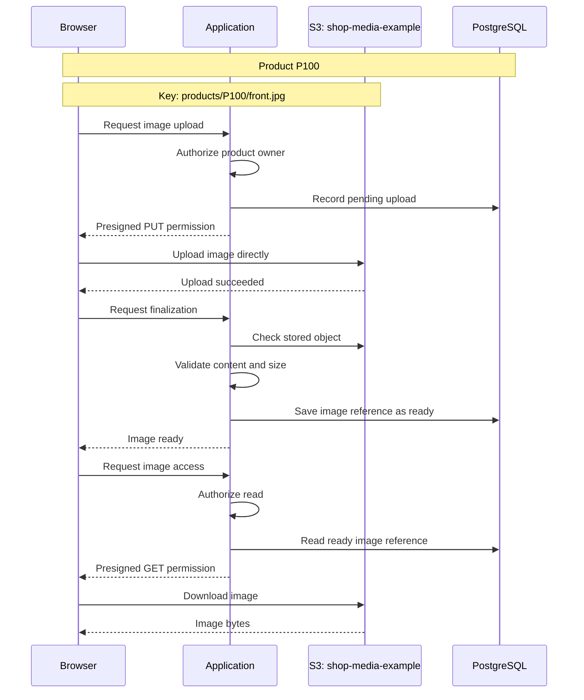

The direct upload avoids carrying the image bytes through the application server. The application still checks that the expected object was uploaded; a browser's success message is not sufficient verification. Content checks may run in a worker, and an object can remain quarantined until approved. Cross-origin browser requests also need appropriate CORS settings; CORS does not grant storage permission.

A **presigned URL** grants time-limited access for a particular object and operation, within the signer's permissions. The bucket can remain private. Anyone possessing the URL can use its granted access, and it can generally be reused until it expires or becomes invalid. Keep it out of sensitive logs. See [AWS's presigned-URL guidance](https://docs.aws.amazon.com/AmazonS3/latest/userguide/using-presigned-url.html).

The diagram omits some failure branches. Use these simple state rules:

| Situation | Application response |
| --- | --- |
| Permission issued but upload fails | Keep the upload pending or failed; do not publish a ready reference |
| Upload succeeds but database update fails | Retry finalization safely; track and later clean abandoned uploads |
| Finalization is repeated | Recognize the same upload and avoid duplicate records or side effects |
| Object changes after validation | Bind readiness to the validated version or otherwise prevent unapproved replacement |
| Old uploads are abandoned | Reconcile pending records and objects before cleanup; avoid deleting active data |

**The database and bucket do not automatically share one transaction.** A practical design records the bucket, key, and, where needed, the verified version or checksum. The fixed key here is for learning; real upload flows need a controlled key/version strategy so a still-valid upload permission cannot silently replace approved content. For production validation, metadata alone does not establish that the bytes are safe or correct.

See [ACID and transaction boundaries](#transactions-and-acid), [application authorization](Identity-and-Access-Management.md#authorization-in-practice), and [pipeline recovery and reconciliation](Data-Engineering-for-Solution-Architecture.md#recovery-backfills-and-exactly-once-claims).

An optional **content delivery network (CDN)** adds an independent cache in front of eligible content. Updating S3 does not automatically remove every cached copy; define cache lifetimes, invalidation, or versioned asset URLs. A presigned S3 URL alone is not a CDN access-control design.

### Consistency, Security, Lifecycle, and Recovery

**Current S3 object operations have strong consistency:** after a successful put, overwrite, or delete, later reads and listings reflect the completed change within S3's documented scope. That does not make a separate database update atomic, force an asynchronous replica to be current, or refresh external caches. Other object-storage systems can offer different guarantees. See [S3 strong consistency](https://aws.amazon.com/s3/consistency/).

| Concern | Simple design rule |
| --- | --- |
| **Private access and least privilege** | Give each identity only the required object/prefix operations; the application still enforces business permissions |
| **Transport and encryption** | Use TLS and suitable at-rest encryption/key controls; encryption does not replace authorization |
| **Upload safety** | Check size and actual content; quarantine or scan when required before publication |
| **Versioning** | Retain earlier revisions for recovery, with policies for old-version retention and cost |
| **Lifecycle rules** | Transition or expire eligible objects; current and noncurrent versions require appropriate rules |
| **Retention / Object Lock** | Protect specified versions using configured retention or legal holds; new versions and delete markers can still be created |
| **Replication** | Provide copies in the configured failure scope; replication is not a substitute for backup or restoration tests |
| **Backup and recovery** | Decide what must be recoverable, who can delete recovery copies, and how restoration will be tested |
| **Cost and performance** | Consider stored bytes, operations, retrieval, transfer, object size, access frequency, concurrency, and recovery needs |
| **Events and integration** | Handle retries, duplicate notifications, and out-of-order events; a notification is not a cross-system commit |

See [S3 security practices](https://docs.aws.amazon.com/AmazonS3/latest/userguide/security-best-practices.html), [lifecycle expiration](https://docs.aws.amazon.com/AmazonS3/latest/userguide/lifecycle-expire-general-considerations.html), [Object Lock](https://docs.aws.amazon.com/AmazonS3/latest/userguide/object-lock.html), and [notification delivery behavior](https://docs.aws.amazon.com/AmazonS3/latest/userguide/notification-how-to-event-types-and-destinations.html).

**Storage classes reflect access and recovery needs:**

| Access pattern | S3 examples | What to check |
| --- | --- | --- |
| **Frequent access** | S3 Standard | Latency, request/transfer costs, and required resilience |
| **Infrequent access** | S3 Standard-IA or One Zone-IA | Retrieval charges, minimum storage rules, and the failure scope |
| **Archive** | S3 Glacier Instant Retrieval, Flexible Retrieval, or Deep Archive | Some offer immediate access; others need a restore request and waiting time |

These are categories, not universal performance or price guarantees. Do not describe every archive class as offline, every object store as cheap, or every class as multi-AZ. Choose using the current [storage-class documentation](https://docs.aws.amazon.com/AmazonS3/latest/userguide/storage-class-intro.html) and the application's [retention and deletion requirements](Data-Engineering-for-Solution-Architecture.md#access-privacy-and-lifecycle).

### Prominent Object-Storage Solutions

These are **representative implementations**, not an exhaustive list, ranking, or claim that their guarantees are identical. The common object-storage concept matters more than memorizing every product name.

#### Major Cloud Platforms

| Solution | Deployment model | Concept to recognize | Official reference |
| --- | --- | --- | --- |
| **Amazon S3** | AWS-managed | Buckets, keys, objects, and storage-class choices | [S3 overview](https://docs.aws.amazon.com/AmazonS3/latest/userguide/Welcome.html) |
| **Azure Blob Storage** | Microsoft-managed | Blob containers and objects; part of Azure Storage | [Blob Storage overview](https://learn.microsoft.com/en-us/azure/storage/blobs/storage-blobs-overview) |
| **Google Cloud Storage** | Google-managed | Buckets, objects, and location/access choices | [Cloud Storage overview](https://docs.cloud.google.com/storage/docs/introduction) |
| **OCI Object Storage** | Oracle-managed | Object storage separate from compute instances | [OCI overview](https://docs.oracle.com/en-us/iaas/Content/Object/Concepts/objectstorageoverview.htm) |
| **IBM Cloud Object Storage** | IBM-managed | Buckets with configured location and resilience | [IBM overview](https://cloud.ibm.com/docs/cloud-object-storage?topic=cloud-object-storage-about-cloud-object-storage) |
| **Alibaba Cloud OSS** | Alibaba-managed | Object Storage Service with multiple access tiers | [OSS overview](https://www.alibabacloud.com/help/en/oss/user-guide/oss-overview) |
| **Tencent Cloud COS** | Tencent-managed | Cloud Object Storage accessed through service APIs | [COS overview](https://www.tencentcloud.com/document/product/436/6222) |
| **Huawei Cloud OBS** | Huawei-managed | Object Storage Service for named stored content | [OBS overview](https://support.huaweicloud.com/intl/en-us/productdesc-obs/en-us_topic_0045853681.html) |

#### Additional Managed Services

| Solution | Deployment model | Concept to recognize | Official reference |
| --- | --- | --- | --- |
| **Cloudflare R2** | Cloudflare-managed | Object storage with an S3-compatible interface | [R2 documentation](https://developers.cloudflare.com/r2/) |
| **Backblaze B2** | Backblaze-managed | B2 object storage with S3-compatible and native interfaces | [B2 S3 API](https://www.backblaze.com/docs/cloud-storage-call-the-s3-compatible-api) |
| **Wasabi** | Wasabi-managed | Managed object storage with documented S3 API variations | [Wasabi API reference](https://docs.wasabi.com/apidocs/wasabi-api) |
| **DigitalOcean Spaces** | DigitalOcean-managed | S3-compatible object storage with optional CDN delivery | [Spaces documentation](https://docs.digitalocean.com/products/spaces/) |

#### Self-Hosted and Open-Source Projects

| Solution | Deployment model | Concept to recognize | Official reference |
| --- | --- | --- | --- |
| **Ceph Object Gateway** | Operator-managed Ceph cluster | Gateway exposing S3/Swift-compatible object interfaces | [Ceph gateway](https://docs.ceph.com/en/latest/radosgw/) |
| **OpenStack Swift** | Operator-managed distributed service | Object/container/account model and Swift's documented consistency | [Swift documentation](https://docs.openstack.org/swift/latest/) |
| **SeaweedFS** | Operator-managed storage system | Object storage through an S3 interface alongside other interfaces | [SeaweedFS project](https://github.com/seaweedfs/seaweedfs) |
| **Apache Ozone** | Operator-managed distributed storage | An S3 gateway over Ozone's object store | [Ozone S3 interface](https://ozone.apache.org/docs/2.1.2/user-guide/client-interfaces/s3/s3-api/) |

#### Commercial Self-Hosted Platforms

| Solution | Deployment model | Concept to recognize | Official reference |
| --- | --- | --- | --- |
| **MinIO AIStor** | Self-hosted vendor platform | S3 object access; distinct from the legacy community repository | [AIStor documentation](https://docs.min.io/aistor/) |
| **Cloudian HyperStore** | Self-hosted vendor platform | Distributed enterprise object storage with S3 interfaces | [HyperStore overview](https://cloudian.com/products/hyperstore/) |
| **Scality RING / ARTESCA** | Self-hosted vendor platforms | Object-storage offerings with different deployment/workload emphases | [Scality products](https://www.scality.com/products) |

**Historical MinIO clarification:** As checked on **5 November 2026**, the [legacy MinIO community repository](https://github.com/minio/minio) is archived and marked unmaintained. Do not treat its old installation guidance as current AIStor documentation or assume the editions share licensing and support terms.

**S3-compatible does not mean identical to AWS S3.** Check the exact operations, policy model, consistency, versioning, limits, and error behavior the implementation supports. Cloudflare publishes a [feature-by-feature compatibility list](https://developers.cloudflare.com/r2/api/s3/api/); Wasabi also documents variations. Do not assume every object-storage service uses the S3 API.

Self-hosting means the operator must arrange capacity, upgrades, access control, monitoring, and recovery. Open-source availability does not remove those responsibilities; a commercial edition does not automatically supply every capability or guarantee.

### When to Choose Object Storage

| Requirement | What to evaluate | Simple example |
| --- | --- | --- |
| **Large named content, media, backups, or datasets** | Object storage | Keep P100's images and exported analytical files |
| **Shared filesystem operations** | File storage | Several applications need a shared directory with supported file semantics |
| **Filesystem/database-engine volumes** | Block storage | Provide the volume required by a conventional database engine |
| **Record-level queries and transactions** | A suitable database | Change a product's price and related operational records |
| **Fast repeated delivery** | Caching/CDN alongside the authoritative store | Deliver a frequently viewed product image from a nearby cache |

For a small application, local files or database binary fields may be sufficient. Introduce object storage when access, durability, sharing, scale, delivery, or operating requirements justify another service. Check recovery and total cost instead of assuming one storage model is always better.

> **Object storage keeps content by key. Databases organize application records. Use them together when their different responsibilities fit the application.**

## Summary

Databases organize application information; DBMSs supply operations and configurable guarantees; storage resources retain the underlying bytes. Relational, key-value, document, column-family, and graph models emphasize different ways to represent and access data.

Transactions, constraints, indexes, partitioning, and recovery mechanisms must be selected for the actual workload. Relational systems can scale beyond one node and store semi-structured data; NoSQL systems can provide strong consistency and transactions within documented boundaries. Neither category removes the need for modeling, compatibility planning, access control, and tested recovery.

The remaining placeholders reserve space for deeper study of column-family and graph databases and their named implementations.

The [object-storage section](#object-storage-and-amazon-s3) explains named content, metadata, and S3 operations. Its product-image example separates file bytes from database records and shows why permissions, lifecycle, and cross-system recovery still need deliberate design.

The [DynamoDB example](#amazon-dynamodb) connects keys, APIs, indexes, sized capacity units, and read guarantees. Its historical architecture discussion is separate from current documented service behavior.

The [selection guide](#database-selection-by-requirements) maps requirements to database candidates and shows how a banking platform can combine authoritative records with optional caches, search, and analytical views. Each added system needs a clear role and a justified operating cost.

> **Recall:** Start with the queries and invariants. Then choose the model, guarantees, engine, and operating strategy—not the other way around.

## Related Notes

- [Data engineering pipelines and analytical architectures](Data-Engineering-for-Solution-Architecture.md)
- [System design at different scales](Understanding-System-Design.md#system-design-at-different-scales)
- [Distributed consistency](Distributed-System-Attributes.md#consistency)
- [CAP theorem](Distributed-Systems-Theorems-and-Data-Structures.md#cap-theorem)
- [PACELC theorem](Distributed-Systems-Theorems-and-Data-Structures.md#pacelc-theorem)
- [IAM and authorization](Identity-and-Access-Management.md#authorization-in-practice)

## Further Reading

- [PostgreSQL: Constraints and Keys](https://www.postgresql.org/docs/current/ddl-constraints.html)
- [PostgreSQL: Transactions](https://www.postgresql.org/docs/current/tutorial-transactions.html)
- [PostgreSQL: Transaction Isolation](https://www.postgresql.org/docs/current/transaction-iso.html)
- [PostgreSQL: JSON Types](https://www.postgresql.org/docs/current/datatype-json.html)
- [PostgreSQL: Query Plans](https://www.postgresql.org/docs/current/using-explain.html)
- [PostgreSQL: Backup and Restore](https://www.postgresql.org/docs/current/backup.html)
- [PostgreSQL: Physical Row Layout and Null Bitmap](https://www.postgresql.org/docs/current/storage-page-layout.html)
- [MySQL: InnoDB Error Handling and Rollback Scope](https://dev.mysql.com/doc/refman/8.4/en/innodb-error-handling.html)
- [MongoDB: Data Modeling](https://www.mongodb.com/docs/manual/data-modeling/)
- [MongoDB: Transactions](https://www.mongodb.com/docs/manual/core/transactions/)
- [MongoDB: Documents, BSON, and Identifiers](https://www.mongodb.com/docs/manual/core/document/)
- [MongoDB: Schema Validation](https://www.mongodb.com/docs/manual/core/schema-validation/)
- [MongoDB: Single-Document Atomicity](https://www.mongodb.com/docs/manual/core/write-operations-atomicity/)
- [MongoDB: insertOne](https://www.mongodb.com/docs/manual/reference/method/db.collection.insertOne/)
- [MongoDB: findOne](https://www.mongodb.com/docs/manual/reference/method/db.collection.findOne/)
- [MongoDB: find and Projections](https://www.mongodb.com/docs/manual/reference/method/db.collection.find/)
- [MongoDB: updateOne](https://www.mongodb.com/docs/manual/reference/method/db.collection.updateOne/)
- [MongoDB: $addToSet](https://www.mongodb.com/docs/manual/reference/operator/update/addToSet/)
- [MongoDB: deleteOne](https://www.mongodb.com/docs/manual/reference/method/db.collection.deleteOne/)
- [MongoDB: Aggregation Pipelines](https://www.mongodb.com/docs/manual/core/aggregation-pipeline/)
- [MongoDB: createIndex](https://www.mongodb.com/docs/manual/reference/method/db.collection.createIndex/)
- [MongoDB: Modeling Best Practices](https://www.mongodb.com/docs/manual/data-modeling/best-practices/)
- [MongoDB: $lookup](https://www.mongodb.com/docs/manual/reference/operator/aggregation/lookup/)
- [MongoDB: Limits and Document Size](https://www.mongodb.com/docs/manual/reference/limits/)
- [DynamoDB: Transactions](https://docs.aws.amazon.com/amazondynamodb/latest/developerguide/transactions.html)
- [DynamoDB: Read Consistency](https://docs.aws.amazon.com/amazondynamodb/latest/developerguide/HowItWorks.ReadConsistency.html)
- [DynamoDB: Tables, Items, Attributes, and Keys](https://docs.aws.amazon.com/amazondynamodb/latest/developerguide/HowItWorks.CoreComponents.html)
- [DynamoDB: Physical Partitions and Item Collections](https://docs.aws.amazon.com/amazondynamodb/latest/developerguide/HowItWorks.Partitions.html)
- [DynamoDB API: PutItem](https://docs.aws.amazon.com/amazondynamodb/latest/APIReference/API_PutItem.html)
- [DynamoDB API: UpdateItem](https://docs.aws.amazon.com/amazondynamodb/latest/APIReference/API_UpdateItem.html)
- [DynamoDB API: GetItem](https://docs.aws.amazon.com/amazondynamodb/latest/APIReference/API_GetItem.html)
- [DynamoDB API: DeleteItem](https://docs.aws.amazon.com/amazondynamodb/latest/APIReference/API_DeleteItem.html)
- [DynamoDB: Query Pagination](https://docs.aws.amazon.com/amazondynamodb/latest/developerguide/Query.Pagination.html)
- [DynamoDB: Filters and Evaluated Data](https://docs.aws.amazon.com/amazondynamodb/latest/developerguide/Query.FilterExpression.html)
- [DynamoDB: Global and Local Secondary Indexes](https://docs.aws.amazon.com/amazondynamodb/latest/developerguide/SecondaryIndexes.html)
- [DynamoDB: Capacity Modes](https://docs.aws.amazon.com/amazondynamodb/latest/developerguide/capacity-mode.html)
- [DynamoDB: Read/Write Unit Accounting](https://docs.aws.amazon.com/amazondynamodb/latest/developerguide/read-write-operations.html)
- [DynamoDB: Item and Capacity Constraints](https://docs.aws.amazon.com/amazondynamodb/latest/developerguide/Constraints.html)
- [DynamoDB: Burst and Adaptive Capacity](https://docs.aws.amazon.com/amazondynamodb/latest/developerguide/burst-adaptive-capacity.html)
- [DynamoDB: Warm Throughput](https://docs.aws.amazon.com/amazondynamodb/latest/developerguide/warm-throughput.html)
- [DynamoDB: Application-Level Write Sharding](https://docs.aws.amazon.com/amazondynamodb/latest/developerguide/bp-partition-key-sharding.html)
- [DynamoDB: Global Tables and Their Consistency Modes](https://docs.aws.amazon.com/amazondynamodb/latest/developerguide/V2globaltables_HowItWorks.html)
- [DynamoDB: Point-in-Time Backups](https://docs.aws.amazon.com/amazondynamodb/latest/developerguide/Point-in-time-recovery.html)
- [AWS Authors: DynamoDB Architecture and Evolution — USENIX ATC 2022](https://www.usenix.org/conference/atc22/presentation/elhemali)
- [Redis: Data Types](https://redis.io/docs/latest/develop/data-types/)
- [Redis: String Values and Key-Based Operations](https://redis.io/docs/latest/develop/data-types/strings/)
- [Dynamo: Amazon's Highly Available Key-Value Store — Original 2007 Paper](https://www.allthingsdistributed.com/files/amazon-dynamo-sosp2007.pdf)
- [Apache CouchDB: Technical Overview](https://docs.couchdb.org/en/stable/intro/overview.html)
- [Apache Cassandra: Architecture Overview](https://cassandra.apache.org/doc/latest/cassandra/architecture/overview.html)
- [Apache Cassandra: Token Placement, Replication, and Membership](https://cassandra.apache.org/doc/latest/cassandra/architecture/dynamo.html)
- [Apache Cassandra: Hints and Hinted Handoff](https://cassandra.apache.org/doc/latest/cassandra/managing/operating/hints.html)
- [Apache Cassandra: Replica Repair and Merkle Trees](https://cassandra.apache.org/doc/latest/cassandra/managing/operating/repair.html)
- [RFC 9162: Merkle Trees and Certificate Transparency](https://www.rfc-editor.org/rfc/rfc9162.html#section-2.1)
- [Bitcoin Developer Guide: Merkle Trees](https://developer.bitcoin.org/devguide/block_chain.html#merkle-trees)
- [BitTorrent BEP 52: Protocol v2 Merkle Trees](https://www.bittorrent.org/beps/bep_0052.html)
- [PostgreSQL: Primary-Standby and Synchronous Replication](https://www.postgresql.org/docs/current/warm-standby.html)
- [PostgreSQL: Failover and Preventing Competing Primaries](https://www.postgresql.org/docs/current/warm-standby-failover.html)
- [Apache HBase: Data Model](https://hbase.apache.org/docs/datamodel/)
- [ClickHouse: Column-Oriented Database Overview](https://clickhouse.com/docs/get-started/about/intro)
- [Greenplum Transaction Snapshots — Historical Vendor Explanation](https://blogs.vmware.com/tanzu/improving-backup-performance-and-reliability-with-distributed-snapshots/)
- [ClickHouse: SQL JOIN Support](https://clickhouse.com/docs/reference/statements/select/join)
- [ClickHouse: Transactional Insert Guarantees and Experimental Transactions](https://clickhouse.com/docs/concepts/features/operations/insert/transactions)
- [ClickHouse: UPDATE](https://clickhouse.com/docs/reference/statements/update)
- [ClickHouse: DELETE](https://clickhouse.com/docs/reference/statements/delete)
- [ClickHouse: Access Control and RBAC](https://clickhouse.com/docs/concepts/features/security/access-rights)
- [ClickHouse: Backup and Restore](https://clickhouse.com/docs/concepts/features/backup-restore/overview)
- [Neo4j: Graph Database Concepts](https://neo4j.com/docs/getting-started/appendix/graphdb-concepts/)
- [Spanner: Schemas and Data Distribution](https://docs.cloud.google.com/spanner/docs/schema-and-data-model)
- [Greenplum Project Repository — Archived Historical Material](https://github.com/greenplum-db/gpdb-archive)
- [Greenplum Architecture — Archived Historical Documentation](https://github.com/greenplum-db/gpdb-archive/blob/main/gpdb-doc/markdown/admin_guide/intro/arch_overview.html.md)
- [Broadcom: Greenplum Standby Coordinator Activation](https://knowledge.broadcom.com/external/article/296354/failover-to-standby.html)
- [Tanzu: Greenplum on Kubernetes](https://blogs.vmware.com/tanzu/greenplum-on-kubernetes/)
- [Yandex Cloud: Greenplum Storage Layouts](https://yandex.cloud/en/docs/managed-greenplum/concepts/tables)
- [Yandex Cloud: Greenplum Data Distribution](https://yandex.cloud/en/docs/managed-greenplum/concepts/sharding)
- [SQLite: Embedded Operation Without a Separate Server](https://www.sqlite.org/serverless.html)
- [PostgreSQL: Full-Text Search](https://www.postgresql.org/docs/current/textsearch.html)
- [pgvector: Vector Similarity Search Extension for PostgreSQL](https://github.com/pgvector/pgvector)
- [PostGIS: Spatial Capabilities for PostgreSQL](https://postgis.net/documentation/)
- [Google Bigtable: Data Model and Row-Key Access](https://docs.cloud.google.com/bigtable/docs/overview)
- [Apache Cassandra: Partition Sizing and Bucketing](https://cassandra.apache.org/doc/latest/cassandra/developing/data-modeling/data-modeling_refining.html)
- [InfluxDB: Time-Series Data and Use Cases](https://docs.influxdata.com/influxdb3/core/)
- [Elasticsearch: Search, Analytics, and Vector Capabilities](https://www.elastic.co/docs/products/elasticsearch)
- [Qdrant: Vector Similarity Search and Metadata Filtering](https://qdrant.tech/documentation/overview/)
- [KurrentDB: Event Streams and the EventStoreDB Rename](https://docs.kurrent.io/getting-started/kurrent-ecosystem)
- [immudb: Verifiable History](https://github.com/codenotary/immudb)
- [Amazon S3: Overview and Responsibilities](https://docs.aws.amazon.com/AmazonS3/latest/userguide/Welcome.html)
- [Amazon S3: Object Keys and Prefixes](https://docs.aws.amazon.com/AmazonS3/latest/userguide/object-keys.html)
- [Amazon S3: Metadata and ETags](https://docs.aws.amazon.com/AmazonS3/latest/userguide/UsingMetadata.html)
- [Amazon S3: PutObject](https://docs.aws.amazon.com/AmazonS3/latest/API/API_PutObject.html)
- [Amazon S3: HeadObject](https://docs.aws.amazon.com/AmazonS3/latest/API/API_HeadObject.html)
- [Amazon S3: GetObject and Range Reads](https://docs.aws.amazon.com/AmazonS3/latest/API/API_GetObject.html)
- [Amazon S3: ListObjectsV2 and Pagination](https://docs.aws.amazon.com/AmazonS3/latest/API/API_ListObjectsV2.html)
- [Amazon S3: DeleteObject](https://docs.aws.amazon.com/AmazonS3/latest/API/API_DeleteObject.html)
- [Amazon S3: Deleting Versions and Delete Markers](https://docs.aws.amazon.com/AmazonS3/latest/userguide/DeletingObjectVersions.html)
- [Amazon S3: Multipart Uploads](https://docs.aws.amazon.com/AmazonS3/latest/userguide/mpuoverview.html)
- [Amazon S3: Presigned Uploads and Downloads](https://docs.aws.amazon.com/AmazonS3/latest/userguide/using-presigned-url.html)
- [Amazon S3: Strong Consistency](https://aws.amazon.com/s3/consistency/)
- [Amazon S3: Storage Classes](https://docs.aws.amazon.com/AmazonS3/latest/userguide/storage-class-intro.html)
- [Amazon S3: Security Practices](https://docs.aws.amazon.com/AmazonS3/latest/userguide/security-best-practices.html)
- [Amazon S3: Lifecycle Expiration](https://docs.aws.amazon.com/AmazonS3/latest/userguide/lifecycle-expire-general-considerations.html)
- [Amazon S3: Object Lock and Retention](https://docs.aws.amazon.com/AmazonS3/latest/userguide/object-lock.html)
- [Amazon S3: Event Delivery, Ordering, and Duplicates](https://docs.aws.amazon.com/AmazonS3/latest/userguide/notification-how-to-event-types-and-destinations.html)
- [Cloudflare R2: S3 API Compatibility](https://developers.cloudflare.com/r2/api/s3/api/)
- [MinIO Community Repository — Archived, Unmaintained](https://github.com/minio/minio)
- [MinIO AIStor: Current Vendor Documentation](https://docs.min.io/aistor/)
- [Redis: GET and Lookup Complexity](https://redis.io/docs/latest/commands/get/)
- [Redis: Persistence, Snapshots, and Append-Only Logs](https://redis.io/docs/latest/operate/oss_and_stack/management/persistence/)
- [PostgreSQL: B-Tree and Hash Index Types](https://www.postgresql.org/docs/current/indexes-types.html)
- [RocksDB: Storage-Engine Overview](https://github.com/meta/rocksdb/wiki/RocksDB-Overview)
