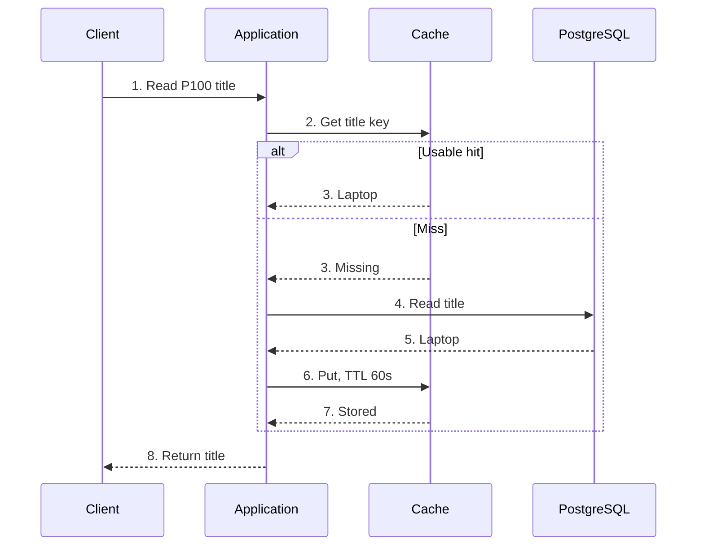
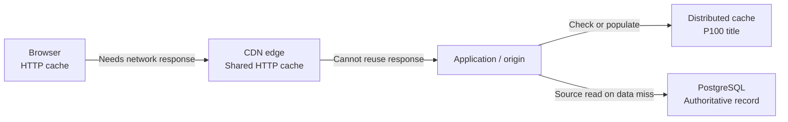
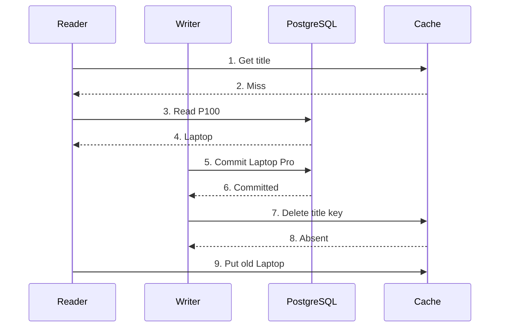
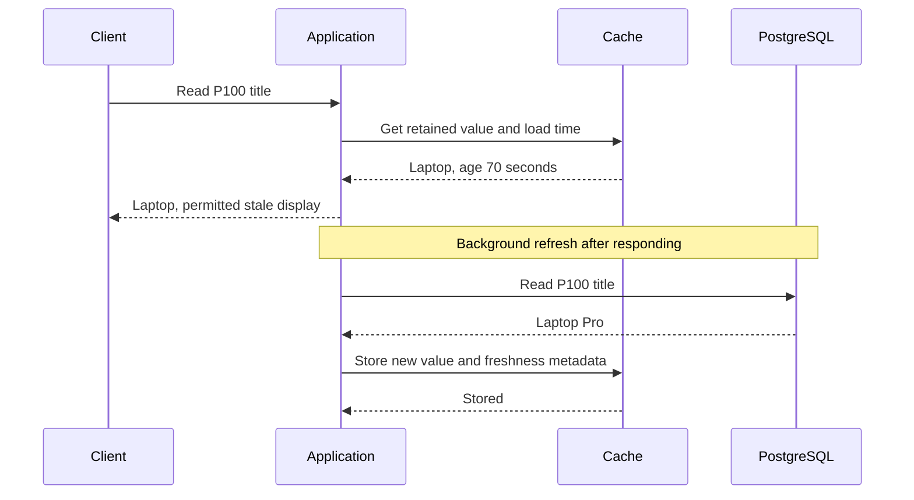
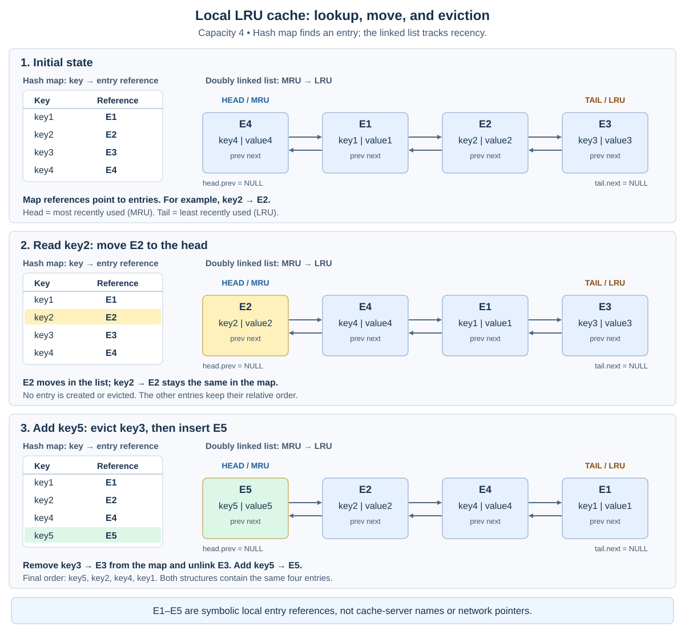
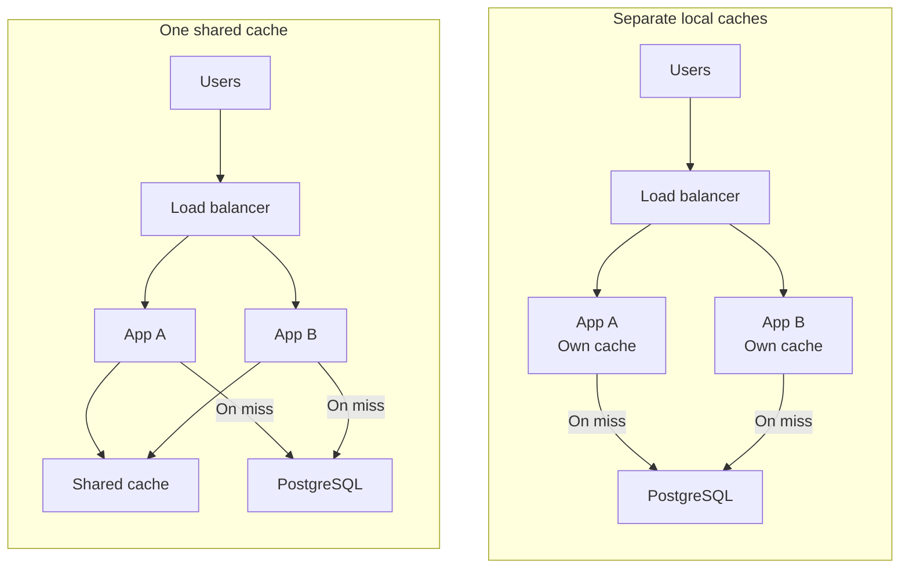
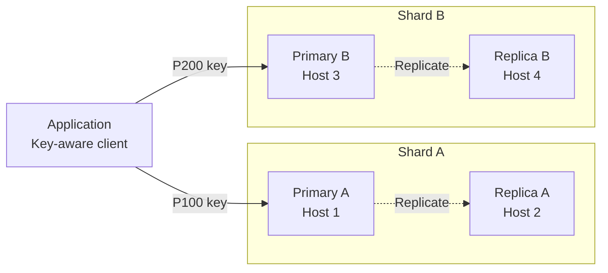

# Distributed Cache

## Table of Contents

- [Overview and Core Mental Model](#overview-and-core-mental-model)
- [Worked Example: Product P100](#worked-example-product-p100)
  - [Cache-Aside Read Flow](#cache-aside-read-flow)
  - [Updating the Source and Invalidating the Cache](#updating-the-source-and-invalidating-the-cache)
- [Cache Layers: Browser, CDN, and Application](#cache-layers-browser-cdn-and-application)
  - [HTTP Freshness and Validation](#http-freshness-and-validation)
  - [Invalidating CDN Content](#invalidating-cdn-content)
- [Requirements, Benefits, and Trade-Offs](#requirements-benefits-and-trade-offs)
  - [A Conceptual Cache API](#a-conceptual-cache-api)
  - [When Caching Helps](#when-caching-helps)
  - [Challenges and Trade-Offs at a Glance](#challenges-and-trade-offs-at-a-glance)
- [Designing a Distributed Cache: Step by Step](#designing-a-distributed-cache-step-by-step)
  - [Functional Requirements](#functional-requirements)
  - [Non-Functional Requirements](#non-functional-requirements)
  - [Design Journey](#design-journey)
  - [Requirements Check](#requirements-check)
- [Freshness, Expiration, and Write Patterns](#freshness-expiration-and-write-patterns)
  - [TTL, Eviction, and Invalidation](#ttl-eviction-and-invalidation)
  - [Loading and Write Patterns](#loading-and-write-patterns)
  - [A Stale-Refill Race](#a-stale-refill-race)
  - [Stale-While-Revalidate: Serve, Then Refresh](#stale-while-revalidate-serve-then-refresh)
  - [Event-Driven Invalidation and Versioned Keys](#event-driven-invalidation-and-versioned-keys)
- [Eviction Policies and a Local LRU Cache](#eviction-policies-and-a-local-lru-cache)
  - [How the Hash Map and List Work](#how-the-hash-map-and-list-work)
  - [Worked LRU Trace](#worked-lru-trace)
  - [LRU Pseudocode and Complexity](#lru-pseudocode-and-complexity)
- [Deployment Choices](#deployment-choices)
  - [In-Process, Co-Located, and Shared Caches](#in-process-co-located-and-shared-caches)
  - [Two Requests, Two App Servers](#two-requests-two-app-servers)
  - [Optional L1 and L2](#optional-l1-and-l2)
  - [Managed Cloud Caches](#managed-cloud-caches)
- [Routing, Sharding, and Replication](#routing-sharding-and-replication)
  - [Routing a Key](#routing-a-key)
    - [Worked Example: Adding or Removing a Cache Node](#worked-example-adding-or-removing-a-cache-node)
  - [Shards vs. Replicas](#shards-vs-replicas)
- [Failures, Security, and Operations](#failures-security-and-operations)
  - [Failure Scenarios and Recovery](#failure-scenarios-and-recovery)
  - [Isolation and Sensitive Data](#isolation-and-sensitive-data)
  - [What to Measure](#what-to-measure)
- [Redis and Memcached](#redis-and-memcached)
  - [Roles and Capabilities](#roles-and-capabilities)
  - [Redis: Short Command Walkthrough](#redis-short-command-walkthrough)
  - [Memcached: Basic Text Protocol Walkthrough](#memcached-basic-text-protocol-walkthrough)
- [Choosing a Cache Architecture](#choosing-a-cache-architecture)
- [Study Map and Recall Summary](#study-map-and-recall-summary)
- [Related Notes](#related-notes)
- [Further Reading](#further-reading)

## Overview and Core Mental Model

**A cache keeps data that is useful to reuse.** It can save a database read, an API call, or an expensive calculation. A **distributed cache** spreads this role across networked cache servers.

Caching is useful only when reuse saves enough work to justify lookup, storage, refresh, and operating costs. A database may already serve a query from RAM; a remote cache adds a network round trip. Measure the actual workload.

| Term | Simple meaning | Example |
| --- | --- | --- |
| **Authoritative source** | The system responsible for the required record and its guarantees | PostgreSQL's product record |
| **Cached value** | A reusable copy or derived result | Product P100's title, `"Laptop"` |
| **Cache hit** | A usable entry is found | Return the title without another database read |
| **Cache miss** | No usable entry is found | The key is absent or its entry has expired |
| **Cache error** | The cache operation cannot complete normally | A timeout or unavailable cache server |
| **Expiration** | An entry stops being usable after its lifetime | A 60-second TTL expires |
| **Eviction** | An entry is removed to manage limited capacity | Remove a cold entry to make room |
| **Invalidation** | A copy is deliberately removed or marked unusable | Delete a cached title after changing it |

**TTL means time to live.** It describes an entry's lifetime, not a guarantee that its content matches the latest committed source value.

A local cache can live inside one process. A shared cache can initially use one remote server. A distributed/sharded cache uses several servers. These are deployment choices, not automatic stages every application must adopt.

> **A cache is a role, not one particular product. Decide what it stores, who refreshes it, and what happens when it is missing.**

## Worked Example: Product P100

A catalog page repeatedly asks for the title of product P100:

| Item | Illustrative value |
| --- | --- |
| **Source** | PostgreSQL product record P100 |
| **Cache key** | `catalog-title:P100` |
| **Cached payload** | `Laptop` |
| **TTL** | 60 seconds |
| **Later source change** | `Laptop` becomes `Laptop Pro` |

The small payload keeps the example readable. A real catalog representation could contain several fields and require serialization. **60 seconds is a teaching choice**, not a recommended production setting.

The application still authorizes requests where needed. At checkout, obtain price and stock through the authoritative business checks required by the purchase; a cached catalog display is not permission to charge a price or promise inventory.

### Cache-Aside Read Flow

**Cache-aside** means the application checks the cache and loads the source when necessary.



On a miss, load the source first. Cache a successful result, then return it. If cache population fails, the application can usually return the successful source result without claiming that the cache was updated. A missing source record is different from a source error; [negative caching](#failure-scenarios-and-recovery) needs its own policy.

The diagram assumes successful normal operations. A cache timeout is **not** an ordinary miss: fallback needs capacity limits, as described in [failure handling](#failure-scenarios-and-recovery).

### Updating the Source and Invalidating the Cache

For the basic cache-aside write path:

1. Commit the title change to `Laptop Pro` in PostgreSQL.
2. Delete `catalog-title:P100` from the cache.
3. A later miss reloads the new title.

Deleting the cache entry before the source commit can allow a reader to refill it with the old source value. Committing first is a sensible baseline, but **database commit plus cache deletion is not one atomic transaction**. A deletion can fail, and concurrent readers can still reintroduce an old value. See the [stale-refill race](#a-stale-refill-race).

Use [Microsoft's cache-aside guidance](https://learn.microsoft.com/en-us/azure/architecture/patterns/cache-aside) for the basic responsibilities and limitations.

## Cache Layers: Browser, CDN, and Application

**A response can pass through several caches. Each copy has its own key, lifetime, and reuse rules.** A CDN is a content delivery network; the origin is the application or server from which it obtains content.

| Layer | What it can reuse | P100 example |
| --- | --- | --- |
| **Browser HTTP cache** | Eligible HTTP responses on one user's device | A previously downloaded catalog page or image |
| **CDN / shared HTTP cache** | Eligible responses shared across requests/users | The public P100 catalog response near a user |
| **Local application cache** | Data retained by one application process | A parsed catalog title in one app instance |
| **Distributed application cache** | Data shared through cache servers | `catalog-title:P100` containing `Laptop` |

An HTTP cache stores a response and its metadata; the application cache here stores a title value. Mobile applications can also keep local data under their own rules. These are complementary layers, not interchangeable products. [MDN: HTTP caching](https://developer.mozilla.org/en-US/docs/Web/HTTP/Guides/Caching)



A usable browser hit can avoid a network request. A CDN hit can avoid calling the application. If both need the origin, the application may still find its data in the distributed cache. Response paths are omitted for clarity. The cache-aside source read is **application → PostgreSQL**, not **cache → PostgreSQL**.

A public catalog representation can be shared when its content and rules permit it. A shopping cart depends on its owner; do not reuse one customer's response for another. Cache keys, permissions, and request variations must agree. See [CDNs and origin traffic](Distributed-Systems-Building-Blocks.md#cdns-and-origin-traffic).

### HTTP Freshness and Validation

The response's **Cache-Control** field tells compliant HTTP caches how it may be reused:

| Response directive | Simple meaning |
| --- | --- |
| `max-age=60` | Freshness lifetime of 60 seconds, using the response's calculated age |
| `s-maxage=120` | Shared-cache freshness lifetime; overrides `max-age` there |
| `public` | Explicitly permits caching, subject to applicable rules |
| `private` | A shared cache must not store the response; a private cache may |
| `no-cache` | May store, but must successfully validate before reuse |
| `no-store` | Must not store the response |

These are introductory meanings for unqualified directives, not security substitutes. `no-store` is not a command to erase every previously retained copy. See [RFC 9111: HTTP caching](https://datatracker.ietf.org/doc/html/rfc9111).

For an illustrative public P100 response:

```http
Cache-Control: public, max-age=60, s-maxage=120
ETag: "p100-catalog-v7"
Vary: Accept-Encoding
```

Browsers and shared caches have different freshness lifetimes here; age is not simply reset at every hop. `Vary` identifies request-header variations that affect reuse. CDN cache-key configuration must also account for relevant query parameters and other variations.

An **ETag** is a validator for a selected representation. On validation, a client can send `If-None-Match: "p100-catalog-v7"`. For a conditional GET, if the applicable current representation matches, the responding server can return **304 Not Modified** without sending its body again. Otherwise it returns the current representation. The cache updates relevant metadata after successful validation. [RFC 9110: If-None-Match](https://datatracker.ietf.org/doc/html/rfc9110#section-13.1.2)

Validating an HTTP response does not automatically refresh Redis or prove the response matches the latest database commit. Application-data freshness and HTTP-response freshness must be designed together. This header example is separate from the [stale-while-revalidate policy](#stale-while-revalidate-serve-then-refresh) below.

### Invalidating CDN Content

Two ways to change a retained P100 asset are:

- **Invalidate its existing URL:** Ask the CDN to stop reusing that edge copy; a later request can fetch the replacement.
- **Publish a versioned URL:** Change, for example, `/products/P100/front.v7.jpg` to `/products/P100/front.v8.jpg` and update the page/reference that selects it.

A CDN purge does not necessarily remove an existing browser copy. Versioned URLs let old and new assets coexist, but readers still need the updated reference and old assets need a retention/cleanup policy. This is URL versioning, not a database transaction or automatic object-store version selection. [CloudFront: invalidation and versioned names](https://docs.aws.amazon.com/AmazonCloudFront/latest/DeveloperGuide/Invalidation.html)

## Requirements, Benefits, and Trade-Offs

### A Conceptual Cache API

These are teaching operations, not an SDK specification:

| Operation | Intended behavior |
| --- | --- |
| `get(key)` | Return a hit with its value, a miss, or an error |
| `put(key, value, ttl)` | Store/replace a value and set a positive entry lifetime in this teaching API |
| `delete(key)` | Invalidate the entry; an already absent key is a normal outcome |

An empty string, a deliberately cached “not found” result, a miss, and a network error must not accidentally become the same application outcome. Product-specific replies differ.

| Requirement | Question to answer |
| --- | --- |
| **Latency and throughput** | Which response-time targets and concurrent request rates matter? |
| **Capacity** | How many payload and metadata bytes fit, with operating headroom? |
| **Freshness** | How old may a displayed title or computed summary be? |
| **Availability** | What can continue when the cache or source is unavailable? |
| **Correctness and access** | Which actions still require authoritative reads and permission checks? |
| **Backend protection** | How many misses can the source safely absorb? |
| **Operations and cost** | Who manages capacity, failover, warming, monitoring, and recovery? |

### When Caching Helps

| Workload | Potential benefit | What to check |
| --- | --- | --- |
| **Repeated catalog reads** | Avoid repeating the same source query | Reuse rate and update frequency |
| **Expensive calculations or query results** | Reuse work already performed | Input/version identity and acceptable staleness |
| **Eligible API responses** | Reduce repeated backend work | Query parameters, authorization, and cacheability |
| **Dashboard summaries** | Reuse a computed aggregate | Refresh lag and metric definitions |
| **CDN/HTTP content** | Reuse eligible content closer to consumers | HTTP freshness and access rules; this is a different cache layer |
| **Session state** | Share state across application instances | Expiration, revocation, and the effect of losing the only session copy |
| **Low-reuse or frequently changing values** | Possibly little saving | Lookup and invalidation costs may exceed the avoided work |

CDN means **content delivery network**; HTTP means **Hypertext Transfer Protocol**. Continue with the [gateway/reverse-proxy functions](Distributed-Systems-Building-Blocks.md#common-reverse-proxy-functions) for HTTP-facing concerns.

A disposable product-title copy can be rebuilt from PostgreSQL. If a session or another record exists **only** in an in-memory store, losing it has different consequences. Define whether loss means safe reauthentication, loss of application state, or an unacceptable failure.

For browser and edge response reuse, see [cache layers and HTTP controls](#cache-layers-browser-cdn-and-application). Before caching an expensive database result, also review [query performance](Databases-and-Storage.md#query-performance-and-database-access), [normalization/denormalization](Databases-and-Storage.md#normalization-and-indexes), and [partitioning versus sharding](Databases-and-Storage.md#partitioning-and-sharding). These solve different parts of the workload; a cache does not remove the need to optimize source access.

Caching intermediate processing results is also different from operating a durable message queue. Redis can serve roles beyond caching, but a cached value does not automatically provide message retention, consumer acknowledgment, or replay guarantees.

Caching can reduce backend load and improve response time. It does not guarantee fixed latency, unlimited scaling, lower total cost, or protection from denial-of-service attacks. Access controls, rate limits, and other protections remain separate responsibilities.

### Challenges and Trade-Offs at a Glance

Here, a **local cache** lives inside one application process, and a **distributed cache** is a shared service that runs across multiple cache servers. A remote cache on a single server already introduces network calls. Follow each challenge's link for more detail.

| Challenge | Local cache | Distributed cache | How to handle it |
| --- | --- | --- | --- |
| **[Stale data](#a-stale-refill-race)** | P100's cached title can differ from PostgreSQL after an update. | The same stale refill can happen, and a lagging replica can serve an older copy. | Set freshness limits and use authoritative reads for decisions that require current data. |
| **[Invalidation complexity](#event-driven-invalidation-and-versioned-keys)** | One process can clear its own entry. With several app instances, each local copy needs attention. | Apps using the same shared entry can invalidate it once at its owning shard. Replicas and any local copies may catch up later. | Invalidate after the source commit, retry failures, and notify local caches that also hold the key. Use TTLs and reconciliation to limit the impact of missed updates. |
| **[Network overhead](#in-process-co-located-and-shared-caches)** | A hit is a lookup inside the process. | A hit requires a network round trip. Large values add transfer cost, and calls can time out. | Measure hit latency and payload sizes. Use short timeouts and consider a local cache for frequently reused values. |
| **[Uneven load](#routing-a-key)** | Each app serves hits for a popular key from its own cache. Concurrent misses can still overload the source. | Requests from many app instances for one popular key can overload its shard while others have spare capacity. | Coalesce misses, use local copies or read replicas where freshness permits, and revisit key placement for unevenly loaded shards. |
| **[Memory and cost](#what-to-measure)** | Entries compete with the app for memory, and each app instance can retain a separate copy. | A shared cache can reduce per-app duplication, but cache servers, metadata, and replicas need their own budget. | Set a memory budget and an eviction policy. Size for payloads, metadata, replicas, and headroom using measurements. |
| **[Operational complexity](#shards-vs-replicas)** | The app owns one cache within its own process. | Clients or a proxy need to route keys to the right shard as servers join, leave, or fail over. | Use supported routing and failover. Test changes in membership, recovery, and gradual refilling. |
| **[Low reuse or frequent updates](#when-caching-helps)** | A value can expire or change before anyone reuses it. | The same low reuse can also mean paying for remote lookups and invalidation with little benefit. | Cache selectively. Compare the reads saved with lookup and update costs, and bypass the cache for low-value entries. |
| **[Cache outage](#failure-scenarios-and-recovery)** | An app restart empties its local cache, so that instance needs to refill it. | A shared shard outage can send many app instances to PostgreSQL at once. | Cap concurrent fallback reads, limit retries, and shed load when the source is at capacity. |

## Designing a Distributed Cache: Step by Step

**Start with the required behavior, build the smallest useful cache, then address the limits you actually encounter.** This walkthrough connects the existing explanations using P100's catalog title. It is a design exercise, not a requirement to deploy every stage.

### Functional Requirements

**Functional requirements (FRs) describe what the cache must do.**

| Requirement | P100 behavior | Detail |
| --- | --- | --- |
| **Read by key** | `get(catalog-title:P100)` returns a usable title, a miss, or an error | [Conceptual cache API](#a-conceptual-cache-api) |
| **Store or replace** | `put(key, value, ttl)` stores `Laptop` with the illustrative 60-second lifetime | [API and expiry](#ttl-eviction-and-invalidation) |
| **Invalidate** | `delete(key)` removes an entry; an absent key is a normal outcome | [Source updates](#updating-the-source-and-invalidating-the-cache) |
| **Handle expiry and capacity** | Expired entries are not valid hits; the selected policy handles a full cache | [Expiry](#ttl-eviction-and-invalidation) and [eviction](#eviction-policies-and-a-local-lru-cache) |

The **application**, not the cache's `get` operation itself, loads PostgreSQL on a miss in this cache-aside design. A successful source read and successful cache population are separate outcomes.

### Non-Functional Requirements

**Non-functional requirements (NFRs) describe the quality and operating limits the design must meet.** Set measurable targets for the actual workload; the following questions identify what to specify.

| Requirement | What to decide |
| --- | --- |
| **Performance** | Required throughput and end-to-end latency, including misses and network calls |
| **Capacity and scalability** | Payload/metadata sizes, memory headroom, expected growth, and how capacity can increase |
| **Availability** | Which failures to tolerate and how quickly service must recover |
| **Freshness and correctness** | Which stale displays are acceptable and which actions must use authoritative checks |
| **Security** | Who may access each entry, including tenant/user isolation |
| **Operations and cost** | Monitoring, safe fallback, recovery effort, and an acceptable resource budget |

A 60-second entry lifetime does not guarantee that the value matches the latest database commit. Likewise, expected O(1) local operations do not establish an end-to-end latency target.

### Design Journey

1. **Avoid reading the same title from PostgreSQL each time.** Start with one application server. The first request for P100 misses in its local cache, so the application reads `Laptop` from PostgreSQL and stores it as `catalog-title:P100` with a 60-second TTL. Later requests can reuse the title while the entry is valid. Hits save database work, but the application now has a second copy to keep fresh.

2. **Limit memory as more products are cached.** Use a hash map to find entries by key and a doubly linked list to track recency. In this local LRU example, the cache holds two titles and starts with P100. Assume the entries stay valid throughout the trace.

   | Request | What happens | Most to least recently used |
   | --- | --- | --- |
   | **P200 misses with space** | Read from PostgreSQL and add P200 at the front | P200 → P100 |
   | **P100 hits** | Return the cached title and move P100 to the front | P100 → P200 |
   | **P300 misses when full** | Read from PostgreSQL, evict P200 from the list and map, then add P300 | P300 → P100 |

   The limit bounds the number of entries. Evicted titles may need another database read, and even a recently used title can expire.

3. **Share cached titles across application servers.** App A has P100 in its local cache. When traffic grows and App B joins, its local cache starts empty, so it reads P100 from PostgreSQL again. Move to a shared cache service and both apps can use the same entry once either app fills it. The cache can now be sized separately from the apps, and each lookup adds a network round trip. See [Two Requests, Two App Servers](#two-requests-two-app-servers).

4. **Split the keys when the shared cache server reaches its limit.** Route P100 to shard A and P200 to shard B on separate servers. Each application uses the same routing rules, so both reach shard A for P100. The shards divide storage and traffic. A surge of P100 requests can still overload shard A, and moving keys during scaling can cause misses and refill traffic.

5. **Keep serving when P100's cache server fails.** Give shard A a replica on another host so an eligible copy can take over. During failover, the application times out cache calls quickly and caps concurrent fallback reads to PostgreSQL. Requests beyond that limit can receive a temporary error. Asynchronous replication can leave the promoted copy behind. Test reconnection and whether the surviving cache and PostgreSQL can handle the traffic. Apply the same checks to shard B.

6. **Update the title through the same design.** Commit `Laptop Pro` to PostgreSQL, then invalidate `catalog-title:P100` on shard A. In the normal path, the next request misses, reloads the new title, and caches it. If deletion fails or a reader that fetched `Laptop` before the commit fills the cache after deletion, a later request can still see the old title. The TTL limits how long that fill can be reused. If the display needs tighter freshness, test a stronger update or invalidation policy. Checkout still checks price and stock against their authoritative sources.

### Requirements Check

**A mechanism is a candidate solution; verification shows whether it meets the requirement.**

| Requirement | Design choice | What to verify |
| --- | --- | --- |
| **Functional behavior** | Key API, expiry, and bounded eviction | Reproduce the P100/P200/P300 trace. Check replacement, expiry, deletion of an absent key, and error handling. |
| **Performance** | Local LRU and a shared cache | Measure latency and throughput for hits and misses. Check whether sharing reduces PostgreSQL reads enough to justify the network hop. |
| **Scalability** | Key-aware routing across two shards | Increase traffic and the number of keys. Check what happens when P100 dominates demand and when keys move. |
| **Availability** | Replicas and bounded fallback | Stop shard A's primary in a test. Check recovery time, client reconnection, and the maximum load PostgreSQL sees during failover. |
| **Freshness and correctness** | Invalidation, TTL, and authoritative checks | Change P100's title during a slow read or failover. Check how long an old title can be served and whether checkout still uses authoritative data. |
| **Security and cost** | Access isolation and resource limits | Verify access controls. Measure memory use, replication traffic, and operating cost against the workload targets. |

See the [cache-aside sequence](#cache-aside-read-flow), [LRU illustration](#worked-lru-trace), [LRU pseudocode](#lru-pseudocode-and-complexity), [deployment comparison](#in-process-co-located-and-shared-caches), and [shard and replica diagram](#shards-vs-replicas).

Use [Choosing a Cache Architecture](#choosing-a-cache-architecture) to decide which stages are necessary. A local cache, shared cache, or managed service can each be appropriate; the requirement determines the choice.

> **Requirements → bounded cache → deployment → routing → replication → freshness and failure handling → verification.**

## Freshness, Expiration, and Write Patterns

### TTL, Eviction, and Invalidation

| Mechanism | Trigger | Meaning for P100 |
| --- | --- | --- |
| **TTL expiration** | Entry lifetime ends | The retained title is no longer usable |
| **Capacity eviction** | The configured capacity policy removes an entry | P100 may disappear before its TTL |
| **Explicit invalidation** | An application or update pipeline removes a copy | Delete the title after a source change |

An entry need not stay cached until its TTL ends. A successful read does not necessarily renew its lifetime; fixed and sliding expiration are different policies. For example, ordinary Redis `GET` does not reset an expiry set by `SET ... EX`.

TTL limits retention of **that fill**. If the fill was obtained from an old replica or delayed reader, its value can already be stale when stored. Physical memory cleanup can occur separately from the rule that expired entries must not be served as valid hits.

Keys should identify what was cached: application/environment, tenant or user scope where relevant, query inputs, and representation version. The public title key in this example is intentionally simple.

### Loading and Write Patterns

| Pattern | Who loads or writes the data? | Main trade-off |
| --- | --- | --- |
| **Cache-aside** | Application loads on a miss and manages invalidation | Explicit control; races and missed invalidations remain possible |
| **Read-through** | A cache-facing component/loader obtains missing values | Simplifies callers; requires a configured loading mechanism |
| **Write-through** | A write path updates the source and cache before reporting success under its contract | Extra work/latency; partial failures still need handling |
| **Write-behind** | A write is accepted before an asynchronous source update completes | Durability, ordering, and recovery become critical |
| **Write-around** | Write the source without populating the cache; later reads may load it | Avoids caching rarely read writes; existing copies still need invalidation |

These are responsibility patterns. Redis or Memcached does not automatically know how to load an arbitrary application database. A library, application, or additional component may implement the behavior.

**Write-around is a write-path choice that can accompany cache-aside reads.** Commit P100's new title to PostgreSQL, invalidate an existing `catalog-title:P100` copy when required, and wait for a later read to populate it. The write does not fill the cache. This can avoid unnecessary population, but it retains the commit/invalidation failure gap and stale-refill race; it is not a consistency guarantee.

Write-behind is a different correctness contract from the P100 cache-aside example. An acknowledgment from a volatile cache is not proof that the source update is durable. A cache and a database do not automatically share [one transaction](Databases-and-Storage.md#distributed-transactions).

### A Stale-Refill Race

Even a successful database update followed by invalidation can race with an earlier read:



The reader loaded the old value before the writer committed, then populated the cache **after** invalidation. A subsequent hit can therefore return `Laptop` while the source says `Laptop Pro`.

Depending on the requirement, evaluate version-aware cache updates, coordinated refreshes, reliable invalidation/reconciliation, or bypassing the cache for authoritative checks. These mechanisms need their own failure rules; a version field alone does not prevent an unconditional stale write. Bounded TTLs can limit retention of one bad fill, but do not establish transactional freshness.

> **Cache-aside is a loading pattern, not a consistency protocol. Decide which stale results are acceptable and which operations must consult authority.**

### Stale-While-Revalidate: Serve, Then Refresh

**Stale-while-revalidate (SWR)** means a permitted stale value can be returned immediately while a background task refreshes it. Use it for content whose delay is acceptable, such as a catalog display; authoritative stock, charging, and payment decisions need their required business checks.

This is a **separate P100 teaching policy**, not a change to the earlier hard 60-second TTL example:

| Age since this value was loaded | Application policy |
| --- | --- |
| **Under 60 seconds** | Serve as fresh under this policy |
| **60 to under 90 seconds** | May serve the retained value and start a background refresh |
| **90 seconds or older** | Do not serve that stale value under this policy; obtain an acceptable result or return an error |

Suppose the retained title is `Laptop`, its age is 70 seconds, and PostgreSQL now contains `Laptop Pro`:



The application needs a **freshness deadline** at 60 seconds and a **retention/stale-serving deadline** at 90 seconds. It could retain the value and metadata until the latter while checking both deadlines on reads. A Redis key already expired with `EX 60` cannot simply be read during seconds 60–89.

Coalesce concurrent refreshes so many stale reads do not all reload PostgreSQL. If refresh fails, do not extend the old value's deadline just because an attempt occurred. At age 90, this policy stops stale serving. A successful new load starts a new window, but does not prove the source read itself was current. Concurrent updates and stale completions still need the earlier [race-handling rules](#a-stale-refill-race).

HTTP has a related response directive, for example `Cache-Control: max-age=60, stale-while-revalidate=30`: supporting caches may reuse a stale response during the additional window while attempting revalidation. It does not configure an application loader or Redis automatically. [RFC 5861: stale-while-revalidate](https://datatracker.ietf.org/doc/html/rfc5861#section-3)

### Event-Driven Invalidation and Versioned Keys

**A source change can trigger cache invalidation instead of waiting only for TTL.** For example:

1. Commit P100's title change to `Laptop Pro` in PostgreSQL.
2. Deliver a change notification identifying P100 and, where needed, its data version.
3. Invalidate the affected title entry and any dependent response/local copies.
4. Let later reads reload the source, using the required freshness rules.

There is a failure gap between a database commit and a separate notification publish. A reliable design needs a recoverable change path, such as change data capture (CDC) or a transactional outbox, plus delivery monitoring and reconciliation. A transactional outbox records the pending event with the source change; a separate worker delivers it. See [snapshots, CDC, and replay](Data-Engineering-for-Solution-Architecture.md#snapshots-cdc-and-replay) and the [transactional outbox pattern](https://docs.aws.amazon.com/prescriptive-guidance/latest/cloud-design-patterns/transactional-outbox.html).

Consumers must handle duplicate delivery, delayed/out-of-order events, and downtime. Repeated invalidation can be idempotent; applying event payloads as cache updates additionally needs ordering/version rules so an older event cannot overwrite newer data. Missed invalidations and in-flight stale refills still need recovery.

**Redis Pub/Sub is at-most-once:** a disconnected subscriber can miss an invalidation permanently. Publishing a message is not proof that every cache copy was invalidated. Durable delivery/replay, bounded TTL, and reconciliation address different parts of the problem. [Redis Pub/Sub delivery semantics](https://redis.io/docs/latest/develop/pubsub/#delivery-semantics)

A different technique is to include a **data version** in the key:

| Key | Illustrative content |
| --- | --- |
| `catalog-title:P100:v7` | `Laptop` |
| `catalog-title:P100:v8` | `Laptop Pro` |

Readers selecting v8 do not overwrite v7's entry. However, they need a reliable way to select the required version, such as an updated authoritative reference. An outdated “current version” pointer can still direct them to v7; adding a suffix alone does not solve freshness. Old entries need expiration or cleanup.

A **data version** identifies a source revision. A **schema/representation version** identifies an encoding or response shape; changing the format does not necessarily mean the underlying product changed. Neither kind of version automatically makes cache/source updates atomic.

> **Invalidation removes a copy. Versioning distinguishes copies. Correct reads still depend on delivery, version selection, and failure handling.**

## Eviction Policies and a Local LRU Cache

| Policy | Expanded name | Removes | What to consider | Good-fit use case and software |
| --- | --- | --- | --- | --- |
| **FIFO** | First in, first out | Earliest inserted entry | Ignores subsequent reuse | **Restaurant reservation system.** The host's dashboard keeps a rolling cache of recent booking updates. When it fills, the oldest update drops out first. *FIFO fits when newer arrivals are more useful than older ones, even if someone recently viewed an older entry.* One Python implementation is [cachetools `FIFOCache`](https://cachetools.readthedocs.io/en/stable/#cachetools.FIFOCache). |
| **LIFO** | Last in, first out | Latest inserted entry | Can discard newly useful data; specialized rather than a general default | **Social media story suggestions.** In a niche design, a cache holds older, reusable suggestions alongside temporary ones. A burst of one-off suggestions mostly replaces the newest entries from the same burst. *LIFO fits when newly inserted entries are usually one-offs and older entries are more likely to be reused.* One Python implementation is [Cacheout `LIFOCache`](https://cacheout.readthedocs.io/en/latest/lifo.html). |
| **MRU** | Most recently used | Most recently accessed entry | Can suit particular scan/reuse patterns; validate the workload | **Document editing software.** A layout task makes repeated passes through a long document in page order. When the document exceeds cache capacity, the page just processed can be evicted because it comes up again only on the next pass. *This approach is useful in scenarios where the most recent items are considered the least likely to be needed again immediately.* One Python implementation is [Cacheout `MRUCache`](https://cacheout.readthedocs.io/en/latest/mru.html). [Sequential scan study](https://courses.cs.duke.edu/spring03/cps216/papers/chou-dewitt-1985.pdf) |
| **LRU** | Least recently used | Least recently accessed entry | Recency is a useful prediction, not proof of future reuse | **Web browser cache.** As a user browses a site, recently loaded images and stylesheets are likely to be reused on the next page. LRU keeps those resources ahead of older ones. *LRU fits when a recent access is a good sign that an item will be needed again soon.* A cache server example is [Redis `allkeys-lru`](https://redis.io/docs/latest/develop/reference/eviction/#approximated-lru-algorithm), which approximates LRU. |
| **LFU** | Least frequently used | Entry with the lowest tracked frequency | Aging/decay helps adapt when previously popular entries become cold | **Music streaming service.** A cache of track details or album artwork can keep frequently requested items for popular songs even through gaps between plays. *LFU fits when how often an item is requested predicts future use better than how recently it was requested.* A cache server example is [Redis `allkeys-lfu`](https://redis.io/docs/latest/develop/reference/eviction/#lfu-eviction), which estimates access frequency and decays older counts. |

Expiration and explicit invalidation are separate from choosing a capacity victim. A configuration may reject new writes instead of evicting existing entries. Policy names also do not specify every implementation detail.

### How the Hash Map and List Work

An exact **local LRU cache** can combine:

- A **hash map**: key → entry reference.
- A **doubly linked list**: entries ordered from most recent to least recent.
- Each entry's **key, cached value, previous reference, and next reference**.

The head is **MRU** and the tail is **LRU**. With a known entry reference, removing it from its current position and inserting it at the head requires changing a few links. The stored key lets eviction remove the same entry from the map without searching for it.

These references are local to the cache process. A list entry is **not a cache server**, and a pointer is not a portable network address. Remote clients send keys and serialized values; routing chooses a server separately.

### Worked LRU Trace

For a teaching capacity of **four entries**, list order is always **MRU → LRU**:

| Operation | Map membership | List order | Result |
| --- | --- | --- | --- |
| **Initial state** | key1, key2, key3, key4 | key4, key1, key2, key3 | key3 is the eviction candidate |
| `get(key2)` | key1, key2, key3, key4 | key2, key4, key1, key3 | Hit; move the existing entry to the head |
| `put(key5, value5)` | key1, key2, key4, key5 | key5, key2, key4, key1 | Evict key3 from both structures |



Entry labels E1–E5 in the illustration are symbolic references. Moving E2 changes its links, not its identity or the map's key2 reference. Both ends are NULL-terminated.

### LRU Pseudocode and Complexity

This language-neutral pseudocode describes capacity and recency only. Assume an initially empty cache, a fixed non-negative capacity, and sequential calls. Expiration, source loading, synchronization, and network I/O are separate layers; an expiration layer must reject expired entries before accepting a hit.

```text
get(key):
    if key is not in map: return MISS
    entry = map[key]
    unlink(entry)
    add_front(entry)
    return HIT(entry.value)

put(key, value):
    if capacity == 0: return
    if key is in map:
        entry = map[key]
        entry.value = value
        unlink(entry)
        add_front(entry)
        return
    if size(map) == capacity:
        victim = tail
        unlink(victim)
        remove map[victim.key]
    entry = new Entry(key, value)
    add_front(entry)
    map[key] = entry

delete(key):
    if key is not in map: return false
    entry = map[key]
    unlink(entry)
    remove map[key]
    return true
```

`unlink` repairs the neighboring links and head/tail, including the empty-list case. `add_front` sets the entry's previous reference to NULL, fixes the old head, and sets the tail when inserting into an empty list. Thus a single entry is both head and tail. Capacity zero disables storage; a miss does not itself contact PostgreSQL.

For N bounded-size entries:

| Operation/resource | Teaching bound |
| --- | --- |
| Map lookup, insertion, removal | Expected/amortized O(1) with suitable hashing |
| Unlink/reinsert a known list entry | O(1) |
| Get, put, or delete in this local model | Expected/amortized O(1) |
| Entry/map/list metadata | O(N), plus the cached payload bytes |

Hashing/copying variable-size keys and values takes byte-dependent work; collisions and resizing affect costs. Real memory limits include payload size, metadata, allocator overhead, and headroom. Four entries is not a real byte-budget policy.

See the existing [key-value complexity, RAM, and disk explanation](Databases-and-Storage.md#why-key-value-lookups-can-be-fast-complexity-ram-and-disk). The O(1) local model does not promise constant end-to-end request latency or one exact global LRU order across servers. Redis, for example, documents **approximate LRU and LFU** policies rather than this exact linked-list algorithm. [Redis eviction documentation](https://redis.io/docs/latest/develop/reference/eviction/)

## Deployment Choices

### In-Process, Co-Located, and Shared Caches

| Arrangement | Where entries live | Main benefit | Main cost |
| --- | --- | --- | --- |
| **In-process** | Inside each application process | No remote call for a local hit | Separate copies, memory use, and invalidation per process |
| **Co-located process/sidecar** | Separate process on the same host or deployment unit | Local communication and separate process management | Interprocess overhead and shared host resources/failure |
| **Shared remote service** | A separate cache accessed by several applications | Reuse across application instances; independent allocation | Network calls and a shared dependency |
| **Distributed/sharded service** | Keys are divided across cache servers | Greater aggregate capacity and throughput | Placement, movement, hot keys, and recovery |
| **Local L1 plus shared L2** | A small local layer in front of a shared layer | Avoid some remote lookups | Another copy and freshness policy to manage |

A shared remote service can use one server or a cluster. Local caches also remain useful in large systems; they are not restricted to small applications.

Restarting one application loses its local entries. A separate cache can stay warm across that application's restart, but can itself fail. Co-location shares CPU/memory and a host failure domain; remote placement does not automatically guarantee independent infrastructure or sufficient surviving capacity.

### Two Requests, Two App Servers

The catalog starts with one application server and a local cache. As traffic grows, we add App B and put a load balancer in front of both apps. Each request goes to one app. In this example, the first request for P100 goes to App A and the second goes to App B. See [Load Balancing Overview](Distributed-Systems-Building-Blocks.md#load-balancing-overview).



Run the same two requests through each design. Start with empty caches and let the first request finish filling its cache before the second arrives. Assume the entry stays valid between requests.

| Request | Separate local caches | One shared cache |
| --- | --- | --- |
| **1. App A receives P100** | App A misses, reads `Laptop` from PostgreSQL, and fills its own cache. | App A misses, reads `Laptop` from PostgreSQL, and fills the shared entry `catalog-title:P100`. |
| **2. App B receives P100** | App B checks its own memory, misses, and reads the same title from PostgreSQL again. It now has its own copy. | App B finds the entry App A filled and returns it without a database read. |
| **PostgreSQL reads** | **2** | **1** |

On a miss, the app reads PostgreSQL directly and fills the cache. The load balancer chooses the app server. A deployment with multiple cache nodes also needs a routing rule to find the node that owns a given cache key. A single cache server is enough to share entries, and sharding can spread keys across more servers as demand grows. See [Routing a Key](#routing-a-key).

If PostgreSQL changes P100's title to `Laptop Pro`, either design can still return the old title until the cached copy is updated, removed, or expires. Sharing lets both apps reuse the same copy. Freshness still depends on the write and invalidation path. See [Updating the Source and Invalidating the Cache](#updating-the-source-and-invalidating-the-cache).

### Optional L1 and L2

**L1** means the first cache layer checked; **L2** is the next. A possible read path is:

```text
Local L1 hit -> return
Local L1 miss -> shared L2
Shared L2 miss -> authoritative source
```

The L1 copy needs its own expiration/invalidation rules. Updating L2 does not automatically update every process's L1. Choose this arrangement only when the saved remote work justifies the additional copies and coordination.

### Managed Cloud Caches

**You can use a managed cache instead of operating cache servers yourself.** This changes infrastructure responsibilities, not the application's freshness rules.

| Provider | Example | What to recognize |
| --- | --- | --- |
| **AWS** | [Amazon ElastiCache](https://docs.aws.amazon.com/AmazonElastiCache/latest/dg/WhatIs.html) | Serverless and node-based options; engine and deployment choices affect behavior |
| **Microsoft Azure** | [Azure Managed Redis](https://learn.microsoft.com/en-us/azure/redis/overview) | A Microsoft-operated service based on Redis Enterprise |
| **Google Cloud** | [Memorystore](https://docs.cloud.google.com/memorystore/docs/redis/memorystore-for-redis-overview) | Managed in-memory offerings; select the appropriate engine/product and availability configuration |

Depending on that choice, the provider operates provisioning, maintenance, and supported sharding, replication, failover, or scaling. **These capabilities are not identical or automatic in every engine and tier.** For example, ElastiCache exposes node-based and serverless choices; managed does not always mean hidden node counts.

Your team still chooses:

- **Content and keys:** What is worth reusing, and how tenant/user scope is isolated.
- **TTL and eviction:** How long an entry may remain and what happens under memory pressure.
- **Freshness and invalidation:** What source changes require, and how much staleness is acceptable.
- **Access and connectivity:** Who can reach the cache and read/write which data.
- **Failure behavior:** Timeouts, client reconnects, safe retries, bounded fallback, and recovery.

**P100 example:** Replace the self-managed cache with a selected managed service. The application still checks `catalog-title:P100`, loads PostgreSQL on a miss, and caches `Laptop` for the illustrative 60 seconds. After changing the source to `Laptop Pro`, it still needs invalidation. A managed failover does not prevent the [stale-refill race](#a-stale-refill-race) or make a cache update atomic with a database commit.

Use the existing [cache-aside flow](#cache-aside-read-flow); the application performs the source read. Review the service's supported client, capacity, network, and availability settings rather than assuming a drop-in change requires no application work.

For the broader responsibility boundary and an AWS architecture example, see [system design in cloud and on-premises environments](Understanding-System-Design.md#system-design-in-cloud-and-on-premises-environments).

> **The provider runs the cache service. Your application decides what a cached value means, when it is fresh enough, and what to do when it disappears.**

## Routing, Sharding, and Replication

### Routing a Key

**Routing answers which cache server should handle a key.** A client library, proxy, or service can perform it using placement information.

Modulo routing, consistent hashing, and fixed hash-slot designs are different options. Changing membership can move keys or cause misses; coordinate routing views and any migration, then control refill load.

Redis Cluster uses **16,384 hash slots**, with a documented key-to-slot mapping and slot ownership. That is not the same design as assigning every server a token on a consistent-hash ring. Memcached placement commonly depends on the client or proxy. Verify that participating applications use compatible key encoding and placement rules. [Redis Cluster specification](https://redis.io/docs/latest/operate/oss_and_stack/reference/cluster-spec/)

An ordinary round-robin load balancer cannot replace key-aware placement unless the receiving service can route the request appropriately. Nor must every application query every cache server. A single very hot key can overload its owner even when the total key count is balanced.

See the existing [consistent-hashing notes](Distributed-Systems-Theorems-and-Data-Structures.md#consistent-hashing), [worked hashing example](examples/consistent_hashing/README.md), and [partitioning discussion](Databases-and-Storage.md#scalability-partitioning-and-consistent-hashing).

#### Worked Example: Adding or Removing a Cache Node

A request for P100 reaches App A or App B through the load balancer. The app forms the cache key `catalog-title:P100`. Suppose the hash function maps that key to **423**. Both apps compute the same hash when they use the same key and hash function. They also need the same view of which nodes own the keys. See [Two Requests, Two App Servers](#two-requests-two-app-servers).

**Start with modulo routing.** Assign C1, C2, and C3 the indexes 0, 1, and 2. With three nodes, `423 % 3 = 0`, so P100 goes to **C1**. Append C4 at index 3 and the calculation becomes `423 % 4 = 3`, so the app checks **C4**. The cached title may still be on C1. The change to the divisor can redirect many existing keys and cause a wave of misses.

**Try the same change with a consistent hash ring.** Use the illustrative hash space **0–999** and put C1 at **100**, C2 at **300**, and C3 at **500**. These positions are called **tokens**. The ring is a routing map that wraps from 999 to 0. From the key's position, move clockwise to the first token at or after it. That token identifies the server to check.

| Cluster change | P100 lookup from hash 423 | What changes |
| --- | --- | --- |
| **Start with C1, C2, C3** | First token is 500, owned by **C3** | C3 owns the range `(300, 500]`. |
| **Add C4 at token 450** | First token is now 450, owned by **C4** | C4 takes `(300, 450]` from C3. A key at 470 still goes to C3. |
| **Remove C4 again** | First token is 500, owned by **C3** | C3 takes back `(300, 450]`. Other ranges keep their owners. |

In this ring, `(300, 450]` means hashes **greater than 300, up to and including 450**. P100 stays at 423 throughout. The change in ownership affects where the app looks. If the new owner has no usable entry, the app reads PostgreSQL and fills that cache. Coordinate routing updates and limit concurrent refills to protect the database. See the [before-and-after ring diagrams](Databases-and-Storage.md#scalability-partitioning-and-consistent-hashing).

**Virtual nodes help spread ownership.** Give a physical server several tokens by hashing stable identifiers such as `C3#1`, `C3#2`, and `C3#3`. If the next token clockwise belongs to C3, the request goes to C3. With several tokens, C3 can own smaller ranges in different parts of the ring. This can spread keys more evenly. Requests for one hot key can still concentrate on its owner. See [Virtual Nodes: Multiple Tokens per Server](Distributed-Systems-Theorems-and-Data-Structures.md#virtual-nodes-multiple-tokens-per-server).

### Shards vs. Replicas

- A **shard** holds a portion of the keys.
- A **replica** holds a copy of a shard's data.
- **Failover** changes which eligible copy serves a role after a failure.

This generic illustration has **two shards and two intended copies per shard**, on four hosts. The P100/P200 placement is illustrative, not a calculated Redis slot assignment.



This is one possible replicated design, not a feature automatically present in every cache. Replica reads and promotion require supported policies. Asynchronous replication can leave a replica behind; acknowledged cache writes can be lost during some failure/failover scenarios. [Redis replication](https://redis.io/docs/latest/operate/oss_and_stack/management/replication/)

Replicas consume capacity too. Adding copies improves some failure options but does not multiply unique-data capacity. Choose failure-domain placement, detection, promotion, and recovery rules deliberately.

**Cache replication copies cache state; it does not establish freshness against PostgreSQL.** If all disposable copies disappear, rebuilding them still needs a healthy source and a controlled request rate. For non-disposable state, define durability and recovery separately. See [replication models](Databases-and-Storage.md#replication-models-and-replica-placement) and [consistency](Distributed-System-Attributes.md#consistency).

## Failures, Security, and Operations

### Failure Scenarios and Recovery

| Problem | What can happen | What to evaluate |
| --- | --- | --- |
| **Stampede: many misses for one key** | Many callers load the same expensive source value | Request coalescing/single-flight, bounded refresh concurrency, and safe coordination |
| **Many keys expire together** | A sudden source-load spike | Staggered TTLs, selective prewarming, and refill limits |
| **Repeated requests for missing records** | Repeated source queries for something absent | Short-lived negative caching; distinguish “not found” from errors |
| **Cache timeout or outage** | Requests stall or overwhelm the source through fallback | Short timeouts, bounded retries, circuit breaking, admission control, and load shedding |
| **Cold start or shard movement** | A low hit rate causes a refill surge | Gradual warming, migration planning, and protection of source capacity |
| **Hot key / uneven traffic** | One owner saturates while others have spare capacity | Coalescing, suitable local copies/read replicas, or redesign of the access pattern |
| **Missed invalidation / stale refill** | Old content continues to be served | Required authoritative checks, versions/coordination where supported, reconciliation, and bounded retention |
| **Source unavailable** | A miss cannot be reconstructed | Serve stale content only where explicitly permitted; otherwise return the appropriate error |
| **Only-copy session/state loss** | Users lose state or cannot continue | A storage/recovery design appropriate to that role, not an assumption of disposable data |

A **single-flight** mechanism lets concurrent callers share one in-progress load for a key. If coordination crosses processes, timeouts, ownership, crashes, and stale completions matter; a lock alone does not solve the stale-refill race.

A **circuit breaker** temporarily limits calls to an unhealthy dependency. **Load shedding** rejects some work to protect the remaining system. Bypassing a failed cache is not always safe: a source sized for ordinary misses may not survive every request becoming a miss.

Negative caching retains an explicit “not found” result for a short period. It can hide a newly created record until refresh, so define invalidation and scope. Do not turn a database timeout or authorization error into a reusable global “not found” entry.

### Isolation and Sensitive Data

- Include tenant/user, query inputs, and permission-relevant scope in keys or reuse rules where needed.
- Keep access to cache services restricted; use supported authentication, authorization, TLS, and network controls.
- Limit which data is retained, for how long, and where it can be copied or logged.
- Propagate deletion/invalidation to local layers, shared layers, and derived copies as required.
- Validate serialized content and bound payload/key sizes; monitor rejected writes and memory pressure.

The public P100 title is simple. Personalized results and permission decisions have different risks. Cache failures or hits must not silently grant access. See [service-level authorization](Identity-and-Access-Management.md#authorization-in-practice).

### What to Measure

| Metric | Why it matters |
| --- | --- |
| **Hits and misses** | Reuse and source-load demand; hit ratio = hits / (hits + misses) |
| **Errors and timeouts** | Keep failures separate from normal misses |
| **End-to-end and cache p95/p99 latency** | Slow-tail behavior can be hidden by an average |
| **Source request rate and concurrency** | Whether misses/fallback are safe |
| **Memory, payload sizes, evictions, and expirations** | Capacity pressure and retention behavior |
| **Replication lag / failover / refill rate** | Copy freshness, recovery, and cold-cache impact |
| **Stale-result and invalidation indicators** | Whether the freshness contract is actually met |
| **Network traffic and operating cost** | Whether avoided work justifies the additional service |

For example, 90 hits and 10 misses give a 90% hit ratio; cache errors should be counted separately. A high hit ratio does not prove correct data, low tail latency, or efficient handling of large values.

Track warm-cache operation and recovery under cold-cache conditions. A running cache process is not proof that the application meets its requirements.

## Redis and Memcached

### Roles and Capabilities

Redis and Memcached are examples to evaluate, not interchangeable guarantees.

| Dimension | Redis | Memcached |
| --- | --- | --- |
| **Values and operations** | Strings and additional server-side data structures/operations | Keyed byte values interpreted by the application, with documented cache operations |
| **Expiration and eviction** | Key expiry and configurable policies including approximate LRU/LFU | Item expiry and implementation-specific LRU-family memory management |
| **Distribution** | Redis Cluster provides hash-slot placement; clients must understand the deployment | Client/proxy placement is central to a multi-server cache |
| **Replication** | Supported primary/replica designs with documented failover behavior | Standard servers do not automatically replicate keys; additional client/proxy designs may add redundancy |
| **Persistence / recovery** | Optional snapshot/log persistence with different failure trade-offs | Primarily disposable cache semantics; optional warm restart is not general crash-safe durability |
| **Reason to evaluate** | Required data operations or supported replication/persistence features | Straightforward disposable key/value caching with suitable client/proxy support |

Redis **RDB** snapshots and **AOF—append-only file** persistence are choices with recovery and performance implications, not guarantees against every loss. Check synchronization, replication, and recovery behavior for the selected deployment. [Redis persistence](https://redis.io/docs/latest/operate/oss_and_stack/management/persistence/)

Memcached documents standard-server limitations separately from optional restart functionality. Do not assume that a warm restart handles crashes or that adding cache servers automatically creates synchronized copies. [Memcached FAQ](https://docs.memcached.org/userguide/faq/), [warm restart](https://docs.memcached.org/features/restart/)

For data that must survive loss, replication and persistence still do not replace appropriate backups and tested restoration. For disposable cache data, the recovery plan may instead be controlled reconstruction from the source.

### Redis: Short Command Walkthrough

These are illustrative commands as entered in a Redis command client, not installation or connection instructions. Assume an initially absent example key, successful sequential operations before its expiry, no eviction, and no concurrent writers.

| Command | Logical response | Meaning |
| --- | --- | --- |
| `SET catalog-title:P100 "Laptop" EX 60` | `OK` | Store the title with a 60-second expiry |
| `GET catalog-title:P100` | `"Laptop"` | Read the title |
| `TTL catalog-title:P100` | Remaining seconds | Time has elapsed; do not expect one fixed value |
| `DEL catalog-title:P100` | Integer `1` | Remove the existing key |
| `GET catalog-title:P100` | Null/nil | Key is now absent |
| `TTL catalog-title:P100` | Integer `-2` | Key does not exist |

`TTL` returns `-1` for an existing key with no expiry. Ordinary `GET` does not renew the expiry. An ordinary `SET` replaces the existing value and, without expiry-preserving options, replaces/removes its previous expiry according to the command options.

In a separate expiration case, leave the newly stored key in place: after its deadline, `GET` returns null/nil and `TTL` returns `-2`. Deleting an already absent key normally reports zero removed keys. These outcomes are not connection errors.

See [SET](https://redis.io/docs/latest/commands/set/), [GET](https://redis.io/docs/latest/commands/get/), [TTL](https://redis.io/docs/latest/commands/ttl/), and [DEL](https://redis.io/docs/latest/commands/del/). A successful command does not by itself establish cross-system transactional freshness or a particular failover/durability guarantee.

### Memcached: Basic Text Protocol Walkthrough

This transcript uses the **basic text protocol**. `Client:` and `Server:` identify message direction; they are explanatory labels, not transmitted bytes. Protocol line endings are **CRLF—carriage return plus line feed**. These are not PowerShell/CMD commands.

Assume the same isolated example conditions as above:

```text
Client: set catalog-title:P100 0 60 6
Client: Laptop
Server: STORED

Client: get catalog-title:P100
Server: VALUE catalog-title:P100 0 6
Server: Laptop
Server: END

Client: delete catalog-title:P100
Server: DELETED

Client: get catalog-title:P100
Server: END
```

In the `set` header, `0` is the application flags field, `60` is the relative expiry in seconds, and `6` is the payload length: ASCII `Laptop` is six bytes, excluding its trailing CRLF. The `VALUE` response repeats the key, flags, and payload length.

An absent key produces no `VALUE` line; the read ends with `END`. Deleting an already absent key produces `NOT_FOUND`. In a separate expiration case, storing the title again and letting it expire also makes `get` return only `END`.

For this protocol, expiry `0` means no time-based expiration, not “store for zero seconds.” Relative expirations can be up to 30 days; larger values are interpreted as Unix timestamps. No-expiry entries can still be evicted. The basic protocol has no direct equivalent of Redis's `TTL` command.

See the official [basic text protocol](https://docs.memcached.org/protocols/basic/) and [user guide](https://docs.memcached.org/userguide/). Client libraries normally handle framing and serialization.

## Choosing a Cache Architecture

| Requirement | Starting point to evaluate |
| --- | --- |
| **Small, private, frequently reused data** | In-process caching, with explicit invalidation and memory bounds |
| **Reuse across application instances** | A shared cache service; distribution is a separate capacity/availability decision |
| **Capacity beyond one cache server** | Key-aware sharding and suitable movement/recovery procedures |
| **Some cache-server failure tolerance** | Supported replicas/failover where justified, plus safe miss handling |
| **Very frequent remote cache hits** | A bounded L1 layer if its freshness cost is acceptable |
| **Fresh values required for business decisions** | Authoritative reads or a stronger designed protocol; TTL alone is insufficient |
| **Rare reuse or cheap source work** | Keep the simpler source-read path if caching adds little benefit |
| **State cannot be reconstructed** | Evaluate a suitable primary-state durability/recovery design |

Start with the smallest arrangement that meets measured needs. Before adding servers, confirm that keys, payload sizes, memory limits, refill behavior, and source capacity are understood. Adding nodes does not remove a single hot key or make cache/source updates atomic.

## Study Map and Recall Summary

Study in this order:

**Hit/miss and authority → browser/CDN/application layers → cache-aside → TTL/invalidation and refresh → local LRU → deployment → routing/replicas → failures and operations.**

For a connected design exercise, follow [Designing a Distributed Cache: Step by Step](#designing-a-distributed-cache-step-by-step), then check each decision against its requirements.

Be ready to explain:

1. Why can a cache miss be normal while a timeout needs different handling?
2. Why can an old value reappear after a successful invalidation?
3. What does the hash map point to, and how does a hit change LRU order?
4. What changes when a cache is shared, sharded, or replicated?
5. How does the source survive a cold cache or cache outage?
6. Which values may be stale, and which actions require authoritative checks?
7. How do `no-cache`, `no-store`, and validation differ, and which layer do they control?
8. Under the separate SWR policy, what happens at ages 59, 70, and 90 seconds?
9. Why can an invalidation notification or a versioned key still leave a reader with old data?

A cache reuses results; a local LRU structure manages a bounded working set; networked caches add placement and failure concerns. None removes the need for correct source data, access rules, freshness policies, and recovery.

Browser/CDN response caches and application-data caches have separate policies. Write-around avoids populating on writes; SWR permits bounded stale serving during refresh. Event-driven invalidation and versioned keys help manage change, with delivery and version-selection responsibilities of their own.

> **Cache what is worth reusing. Decide how it becomes fresh, where it lives, and what happens when it disappears.**

## Related Notes

- [System design at different scales](Understanding-System-Design.md#system-design-at-different-scales)
- [Cloud and on-premises responsibilities](Understanding-System-Design.md#system-design-in-cloud-and-on-premises-environments)
- [Database caches versus materialized views](Databases-and-Storage.md#cached-results-vs-materialized-views)
- [Query performance and database access](Databases-and-Storage.md#query-performance-and-database-access)
- [Normalization, denormalization, and indexes](Databases-and-Storage.md#normalization-and-indexes)
- [Partitioning and sharding](Databases-and-Storage.md#partitioning-and-sharding)
- [Key-value lookup complexity and hardware](Databases-and-Storage.md#why-key-value-lookups-can-be-fast-complexity-ram-and-disk)
- [Consistent hashing](Distributed-Systems-Theorems-and-Data-Structures.md#consistent-hashing)
- [Replication models and replica placement](Databases-and-Storage.md#replication-models-and-replica-placement)
- [Distributed consistency](Distributed-System-Attributes.md#consistency)
- [Authorization enforcement](Identity-and-Access-Management.md#authorization-in-practice)
- [HTTP-facing reverse-proxy functions](Distributed-Systems-Building-Blocks.md#common-reverse-proxy-functions)
- [CDNs and origin traffic](Distributed-Systems-Building-Blocks.md#cdns-and-origin-traffic)
- [Derived data and serving choices](Data-Engineering-for-Solution-Architecture.md#storage-and-serving-choices)
- [Source changes, CDC, and replay](Data-Engineering-for-Solution-Architecture.md#snapshots-cdc-and-replay)

## Further Reading

- [Microsoft: Cache-Aside Pattern](https://learn.microsoft.com/en-us/azure/architecture/patterns/cache-aside)
- [Redis: Key Eviction and Approximate LRU/LFU](https://redis.io/docs/latest/develop/reference/eviction/)
- [Redis: Cluster Specification and Hash Slots](https://redis.io/docs/latest/operate/oss_and_stack/reference/cluster-spec/)
- [Redis: Replication and Failure Trade-Offs](https://redis.io/docs/latest/operate/oss_and_stack/management/replication/)
- [Redis: Persistence Options](https://redis.io/docs/latest/operate/oss_and_stack/management/persistence/)
- [Redis: Data Types](https://redis.io/docs/latest/develop/data-types/)
- [Redis: SET](https://redis.io/docs/latest/commands/set/)
- [Redis: GET](https://redis.io/docs/latest/commands/get/)
- [Redis: TTL](https://redis.io/docs/latest/commands/ttl/)
- [Redis: DEL](https://redis.io/docs/latest/commands/del/)
- [Memcached: User Guide and Invalidation](https://docs.memcached.org/userguide/)
- [Memcached: Basic Text Protocol](https://docs.memcached.org/protocols/basic/)
- [Memcached: FAQ and Server Responsibilities](https://docs.memcached.org/userguide/faq/)
- [Memcached: Warm Restart and Its Limits](https://docs.memcached.org/features/restart/)
- [AWS: Amazon ElastiCache Overview](https://docs.aws.amazon.com/AmazonElastiCache/latest/dg/WhatIs.html)
- [Microsoft: Azure Managed Redis Overview](https://learn.microsoft.com/en-us/azure/redis/overview)
- [Google Cloud: Memorystore for Redis Overview](https://docs.cloud.google.com/memorystore/docs/redis/memorystore-for-redis-overview)
- [RFC 9111: HTTP Caching](https://datatracker.ietf.org/doc/html/rfc9111)
- [RFC 9110: Conditional Requests and If-None-Match](https://datatracker.ietf.org/doc/html/rfc9110#section-13.1.2)
- [RFC 5861: Stale-While-Revalidate](https://datatracker.ietf.org/doc/html/rfc5861#section-3)
- [MDN: HTTP Caching](https://developer.mozilla.org/en-US/docs/Web/HTTP/Guides/Caching)
- [AWS CloudFront: Invalidation and Versioned File Names](https://docs.aws.amazon.com/AmazonCloudFront/latest/DeveloperGuide/Invalidation.html)
- [Redis: Pub/Sub Delivery Semantics](https://redis.io/docs/latest/develop/pubsub/#delivery-semantics)
- [AWS: Transactional Outbox Pattern](https://docs.aws.amazon.com/prescriptive-guidance/latest/cloud-design-patterns/transactional-outbox.html)
