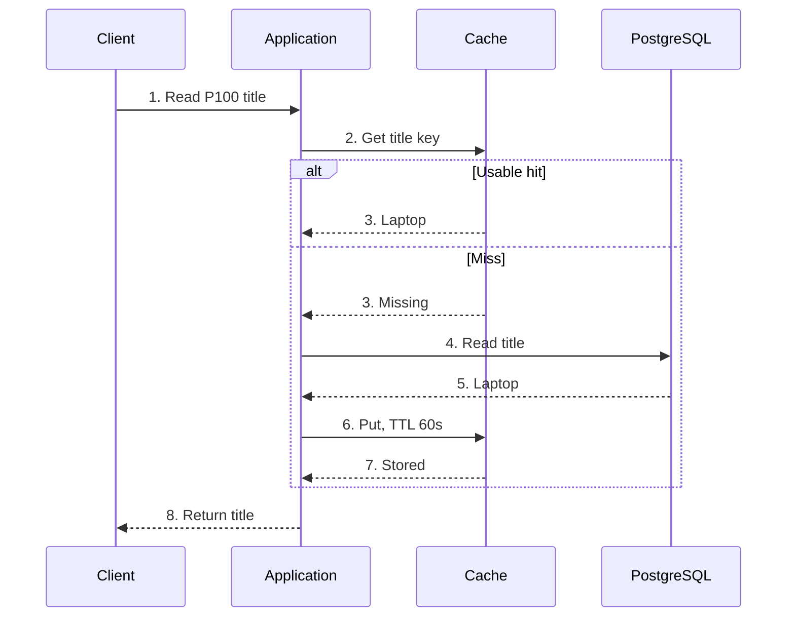
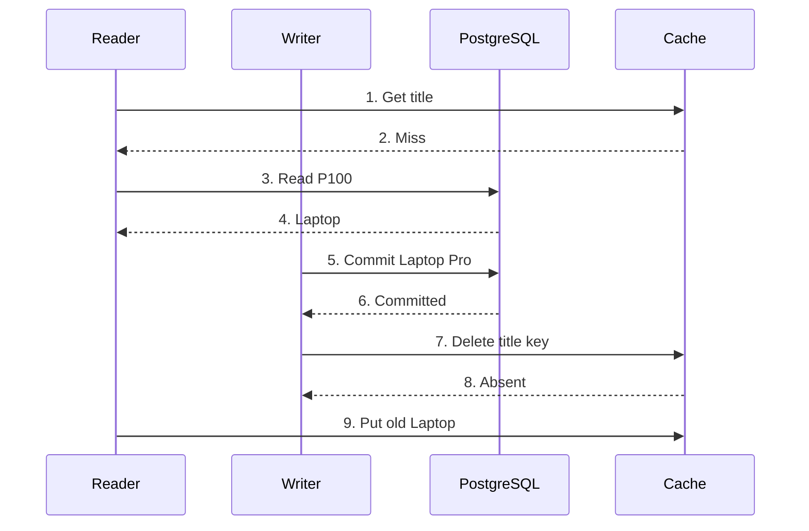
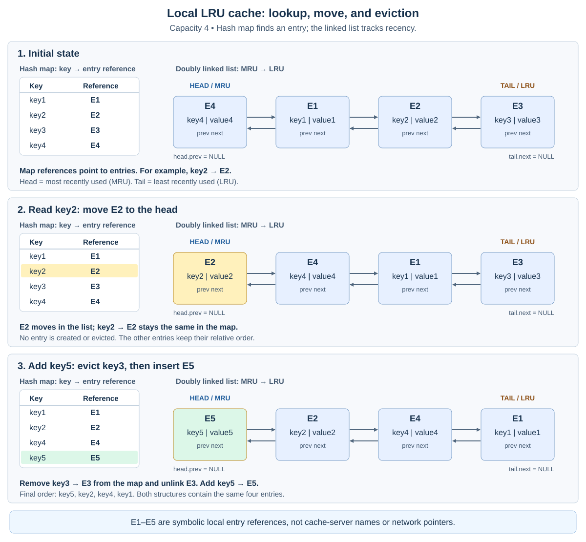
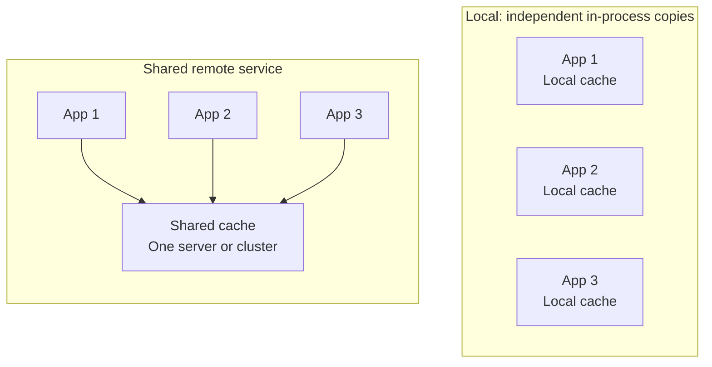
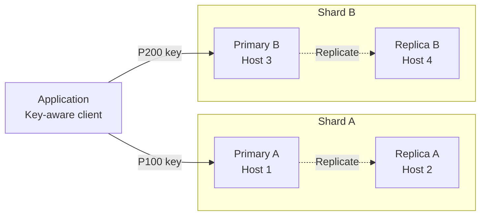

# Distributed Cache

## Table of Contents

- [Overview and Core Mental Model](#overview-and-core-mental-model)
- [Worked Example: Product P100](#worked-example-product-p100)
  - [Cache-Aside Read Flow](#cache-aside-read-flow)
  - [Updating the Source and Invalidating the Cache](#updating-the-source-and-invalidating-the-cache)
- [Requirements, Benefits, and Trade-Offs](#requirements-benefits-and-trade-offs)
  - [A Conceptual Cache API](#a-conceptual-cache-api)
  - [When Caching Helps](#when-caching-helps)
- [Freshness, Expiration, and Write Patterns](#freshness-expiration-and-write-patterns)
  - [TTL, Eviction, and Invalidation](#ttl-eviction-and-invalidation)
  - [Loading and Write Patterns](#loading-and-write-patterns)
  - [A Stale-Refill Race](#a-stale-refill-race)
- [Eviction Policies and a Local LRU Cache](#eviction-policies-and-a-local-lru-cache)
  - [How the Hash Map and List Work](#how-the-hash-map-and-list-work)
  - [Worked LRU Trace](#worked-lru-trace)
  - [LRU Pseudocode and Complexity](#lru-pseudocode-and-complexity)
- [Deployment Choices](#deployment-choices)
  - [In-Process, Co-Located, and Shared Caches](#in-process-co-located-and-shared-caches)
  - [Optional L1 and L2](#optional-l1-and-l2)
- [Routing, Sharding, and Replication](#routing-sharding-and-replication)
  - [Routing a Key](#routing-a-key)
  - [Shards vs. Replicas](#shards-vs-replicas)
- [Failures, Security, and Operations](#failures-security-and-operations)
  - [Failure Scenarios and Recovery](#failure-scenarios-and-recovery)
  - [Isolation and Sensitive Data](#isolation-and-sensitive-data)
  - [What to Measure](#what-to-measure)
- [Redis and Memcached](#redis-and-memcached)
  - [Roles and Capabilities](#roles-and-capabilities)
  - [Redis: Short Command Walkthrough](#redis-short-command-walkthrough)
  - [Memcached: Basic Text Protocol Walkthrough](#memcached-basic-text-protocol-walkthrough)
- [Choosing a Cache Architecture](#choosing-a-cache-architecture)
- [Study Map and Recall Summary](#study-map-and-recall-summary)
- [Related Notes](#related-notes)
- [Further Reading](#further-reading)

## Overview and Core Mental Model

**A cache keeps data that is useful to reuse.** It can save a database read, an API call, or an expensive calculation. A **distributed cache** spreads this role across networked cache servers.

Caching is useful only when reuse saves enough work to justify lookup, storage, refresh, and operating costs. A database may already serve a query from RAM; a remote cache adds a network round trip. Measure the actual workload.

| Term | Simple meaning | Example |
| --- | --- | --- |
| **Authoritative source** | The system responsible for the required record and its guarantees | PostgreSQL's product record |
| **Cached value** | A reusable copy or derived result | Product P100's title, `"Laptop"` |
| **Cache hit** | A usable entry is found | Return the title without another database read |
| **Cache miss** | No usable entry is found | The key is absent or its entry has expired |
| **Cache error** | The cache operation cannot complete normally | A timeout or unavailable cache server |
| **Expiration** | An entry stops being usable after its lifetime | A 60-second TTL expires |
| **Eviction** | An entry is removed to manage limited capacity | Remove a cold entry to make room |
| **Invalidation** | A copy is deliberately removed or marked unusable | Delete a cached title after changing it |

**TTL means time to live.** It describes an entry's lifetime, not a guarantee that its content matches the latest committed source value.

A local cache can live inside one process. A shared cache can initially use one remote server. A distributed/sharded cache uses several servers. These are deployment choices, not automatic stages every application must adopt.

> **A cache is a role, not one particular product. Decide what it stores, who refreshes it, and what happens when it is missing.**

## Worked Example: Product P100

A catalog page repeatedly asks for the title of product P100:

| Item | Illustrative value |
| --- | --- |
| **Source** | PostgreSQL product record P100 |
| **Cache key** | `catalog-title:P100` |
| **Cached payload** | `Laptop` |
| **TTL** | 60 seconds |
| **Later source change** | `Laptop` becomes `Laptop Pro` |

The small payload keeps the example readable. A real catalog representation could contain several fields and require serialization. **60 seconds is a teaching choice**, not a recommended production setting.

The application still authorizes requests where needed. At checkout, obtain price and stock through the authoritative business checks required by the purchase; a cached catalog display is not permission to charge a price or promise inventory.

### Cache-Aside Read Flow

**Cache-aside** means the application checks the cache and loads the source when necessary.



On a miss, load the source first. Cache a successful result, then return it. If cache population fails, the application can usually return the successful source result without claiming that the cache was updated. A missing source record is different from a source error; [negative caching](#failure-scenarios-and-recovery) needs its own policy.

The diagram assumes successful normal operations. A cache timeout is **not** an ordinary miss: fallback needs capacity limits, as described in [failure handling](#failure-scenarios-and-recovery).

### Updating the Source and Invalidating the Cache

For the basic cache-aside write path:

1. Commit the title change to `Laptop Pro` in PostgreSQL.
2. Delete `catalog-title:P100` from the cache.
3. A later miss reloads the new title.

Deleting the cache entry before the source commit can allow a reader to refill it with the old source value. Committing first is a sensible baseline, but **database commit plus cache deletion is not one atomic transaction**. A deletion can fail, and concurrent readers can still reintroduce an old value. See the [stale-refill race](#a-stale-refill-race).

Use [Microsoft's cache-aside guidance](https://learn.microsoft.com/en-us/azure/architecture/patterns/cache-aside) for the basic responsibilities and limitations.

## Requirements, Benefits, and Trade-Offs

### A Conceptual Cache API

These are teaching operations, not an SDK specification:

| Operation | Intended behavior |
| --- | --- |
| `get(key)` | Return a hit with its value, a miss, or an error |
| `put(key, value, ttl)` | Store/replace a value and set a positive entry lifetime in this teaching API |
| `delete(key)` | Invalidate the entry; an already absent key is a normal outcome |

An empty string, a deliberately cached “not found” result, a miss, and a network error must not accidentally become the same application outcome. Product-specific replies differ.

| Requirement | Question to answer |
| --- | --- |
| **Latency and throughput** | Which response-time targets and concurrent request rates matter? |
| **Capacity** | How many payload and metadata bytes fit, with operating headroom? |
| **Freshness** | How old may a displayed title or computed summary be? |
| **Availability** | What can continue when the cache or source is unavailable? |
| **Correctness and access** | Which actions still require authoritative reads and permission checks? |
| **Backend protection** | How many misses can the source safely absorb? |
| **Operations and cost** | Who manages capacity, failover, warming, monitoring, and recovery? |

### When Caching Helps

| Workload | Potential benefit | What to check |
| --- | --- | --- |
| **Repeated catalog reads** | Avoid repeating the same source query | Reuse rate and update frequency |
| **Expensive calculations or query results** | Reuse work already performed | Input/version identity and acceptable staleness |
| **Eligible API responses** | Reduce repeated backend work | Query parameters, authorization, and cacheability |
| **Dashboard summaries** | Reuse a computed aggregate | Refresh lag and metric definitions |
| **CDN/HTTP content** | Reuse eligible content closer to consumers | HTTP freshness and access rules; this is a different cache layer |
| **Session state** | Share state across application instances | Expiration, revocation, and the effect of losing the only session copy |
| **Low-reuse or frequently changing values** | Possibly little saving | Lookup and invalidation costs may exceed the avoided work |

CDN means **content delivery network**; HTTP means **Hypertext Transfer Protocol**. Continue with the [gateway/reverse-proxy functions](Distributed-Systems-Building-Blocks.md#common-reverse-proxy-functions) for HTTP-facing concerns.

A disposable product-title copy can be rebuilt from PostgreSQL. If a session or another record exists **only** in an in-memory store, losing it has different consequences. Define whether loss means safe reauthentication, loss of application state, or an unacceptable failure.

Caching intermediate processing results is also different from operating a durable message queue. Redis can serve roles beyond caching, but a cached value does not automatically provide message retention, consumer acknowledgment, or replay guarantees.

Caching can reduce backend load and improve response time. It does not guarantee fixed latency, unlimited scaling, lower total cost, or protection from denial-of-service attacks. Access controls, rate limits, and other protections remain separate responsibilities.

## Freshness, Expiration, and Write Patterns

### TTL, Eviction, and Invalidation

| Mechanism | Trigger | Meaning for P100 |
| --- | --- | --- |
| **TTL expiration** | Entry lifetime ends | The retained title is no longer usable |
| **Capacity eviction** | The configured capacity policy removes an entry | P100 may disappear before its TTL |
| **Explicit invalidation** | An application or update pipeline removes a copy | Delete the title after a source change |

An entry need not stay cached until its TTL ends. A successful read does not necessarily renew its lifetime; fixed and sliding expiration are different policies. For example, ordinary Redis `GET` does not reset an expiry set by `SET ... EX`.

TTL limits retention of **that fill**. If the fill was obtained from an old replica or delayed reader, its value can already be stale when stored. Physical memory cleanup can occur separately from the rule that expired entries must not be served as valid hits.

Keys should identify what was cached: application/environment, tenant or user scope where relevant, query inputs, and representation version. The public title key in this example is intentionally simple.

### Loading and Write Patterns

| Pattern | Who loads or writes the data? | Main trade-off |
| --- | --- | --- |
| **Cache-aside** | Application loads on a miss and manages invalidation | Explicit control; races and missed invalidations remain possible |
| **Read-through** | A cache-facing component/loader obtains missing values | Simplifies callers; requires a configured loading mechanism |
| **Write-through** | A write path updates the source and cache before reporting success under its contract | Extra work/latency; partial failures still need handling |
| **Write-behind** | A write is accepted before an asynchronous source update completes | Durability, ordering, and recovery become critical |

These are responsibility patterns. Redis or Memcached does not automatically know how to load an arbitrary application database. A library, application, or additional component may implement the behavior.

Write-behind is a different correctness contract from the P100 cache-aside example. An acknowledgment from a volatile cache is not proof that the source update is durable. A cache and a database do not automatically share [one transaction](Databases-and-Storage.md#distributed-transactions).

### A Stale-Refill Race

Even a successful database update followed by invalidation can race with an earlier read:



The reader loaded the old value before the writer committed, then populated the cache **after** invalidation. A subsequent hit can therefore return `Laptop` while the source says `Laptop Pro`.

Depending on the requirement, evaluate version-aware cache updates, coordinated refreshes, reliable invalidation/reconciliation, or bypassing the cache for authoritative checks. These mechanisms need their own failure rules; a version field alone does not prevent an unconditional stale write. Bounded TTLs can limit retention of one bad fill, but do not establish transactional freshness.

> **Cache-aside is a loading pattern, not a consistency protocol. Decide which stale results are acceptable and which operations must consult authority.**

## Eviction Policies and a Local LRU Cache

| Policy | Expanded name | Removes | What to consider |
| --- | --- | --- | --- |
| **FIFO** | First in, first out | Earliest inserted entry | Ignores subsequent reuse |
| **LIFO** | Last in, first out | Latest inserted entry | Can discard newly useful data; specialized rather than a general default |
| **MRU** | Most recently used | Most recently accessed entry | Can suit particular scan/reuse patterns; validate the workload |
| **LRU** | Least recently used | Least recently accessed entry | Recency is a useful prediction, not proof of future reuse |
| **LFU** | Least frequently used | Entry with the lowest tracked frequency | Aging/decay helps adapt when previously popular entries become cold |

Expiration and explicit invalidation are separate from choosing a capacity victim. A configuration may reject new writes instead of evicting existing entries. Policy names also do not specify every implementation detail.

### How the Hash Map and List Work

An exact **local LRU cache** can combine:

- A **hash map**: key → entry reference.
- A **doubly linked list**: entries ordered from most recent to least recent.
- Each entry's **key, cached value, previous reference, and next reference**.

The head is **MRU** and the tail is **LRU**. With a known entry reference, removing it from its current position and inserting it at the head requires changing a few links. The stored key lets eviction remove the same entry from the map without searching for it.

These references are local to the cache process. A list entry is **not a cache server**, and a pointer is not a portable network address. Remote clients send keys and serialized values; routing chooses a server separately.

### Worked LRU Trace

For a teaching capacity of **four entries**, list order is always **MRU → LRU**:

| Operation | Map membership | List order | Result |
| --- | --- | --- | --- |
| **Initial state** | key1, key2, key3, key4 | key4, key1, key2, key3 | key3 is the eviction candidate |
| `get(key2)` | key1, key2, key3, key4 | key2, key4, key1, key3 | Hit; move the existing entry to the head |
| `put(key5, value5)` | key1, key2, key4, key5 | key5, key2, key4, key1 | Evict key3 from both structures |



Entry labels E1–E5 in the illustration are symbolic references. Moving E2 changes its links, not its identity or the map's key2 reference. Both ends are NULL-terminated.

### LRU Pseudocode and Complexity

This language-neutral pseudocode describes capacity and recency only. Assume an initially empty cache, a fixed non-negative capacity, and sequential calls. Expiration, source loading, synchronization, and network I/O are separate layers; an expiration layer must reject expired entries before accepting a hit.

```text
get(key):
    if key is not in map: return MISS
    entry = map[key]
    unlink(entry)
    add_front(entry)
    return HIT(entry.value)

put(key, value):
    if capacity == 0: return
    if key is in map:
        entry = map[key]
        entry.value = value
        unlink(entry)
        add_front(entry)
        return
    if size(map) == capacity:
        victim = tail
        unlink(victim)
        remove map[victim.key]
    entry = new Entry(key, value)
    add_front(entry)
    map[key] = entry

delete(key):
    if key is not in map: return false
    entry = map[key]
    unlink(entry)
    remove map[key]
    return true
```

`unlink` repairs the neighboring links and head/tail, including the empty-list case. `add_front` sets the entry's previous reference to NULL, fixes the old head, and sets the tail when inserting into an empty list. Thus a single entry is both head and tail. Capacity zero disables storage; a miss does not itself contact PostgreSQL.

For N bounded-size entries:

| Operation/resource | Teaching bound |
| --- | --- |
| Map lookup, insertion, removal | Expected/amortized O(1) with suitable hashing |
| Unlink/reinsert a known list entry | O(1) |
| Get, put, or delete in this local model | Expected/amortized O(1) |
| Entry/map/list metadata | O(N), plus the cached payload bytes |

Hashing/copying variable-size keys and values takes byte-dependent work; collisions and resizing affect costs. Real memory limits include payload size, metadata, allocator overhead, and headroom. Four entries is not a real byte-budget policy.

See the existing [key-value complexity, RAM, and disk explanation](Databases-and-Storage.md#why-key-value-lookups-can-be-fast-complexity-ram-and-disk). The O(1) local model does not promise constant end-to-end request latency or one exact global LRU order across servers. Redis, for example, documents **approximate LRU and LFU** policies rather than this exact linked-list algorithm. [Redis eviction documentation](https://redis.io/docs/latest/develop/reference/eviction/)

## Deployment Choices

### In-Process, Co-Located, and Shared Caches

| Arrangement | Where entries live | Main benefit | Main cost |
| --- | --- | --- | --- |
| **In-process** | Inside each application process | No remote call for a local hit | Separate copies, memory use, and invalidation per process |
| **Co-located process/sidecar** | Separate process on the same host or deployment unit | Local communication and separate process management | Interprocess overhead and shared host resources/failure |
| **Shared remote service** | A separate cache accessed by several applications | Reuse across application instances; independent allocation | Network calls and a shared dependency |
| **Distributed/sharded service** | Keys are divided across cache servers | Greater aggregate capacity and throughput | Placement, movement, hot keys, and recovery |
| **Local L1 plus shared L2** | A small local layer in front of a shared layer | Avoid some remote lookups | Another copy and freshness policy to manage |

A shared remote service can use one server or a cluster. Local caches also remain useful in large systems; they are not restricted to small applications.



The local diagram shows in-process caches; a co-located separate process is the other local option in the table. Shared-cache arrows mean application access, not broadcasts to every server.

Restarting one application loses its local entries. A separate cache can stay warm across that application's restart, but can itself fail. Co-location shares CPU/memory and a host failure domain; remote placement does not automatically guarantee independent infrastructure or sufficient surviving capacity.

### Optional L1 and L2

**L1** means the first cache layer checked; **L2** is the next. A possible read path is:

```text
Local L1 hit -> return
Local L1 miss -> shared L2
Shared L2 miss -> authoritative source
```

The L1 copy needs its own expiration/invalidation rules. Updating L2 does not automatically update every process's L1. Choose this arrangement only when the saved remote work justifies the additional copies and coordination.

## Routing, Sharding, and Replication

### Routing a Key

**Routing answers which cache server should handle a key.** A client library, proxy, or service can perform it using placement information.

Modulo routing, consistent hashing, and fixed hash-slot designs are different options. Changing membership can move keys or cause misses; coordinate routing views and any migration, then control refill load.

Redis Cluster uses **16,384 hash slots**, with a documented key-to-slot mapping and slot ownership. That is not the same design as assigning every server a token on a consistent-hash ring. Memcached placement commonly depends on the client or proxy. Verify that participating applications use compatible key encoding and placement rules. [Redis Cluster specification](https://redis.io/docs/latest/operate/oss_and_stack/reference/cluster-spec/)

An ordinary round-robin load balancer cannot replace key-aware placement unless the receiving service can route the request appropriately. Nor must every application query every cache server. A single very hot key can overload its owner even when the total key count is balanced.

See the existing [consistent-hashing notes](Distributed-Systems-Theorems-and-Data-Structures.md#consistent-hashing), [worked hashing example](examples/consistent_hashing/README.md), and [partitioning discussion](Databases-and-Storage.md#scalability-partitioning-and-consistent-hashing).

### Shards vs. Replicas

- A **shard** holds a portion of the keys.
- A **replica** holds a copy of a shard's data.
- **Failover** changes which eligible copy serves a role after a failure.

This generic illustration has **two shards and two intended copies per shard**, on four hosts. The P100/P200 placement is illustrative, not a calculated Redis slot assignment.



This is one possible replicated design, not a feature automatically present in every cache. Replica reads and promotion require supported policies. Asynchronous replication can leave a replica behind; acknowledged cache writes can be lost during some failure/failover scenarios. [Redis replication](https://redis.io/docs/latest/operate/oss_and_stack/management/replication/)

Replicas consume capacity too. Adding copies improves some failure options but does not multiply unique-data capacity. Choose failure-domain placement, detection, promotion, and recovery rules deliberately.

**Cache replication copies cache state; it does not establish freshness against PostgreSQL.** If all disposable copies disappear, rebuilding them still needs a healthy source and a controlled request rate. For non-disposable state, define durability and recovery separately. See [replication models](Databases-and-Storage.md#replication-models-and-replica-placement) and [consistency](Distributed-System-Attributes.md#consistency).

## Failures, Security, and Operations

### Failure Scenarios and Recovery

| Problem | What can happen | What to evaluate |
| --- | --- | --- |
| **Stampede: many misses for one key** | Many callers load the same expensive source value | Request coalescing/single-flight, bounded refresh concurrency, and safe coordination |
| **Many keys expire together** | A sudden source-load spike | Staggered TTLs, selective prewarming, and refill limits |
| **Repeated requests for missing records** | Repeated source queries for something absent | Short-lived negative caching; distinguish “not found” from errors |
| **Cache timeout or outage** | Requests stall or overwhelm the source through fallback | Short timeouts, bounded retries, circuit breaking, admission control, and load shedding |
| **Cold start or shard movement** | A low hit rate causes a refill surge | Gradual warming, migration planning, and protection of source capacity |
| **Hot key / uneven traffic** | One owner saturates while others have spare capacity | Coalescing, suitable local copies/read replicas, or redesign of the access pattern |
| **Missed invalidation / stale refill** | Old content continues to be served | Required authoritative checks, versions/coordination where supported, reconciliation, and bounded retention |
| **Source unavailable** | A miss cannot be reconstructed | Serve stale content only where explicitly permitted; otherwise return the appropriate error |
| **Only-copy session/state loss** | Users lose state or cannot continue | A storage/recovery design appropriate to that role, not an assumption of disposable data |

A **single-flight** mechanism lets concurrent callers share one in-progress load for a key. If coordination crosses processes, timeouts, ownership, crashes, and stale completions matter; a lock alone does not solve the stale-refill race.

A **circuit breaker** temporarily limits calls to an unhealthy dependency. **Load shedding** rejects some work to protect the remaining system. Bypassing a failed cache is not always safe: a source sized for ordinary misses may not survive every request becoming a miss.

Negative caching retains an explicit “not found” result for a short period. It can hide a newly created record until refresh, so define invalidation and scope. Do not turn a database timeout or authorization error into a reusable global “not found” entry.

### Isolation and Sensitive Data

- Include tenant/user, query inputs, and permission-relevant scope in keys or reuse rules where needed.
- Keep access to cache services restricted; use supported authentication, authorization, TLS, and network controls.
- Limit which data is retained, for how long, and where it can be copied or logged.
- Propagate deletion/invalidation to local layers, shared layers, and derived copies as required.
- Validate serialized content and bound payload/key sizes; monitor rejected writes and memory pressure.

The public P100 title is simple. Personalized results and permission decisions have different risks. Cache failures or hits must not silently grant access. See [service-level authorization](Identity-and-Access-Management.md#authorization-in-practice).

### What to Measure

| Metric | Why it matters |
| --- | --- |
| **Hits and misses** | Reuse and source-load demand; hit ratio = hits / (hits + misses) |
| **Errors and timeouts** | Keep failures separate from normal misses |
| **End-to-end and cache p95/p99 latency** | Slow-tail behavior can be hidden by an average |
| **Source request rate and concurrency** | Whether misses/fallback are safe |
| **Memory, payload sizes, evictions, and expirations** | Capacity pressure and retention behavior |
| **Replication lag / failover / refill rate** | Copy freshness, recovery, and cold-cache impact |
| **Stale-result and invalidation indicators** | Whether the freshness contract is actually met |
| **Network traffic and operating cost** | Whether avoided work justifies the additional service |

For example, 90 hits and 10 misses give a 90% hit ratio; cache errors should be counted separately. A high hit ratio does not prove correct data, low tail latency, or efficient handling of large values.

Track warm-cache operation and recovery under cold-cache conditions. A running cache process is not proof that the application meets its requirements.

## Redis and Memcached

### Roles and Capabilities

Redis and Memcached are examples to evaluate, not interchangeable guarantees.

| Dimension | Redis | Memcached |
| --- | --- | --- |
| **Values and operations** | Strings and additional server-side data structures/operations | Keyed byte values interpreted by the application, with documented cache operations |
| **Expiration and eviction** | Key expiry and configurable policies including approximate LRU/LFU | Item expiry and implementation-specific LRU-family memory management |
| **Distribution** | Redis Cluster provides hash-slot placement; clients must understand the deployment | Client/proxy placement is central to a multi-server cache |
| **Replication** | Supported primary/replica designs with documented failover behavior | Standard servers do not automatically replicate keys; additional client/proxy designs may add redundancy |
| **Persistence / recovery** | Optional snapshot/log persistence with different failure trade-offs | Primarily disposable cache semantics; optional warm restart is not general crash-safe durability |
| **Reason to evaluate** | Required data operations or supported replication/persistence features | Straightforward disposable key/value caching with suitable client/proxy support |

Redis **RDB** snapshots and **AOF—append-only file** persistence are choices with recovery and performance implications, not guarantees against every loss. Check synchronization, replication, and recovery behavior for the selected deployment. [Redis persistence](https://redis.io/docs/latest/operate/oss_and_stack/management/persistence/)

Memcached documents standard-server limitations separately from optional restart functionality. Do not assume that a warm restart handles crashes or that adding cache servers automatically creates synchronized copies. [Memcached FAQ](https://docs.memcached.org/userguide/faq/), [warm restart](https://docs.memcached.org/features/restart/)

For data that must survive loss, replication and persistence still do not replace appropriate backups and tested restoration. For disposable cache data, the recovery plan may instead be controlled reconstruction from the source.

### Redis: Short Command Walkthrough

These are illustrative commands as entered in a Redis command client, not installation or connection instructions. Assume an initially absent example key, successful sequential operations before its expiry, no eviction, and no concurrent writers.

| Command | Logical response | Meaning |
| --- | --- | --- |
| `SET catalog-title:P100 "Laptop" EX 60` | `OK` | Store the title with a 60-second expiry |
| `GET catalog-title:P100` | `"Laptop"` | Read the title |
| `TTL catalog-title:P100` | Remaining seconds | Time has elapsed; do not expect one fixed value |
| `DEL catalog-title:P100` | Integer `1` | Remove the existing key |
| `GET catalog-title:P100` | Null/nil | Key is now absent |
| `TTL catalog-title:P100` | Integer `-2` | Key does not exist |

`TTL` returns `-1` for an existing key with no expiry. Ordinary `GET` does not renew the expiry. An ordinary `SET` replaces the existing value and, without expiry-preserving options, replaces/removes its previous expiry according to the command options.

In a separate expiration case, leave the newly stored key in place: after its deadline, `GET` returns null/nil and `TTL` returns `-2`. Deleting an already absent key normally reports zero removed keys. These outcomes are not connection errors.

See [SET](https://redis.io/docs/latest/commands/set/), [GET](https://redis.io/docs/latest/commands/get/), [TTL](https://redis.io/docs/latest/commands/ttl/), and [DEL](https://redis.io/docs/latest/commands/del/). A successful command does not by itself establish cross-system transactional freshness or a particular failover/durability guarantee.

### Memcached: Basic Text Protocol Walkthrough

This transcript uses the **basic text protocol**. `Client:` and `Server:` identify message direction; they are explanatory labels, not transmitted bytes. Protocol line endings are **CRLF—carriage return plus line feed**. These are not PowerShell/CMD commands.

Assume the same isolated example conditions as above:

```text
Client: set catalog-title:P100 0 60 6
Client: Laptop
Server: STORED

Client: get catalog-title:P100
Server: VALUE catalog-title:P100 0 6
Server: Laptop
Server: END

Client: delete catalog-title:P100
Server: DELETED

Client: get catalog-title:P100
Server: END
```

In the `set` header, `0` is the application flags field, `60` is the relative expiry in seconds, and `6` is the payload length: ASCII `Laptop` is six bytes, excluding its trailing CRLF. The `VALUE` response repeats the key, flags, and payload length.

An absent key produces no `VALUE` line; the read ends with `END`. Deleting an already absent key produces `NOT_FOUND`. In a separate expiration case, storing the title again and letting it expire also makes `get` return only `END`.

For this protocol, expiry `0` means no time-based expiration, not “store for zero seconds.” Relative expirations can be up to 30 days; larger values are interpreted as Unix timestamps. No-expiry entries can still be evicted. The basic protocol has no direct equivalent of Redis's `TTL` command.

See the official [basic text protocol](https://docs.memcached.org/protocols/basic/) and [user guide](https://docs.memcached.org/userguide/). Client libraries normally handle framing and serialization.

## Choosing a Cache Architecture

| Requirement | Starting point to evaluate |
| --- | --- |
| **Small, private, frequently reused data** | In-process caching, with explicit invalidation and memory bounds |
| **Reuse across application instances** | A shared cache service; distribution is a separate capacity/availability decision |
| **Capacity beyond one cache server** | Key-aware sharding and suitable movement/recovery procedures |
| **Some cache-server failure tolerance** | Supported replicas/failover where justified, plus safe miss handling |
| **Very frequent remote cache hits** | A bounded L1 layer if its freshness cost is acceptable |
| **Fresh values required for business decisions** | Authoritative reads or a stronger designed protocol; TTL alone is insufficient |
| **Rare reuse or cheap source work** | Keep the simpler source-read path if caching adds little benefit |
| **State cannot be reconstructed** | Evaluate a suitable primary-state durability/recovery design |

Start with the smallest arrangement that meets measured needs. Before adding servers, confirm that keys, payload sizes, memory limits, refill behavior, and source capacity are understood. Adding nodes does not remove a single hot key or make cache/source updates atomic.

## Study Map and Recall Summary

Study in this order:

**Hit/miss and authority → cache-aside → TTL/invalidation → local LRU → deployment → routing/replicas → failures and operations.**

Be ready to explain:

1. Why can a cache miss be normal while a timeout needs different handling?
2. Why can an old value reappear after a successful invalidation?
3. What does the hash map point to, and how does a hit change LRU order?
4. What changes when a cache is shared, sharded, or replicated?
5. How does the source survive a cold cache or cache outage?
6. Which values may be stale, and which actions require authoritative checks?

A cache reuses results; a local LRU structure manages a bounded working set; networked caches add placement and failure concerns. None removes the need for correct source data, access rules, freshness policies, and recovery.

> **Cache what is worth reusing. Decide how it becomes fresh, where it lives, and what happens when it disappears.**

## Related Notes

- [System design at different scales](Understanding-System-Design.md#system-design-at-different-scales)
- [Database caches versus materialized views](Databases-and-Storage.md#cached-results-vs-materialized-views)
- [Key-value lookup complexity and hardware](Databases-and-Storage.md#why-key-value-lookups-can-be-fast-complexity-ram-and-disk)
- [Consistent hashing](Distributed-Systems-Theorems-and-Data-Structures.md#consistent-hashing)
- [Replication models and replica placement](Databases-and-Storage.md#replication-models-and-replica-placement)
- [Distributed consistency](Distributed-System-Attributes.md#consistency)
- [Authorization enforcement](Identity-and-Access-Management.md#authorization-in-practice)
- [HTTP-facing reverse-proxy functions](Distributed-Systems-Building-Blocks.md#common-reverse-proxy-functions)
- [Derived data and serving choices](Data-Engineering-for-Solution-Architecture.md#storage-and-serving-choices)

## Further Reading

- [Microsoft: Cache-Aside Pattern](https://learn.microsoft.com/en-us/azure/architecture/patterns/cache-aside)
- [Redis: Key Eviction and Approximate LRU/LFU](https://redis.io/docs/latest/develop/reference/eviction/)
- [Redis: Cluster Specification and Hash Slots](https://redis.io/docs/latest/operate/oss_and_stack/reference/cluster-spec/)
- [Redis: Replication and Failure Trade-Offs](https://redis.io/docs/latest/operate/oss_and_stack/management/replication/)
- [Redis: Persistence Options](https://redis.io/docs/latest/operate/oss_and_stack/management/persistence/)
- [Redis: Data Types](https://redis.io/docs/latest/develop/data-types/)
- [Redis: SET](https://redis.io/docs/latest/commands/set/)
- [Redis: GET](https://redis.io/docs/latest/commands/get/)
- [Redis: TTL](https://redis.io/docs/latest/commands/ttl/)
- [Redis: DEL](https://redis.io/docs/latest/commands/del/)
- [Memcached: User Guide and Invalidation](https://docs.memcached.org/userguide/)
- [Memcached: Basic Text Protocol](https://docs.memcached.org/protocols/basic/)
- [Memcached: FAQ and Server Responsibilities](https://docs.memcached.org/userguide/faq/)
- [Memcached: Warm Restart and Its Limits](https://docs.memcached.org/features/restart/)
