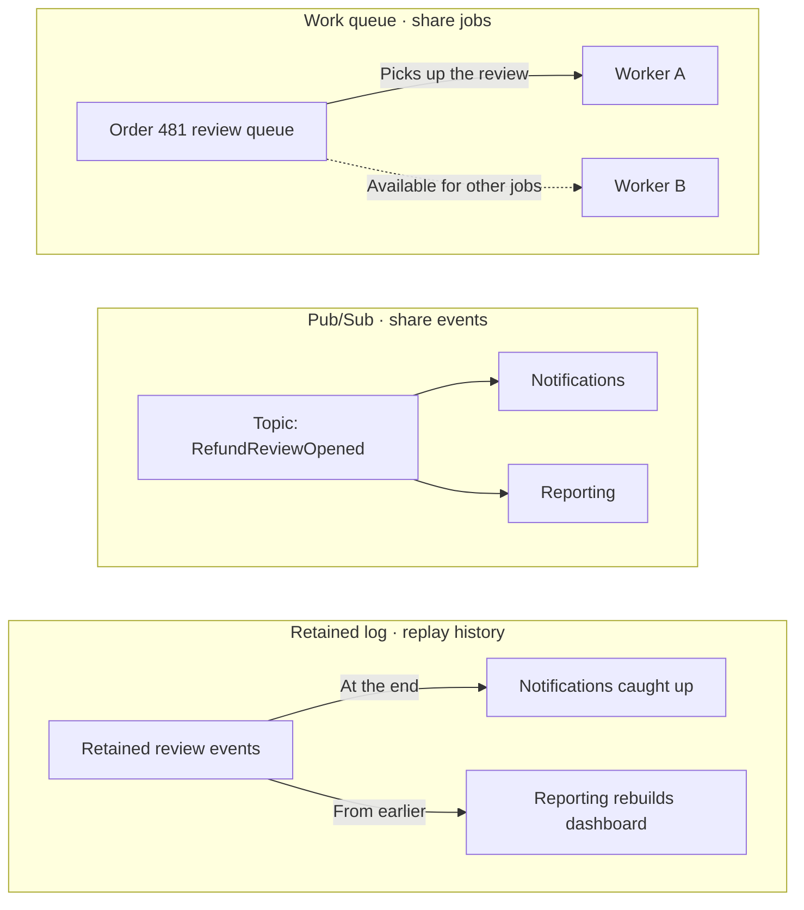
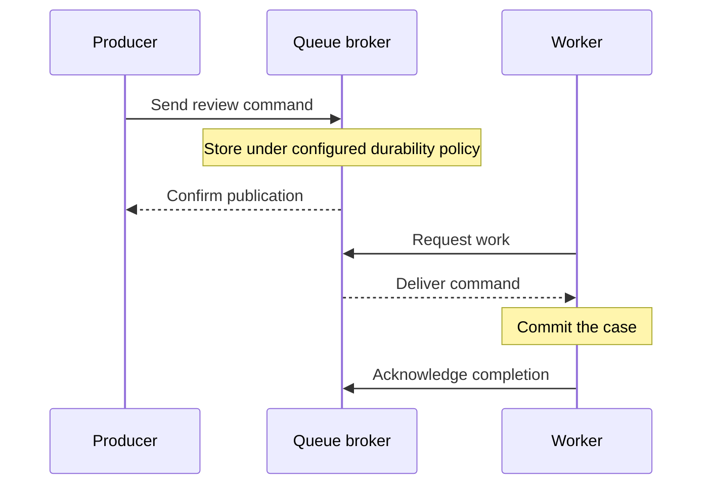
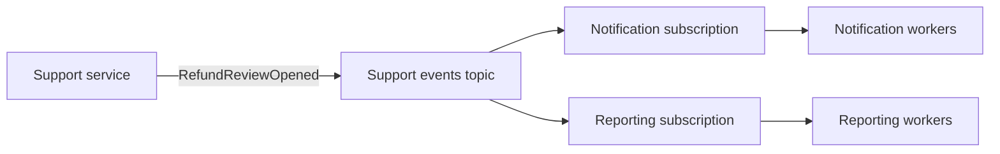
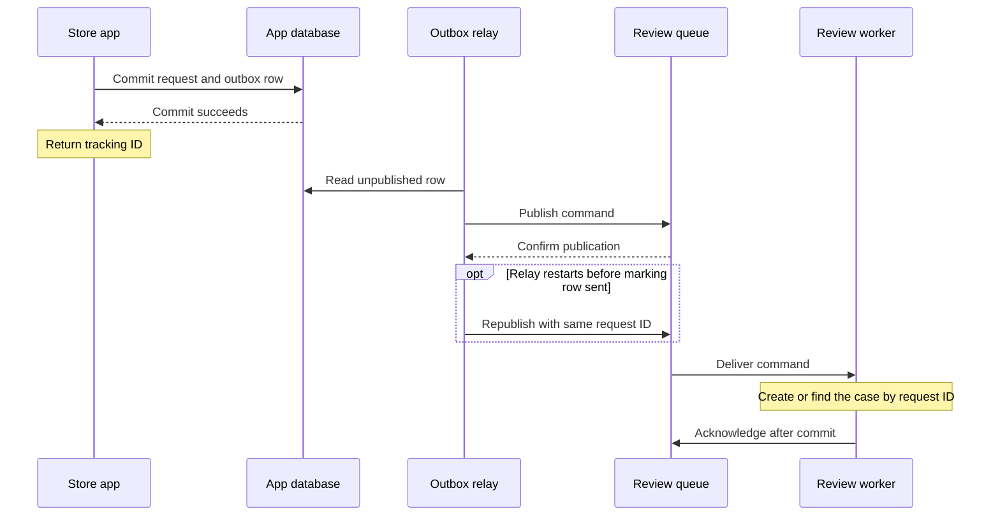
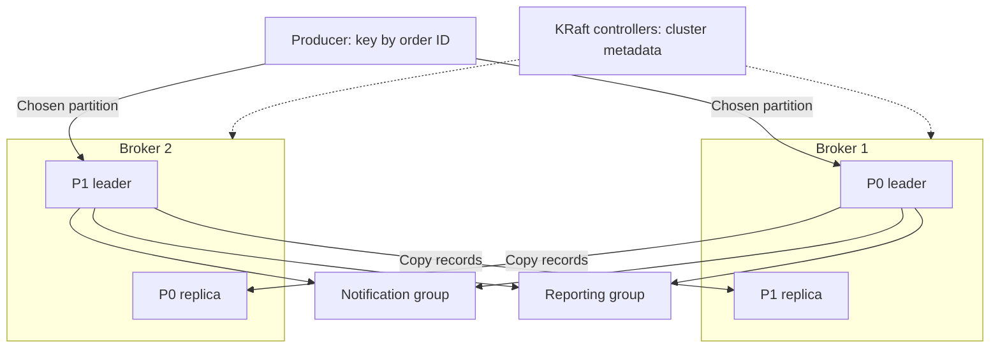

# Distributed Messaging and Event-Driven Architecture

## Table of Contents

- [Messaging Mental Model](#messaging-mental-model)
- [Synchronous Calls, Messages, and Events](#synchronous-calls-messages-and-events)
- [Work Queues, Pub/Sub, and Retained Logs](#work-queues-pubsub-and-retained-logs)
  - [Work Queue: One Job, Competing Workers](#work-queue-one-job-competing-workers)
  - [Pub/Sub: One Event, Independent Subscribers](#pubsub-one-event-independent-subscribers)
- [Designing a Distributed Messaging System](#designing-a-distributed-messaging-system)
  - [Conceptual Messaging API](#conceptual-messaging-api)
- [Delivery, Ordering, and Recovery](#delivery-ordering-and-recovery)
- [Worked Design: Refund Review for Order 481](#worked-design-refund-review-for-order-481)
- [Kafka, Kinesis, and Platform Selection](#kafka-kinesis-and-platform-selection)
  - [Kafka: Partitions, Replicas, and Consumer Groups](#kafka-partitions-replicas-and-consumer-groups)
    - [How Kafka Stores and Fetches Records](#how-kafka-stores-and-fetches-records)
    - [Kafka Acknowledgments and Consumer Lag](#kafka-acknowledgments-and-consumer-lag)
  - [Kafka vs. RabbitMQ for Order 481](#kafka-vs-rabbitmq-for-order-481)
  - [Choose a Platform by Requirement](#choose-a-platform-by-requirement)
  - [Kafka and RabbitMQ Command Walkthroughs](#kafka-and-rabbitmq-command-walkthroughs)
    - [Kafka: Publish and Read a Retained Event](#kafka-publish-and-read-a-retained-event)
    - [RabbitMQ: Route and Acknowledge a Review Command](#rabbitmq-route-and-acknowledge-a-review-command)
- [Stream Processing, CQRS, and Event Sourcing](#stream-processing-cqrs-and-event-sourcing)
- [Operations and Design Checklist](#operations-and-design-checklist)
- [Related Notes](#related-notes)
- [References](#references)

## Messaging Mental Model

In a distributed system, independently running services communicate by sending messages. Asynchronous messaging lets a sender hand off work and continue while the receiver handles it at its own pace.

Two common messaging patterns answer **who should receive the message?**

- **Work queue — share jobs.** Workers share a backlog. One worker handles each delivery attempt. For order 481, the job is to open a refund-review case.
- **Publish/subscribe (Pub/Sub) — share events.** Each matching subscription can receive the same event independently. When the case opens, notifications tell the shopper and reporting updates its dashboard.

A **retained log** answers **what history can readers go back to?** It keeps events according to a retention policy so readers can catch up or replay them. Reporting can use that history to rebuild its dashboard.



## Synchronous Calls, Messages, and Events

A shopper asks, **“Where is order 481, and can I get a refund?”** The assistant checks the live status. The order is delayed, and the store's policy sends delay-related refund requests to support. When the shopper asks for help, the system accepts a review request. Support can open the case later, then notify the shopper and report on workload.

| What needs to happen | What to send | Interaction |
| --- | --- | --- |
| Read the current status of order 481 | **Query:** `GetOrderStatus` | The assistant waits for a response with the live status or an error. |
| Ask support to open a refund review | **Command:** `CreateRefundReview` | The request can wait in a work queue until a worker is ready. |
| Inform other systems that the review exists | **Event:** `RefundReviewOpened` | Notification and reporting services can react independently. |

A **message** is the unit sent between components. It can carry a command, an event, or a request or response. A **producer** sends it, a **consumer** handles it, and a **broker** can store and route it. In publish/subscribe (**Pub/Sub**), the producer is a **publisher**, the named destination is a **topic**, and a **subscription** defines a subscriber's delivery interest and, where supported, its progress.

**Event-driven architecture (EDA)** organizes parts of a system around events that other components can react to. It lets those components run and recover at their own pace. They still share expectations about what each event means, how it is formatted, and how promptly it becomes available. The same design can use EDA for follow-up work and synchronous calls for answers the shopper needs immediately.

> **A request was accepted, a message was stored, and a business action completed are three different milestones.**

## Work Queues, Pub/Sub, and Retained Logs

| Pattern | Who receives the work or data? | Progress and retention | Example |
| --- | --- | --- | --- |
| **Work queue** | Workers compete for a job. A particular attempt is assigned to a worker, and the job may be redelivered. | Completion is tracked per message, commonly through acknowledgment or deletion. Unfinished work remains subject to the queue's retention and retry rules. | Open one case for a refund-review request. |
| **Pub/Sub** | Each matching subscription can receive the event. Several workers can share one subscription when the platform supports it. | Each subscription can progress independently. Offline delivery, retention, and replay depend on the service and configuration. | Notify the shopper and update the support dashboard. |
| **Retained log** | Readers or consumer groups consume records at their own pace. | Readers track positions. Retention or compaction governs when records disappear, independently of whether any reader has finished. | Replay retained review events to rebuild a dashboard. |

### Work Queue: One Job, Competing Workers



Workers can **pull** at a rate they control, or a broker can **push** deliveries to active consumers with limits on outstanding work. In either model, arrange for a durable result before final acknowledgment. RabbitMQ, for example, treats publisher confirms and consumer acknowledgments as independent signals. Amazon SQS temporarily hides a received message with a **visibility timeout**, and the consumer deletes it after success. Expiry can make unfinished work visible again. [RabbitMQ confirms and acknowledgments](https://www.rabbitmq.com/docs/confirms) · [Amazon SQS visibility timeout](https://docs.aws.amazon.com/AWSSimpleQueueService/latest/SQSDeveloperGuide/sqs-visibility-timeout.html)

### Pub/Sub: One Event, Independent Subscribers



Both subscriptions can receive the event. Workers within the notification subscription can share notification work. A slow reporting consumer has its own backlog and can catch up within the configured retention window. It can still contribute to costs or load on shared broker resources. One implementation is an Amazon SNS topic with two Amazon SQS queues. [SNS fan-out to SQS](https://docs.aws.amazon.com/sns/latest/dg/sns-sqs-as-subscriber.html) · [Google Cloud Pub/Sub subscriptions](https://docs.cloud.google.com/pubsub/docs/subscription-overview)

## Designing a Distributed Messaging System

| Design question | Decision to make |
| --- | --- |
| **What must be delivered and in what order?** | Identify the business effect, the acceptable loss or duplication, and the ordering scope. Decide who can replay work and what a replay may change. |
| **How much work arrives?** | Estimate sustained and peak messages per second, payload size, and fan-out. Set a limit on acceptable message age and size retention for recovery time and storage cost. |
| **How do consumers keep up?** | Bound in-flight work, use batches where the delay is acceptable, and scale consumers within partition and downstream capacity. Apply backpressure by slowing intake or limiting delivery when consumers fall behind. |
| **How is work spread across machines?** | Choose a routing or partition key. A key such as tenant ID preserves locality but can concentrate load from a busy tenant. More partitions can add parallelism at the cost of more coordination. |
| **What happens when a node fails?** | Choose replication and failure domains that meet the recovery goal. Tie producer confirmation to the platform's storage policy, and test failover and reconstruction of consumer progress. |

**Backlog example.** If arrivals are 1,000 messages/s and workers complete 800/s for 60 seconds, the backlog grows by `(1,000 − 800) × 60 = 12,000` messages. If arrivals then drop to 500/s, the same workers clear it at `800 − 500 = 300` messages/s. Draining those 12,000 messages takes 40 seconds. These numbers assume an initially empty queue, stable rates within each interval, and no retries. A queue absorbs a burst as storage and delay. Sustained arrivals above completion capacity require more capacity, less intake, or reduced work per message.

### Conceptual Messaging API

These operation names describe the responsibilities of a messaging interface. Each platform exposes them through its own client protocol or API. The producer sends the [order 481 message envelope](#worked-design-refund-review-for-order-481) as the payload.

| Operation | Example inputs | What the result means |
| --- | --- | --- |
| **CreateTopic** | Name `support-events`, partition count, replication factor, retention | The topic is ready for publication once creation succeeds. Invalid settings or a conflicting name need error handling. |
| **DeclareQueue / Bind** | Queue `refund-review`, exchange `support.commands`, routing key `refund.review.create` | The binding gives matching commands a route to the queue. Queue settings and routing rules are separate choices. |
| **Publish** | Topic or exchange, partition or routing key, message envelope | The result confirms what the platform and chosen settings promise, such as a successful append or route. The worker reports its outcome separately. |
| **Receive** | Queue or subscription, maximum message count, wait time where supported | A pull-style interface returns deliveries with handles for acknowledgment, or an empty batch. In a push-style interface, the worker subscribes and receives deliveries as capacity permits. |
| **Acknowledge** | Delivery handle for `CreateRefundReview` | Finish this delivery after durably creating or finding the case. Rejection, retry, and requeue behavior depend on the broker. |
| **Fetch** | Kafka topic, partition, starting offset, size or wait limits | Read a batch of retained records. A consumer group assigns partitions and uses committed progress on restart. |
| **CommitOffset** | Kafka group, topic, partition, next offset | Save the group's restart position. After finishing offset `42` and the preceding required work, commit `43`. Other groups keep their own positions. |

For a publish timeout, the sender may be unsure whether the broker accepted the message. Retry with the same review request ID so the worker can recognize the same business operation. On the read side, RabbitMQ acknowledgments track individual deliveries, while Kafka offsets track where a group will resume in a partition. [RabbitMQ confirms and acknowledgments](https://www.rabbitmq.com/docs/confirms) · [Kafka consumer positions](https://kafka.apache.org/43/javadoc/org/apache/kafka/clients/consumer/KafkaConsumer.html)

## Delivery, Ordering, and Recovery

| Guarantee | What the consumer may observe | Design response |
| --- | --- | --- |
| **At-most-once** | No delivery or one delivery within the stated scope. | Use when missing an update is acceptable or another path can reconcile it. |
| **At-least-once** | One or more deliveries under the configured retention and recovery assumptions. | Make the business action safe to repeat and acknowledge after committing it. |
| **Exactly-once within a defined scope** | The system records one committed result within a specified processing boundary. An attempt can still run again. | Name the source, processing state, and destination covered by the guarantee. Protect side effects outside that boundary separately. |

For order 481, a worker can save a case and crash before acknowledging the command. A second worker sees the same `reviewRequestId` and finds the existing case. A unique constraint on that ID, checked as part of the case write, also protects against concurrent workers. If the destination is external, use its idempotency mechanism where available and reconcile uncertain outcomes. Database uniqueness alone protects the local case write.

**Ordering belongs to a scope.** Choose a partition key or message group when related events must stay in order, such as the status changes of one order. Delivery order and completion order can differ when workers run in parallel or retry. If the application needs to detect an older update, include an entity version or sequence and validate it at the destination. For a concrete distinction, SQS standard queues allow duplicates and occasional reordering, while FIFO ordering applies within a message group. [Amazon SQS standard queues](https://docs.aws.amazon.com/AWSSimpleQueueService/latest/SQSDeveloperGuide/standard-queues.html) · [Amazon SQS FIFO queues](https://docs.aws.amazon.com/AWSSimpleQueueService/latest/SQSDeveloperGuide/sqs-fifo-queues.html)

- **Transient failure.** Retry with a bounded attempt limit and increasing delays with jitter so workers avoid hammering a recovering dependency.
- **Poison message.** A message that repeatedly fails, for example because its schema is unusable, can be moved to a **dead-letter queue (DLQ)** under the configured policy. Keep the original ID, failure reason, and enough context to investigate.
- **Redrive.** Once the cause is fixed, reintroduce selected failed work at a controlled rate. Preserve operation identity so already-completed work remains safe to reprocess.
- **Replay.** Reread retained history to rebuild state or test a new consumer. Replaying a dashboard projection and replaying an email sender have different consequences. Bound retention, choose replay positions deliberately, and suppress or deduplicate side effects.

## Worked Design: Refund Review for Order 481


After the live status check, the shopper asks the assistant to hand the issue to support. The app saves the review request and a **transactional outbox** record in one local database transaction. The outbox is a table of messages to publish. The app can now say **“Review request received”** and return a tracking ID, even if the broker is temporarily unavailable. [Transactional outbox pattern](https://docs.aws.amazon.com/prescriptive-guidance/latest/cloud-design-patterns/transactional-outbox.html)



The relay records publication progress after confirmation. If it crashes between those steps, the command can be published again. The worker creates or finds the same case for `req-481-1`. When creating it, the support service can record `RefundReviewOpened` in its own outbox in the same transaction. That event goes to the notification and reporting subscriptions. A case being opened means **review can start**. Staff approval and refund execution are later business steps.

An illustrative command envelope:

```json
{
  "messageId": "msg-701",
  "type": "CreateRefundReview",
  "schemaVersion": 1,
  "timestamp": "2026-11-06T10:00:00Z",
  "correlationId": "flow-481-1",
  "payload": {
    "orderId": "481",
    "reviewRequestId": "req-481-1"
  }
}
```

The `messageId` identifies the envelope, the `correlationId` follows the work across services, and the `reviewRequestId` identifies the business operation across retries. A new event such as `RefundReviewOpened` has its own message ID and can carry the same correlation and review-request IDs. Validate schemas and keep only the information each consumer needs.

| Failure | What happens in this design |
| --- | --- |
| **Relay publishes twice** | The review request retains the same identity. Repeated deliveries lead to one case. |
| **Worker commits and then crashes** | The queue can redeliver. The next worker finds the existing case and acknowledges after checking durable state. |
| **Message cannot be read or processed** | It is inspected in the DLQ after the retry policy is exhausted. The review stays unresolved until repaired or handled through support. |
| **Reporting falls behind** | The case can still be opened and the notification path can continue. Reporting tracks its own lag and catches up within retention or rebuilds from an appropriate source. |

> **The outbox protects the transition from a database commit to publication. Idempotent processing protects the business result when a message returns.**

## Kafka, Kinesis, and Platform Selection

### Kafka: Partitions, Replicas, and Consumer Groups

Kafka brokers store records in named **topics**, each divided into **partitions**. A partition is an ordered log with its own **offsets**, the positions readers use to track progress. A partition leader handles writes, while follower replicas fetch its records. A broker can lead some partitions and replicate others.

In this example, the producer keys support events by order ID. P0 and P1 are two partitions of `support-events`. The producer routes an event to one partition. Each consumer group keeps its own progress for both partitions.



- **Partition order.** With a stable partition mapping, events for the same order can use the same partition. Partitions have separate orders. Changing the number of partitions can change key placement, so plan the transition if per-key order matters.
- **Worker assignment.** With ordinary Kafka consumer groups, each partition is assigned to one group member at a time. Adding members beyond the partition count leaves some idle. A **rebalance** changes assignments when membership or subscriptions change. Another group can read the same records independently.
- **Offsets and recovery.** If a worker has finished offset `42` and all earlier required work in that partition, it can commit `43` as its next position. If the worker saves an external result but dies before committing that position, a replacement can process `42` again. Committing past unfinished work can skip that work after recovery.
- **Retention and replay.** A consumer commit records progress. Kafka keeps records according to topic retention or compaction. A new group can read available history from a chosen position. For reconstruction, check what the topic still retains and whether its retention policy preserves the events you need.
- **Metadata and replication.** KRaft controllers coordinate cluster metadata, while brokers replicate partition data. Kafka 4.0 removed ZooKeeper mode. An older deployment diagram may show ZooKeeper as the metadata coordination service.

[Kafka introduction](https://kafka.apache.org/43/getting-started/introduction/) · [Kafka consumer positions](https://kafka.apache.org/43/javadoc/org/apache/kafka/clients/consumer/KafkaConsumer.html) · [Kafka KRaft](https://kafka.apache.org/43/operations/kraft/) · [Kafka 4.0 upgrade guide](https://kafka.apache.org/40/getting-started/upgrade/)

**Exactly-once boundary.** A Kafka consume-transform-produce workflow can use transactions to commit output records and input offsets together, with downstream readers using read-committed isolation. Kafka Streams can also include managed state updates within its processing guarantee when configured appropriately. A write to an unrelated database or a call to a payment API requires its own coordination or idempotency mechanism. [Kafka delivery semantics](https://kafka.apache.org/43/design/design/) · [Kafka Streams concepts](https://kafka.apache.org/43/streams/core-concepts/)

#### How Kafka Stores and Fetches Records

1. **Send a batch.** The producer groups records going to the same partition and can compress them together. One request carries several records. Waiting to fill a batch can add delay.
2. **Append to a segment.** The partition leader appends the batch to the active **log segment's** data file. A partition's log is stored as a series of these segments. Kafka rolls to a new one as needed. With delete-based retention, it can remove eligible old segments as units.
3. **Find an offset.** Suppose P0 has segments starting at offsets `0` and `40`. To fetch `42`, Kafka selects the segment starting at `40`, uses its **sparse offset index** to jump to a nearby file position, and scans forward. A sparse index stores selected positions, so it can stay small.
4. **Fetch a batch.** The operating system's **page cache** can serve recently used log data from RAM. On a supported path, Kafka can use `sendfile` to transfer log bytes to the socket with fewer copies through application memory. That path depends on how traffic is served, including whether TLS is used. If too little data is available for a fetch, the broker can wait briefly before replying. This **long poll** reduces repeated empty requests.

Batching and caching can reduce disk, network, and CPU work. The time it takes to acknowledge a write still depends on the replication and durability settings. For performance comparisons, test with the same message sizes, hardware, and durability requirements. [Kafka design](https://kafka.apache.org/43/design/design/) · [Kafka log implementation](https://kafka.apache.org/43/implementation/log/)

#### Kafka Acknowledgments and Consumer Lag

**When can a publish succeed?** The **in-sync replica set (ISR)** includes the leader and followers that are keeping up within Kafka's rules. With `acks=all`, a successful write waits for the full current ISR. The `min.insync.replicas` setting specifies how small that set can be for such a write to succeed.

Suppose P0 has three configured replicas and uses `acks=all` with `min.insync.replicas=2`. Assume the leader is reachable and the ISR stays the same for each write in the table.

| Replicas currently in sync | What happens when the producer writes |
| --- | --- |
| **3**, including the leader | The leader waits for all three to have the record. |
| **2**, including the leader | The write can succeed once both have the record. The third replica has dropped out of the ISR. |
| **1**, the leader | A write with `acks=all` cannot succeed with this ISR size. |

The partition's **high watermark** marks the replication boundary that limits what consumers can read. Transactional visibility can impose an additional limit. A producer acknowledgment describes the configured write outcome. The consumer records its own progress after doing its work. [Kafka topic settings](https://kafka.apache.org/43/configuration/topic-configs/) · [Kafka producer settings](https://kafka.apache.org/43/configuration/producer-configs/) · [Kafka consumer positions and isolation](https://kafka.apache.org/43/javadoc/org/apache/kafka/clients/consumer/KafkaConsumer.html)

**What happens when reporting goes offline?** After handling offset `42`, the reporting group commits `43` as its next position in P0. With the worker down, the log end advances to `48`, the next position after the newest record. The difference is `48 − 43 = 5` offsets. With consecutive, visible records, those are records `43` through `47`. The group resumes at `43` if that history is still available. Gaps, for example after compaction, can make the offset distance differ from the number of records to process. [Kafka consumer offsets](https://kafka.apache.org/43/javadoc/org/apache/kafka/clients/consumer/KafkaConsumer.html)

### Kafka vs. RabbitMQ for Order 481

Compare a **RabbitMQ work queue** and a **Kafka retained topic** using one refund review.

| Design question | RabbitMQ work queue | Kafka retained topic |
| --- | --- | --- |
| **What do we send?** | Route `CreateRefundReview` through an exchange to a review queue. One worker handles a delivery and opens or finds the case. | Publish `RefundReviewOpened` to `support-events`. Notification and reporting groups can each read the event. |
| **What does completion mean?** | The worker acknowledges the command once the case is durable. A successful acknowledgment lets the queue remove that message. | Each group commits its position after processing. The record remains available according to the topic's retention policy. |
| **What if processing fails?** | A worker can receive the command again. A configured dead-letter exchange can route eligible failures to a bound dead-letter queue. | The group can resume from its committed position. The application or its framework decides how to retry or divert a poison record. |
| **What order can we rely on?** | Queue delivery is normally FIFO. Priorities, redelivery, and concurrent workers can affect the order observed or the order in which work completes. | Records have an order within each partition. Keying by order ID can keep changes for one order together. |
| **What happens when reporting needs history?** | A normal work queue is a backlog of jobs. RabbitMQ Streams is a separate option for retaining and replaying records. | A reporting group can start from an earlier retained position to rebuild its view. |

Use a queue when the primary requirement is **getting a job done**. Evaluate a retained topic when independent teams need **the same event history**. A system can use both: the review worker opens the case from a queue, then publishes the resulting fact for independent consumers. [RabbitMQ queues](https://www.rabbitmq.com/docs/queues) · [RabbitMQ dead-letter exchanges](https://www.rabbitmq.com/docs/dlx) · [RabbitMQ Streams](https://www.rabbitmq.com/docs/streams) · [Kafka design](https://kafka.apache.org/43/design/design/)

### Choose a Platform by Requirement

| Requirement | Candidate to evaluate | What to check |
| --- | --- | --- |
| **A managed AWS work backlog** | **Amazon SQS.** Workers receive review requests and delete them after success. | Standard versus FIFO delivery, visibility timeout, retry policy, and safe handling of repeated work. [Amazon SQS standard queues](https://docs.aws.amazon.com/AWSSimpleQueueService/latest/SQSDeveloperGuide/standard-queues.html) |
| **Fan-out with separate buffered workloads on AWS** | **Amazon SNS plus SQS.** Publish one event to a topic with separate queues for notifications and reporting. | Subscription filters, queue access, delivery retries, and downstream queue capacity. [SNS fan-out to SQS](https://docs.aws.amazon.com/sns/latest/dg/sns-sqs-as-subscriber.html) |
| **Route messages to workers or multiple queues** | **RabbitMQ.** Exchanges route messages to bound queues, including competing-worker and fan-out patterns. | Exchange and queue behavior, publisher confirms, acknowledgments, and recovery for the chosen deployment. [RabbitMQ exchanges](https://www.rabbitmq.com/docs/exchanges) · [RabbitMQ queues](https://www.rabbitmq.com/docs/queues) |
| **Independent managed subscriptions** | **Google Cloud Pub/Sub.** Each subscription has an independent delivery path, and workers can share a subscription. | Push or pull, acknowledgment deadlines, ordering or replay settings, and supported guarantee scope. [Google Cloud Pub/Sub subscriptions](https://docs.cloud.google.com/pubsub/docs/subscription-overview) |
| **Retained history with independent readers** | **Apache Kafka.** Consumer groups can process or replay partitioned event history. | Partition keys, retention, consumer lag, replication, recovery, and operating effort. [Kafka introduction](https://kafka.apache.org/43/getting-started/introduction/) |
| **Managed AWS stream ingestion and replay** | **Amazon Kinesis Data Streams.** Producers send records using partition keys, and consumer applications read from shards. | Shard capacity, retention, reader throughput, and hot keys. [Kinesis Data Streams concepts](https://docs.aws.amazon.com/streams/latest/dev/key-concepts.html) |
| **Live notifications or an existing Redis-based stream** | **Redis Pub/Sub** for live signals. **Redis Streams** for retained entries and consumer groups. | Pub/Sub messages can be missed while disconnected. With Streams, evaluate acknowledgment, trimming, persistence, and failure behavior. [Redis Pub/Sub delivery semantics](https://redis.io/docs/latest/develop/pubsub/#delivery-semantics) · [Redis Streams](https://redis.io/docs/latest/develop/data-types/streams/) |

Kinesis Data Streams retains the stream. **Amazon Data Firehose** delivers streaming data to supported destinations such as Amazon S3. **Amazon Managed Service for Apache Flink** runs stream-processing applications. These roles can be combined when the use case needs them. [Amazon Data Firehose](https://docs.aws.amazon.com/firehose/latest/dev/what-is-this-service.html) · [Managed Service for Apache Flink](https://docs.aws.amazon.com/managed-flink/latest/java/what-is.html)

### Kafka and RabbitMQ Command Walkthroughs

Run each block in **Bash** against its own isolated lab broker. The examples assume the broker and CLI tools are already available, the sample destinations and groups are new, and other clients are idle on those destinations. Use fresh lab names for a repeat run. Both examples use fictional order 481.

#### Kafka: Publish and Read a Retained Event

From the **Kafka 4.3** distribution directory, assume a single lab broker at `localhost:9092` with consumer groups working. Create a two-partition topic. The single replica is sufficient to show routing and reads on one broker. [Kafka quick start](https://kafka.apache.org/43/getting-started/quickstart/) · [Kafka topic configuration](https://kafka.apache.org/43/configuration/topic-configs/)

```bash
bin/kafka-topics.sh --bootstrap-server localhost:9092 --create \
  --topic support-events-lab --partitions 2 --replication-factor 1 \
  --config min.insync.replicas=1
```

Publish the event that a refund-review case has opened. The text before `|` is the partition key, so the record is keyed by order ID `481`. The text after `|` is its value. [Kafka console producer options](https://github.com/apache/kafka/blob/4.3.0/tools/src/main/java/org/apache/kafka/tools/ConsoleProducer.java) · [Kafka line reader](https://github.com/apache/kafka/blob/4.3.0/tools/src/main/java/org/apache/kafka/tools/LineMessageReader.java)

```bash
printf '%s\n' '481|{"messageId":"msg-702","type":"RefundReviewOpened","schemaVersion":1,"timestamp":"2026-11-06T10:01:00Z","correlationId":"flow-481-1","payload":{"orderId":"481","reviewRequestId":"req-481-1"}}' | \
  bin/kafka-console-producer.sh --bootstrap-server localhost:9092 --topic support-events-lab \
    --command-property acks=all --reader-property parse.key=true --reader-property 'key.separator=|'
```

Read one event with each of two fresh groups. Both should print key `481` and the `RefundReviewOpened` payload. The console commands display the record. A consumer that writes a result to a database should commit its offset after the write succeeds. [Kafka console consumer options](https://github.com/apache/kafka/blob/4.3.0/tools/src/main/java/org/apache/kafka/tools/consumer/ConsoleConsumerOptions.java) · [Kafka offset commits](https://kafka.apache.org/43/javadoc/org/apache/kafka/clients/consumer/KafkaConsumer.html)

```bash
bin/kafka-console-consumer.sh --bootstrap-server localhost:9092 --topic support-events-lab \
  --group reporting-lab --from-beginning --max-messages 1 --timeout-ms 10000 \
  --formatter-property print.key=true

bin/kafka-console-consumer.sh --bootstrap-server localhost:9092 --topic support-events-lab \
  --group notifications-lab --from-beginning --max-messages 1 --timeout-ms 10000 \
  --formatter-property print.key=true
```

#### RabbitMQ: Route and Acknowledge a Review Command

Use **`rabbitmqadmin` v2** with an existing connection alias called `messaging-lab` and permission to use the lab virtual host `/`. Declare a direct exchange, a classic queue, and a binding that matches the routing key exactly. [RabbitMQ management CLI](https://www.rabbitmq.com/docs/management-cli) · [RabbitMQ direct exchanges](https://www.rabbitmq.com/docs/exchanges)

```bash
rabbitmqadmin --node messaging-lab --vhost / exchanges declare \
  --name support.commands.lab --type direct --durable true

rabbitmqadmin --node messaging-lab --vhost / queues declare \
  --name refund-review-lab --type classic --durable true

rabbitmqadmin --node messaging-lab --vhost / bindings declare \
  --source support.commands.lab --destination-type queue \
  --destination refund-review-lab --routing-key refund.review.create
```

Publish the review command to that exchange. The binding routes the message to `refund-review-lab`. [RabbitMQ management API publish operation](https://www.rabbitmq.com/docs/http-api-reference)

```bash
rabbitmqadmin --node messaging-lab --vhost / publish message \
  --exchange support.commands.lab --routing-key refund.review.create \
  --properties '{"content_type":"application/json","delivery_mode":2}' \
  --payload '{"messageId":"msg-701","type":"CreateRefundReview","schemaVersion":1,"timestamp":"2026-11-06T10:00:00Z","correlationId":"flow-481-1","payload":{"orderId":"481","reviewRequestId":"req-481-1"}}'
```

Fetch one message and requeue it. Fetch again to see the same review request, this time acknowledging it for removal. A third fetch should return no message under the lab assumptions. [RabbitMQ management API fetch and acknowledgment modes](https://www.rabbitmq.com/docs/http-api-reference) · [RabbitMQ CLI flags](https://github.com/rabbitmq/rabbitmqadmin-ng/blob/main/src/cli/mod.rs)

```bash
rabbitmqadmin --node messaging-lab --vhost / get messages \
  --queue refund-review-lab --count 1 --ack-mode ack_requeue_true

rabbitmqadmin --node messaging-lab --vhost / get messages \
  --queue refund-review-lab --count 1 --ack-mode ack_requeue_false

rabbitmqadmin --node messaging-lab --vhost / get messages \
  --queue refund-review-lab --count 1 --ack-mode ack_requeue_false
```

These management commands let you observe routing and queue behavior in a lab. In the worked system, an AMQP (Advanced Message Queuing Protocol) client receives each delivery, creates or finds the case, then acknowledges it after the database commit. [RabbitMQ consumer acknowledgments](https://www.rabbitmq.com/docs/confirms)

## Stream Processing, CQRS, and Event Sourcing

**Stream processing** continuously transforms or analyzes arriving records. Kafka Streams is a library that runs in an application and reads and writes Kafka records. Apache Flink runs stream-processing jobs. The retained input gives a processor something to resume or replay, while the processor can filter, join, group, or aggregate those records. See [batch and streaming processing](Data-Engineering-for-Solution-Architecture.md#batch-streaming-and-interactive-queries). [Kafka Streams concepts](https://kafka.apache.org/43/streams/core-concepts/) · [Apache Flink architecture](https://flink.apache.org/what-is-flink/flink-architecture/)

For the support dashboard, count unique reviews opened per five-minute window using the time the case opened (**event time**) and the review ID. A case opened at 10:04 belongs to `[10:00, 10:05)` even if the processor sees it at 10:06. A design that keeps that window open for late data can revise the count. Decide how long to maintain aggregation state and how to handle arrivals beyond the cutoff. A rebuild can replay into a fresh projection so the same review contributes once.

| Pattern | What it changes | Example for order 481 |
| --- | --- | --- |
| **Conventional CRUD** | Create, read, update, and delete use one application model. | The support app creates a review and queries the same review table for status. |
| **Command Query Responsibility Segregation (CQRS)** | Commands and queries use separate models. The models can share a database or use separate stores. An asynchronously updated read model can lag. | The write model enforces review rules. A read model gives agents a dashboard grouped by case status. |
| **Event sourcing** | The authoritative state history is a sequence of domain events. Replay reconstructs state, optionally using snapshots. | Build case state from facts such as `RefundReviewOpened` and `RefundReviewApproved`. |

A state-based application can keep ordinary case rows and still publish events through an outbox. CQRS can use a state-based write model. An event-sourced application needs a history that can actually rebuild the state after schema changes or retention decisions. Use a separate read model when its query or scaling needs justify maintaining and recovering it. [CQRS pattern](https://learn.microsoft.com/en-us/azure/architecture/patterns/cqrs) · [Event sourcing pattern](https://learn.microsoft.com/en-us/azure/architecture/patterns/event-sourcing)

## Operations and Design Checklist

| Area | What to make explicit |
| --- | --- |
| **Contracts and ownership** | Assign owners for each topic, queue, and subscription. Version schemas, test producer and consumer compatibility, and plan rollouts that support overlapping versions. |
| **Permissions and data handling** | Grant publishers and subscribers only the access they need. Set encryption, retention, and deletion policies for messages, replicas, and dead-letter copies. Keep sensitive fields out of payloads when IDs suffice. |
| **Flow and freshness** | Track queue depth, oldest-message age, consumer lag, arrival/completion rates, and processing latency. Compare these signals with the business deadline for opening reviews. |
| **Failure and recovery** | Monitor publisher errors, retries, dead-letter volume, and replication health. Trace message and correlation IDs. Test lost acknowledgments, worker crashes, slow consumers, and controlled replay. |
| **Audit and replay** | Decide who can replay, what a replay changes, and how to reconcile recorded actions with outcomes. Rebuilding a dashboard and reissuing an external action need separate controls. |

1. Decide which work must finish before the caller gets a response.
2. Choose a queue for competing work, subscriptions for fan-out, and a retained log when readers need history.
3. Define the business key, acknowledgment boundary, ordering scope, and recovery path.
4. Size capacity for peaks and catch-up. Validate the design with failures and realistic traffic.

> **Queues distribute work. Subscriptions distribute facts. Retained logs make history available for replay.**  
> **A broker can redeliver a message. The application decides how to make the business action safe to repeat.**

## Related Notes

- [Order 481 and the system design course concepts](Understanding-System-Design.md#course-concepts-in-the-same-request)
- [Distributed transactions](Databases-and-Storage.md#distributed-transactions)
- [Kafka KRaft and consensus](Distributed-Systems-Theorems-and-Data-Structures.md#kafka-example-flp-and-kraft)
- [Cache invalidation from events](Distributed-Cache.md#event-driven-invalidation-and-versioned-keys)
- [Ingestion, change data capture, and replay](Data-Engineering-for-Solution-Architecture.md#snapshots-cdc-and-replay)
- [Messaging in distributed robotics](Distributed-Intelligence-and-Robotics-System-Design.md#pubsub-distributed-queues-and-event-driven-architectures)

## References

- [Apache Kafka: Design and delivery semantics](https://kafka.apache.org/43/design/design/) and [KRaft operations](https://kafka.apache.org/43/operations/kraft/)
- [Apache Kafka: Kafka Streams core concepts](https://kafka.apache.org/43/streams/core-concepts/)
- [RabbitMQ: Publisher confirms and consumer acknowledgments](https://www.rabbitmq.com/docs/confirms)
- [AWS: Amazon SQS visibility timeout](https://docs.aws.amazon.com/AWSSimpleQueueService/latest/SQSDeveloperGuide/sqs-visibility-timeout.html) and [Amazon SNS fan-out to SQS](https://docs.aws.amazon.com/sns/latest/dg/sns-sqs-as-subscriber.html)
- [AWS: Transactional outbox pattern](https://docs.aws.amazon.com/prescriptive-guidance/latest/cloud-design-patterns/transactional-outbox.html)
- [Google Cloud: Pub/Sub subscription overview](https://docs.cloud.google.com/pubsub/docs/subscription-overview)
- [Microsoft: CQRS](https://learn.microsoft.com/en-us/azure/architecture/patterns/cqrs) and [event sourcing](https://learn.microsoft.com/en-us/azure/architecture/patterns/event-sourcing)
