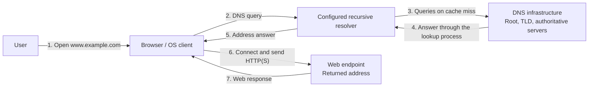
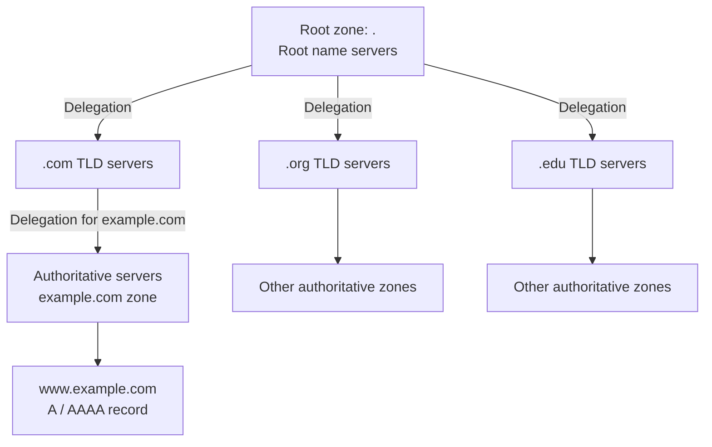
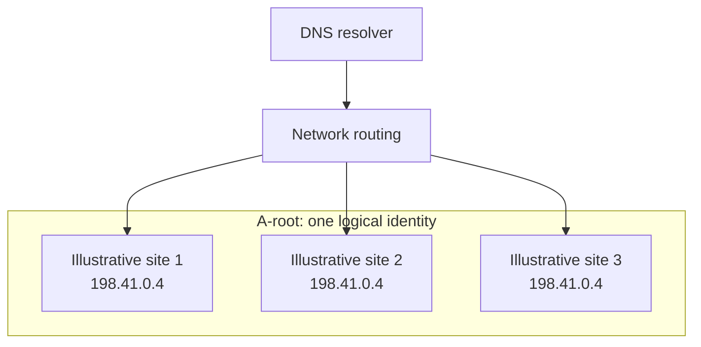
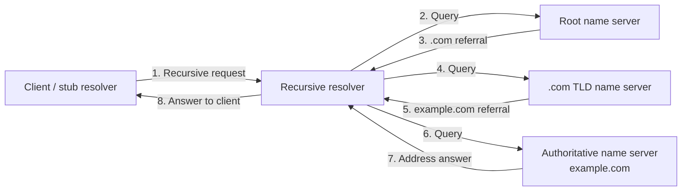
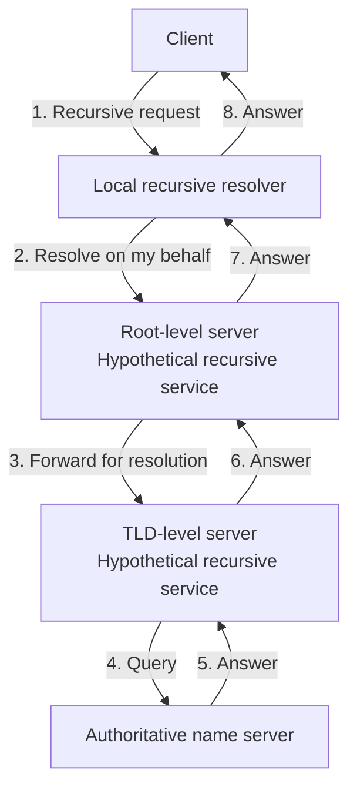
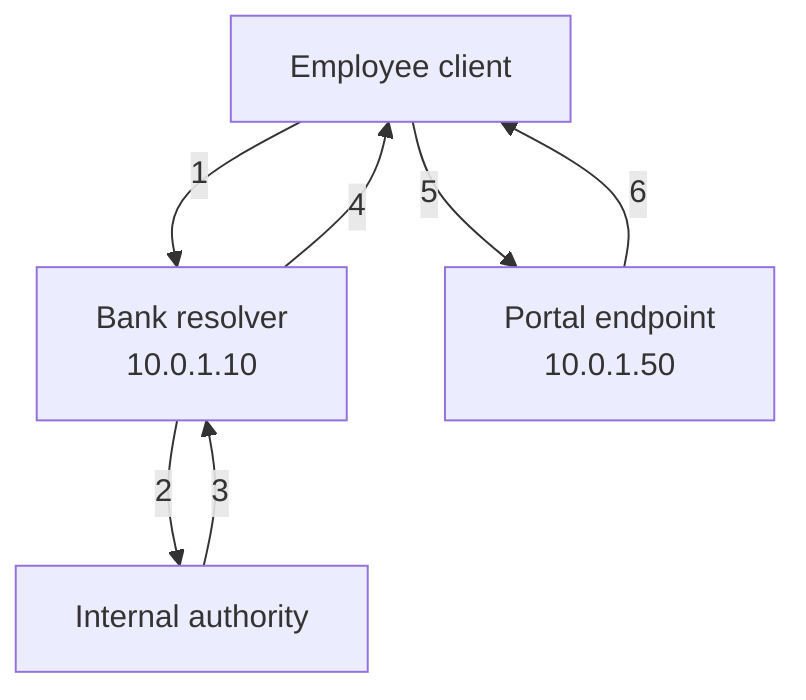
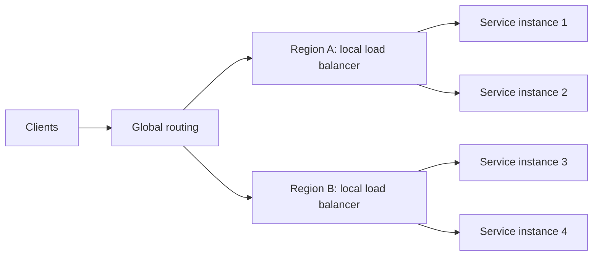
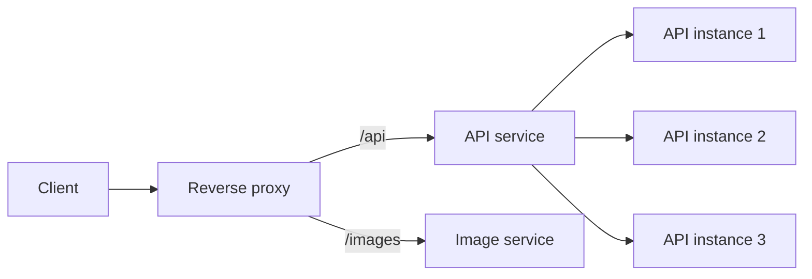
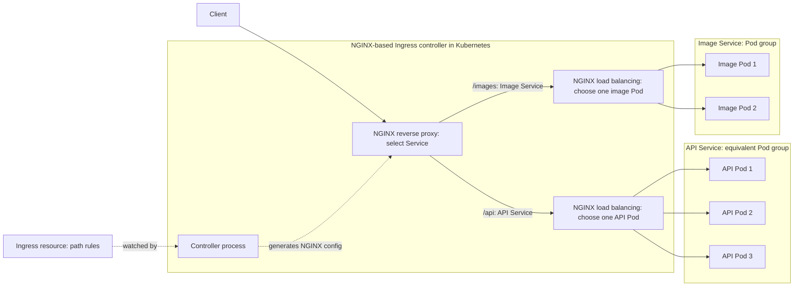
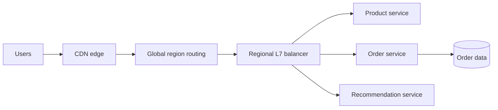

# Distributed Systems Building Blocks

## Table of Contents

- [Overview](#overview)
- [Exploring DNS](#exploring-dns)
  - [DNS Name Resolution](#dns-name-resolution)
  - [Name Servers and Resolvers](#name-servers-and-resolvers)
  - [Resource Records](#resource-records)
  - [DNS Hierarchy](#dns-hierarchy)
  - [DNS Server Deployment and Governance](#dns-server-deployment-and-governance)
    - [Counts and Locations](#counts-and-locations)
    - [Root Identities and Anycast](#root-identities-and-anycast)
    - [Operators, Governance, and National Networks](#operators-governance-and-national-networks)
  - [DNS Querying](#dns-querying)
    - [Iterative Queries](#iterative-queries)
    - [Recursive Queries](#recursive-queries)
    - [Conceptual Fully Recursive Forwarding](#conceptual-fully-recursive-forwarding)
  - [DNS Caching](#dns-caching)
  - [Private DNS and Internal Applications](#private-dns-and-internal-applications)
    - [Internal Infrastructure and Lookup Scope](#internal-infrastructure-and-lookup-scope)
    - [What the DNS Service Stores](#what-the-dns-service-stores)
    - [Bank Portal Request Flow](#bank-portal-request-flow)
    - [Split-Horizon DNS and Security](#split-horizon-dns-and-security)
    - [Local Hosts Files](#local-hosts-files)
    - [Public DNS, Private DNS, and Hosts Files Compared](#public-dns-private-dns-and-hosts-files-compared)
- [Scalability, Reliability, and Consistency in DNS](#scalability-reliability-and-consistency-in-dns)
  - [Scalability](#scalability)
  - [Reliability](#reliability)
  - [Consistency](#consistency)
- [Load Balancers](#load-balancers)
  - [Load Balancing Overview](#load-balancing-overview)
  - [Where Balancing Happens](#where-balancing-happens)
    - [Layer 4 vs. Layer 7](#layer-4-vs-layer-7)
    - [Local vs. Global Traffic Distribution](#local-vs-global-traffic-distribution)
  - [Backend Selection Algorithms](#backend-selection-algorithms)
  - [Reverse Proxy vs. Load Balancer](#reverse-proxy-vs-load-balancer)
    - [Mental Model: Service Routing and Instance Selection](#mental-model-service-routing-and-instance-selection)
    - [NGINX, Ingress, and Kubernetes Service](#nginx-ingress-and-kubernetes-service)
  - [Common Reverse Proxy Functions](#common-reverse-proxy-functions)
  - [CDNs and Origin Traffic](#cdns-and-origin-traffic)
  - [TLS Termination](#tls-termination)
    - [How It Works](#how-it-works)
    - [Connection to the Backend](#connection-to-the-backend)
  - [Session Affinity](#session-affinity)
  - [Health Checks and Failover](#health-checks-and-failover)
  - [Autoscaling with Load Balancing](#autoscaling-with-load-balancing)
  - [Traffic Routing Policies](#traffic-routing-policies)
  - [Worked Example: Flash Sale](#worked-example-flash-sale)
  - [Design Checklist](#design-checklist)
  - [Key Takeaways](#key-takeaways)
- [Application Gateways](#application-gateways)
- [Microservices Architectures](#microservices-architectures)
- [Cloud-Native Implementations](#cloud-native-implementations)
- [On-Premises Options](#on-premises-options)
- [Summary](#summary)
- [Further Reading](#further-reading)

## Overview

Distributed systems need a way to **find services, distribute traffic, and apply request policies**. DNS, load balancers, and application gateways provide complementary building blocks.

| Building block | Main question | Example |
| --- | --- | --- |
| **DNS** | Which address or other record belongs to this name? | Resolve `www.example.com` to an address for an application entry point. |
| **Load balancer** | Which eligible backend should receive this connection or request? | Select a healthy instance of the order service. |
| **Application gateway** | How should an application request be routed and controlled? | Route an API request and enforce authentication or rate limits. |

These roles can overlap in one product. A common web path is **DNS lookup → connection to an entry point → gateway/routing and backend selection → application**. DNS resolution is separate from forwarding the application request; the entry-point address may represent a CDN, proxy, or load balancer rather than one application server.

> **Mental model:** DNS helps you **find the destination**; load balancing **distributes work**; a gateway **applies application-level routing and policies**. None replaces the application's own data correctness or failure handling.

## Exploring DNS

**The Domain Name System (DNS)** is a distributed, hierarchical system for looking up information associated with domain names. Its familiar use is translating names into IP addresses, but it also stores aliases, mail-routing information, and delegation records.

### DNS Name Resolution

When someone opens `https://www.example.com`, the browser needs an address before establishing a new connection, unless a usable answer or connection is already available.

1. The browser or OS checks applicable local caches.
2. On a cache miss, the client asks its **configured recursive resolver** to resolve the name.
3. The resolver answers from its cache or queries the DNS hierarchy.
4. It returns an address; the browser can then connect to the web endpoint and send its HTTP(S) request.



**Diagram:** DNS discovers the address; the subsequent web request follows a separate network path to that endpoint. The recursive resolver is **not an HTTP forwarding proxy**. It may be provided by an ISP, enterprise network, or public DNS service. A browser can also use its own configured DNS mechanism rather than the OS resolver.

### Name Servers and Resolvers

DNS is **not one central server or a complete database copied onto every server**. Responsibilities are distributed between resolvers and authoritative servers.

> A **recursive DNS resolver is a software service**, not a special type of physical computer. It can run on a physical server, virtual machine, or container. Your ISP, organization, or a public DNS provider can operate it—or you can run one yourself. It answers clients using cached information, queries the DNS hierarchy, or forwards requests to another resolver, depending on its configuration.

> The **stub resolver** is the client-side component, commonly part of your OS. The **recursive resolver** is the service it asks to perform resolution. They can run on different machines or on the same computer.

| Component | Responsibility |
| --- | --- |
| **Stub resolver** | Client-side DNS component, commonly in the OS, that asks a recursive resolver for an answer. |
| **Recursive resolver** | Resolves names on the client's behalf, follows referrals or uses upstream forwarders, and caches results. |
| **Root name server** | Serves the root zone and refers relevant queries to TLD servers. |
| **TLD name server** | Serves a top-level zone such as `.com` and provides delegations to its child zones. |
| **Authoritative name server** | Answers from the data for a zone it serves, such as `example.com`; it may be operated by the organization or a DNS provider. |

A **zone** is an administratively managed portion of the DNS namespace. Delegation lets one zone point to the servers responsible for a child zone. Server roles can coexist in an implementation, but they are different responsibilities.

**Authoritative DNS server vs. application server:**

| Aspect | Authoritative DNS server | Application server |
| --- | --- | --- |
| **Serves** | DNS records for its zones | Application pages, APIs, and business operations |
| **Example response** | An address record for `portal.example.com` | The portal's HTML or API response |
| **Role in a web visit** | Helps the resolver obtain the endpoint address | Handles the subsequent application request |

DNS does **not** forward the browser's web request. After resolution, the browser connects separately to the returned address, which may identify an application server, reverse proxy, or load balancer. See [DNS Name Resolution](#dns-name-resolution) for that separation. DNS and application software can share a physical or virtual machine, but they remain different services.

### Resource Records

A **resource record (RR)** associates a name with typed data and a cache lifetime. Address records are only one kind. The following names and addresses are illustrative:

| Type | Maps or identifies | Example | Important distinction |
| --- | --- | --- | --- |
| **A** | Name → IPv4 address | `www.example.com` → `192.0.2.10` | A is specifically IPv4, not every IP version. |
| **AAAA** | Name → IPv6 address | `www.example.com` → `2001:db8::10` | Provides an IPv6 address. |
| **NS** | Zone name → authoritative server name | `example.com` → `ns1.example.net` | Names a server; its address may need a separate lookup. |
| **CNAME** | Alias name → canonical name | `shop.example.com` → `www.example.com` | Names another DNS name, not an IP address or an HTTP redirect. |
| **MX** | Domain → mail-exchanger name and preference | `example.com` → `10 mail.example.com` | Lower preference numbers are preferred; the mail server's address is resolved separately. |

NS and related address information help a resolver find the next server. A referral may include **glue address records** where needed to reach delegated servers. These are navigation information, not necessarily the requested website's final address. [RR formats and types: RFC 1035](https://www.rfc-editor.org/rfc/rfc1035), [IPv6 records: RFC 3596](https://www.rfc-editor.org/rfc/rfc3596)

### DNS Hierarchy

DNS organizes names hierarchically. For a simplified, uncached lookup of `www.example.com`:

1. A root server points the resolver to **`.com` servers**.
2. A `.com` server points it to **authoritative servers for `example.com`**.
3. An authoritative server supplies the requested record, such as the A record for `www.example.com`, or an applicable alias or negative answer.



**Diagram:** Arrows show **delegation and responsibility**, not recursive forwarding of every query. Root servers do not store every website's address, and authoritative DNS servers are not the web servers themselves. More delegation levels or aliases can add steps; cached records can eliminate steps.

### DNS Server Deployment and Governance

DNS is distributed both **logically**—through zones and delegations—and **physically**—through deployments in different networks and locations. A server name, an operator, a deployment, and a physical computer are not interchangeable concepts.

#### Counts and Locations

| DNS role or counting unit | How many? | Where? |
| --- | --- | --- |
| **Root-server identities** | 13 named identities, A–M, operated by 12 organizations at the snapshot date below | Each identity can be served from multiple locations. |
| **Root-server operational instances** | 2,047 in the dated inventory below; this is a changing deployment count | Distributed across countries and networks worldwide. |
| **TLD authoritative infrastructure** | Multiple deployments serving the different TLD zones; no single useful fixed global machine count | Registry/operator infrastructure in multiple locations. |
| **Other authoritative servers** | Many independently operated services for delegated zones; no fixed global total | Organizations, hosting providers, and managed DNS infrastructure. |
| **Recursive resolvers** | Many ISP, enterprise, public-service, and private deployments | Near their users or in provider infrastructure. |

**Dated snapshot:** The [root-server operators' inventory](https://root-servers.org/) reported **2,047 operational instances and 12 operators on 16 October 2026**, with a published timestamp of `2026-10-16T02:15:00Z`. Use its live map and per-operator listings for current locations; this number is not a permanent architectural constant. Published sites include London, Frankfurt, Tokyo, and New York, among many others.

An **instance** is a deployed service instance, not necessarily one physical computer. A site or service deployment can involve multiple machines. Likewise, root and TLD servers are themselves authoritative for their respective zones—the table groups responsibilities, not mutually exclusive hardware types. [DNS terminology: RFC 9499](https://www.rfc-editor.org/info/rfc9499)

> **13 identities does not mean 13 computers or 13 countries.** A–M name logical root services; their deployed instances provide the geographic distribution. The [IANA root-server list](https://www.iana.org/domains/root/servers) identifies their names, addresses, and operators. Verisign operates both A and J, illustrating why identity count and operator count differ.

#### Root Identities and Anycast

**Anycast** allows instances in different locations to serve the **same destination IP address**. Their networks advertise reachability to that service address, and routing determines which instance receives a query.

For example, A-root's name is **`a.root-servers.net`**, and its IPv4 service address is **`198.41.0.4`**. The following three sites are illustrative, not a claim about its complete or exact deployment inventory. [A-root name and address](https://www.iana.org/domains/root/servers)



**Diagram:** The three arrows show **possible destinations**, not a broadcast. A query normally reaches **one** instance. Each instance serves the root-zone information; the resolver does not need a unique address for every physical location.

- **Latency:** Routing can select a nearby network location, but its chosen route is not necessarily the geographically closest or lowest-latency one.
- **Capacity:** Different clients' queries can reach different instances, distributing aggregate load.
- **Resilience:** If an unhealthy location's route is withdrawn or otherwise avoided, traffic can reach another instance. Detection and routing convergence take time; rerouting is not automatically instantaneous, and retries may be needed.

> **Mental model:** A root identity is a distributed DNS service. Anycast selects a reachable deployment through network routing; it is not a DNS query sent to every deployment.

#### Operators, Governance, and National Networks

“Who controls DNS?” combines several different responsibilities:

| Responsibility | What it means |
| --- | --- |
| **Root-server operation** | Operators run the instances serving their root identities. Examples include Verisign, ISC, Netnod, RIPE NCC, WIDE, and ICANN. |
| **Root-zone coordination** | IANA functions, provided by PTI within ICANN, coordinate root delegations through established processes. This is distinct from running every root-server instance. |
| **TLD and domain administration** | Registries and delegated domain administrators manage their respective zones, not every name in the global DNS. |
| **Geographic hosting** | An operator's service can have deployments outside the country where the organization is based. Hosting an instance does not confer authority to rewrite the global namespace. |
| **Domestic network policy** | Governments and network operators can affect local access, resolver behavior, and connectivity. That is different from administering the global root zone. |

No single country performs all these roles. Many root operators are US-based, but operator headquarters, deployment locations, and governance responsibilities are different facts. See [IANA's operator list](https://www.iana.org/domains/root/servers). The direct US government IANA-functions contract ended on **1 October 2016**; that transition did not eliminate legal jurisdictions or domestic network policies. [ICANN's stewardship-transition explanation](https://www.icann.org/stewardship-accountability)

**Brief country examples:**

| Country | What the technical evidence establishes |
| --- | --- |
| **Russia** | [`.ru` is delegated in the public root](https://www.iana.org/domains/root/db/ru.html); the dated root-server inventory also lists operational instances in Moscow. |
| **South Korea** | [`.kr` is delegated in the public root](https://www.iana.org/domains/root/db/kr.html); the inventory lists operational instances in Seoul. |
| **North Korea** | [`.kp` has a public-root delegation](https://www.iana.org/domains/root/db/kp.html). That fact does not establish residents' access to the global internet or the scope of domestic intranets. |

The Moscow and Seoul deployment observations are from the [official inventory checked on 16 October 2026](https://root-servers.org/), not a guarantee that every listed location remains operational indefinitely. DNS participation, local hosting, domestic naming systems, and internet-access restrictions are separate questions.

**What if a country has no root instance?** A reachable resolver can contact an instance in another country and follow the usual referrals, or use cached information or an approved upstream resolver. Hosting a local root instance is not a prerequisite for public DNS resolution; usable network connectivity and policy still matter.

> **Recall:** Operating a local DNS server is not the same as controlling the global DNS namespace. A country or organization can use global DNS without hosting every layer of its infrastructure.

### DNS Querying

**Recursive** and **iterative** describe how a query is handled, not two entirely separate DNS infrastructures.

| Query style | What the requester asks | What the responding server does |
| --- | --- | --- |
| **Recursive** | “Resolve this name for me.” | If it offers recursion, pursues resolution and returns the resulting answer or an error. |
| **Iterative** | “Give me the answer or the best next step you know.” | Returns an available answer, a referral, or an appropriate error without resolving the remaining hierarchy on the requester's behalf. |

> **Typical combination:** The client makes a **recursive request**; its recursive resolver follows **iterative referrals** through the hierarchy on a cache miss. Calling it a recursive resolver does not mean its upstream queries must all be recursive. [Query behavior: RFC 1034](https://www.rfc-editor.org/rfc/rfc1034)

#### Iterative Queries

The following simplified flow assumes no useful cached answer, no alias, and a successful lookup. The **recursive resolver**, not ordinarily the browser's stub resolver, performs the iterative work.



**Walkthrough:** The resolver receives a referral, contacts the referred servers, and repeats until it obtains the requested result. Root and TLD responses identify **where to ask next**; the authoritative answer supplies the record in this example. These eight arrows illustrate message order, not eight mandatory messages for every lookup.

#### Recursive Queries

The client delegates the resolution work to a recursive resolver. It waits for the answer rather than contacting root, TLD, and authoritative servers itself. The resolver may return a cached answer, perform the iterative flow above, or ask a configured upstream recursive resolver.

**Example:** A laptop asks its configured DNS service for `www.example.com`. That service handles the hierarchy and returns the result. The laptop does not need its own complete resolver implementation.

Recursive service is offered according to server policy; not every DNS server accepts recursive requests. Public root and TLD servers normally supply authoritative answers or referrals, rather than acting as general-purpose recursive resolvers.

#### Conceptual Fully Recursive Forwarding

> **Conceptual contrast—not the usual public-DNS lookup.** This forwarding chain assumes that the illustrated root-level and TLD-level servers also provide recursion for these requests. It preserves the idea of the original comparison, but that assumption does **not** describe normal public root/TLD operation.



**Diagram:** Requests move down the chain and answers return through it. In the typical preceding diagram, the resolver instead receives referrals and contacts each level itself. Real recursive forwarding can occur between configured resolvers; it does not require public root/TLD servers to recurse.

**Load and performance:** Recursive resolvers do maintain outstanding-query state, but recursion does not inherently become slower merely because time passes. Capacity, caching, query volume, and response delays determine load. Keeping public authoritative servers focused on their zones and using caching resolvers distributes the work.

### DNS Caching

**Caching** temporarily reuses DNS results so repeated lookups need not traverse the hierarchy. It reduces **lookup latency**, **network traffic**, and **upstream query load**.

| Possible cache location | What it helps avoid |
| --- | --- |
| **Browser** | Repeating a lookup for a name already resolved by that browser. |
| **Operating system** | Repeating lookups across local applications. |
| **Local-network resolver/forwarder** | Sending every local client's repeated query upstream. |
| **ISP, enterprise, or public recursive resolver** | Repeating hierarchy queries for names requested by many clients. |

Not every deployment uses all four layers. Resolvers can cache final answers and useful delegation information; an upstream cache hit can bypass several hierarchy steps.

**TTL (time to live)** is the record's permitted cache lifetime in seconds. The authoritative data supplies it; caches track the remaining lifetime rather than extending a record's life indefinitely each time they return it.

**Example: A 300-second TTL and an address change.**

| Time | Event | Normal result from this resolver |
| --- | --- | --- |
| **0 s** | Cache `www.example.com` → `192.0.2.10`, TTL 300. | Return the cached old address. |
| **60 s** | Authoritative data changes to `192.0.2.20`. | The previously cached record is not automatically invalidated. |
| **120 s** | Another client asks the same resolver. | It may still receive `192.0.2.10`; 180 seconds remain. |
| **300 s or later** | Cache lifetime expires; a new lookup obtains the updated authoritative answer. | Return `192.0.2.20`, assuming the update is available and resolution succeeds. |

This is one resolver's timeline, not a global update deadline. Other caches may have obtained the answer at different times. Lowering the authoritative TTL does not retroactively shorten the lifetime of an old answer already cached.

> **TTL trade-off:** Longer TTLs reduce repeated queries but can prolong stale routing after a change. Shorter TTLs improve responsiveness to updates but increase query load and reliance on reachable upstream DNS.

Ordinary expiry requires refreshing the answer. Some resolvers support explicitly configured **serve-stale** behavior during upstream failure; that is a resilience policy, not a promise that every cache always serves expired data. [Serving stale DNS data: RFC 8767](https://www.rfc-editor.org/rfc/rfc8767)

### Private DNS and Internal Applications

An organization can use the same DNS protocols to name **internal resources**. Employees do not need to memorize application IP addresses, and private-only records need not be published through public DNS.

**Bank example:**

```text
Internal zone:       internal.bank.example
Employee portal:     portal.internal.bank.example
Portal endpoint:     10.0.1.50
Configured resolver: 10.0.1.10
```

Names ending in **`.example` are documentation placeholders**, not a real bank's domain. In a real deployment, use a deliberately managed namespace, such as a suitable subdomain of a domain the organization controls. The `10.0.1.x` addresses illustrate private-network endpoints, reachable only where routing and policy permit them. [Reserved example names: RFC 2606](https://www.rfc-editor.org/rfc/rfc2606)

#### Internal Infrastructure and Lookup Scope

| Component | Needed for the private portal lookup? | Role |
| --- | --- | --- |
| **Client-side name resolution** | Yes, when accessing the portal by name | Uses configured local sources/caches and a resolver. |
| **Internal authoritative zone** | Yes, for centrally served private DNS records | Holds the portal record and authoritative answers for `internal.bank.example`. |
| **Recursive resolver/forwarder role** | Commonly used by clients | Answers from local zones/cache or contacts the configured internal authority. |
| **Public root and TLD servers** | Not for this configured private zone | Remain relevant when the resolver performs uncached public resolution. |
| **Application endpoint** | Yes, but it is not a DNS server role | Runs the portal or forwards requests to its application instances. |

The resolver knows the private zone because it serves it locally or is configured to query an appropriate internal authority, for example through conditional forwarding. It does **not** have to discover that private zone through the public root. The organization also does not need to build its own root/TLD hierarchy merely to serve one internal zone.

Resolver and authoritative roles may run on the same physical or virtual server, or on separate infrastructure. Multiple appropriately configured DNS deployments reduce dependence on a single server; clients need a way to use the alternatives, and authoritative data must be kept consistent.

**What about a public name?** For an allowed name such as `www.example.com`, the bank's resolver can use an approved upstream service or perform public iterative resolution. Routing private names to the correct internal authority avoids treating them as public names or leaking unnecessary private-name queries upstream.

#### What the DNS Service Stores

DNS data may be held in zone files, a directory/database backend, or a managed service. DNS does not require a particular relational database product.

| Information | Example | Meaning |
| --- | --- | --- |
| **Authoritative zone records** | A record: `portal.internal.bank.example` → `10.0.1.50`; CNAME: `hr.internal.bank.example` → `portal.internal.bank.example` | The zone's source data. AAAA, MX, and NS records have the same roles described in [Resource Records](#resource-records). |
| **Zone metadata** | SOA record, including a zone serial and maintenance timers | Identifies zone-management information; the serial helps track zone versions. |
| **Record lifetimes** | TTL 300 on a record | Controls ordinary cache reuse, not how long the application itself exists. |
| **Resolver cache** | Previously obtained answers and delegation information | Temporary copied information; not the source of authority for those zones. |
| **Server configuration** | Served zones, upstream forwarders, access policies | Controls server behavior; configuration is distinct from the resource records themselves. |

DNS is **not the application's business database or source-code store**. Customer accounts, business transactions, and portal content belong in the application and its storage systems. Do not use ordinary DNS records as a password or secret store.

#### Bank Portal Request Flow

The client first uses its applicable local name-resolution sources and caches. The diagram shows a lookup that needs DNS and misses the resolver's cache; a usable local answer can skip that work.



1. The client asks for `portal.internal.bank.example`.
2. The resolver queries the internal authority for the configured private zone.
3. The authority returns the A record containing `10.0.1.50`.
4. The resolver returns the answer to the client, with applicable caching.
5. The browser connects to the portal endpoint and sends its HTTPS request.
6. The application returns its response after applying its normal access checks.

**Diagram:** The resolver and authority boxes are **logical roles**, not a requirement for two separate machines. DNS traffic ends with the address response; the browser's portal request does not pass through the DNS server.

#### Split-Horizon DNS and Security

**Split DNS**, also called **split-horizon DNS**, allows the same name to receive different answers depending on the querying context. An internal resolver may return a private address for a company service while an external view returns a public entry point or no published record. [Current DNS terminology: RFC 9499](https://www.rfc-editor.org/info/rfc9499)

**Example:** For the illustrative name `portal.bank.example`, an internal view returns **`10.0.1.50`**, while an external view returns a public entry point represented here by **`192.0.2.50`**. Employees on the company network or an appropriately configured VPN use the internal view. The resolver/view configuration and network path determine the result—not merely whether a user knows the name. These are documentation names and addresses, not a live public delegation.

> **Private naming is not application security.** DNS does not grant access, authenticate employees, or encrypt portal traffic. Authentication, authorization, TLS, and network controls remain necessary according to the application's requirements. Keeping a record private is not a substitute for protecting the endpoint.

#### Local Hosts Files

A **hosts file** provides static hostname-to-address mappings on an individual computer. Example entries are:

```text
127.0.0.1    localhost
10.0.1.50    portal.internal.bank.example
10.0.1.60    test.internal.bank.example
```

Conventional locations:

- **Windows:** `C:\Windows\System32\drivers\etc\hosts`
- **Linux/macOS:** `/etc/hosts`

Applications using the relevant system name-resolution mechanism can obtain these mappings without a DNS query. The lookup order, cache interaction, and whether an application uses that mechanism depend on OS and application configuration; “the hosts file is always checked first” is not a universal rule. [Linux hosts-file documentation](https://man7.org/linux/man-pages/man5/hosts.5.html), [Microsoft hosts-file documentation](https://support.microsoft.com/en-us/windows/experience/how-to-reset-the-hosts-file-back-to-the-default)

**Useful for:** Small local overrides, controlled testing, or an isolated machine's naming needs. The file does not provide authoritative zones, DNS queries/referrals, MX routing, or DNS-record TTL fields.

**Why not distribute a hosts file to every employee?** Each computer needs the right entries and later updates. Configuration-management tools can distribute files, but the hosts file itself does not publish or automatically synchronize its mappings. A stale entry can keep pointing to an old endpoint; centrally managed DNS is usually more practical as the fleet grows.

#### Public DNS, Private DNS, and Hosts Files Compared

| Aspect | Public DNS | Private DNS | Hosts file |
| --- | --- | --- | --- |
| **Scope** | Globally delegated namespace and published records | Organization-controlled zones or DNS views | One computer's local mappings |
| **Management** | Delegated zone administrators and DNS operators | Organization's infrastructure team or configured DNS provider | Local administration or configuration-management tooling |
| **Resolution** | Resolvers use caches, upstream services, and public delegations | Configured resolvers obtain internal authoritative answers; public lookup may also be supported | Applications consult a local file through their resolution mechanism |
| **Scaling** | Distributed authority, replication, and caching | Shared administration, redundant servers, and caching | Updates must reach every affected computer |
| **Application security** | Separate from DNS naming | Separate from DNS naming | Separate from the local mapping |

> **Mental model:** Public DNS provides globally coordinated names; private DNS provides organization-controlled resolution; a hosts file provides local mappings. All help find endpoints, but none runs or secures the application merely by naming it.

## Scalability, Reliability, and Consistency in DNS

DNS is itself a distributed system. It separates responsibility and uses caches and replicated services to handle large query volumes, while accepting that updates are not immediately visible to everyone.

### Scalability

- **Hierarchy and delegation:** Each zone manages its own portion of the namespace instead of one central server storing all records.
- **Caching:** Popular names can be answered locally, so root and TLD servers are not consulted for every visit.
- **Distributed server instances:** Queries can be served across multiple locations, spreading load and reducing dependence on one site.
- **Anycast where deployed:** Several instances advertise the same service address; network routing selects an instance. This is not a guarantee of the lowest application latency.

**Example:** Thousands of users behind one caching resolver request the same website. Once its address is cached, many subsequent requests are answered there without repeating the full lookup.

Root-server identities are backed by distributed instances; an identity is not necessarily one physical machine. No fixed physical-instance count is needed to understand the architecture. [Distributed authoritative service: RFC 3258](https://www.rfc-editor.org/rfc/rfc3258)

### Reliability

- **Redundant authoritative servers:** A zone can remain reachable when one server or site fails. Independent network locations reduce shared failure risk.
- **Retries and alternate servers:** A resolver can retry after a timeout or contact another eligible name server.
- **Cached answers:** An available, usable cached record can help when upstream DNS is temporarily unreachable.
- **Transport support:** Traditional DNS uses UDP and TCP. UDP does not guarantee delivery; DNS implementations handle timeouts and retries. TCP supports larger responses and other exchanges, and is not limited to zone transfers.

**Example:** One authoritative server stops responding. The resolver tries another server for the same zone; if that succeeds, the client still receives an answer. General-purpose DNS implementations must support both UDP and TCP. [DNS over TCP: RFC 7766](https://www.rfc-editor.org/rfc/rfc7766)

> **Redundancy helps, but does not guarantee availability.** Expired or missing cache entries, failures affecting all authoritative servers, or bad DNS configuration can still prevent resolution. Correct DNS resolution also does not prove that the returned web endpoint is healthy.

Choose authoritative replicas with suitable failure independence, not merely multiple processes on one machine. [Secondary-server placement: RFC 2182](https://www.rfc-editor.org/rfc/rfc2182)

### Consistency

DNS does not normally provide one instantly updated global view. Different clients may temporarily receive different answers after a change.

There are **two distinct sources of delay**:

1. **Authoritative synchronization:** The zone's serving replicas need to receive an update through the operator's replication or transfer mechanisms.
2. **Cache expiry and refresh:** Resolvers may keep returning an earlier answer for its remaining cache lifetime, even after the authoritative servers have changed.

**Example:** Resolver A still has the old address from the TTL walkthrough; resolver B obtains the new address after the authoritative update. Both answers can be observed during the transition. With stable updated authority data and successful refreshes, caches converge toward the new answer rather than changing simultaneously.

There is no universal “DNS propagation takes X hours” rule. Timing depends on authoritative synchronization, existing record lifetimes, cache policy, and connectivity. A shorter TTL can reduce ordinary cache staleness, but does not make replication instantaneous or force existing connections to move.

> **Recall:** DNS gains scale and responsiveness through **delegation, caching, and redundancy**. The trade-off is that routing changes require a transition plan: stale addresses, unreachable servers, and existing connections must be considered separately.

## Load Balancers

### Load Balancing Overview

**Load balancing** distributes incoming connections, requests, or jobs among eligible backends. Its goals are to use capacity efficiently, avoid overloaded instances, and keep traffic flowing when individual backends fail.



> <u>Load balancing does not create capacity.</u> It distributes work across the capacity that exists. Autoscaling, admission control, caching, and backpressure address sustained overload.

The routing decision has two parts: **which group of backends is eligible** (for example, a region or service) and **which healthy backend within that group receives the work**. Health, performance, location, session state, and business rules may all affect that choice.

### Where Balancing Happens

#### Layer 4 vs. Layer 7

**Layer 4 (L4)** balancers route TCP or UDP traffic using connection metadata such as IP addresses and ports. **Layer 7 (L7)** balancers understand application protocols such as HTTP and can route using hostnames, paths, headers, and cookies.

| Aspect | L4: transport level | L7: application level |
| --- | --- | --- |
| **Decision inputs** | IP, port, protocol, connection state | HTTP host, path, headers, cookies, request rules |
| **Suitable traffic** | TCP/UDP services, non-HTTP protocols | Web applications, APIs, service routing |
| **Visibility** | Usually cannot inspect encrypted HTTP content | Can inspect HTTP only when TLS terminates at or before this layer |
| **Typical strength** | Lower processing overhead; protocol agnostic | Fine-grained routing and application controls |
| **Typical trade-off** | No content-based HTTP routing | More processing and configuration complexity |

L4 can forward encrypted traffic without decrypting it. Some L4 products can also terminate TLS; *layer* and *TLS behavior* are separate design choices. L7 routing based on HTTP content requires access to the decrypted request.

#### Local vs. Global Traffic Distribution

| Scope | Decision | Common mechanisms |
| --- | --- | --- |
| **Local** | Which instance in a region or cluster should handle this request? | Reverse proxy, service load balancer, service mesh |
| **Global** | Which region, data center, or edge location should receive this user? | DNS policies, anycast, global proxy, traffic manager |

Local balancing spreads work and provides instance-level failover. Global distribution can reduce network delay and support regional failover. A common path is **global region selection → regional load balancer → healthy service instance**.

> Global routing is a policy choice, not always “send everyone to the nearest region.” Data location, available capacity, regional features, and current health may matter more than distance.

DNS-based routing updates the answers given to *new* DNS lookups. Cached DNS answers and existing connections can keep using an old endpoint until they expire or reconnect, so DNS failover is not instantaneous.

### Backend Selection Algorithms

Selection algorithms operate on the *healthy, eligible* backend pool. Different algorithms work best for different request lengths and server capacities.

| Algorithm | Decision rule | Good fit | Main limitation |
| --- | --- | --- | --- |
| **Round robin** | Rotate through backends in order | Similar instances and roughly similar work | Ignores current load and request duration |
| **Weighted round robin** | Send more requests to higher-weight backends | Unequal instance capacity or controlled rollout | Weights need adjustment; request cost can vary |
| **Least connections** | Choose the backend with the fewest active connections | Long-lived or uneven connections | Connection count may not reflect CPU work |
| **Least response time** | Prefer a backend with lower observed latency, often with load considered | Latency-sensitive services | Noisy measurements can cause traffic shifts |
| **IP or key hash** | Map a stable key to a backend | Affinity or cache locality | NAT can group users; mapping changes when nodes change |

For weighted routing, an instance with weight $w_i$ receives approximately this share *over many requests* when all targets remain healthy:

$$
p_i \approx \frac{w_i}{\sum_{j=1}^{n} w_j}
$$

For example, weights `2:1` aim for roughly two-thirds of requests to the first instance and one-third to the second. They do not guarantee equal CPU use or exact percentages in a short sample. **Consistent hashing** can reduce remapping when a node joins or leaves, but it still requires a strategy for hot keys.

### Reverse Proxy vs. Load Balancer

A **reverse proxy** receives requests from clients and forwards them to backend services. **Load balancing** is the function of distributing traffic among multiple backends. One component can do both.

| Aspect | Reverse proxy | Load balancer |
| --- | --- | --- |
| **Primary purpose** | Act as an intermediary between clients and backends | Distribute traffic across backends |
| **Routing** | Forward requests using rules such as hostname or URL path | Select a backend using a policy such as round robin or least connections |
| **Backend count** | One or more | Usually multiple |
| **Typical functions** | TLS termination, caching, authentication, request routing | Traffic distribution, health checks, failover |
| **Typical layer** | Often application layer (Layer 7) | Transport layer (Layer 4) or application layer (Layer 7) |

> **Remember:** *Reverse proxy* describes a component's position and role in the request path; *load balancing* describes what it does with traffic. A reverse proxy need not balance traffic, and a load balancer may work as a reverse proxy.

Neither term requires a dedicated physical server. Implementations include software, hardware appliances, and managed cloud services.

#### Mental Model: Service Routing and Instance Selection

For an HTTP application, two useful questions are **“Which service handles this path?”** and **“Which healthy instance of that service handles this request?”** The first is a routing decision; the second is a load-balancing decision.



This diagram shows *logical decisions*, not required separate devices. One NGINX instance can route `/api` to the API service **and** balance requests among its instances. Another design may use separate components. A transport-level load balancer can distribute connections without inspecting HTTP paths.

> **Memory aid:** A reverse proxy is the intermediary that receives and forwards client requests. Load balancing is the choice among available destinations. Service routing and instance selection often happen together, but neither term is a formal subtype of the other.

#### NGINX, Ingress, and Kubernetes Service

| Term | What it is | Role in this example |
| --- | --- | --- |
| **NGINX** | Open-source, high-performance HTTP server, reverse proxy, and load balancer | Routes requests and selects backends; can run on a VM, bare-metal server, or in a container |
| **Ingress** | Kubernetes API resource containing HTTP(S) host and path rules | Declares that `/api` goes to the API Service and `/images` goes to the Image Service |
| **Ingress controller** | Software, often running in Kubernetes Pods, that watches Ingress rules and implements them | An NGINX-based controller generates and updates NGINX configuration as the rules change |
| **Service** | Kubernetes abstraction that gives a group of Pods a stable network identity | Represents the API or image backend; a normal Service can distribute traffic among its ready Pods |



In a traditional standalone setup, NGINX is installed on a VM or bare-metal server and its configuration, such as `nginx.conf` and included files, maps hostnames and paths to backends. Teams can maintain that configuration directly or through automation. With an NGINX-based Ingress controller, you define Kubernetes Ingress rules; the controller watches them and automatically generates and updates the NGINX configuration. See the [NGINX configuration guide](https://nginx.org/en/docs/beginners_guide.html) and [F5 NGINX Ingress Controller design](https://docs.nginx.com/nginx-ingress-controller/overview/design/).

The diagram shows **two logical functions handled by the same NGINX-based controller**: reverse-proxy routing picks the Service named by the path rule, and load balancing picks one eligible Pod for that request. The arrows to multiple Pods show possible destinations, not a broadcast. Depending on the controller, traffic may go directly to Pod endpoints rather than through a Service's virtual IP. An Ingress resource alone does not handle traffic; it needs a controller. A Kubernetes `Service` of type `LoadBalancer` is a separate way to expose a workload through an external load balancer. See the [Kubernetes Ingress](https://kubernetes.io/docs/concepts/services-networking/ingress/) and [Service](https://kubernetes.io/docs/concepts/services-networking/service/) documentation.

**Naming note:** The Kubernetes community project **Ingress NGINX** was [retired in March 2026](https://kubernetes.io/blog/2026/01/29/ingress-nginx-statement/). It is distinct from the actively maintained [F5 NGINX Ingress Controller](https://docs.nginx.com/nginx-ingress-controller/changelog/). The general concepts of Ingress resources and controllers still apply.

### Common Reverse Proxy Functions

A reverse proxy can perform several functions at once:

1. **Load balancing:** Spread requests across healthy backend instances.
2. **API gateway:** Route API calls, authenticate clients, and enforce rate limits.
3. **Caching:** Serve stored responses without repeatedly calling the backend.
4. **Security filtering:** Apply access rules and block unwanted requests.
5. **TLS termination:** Handle the client-side HTTPS connection.
6. **Application routing:** Send requests to services based on hostname, path, or other request properties.

These are common capabilities, not mutually exclusive types. For example, the same proxy can terminate TLS, check authentication, and then balance requests across an application cluster.

### CDNs and Origin Traffic

A **content delivery network (CDN)** places edge servers near users. An edge can serve a cached response or fetch it from the **origin** (the application's source server). This reduces the distance and number of requests that reach the origin.

| Aspect | Regional reverse proxy | CDN edge |
| --- | --- | --- |
| **Typical placement** | In front of an application or service pool | Distributed near users |
| **Common job** | Route and protect application requests | Cache and deliver content; shield the origin |
| **Cacheable content** | Can cache selected responses | Often used for assets, and sometimes cacheable HTML or API responses |
| **On a cache miss** | Forwards to a backend | Fetches from the origin or another cache tier |

These are overlapping roles: a CDN edge is often itself a reverse proxy and may offer routing, security, and load-balancing features. A common path is **user → CDN edge → regional reverse proxy/load balancer → application**.

Cache only when the response is safe to reuse. Set appropriate cache keys, expiry, and invalidation rules; avoid sharing personalized or private content across users. A CDN also does not replace regional capacity planning for requests it cannot serve from cache.

### TLS Termination

**TLS termination** means the client's encrypted connection ends at an intermediary, such as a reverse proxy, load balancer, or API gateway. That intermediary decrypts the request before processing or forwarding it.

```text
Client ── HTTPS/TLS ──► Proxy or load balancer ── HTTP or new HTTPS/TLS ──► Backend
                      (client TLS connection ends here)
```

#### How It Works

1. **Handshake:** The client establishes a TLS connection with the intermediary, which presents its certificate and proves its identity using the associated private key.
2. **Decryption:** The intermediary uses the negotiated *session keys* to decrypt request data.
3. **Processing:** It can inspect the request, apply routing or security rules, and choose a backend.
4. **Forwarding:** It sends the request to the backend over a separate connection, using HTTP or a new HTTPS connection.

> The private key is involved in authenticating the TLS endpoint during the handshake. In modern TLS, application traffic is decrypted with negotiated session keys, not directly with the certificate's private key.

#### Connection to the Backend

| Mode | Client to intermediary | Intermediary to backend | Meaning |
| --- | --- | --- | --- |
| **TLS termination with HTTP upstream** | HTTPS | HTTP | The internal hop is unencrypted; use only where that is acceptable for the network and security requirements. |
| **TLS termination with re-encryption** | HTTPS | New HTTPS connection | Both network hops are encrypted, but the intermediary can still inspect the request. |
| **TLS pass-through** | HTTPS | Original TLS traffic forwarded | The backend terminates TLS; the intermediary does not decrypt the application request. |

TLS termination does **not** imply that traffic to the backend must be plaintext. Re-encryption establishes a separate TLS connection for that hop. Pass-through is a different design because TLS ends at the backend.

### Session Affinity

**Session affinity** (or a *sticky session*) tries to send repeat requests from the same client to the same backend. It can help when session state is kept in that backend's memory.

| Method | How it works | Caution |
| --- | --- | --- |
| **Cookie-based affinity** | A cookie identifies the preferred backend or routing group. | The client must retain the cookie; an unhealthy backend still needs failover. |
| **IP-based affinity** | A hash of the client IP selects a backend. | NAT, mobile networks, and proxies can make many users share one IP or change IPs. |
| **Shared session storage** | Any backend reads state from a common store. | The store itself needs capacity, availability, and expiry policies. |

Affinity can simplify a stateful application, but it makes load distribution less even and complicates scaling and failover. Prefer **stateless application instances plus shared or client-held session state** when practical. If affinity is necessary, plan for the backend to disappear mid-session.

### Health Checks and Failover

A balancer should send new work only to backends that can actually serve it. A running process is not necessarily a *ready* process: it may still be starting, overloaded, or disconnected from a critical dependency.

- **Active health checks:** The balancer sends periodic probes to each backend.
- **Passive health checks:** The balancer observes errors and timeouts from real requests.
- **Readiness checks:** Indicate whether an instance should receive new traffic.
- **Failure thresholds:** Require repeated probe failures or successes to avoid flapping.
- **Connection draining:** Stop new requests to a departing backend and allow in-flight work to finish.
- **Timeouts and bounded retries:** Detect failure while avoiding retry storms or duplicate writes.

```text
register → warm up → pass readiness check → receive traffic
                                   ↓
             fail health check or scale in → drain → remove
```

> A health check should reflect the operation being served. A shallow `/health` response can be green while checkout cannot reach its payment dependency. At the same time, making every health check depend on every downstream service can cause correlated mass failover.

At the global layer, failover may move users to another region. That region must have enough spare capacity and access to the data required for correct operation. Routing alone cannot preserve session state, synchronize databases, or guarantee zero downtime.

### Autoscaling with Load Balancing

**Autoscaling** adjusts the number of service instances; the **load balancer** discovers healthy instances and distributes traffic among them. Together they provide elastic capacity.

1. Demand rises, measured by a useful signal such as queue age, requests per instance, CPU, or latency.
2. The scaler adds instances. They start, warm up, and pass readiness checks.
3. The balancer begins sending them traffic.
4. When demand falls, instances are drained before removal.

A rough capacity estimate is:

$$
N_{needed} \approx \left\lceil \frac{\lambda}{\mu \rho_{target}} \right\rceil
$$

where $\lambda$ is incoming requests per second, $\mu$ is sustainable requests per second per instance, and $\rho_{target}$ is the desired utilization fraction. This is a planning approximation: real capacity depends on request mix, queues, startup time, and downstream bottlenecks.

| Scaling signal | Useful for | Watch out for |
| --- | --- | --- |
| **CPU or memory** | Compute-heavy or memory-bound services | May not reveal blocked I/O or queue growth |
| **Requests per instance** | Relatively uniform request workloads | Expensive requests are not equal to cheap ones |
| **Queue depth or age** | Background consumers | Deep queues can take time to drain after scaling |
| **Latency or saturation** | User-facing performance | Often rises after overload has already begun |

Keep headroom for bursts and failures. Scale-out has a delay, so use warm capacity or predictive scheduling for known peaks. Ensure the database, cache, and external services can handle the extra traffic; adding application instances does not scale every dependency.

### Traffic Routing Policies

**Routing policies choose a destination group**—a service, region, or release version. **Selection algorithms choose a backend inside that group.**

| Policy | Example | Main use |
| --- | --- | --- |
| **Path-based** | `/api/orders` → orders service | Route different endpoints to different services |
| **Host-based** | `admin.example.com` → admin service | Serve several applications through one entry point |
| **Latency-based** | Choose a region with lower measured network delay | Reduce user round-trip time |
| **Geographic** | Route by user location or declared market | Localization or regional policy |
| **Weighted** | 95% stable release, 5% new release | Canary rollout or gradual migration |
| **Failover** | Send traffic to a secondary region when the primary fails | Disaster recovery |

For a canary rollout, increase the new version's weight only after checking error rate, latency, and business outcomes. Keep a fast rollback path. Session affinity and caches can make the observed split differ from the configured weight.

> Geo routing can help apply regional policy, but it does not by itself guarantee data residency. Verify where requests, processing, logs, backups, and failover traffic actually go.

### Worked Example: Flash Sale

Suppose a retailer expects a short global traffic spike. Its request path could be:



- The **CDN** serves cacheable product assets, reducing origin requests.
- **Global routing** selects an allowed, healthy region. A secondary region is tested for capacity and data access before it is needed.
- The **regional L7 balancer** sends paths to the right services and excludes unhealthy instances.
- **Autoscaling** adds product or recommendation instances as demand rises; checkout retains reserved capacity and backpressure.
- A **weighted canary** sends a small share of recommendation requests to a new version. It rolls back if quality or error metrics worsen.
- **Session and order state** live outside individual application instances so instance replacement does not erase them.

This architecture improves resilience, but it cannot promise zero downtime. A database bottleneck, stale DNS answer, failed cross-region data dependency, or cache stampede can still affect users; each needs its own mitigation.

### Design Checklist

1. What is being balanced: TCP connections, HTTP requests, or queued jobs?
2. Is the decision local, global, or both? What are the allowed regions?
3. Does routing require HTTP content (L7), or is transport-level routing enough (L4)?
4. Which backends are eligible, and how is readiness measured?
5. Which algorithm fits request duration, instance capacity, and affinity needs?
6. Where does TLS terminate, and is the backend hop encrypted?
7. Which responses can be cached, and how are private responses isolated?
8. How are instances added, warmed up, drained, and removed?
9. What happens when one instance, region, or shared dependency fails?
10. Which metrics trigger scaling, failover, canary rollback, or load shedding?

### Key Takeaways

- Load balancing selects among **healthy, eligible backends**. It improves use of existing capacity; scaling and backpressure handle growth.
- L4 routing uses connection information; L7 routing can use HTTP details when the request is decrypted.
- Global routing chooses a region or edge; local balancing chooses an instance. DNS-based changes are limited by caching and existing connections.
- Algorithms, health checks, session state, and autoscaling must be designed together.
- A reverse proxy describes an intermediary role; load balancing describes traffic distribution. A CDN edge can also be a reverse proxy.
- In Kubernetes, an Ingress declares HTTP routing rules, an ingress controller implements them, and a Service identifies a backend group of Pods.
- TLS termination ends the client-side encrypted connection at the intermediary; the backend hop may use HTTP or a new HTTPS connection.
- Failover is only effective when the alternate destination has capacity, correct data, and a tested recovery path.

## Application Gateways

> Study notes to be added.

## Microservices Architectures

> Study notes to be added.

## Cloud-Native Implementations

> Study notes to be added.

## On-Premises Options

> Study notes to be added.

## Summary

> Study notes to be added.

## Further Reading

- [IANA: Root Names, Addresses, and Operators](https://www.iana.org/domains/root/servers)
- [Root Server Operators: Live Inventory and Location Map](https://root-servers.org/)
- [ICANN: The 2016 IANA Stewardship Transition](https://www.icann.org/stewardship-accountability)
- [IANA: .ru Delegation](https://www.iana.org/domains/root/db/ru.html)
- [IANA: .kr Delegation](https://www.iana.org/domains/root/db/kr.html)
- [IANA: .kp Delegation](https://www.iana.org/domains/root/db/kp.html)
- [RFC 9499: DNS Terminology, Including Split DNS and Server Instances](https://www.rfc-editor.org/info/rfc9499/)
- [RFC 2606: Reserved Names for Documentation and Examples](https://www.rfc-editor.org/rfc/rfc2606)
- [Linux Manual: hosts File](https://man7.org/linux/man-pages/man5/hosts.5.html)
- [Microsoft: Hosts File Location and Format](https://support.microsoft.com/en-us/windows/experience/how-to-reset-the-hosts-file-back-to-the-default)
- [RFC 1034: Domain Names — Concepts and Facilities](https://www.rfc-editor.org/rfc/rfc1034)
- [RFC 1035: Domain Names — Implementation and Specification](https://www.rfc-editor.org/rfc/rfc1035)
- [RFC 3596: DNS Extensions to Support IPv6](https://www.rfc-editor.org/rfc/rfc3596)
- [RFC 7766: DNS Transport over TCP](https://www.rfc-editor.org/rfc/rfc7766)
- [RFC 2182: Selection and Operation of Secondary DNS Servers](https://www.rfc-editor.org/rfc/rfc2182)
- [RFC 3258: Distributing Authoritative Name Servers](https://www.rfc-editor.org/rfc/rfc3258)
- [RFC 8767: Serving Stale Data to Improve DNS Resiliency](https://www.rfc-editor.org/rfc/rfc8767)

- [NGINX: Using nginx as HTTP load balancer](https://nginx.org/en/docs/http/load_balancing.html)
- [Kubernetes: Ingress](https://kubernetes.io/docs/concepts/services-networking/ingress/)
- [Kubernetes: Service](https://kubernetes.io/docs/concepts/services-networking/service/)
- [F5: What is SSL termination?](https://www.f5.com/glossary/ssl-termination)
- [AWS: HTTPS listeners for Application Load Balancers](https://docs.aws.amazon.com/elasticloadbalancing/latest/application/create-https-listener.html)
- [NGINX: HTTP health checks](https://docs.nginx.com/nginx/admin-guide/load-balancer/http-health-check/)
- [AWS: Target health checks and draining](https://docs.aws.amazon.com/elasticloadbalancing/latest/application/target-group-health-checks.html)
- [AWS: DNS failover and TTL](https://docs.aws.amazon.com/Route53/latest/DeveloperGuide/resource-record-sets-values-failover.html)
- [Cloudflare: CDN caching basics](https://developers.cloudflare.com/cache/get-started/)
