# Distributed Systems Building Blocks

## Table of Contents

- [Overview](#overview)
- [Exploring DNS](#exploring-dns)
  - [DNS Name Resolution](#dns-name-resolution)
  - [Name Servers and Resolvers](#name-servers-and-resolvers)
    - [Checking Your DNS Server in Windows](#checking-your-dns-server-in-windows)
  - [Resource Records](#resource-records)
  - [DNS Hierarchy](#dns-hierarchy)
  - [DNS Server Deployment and Governance](#dns-server-deployment-and-governance)
    - [Counts and Locations](#counts-and-locations)
    - [Root Identities and Anycast](#root-identities-and-anycast)
    - [Operators, Governance, and National Networks](#operators-governance-and-national-networks)
    - [Example: Azerbaijan and the .az Domain](#example-azerbaijan-and-the-az-domain)
    - [DNS Independence vs. Network Isolation](#dns-independence-vs-network-isolation)
  - [DNS Querying](#dns-querying)
    - [Iterative Queries](#iterative-queries)
    - [Recursive Queries](#recursive-queries)
    - [Conceptual Fully Recursive Forwarding](#conceptual-fully-recursive-forwarding)
  - [DNS Caching](#dns-caching)
    - [Planned Hosting Migration and DNS TTL](#planned-hosting-migration-and-dns-ttl)
  - [Private DNS and Internal Applications](#private-dns-and-internal-applications)
    - [Internal Infrastructure and Lookup Scope](#internal-infrastructure-and-lookup-scope)
    - [What the DNS Service Stores](#what-the-dns-service-stores)
    - [Bank Portal Request Flow](#bank-portal-request-flow)
    - [Split-Horizon DNS and Security](#split-horizon-dns-and-security)
    - [Local Hosts Files](#local-hosts-files)
    - [Public DNS, Private DNS, and Hosts Files Compared](#public-dns-private-dns-and-hosts-files-compared)
- [Scalability, Reliability, and Consistency in DNS](#scalability-reliability-and-consistency-in-dns)
  - [Scalability](#scalability)
  - [Reliability](#reliability)
  - [Consistency](#consistency)
- [Load Balancers](#load-balancers)
  - [Load Balancing Overview](#load-balancing-overview)
  - [Where Balancing Happens](#where-balancing-happens)
    - [Load Balancer Placement](#load-balancer-placement)
    - [Layer 4 vs. Layer 7](#layer-4-vs-layer-7)
      - [TCP Connection: A Simple Mental Model](#tcp-connection-a-simple-mental-model)
      - [TCP Header: What Each Segment Carries](#tcp-header-what-each-segment-carries)
      - [Inspecting TCP Connections and Headers](#inspecting-tcp-connections-and-headers)
      - [Why One TCP Connection Stays on One Backend](#why-one-tcp-connection-stays-on-one-backend)
    - [Local vs. Global Traffic Distribution](#local-vs-global-traffic-distribution)
      - [DNS-Based Global Load Balancing](#dns-based-global-load-balancing)
  - [Backend Selection Algorithms](#backend-selection-algorithms)
    - [Static vs. Dynamic Selection](#static-vs-dynamic-selection)
  - [Reverse Proxy vs. Load Balancer](#reverse-proxy-vs-load-balancer)
    - [Mental Model: Service Routing and Instance Selection](#mental-model-service-routing-and-instance-selection)
    - [Single-Server Deployments](#single-server-deployments)
    - [NGINX, Ingress, and Kubernetes Service](#nginx-ingress-and-kubernetes-service)
  - [Common Reverse Proxy Functions](#common-reverse-proxy-functions)
    - [Reverse Proxy vs. API Gateway](#reverse-proxy-vs-api-gateway)
  - [CDNs and Origin Traffic](#cdns-and-origin-traffic)
  - [TLS Termination](#tls-termination)
    - [SSL vs. TLS: Naming and Versions](#ssl-vs-tls-naming-and-versions)
    - [Certificate Authorities: The Digital Notary](#certificate-authorities-the-digital-notary)
    - [Public and Private CAs](#public-and-private-cas)
    - [Certificate Issuance vs. Connection Verification](#certificate-issuance-vs-connection-verification)
    - [How It Works](#how-it-works)
    - [Connection to the Backend](#connection-to-the-backend)
  - [Session Affinity](#session-affinity)
  - [State in Load Balancing](#state-in-load-balancing)
  - [Health Checks and Failover](#health-checks-and-failover)
  - [Autoscaling with Load Balancing](#autoscaling-with-load-balancing)
  - [Traffic Routing Policies](#traffic-routing-policies)
  - [Illustrative Multi-Tier Deployment](#illustrative-multi-tier-deployment)
  - [Implementation Options](#implementation-options)
  - [Worked Example: Flash Sale](#worked-example-flash-sale)
  - [Design Checklist](#design-checklist)
  - [Key Takeaways](#key-takeaways)
- [Application Gateways](#application-gateways)
  - [Role and Request Flow](#role-and-request-flow)
  - [Features and Capabilities](#features-and-capabilities)
  - [Design Considerations](#design-considerations)
- [Microservices Architectures](#microservices-architectures)
  - [Gateway Support for Microservices](#gateway-support-for-microservices)
  - [Routing vs. Aggregation](#routing-vs-aggregation)
  - [External vs. Internal Traffic](#external-vs-internal-traffic)
- [Cloud-Native Implementations](#cloud-native-implementations)
  - [Managed Cloud Services](#managed-cloud-services)
  - [Kubernetes Gateways and Ingress](#kubernetes-gateways-and-ingress)
- [On-Premises Options](#on-premises-options)
  - [Self-Hosted Gateway Options](#self-hosted-gateway-options)
  - [Operational Responsibilities](#operational-responsibilities)
- [Summary](#summary)
- [Further Reading](#further-reading)

## Overview

Distributed systems need a way to **find services, distribute traffic, and apply request policies**. DNS, load balancers, and application gateways provide complementary building blocks.

| Building block | Main question | Example |
| --- | --- | --- |
| **DNS** | Which address or other record belongs to this name? | Resolve `www.example.com` to an address for an application entry point. |
| **Load balancer** | Which eligible backend should receive this connection or request? | Select a healthy instance of the order service. |
| **Application gateway** | How should an application request be routed and controlled? | Route an API request and enforce authentication or rate limits. |

These roles can overlap in one product. A common web path is **DNS lookup → connection to an entry point → gateway/routing and backend selection → application**. DNS resolution is separate from forwarding the application request; the entry-point address may represent a CDN, proxy, or load balancer rather than one application server.

> **Mental model:** DNS helps you **find the destination**; load balancing **distributes work**; a gateway **applies application-level routing and policies**. None replaces the application's own data correctness or failure handling.

## Exploring DNS

**The Domain Name System (DNS)** is a distributed, hierarchical system for looking up information associated with domain names. Its familiar use is translating names into IP addresses, but it also stores aliases, mail-routing information, and delegation records.

### DNS Name Resolution

When someone opens `https://www.example.com`, the browser needs an address before establishing a new connection, unless a usable answer or connection is already available.

1. The browser or OS checks applicable local caches.
2. On a cache miss, the client asks its **configured recursive resolver** to resolve the name.
3. The resolver answers from its cache or queries the DNS hierarchy.
4. It returns an address; the browser can then connect to the web endpoint and send its HTTP(S) request.

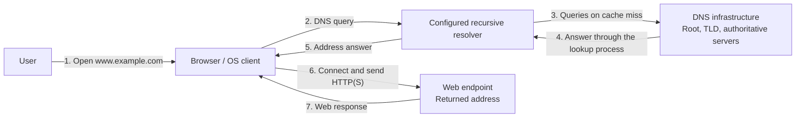

**Diagram:** DNS discovers the address; the subsequent web request follows a separate network path to that endpoint. The recursive resolver is **not an HTTP forwarding proxy**. It may be provided by an ISP, enterprise network, or public DNS service. A browser can also use its own configured DNS mechanism rather than the OS resolver.

### Name Servers and Resolvers

DNS is **not one central server or a complete database copied onto every server**. Responsibilities are distributed between resolvers and authoritative servers.

> A **recursive DNS resolver is a software service**, not a special type of physical computer. It can run on a physical server, virtual machine, or container. Your ISP, organization, or a public DNS provider can operate it—or you can run one yourself. It answers clients using cached information, queries the DNS hierarchy, or forwards requests to another resolver, depending on its configuration.

> The **stub resolver** is the client-side component, commonly part of your OS. The **recursive resolver** is the service it asks to perform resolution. They can run on different machines or on the same computer.

| Component | Responsibility |
| --- | --- |
| **Stub resolver** | Client-side DNS component, commonly in the OS, that asks a recursive resolver for an answer. |
| **Recursive resolver** | Resolves names on the client's behalf, follows referrals or uses upstream forwarders, and caches results. |
| **Root name server** | Serves the root zone and refers relevant queries to TLD servers. |
| **TLD name server** | Serves a top-level zone such as `.com` and provides delegations to its child zones. |
| **Authoritative name server** | Answers from the data for a zone it serves, such as `example.com`; it may be operated by the organization or a DNS provider. |

A **zone** is an administratively managed portion of the DNS namespace. Delegation lets one zone point to the servers responsible for a child zone. Server roles can coexist in an implementation, but they are different responsibilities.

**Authoritative DNS server vs. application server:**

| Aspect | Authoritative DNS server | Application server |
| --- | --- | --- |
| **Serves** | DNS records for its zones | Application pages, APIs, and business operations |
| **Example response** | An address record for `portal.example.com` | The portal's HTML or API response |
| **Role in a web visit** | Helps the resolver obtain the endpoint address | Handles the subsequent application request |

DNS does **not** forward the browser's web request. After resolution, the browser connects separately to the returned address, which may identify an application server, reverse proxy, or load balancer. See [DNS Name Resolution](#dns-name-resolution) for that separation. DNS and application software can share a physical or virtual machine, but they remain different services.

#### Checking Your DNS Server in Windows

Plain `ipconfig` shows basic interface information, not the configured DNS server addresses. In **PowerShell**, inspect the full configuration or list DNS addresses directly:

```powershell
ipconfig /all
Get-DnsClientServerAddress
```

Check **DNS Servers** for the active network adapter; entries on disconnected or virtual adapters are not necessarily used for your lookup. A default gateway address alone does not establish that the gateway also provides DNS. See Microsoft's [ipconfig](https://learn.microsoft.com/en-us/windows-server/administration/windows-commands/ipconfig) and [Get-DnsClientServerAddress](https://learn.microsoft.com/en-us/powershell/module/dnsclient/get-dnsclientserveraddress) references.

To test a lookup using the default DNS server:

```powershell
nslookup www.example.com
```

**Illustrative output only:** The angle-bracketed values below are placeholders, not real addresses or literal command arguments.

```text
Server:  UnKnown
Address: <router-IP>

Non-authoritative answer:
Name:    www.example.com
Address: <website-IP>
```

- **`<router-IP>`:** The DNS endpoint queried in this example. A home router commonly forwards queries to an upstream resolver; matching the gateway and DNS addresses indicates these roles share an endpoint, not how it resolves names internally.
- **`UnKnown`:** The DNS server's name could not be resolved; this alone does not mean the requested lookup failed.
- **`Non-authoritative answer`:** The response is not marked authoritative for the queried name. It does not establish whether the answer was just fetched or already cached.
- **`<website-IP>`:** An address returned for the requested name; actual output may contain several IPv4 or IPv6 addresses.

These outputs do **not necessarily reveal the router's upstream DNS provider**. Browsers using their own secure-DNS configuration may follow a different resolution path. The lookup example is diagnostic, not a change to DNS settings. See Microsoft's [nslookup reference](https://learn.microsoft.com/en-us/windows-server/administration/windows-commands/nslookup).

> **Mental model:** Computer → router's DNS service → upstream resolver if needed → answer. The router may answer from its cache instead of forwarding every query.

> **Sharing safely:** Publish placeholders or a minimal example, not a raw configuration dump. Omit machine-specific addresses, hostnames, MAC addresses, adapter identifiers, and other identifying network details.

### Resource Records

A **resource record (RR)** associates a name with typed data and a cache lifetime. Address records are only one kind. The following names and addresses are illustrative:

| Type | Maps or identifies | Example | Important distinction |
| --- | --- | --- | --- |
| **A** | Name → IPv4 address | `www.example.com` → `192.0.2.10` | A is specifically IPv4, not every IP version. |
| **AAAA** | Name → IPv6 address | `www.example.com` → `2001:db8::10` | Provides an IPv6 address. |
| **NS** | Zone name → authoritative server name | `example.com` → `ns1.example.net` | Names a server; its address may need a separate lookup. |
| **CNAME** | Alias name → canonical name | `shop.example.com` → `www.example.com` | Names another DNS name, not an IP address or an HTTP redirect. |
| **MX** | Domain → mail-exchanger name and preference | `example.com` → `10 mail.example.com` | Lower preference numbers are preferred; the mail server's address is resolved separately. |

NS and related address information help a resolver find the next server. A referral may include **glue address records** where needed to reach delegated servers. These are navigation information, not necessarily the requested website's final address. [RR formats and types: RFC 1035](https://www.rfc-editor.org/rfc/rfc1035), [IPv6 records: RFC 3596](https://www.rfc-editor.org/rfc/rfc3596)

### DNS Hierarchy

DNS organizes names hierarchically. For a simplified, uncached lookup of `www.example.com`:

1. A root server points the resolver to **`.com` servers**.
2. A `.com` server points it to **authoritative servers for `example.com`**.
3. An authoritative server supplies the requested record, such as the A record for `www.example.com`, or an applicable alias or negative answer.

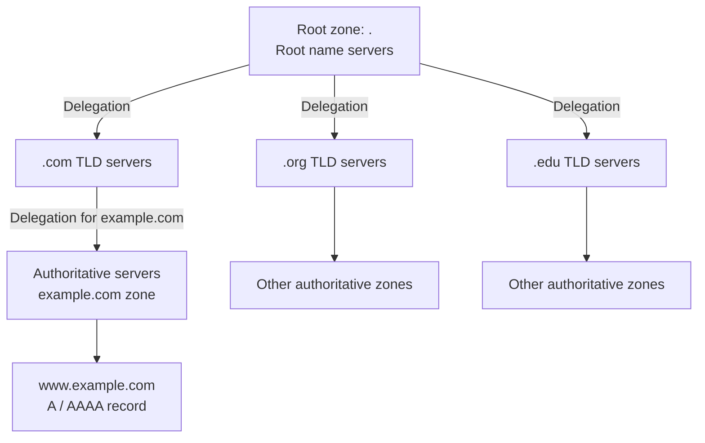

**Diagram:** Arrows show **delegation and responsibility**, not recursive forwarding of every query. Root servers do not store every website's address, and authoritative DNS servers are not the web servers themselves. More delegation levels or aliases can add steps; cached records can eliminate steps.

### DNS Server Deployment and Governance

DNS is distributed both **logically**—through zones and delegations—and **physically**—through deployments in different networks and locations. A server name, an operator, a deployment, and a physical computer are not interchangeable concepts.

#### Counts and Locations

| DNS role or counting unit | How many? | Where? |
| --- | --- | --- |
| **Root-server identities** | 13 named identities, A–M, operated by 12 organizations at the snapshot date below | Each identity can be served from multiple locations. |
| **Root-server operational instances** | 2,047 in the dated inventory below; this is a changing deployment count | Distributed across countries and networks worldwide. |
| **TLD authoritative infrastructure** | Multiple deployments serving the different TLD zones; no single useful fixed global machine count | Registry/operator infrastructure in multiple locations. |
| **Other authoritative servers** | Many independently operated services for delegated zones; no fixed global total | Organizations, hosting providers, and managed DNS infrastructure. |
| **Recursive resolvers** | Many ISP, enterprise, public-service, and private deployments | Near their users or in provider infrastructure. |

**Dated snapshot:** The [root-server operators' inventory](https://root-servers.org/) reported **2,047 operational instances and 12 operators on 16 October 2026**, with a published timestamp of `2026-10-16T02:15:00Z`. Use its live map and per-operator listings for current locations; this number is not a permanent architectural constant. Published sites include London, Frankfurt, Tokyo, and New York, among many others.

An **instance** is a deployed service instance, not necessarily one physical computer. A site or service deployment can involve multiple machines. Likewise, root and TLD servers are themselves authoritative for their respective zones—the table groups responsibilities, not mutually exclusive hardware types. [DNS terminology: RFC 9499](https://www.rfc-editor.org/info/rfc9499)

> **13 identities does not mean 13 computers or 13 countries.** A–M name logical root services; their deployed instances provide the geographic distribution. The [IANA root-server list](https://www.iana.org/domains/root/servers) identifies their names, addresses, and operators. Verisign operates both A and J, illustrating why identity count and operator count differ.

#### Root Identities and Anycast

**Anycast** allows instances in different locations to serve the **same destination IP address**. Their networks advertise reachability to that service address, and routing determines which instance receives a query.

For example, A-root's name is **`a.root-servers.net`**, and its IPv4 service address is **`198.41.0.4`**. The following three sites are illustrative, not a claim about its complete or exact deployment inventory. [A-root name and address](https://www.iana.org/domains/root/servers)

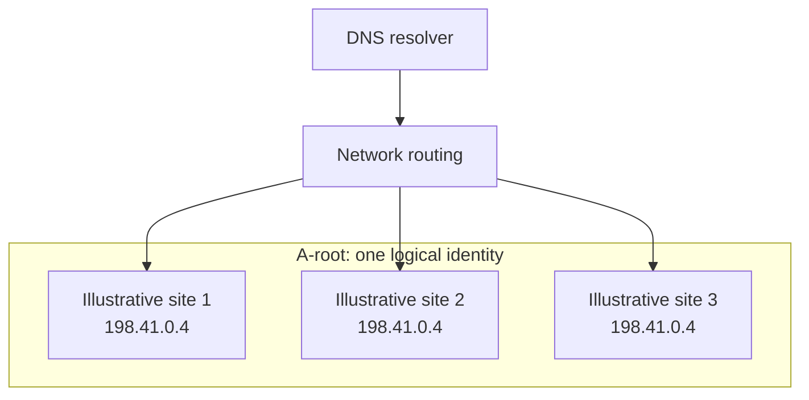

**Diagram:** The three arrows show **possible destinations**, not a broadcast. A query normally reaches **one** instance. Each instance serves the root-zone information; the resolver does not need a unique address for every physical location.

- **Latency:** Routing can select a nearby network location, but its chosen route is not necessarily the geographically closest or lowest-latency one.
- **Capacity:** Different clients' queries can reach different instances, distributing aggregate load.
- **Resilience:** If an unhealthy location's route is withdrawn or otherwise avoided, traffic can reach another instance. Detection and routing convergence take time; rerouting is not automatically instantaneous, and retries may be needed.

> **Mental model:** A root identity is a distributed DNS service. Anycast selects a reachable deployment through network routing; it is not a DNS query sent to every deployment.

#### Operators, Governance, and National Networks

“Who controls DNS?” combines several different responsibilities:

| Responsibility | What it means |
| --- | --- |
| **Root-server operation** | Operators run the instances serving their root identities. Examples include Verisign, ISC, Netnod, RIPE NCC, WIDE, and ICANN. |
| **Root-zone coordination** | IANA functions, provided by PTI within ICANN, coordinate root delegations through established processes. This is distinct from running every root-server instance. |
| **TLD and domain administration** | Registries and delegated domain administrators manage their respective zones, not every name in the global DNS. |
| **Geographic hosting** | An operator's service can have deployments outside the country where the organization is based. Hosting an instance does not confer authority to rewrite the global namespace. |
| **Domestic network policy** | Governments and network operators can affect local access, resolver behavior, and connectivity. That is different from administering the global root zone. |

No single country performs all these roles. Many root operators are US-based, but operator headquarters, deployment locations, and governance responsibilities are different facts. See [IANA's operator list](https://www.iana.org/domains/root/servers). The direct US government IANA-functions contract ended on **1 October 2016**; that transition did not eliminate legal jurisdictions or domestic network policies. [ICANN's stewardship-transition explanation](https://www.icann.org/stewardship-accountability)

**Brief country examples:**

| Country | What the technical evidence establishes |
| --- | --- |
| **Russia** | [`.ru` is delegated in the public root](https://www.iana.org/domains/root/db/ru.html); the dated root-server inventory also lists operational instances in Moscow. |
| **South Korea** | [`.kr` is delegated in the public root](https://www.iana.org/domains/root/db/kr.html); the inventory lists operational instances in Seoul. |
| **North Korea** | [`.kp` has a public-root delegation](https://www.iana.org/domains/root/db/kp.html). That fact does not establish residents' access to the global internet or the scope of domestic intranets. |

The Moscow and Seoul deployment observations are from the [official inventory checked on 16 October 2026](https://root-servers.org/), not a guarantee that every listed location remains operational indefinitely. DNS participation, local hosting, domestic naming systems, and internet-access restrictions are separate questions.

**What if a country has no root instance?** A reachable resolver can contact an instance in another country and follow the usual referrals, or use cached information or an approved upstream resolver. Hosting a local root instance is not a prerequisite for public DNS resolution; usable network connectivity and policy still matter.

> **Recall:** Operating a local DNS server is not the same as controlling the global DNS namespace. A country or organization can use global DNS without hosting every layer of its infrastructure.

#### Example: Azerbaijan and the .az Domain

Azerbaijan's **`.az` country-code top-level domain (ccTLD)** is part of the global DNS namespace. Managing `.az` does not mean managing every DNS lookup made by someone in Azerbaijan.

| Role | Responsibility |
| --- | --- |
| **IANA root delegation** | Publishes the delegation identifying the authoritative nameservers for `.az`. |
| **IntraNS** | Listed by IANA as the `.az` ccTLD manager. |
| **Domain administrators and their DNS providers** | Manage authoritative records for domains delegated below `.az`. |
| **Recursive resolver operators** | Resolve names for clients; these may be ISPs, organizations, public DNS services, or users operating their own resolvers. |

**Snapshot checked on 16 October 2026:** IANA lists these four authoritative nameserver hostnames for `.az`. IPv4 addresses below are taken from that delegation record; consult it for IPv6 addresses and later changes. [IANA `.az` delegation](https://www.iana.org/domains/root/db/az.html)

| Nameserver hostname | Listed IPv4 address |
| --- | --- |
| `ns13.intrans.az` | `217.14.111.13` |
| `ns3.intrans.az` | `148.251.2.246` |
| `az.hostmaster.ua` | `195.47.253.13` |
| `rip.psg.com` | `147.28.0.39` |

These are service names and addresses, **not a physical-location inventory**. A hostname's suffix does not establish where its machines are located, and an address can represent a distributed service. The TLD manager, authoritative DNS operator, resolver provider, and website host need not be the same organization.

**Illustrative lookup:** A user in Baku opens `www.example.az`. Here, `example.az` is a hypothetical delegated domain for the walkthrough—not a claim about that live name's registration or DNS configuration. Assume an uncached, successful lookup without aliases.

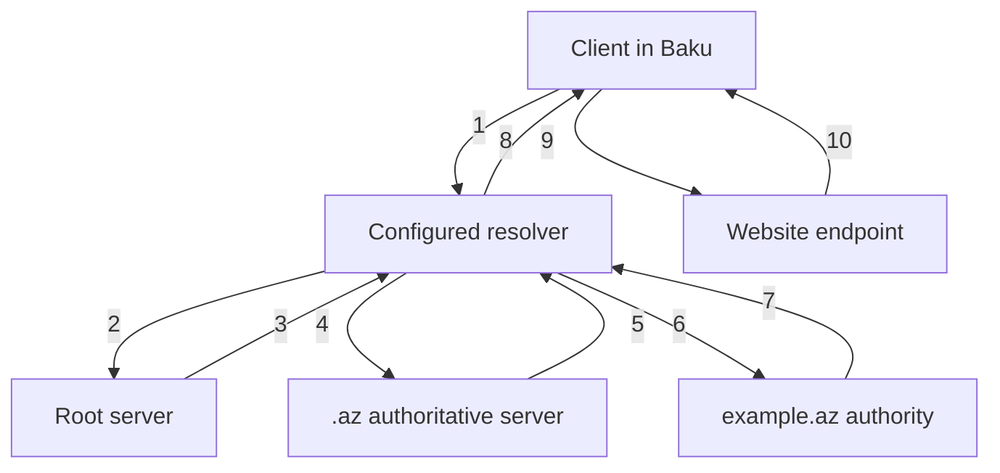

1. The client asks its configured recursive resolver for the name.
2. The resolver queries a root server.
3. The root returns a referral to `.az` nameservers.
4. The resolver queries an authoritative server for `.az`.
5. That server returns a referral to `example.az` nameservers.
6. The resolver queries an authoritative server for `example.az`.
7. The authority returns the website's address record.
8. The resolver answers the client; appropriate answers and referrals can be cached.
9. The browser establishes its separate connection to the returned endpoint and sends its HTTP(S) request.
10. The web endpoint returns the application response.

**Diagram:** Root, TLD, and domain servers provide answers or referrals **to the resolver**. They do not relay the browser's web request through the hierarchy. Cached information, forwarding, aliases, or additional delegations can change the actual steps.

> **Geography does not choose the TLD.** A user in Baku resolving `google.com` follows the `.com` delegation, not `.az` merely because the user is in Azerbaijan. The configured resolver can also be outside Azerbaijan.

#### DNS Independence vs. Network Isolation

> **DNS tells a computer where a service is. Networking determines whether it can reach that service.** Operating your own DNS is not the same as operating a self-contained network, and neither automatically means isolation from the global internet.

These are illustrative architectures, not permanent labels for entire countries:

| Architecture | Naming | Connectivity |
| --- | --- | --- |
| **Globally connected network** | Uses the global namespace, possibly through locally operated resolvers | Communicates with external networks according to routing and access policy. |
| **Domestic infrastructure with controlled external connectivity** | Domestic DNS and services coexist with global naming; local views or policy can affect answers | External connectivity exists but may be managed or restricted. |
| **Isolated intranet** | Uses locally available zones or a separately administered namespace | Services communicate internally; that network has no general global connectivity. |

**Local DNS does not necessarily mean an alternative root.** A resolver can serve a maintained local copy of the **global** root zone while retaining its existing delegations and namespace. RFC 8806 describes this as a local service for the resolver on the same host. It still needs maintenance; the root-zone copy is not a copy of every website's DNS records or content. [Local root service: RFC 8806](https://www.rfc-editor.org/rfc/rfc8806)

**Theoretical example: AZ-Net.** Imagine a country-sized intranet with domestic users, networks, DNS, and hosted applications. This is an architectural example, **not a claim that Azerbaijan operates such an isolated system**.

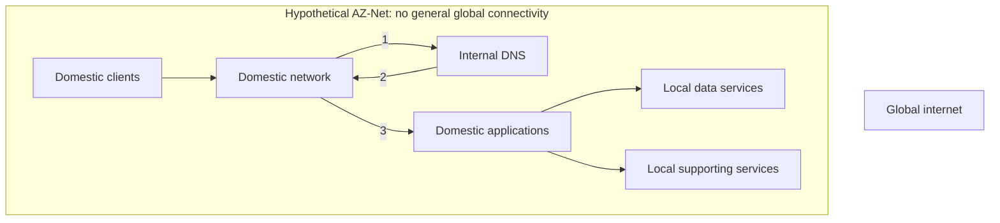

**Diagram:** The global internet has no connection in this isolated example. The numbered arrows represent **DNS query (1), DNS answer (2), and subsequent application traffic (3)** across the domestic network. Application traffic does not pass through DNS. The drawing omits response arrows and redundancy for clarity.

For example, a private zone could map the documentation name **`bank.aznet.example` → `10.0.0.50`**, and a browser with a valid internal route could reach the domestic banking endpoint. The private mapping does not make that address globally reachable.

| Required capability | Why DNS alone is insufficient |
| --- | --- |
| **Domestic connectivity** | Routers, links, and interconnections must carry packets between users and services. |
| **Locally available naming** | Resolvers need the relevant local authoritative records, not just cached external addresses. A separate root hierarchy is optional when configured private zones suffice. |
| **Domestic hosting and storage** | The application, its databases, and necessary content must actually be reachable inside the network. |
| **Supporting dependencies** | Authentication, certificate trust, time services, monitoring, and required application dependencies must remain usable without external access. |
| **Operations and recovery** | Redundancy, backups, updates, and tested failure handling are still needed. Isolation does not guarantee reliability or security. |

**Example failure:** An internal portal's name resolves correctly, but login still fails because its identity provider is only reachable outside AZ-Net. Likewise, a locally hosted page can break if required scripts or APIs exist only on external services. DNS independence does not remove these dependencies.

**Naming and reconnection:** A private network can administer its own names, but creating a private TLD does not register it in the global root. Arbitrarily invented TLDs can conflict with public names now or later. The example uses reserved `.example` names; real namespace choices require deliberate management.

Before reconnecting, reconcile **name ownership and resolution views, address overlap and routing, DNSSEC/TLS trust, and external service dependencies**. Conflicting roots can cause the same name to identify unrelated services. A coordinated public root preserves global naming consistency; it does not require every user to receive an identical IP address, as legitimate geographic routing and split views can differ. [IAB explanation of the unique public root: RFC 2826](https://www.rfc-editor.org/rfc/rfc2826)

**Real-world cases and their limits:**

| Case | What it illustrates | Qualification |
| --- | --- | --- |
| **Russia's National DNS** | Nationally managed DNS infrastructure intended to reduce dependence on external root access | The Internet Society's assessment, updated in December 2023, describes its design and fragmentation risks. This is not evidence that Russia is permanently disconnected from the global internet. [Assessment](https://www.internetsociety.org/resources/internet-fragmentation/russias-national-dns/) |
| **Iran's domestic networking / National Information Network** | Domestic reachability and services can coexist with restrictions on international connectivity | Initial private-address observations were documented in a **2012 working draft**; a **2026 measurement preprint** discusses NIN and international shutdowns. These dated studies do not guarantee that every domestic service works during every disruption. [2012 research](https://arxiv.org/abs/1209.6398), [2026 study](https://arxiv.org/html/2605.00187v2) |
| **North Korea's Kwangmyong** | A reported domestic intranet, distinct from public internet services | A February 2026 researcher report describes evidence from sources and logs, with uncertainties identified. Do not equate this intranet with the entire country's connectivity or infer population-wide access from `.kp`'s public delegation. [Researcher's report](https://nkinternet.com/2026/02/08/kwangmyong/) |

These examples concern different mechanisms and observation periods; none should be reduced to “this country has its own completely separate internet.”

> **Final mental model:** **Local DNS operation ≠ an independent namespace ≠ network isolation.** A country can host DNS and applications while remaining globally connected, or operate a country-sized intranet. Meaningful independence depends on the complete service and dependency chain—not DNS alone.

### DNS Querying

**Recursive** and **iterative** describe how a query is handled, not two entirely separate DNS infrastructures.

| Query style | What the requester asks | What the responding server does |
| --- | --- | --- |
| **Recursive** | “Resolve this name for me.” | If it offers recursion, pursues resolution and returns the resulting answer or an error. |
| **Iterative** | “Give me the answer or the best next step you know.” | Returns an available answer, a referral, or an appropriate error without resolving the remaining hierarchy on the requester's behalf. |

> **Typical combination:** The client makes a **recursive request**; its recursive resolver follows **iterative referrals** through the hierarchy on a cache miss. Calling it a recursive resolver does not mean its upstream queries must all be recursive. [Query behavior: RFC 1034](https://www.rfc-editor.org/rfc/rfc1034)

#### Iterative Queries

The following simplified flow assumes no useful cached answer, no alias, and a successful lookup. The **recursive resolver**, not ordinarily the browser's stub resolver, performs the iterative work.

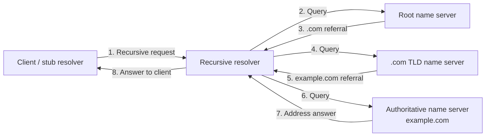

**Walkthrough:** The resolver receives a referral, contacts the referred servers, and repeats until it obtains the requested result. Root and TLD responses identify **where to ask next**; the authoritative answer supplies the record in this example. These eight arrows illustrate message order, not eight mandatory messages for every lookup.

#### Recursive Queries

The client delegates the resolution work to a recursive resolver. It waits for the answer rather than contacting root, TLD, and authoritative servers itself. The resolver may return a cached answer, perform the iterative flow above, or ask a configured upstream recursive resolver.

**Example:** A laptop asks its configured DNS service for `www.example.com`. That service handles the hierarchy and returns the result. The laptop does not need its own complete resolver implementation.

Recursive service is offered according to server policy; not every DNS server accepts recursive requests. Public root and TLD servers normally supply authoritative answers or referrals, rather than acting as general-purpose recursive resolvers.

#### Conceptual Fully Recursive Forwarding

> **Conceptual contrast—not the usual public-DNS lookup.** This forwarding chain assumes that the illustrated root-level and TLD-level servers also provide recursion for these requests. It preserves the idea of the original comparison, but that assumption does **not** describe normal public root/TLD operation.

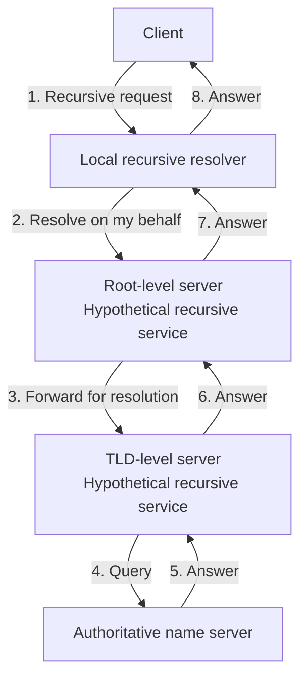

**Diagram:** Requests move down the chain and answers return through it. In the typical preceding diagram, the resolver instead receives referrals and contacts each level itself. Real recursive forwarding can occur between configured resolvers; it does not require public root/TLD servers to recurse.

**Load and performance:** Recursive resolvers do maintain outstanding-query state, but recursion does not inherently become slower merely because time passes. Capacity, caching, query volume, and response delays determine load. Keeping public authoritative servers focused on their zones and using caching resolvers distributes the work.

### DNS Caching

**Caching** temporarily reuses DNS results so repeated lookups need not traverse the hierarchy. It reduces **lookup latency**, **network traffic**, and **upstream query load**.

| Possible cache location | What it helps avoid |
| --- | --- |
| **Browser** | Repeating a lookup for a name already resolved by that browser. |
| **Operating system** | Repeating lookups across local applications. |
| **Local-network resolver/forwarder** | Sending every local client's repeated query upstream. |
| **ISP, enterprise, or public recursive resolver** | Repeating hierarchy queries for names requested by many clients. |

Not every deployment uses all four layers. Resolvers can cache final answers and useful delegation information; an upstream cache hit can bypass several hierarchy steps.

**TTL (time to live)** is the record's permitted cache lifetime in seconds. The authoritative data supplies it; caches track the remaining lifetime rather than extending a record's life indefinitely each time they return it.

**Example: A 300-second TTL and an address change.**

| Time | Event | Normal result from this resolver |
| --- | --- | --- |
| **0 s** | Cache `www.example.com` → `192.0.2.10`, TTL 300. | Return the cached old address. |
| **60 s** | Authoritative data changes to `192.0.2.20`. | The previously cached record is not automatically invalidated. |
| **120 s** | Another client asks the same resolver. | It may still receive `192.0.2.10`; 180 seconds remain. |
| **300 s or later** | Cache lifetime expires; a new lookup obtains the updated authoritative answer. | Return `192.0.2.20`, assuming the update is available and resolution succeeds. |

This is one resolver's timeline, not a global update deadline. Other caches may have obtained the answer at different times. Lowering the authoritative TTL does not retroactively shorten the lifetime of an old answer already cached.

> **TTL trade-off:** Longer TTLs reduce repeated queries but can prolong stale routing after a change. Shorter TTLs improve responsiveness to updates but increase query load and reliance on reachable upstream DNS.

Ordinary expiry requires refreshing the answer. Some resolvers support explicitly configured **serve-stale** behavior during upstream failure; that is a resilience policy, not a promise that every cache always serves expired data. [Serving stale DNS data: RFC 8767](https://www.rfc-editor.org/rfc/rfc8767)

#### Planned Hosting Migration and DNS TTL

**DNS TTL belongs to a DNS record, not the application server.** When an application moves to a new IP address, cached answers may continue directing clients to the old endpoint until their **remaining TTL** expires. The new endpoint can already be running and available for testing before public DNS points to it.

> A TTL of one day does not mean everyone switches exactly one day after migration. Different caches obtained the old answer at different times; lowering TTL does not shorten a lifetime already cached.

**Remaining-lifetime example:** A resolver caches the old address at **09:00** with a 24-hour TTL. If the address changes at **15:00**, that cached answer can remain usable until **09:00 the next day**—another **18 hours**, not necessarily another full day.

**Planned migration example:** Move `www.example.com` from **`192.0.2.10`** to **`192.0.2.20`**. The current TTL is **86,400 seconds (24 hours)**; temporarily lower it to **300 seconds (5 minutes)**. This example changes an address record while keeping the authoritative DNS service in place.

| Stage | Action | Why |
| --- | --- | --- |
| **Lower TTL in advance** | Change the relevant record's TTL to 300 seconds, keeping the old IP. | Prepare for faster refreshes during cutover. |
| **Allow old caches to expire** | Once the authoritative servers consistently serve the lower TTL, wait at least the previous 24-hour TTL before changing the IP. | Existing caches may still retain the old 86,400-second lifetime. |
| **Prepare and test** | Deploy and test the application at the new hosting location before cutover. This can happen during the waiting period. | The new endpoint must work before users arrive. |
| **Switch the address** | Update the DNS record to the new IP, retaining the short TTL. | Subsequent successful refreshes obtain the new destination. |
| **Monitor the overlap** | Keep old and new endpoints available temporarily; monitor requests, errors, and connections on both. | Clients can reach different endpoints during the transition. |
| **Stabilize and retire** | Once it is safe, retire the old endpoint and increase TTL again if appropriate. | Avoid premature shutdown while reducing ongoing lookup load after the migration. |

Lowering TTL before a planned address change and increasing it after validation is also described in [AWS's DNS TTL guidance](https://docs.aws.amazon.com/Route53/latest/DeveloperGuide/resource-record-sets-values-basic.html).

**When can the old hosting server be shut down?** Generally, keep both endpoints available during the transition—but do **not** make retirement depend on proving that caches have expired everywhere. There is no reliable global view of every client cache. Instead:

1. Allow the relevant TTL window to pass, taking the pre-cutover TTL preparation into account.
2. Check remaining legitimate traffic and long-lived connections to the old endpoint; DNS expiry does not close existing connections.
3. Confirm that the new endpoint is healthy and application data remains correct.
4. Allow a safety margin appropriate to the workload and recovery requirements before decommissioning the old endpoint.

**Important cautions:**

- **Five minutes is not a universal traffic-switch deadline.** DNS behavior, local/application caching, and the serve-stale policies discussed above can affect observed refreshes. Existing connections may last longer still. [Cloudflare's TTL and client-cache explanation](https://developers.cloudflare.com/dns/manage-dns-records/reference/ttl/)
- **Test the correct hostname and HTTPS behavior**, not only the new raw IP. Hostname-based routing and TLS certificates can make those tests behave differently.
- **DNS does not migrate or synchronize application data.** If both endpoints accept writes, use an appropriate shared authoritative data source or coordinated migration strategy; do not let them independently create conflicting state.
- **Endpoint overlap does not require two independent writable application copies.** For example, the old endpoint may forward requests to the new service if the architecture supports that safely.
- **Keep a rollback path.** Reverting DNS also takes effect through caches, so it is not an instantaneous global undo. A rollback must also account for data written after cutover.
- **Check all affected records.** IPv4, IPv6, aliases, or a change of authoritative nameservers can involve additional records and cache lifetimes beyond this simple A-record example.

> **Recall:** Lower TTL early, prepare the new endpoint, change DNS, keep an overlap period, monitor and drain old traffic, then retire the old endpoint when it is safe. **TTL controls cache reuse—not application readiness, connection lifetime, or data migration.**

### Private DNS and Internal Applications

An organization can use the same DNS protocols to name **internal resources**. Employees do not need to memorize application IP addresses, and private-only records need not be published through public DNS.

**Bank example:**

```text
Internal zone:       internal.bank.example
Employee portal:     portal.internal.bank.example
Portal endpoint:     10.0.1.50
Configured resolver: 10.0.1.10
```

Names ending in **`.example` are documentation placeholders**, not a real bank's domain. In a real deployment, use a deliberately managed namespace, such as a suitable subdomain of a domain the organization controls. The `10.0.1.x` addresses illustrate private-network endpoints, reachable only where routing and policy permit them. [Reserved example names: RFC 2606](https://www.rfc-editor.org/rfc/rfc2606)

#### Internal Infrastructure and Lookup Scope

| Component | Needed for the private portal lookup? | Role |
| --- | --- | --- |
| **Client-side name resolution** | Yes, when accessing the portal by name | Uses configured local sources/caches and a resolver. |
| **Internal authoritative zone** | Yes, for centrally served private DNS records | Holds the portal record and authoritative answers for `internal.bank.example`. |
| **Recursive resolver/forwarder role** | Commonly used by clients | Answers from local zones/cache or contacts the configured internal authority. |
| **Public root and TLD servers** | Not for this configured private zone | Remain relevant when the resolver performs uncached public resolution. |
| **Application endpoint** | Yes, but it is not a DNS server role | Runs the portal or forwards requests to its application instances. |

The resolver knows the private zone because it serves it locally or is configured to query an appropriate internal authority, for example through conditional forwarding. It does **not** have to discover that private zone through the public root. The organization also does not need to build its own root/TLD hierarchy merely to serve one internal zone.

Resolver and authoritative roles may run on the same physical or virtual server, or on separate infrastructure. Multiple appropriately configured DNS deployments reduce dependence on a single server; clients need a way to use the alternatives, and authoritative data must be kept consistent.

**What about a public name?** For an allowed name such as `www.example.com`, the bank's resolver can use an approved upstream service or perform public iterative resolution. Routing private names to the correct internal authority avoids treating them as public names or leaking unnecessary private-name queries upstream.

#### What the DNS Service Stores

DNS data may be held in zone files, a directory/database backend, or a managed service. DNS does not require a particular relational database product.

| Information | Example | Meaning |
| --- | --- | --- |
| **Authoritative zone records** | A record: `portal.internal.bank.example` → `10.0.1.50`; CNAME: `hr.internal.bank.example` → `portal.internal.bank.example` | The zone's source data. AAAA, MX, and NS records have the same roles described in [Resource Records](#resource-records). |
| **Zone metadata** | SOA record, including a zone serial and maintenance timers | Identifies zone-management information; the serial helps track zone versions. |
| **Record lifetimes** | TTL 300 on a record | Controls ordinary cache reuse, not how long the application itself exists. |
| **Resolver cache** | Previously obtained answers and delegation information | Temporary copied information; not the source of authority for those zones. |
| **Server configuration** | Served zones, upstream forwarders, access policies | Controls server behavior; configuration is distinct from the resource records themselves. |

DNS is **not the application's business database or source-code store**. Customer accounts, business transactions, and portal content belong in the application and its storage systems. Do not use ordinary DNS records as a password or secret store.

#### Bank Portal Request Flow

The client first uses its applicable local name-resolution sources and caches. The diagram shows a lookup that needs DNS and misses the resolver's cache; a usable local answer can skip that work.

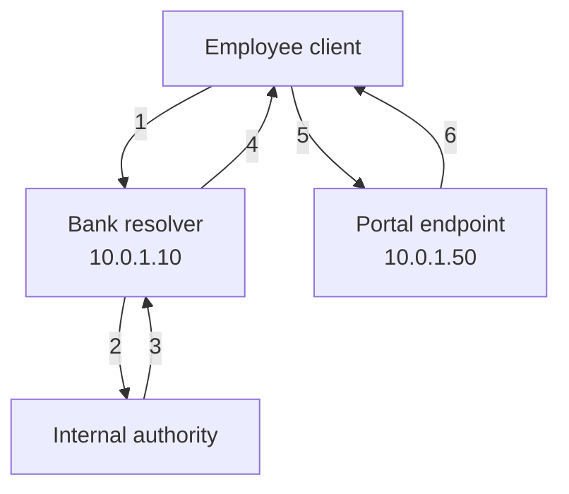

1. The client asks for `portal.internal.bank.example`.
2. The resolver queries the internal authority for the configured private zone.
3. The authority returns the A record containing `10.0.1.50`.
4. The resolver returns the answer to the client, with applicable caching.
5. The browser connects to the portal endpoint and sends its HTTPS request.
6. The application returns its response after applying its normal access checks.

**Diagram:** The resolver and authority boxes are **logical roles**, not a requirement for two separate machines. DNS traffic ends with the address response; the browser's portal request does not pass through the DNS server.

#### Split-Horizon DNS and Security

**Split DNS**, also called **split-horizon DNS**, allows the same name to receive different answers depending on the querying context. An internal resolver may return a private address for a company service while an external view returns a public entry point or no published record. [Current DNS terminology: RFC 9499](https://www.rfc-editor.org/info/rfc9499)

**Example:** For the illustrative name `portal.bank.example`, an internal view returns **`10.0.1.50`**, while an external view returns a public entry point represented here by **`192.0.2.50`**. Employees on the company network or an appropriately configured VPN use the internal view. The resolver/view configuration and network path determine the result—not merely whether a user knows the name. These are documentation names and addresses, not a live public delegation.

> **Private naming is not application security.** DNS does not grant access, authenticate employees, or encrypt portal traffic. Authentication, authorization, TLS, and network controls remain necessary according to the application's requirements. Keeping a record private is not a substitute for protecting the endpoint.

#### Local Hosts Files

A **hosts file** provides static hostname-to-address mappings on an individual computer. Example entries are:

```text
127.0.0.1    localhost
10.0.1.50    portal.internal.bank.example
10.0.1.60    test.internal.bank.example
```

Conventional locations:

- **Windows:** `C:\Windows\System32\drivers\etc\hosts`
- **Linux/macOS:** `/etc/hosts`

Applications using the relevant system name-resolution mechanism can obtain these mappings without a DNS query. The lookup order, cache interaction, and whether an application uses that mechanism depend on OS and application configuration; “the hosts file is always checked first” is not a universal rule. [Linux hosts-file documentation](https://man7.org/linux/man-pages/man5/hosts.5.html), [Microsoft hosts-file documentation](https://support.microsoft.com/en-us/windows/experience/how-to-reset-the-hosts-file-back-to-the-default)

**Useful for:** Small local overrides, controlled testing, or an isolated machine's naming needs. The file does not provide authoritative zones, DNS queries/referrals, MX routing, or DNS-record TTL fields.

**Why not distribute a hosts file to every employee?** Each computer needs the right entries and later updates. Configuration-management tools can distribute files, but the hosts file itself does not publish or automatically synchronize its mappings. A stale entry can keep pointing to an old endpoint; centrally managed DNS is usually more practical as the fleet grows.

#### Public DNS, Private DNS, and Hosts Files Compared

| Aspect | Public DNS | Private DNS | Hosts file |
| --- | --- | --- | --- |
| **Scope** | Globally delegated namespace and published records | Organization-controlled zones or DNS views | One computer's local mappings |
| **Management** | Delegated zone administrators and DNS operators | Organization's infrastructure team or configured DNS provider | Local administration or configuration-management tooling |
| **Resolution** | Resolvers use caches, upstream services, and public delegations | Configured resolvers obtain internal authoritative answers; public lookup may also be supported | Applications consult a local file through their resolution mechanism |
| **Scaling** | Distributed authority, replication, and caching | Shared administration, redundant servers, and caching | Updates must reach every affected computer |
| **Application security** | Separate from DNS naming | Separate from DNS naming | Separate from the local mapping |

> **Mental model:** Public DNS provides globally coordinated names; private DNS provides organization-controlled resolution; a hosts file provides local mappings. All help find endpoints, but none runs or secures the application merely by naming it.

## Scalability, Reliability, and Consistency in DNS

DNS is itself a distributed system. It separates responsibility and uses caches and replicated services to handle large query volumes, while accepting that updates are not immediately visible to everyone.

### Scalability

- **Hierarchy and delegation:** Each zone manages its own portion of the namespace instead of one central server storing all records.
- **Caching:** Popular names can be answered locally, so root and TLD servers are not consulted for every visit.
- **Distributed server instances:** Queries can be served across multiple locations, spreading load and reducing dependence on one site.
- **Anycast where deployed:** Several instances advertise the same service address; network routing selects an instance. This is not a guarantee of the lowest application latency.

**Example:** Thousands of users behind one caching resolver request the same website. Once its address is cached, many subsequent requests are answered there without repeating the full lookup.

Root-server identities are backed by distributed instances; an identity is not necessarily one physical machine. No fixed physical-instance count is needed to understand the architecture. [Distributed authoritative service: RFC 3258](https://www.rfc-editor.org/rfc/rfc3258)

### Reliability

- **Redundant authoritative servers:** A zone can remain reachable when one server or site fails. Independent network locations reduce shared failure risk.
- **Retries and alternate servers:** A resolver can retry after a timeout or contact another eligible name server.
- **Cached answers:** An available, usable cached record can help when upstream DNS is temporarily unreachable.
- **Transport support:** Traditional DNS uses UDP and TCP. UDP does not guarantee delivery; DNS implementations handle timeouts and retries. TCP supports larger responses and other exchanges, and is not limited to zone transfers.

**Example:** One authoritative server stops responding. The resolver tries another server for the same zone; if that succeeds, the client still receives an answer. General-purpose DNS implementations must support both UDP and TCP. [DNS over TCP: RFC 7766](https://www.rfc-editor.org/rfc/rfc7766)

> **Redundancy helps, but does not guarantee availability.** Expired or missing cache entries, failures affecting all authoritative servers, or bad DNS configuration can still prevent resolution. Correct DNS resolution also does not prove that the returned web endpoint is healthy.

Choose authoritative replicas with suitable failure independence, not merely multiple processes on one machine. [Secondary-server placement: RFC 2182](https://www.rfc-editor.org/rfc/rfc2182)

### Consistency

DNS does not normally provide one instantly updated global view. Different clients may temporarily receive different answers after a change.

There are **two distinct sources of delay**:

1. **Authoritative synchronization:** The zone's serving replicas need to receive an update through the operator's replication or transfer mechanisms.
2. **Cache expiry and refresh:** Resolvers may keep returning an earlier answer for its remaining cache lifetime, even after the authoritative servers have changed.

**Example:** Resolver A still has the old address from the TTL walkthrough; resolver B obtains the new address after the authoritative update. Both answers can be observed during the transition. With stable updated authority data and successful refreshes, caches converge toward the new answer rather than changing simultaneously.

There is no universal “DNS propagation takes X hours” rule. Timing depends on authoritative synchronization, existing record lifetimes, cache policy, and connectivity. A shorter TTL can reduce ordinary cache staleness, but does not make replication instantaneous or force existing connections to move.

> **Recall:** DNS gains scale and responsiveness through **delegation, caching, and redundancy**. The trade-off is that routing changes require a transition plan: stale addresses, unreachable servers, and existing connections must be considered separately.

## Load Balancers

### Load Balancing Overview

**Load balancing** distributes incoming connections, requests, or jobs among eligible backends. Its goals are to use capacity efficiently, avoid overloaded instances, and keep traffic flowing when individual backends fail.

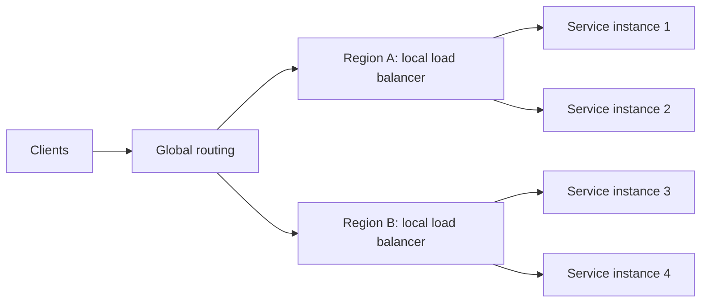

> <u>Load balancing does not create capacity.</u> It distributes work across the capacity that exists. Autoscaling, admission control, caching, and backpressure address sustained overload.

The routing decision has two parts: **which group of backends is eligible** (for example, a region or service) and **which healthy backend within that group receives the work**. Health, performance, location, session state, and business rules may all affect that choice.

Balancing is a general scheduling idea: work can be spread across CPU cores, storage devices, or network links. Here, the focus is **application traffic distributed among service instances**.

| Benefit | What balancing contributes | What it does not guarantee |
| --- | --- | --- |
| **Capacity utilization** | Spreads work across eligible resources | Equal CPU use or the shortest possible response time |
| **Availability** | Directs new work away from detected failed backends | Recovery of every in-flight request or survival of shared failures |
| **Horizontal scaling** | Includes new ready instances in the destination pool | Automatic scaling of databases or other dependencies |
| **Graceful degradation** | Can cooperate with limits, prioritization, and load shedding | Continued operation under unlimited demand |
| **Operational control** | Provides a place for routing, health policies, and metrics | Correct policies without configuration and monitoring |

### Where Balancing Happens

#### Load Balancer Placement

Load balancing is useful wherever a caller needs to choose among **interchangeable, eligible instances**. It can sit at the public entry point or between internal tiers.

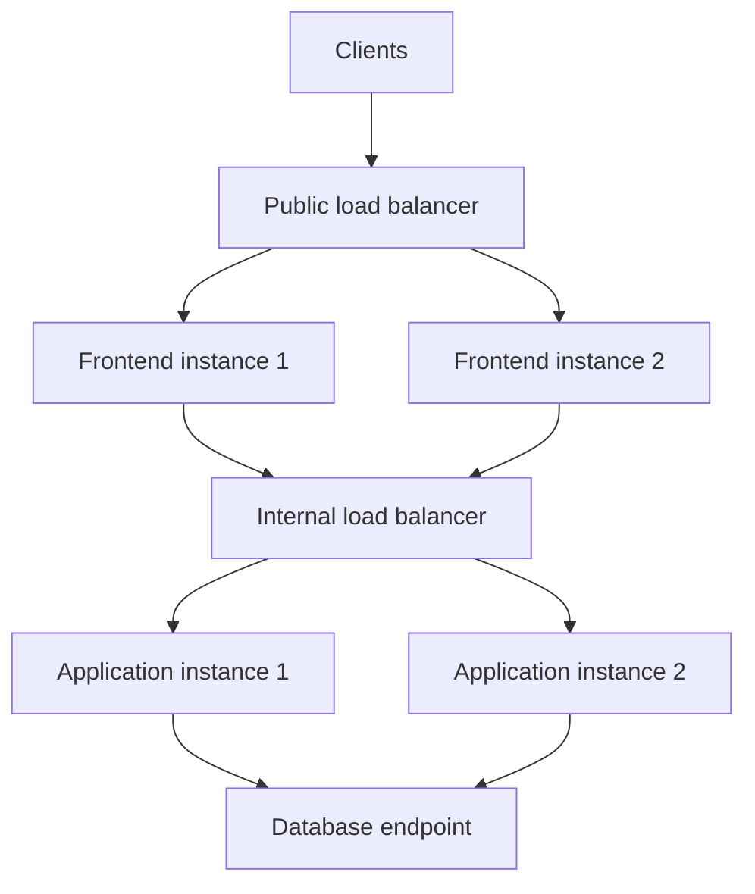

The frontend and application pools can scale independently. An internal balancer may be a proxy, a platform service, or client-side selection through a library; **not every service boundary needs another proxy**.

Database routing needs additional care: a primary and a read replica are usually **not interchangeable write targets**. Use database-aware routing or the database's supported endpoints, respecting write leadership, replication lag, transaction state, and consistency requirements.

> A balancer can route around an eligible instance's failure; it cannot make an unavailable dependency work. Timeouts, circuit breakers, backpressure, and dependency-aware recovery remain separate concerns.

#### Layer 4 vs. Layer 7

**Layer 4 (L4)** balancers route TCP or UDP traffic using connection metadata such as IP addresses and ports. **Layer 7 (L7)** balancers understand application protocols such as HTTP and can route using hostnames, paths, headers, and cookies.

| Aspect | L4: transport level | L7: application level |
| --- | --- | --- |
| **Decision inputs** | IP, port, protocol, connection state | HTTP host, path, headers, cookies, request rules |
| **Suitable traffic** | TCP/UDP services, non-HTTP protocols | Web applications, APIs, service routing |
| **Visibility** | Usually cannot inspect encrypted HTTP content | Can inspect HTTP only when TLS terminates at or before this layer |
| **Typical strength** | Lower processing overhead; protocol agnostic | Fine-grained routing and application controls |
| **Typical trade-off** | No content-based HTTP routing | More processing and configuration complexity |

L4 can forward encrypted traffic without decrypting it. Some L4 products can also terminate TLS; *layer* and *TLS behavior* are separate design choices. L7 routing based on HTTP content requires access to the decrypted request.

##### TCP Connection: A Simple Mental Model

A **TCP connection** is a logical, two-way communication channel between two software endpoints. It is **not a dedicated physical cable**: the endpoints remember information about their conversation, usually through their operating systems' networking stacks.

The usual **three-way handshake** establishes the connection:

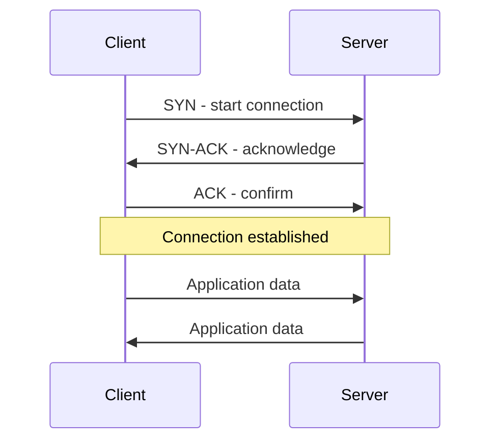

- The application writes **bytes**; TCP divides them into segments carried in IP packets.
- **Sequence numbers and acknowledgments** track progress, supporting ordered delivery and retransmission of missing data.
- Each endpoint keeps **connection state**, including sequence numbers and buffers. TCP can send data in both directions.
- A connection can close normally or fail. Reliability does not mean TCP can deliver through a permanently broken network.

See the [TCP specification, RFC 9293](https://www.rfc-editor.org/rfc/rfc9293.html).

> **Connection ≠ request ≠ user session.** HTTP over TCP can reuse one connection for several requests. TCP itself does not encrypt data; HTTPS over TCP adds TLS. The diagram shows TCP setup, not the separate TLS handshake.

##### TCP Header: What Each Segment Carries

A **TCP header** carries each segment's control information:

```text
IP header | TCP header | Payload (if any)
```

Diagrams show **32-bit-wide rows**, not communication stages.

**TCP wire layout (RFC 9293 base format):** Bit positions run from `0` to `31` across each row; parenthesized numbers in field labels are widths in bits.

```text
 0                   1                   2                   3
 0 1 2 3 4 5 6 7 8 9 0 1 2 3 4 5 6 7 8 9 0 1 2 3 4 5 6 7 8 9 0 1
+-------------------------------+-------------------------------+
|       Sender port (16)        |      Receiver port (16)       |
+---------------------------------------------------------------+
|                         Sequence Number (32)                  |
+---------------------------------------------------------------+
|                      Acknowledgment Number (32)               |
+-------+-------+-+-+-+-+-+-+-+-+-------------------------------+
|Offset | Resvd |C|E|U|A|P|R|S|F|      Receive window (16)      |
+-------+-------+-+-+-+-+-+-+-+-+-------------------------------+
|         Checksum (16)         |      Urgent offset (16)       |
+---------------------------------------------------------------+
|     Options and zero padding (0-40 bytes; variable rows)      |
+---------------------------------------------------------------+
```

`Offset` is the 4-bit data offset; `Resvd` is the 4-bit reserved area in this base format. Each flag occupies **one bit**, in order: `C` = CWR, `E` = ECE, `U` = URG, `A` = ACK, `P` = PSH, `R` = RST, `S` = SYN, `F` = FIN. CWR/ECE support congestion notification; PSH is the push flag. The pointer labeled `Urgent offset` is the urgent-pointer field.

The first **five rows of fields are the fixed 20-byte header**. Options/padding are optional and may span several rows; payload follows the complete header and is **not part of it**. For example, data offset `5` means `5 × 4 = 20` header bytes; `8` means `32` bytes. See the [header-format specification](https://www.rfc-editor.org/rfc/rfc9293.html#section-3.1).

| Field | Simple meaning |
| --- | --- |
| **Source / destination ports — 16 bits each** | Identify sending and receiving software endpoints. |
| **Sequence number — 32 bits** | First data byte's position; SYN also consumes a number. |
| **Acknowledgment number — 32 bits** | Next byte expected from the other endpoint, when ACK is set. |
| **Data offset — 4 bits** | Header length in 32-bit words; identifies where payload begins. |
| **Reserved bits** | Space reserved for protocol use. |
| **Flags** | Include SYN (establish), ACK (acknowledge), FIN (finish), and RST (reset). |
| **Window — 16 bits** | Receive capacity for flow control; negotiated scaling extends its range. |
| **Checksum — 16 bits** | Helps detect corrupted headers or data. |
| **Urgent pointer — 16 bits** | Marks urgent data when URG is set; rarely used. |
| **Options / padding** | Additional capabilities and alignment. |

> **Diagram correction:** Data offset is **4 bits, not 16**. The standard header is **20–60 bytes**. IP addresses belong to the **IP header**. Payload can be empty.

Reference: [RFC 9293: TCP header format](https://www.rfc-editor.org/rfc/rfc9293.html#section-3.1).

##### Inspecting TCP Connections and Headers

**Connection listings describe sockets; packet captures show individual transmitted headers.** They answer different questions.

**List TCP connections and listening sockets:**

| System / shell | Command | Shows |
| --- | --- | --- |
| **Windows — PowerShell or CMD** | `netstat -ano -p tcp` | Endpoints, connection states, and process IDs |
| **macOS — Terminal** | `netstat -an -p tcp` | Endpoints and connection states |
| **Linux — Terminal** | `ss -tanp` | TCP sockets and states; process details where permitted |

These listings do **not** display each packet's sequence number, flags, or checksum. See the [Windows netstat reference](https://learn.microsoft.com/en-us/windows-server/administration/windows-commands/netstat), [Apple netstat manual](https://github.com/apple-oss-distributions/network_cmds/blob/main/netstat.tproj/netstat.1), and [Linux ss manual](https://man7.org/linux/man-pages/man8/ss.8.html).

**Inspect actual packets on Windows:** Install Wireshark with **TShark** and **Npcap**. In PowerShell, list capture interfaces, then capture up to ten TCP packets with decoded fields:

```powershell
& "C:\Program Files\Wireshark\tshark.exe" -D
& "C:\Program Files\Wireshark\tshark.exe" -i 1 -f "tcp" -c 10 -V
```

Replace `1` with the desired interface number. The path assumes Wireshark's usual installation location; adapt it if different. Capture permissions depend on the installation and organizational policy.

**Inspect actual packets on macOS or Linux:** With TShark installed:

```bash
tshark -D
sudo tshark -i 1 -f "tcp" -c 10 -V
```

Again select the correct interface; elevation is only needed when capture permissions require it. `-D` lists interfaces, `-i` selects one, `-f` filters captured traffic, `-c` limits packet count, and `-V` prints decoded details. See the [TShark manual](https://www.wireshark.org/docs/man-pages/tshark.html).

**Compact alternative on macOS or Linux:** Use `tcpdump` for packet summaries rather than a full field-by-field decode:

```bash
sudo tcpdump -D
sudo tcpdump -i INTERFACE -nn -S -v -c 10 tcp
```

Replace `INTERFACE` with an interface name from the listing. `-nn` keeps addresses and ports numeric; `-S` shows absolute TCP sequence numbers; `-v` adds detail. macOS includes `tcpdump`; Linux may require installation. See [Apple's packet-trace guide](https://developer.apple.com/documentation/network/recording-a-packet-trace).

Start capture before generating TCP traffic; **Ctrl+C stops it** if ten packets have not arrived. In Wireshark's GUI, select the interface, capture traffic, filter the display with `tcp`, and expand **Transmission Control Protocol** for decoded header fields. HTTPS payloads remain encrypted without appropriate decryption material, but TCP headers are normally visible.

> **Capture responsibly:** Inspect only traffic you are authorized to capture. Captures and verbose output can reveal addresses, hostnames, and sensitive data. Do not publish raw captures or machine-specific output. These are optional diagnostic examples, not instructions to change networking or security policy.

##### Why One TCP Connection Stays on One Backend

“Same server” means the **same selected backend for that connection**, not that the balancer and backend must share one physical machine.

```text
Connection 1 → Load balancer → Server A
Connection 2 → Load balancer → Server B (may be selected)
```

1. When connection 1 starts, the balancer selects **A**.
2. A holds the TCP state for that conversation. Subsequent traffic stays with A because B cannot automatically interpret it as an established connection of its own.
3. A new connection gets its own selection: it might reach **B**, or A again.
4. If A fails, the existing connection usually breaks. Reconnecting can select another backend; this is not seamless continuation of the old TCP conversation.

The balancer can preserve its choice through a **connection table**, **stable flow hashing**, or both. A common flow identifier is the **5-tuple**:

```text
Source IP + Source port + Destination IP + Destination port + Protocol
```

Exact selection inputs vary by implementation. For example, [AWS Network Load Balancer](https://docs.aws.amazon.com/elasticloadbalancing/latest/network/introduction.html) documents flow hashing and routes each TCP connection to one target for its lifetime.

**Proxy qualification:** Some L4 balancers terminate the client-side TCP connection and create a **separate backend-side TCP connection**. The proxy relays bytes between them; there is not necessarily one unchanged end-to-end TCP connection. NGINX's [stream proxy](https://nginx.org/en/docs/stream/ngx_stream_proxy_module.html) is an example. This TCP behavior does not itself imply TLS termination.

> **Connection affinity ≠ user/session affinity.** Preserving one connection's destination does not keep a user's new connections on the same backend. See [Session Affinity](#session-affinity) for cross-connection policies and [State in Load Balancing](#state-in-load-balancing) for state-handling choices. Reconnecting also does not automatically make replaying a request safe; see [Health Checks and Failover](#health-checks-and-failover).

#### Local vs. Global Traffic Distribution

| Scope | Decision | Common mechanisms |
| --- | --- | --- |
| **Local** | Which instance in a region or cluster should handle this request? | Reverse proxy, service load balancer, service mesh |
| **Global** | Which region, data center, or edge location should receive this user? | DNS policies, anycast, global proxy, traffic manager |

Local balancing spreads work and provides instance-level failover. Global distribution can reduce network delay and support regional failover. A common path is **global region selection → regional load balancer → healthy service instance**.

> Global routing is a policy choice, not always “send everyone to the nearest region.” Data location, available capacity, regional features, and current health may matter more than distance.

DNS-based routing updates the answers given to *new* DNS lookups. Cached DNS answers and existing connections can keep using an old endpoint until they expire or reconnect, so DNS failover is not instantaneous.

##### DNS-Based Global Load Balancing

**DNS-based GSLB selects the addresses returned during name resolution.** The subsequent application connection goes to the selected endpoint, not through the DNS server. The existing [overview diagram](#load-balancing-overview) shows how global selection can lead to a regional balancer and then an instance.

| Approach | Example | Limitation |
| --- | --- | --- |
| **Simple round-robin DNS** | Return several addresses, possibly rotating their order | Clients and caches do not necessarily produce an even request split; no inherent backend health detection |
| **Health-aware DNS policy** | Omit an unhealthy region from newly generated answers | Detection and cached answers delay the effect of a change |
| **Weighted, geographic, or latency policy** | Prefer an allowed region using configured weights or location/latency information | Resolver location and available client information may not accurately represent each user |

For example, a DNS answer can identify Region A's entry point; its local balancer then selects a ready application instance. DNS policies and regional balancing solve **different selection problems**, not competing versions of the same function. Health-aware DNS is available in systems such as [Amazon Route 53](https://docs.aws.amazon.com/Route53/latest/DeveloperGuide/dns-failover.html).

Important limits:

- A DNS response may be cached and reused by many clients. Address order is not a guarantee of which address a client uses, or how much traffic reaches it.
- TTL affects answer reuse; it does not move existing connections. See [planned migration and TTL](#planned-hosting-migration-and-dns-ttl) for transition planning.
- DNS is **not universally restricted to 512-byte responses**. That is the original UDP limit without extensions; EDNS permits larger UDP messages, and DNS supports TCP. Response size is not a reason to publish every backend address. See [RFC 6891](https://www.rfc-editor.org/rfc/rfc6891) and [RFC 7766](https://www.rfc-editor.org/rfc/rfc7766).
- DNS, anycast, and proxy-based global routing are architectural options. **Not every application requires both global and local balancing**, and regional health information need not come from a direct local-balancer-to-global-balancer reporting channel.

### Backend Selection Algorithms

Selection algorithms operate on the *healthy, eligible* backend pool. Different algorithms work best for different request lengths and server capacities.

| Algorithm | Decision rule | Good fit | Main limitation |
| --- | --- | --- | --- |
| **Round robin** | Rotate through backends in order | Similar instances and roughly similar work | Ignores current load and request duration |
| **Weighted round robin** | Send more requests to higher-weight backends | Unequal instance capacity or controlled rollout | Weights need adjustment; request cost can vary |
| **Least connections** | Choose the backend with the fewest active connections | Long-lived or uneven connections | Connection count may not reflect CPU work |
| **Least response time** | Prefer a backend with lower observed latency, often with load considered | Latency-sensitive services | Noisy measurements can cause traffic shifts |
| **IP or key hash** | Map a stable key to a backend | Affinity or cache locality | NAT can group users; mapping changes when nodes change |
| **Consistent hashing** | Map a key through a ring or another stable assignment structure | Cache locality with reduced remapping as membership changes | Hot keys, uneven distribution, and divergent membership views still need handling |

For weighted routing, an instance with weight $w_i$ receives approximately this share *over many requests* when all targets remain healthy:

$$
p_i \approx \frac{w_i}{\sum_{j=1}^{n} w_j}
$$

For example, weights `2:1` aim for roughly two-thirds of requests to the first instance and one-third to the second. They do not guarantee equal CPU use or exact percentages in a short sample. **Consistent hashing** can reduce remapping when a node joins or leaves, but it still requires a strategy for hot keys.

See the [consistent-hashing explanation](Distributed-Systems-Theorems-and-Data-Structures.md#consistent-hashing), [DSA-style README](examples/consistent_hashing/README.md), and [C++ core](examples/consistent_hashing/consistent_hashing_dsa.cpp) for the ring procedure. Production policies include ring hashing and other approaches; see [Envoy's selection-policy documentation](https://www.envoyproxy.io/docs/envoy/latest/intro/arch_overview/upstream/load_balancing/load_balancers).

#### Static vs. Dynamic Selection

This distinction describes **which information determines selection**, not whether the balancer stores any data at all.

| Policy style | Selection inputs | Examples | Trade-off |
| --- | --- | --- | --- |
| **Static or configuration-driven** | Configured membership, weights, or a request key, without current backend-load measurements | Round robin, fixed weighted round robin, key hashing | Simple and predictable, but unequal request costs can create imbalance |
| **Dynamic or load-aware** | Current or recent connection counts, active requests, latency, or reported utilization | Least connections, least requests, latency-aware selection | Adapts to measured conditions, but measurements cost work and may be stale or noisy |

**Health filtering is separate from selection.** Round robin can still exclude unhealthy instances. Dynamic selection does not necessarily require every balancer to exchange all measurements: counters may be local, while other designs collect backend load reports. Fixed weights are configuration-driven; weights recomputed from utilization make that policy load-aware. [Envoy documents both fixed and load-informed policies](https://www.envoyproxy.io/docs/envoy/latest/intro/arch_overview/upstream/load_balancing/load_balancers).

A balancer therefore does **not always select the least-busy server**, and a dynamic policy is not automatically better. Choose based on request duration, capacity differences, measurement quality, overhead, and observed performance.

### Reverse Proxy vs. Load Balancer

A **reverse proxy** receives requests from clients and forwards them to backend services. **Load balancing** is the function of distributing traffic among multiple backends. One component can do both.

| Aspect | Reverse proxy | Load balancer |
| --- | --- | --- |
| **Primary purpose** | Act as an intermediary between clients and backends | Distribute traffic across backends |
| **Routing** | Forward requests using rules such as hostname or URL path | Select a backend using a policy such as round robin or least connections |
| **Backend count** | One or more | Usually multiple |
| **Typical functions** | TLS termination, caching, authentication, request routing | Traffic distribution, health checks, failover |
| **Typical layer** | Often application layer (Layer 7) | Transport layer (Layer 4) or application layer (Layer 7) |

> **Remember:** *Reverse proxy* describes a component's position and role in the request path; *load balancing* describes what it does with traffic. A reverse proxy need not balance traffic, and a load balancer may work as a reverse proxy.

Neither term requires a dedicated physical server. Implementations include software, hardware appliances, and managed cloud services.

#### Mental Model: Service Routing and Instance Selection

For an HTTP application, two useful questions are **“Which service handles this path?”** and **“Which healthy instance of that service handles this request?”** The first is a routing decision; the second is a load-balancing decision.

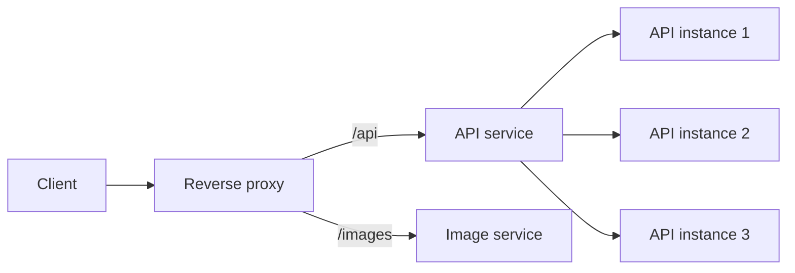

This diagram shows *logical decisions*, not required separate devices. One NGINX instance can route `/api` to the API service **and** balance requests among its instances. Another design may use separate components. A transport-level load balancer can distribute connections without inspecting HTTP paths.

> **Memory aid:** A reverse proxy is the intermediary that receives and forwards client requests. Load balancing is the choice among available destinations. Service routing and instance selection often happen together, but neither term is a formal subtype of the other.

#### Single-Server Deployments

**One physical server does not necessarily mean one application instance.** A server can run a reverse proxy, one or several application processes, and a database.

| Deployment | Reverse proxy | Load balancing |
| --- | --- | --- |
| **One application instance on one server** | Can provide a common entry point for HTTPS and request policies | Usually unnecessary: there is only one application instance to select |
| **Several application instances on one server** | Can forward requests to local processes | Can distribute requests among processes listening on different ports |
| **Application instances on multiple servers** | Can route requests to the appropriate service | Can distribute requests among instances on different machines |

**Example: One backend instance.** The client is outside the server; the other components share one machine.

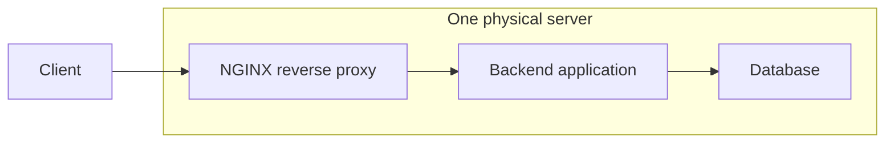

**Example: Several backend processes on the same server.** Each request goes to one selected instance, not all three.

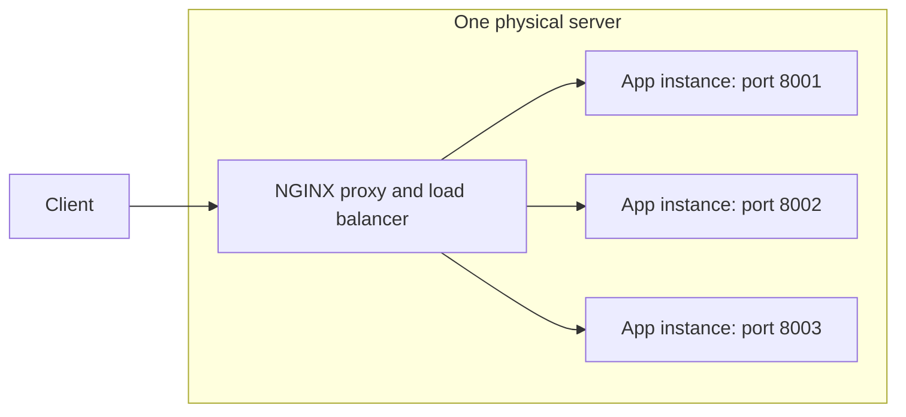

Multiple local instances can use available server capacity, but **they do not protect against failure of that physical server**.

Even with one backend, a configured proxy can provide:

- **HTTPS handling:** Manage the client-facing certificate and encrypted connection; see [TLS Termination](#tls-termination) for HTTP upstreams, re-encryption, and pass-through.
- **Request routing:** Forward `/api/` to an API on port `8000` and `/` to a frontend on port `3000`. It may instead serve `/images/` from local files: that is its **web-server role**, whereas forwarding to an image service is reverse proxying.
- **Request controls:** Apply configured rate limits, request-size limits, and access restrictions before forwarding.
- **Caching:** Reuse selected, safely cacheable responses instead of repeatedly contacting the backend; personalized responses need appropriate isolation or must not be shared.

Without a proxy, clients can connect directly to an application server that provides the required HTTPS, routing, and controls itself. **A reverse proxy is optional**, not a prerequisite for a small application. NGINX documents both [local proxying and static-file serving](https://nginx.org/en/docs/beginners_guide.html), as well as [balancing among backend instances](https://nginx.org/en/docs/http/load_balancing.html).

> **Remember:** A reverse proxy can be useful with **one backend**. Load balancing becomes useful when there are **multiple eligible instances**, even if they share one machine.

#### NGINX, Ingress, and Kubernetes Service

**NGINX is running server software, not a configuration file.** Its processes receive and handle requests; files such as `nginx.conf` describe how it should behave. The file itself does not forward traffic. See the [NGINX beginner's guide](https://nginx.org/en/docs/beginners_guide.html).

For example, this **configuration fragment belongs inside an HTTP `server` block**; it is not a complete configuration:

```nginx
location /api/ {
    proxy_pass http://127.0.0.1:8000;
}
```

In this standalone, same-host example, NGINX forwards `/api/orders` to `http://127.0.0.1:8000/api/orders`. Because `proxy_pass` specifies no URI after the host and port, it preserves the `/api/` prefix. In containers, loopback refers to the container's own network namespace, so another container normally needs a different backend address. See the [`proxy_pass` reference](https://nginx.org/en/docs/http/ngx_http_proxy_module.html#proxy_pass).

| Term | What it is | Role in this example |
| --- | --- | --- |
| **NGINX** | Open-source, high-performance HTTP server, reverse proxy, and load balancer | Routes requests and selects backends; can run on a VM, bare-metal server, or in a container |
| **Ingress** | Kubernetes API resource containing HTTP(S) host and path rules | Declares that `/api` goes to the API Service and `/images` goes to the Image Service |
| **Ingress controller** | Software, often running in Kubernetes Pods, that watches Ingress rules and implements them | An NGINX-based controller generates and updates NGINX configuration as the rules change |
| **Service** | Kubernetes abstraction that gives a group of Pods a stable network identity | Represents the API or image backend; a normal Service can distribute traffic among its ready Pods |

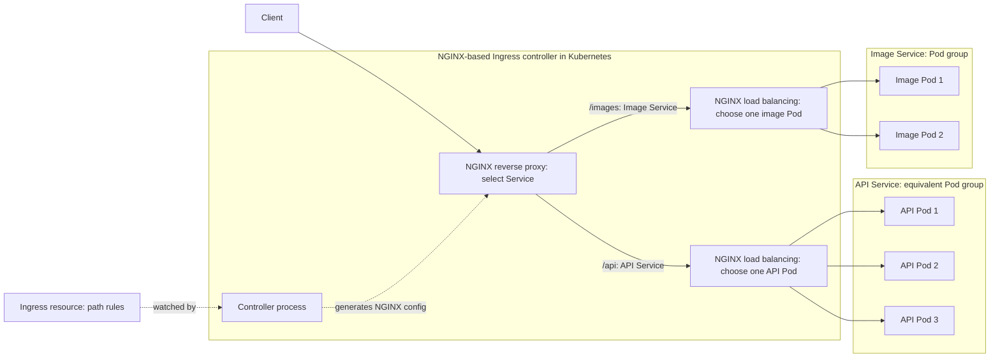

In a traditional standalone setup, NGINX is installed on a VM or bare-metal server and its configuration, such as `nginx.conf` and included files, maps hostnames and paths to backends. Teams can maintain that configuration directly or through automation. With an NGINX-based Ingress controller, you define Kubernetes Ingress rules; the controller watches them and automatically generates and updates the NGINX configuration. See the [NGINX configuration guide](https://nginx.org/en/docs/beginners_guide.html) and [F5 NGINX Ingress Controller design](https://docs.nginx.com/nginx-ingress-controller/overview/design/).

The diagram shows **two logical functions handled by the same NGINX-based controller**: reverse-proxy routing picks the Service named by the path rule, and load balancing picks one eligible Pod for that request. The arrows to multiple Pods show possible destinations, not a broadcast. Depending on the controller, traffic may go directly to Pod endpoints rather than through a Service's virtual IP. An Ingress resource alone does not handle traffic; it needs a controller. A Kubernetes `Service` of type `LoadBalancer` is a separate way to expose a workload through an external load balancer. See the [Kubernetes Ingress](https://kubernetes.io/docs/concepts/services-networking/ingress/) and [Service](https://kubernetes.io/docs/concepts/services-networking/service/) documentation.

**Naming note:** The Kubernetes community project **Ingress NGINX** was [retired in March 2026](https://kubernetes.io/blog/2026/01/29/ingress-nginx-statement/). It is distinct from the actively maintained [F5 NGINX Ingress Controller](https://docs.nginx.com/nginx-ingress-controller/changelog/). The general concepts of Ingress resources and controllers still apply.

### Common Reverse Proxy Functions

A reverse proxy can perform several functions at once:

1. **Load balancing:** Spread requests across healthy backend instances.
2. **API gateway:** Route API calls, authenticate clients, and enforce rate limits.
3. **Caching:** Serve stored responses without repeatedly calling the backend.
4. **Security filtering:** Apply access rules and block unwanted requests.
5. **TLS termination:** Handle the client-side HTTPS connection.
6. **Application routing:** Send requests to services based on hostname, path, or other request properties.

These are common capabilities, not mutually exclusive types. For example, the same proxy can terminate TLS, check authentication, and then balance requests across an application cluster.

#### Reverse Proxy vs. API Gateway

A **reverse proxy** describes an intermediary that receives client requests and forwards them to backends. An **API gateway** is an API-focused entry point that applies routing and API policies. These roles overlap: the same component can perform both.

| Capability | Reverse proxy, such as NGINX | API gateway |
| --- | --- | --- |
| **Request routing** | Can route by host or path | Commonly routes APIs and versions |
| **TLS termination** | Can handle client HTTPS when configured | Commonly handles client HTTPS |
| **Rate limiting and request limits** | Available depending on implementation and configuration | Common API-policy capabilities; support varies |
| **Authentication** | May use built-in modules or delegate to an authentication service | Often integrates with identity providers and token validation |
| **API keys, consumer quotas, and API management** | May require additional modules, services, or products | Often a focus, but exact features vary by product |

These are **capabilities, not automatic guarantees**. For example, NGINX can delegate access decisions through its [HTTP authentication-request module](https://nginx.org/en/docs/http/ngx_http_auth_request_module.html), which is not built by default. A simple forwarding configuration does not automatically enable authentication, caching, or rate limiting.

> **Mental model:** Reverse proxy = an intermediary role. API gateway = an API-management role. Neither removes the application's responsibility to validate input and enforce business-level authorization.

For what HTTPS decryption at the entry point actually means, see [TLS Termination](#tls-termination); the backend connection can use HTTP or a separate, verified HTTPS connection according to the security requirements.

### CDNs and Origin Traffic

A **content delivery network (CDN)** places edge servers near users. An edge can serve a cached response or fetch it from the **origin** (the application's source server). This reduces the distance and number of requests that reach the origin.

| Aspect | Regional reverse proxy | CDN edge |
| --- | --- | --- |
| **Typical placement** | In front of an application or service pool | Distributed near users |
| **Common job** | Route and protect application requests | Cache and deliver content; shield the origin |
| **Cacheable content** | Can cache selected responses | Often used for assets, and sometimes cacheable HTML or API responses |
| **On a cache miss** | Forwards to a backend | Fetches from the origin or another cache tier |

These are overlapping roles: a CDN edge is often itself a reverse proxy and may offer routing, security, and load-balancing features. A common path is **user → CDN edge → regional reverse proxy/load balancer → application**.

Cache only when the response is safe to reuse. Set appropriate cache keys, expiry, and invalidation rules; avoid sharing personalized or private content across users. A CDN also does not replace regional capacity planning for requests it cannot serve from cache.

### TLS Termination

**TLS termination** means the client's encrypted connection ends at an intermediary, such as a reverse proxy, load balancer, or API gateway. That intermediary decrypts the request before processing or forwarding it.

```text
Client ── HTTPS/TLS ──► Proxy or load balancer ── HTTP or new HTTPS/TLS ──► Backend
                      (client TLS connection ends here)
```

#### SSL vs. TLS: Naming and Versions

**TLS (Transport Layer Security) is the modern successor to SSL (Secure Sockets Layer), but not every TLS version is suitable today.** The familiar phrase **“SSL certificate”** is a legacy industry label for a certificate used with TLS; it does not mean SSL should be enabled or that the certificate selects the protocol version.

| Protocol | Practical guidance |
| --- | --- |
| **SSL—all versions** | Obsolete and unsafe; do not enable |
| **TLS 1.0 / 1.1** | Deprecated; do not enable |
| **TLS 1.2** | Supported for compatibility when securely configured |
| **TLS 1.3** | Preferred modern version where supported |

See the [SSL 3.0 deprecation](https://www.rfc-editor.org/rfc/rfc7568.html), [TLS 1.0/1.1 deprecation](https://www.rfc-editor.org/rfc/rfc8996.html), and [secure-TLS recommendations](https://www.rfc-editor.org/rfc/rfc9325.html). A protocol name alone does not guarantee security: enabled algorithms, certificate validation, implementations, and key handling also matter.

Important improvements and qualifications:

- **Cryptography:** TLS 1.3 removes legacy choices and uses authenticated encryption, such as AES-GCM or ChaCha20-Poly1305.
- **Handshake latency:** A normal full TLS 1.3 handshake needs fewer round trips than TLS 1.2; resumption behaves differently.
- **Forward secrecy:** Normal certificate-based TLS 1.3 handshakes protect recordings against later theft of the certificate's private key, assuming ephemeral/session secrets remain protected and are erased. Compromised session keys or endpoints remain a risk.
- **Alerts:** Encryption depends on connection state; early errors can be plaintext. “SSL alerts are unencrypted; TLS alerts are encrypted” is not a valid blanket distinction.

**Pre-shared-key-only (PSK-only)** exchanges lack the same forward-secrecy guarantee; optional **0-RTT early data** lacks full forward secrecy and introduces replay risks. See the [TLS 1.3 specification](https://www.rfc-editor.org/rfc/rfc8446.html).

**Key derivation:** TLS 1.3 uses **HKDF** (HMAC-based key derivation); TLS 1.2 uses a different **PRF-based construction** (pseudorandom function). Do not infer that an older construction is insecure merely because it differs. See [TLS 1.3 key derivation](https://www.rfc-editor.org/rfc/rfc8446.html#section-7.1) and [TLS 1.2's PRF](https://www.rfc-editor.org/rfc/rfc5246.html#section-5).

> **Remember:** The certificate identifies the endpoint; the negotiated TLS version and cryptographic configuration determine how the connection is protected. “SSL” in a product label is not a reason to enable an obsolete protocol.

#### Certificate Authorities: The Digital Notary

A **Certificate Authority (CA)** acts like a digital notary: after specified checks, it signs a certificate binding a **public key** to an identity, such as a domain name. The CA is a certificate-issuing system operated by an organization or individual, not necessarily a separate physical server.

The analogy has limits: a certificate does **not** certify that a website's content, business, or proposed actions are trustworthy. For public TLS server certificates, common validation categories are:

| Category | What is checked |
| --- | --- |
| **Domain Validation (DV)** | Control of the requested domain, using an approved method such as a DNS or HTTP challenge |
| **Organization Validation (OV)** | Domain control and verified organization identity information |
| **Extended Validation (EV)** | Domain control plus additional prescribed organization, existence, and authorization checks |

These describe **identity-validation differences, not stronger encryption levels**. See the [CA/Browser Forum Baseline Requirements](https://cabforum.org/working-groups/server/baseline-requirements/requirements/) and [EV explanation](https://cabforum.org/working-groups/server/extended-validation/about/).

#### Public and Private CAs

| Aspect | Public CA | Private / local CA |
| --- | --- | --- |
| **Trust** | Depends on inclusion in applicable browser, OS, or application trust programs | Depends on administrators explicitly configuring client trust |
| **Typical use** | Public-facing HTTPS services | Development, internal applications, VPNs, and device authentication |
| **Operation** | Multiple independent operators, including commercial and nonprofit organizations | An organization or developer can operate one, even on a laptop |
| **Examples** | DigiCert or Let's Encrypt, subject to client trust-store support | An enterprise PKI or a developer's local CA |

Public CAs are **not one global monopoly or an immutable list**. Browser and OS providers maintain root programs with admission, auditing, and continuing-trust requirements. Root keys can be relatively long-lived, but roots can be replaced or distrusted; individual service certificates are renewed on their own lifecycle. See the [Chrome Root Program policy](https://googlechrome.github.io/chromerootprogram/crp/policy/).

A private CA works only for clients that trust its root certificate or another appropriately configured trust anchor. **Being on the same LAN, VPN, laptop, or private network does not automatically create that trust.** The relevant application may use a different trust store from the OS. A root's self-signature alone does not make it trustworthy.

Public deployments commonly use **root CA → intermediate CA → server certificate**. An intermediate issues the server certificate, while the root key can remain offline. The client connects the presented certificate chain to a locally trusted anchor; trust is not established simply by the server sending a root certificate. See [Let's Encrypt's chain-of-trust explanation](https://letsencrypt.org/certificates/).

> **Private CA safety:** Distribute the public CA certificate as needed, not the CA's private key. Protect the signing key: whoever controls it can issue certificates within that CA's authority. No trust-store changes are required to study this example.

#### Certificate Issuance vs. Connection Verification

Consider **Application A**, a server, and **Application B**, its client. Issuance and connection verification are different phases:

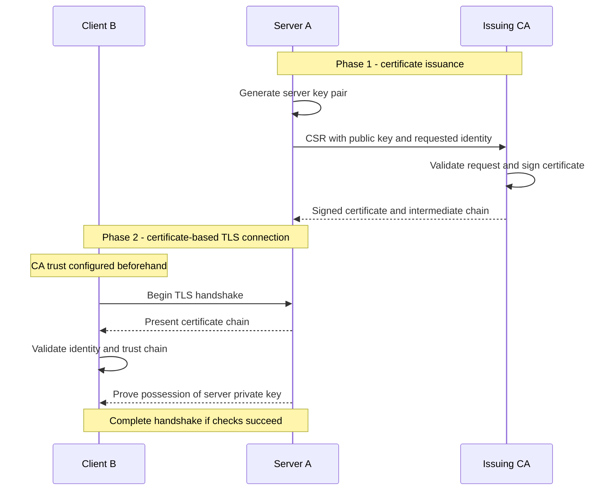

**Issuance:** A generates its key pair and submits a **Certificate Signing Request (CSR)** containing its public key and requested identity. The CSR is signed with A's corresponding private key, which **does not leave A** in this example. The CA checks authorization and identity, then signs the certificate with its **existing CA signing key**, often an intermediate's key. It does not generate a new CA key for each request or receive A's private key. [Issuance example: Let's Encrypt](https://letsencrypt.org/how-it-works/)

**Connection verification:** B checks the certificate chain against its configured trust anchors, the requested hostname, validity period, permitted use, and applicable security policies. In a certificate-based TLS handshake, A proves possession of its matching private key; presenting a copied certificate alone is insufficient. B can then complete the handshake if all required checks succeed. See [certificate-path validation, RFC 5280](https://www.rfc-editor.org/rfc/rfc5280.html#section-6) and [TLS authentication, RFC 8446](https://www.rfc-editor.org/rfc/rfc8446.html#section-4.4).

Ordinary HTTPS does **not** require B to have its own client certificate. **Mutual TLS (mTLS)** additionally authenticates the client using its certificate and proof of the associated private key. This is separate from application-level user login and authorization.

> **The CA signs the certificate; the client verifies it.** The CA does not approve every HTTPS request. Depending on client policy, certificate-status or chain-retrieval services may still be consulted; that is not per-request permission from a notary.

When **NGINX terminates TLS**, NGINX is the client-facing TLS endpoint in this example: it presents the certificate and uses the associated private key, rather than requiring the backend to handle that client connection. Protect that key and automate certificate renewal as appropriate. Re-encryption creates a separate backend TLS connection with its own validation requirements. See the [NGINX HTTPS configuration guide](https://nginx.org/en/docs/http/configuring_https_servers.html) and [Connection to the Backend](#connection-to-the-backend).

#### How It Works

1. **Handshake:** The client establishes a TLS connection with the intermediary, which presents its certificate and proves its identity using the associated private key.
2. **Decryption:** The intermediary uses the negotiated *session keys* to decrypt request data.
3. **Processing:** It can inspect the request, apply routing or security rules, and choose a backend.
4. **Forwarding:** It sends the request to the backend over a separate connection, using HTTP or a new HTTPS connection.

> The private key is involved in authenticating the TLS endpoint during the handshake. In modern TLS, application traffic is decrypted with negotiated session keys, not directly with the certificate's private key.

#### Connection to the Backend

| Mode | Client to intermediary | Intermediary to backend | Meaning |
| --- | --- | --- | --- |
| **TLS termination with HTTP upstream** | HTTPS | HTTP | The internal hop is unencrypted; use only where that is acceptable for the network and security requirements. |
| **TLS termination with re-encryption** | HTTPS | New HTTPS connection | Both network hops are encrypted, but the intermediary can still inspect the request. |
| **TLS pass-through** | HTTPS | Original TLS traffic forwarded | The backend terminates TLS; the intermediary does not decrypt the application request. |

TLS termination does **not** imply that traffic to the backend must be plaintext. Re-encryption establishes a separate TLS connection for that hop. Pass-through is a different design because TLS ends at the backend.

### Session Affinity

**Session affinity** (or a *sticky session*) tries to send repeat requests from the same client to the same backend. It can help when session state is kept in that backend's memory.

| Method | How it works | Caution |
| --- | --- | --- |
| **Cookie-based affinity** | A cookie identifies the preferred backend or routing group. | The client must retain the cookie; an unhealthy backend still needs failover. |
| **IP-based affinity** | A hash of the client IP selects a backend. | NAT, mobile networks, and proxies can make many users share one IP or change IPs. |
| **Shared session storage** | Any backend reads state from a common store. | The store itself needs capacity, availability, and expiry policies. |

Affinity can simplify a stateful application, but it makes load distribution less even and complicates scaling and failover. Prefer **stateless application instances plus shared or client-held session state** when practical. If affinity is necessary, plan for the backend to disappear mid-session.

### State in Load Balancing

**Stateful versus stateless is meaningful only when you name the state being discussed.** A balancer can avoid per-client affinity mappings while still keeping connection counters, configuration, health status, and backend membership.

| Kind of state | Example | Implication |
| --- | --- | --- |
| **Connection or flow state** | Map an established TCP flow to its backend | Later packets must reach the correct connection; losing mappings can interrupt it |
| **Server-side affinity mapping** | Remember that session X belongs to instance 2 | Replacement balancers may need that mapping or a recovery strategy |
| **Cookie-carried or deterministic affinity** | Read a routing cookie or hash a stable key | Can avoid a server-side per-client mapping, but still depends on valid inputs and backend configuration |
| **Application session state** | A user's cart stored in a backend's memory | Routing alone does not replicate or recover that cart |
| **Shared operational state** | Distribute membership or synchronize selected mappings | Helps coordinate balancers but adds consistency and failure-handling concerns |

**Local state is still state**; it does not become stateless merely because it is not shared. Conversely, stateful balancing does not require every deployment to synchronize every session between all balancers. Some use connection pinning, selected replication, client-carried information, or tolerate reconnection.

Consistent hashing can reduce mapping changes, but it does not eliminate connection state or recover lost application sessions. Balancers also need compatible hashing inputs and membership views to make matching choices. Google's [Maglev design](https://research.google/pubs/maglev-a-fast-and-reliable-software-network-load-balancer/) illustrates a production combination of consistent hashing and connection tracking.

> Distinguish **balancer state** from **application state**. A deterministic routing decision does not make the application stateless, and sticky routing is not data replication.

### Health Checks and Failover

A balancer should send new work only to backends that can actually serve it. A running process is not necessarily a *ready* process: it may still be starting, overloaded, or disconnected from a critical dependency.

- **Active health checks:** The balancer sends periodic probes to each backend.
- **Passive health checks:** The balancer observes errors and timeouts from real requests.
- **Readiness checks:** Indicate whether an instance should receive new traffic.
- **Failure thresholds:** Require repeated probe failures or successes to avoid flapping.
- **Connection draining:** Stop new requests to a departing backend and allow in-flight work to finish.
- **Timeouts and bounded retries:** Detect failure while avoiding retry storms or duplicate writes.

```text
register → warm up → pass readiness check → receive traffic
                                   ↓
             fail health check or scale in → drain → remove
```

> A health check should reflect the operation being served. A shallow `/health` response can be green while checkout cannot reach its payment dependency. At the same time, making every health check depend on every downstream service can cause correlated mass failover.

At the global layer, failover may move users to another region. That region must have enough spare capacity and access to the data required for correct operation. Routing alone cannot preserve session state, synchronize databases, or guarantee zero downtime.

**Failover is not the same as safely replaying a request.** A backend may commit an order before its response is lost. Retry only when the operation is safe to repeat or protected by an appropriate idempotency mechanism; consider replayability, deadlines, and retry limits.

The balancing layer itself also needs a failure plan: redundant instances, a managed service, routing failover, or another deployment-specific arrangement. A single proxy on a single host can otherwise become the entry point's single point of failure. TLS termination can centralize certificate handling and move cryptographic work, but is **not by itself DDoS protection**; backend encryption choices remain as described in [TLS Termination](#tls-termination).

### Autoscaling with Load Balancing

**Autoscaling** adjusts the number of service instances; the **load balancer** discovers healthy instances and distributes traffic among them. Together they provide elastic capacity.

1. Demand rises, measured by a useful signal such as queue age, requests per instance, CPU, or latency.
2. The scaler adds instances. They start, warm up, and pass readiness checks.
3. The balancer begins sending them traffic.
4. When demand falls, instances are drained before removal.

A rough capacity estimate is:

$$
N_{needed} \approx \left\lceil \frac{\lambda}{\mu \rho_{target}} \right\rceil
$$

where $\lambda$ is incoming requests per second, $\mu$ is sustainable requests per second per instance, and $\rho_{target}$ is the desired utilization fraction. This is a planning approximation: real capacity depends on request mix, queues, startup time, and downstream bottlenecks.

| Scaling signal | Useful for | Watch out for |
| --- | --- | --- |
| **CPU or memory** | Compute-heavy or memory-bound services | May not reveal blocked I/O or queue growth |
| **Requests per instance** | Relatively uniform request workloads | Expensive requests are not equal to cheap ones |
| **Queue depth or age** | Background consumers | Deep queues can take time to drain after scaling |
| **Latency or saturation** | User-facing performance | Often rises after overload has already begun |

Keep headroom for bursts and failures. Scale-out has a delay, so use warm capacity or predictive scheduling for known peaks. Ensure the database, cache, and external services can handle the extra traffic; adding application instances does not scale every dependency.

### Traffic Routing Policies

**Routing policies choose a destination group**—a service, region, or release version. **Selection algorithms choose a backend inside that group.**

| Policy | Example | Main use |
| --- | --- | --- |
| **Path-based** | `/api/orders` → orders service | Route different endpoints to different services |
| **Host-based** | `admin.example.com` → admin service | Serve several applications through one entry point |
| **Latency-based** | Choose a region with lower measured network delay | Reduce user round-trip time |
| **Geographic** | Route by user location or declared market | Localization or regional policy |
| **Weighted** | 95% stable release, 5% new release | Canary rollout or gradual migration |
| **Failover** | Send traffic to a secondary region when the primary fails | Disaster recovery |

For a canary rollout, increase the new version's weight only after checking error rate, latency, and business outcomes. Keep a fast rollback path. Session affinity and caches can make the observed split differ from the configured weight.

> Geo routing can help apply regional policy, but it does not by itself guarantee data residency. Verify where requests, processing, logs, backups, and failover traffic actually go.

### Illustrative Multi-Tier Deployment

A large deployment **might** separate global endpoint selection, packet distribution, transport-level balancing, and application-level routing:

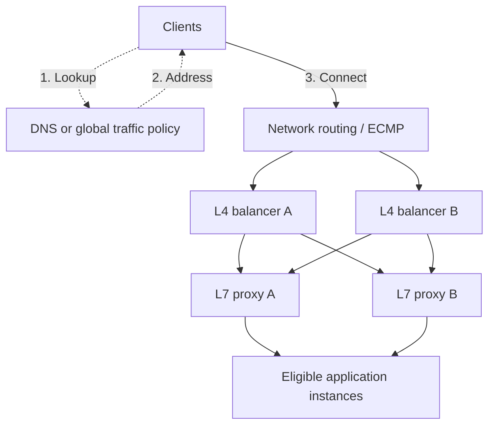

1. **DNS/global policy:** Supplies an entry-point address; it does not forward the HTTP request.
2. **Network distribution:** Routing can spread flows across available balancer instances. ECMP means *equal-cost multipath*; it commonly hashes flow fields rather than simply rotating individual packets.
3. **L4 layer:** Selects a transport destination and preserves flow consistency as required by the design.
4. **L7 layer:** Applies HTTP routing and selects ready application backends, with TLS terminated at or before HTTP inspection.

This is an **illustration, not a required four-tier standard**. Products can combine roles, managed services can hide layers, and smaller applications can omit most of them. Every extra hop adds latency, operating cost, and a failure surface. Changes in routing or backend membership must account for existing flows. [Maglev](https://research.google/pubs/maglev-a-fast-and-reliable-software-network-load-balancer/) is one example of routing distributing traffic across software network balancers, not a template every application must follow.

### Implementation Options

| Option | Deployment and responsibility | Advantages | Trade-offs |
| --- | --- | --- | --- |
| **Hardware appliance** | Dedicated device operated by your team | Specialized acceleration and integrated network functions may fit particular requirements | Procurement, capacity planning, licensing, redundant devices, and vendor dependence |
| **Self-managed software** | Processes on hosts, VMs, or containers; your team manages configuration and lifecycle | Programmability, flexible placement, and scaling on general-purpose infrastructure | Patching, capacity, observability, redundancy, and configuration safety remain your responsibility |
| **Managed cloud service / LBaaS** | Provider operates the balancing infrastructure within a defined service scope | Less infrastructure maintenance; integration with discovery, metrics, and scaling | Usage charges, service limits, provider-specific behavior, and configuration responsibilities |

**LBaaS** means *load balancing as a service*. A particular offering may be regional or global, L4 or L7; do not assume it supplies all scopes and features. Managed infrastructure does not remove responsibility for healthy backends, application correctness, or safe routing policies.

There is **no universal performance winner**. Compare throughput, connections, TLS and HTTP processing, latency under realistic load, failure behavior, required features, and total operational cost. Hardware acceleration can help specific workloads; production software systems can also achieve high throughput. Hybrid designs are possible, but should solve a concrete requirement rather than add layers by default.

### Worked Example: Flash Sale

Suppose a retailer expects a short global traffic spike. Its request path could be:

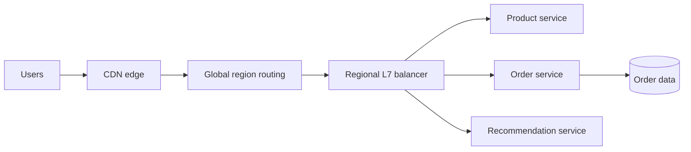

- The **CDN** serves cacheable product assets, reducing origin requests.
- **Global routing** selects an allowed, healthy region. A secondary region is tested for capacity and data access before it is needed.
- The **regional L7 balancer** sends paths to the right services and excludes unhealthy instances.
- **Autoscaling** adds product or recommendation instances as demand rises; checkout retains reserved capacity and backpressure.
- A **weighted canary** sends a small share of recommendation requests to a new version. It rolls back if quality or error metrics worsen.
- **Session and order state** live outside individual application instances so instance replacement does not erase them.

This architecture improves resilience, but it cannot promise zero downtime. A database bottleneck, stale DNS answer, failed cross-region data dependency, or cache stampede can still affect users; each needs its own mitigation.

### Design Checklist

1. What is being balanced: TCP connections, HTTP requests, or queued jobs?
2. Is the decision local, global, or both? What are the allowed regions?
3. Does routing require HTTP content (L7), or is transport-level routing enough (L4)?
4. Which backends are eligible, and how is readiness measured?
5. Which algorithm fits request duration, instance capacity, and affinity needs?
6. Where does TLS terminate, and is the backend hop encrypted?
7. Which responses can be cached, and how are private responses isolated?
8. How are instances added, warmed up, drained, and removed?
9. What happens when one instance, region, or shared dependency fails?
10. Which metrics trigger scaling, failover, canary rollback, or load shedding?

### Key Takeaways

- Load balancing selects among **healthy, eligible backends**. It improves use of existing capacity; scaling and backpressure handle growth.
- L4 routing uses connection information; L7 routing can use HTTP details when the request is decrypted.
- Global routing chooses a region or edge; local balancing chooses an instance. DNS-based changes are limited by caching and existing connections.
- Algorithms, health checks, session state, and autoscaling must be designed together.
- A reverse proxy describes an intermediary role; load balancing describes traffic distribution. A CDN edge can also be a reverse proxy.
- In Kubernetes, an Ingress declares HTTP routing rules, an ingress controller implements them, and a Service identifies a backend group of Pods.
- TLS termination ends the client-side encrypted connection at the intermediary; the backend hop may use HTTP or a new HTTPS connection.
- Failover is only effective when the alternate destination has capacity, correct data, and a tested recovery path.

## Application Gateways

An **application gateway** is an application-aware intermediary that routes traffic and applies shared policies in front of backend services. An **API gateway** focuses on exposing and managing APIs. Terminology varies by product: these are overlapping roles, not universal product categories.

### Role and Request Flow

A gateway works as a reverse proxy and may also load-balance requests. L7 load balancers can provide many of the same capabilities; the distinction is **the policies and API-management functions required**, not simply “basic balancer versus advanced gateway.” See [Reverse Proxy vs. API Gateway](#reverse-proxy-vs-api-gateway).

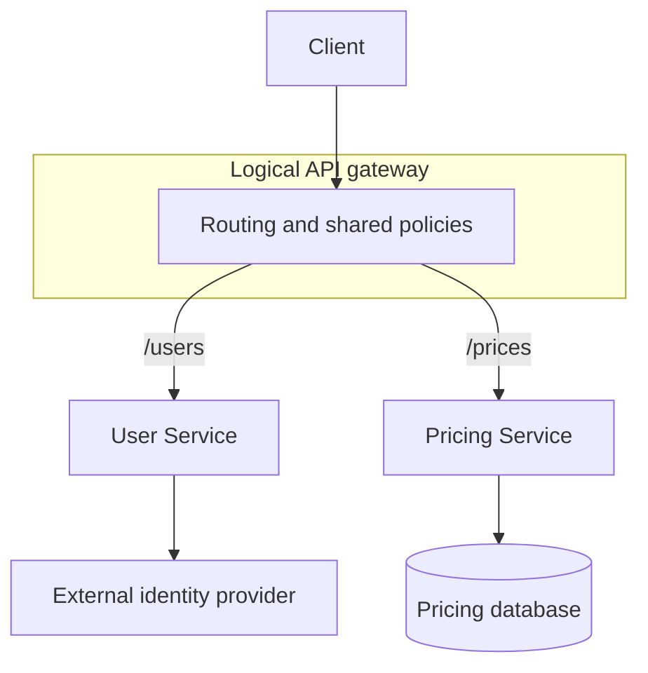

The diagram shows **possible routes, not a broadcast**: a `/prices` request normally goes to Pricing Service, not both services. The external identity provider is an illustrative User Service dependency; its involvement depends on the operation and authentication design. Each service owns its downstream interactions.

One **logical entry point** can be backed by several gateway replicas and multiple endpoints. It need not be the first physical network hop: DNS, a CDN, DDoS protection, or a separate load balancer may precede it. Gateways also work with monoliths, internal APIs, and on-premises applications—not only cloud microservices.

### Features and Capabilities

Support depends on the product, edition, plugins, integrations, and configuration. A gateway need not implement every capability below.

| Capability | Purpose and example | Important boundary |
| --- | --- | --- |
| **Request routing** | Match host, path, headers, or source-network rules to select a service | A route is not permission to access its data |
| **Authentication (AuthN)** | **Who are you?** Validate a token, certificate, or other credential | Validate issuer, audience, signature, and expiry as applicable |
| **Authorization (AuthZ)** | **What may you do?** Enforce API scopes or route access | Services must still enforce object ownership and business rules |
| **Rate limits and quotas** | Bound request rates or consumer usage | Cluster-wide limits may require coordinated counters; neither guarantees spare capacity |
| **TLS handling** | Terminate client TLS and optionally establish backend TLS | Manage certificates and validate upstream identity; see [TLS Termination](#tls-termination) |
| **WAF integration** | Filter known malicious request patterns | A web application firewall is not complete DDoS protection or a replacement for secure code |
| **Caching** | Reuse selected safe responses | Include identity/tenant context where needed, or exclude private responses |
| **Compression** | Reduce suitable response sizes | Costs CPU and requires appropriate security and content policies |
| **Connection management** | Reuse backend connections and bound concurrent work | Respect timeouts, protocol behavior, and backend limits |
| **Observability** | Record request/error rates, latency, access logs, and trace context | Gateway visibility does not replace instrumentation inside services |
| **Adaptation** | Transform headers or payloads; translate supported protocols for legacy services | Preserve contract semantics, error behavior, and trust boundaries |

For example, validating a user's token at the gateway does **not** establish that the user may read every account ID accepted by a backend. Object-level authorization remains essential. [OWASP: Broken Object-Level Authorization](https://owasp.org/API-Security/editions/2023/en/0xa1-broken-object-level-authorization/)

### Design Considerations

1. **Capacity and redundancy:** Size for connections, throughput, TLS, filters, and failure headroom. Replicate across appropriate failure domains; avoid making one gateway host the sole entry point.
2. **Timeouts and retries:** Budget end-to-end deadlines, bound retries, and account for whether requests can be replayed. Protect writes with appropriate idempotency; see [Health Checks and Failover](#health-checks-and-failover).
3. **Overload and caching:** Apply admission controls, concurrency limits, and backpressure. Define cache keys, expiry, and invalidation without leaking one user's response to another.
4. **Trust boundaries:** Restrict unintended direct backend access, validate forwarded identity, and retain service-level authorization. TLS termination or a WAF alone does not prevent all attacks; DDoS protection also depends on upstream capacity and defenses.
5. **Safe change management:** Validate configuration and policy changes, stage rollouts, monitor outcomes, and retain rollback paths. Keep API versions compatible during mixed deployments.
6. **Certificates and telemetry:** Protect signing/endpoint keys, renew certificates, and verify backend TLS. Correlate logs and traces while redacting tokens, credentials, and sensitive payloads.

> **Recall:** A gateway centralizes selected shared policies, not all application intelligence. Keep core business rules in services and make the gateway layer resilient itself.

## Microservices Architectures

**Microservices** organize an application into services designed for independent deployment around explicit responsibilities and interfaces. They can communicate through HTTP APIs, gRPC, or asynchronous messaging; REST is one option, not a requirement. Independent deployment requires compatible contracts and appropriate ownership of data and behavior—not merely separate processes.

### Gateway Support for Microservices

| Need | Gateway contribution | What services and teams still provide |
| --- | --- | --- |
| **Stable public API** | Expose a consistent hostname and API surface while internal endpoints change | Compatible contracts, versioning, and migration plans |
| **Discovery and instance selection** | Use configured destinations, DNS, platform discovery, or registry integration to reach eligible instances | Accurate membership and readiness signals |
| **Shared policies** | Apply common authentication, limits, and telemetry conventions | Business authorization, validation, and internal observability |
| **Independent releases** | Update routing or policies separately from backend binaries | Compatibility tests and coordination when contracts change |
| **Independent scaling** | Distribute incoming traffic to the relevant service pool | Capacity management for each service and its dependencies |

A gateway can reduce client coupling to internal topology and repeated infrastructure code, but **does not itself create service independence**. Small systems or independently exposed services may not need a shared gateway.

### Routing vs. Aggregation

- **Routing:** `/users/42` selects User Service; `/prices/item7` selects Pricing Service. The gateway forwards a request to its chosen destination.
- **Aggregation:** A `/dashboard` operation might obtain user and pricing information and combine the results. This requires multiple calls, deadlines, and explicit partial-failure behavior.

Aggregation is **optional**, not what every routed request does. Complex composition often belongs in a dedicated aggregation service or **backend for frontend (BFF)** rather than an increasingly business-heavy gateway. See [Microsoft's API-gateway architecture discussion](https://learn.microsoft.com/en-us/azure/architecture/microservices/design/gateway).

### External vs. Internal Traffic

**North–south traffic** enters or leaves the application environment; an ingress/API gateway often handles this boundary. **East–west traffic** runs between internal services. It may use direct calls, messaging, client libraries, or a service mesh rather than returning through the public gateway.

A **service mesh** can supply service-to-service transport security, routing, and telemetry. It is not interchangeable with a public API-management platform, although a mesh may include ingress gateways. Neither approach removes application-level correctness requirements. See the [Istio ingress-gateway example](https://istio.io/latest/docs/tasks/traffic-management/ingress/ingress-control/).

## Cloud-Native Implementations

Cloud platforms offer several complementary entry-point services. **A managed API gateway, an L7 load balancer, a WAF, and a CDN are not equivalent products**, even when integrated in one architecture.

### Managed Cloud Services

| Platform | API-focused service | Complementary traffic services | Distinction |
| --- | --- | --- | --- |
| **AWS** | [Amazon API Gateway](https://docs.aws.amazon.com/apigateway/latest/developerguide/welcome.html): publish and manage HTTP, REST, or WebSocket APIs | [Application Load Balancer](https://docs.aws.amazon.com/elasticloadbalancing/latest/application/introduction.html): HTTP(S) routing and backend distribution | API type and integrations determine policies; ALB is not a substitute for every API-management feature |
| **Azure** | [API Management](https://learn.microsoft.com/en-us/azure/api-management/api-management-key-concepts): API policies and lifecycle management | [Application Gateway](https://learn.microsoft.com/en-us/azure/application-gateway/overview): L7 web traffic balancing, TLS, and WAF integration | Application Gateway is not another name for API Management; they can be combined |
| **Google Cloud** | [API Gateway](https://docs.cloud.google.com/api-gateway/docs/about-api-gateway) and [Apigee](https://docs.cloud.google.com/apigee/docs/api-platform/get-started/what-apigee): different API-serving/management offerings | [Application Load Balancing](https://docs.cloud.google.com/load-balancing/docs/application-load-balancer), [Cloud Armor](https://docs.cloud.google.com/armor/docs/cloud-armor-overview), and [Cloud CDN](https://docs.cloud.google.com/cdn/docs/overview) | Armor supplies protection policies; CDN supplies edge caching. Neither is a standalone API gateway |

These are **role examples, not interchangeable feature lists or purchasing recommendations**. Check supported combinations, API types, regional scope, quotas, identity integrations, and service tiers. Do not assume every service is serverless or automatically autoscaling; provisioning and scaling models differ. Managed operation also does not remove responsibility for backend readiness, authorization, capacity, or safe configuration.

### Kubernetes Gateways and Ingress

An **Ingress resource** declares routing rules; an **Ingress controller** implements them. **Gateway API** provides Kubernetes resources such as `GatewayClass`, `Gateway`, and `HTTPRoute` for configuring network traffic. A compatible controller and data plane are still needed. **Gateway API is not itself an API-gateway product.** See the [Kubernetes Ingress documentation](https://kubernetes.io/docs/concepts/services-networking/ingress/) and [Gateway API introduction](https://gateway-api.sigs.k8s.io/docs/introduction/).

| Implementation | Role and qualification |
| --- | --- |
| **Kong** | [Kong Ingress Controller](https://developer.konghq.com/kubernetes-ingress-controller/) translates supported Kubernetes routing resources into Kong Gateway configuration; gateway features depend on edition and plugins |
| **Traefik** | [Traefik Proxy](https://doc.traefik.io/traefik/) provides ingress/reverse-proxy routing and middleware; distinguish it from additional API-management products |
| **Istio** | [Istio ingress gateways](https://istio.io/latest/docs/tasks/traffic-management/ingress/ingress-control/) provide an entry boundary into a service-mesh environment; Istio is not merely an Ingress controller |
| **Emissary-Ingress** | [Emissary-Ingress](https://emissary-ingress.dev/docs/4.1/about/why-ambassador/) provides Envoy-based Kubernetes ingress/API routing; authentication and rate-limit designs may use external services |

Controller support and policy extensions vary. Declaring a resource does not automatically enable every security, analytics, or API-management capability. For the existing NGINX example and naming distinctions, see [NGINX, Ingress, and Kubernetes Service](#nginx-ingress-and-kubernetes-service).

## On-Premises Options

Gateways can run in an organization's data center, on a VM, on bare metal, or in containers. **Self-hosted does not mean on-premises only**: the same software can run in cloud infrastructure, while the team retains operational responsibilities.

### Self-Hosted Gateway Options

| Software | Main role | Capabilities and qualifications |
| --- | --- | --- |
| **[Kong Gateway](https://developer.konghq.com/gateway/)** | API gateway | Routing and extensible policy plugins; edition, plugin, and licensing choices affect available features |
| **[Tyk Gateway](https://tyk.io/docs/tyk-open-source)** | API gateway with an open-source core | API access controls, routing, and traffic policies; management dashboards and developer portals are separate platform components, not automatically part of the open-source gateway |
| **[NGINX](https://nginx.org/en/docs/http/ngx_http_proxy_module.html)** | Web server, reverse proxy, and load balancer | Can implement gateway policies through configuration and integrations; distinguish open-source modules from commercial products and extensions |
| **[HAProxy](https://www.haproxy.org/)** | TCP/HTTP proxy and load balancer | Provides L4/L7 application delivery and traffic controls; a complete API-management experience may require additional components |

**Kong Gateway and [Kong Mesh](https://developer.konghq.com/mesh/) are different components**: the first focuses on API gateway functions; the latter manages a service mesh across services. Do not assume either is included merely because the other is deployed.

### Operational Responsibilities

For self-hosted gateways, plan installation and upgrades, security patching, redundant placement, discovery integration, certificates, configuration backups, monitoring, and capacity testing. If policies use shared counters or external authentication services, those dependencies need their own availability and timeout plans.

Open-source availability does not imply that every dashboard, portal, analytics service, or enterprise plugin is free or bundled. Check the relevant component's documentation and license. Choose the smallest set of components that meets the requirements rather than assembling every product into one request path.

> **Deployment model ≠ gateway role.** Public cloud, private infrastructure, and hybrid environments can use the same architectural patterns with different operating responsibilities.

## Summary

**DNS, load balancers, and application gateways solve complementary problems in a request's journey.** DNS resolves names through a distributed hierarchy; caching reduces lookup latency and DNS traffic, while TTLs affect how quickly changes become visible. Load balancers distribute connections or requests among eligible backends using policies suited to their workload. L4 balancing uses transport information; L7 balancing can inspect application requests. Application/API gateways provide a unified entry point with routing and configurable shared policies such as authentication, rate limiting, observability, and adaptation.

These components can improve scalability, performance, and resilience, but their guarantees depend on configuration, healthy capacity, and application correctness. Gateways are useful for microservices and other architectures—not exclusively cloud systems. DNS cache expiry, connection affinity, safe retries, certificate trust, and service-level authorization remain separate concerns that must work together.

For system-design interviews, be prepared to explain **placement, request flow, trade-offs, and failure behavior**, not merely product names.

> **DNS finds an endpoint; load balancing selects a backend; a gateway applies routing and application policies. One product may perform several roles.**

## Further Reading

- [AWS: DNS Record TTL and Preparing for Address Changes](https://docs.aws.amazon.com/Route53/latest/DeveloperGuide/resource-record-sets-values-basic.html)
- [Cloudflare: DNS TTL and Client Cache Behavior](https://developers.cloudflare.com/dns/manage-dns-records/reference/ttl/)
- [IANA: Azerbaijan's .az Delegation](https://www.iana.org/domains/root/db/az.html)
- [RFC 8806: Running a Root Server Local to a Resolver](https://www.rfc-editor.org/rfc/rfc8806)
- [RFC 2826: IAB Technical Comment on the Unique DNS Root](https://www.rfc-editor.org/rfc/rfc2826)
- [Internet Society: Russia's National DNS — Assessment Updated December 2023](https://www.internetsociety.org/resources/internet-fragmentation/russias-national-dns/)
- [Collin Anderson: The Hidden Internet of Iran — 2012 Working Draft](https://arxiv.org/abs/1209.6398)
- [Sadeghi Jahromi and Jaskolka: Internet Shutdown Measurements in Iran — 2026 Preprint](https://arxiv.org/html/2605.00187v2)
- [North Korean Internet: Kwangmyong — February 2026 Researcher Report](https://nkinternet.com/2026/02/08/kwangmyong/)
- [IANA: Root Names, Addresses, and Operators](https://www.iana.org/domains/root/servers)
- [Root Server Operators: Live Inventory and Location Map](https://root-servers.org/)
- [ICANN: The 2016 IANA Stewardship Transition](https://www.icann.org/stewardship-accountability)
- [IANA: .ru Delegation](https://www.iana.org/domains/root/db/ru.html)
- [IANA: .kr Delegation](https://www.iana.org/domains/root/db/kr.html)
- [IANA: .kp Delegation](https://www.iana.org/domains/root/db/kp.html)
- [RFC 9499: DNS Terminology, Including Split DNS and Server Instances](https://www.rfc-editor.org/info/rfc9499/)
- [RFC 2606: Reserved Names for Documentation and Examples](https://www.rfc-editor.org/rfc/rfc2606)
- [Linux Manual: hosts File](https://man7.org/linux/man-pages/man5/hosts.5.html)
- [Microsoft: Hosts File Location and Format](https://support.microsoft.com/en-us/windows/experience/how-to-reset-the-hosts-file-back-to-the-default)
- [RFC 1034: Domain Names — Concepts and Facilities](https://www.rfc-editor.org/rfc/rfc1034)
- [RFC 1035: Domain Names — Implementation and Specification](https://www.rfc-editor.org/rfc/rfc1035)
- [RFC 3596: DNS Extensions to Support IPv6](https://www.rfc-editor.org/rfc/rfc3596)
- [RFC 7766: DNS Transport over TCP](https://www.rfc-editor.org/rfc/rfc7766)
- [RFC 2182: Selection and Operation of Secondary DNS Servers](https://www.rfc-editor.org/rfc/rfc2182)
- [RFC 3258: Distributing Authoritative Name Servers](https://www.rfc-editor.org/rfc/rfc3258)
- [RFC 8767: Serving Stale Data to Improve DNS Resiliency](https://www.rfc-editor.org/rfc/rfc8767)

- [NGINX: Using nginx as HTTP load balancer](https://nginx.org/en/docs/http/load_balancing.html)
- [RFC 9293: TCP Connections, Reliability, and Connection Establishment](https://www.rfc-editor.org/rfc/rfc9293.html)
- [Microsoft: netstat](https://learn.microsoft.com/en-us/windows-server/administration/windows-commands/netstat)
- [Apple: netstat Manual](https://github.com/apple-oss-distributions/network_cmds/blob/main/netstat.tproj/netstat.1)
- [Linux: ss Manual](https://man7.org/linux/man-pages/man8/ss.8.html)
- [Wireshark: TShark Command-Line Manual](https://www.wireshark.org/docs/man-pages/tshark.html)
- [Apple: Recording a Packet Trace](https://developer.apple.com/documentation/network/recording-a-packet-trace)
- [AWS: Network Load Balancer Flow Hashing and TCP Connection Routing](https://docs.aws.amazon.com/elasticloadbalancing/latest/network/introduction.html)
- [NGINX: TCP/UDP Stream Proxying](https://nginx.org/en/docs/stream/ngx_stream_proxy_module.html)
- [NGINX: HTTP Selection Methods, Weights, and Session Persistence](https://docs.nginx.com/nginx/admin-guide/load-balancer/http-load-balancer/)
- [Envoy: Backend Selection Policies](https://www.envoyproxy.io/docs/envoy/latest/intro/arch_overview/upstream/load_balancing/load_balancers)
- [Google: Maglev — Software Network Load Balancing, Hashing, and Connection Tracking](https://research.google/pubs/maglev-a-fast-and-reliable-software-network-load-balancer/)
- [AWS: Health Checks and DNS Failover](https://docs.aws.amazon.com/Route53/latest/DeveloperGuide/dns-failover.html)
- [RFC 6891: EDNS and Extended DNS UDP Message Sizes](https://www.rfc-editor.org/rfc/rfc6891)
- [NGINX: Beginner's Guide — Processes, Configuration, Static Files, and Proxying](https://nginx.org/en/docs/beginners_guide.html)
- [NGINX: proxy_pass and URI Handling](https://nginx.org/en/docs/http/ngx_http_proxy_module.html#proxy_pass)
- [NGINX: Authentication via Subrequests](https://nginx.org/en/docs/http/ngx_http_auth_request_module.html)
- [Kubernetes: Ingress](https://kubernetes.io/docs/concepts/services-networking/ingress/)
- [Kubernetes: Service](https://kubernetes.io/docs/concepts/services-networking/service/)
- [F5: What is SSL termination?](https://www.f5.com/glossary/ssl-termination)
- [CA/Browser Forum: Public TLS Baseline Requirements](https://cabforum.org/working-groups/server/baseline-requirements/requirements/)
- [CA/Browser Forum: Extended Validation](https://cabforum.org/working-groups/server/extended-validation/about/)
- [Chrome: Root Program Policy](https://googlechrome.github.io/chromerootprogram/crp/policy/)
- [Let's Encrypt: Certificate Issuance and Domain Validation](https://letsencrypt.org/how-it-works/)
- [Let's Encrypt: Chains of Trust](https://letsencrypt.org/certificates/)
- [RFC 5280: Certificate-Path Validation](https://www.rfc-editor.org/rfc/rfc5280.html#section-6)
- [RFC 8446: TLS 1.3 Authentication](https://www.rfc-editor.org/rfc/rfc8446.html#section-4.4)
- [RFC 7568: Deprecating SSL 3.0](https://www.rfc-editor.org/rfc/rfc7568.html)
- [RFC 8996: Deprecating TLS 1.0 and TLS 1.1](https://www.rfc-editor.org/rfc/rfc8996.html)
- [RFC 9325: Recommendations for Secure TLS Use](https://www.rfc-editor.org/rfc/rfc9325.html)
- [RFC 5246: TLS 1.2 Pseudorandom Function](https://www.rfc-editor.org/rfc/rfc5246.html#section-5)
- [NGINX: Configuring HTTPS Servers](https://nginx.org/en/docs/http/configuring_https_servers.html)
- [AWS: HTTPS listeners for Application Load Balancers](https://docs.aws.amazon.com/elasticloadbalancing/latest/application/create-https-listener.html)
- [NGINX: HTTP health checks](https://docs.nginx.com/nginx/admin-guide/load-balancer/http-health-check/)
- [AWS: Target health checks and draining](https://docs.aws.amazon.com/elasticloadbalancing/latest/application/target-group-health-checks.html)
- [AWS: DNS failover and TTL](https://docs.aws.amazon.com/Route53/latest/DeveloperGuide/resource-record-sets-values-failover.html)
- [Cloudflare: CDN caching basics](https://developers.cloudflare.com/cache/get-started/)
- [Microsoft Architecture Center: API Gateway Roles and Aggregation](https://learn.microsoft.com/en-us/azure/architecture/microservices/design/gateway)
- [OWASP: Broken Object-Level Authorization](https://owasp.org/API-Security/editions/2023/en/0xa1-broken-object-level-authorization/)
- [AWS: Amazon API Gateway](https://docs.aws.amazon.com/apigateway/latest/developerguide/welcome.html)
- [AWS: Application Load Balancer](https://docs.aws.amazon.com/elasticloadbalancing/latest/application/introduction.html)
- [Azure: API Management](https://learn.microsoft.com/en-us/azure/api-management/api-management-key-concepts)
- [Azure: Application Gateway](https://learn.microsoft.com/en-us/azure/application-gateway/overview)
- [Google Cloud: API Gateway](https://docs.cloud.google.com/api-gateway/docs/about-api-gateway)
- [Google Cloud: Apigee](https://docs.cloud.google.com/apigee/docs/api-platform/get-started/what-apigee)
- [Google Cloud: Application Load Balancing](https://docs.cloud.google.com/load-balancing/docs/application-load-balancer)
- [Google Cloud: Cloud Armor](https://docs.cloud.google.com/armor/docs/cloud-armor-overview)
- [Google Cloud: Cloud CDN](https://docs.cloud.google.com/cdn/docs/overview)
- [Kubernetes: Gateway API Introduction](https://gateway-api.sigs.k8s.io/docs/introduction/)
- [Kong: Gateway](https://developer.konghq.com/gateway/)
- [Kong: Ingress Controller](https://developer.konghq.com/kubernetes-ingress-controller/)
- [Kong: Mesh](https://developer.konghq.com/mesh/)
- [Tyk: Open-Source Gateway and Platform Components](https://tyk.io/docs/tyk-open-source)
- [Traefik: Proxy Documentation](https://doc.traefik.io/traefik/)
- [Istio: Ingress Gateways](https://istio.io/latest/docs/tasks/traffic-management/ingress/ingress-control/)
- [Emissary-Ingress: Architecture and Purpose](https://emissary-ingress.dev/docs/4.1/about/why-ambassador/)
- [NGINX: HTTP Proxy Module](https://nginx.org/en/docs/http/ngx_http_proxy_module.html)
- [HAProxy: Project and Documentation](https://www.haproxy.org/)
