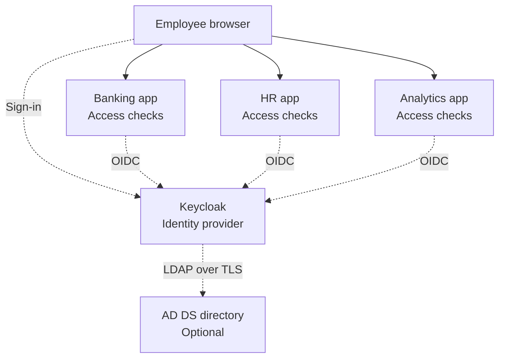

# Identity and Access Management in System Design

## Table of Contents

- [Overview and Core Mental Model](#overview-and-core-mental-model)
- [IAM Knowledge Map](#iam-knowledge-map)
  - [Users, Accounts, Groups, Roles, and Permissions](#users-accounts-groups-roles-and-permissions)
  - [Human and Workload Identities](#human-and-workload-identities)
- [Protocols, Formats, Models, and Products](#protocols-formats-models-and-products)
  - [Common Confusions](#common-confusions)
- [Directories and Identity Providers](#directories-and-identity-providers)
  - [What a Directory Contains](#what-a-directory-contains)
  - [How Keycloak Fits](#how-keycloak-fits)
- [Authentication, SSO, and Federation](#authentication-sso-and-federation)
  - [Illustrative Enterprise Architecture](#illustrative-enterprise-architecture)
  - [OIDC Login Walkthrough](#oidc-login-walkthrough)
  - [Why the Second Application May Not Ask for Login](#why-the-second-application-may-not-ask-for-login)
- [Authorization in Practice](#authorization-in-practice)
  - [RBAC, ABAC, and ACLs Compared](#rbac-abac-and-acls-compared)
  - [Enforcing Access to Real Resources](#enforcing-access-to-real-resources)
- [Sessions, Tokens, and Identity Lifecycle](#sessions-tokens-and-identity-lifecycle)
  - [Different Artifacts, Different Purposes](#different-artifacts-different-purposes)
  - [Validation and Storage](#validation-and-storage)
  - [Joining, Changing Roles, and Leaving](#joining-changing-roles-and-leaving)
- [IAM Architecture and Failure Handling](#iam-architecture-and-failure-handling)
  - [Centralized Identity, Distributed Enforcement](#centralized-identity-distributed-enforcement)
  - [Failures and Operational Responsibilities](#failures-and-operational-responsibilities)
  - [Service Identities and AI Agents](#service-identities-and-ai-agents)
- [Study Map](#study-map)
- [Recall Summary](#recall-summary)
- [Related Notes](#related-notes)
- [References](#references)

## Overview and Core Mental Model

**Identity and Access Management (IAM) is part of system design's security architecture.** It applies to small applications, enterprise networks, distributed services, and AI systems—not only cloud platforms.

System design determines how identity services, applications, and access policies fit together. IAM and security engineering provide the deeper expertise to implement, secure, and operate those components. Studying system design therefore includes understanding LDAP, directories, identity providers, SSO, and authorization models, without requiring every system designer to become a directory administrator.

| Question | IAM concern | Simple example |
| --- | --- | --- |
| **Which person, service, or device is represented?** | Identity | Employee account `employee-42` |
| **How does it prove its identity?** | Authentication (AuthN) | A passkey, or a password plus another authentication factor |
| **What may it do to which resource?** | Authorization (AuthZ) | Read an assigned report, but not another team's payroll |
| **Who grants, reviews, changes, and removes access?** | Lifecycle and governance | Remove finance access after a department transfer |

These are related decisions, not synonyms. A successful login does not imply permission to perform every operation.

> **A directory stores identity information; an IdP authenticates and communicates identity; applications enforce access decisions.**

These are **logical responsibilities**, not mandatory separate machines. A product can combine them: a directory may support authentication, and an IdP may store users or evaluate policies. Applications still need enforcement at the point where protected actions and data are accessed.

## IAM Knowledge Map

| Area | Responsibility | Example |
| --- | --- | --- |
| **Identity management** | Maintain accounts, attributes, memberships, and lifecycle | Create an employee account and update its department |
| **Directory services** | Organize and expose identity records | AD DS or OpenLDAP |
| **Authentication** | Verify control of appropriate authenticators | Passwords, passkeys, MFA, or Kerberos tickets |
| **Authorization** | Decide whether a subject may perform an action on a resource | RBAC, ABAC, or an ACL |
| **Identity provider (IdP)** | Authenticate users and provide trusted identity information to relying applications | Keycloak or Microsoft Entra ID |
| **Single sign-on (SSO)** | Reuse an authentication session across integrated applications | Open HR after signing into another company app |
| **Identity federation** | Accept identity information through an established trust relationship | An application trusts an OIDC provider or SAML IdP |
| **Provisioning** | Create, update, disable, or remove accounts and memberships in target systems | A provisioning service updates an application's accounts through SCIM |
| **Governance** | Approve and review access, enforce separation of duties, and retain evidence | Periodically review who may approve payments |

**Provisioning is not authentication:** creating an account does not log someone in. **SSO is not universal authorization:** access to HR does not automatically grant access to treasury.

### Users, Accounts, Groups, Roles, and Permissions

| Term | Meaning | Example |
| --- | --- | --- |
| **User / subject** | Entity requesting access; not necessarily human | An employee or scheduled job |
| **Account** | A system's representation of an identity | A directory account linked to an application account |
| **Group** | A collection of accounts | `finance-employees` |
| **Role** | A named responsibility associated with permissions | `report-reader` |
| **Permission** | An allowed action on a resource or resource type | Read an assigned financial report |
| **Policy** | Rules for evaluating access | Allow report reading only within the user's tenant |

A person can have different accounts in different systems. A group can be mapped to a role, but **group membership and role assignment are not inherently the same thing**. Mapping is a deliberate policy decision.

### Human and Workload Identities

Humans use interactive login and account recovery. Services, jobs, and devices need nonhuman identities with appropriately scoped credentials or attestations. Neither should routinely borrow an administrator's personal credentials. The owner, permitted actions, credential lifecycle, and audit trail must remain clear.

## Protocols, Formats, Models, and Products

These names describe different layers of IAM; comparing all of them as competing products is misleading.

| Item | Category | What it does |
| --- | --- | --- |
| **LDAP** | Directory-access protocol | Searches and updates directory entries; includes bind operations used in authentication arrangements |
| **Kerberos** | Authentication protocol | Uses tickets to authenticate clients to network services |
| **OAuth 2.0** | Authorization framework | Gives applications limited API access on a user's behalf or their own behalf |
| **OpenID Connect (OIDC)** | Authentication layer built on OAuth 2.0 | Communicates an authentication result and identity claims to an application |
| **SAML 2.0** | Assertion and protocol standard | Exchanges XML-based authentication and attribute information; used in enterprise federation/SSO |
| **SCIM** | Identity-provisioning standard | Standardizes user/group management across systems |
| **JWT** | Claims/token format | Represents claims that can be integrity-protected and/or encrypted |
| **RBAC** | Authorization model | Associates permissions with roles |
| **ABAC** | Authorization model | Evaluates subject, resource, action, and environment attributes against policies |
| **ACL** | Access-control representation | Lists access rights associated with a resource |
| **Active Directory Domain Services (AD DS)** | Directory and domain-services implementation | Manages directory objects and supports enterprise authentication and access control |
| **OpenLDAP** | Directory software | Implements LDAP directory services |
| **Keycloak** | IAM/IdP software | Provides login, SSO, protocol integration, and identity-management capabilities |
| **Microsoft Entra ID** | Cloud identity service | Supplies identity and application-access capabilities; distinct from AD DS |

Protocol references: [LDAP](https://www.rfc-editor.org/rfc/rfc4511.html), [Kerberos](https://www.rfc-editor.org/rfc/rfc4120.html), [OAuth 2.0](https://www.rfc-editor.org/rfc/rfc6749.html), [OIDC](https://openid.net/specs/openid-connect-core-1_0.html), and [OASIS SAML 2.0](https://docs.oasis-open.org/security/saml/v2.0/saml-core-2.0-os.pdf).

### Common Confusions

- **LDAP is not a product:** AD DS and OpenLDAP can expose LDAP interfaces, but have different capabilities.
- **AD DS is not Entra ID:** they can be integrated, but are not interchangeable directory endpoints. See [Microsoft's comparison](https://learn.microsoft.com/en-us/entra/fundamentals/compare).
- **OAuth alone is not a login protocol:** OIDC supplies the standardized end-user authentication layer.
- **JWT is not automatically encrypted:** signing protects integrity/authenticity, not secrecy. Decoding claims is not validation. Access tokens need not be JWTs. See [RFC 7519](https://www.rfc-editor.org/rfc/rfc7519.html).
- **SCIM is not SSO:** it manages identity resources, rather than establishing a browser login session. See [RFC 7644](https://www.rfc-editor.org/rfc/rfc7644.html).

> **Mental model:** IAM is the discipline; protocols connect systems; token formats carry information; authorization models structure decisions; products implement combinations of these capabilities.

## Directories and Identity Providers

### What a Directory Contains

A directory is a specialized data service, not simply a password file. Entries can contain account identifiers, names, department attributes, group memberships, account status, and references to other entries. Some directory systems also manage computer accounts and other network objects.

Entries follow a schema and may be organized hierarchically with **distinguished names (DNs)**. An application or IdP can search relevant attributes using an authorized directory connection. Credential handling depends on the directory and authentication mechanism; applications should not assume passwords are available as readable attributes.

Directory access can use **LDAP over TLS**, including appropriately configured StartTLS or an encrypted LDAP connection. Validate the server's identity and restrict connector privileges; “internal network” is not an encryption or access-control policy. These notes do not prescribe a directory configuration. See the [OpenLDAP introduction](https://www.openldap.org/doc/admin26/intro.html) and [LDAP protocol](https://www.rfc-editor.org/rfc/rfc4511.html).

### How Keycloak Fits

Keycloak can manage local users or integrate with an existing AD DS/OpenLDAP directory. Its **LDAP-backed user federation** connects user storage and authentication to that directory; imports, synchronization, and group/attribute mapping depend on configuration.

Keycloak can also act as an **identity broker**, accepting authentication from an upstream OIDC or SAML provider and presenting its own integration to applications. This is different from reading users through LDAP. An existing directory is optional; not every Keycloak deployment requires Active Directory.

A Keycloak **realm** groups identity-related configuration; an application integration is represented as a **client**. These product concepts do not remove the need to design tenant isolation and application permissions explicitly. See the [Keycloak administration guide](https://www.keycloak.org/docs/latest/server_admin/index.html).

## Authentication, SSO, and Federation

### Illustrative Enterprise Architecture

Suppose employees access banking, HR, and analytics web applications. The organization chooses Keycloak as its IdP, optionally backed by an existing directory. This is a learning example, not a production bank architecture or a requirement to deploy these products.

**Solid arrows** show ordinary application access. **Dotted arrows** show identity-related interactions, not a chronological packet trace. Keycloak does not proxy every application request. Applications are separately registered with the IdP and enforce their own permissions.

### OIDC Login Walkthrough

Choose a **server-side web application** using authorization code flow with **PKCE** (Proof Key for Code Exchange):

1. The browser requests a protected page. The application creates login-transaction state and a PKCE verifier/challenge, then redirects to the IdP.
2. The IdP authenticates the employee, using local users or its configured directory integration and MFA policy.
3. The IdP redirects the browser to the application's registered callback with a short-lived authorization code—not the user's password.
4. The application checks the login transaction and exchanges the code server-to-server, presenting the PKCE verifier and appropriate client authentication.
5. It validates the ID token, including issuer, audience, signature, expiry, and nonce when used. The ID token is the login result, not an API bearer credential.
6. The application establishes its own session and sets a protected session cookie. In this example, tokens are retained server-side rather than exposed to browser scripts.
7. The application checks permissions for each protected operation. If it calls a separate API, it uses an appropriate access token; that API validates it and enforces authorization.

Use established protocol libraries, secure redirect handling, and current guidance rather than implementing cryptography or login protocols from scratch. References: [OIDC authorization code flow](https://openid.net/specs/openid-connect-core-1_0.html#CodeFlowAuth) and [OAuth security best practices](https://www.rfc-editor.org/rfc/rfc9700.html).

### Why the Second Application May Not Ask for Login

When the employee opens HR, HR performs its own login integration. The browser may already have an acceptable **IdP session**, so Keycloak can authenticate the employee to HR without asking for credentials again. HR establishes its own application session and evaluates access.

SSO is **not** the banking application's cookie being shared indiscriminately with HR. Reauthentication, MFA, consent, or access denial can still occur. Federation establishes trust between identity participants; SSO is an experience that trust and session reuse can enable. Neither implies that all applications grant the same permissions.

## Authorization in Practice

### RBAC, ABAC, and ACLs Compared

| Approach | Decision structure | Employee example | Trade-off |
| --- | --- | --- | --- |
| **RBAC** | Users receive roles; roles carry permissions | `report-reader` may read financial reports | Simple for stable responsibilities; overly specific roles can proliferate |
| **ABAC** | Evaluate attributes of subject, resource, action, and environment | Allow reading when employee department and report department match | More contextual, but attribute quality and policy evaluation become critical |
| **ACL** | A resource records permitted subjects/groups and actions | Report R lists Team A as readers | Direct resource-level control, but many lists can become difficult to administer |

These can be combined. A role might allow a report-reading operation while attributes or an ACL restrict **which reports**. See [NIST's RBAC material](https://csrc.nist.gov/projects/role-based-access-control) and [ABAC guidance](https://csrc.nist.gov/pubs/sp/800/162/upd2/final).

### Enforcing Access to Real Resources

An employee with role `analyst` requests customer record C. The service must still verify that the employee is allowed to access **C in the correct tenant and context**. A valid token and a matching broad role do not prove record ownership or a permitted business purpose.

An organization may map directory group `finance-employees` to application role `report-reader`. Define who owns that mapping and how changes propagate. Do not blindly trust group or tenant names supplied in request parameters.

Apply **least privilege**, deny access when the required policy does not grant it, and evaluate relevant permissions on every protected operation. A gateway can validate credentials or coarse scopes, while services enforce resource-level rules. Central policy evaluation is possible; the service remains an enforcement point. See [OWASP authorization guidance](https://cheatsheetseries.owasp.org/cheatsheets/Authorization_Cheat_Sheet.html) and the [gateway capability table](Distributed-Systems-Building-Blocks.md#features-and-capabilities).

## Sessions, Tokens, and Identity Lifecycle

### Different Artifacts, Different Purposes

| Artifact | Used by | Purpose and boundary |
| --- | --- | --- |
| **IdP session** | Browser and identity provider | Supports login-session reuse at the IdP; not a blanket permission for all applications |
| **Application session cookie** | Browser and that application | Represents the application's session; can reference server-side state |
| **ID token** | OIDC client application | Communicates an authentication result for that client; not a substitute for an API access token |
| **Access token** | Client presents it to the intended resource server/API | Grants limited access under applicable policies; may be opaque or structured |
| **Refresh token** | Authorized client presents it to the authorization server | Requests new access tokens; not sent to the protected API as its access credential |

Token roles follow [OIDC](https://openid.net/specs/openid-connect-core-1_0.html) and the [OAuth framework](https://www.rfc-editor.org/rfc/rfc6749.html). Bearer credentials generally allow whoever possesses them to act within their authority, so treat them as secrets.

### Validation and Storage

For a signed JWT, verify the signature using an appropriately trusted key, restrict allowed algorithms, and check expected issuer, audience, validity times, and token purpose. Validate its claims and apply authorization; **decoding base64 data is not validation**. For opaque tokens, use the issuer's supported validation mechanism, such as introspection. See [JWT security best practices](https://www.rfc-editor.org/rfc/rfc8725.html).

In the server-side example, protect server-held tokens and configure session cookies with appropriate `Secure`, `HttpOnly`, and `SameSite` attributes. Session management also needs CSRF defenses, session-ID rotation where appropriate, idle/absolute expiry, and secure recovery. Cookie attributes alone do not solve every session attack. Avoid logging tokens or credentials. See [OWASP session-management guidance](https://cheatsheetseries.owasp.org/cheatsheets/Session_Management_Cheat_Sheet.html).

### Joining, Changing Roles, and Leaving

| Lifecycle event | Required coordination |
| --- | --- |
| **Join** | Establish identity, approve needed access, provision accounts, and enroll authenticators |
| **Move** | Remove obsolete access as well as granting approved new responsibilities |
| **Leave** | Disable access, handle sessions/tokens and nonhuman credentials, and preserve required audit records |
| **Review** | Check continued business need, excessive privileges, orphaned accounts, and separation of duties |

**SCIM** can standardize account/group provisioning between supported systems; it does not itself perform access approval, periodic reviews, or every governance task. Manual and other automated mechanisms also exist. Do not assume a particular IdP includes every provisioning connector. [SCIM protocol](https://www.rfc-editor.org/rfc/rfc7644.html)

**Logout, disabling an account, and invalidating tokens are different operations.** Ending one application's session may not end the IdP session or other applications' sessions. A previously issued access token may remain acceptable until expiry unless the design provides additional invalidation or online checks. Embedded role claims can also become stale.

Define the required removal delay and choose compatible session expiry, token lifetimes, refresh handling, revocation/introspection, or other policy mechanisms. Do not promise instantaneous global sign-out merely because SSO is enabled.

## IAM Architecture and Failure Handling

### Centralized Identity, Distributed Enforcement

Central identity can simplify integrations and credential governance. Applications can validate signed tokens locally, evaluate policies internally, or consult shared policy services. **Centralized policy administration does not require an online IdP call for every request.** Conversely, some designs intentionally require online checks for freshness or risk control.

System design must balance availability, response time, revocation freshness, and operational complexity. A single application may need far less infrastructure than an enterprise, while still needing sound authentication, authorization, and recovery.

### Failures and Operational Responsibilities

| Situation | Expected design response |
| --- | --- |
| **IdP unavailable** | New logins or refreshes may fail; some existing sessions or locally validated tokens can continue within established policy limits |
| **Directory unavailable** | Directory-backed authentication or synchronization may fail; cached data must not silently override required security checks |
| **Token or required validation unavailable** | Reject or defer the protected operation; do not grant access because a dependency is down |
| **Signing-key rotation** | Publish trusted verification keys and plan overlap for valid tokens; unknown keys require safe handling, not skipped verification |
| **Permission change** | Account for cached policy decisions, directory synchronization, and old token claims |
| **Recovery or administration failure** | Protect recovery channels and administrative access; any emergency-access procedure needs explicit authorization and auditing |

Operate the IdP, its state stores, and directory dependencies with suitable redundancy, backups, monitoring, time synchronization, and tested recovery. Separate routine signing-key rotation from emergency response to a compromised key.

Audit sign-ins, denied access, role changes, provisioning, and administrative actions. Correlate events while minimizing sensitive data, restricting log access, and defining retention. Reliability means meeting a defined security policy during failures—not bypassing it.

### Service Identities and AI Agents

Assign services and jobs their own identities and narrow permissions. Use suitable short-lived workload credentials or certificates where supported, protect bootstrap credentials, and plan rotation/revocation. A service acting for a user may need both **its own identity** and the user's delegated authority; one does not automatically imply the other.

An AI agent's proposed action is not authorization. The application must enforce the requesting user's permissions and the tool's permitted operations outside the model. Avoid giving an agent a broad shared administrator identity just because it can generate tool calls. See [AI security controls](AI-Systems-Design.md#threats-and-controls).

For encrypted transport and service certificates, see [TLS Termination](Distributed-Systems-Building-Blocks.md#tls-termination) and [Certificate Authorities](Distributed-Systems-Building-Blocks.md#certificate-authorities-the-digital-notary). Certificate trust authenticates an endpoint within its trust model; it does not define every business permission.

## Study Map

| Order | Study focus | Question to answer before moving on |
| --- | --- | --- |
| **1** | AuthN and AuthZ | Why can a valid login still be denied an operation? |
| **2** | Directories and IdPs | Which component stores records, and which authenticates users for apps? |
| **3** | SSO and federation | How does a second app trust an existing authentication without receiving the password? |
| **4** | RBAC, ABAC, and ACLs | How are permitted actions constrained to the right resources? |
| **5** | Tokens, sessions, and lifecycle | What expires, what can be revoked, and how does access removal propagate? |
| **6** | Reliability and security | What happens during IdP failure, stale permissions, or key rotation? |

Topics can be revisited in parallel. Product configuration is easier to understand after the responsibility and trust boundaries are clear.

## Recall Summary

- **IAM is an architectural discipline**, not a single product or protocol.
- **LDAP accesses directories; AD DS/OpenLDAP implement directory services.**
- **OIDC/SAML connect identity participants; SSO reuses authentication, not permissions.**
- **Roles, attributes, and ACLs structure authorization; services enforce the resulting decisions.**
- **JWT is a format; ID tokens, access tokens, refresh tokens, and session cookies have different jobs.**
- **Provisioning and governance manage who should retain access; expiration and invalidation determine when changes take effect.**
- **Applications, devices, and agents need scoped identities and safe failure behavior.**

> **Know who is asking, verify the identity appropriately, check the exact action and resource, and manage how access changes over time.**

## Related Notes

- [System design and related engineering disciplines](Understanding-System-Design.md#system-design-and-related-engineering-disciplines)
- [Application gateway capabilities and AuthN/AuthZ](Distributed-Systems-Building-Blocks.md#features-and-capabilities)
- [TLS, certificate authorities, and connection verification](Distributed-Systems-Building-Blocks.md#certificate-issuance-vs-connection-verification)
- [AI security, privacy, and data residency](AI-Systems-Design.md#security-privacy-and-data-residency)

## References

- [Keycloak: Server Administration Guide](https://www.keycloak.org/docs/latest/server_admin/index.html)
- [Microsoft: Active Directory and Microsoft Entra ID Compared](https://learn.microsoft.com/en-us/entra/fundamentals/compare)
- [OpenLDAP: Introduction to Directory Services](https://www.openldap.org/doc/admin26/intro.html)
- [OpenID Foundation: OpenID Connect Core 1.0](https://openid.net/specs/openid-connect-core-1_0.html)
- [IETF RFC 4511: LDAP](https://www.rfc-editor.org/rfc/rfc4511.html)
- [IETF RFC 4120: Kerberos V5](https://www.rfc-editor.org/rfc/rfc4120.html)
- [IETF RFC 6749: OAuth 2.0 Authorization Framework](https://www.rfc-editor.org/rfc/rfc6749.html)
- [IETF RFC 9700: OAuth 2.0 Security Best Practices](https://www.rfc-editor.org/rfc/rfc9700.html)
- [IETF RFC 7519: JSON Web Token](https://www.rfc-editor.org/rfc/rfc7519.html)
- [IETF RFC 8725: JWT Best Practices](https://www.rfc-editor.org/rfc/rfc8725.html)
- [IETF RFC 7644: SCIM Protocol](https://www.rfc-editor.org/rfc/rfc7644.html)
- [OASIS: SAML 2.0 Assertions and Protocols](https://docs.oasis-open.org/security/saml/v2.0/saml-core-2.0-os.pdf)
- [NIST: Role-Based Access Control](https://csrc.nist.gov/projects/role-based-access-control)
- [NIST SP 800-162: Attribute-Based Access Control](https://csrc.nist.gov/pubs/sp/800/162/upd2/final)
- [OWASP: Authorization Cheat Sheet](https://cheatsheetseries.owasp.org/cheatsheets/Authorization_Cheat_Sheet.html)
- [OWASP: Session Management Cheat Sheet](https://cheatsheetseries.owasp.org/cheatsheets/Session_Management_Cheat_Sheet.html)
