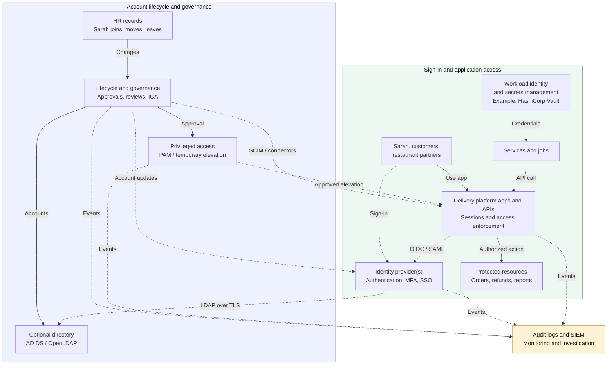

# Identity and Access Management in System Design

## Table of Contents

- [Overview and Core Mental Model](#overview-and-core-mental-model)
- [The Whole IAM Picture](#the-whole-iam-picture)
  - [How to Read the Architecture](#how-to-read-the-architecture)
  - [Navigate by Component](#navigate-by-component)
- [Identity, Directories, and Provisioning](#identity-directories-and-provisioning)
  - [Users, Accounts, Groups, Roles, and Permissions](#users-accounts-groups-roles-and-permissions)
  - [Directories and Identity Providers](#directories-and-identity-providers)
    - [What a Directory Contains](#what-a-directory-contains)
    - [How Keycloak Fits](#how-keycloak-fits)
  - [Provisioning and SCIM](#provisioning-and-scim)
- [Authentication, SSO, and Federation](#authentication-sso-and-federation)
  - [Passwords and Multi-Factor Authentication](#passwords-and-multi-factor-authentication)
  - [Passkeys and Account Recovery](#passkeys-and-account-recovery)
  - [SSO and Federation](#sso-and-federation)
  - [OIDC Login Walkthrough](#oidc-login-walkthrough)
  - [Why the Second Application May Not Ask for Login](#why-the-second-application-may-not-ask-for-login)
  - [OAuth Delegation: A Restaurant Connects an Accounting App](#oauth-delegation-a-restaurant-connects-an-accounting-app)
- [Authorization in Practice](#authorization-in-practice)
  - [RBAC, ABAC, and ACLs Compared](#rbac-abac-and-acls-compared)
  - [Enforcing Access to Real Resources](#enforcing-access-to-real-resources)
- [Sessions and Tokens](#sessions-and-tokens)
  - [Different Artifacts, Different Purposes](#different-artifacts-different-purposes)
  - [Validation and Storage](#validation-and-storage)
- [Access Changes, Privileges, and Governance](#access-changes-privileges-and-governance)
  - [Joining, Changing Roles, and Leaving](#joining-changing-roles-and-leaving)
  - [Temporary Access and Privileged Access Management](#temporary-access-and-privileged-access-management)
  - [Segregation of Duties, Reviews, and Orphan Accounts](#segregation-of-duties-reviews-and-orphan-accounts)
  - [Verified Offboarding](#verified-offboarding)
- [Accounting, Monitoring, and Risk](#accounting-monitoring-and-risk)
  - [Audit Events and SIEM](#audit-events-and-siem)
  - [Adaptive Authentication and Zero Trust](#adaptive-authentication-and-zero-trust)
- [Customers, Partners, and Workload Identities](#customers-partners-and-workload-identities)
  - [Customer and Partner Access](#customer-and-partner-access)
  - [Human and Workload Identities](#human-and-workload-identities)
    - [Example: Vault Supplies Database Credentials](#example-vault-supplies-database-credentials)
  - [Service Identities and AI Agents](#service-identities-and-ai-agents)
    - [Consul and Service-to-Service Identity](#consul-and-service-to-service-identity)
- [IAM Architecture and Failure Handling](#iam-architecture-and-failure-handling)
  - [Centralized Identity, Distributed Enforcement](#centralized-identity-distributed-enforcement)
  - [Failures and Operational Responsibilities](#failures-and-operational-responsibilities)
  - [Emergency Access](#emergency-access)
- [IAM Knowledge Map and Acronym Reference](#iam-knowledge-map-and-acronym-reference)
  - [IAM Knowledge Map](#iam-knowledge-map)
  - [Protocols, Formats, Models, and Products](#protocols-formats-models-and-products)
  - [Common Confusions](#common-confusions)
- [Study Map](#study-map)
- [Recall Summary](#recall-summary)
- [Related Notes](#related-notes)
- [References](#references)

## Overview and Core Mental Model

**Identity and Access Management (IAM) is part of system design's security architecture.** It applies to small applications, enterprise networks, distributed services, and artificial intelligence (AI) systems.

System design determines how identity services, applications, and access policies fit together. IAM and security engineering provide the deeper expertise to implement, secure, and operate those components. These responsibilities can share products or machines.

**Follow one example:** Sarah joins a food-delivery company as a customer-support employee. She needs to read assigned orders and issue limited refunds. Later, she moves to the restaurant-payments team, requests temporary access, and eventually leaves. The same platform also serves customers, restaurant partners, and software services.

| Question | IAM concern | Sarah's example |
| --- | --- | --- |
| **Which person, service, or device is represented?** | Identity | Sarah's employee identity links her accounts across systems. |
| **How does it prove its identity?** | Authentication (AuthN) | Sarah signs in using an approved authenticator. |
| **What may it do to which resource?** | Authorization (AuthZ) | Sarah may refund an eligible assigned order within her limit. |
| **What happened, and who performed the action?** | Accounting / auditing | Record the refund decision and its actor. |
| **Who grants, reviews, changes, and removes access?** | Lifecycle and governance | Remove Sarah's support permissions when she moves to payments. |

Authentication, authorization, and accounting are often called **AAA**. Accounting here means recording activity and its attribution, not financial bookkeeping. Lifecycle and governance keep the answers aligned with changing responsibilities.

> **A directory stores identity information; an identity provider (IdP) authenticates and communicates identity; applications enforce access decisions.**

A successful login does not grant every permission. A product can combine these logical responsibilities, but protected actions still need enforcement.

## The Whole IAM Picture

Start with this map, then follow Sarah's journey through the sections below. It shows how the responsibilities connect; a small application may need far fewer components.

### How to Read the Architecture

This is a **component and relationship map, not a chronological message trace**. Arrows identify interactions and dependencies; login redirects are explained in the later walkthrough.

- **Lifecycle:** Human resources (HR) supplies employee changes. Governance processes approve access and update relevant systems. Customer registration and partner sponsorship have different sources.
- **Sign-in:** The IdP supports authentication and single sign-on (SSO). It does not proxy every application request.
- **Application access:** Application programming interfaces (APIs) and portals enforce permissions for the requested resource. The diagram groups several applications, not one mandatory program.
- **Provisioning versus federation:** System for Cross-domain Identity Management (SCIM) changes supported applications' accounts. OpenID Connect (OIDC) and Security Assertion Markup Language (SAML) support federated sign-in. These are separate integrations.
- **Optional directory:** Active Directory Domain Services (AD DS) and OpenLDAP are directory implementations. Lightweight Directory Access Protocol (LDAP) accesses directories; Transport Layer Security (TLS) protects that connection when appropriately configured.
- **Privileges and evidence:** Identity Governance and Administration (IGA) covers access decisions and reviews. Privileged Access Management (PAM) handles privileged access. Security Information and Event Management (SIEM) correlates security events.

Multi-factor authentication (MFA) strengthens sign-in. Workload identities represent software; secrets management protects credentials. Each appears in the journey below.

The optional directory can be replaced by an IdP's local user store. Employee, customer, and partner populations may use different providers, policies, and account lifecycles. The company does not need a separate commercial product for every box, and Keycloak does not automatically provide every illustrated function.

### Navigate by Component

| Component | Question answered | Continue with |
| --- | --- | --- |
| HR and lifecycle provisioning | How does Sarah receive the right accounts? | [Identity, directories, and provisioning](#identity-directories-and-provisioning) |
| Directory and IdP | Where are identity records, and who authenticates Sarah? | [Directories and identity providers](#directories-and-identity-providers) |
| Sign-in and federation | How does the support portal trust Sarah's login? | [Authentication, SSO, and federation](#authentication-sso-and-federation) |
| Apps, APIs, and protected data | May Sarah refund this particular order? | [Authorization in practice](#authorization-in-practice) |
| Sessions and credentials | What lets Sarah continue working after login? | [Sessions and tokens](#sessions-and-tokens) |
| Governance and privileged access | Who approves, reviews, and removes extra access? | [Access changes, privileges, and governance](#access-changes-privileges-and-governance) |
| Audit logs and SIEM | What happened, and what deserves investigation? | [Accounting, monitoring, and risk](#accounting-monitoring-and-risk) |
| Customers, partners, services, and jobs | How do other identities differ from employees? | [Customers, partners, and workload identities](#customers-partners-and-workload-identities) |
| Secrets management / Vault | How does a service obtain permitted database credentials? | [Vault example](#example-vault-supplies-database-credentials) |
| Operational dependencies | What happens when identity infrastructure fails? | [IAM architecture and failure handling](#iam-architecture-and-failure-handling) |

## Identity, Directories, and Provisioning

**Sarah joins customer support.** HR records her employment, manager, and department. A lifecycle process uses approved information to establish her identity, create required accounts, and assign standard access.

HR is a common authoritative source for employee information; it is not necessarily the source for every identity or every permission. Application owners still determine appropriate access.

### Users, Accounts, Groups, Roles, and Permissions

| Term | Meaning | Example |
| --- | --- | --- |
| **Identity / subject** | Person, service, or device represented in access decisions | Sarah, or a reporting job |
| **Account** | A system's representation of an identity | Sarah has a directory account and a linked support-app account. |
| **Group** | A collection of accounts | `support-employees` |
| **Role** | A named responsibility associated with permissions | `support-agent` |
| **Permission** | An allowed action on a resource or resource type | Read an assigned order; request an eligible refund. |
| **Policy** | Rules used to evaluate access | Permit a refund only for an assigned order within the employee's limit. |

Sarah can have accounts in several systems. Link them using appropriate stable identifiers; a display name alone is not a reliable account association.

A directory group can map to an application role. **Group membership and role assignment are not inherently the same thing**: the organization deliberately defines, owns, and maintains that mapping.

### Directories and Identity Providers

The **directory** maintains identity records. The **IdP** authenticates users and communicates identity to integrated applications. A directory can participate in authentication, and an IdP can maintain its own users, so these are responsibilities rather than rigid product boundaries.

#### What a Directory Contains

A directory is a specialized data service, not simply a password file. Records can include account identifiers, names, departments, groups, account status, and references to other entries. Some systems also manage computer accounts and network objects.

Entries follow a schema and may be organized hierarchically using **distinguished names (DNs)**. An authorized application or IdP can search relevant attributes. Credential handling depends on the directory and mechanism; applications should not assume passwords are readable attributes.

LDAP includes search, update, and bind operations. **AD DS is a directory/domain-services implementation**, not another name for LDAP. AD DS also supports mechanisms such as Kerberos, a ticket-based authentication protocol. Microsoft Entra ID is a distinct cloud identity service, although it can be integrated with AD DS. See [LDAP](https://www.rfc-editor.org/rfc/rfc4511.html), [Kerberos](https://www.rfc-editor.org/rfc/rfc4120.html), and [Microsoft's comparison](https://learn.microsoft.com/en-us/entra/fundamentals/compare).

Directory access can use **LDAP over TLS**, through StartTLS or an encrypted LDAP connection. Validate server identity and restrict connector privileges; “internal network” is not an encryption or authorization policy. See the [OpenLDAP introduction](https://www.openldap.org/doc/admin26/intro.html).

#### How Keycloak Fits

For this example, **Keycloak is the workforce IdP**. It can store local users or integrate with an existing AD DS/OpenLDAP directory. Its **LDAP-backed user federation** connects user storage and authentication to that directory; import, synchronization, and attribute/group mapping depend on configuration.

Keycloak can also be an **identity broker**, accepting authentication from an upstream OIDC or SAML provider. This federation between identity systems differs from reading directory records over LDAP. An existing directory is optional.

A Keycloak **realm** groups identity-related configuration, and a **client** represents an application integration. These concepts do not automatically establish tenant isolation or correct business permissions. See the [Keycloak administration guide](https://www.keycloak.org/docs/latest/server_admin/index.html).

### Provisioning and SCIM

**Provisioning** creates, updates, disables, or removes accounts and memberships in target systems. Sarah's approved support role may trigger standard access, sometimes called **birthright access**. That access still needs explicit policy ownership.

| Step | Sarah's example |
| --- | --- |
| Establish identity | Associate Sarah's approved employee record with her identity-system account. |
| Provision target accounts | Create or link her support-portal and other required accounts. |
| Assign approved access | Map the support group to the appropriate application role. |
| Enroll authenticators | Establish her approved sign-in methods. |
| Verify completion | Check that target systems applied the intended changes. |

SCIM standardizes user/group provisioning in compatible systems. It does not perform login, approve business access, or provide every governance function. Some applications need other connectors or manual actions. A failed update must be detected and reconciled; do not assume every IdP includes every provisioning connector. [SCIM protocol](https://www.rfc-editor.org/rfc/rfc7644.html)

> **Creating Sarah's account prepares access. Authentication proves control of her sign-in credentials; authorization governs what she may do.**

## Authentication, SSO, and Federation

**Sarah opens the support portal.** The portal needs a trusted authentication result before establishing her application session.

### Passwords and Multi-Factor Authentication

Authentication verifies control of authenticators associated with the claimed identity.

| Factor type | Meaning | Example |
| --- | --- | --- |
| **Something you know** | A secret the user knows | Password or personal identification number (PIN) |
| **Something you have** | Control of an authenticator | Security key or authenticator device |
| **Something you are** | A biometric characteristic, used with an appropriate authenticator | Fingerprint verification on a device |

**MFA uses at least two different factor types.** Two passwords are still one type. Two steps are not necessarily two factors; a multi-factor authenticator may combine possession with local PIN or biometric verification.

Passwords can be reused, guessed, or captured by phishing. Second-factor mechanisms also differ: manually entered codes and approval prompts do not all provide phishing resistance, and repeated prompts can encourage mistaken approval. Choose authentication methods and recovery appropriate to the required assurance. [NIST authentication guidance](https://pages.nist.gov/800-63-4/sp800-63b.html)

### Passkeys and Account Recovery

A **passkey** is a public-key credential used through mechanisms such as Web Authentication (WebAuthn). The service keeps the public key; an authenticator or supported credential manager protects the private key. Some credentials remain device-bound, while others can be synchronized through a protected provider.

When Sarah signs in, her authenticator signs a challenge. The private key is not sent to the website during authentication. Credentials are scoped to the relying service, and the service validates the origin and authentication response. This provides **phishing resistance**, unlike simply entering a reusable password into a page. It does not protect against every device compromise, stolen session, or weak recovery process. [W3C WebAuthn](https://www.w3.org/TR/webauthn-3/)

**Recovery is another path into the account.** If Sarah loses her authenticator, a weak help-desk reset could undermine strong normal sign-in. Establish suitable identity checks, protect replacement enrollment, and record recovery events. A familiar name or knowledge of an employee's email address is insufficient by itself. [NIST authentication guidance](https://pages.nist.gov/800-63-4/sp800-63b.html)

### SSO and Federation

**SSO** allows integrated applications to reuse an acceptable authentication session. **Federation** establishes how an application trusts identity information from another participant. SSO is an experience federation and session reuse can enable, not a shared permission for all applications.

Two common standards are:

- **OIDC:** An authentication layer built on the OAuth 2.0 authorization framework. It standardizes an authentication result and identity claims for an application.
- **SAML 2.0:** A standard using assertions and protocols, commonly with signed authentication assertions in enterprise federation. Its assertions use Extensible Markup Language (XML).

The support portal is registered with the IdP and validates the authentication result according to the selected protocol. It does not simply trust an email address from a browser parameter. See [OIDC Core](https://openid.net/specs/openid-connect-core-1_0.html) and [OASIS SAML 2.0](https://docs.oasis-open.org/security/saml/v2.0/saml-core-2.0-os.pdf).

### OIDC Login Walkthrough

Choose a **server-side web application** using authorization code flow with **Proof Key for Code Exchange (PKCE)**:

1. Sarah requests a protected page. The application creates login-transaction state and a PKCE verifier/challenge, then redirects her browser to Keycloak.
2. Keycloak authenticates Sarah using its local users or configured directory integration, applying the required authentication policy.
3. The IdP redirects her browser to the application's registered callback with a short-lived authorization code—not Sarah's password.
4. The application checks the login transaction and exchanges the code server-to-server, presenting the PKCE verifier and appropriate client authentication.
5. It validates the **identity (ID) token**, including issuer, audience, signature, expiry, and nonce when used. The ID token communicates the authentication result; it is not an API bearer credential.
6. The application establishes its own session and sets a protected session cookie. Tokens remain server-side in this example.
7. The application checks permissions for protected operations. If it calls a separate API, it uses an appropriate access token; that API validates the credential and enforces authorization.

Sarah's password need not pass through each integrated application. Use established libraries and current guidance instead of implementing login protocols or cryptography from scratch. References: [OIDC authorization code flow](https://openid.net/specs/openid-connect-core-1_0.html#CodeFlowAuth) and [OAuth security best practices](https://www.rfc-editor.org/rfc/rfc9700.html).

### Why the Second Application May Not Ask for Login

Sarah also has approved access to a reporting portal. When she opens it, that application starts its own login integration. Her browser may already have an acceptable **IdP session**, allowing Keycloak to authenticate her without asking for credentials again. The reporting portal then establishes its own session and checks its own permissions.

The support portal's cookie is not shared indiscriminately with the reporting portal. Reauthentication, MFA, consent, or access denial can still occur. In particular, SSO would not grant Sarah payment-administration access while she still works in support.

### OAuth Delegation: A Restaurant Connects an Accounting App

A restaurant owner wants a separate accounting application to read **that restaurant's sales**:

1. The accounting application requests limited access through the platform's authorization service.
2. The owner authenticates and authorizes the requested access through the supported flow.
3. The accounting application receives an **access token**, rather than the owner's password.
4. It presents that token when requesting sales data.
5. The API validates the token and checks scopes, restaurant ownership, and applicable resource policies.

**OAuth 2.0 handles limited access; OIDC adds standardized end-user authentication.** OAuth also supports applications acting on their own behalf. Consent to a broad scope does not bypass restaurant-level authorization.

An access token may be a **JSON Web Token (JWT)** or an opaque value. JWT is a format for claims that can be signed and/or encrypted, not a login protocol. Decoding it does not validate it. See the [OAuth framework](https://www.rfc-editor.org/rfc/rfc6749.html) and [JWT specification](https://www.rfc-editor.org/rfc/rfc7519.html).

## Authorization in Practice

**Sarah is authenticated; may she refund order O-104?** The system must consider the specific action, order, context, and current permissions.

For this learning example, a support agent may request a refund of **up to $50** only for an eligible order within their assignment. Sarah's role does not authorize access to every customer's data or to payment administration. The amount is an illustrative application rule, not an IAM standard.

### RBAC, ABAC, and ACLs Compared

| Approach | Decision structure | Sarah's example | Trade-off |
| --- | --- | --- | --- |
| **Role-Based Access Control (RBAC)** | Users receive roles; roles carry permissions | `support-agent` permits reading orders and requesting limited refunds. | Straightforward for stable duties; overly specific roles can proliferate. |
| **Attribute-Based Access Control (ABAC)** | Evaluate subject, resource, action, and environment attributes | Check Sarah's assigned region, the order's region, and relevant device policy. | Contextual, but depends on reliable attributes and clear evaluation. |
| **Access Control List (ACL)** | A resource lists permitted subjects/groups and actions | Investigation C lists Sarah's support group as readers. | Direct resource control; many lists can become difficult to maintain. |

These approaches can combine: a role allows a type of action, while attributes or an ACL restrict the affected resources. See [NIST RBAC material](https://csrc.nist.gov/projects/role-based-access-control) and [ABAC guidance](https://csrc.nist.gov/pubs/sp/800/162/upd2/final).

### Enforcing Access to Real Resources

The service handling Sarah's refund must validate her authority and the order's eligibility, amount, assignment, and tenant or restaurant boundary where applicable. A valid token and a broad role alone are insufficient. Do not trust an order identifier, group name, or tenant supplied in request parameters without validating the relationship.

The organization may map directory group `support-employees` to application role `support-agent`. Define the mapping's owner and propagation behavior, and remove it when no longer appropriate.

Apply **least privilege**: give Sarah the access required for her duties, deny operations without a valid grant, and enforce relevant permissions on each protected operation. A gateway can validate credentials or coarse scopes; services still enforce resource-level and business rules. Central policy evaluation is possible, with enforcement at the protected action. See [OWASP authorization guidance](https://cheatsheetseries.owasp.org/cheatsheets/Authorization_Cheat_Sheet.html) and [gateway capabilities](Distributed-Systems-Building-Blocks.md#features-and-capabilities).

> **Login answers “who authenticated?” Authorization answers “may this identity do this action to this resource now?”**

## Sessions and Tokens

**Sarah continues working after login.** Several different artifacts support that experience; none should be treated as interchangeable.

### Different Artifacts, Different Purposes

| Artifact | Used by | Purpose and boundary |
| --- | --- | --- |
| **IdP session** | Browser and identity provider | Supports authentication-session reuse at the IdP, subject to its policies. |
| **Application session cookie** | Browser and that application | Represents the application's session; can reference server-side state. |
| **ID token** | OIDC client application | Communicates an authentication result for that client; not an API access credential. |
| **Access token** | Client presents it to the intended API/resource server | Supports limited access under applicable policies; can be opaque or structured. |
| **Refresh token** | Authorized client presents it to the authorization server | Requests new access tokens; it is not sent to a protected API as an access token. |

Tokens follow [OIDC](https://openid.net/specs/openid-connect-core-1_0.html) and the [OAuth framework](https://www.rfc-editor.org/rfc/rfc6749.html). Possession of a bearer credential generally lets its holder act within its authority, so protect it as a secret. Credentials alone do not replace the API's business checks.

### Validation and Storage

For a signed JWT, verify its signature using appropriately trusted keys, restrict algorithms, and check issuer, audience, validity times, and token purpose. Validate relevant claims and apply authorization. **Base64 decoding is not validation**, and signing does not conceal the claims. For opaque access tokens, use the issuer's supported validation mechanism, such as introspection. See [JWT security best practices](https://www.rfc-editor.org/rfc/rfc8725.html).

In this server-side example, protect server-held tokens and use appropriate `Secure`, `HttpOnly`, and `SameSite` cookie attributes. Also address **Cross-Site Request Forgery (CSRF)**, appropriate session-identifier rotation, idle/absolute expiry, and secure recovery. Cookie attributes alone do not solve every session attack. Never record credentials or raw tokens in ordinary logs. See [OWASP session-management guidance](https://cheatsheetseries.owasp.org/cheatsheets/Session_Management_Cheat_Sheet.html).

**Logout, account disabling, and token invalidation are different operations.** An application logout may leave the IdP and other application sessions active. An issued access token may remain acceptable until expiry unless the architecture supplies additional invalidation or online checks. Its embedded role claims can become stale.

## Access Changes, Privileges, and Governance

**Sarah moves from support to restaurant payments.** Access management now needs to remove her obsolete duties while granting her approved new ones.

### Joining, Changing Roles, and Leaving

| Event | Sarah's story | Required coordination |
| --- | --- | --- |
| **Join** | Starts in support. | Approve access, provision/link accounts, enroll authenticators, verify completion. |
| **Move** | Transfers to payments. | Remove support access and grant approved payments duties; verify changes across systems. |
| **Temporary assignment** | Investigates an older refund. | Approve narrowly scoped, time-limited access and remove it afterward. |
| **Leave** | Employment ends. | Disable relevant access, handle sessions/tokens, and verify application accounts. |
| **Review** | Responsibilities or projects change. | Reassess whether each permission and account remains appropriate. |

**Privilege creep** occurs when new permissions accumulate while old ones remain. Adding Sarah's payments role without removing obsolete support access is a concrete example.

### Temporary Access and Privileged Access Management

Sarah needs to investigate an old refund outside her normal payment-team permissions. She requests access with a reason; the relevant owner approves a narrow grant for, say, **two hours**. The implementation must enforce its expiry and account for caches or already-issued credentials.

This is **Just-in-Time (JIT) access**: grant access when required for a limited period. It need not be administrator access.

| Concern | Main responsibility | Example |
| --- | --- | --- |
| **Temporary business access** | Permit an exceptional task within an approved scope and duration. | Sarah reads one historical refund investigation. |
| **PAM** | Protect and control powerful administrative access. | Time-limited administrator activation, privileged-credential controls, or recorded sessions where supported. |
| **IGA** | Govern entitlement decisions, approvals, reviews, and lifecycle evidence. | An owner reviews who should retain payment-approval privileges. |

PAM products and implementations differ. Microsoft's Privileged Identity Management (PIM) illustrates time- and approval-based role activation; it is not a universal specification for every PAM system. See [Microsoft's PIM overview](https://learn.microsoft.com/en-us/entra/id-governance/privileged-identity-management/pim-configure).

### Segregation of Duties, Reviews, and Orphan Accounts

**Segregation of Duties (SoD)** separates conflicting responsibilities. For example, unrestricted permission to create a restaurant record plus permission to approve its payments could allow one person to complete a fraudulent process. Policy can prohibit that combination or require independent approval.

**Access reviews** ask managers and application owners whether permissions remain justified. Review frequency and evidence should reflect the risk; approving every entitlement automatically defeats the purpose.

An **orphan account** lacks a valid owner or lifecycle association. Reconcile application accounts with appropriate identity and ownership records, investigate discrepancies, and remediate them. **No HR match does not automatically mean “delete”:** legitimate contractors, partner accounts, and service identities may use different sources.

IGA encompasses access requests, approvals, reviews, lifecycle policies, and evidence. An IdP handles sign-in; governance establishes and reviews who should retain access. See [Microsoft's identity-governance overview](https://learn.microsoft.com/en-us/entra/id-governance/identity-governance-overview).

### Verified Offboarding

**Sarah leaves the company.** Disabling only her email mailbox is insufficient: the support portal might still have an independently usable local account.

1. Record the departure and identify the relevant identity, account, permission, and ownership relationships.
2. Disable new sign-ins through her central identity and prevent unauthorized credential recovery or re-enrollment.
3. Disable or remove relevant application accounts and entitlements through supported integrations or controlled manual actions. Include separate local accounts and poorly integrated systems.
4. Terminate application/IdP sessions and revoke or restrict refresh/access credentials where supported. Account for tokens that remain valid until expiry or another enforcement check.
5. Transfer ownership of necessary service accounts and resources; replace credentials she could still use where required. Do not indiscriminately delete unrelated services.
6. Verify that target systems applied the changes, investigate failed provisioning jobs, and retain appropriate audit evidence.

Define the required access-removal delay and choose compatible session/token lifetimes, synchronization, revocation, introspection, or other checks. **SSO does not promise instantaneous global sign-out.**

In the corrected ending, a later attempt to use Sarah's old local support account fails because that account was disabled and the change was verified.

> **Offboarding is complete when the required access changes have taken effect in the relevant systems—not merely when a central update was submitted.**

## Accounting, Monitoring, and Risk

### Audit Events and SIEM

**Sarah performs a refund or receives temporary access.** The relevant systems should produce useful evidence without storing unnecessary secrets or customer data.

| Event | Useful audit context |
| --- | --- |
| Sign-in, failure, or recovery | Identity, time, outcome, method, and relevant risk context. |
| Allowed or denied protected action | Actor, action, resource identifier, policy result, and request correlation identifier. |
| Access approval or role change | Requester, approver, scope, duration, and outcome. |
| Provisioning or offboarding | Target system, intended change, applied result, and failures requiring follow-up. |
| Privileged activity | Granted privilege, activation period, actions, and review evidence as appropriate. |

A SIEM can collect and correlate events from the IdP, applications, provisioning, and privileged-access systems for investigation. Logs need suitable access restrictions, retention, integrity protection, and time correlation. Minimize personal data and redact credentials and tokens. A SIEM does not automatically record every action or prove that all activity was legitimate. [NIST log-management guidance](https://csrc.nist.gov/pubs/sp/800/92/final)

### Adaptive Authentication and Zero Trust

Suppose Sarah's account appears in two distant locations within a short period. That is a risk signal, not proof of compromise: a **Virtual Private Network (VPN)** or another legitimate condition can affect apparent location.

**Adaptive or risk-based authentication** uses relevant signals to decide whether to allow sign-in, request stronger verification, or block/escalate under policy.

**Zero trust** avoids granting implicit trust simply because an account is on the company network or a device is company-owned. Consider identity, device, resource, permissions, and policy at the appropriate enforcement points. It does not require Sarah to enter credentials after every click or require the IdP to be contacted on every request. [NIST zero-trust guidance](https://csrc.nist.gov/pubs/sp/800/207/final)

## Customers, Partners, and Workload Identities

### Customer and Partner Access

The delivery company manages more than employees:

| Population | Identity/lifecycle source | Access example and concern |
| --- | --- | --- |
| **Employees** | Employment information and approved workforce processes. | Sarah accesses support or payments according to current duties. |
| **Customers** | Registration and customer-account lifecycle. | A customer accesses their own orders; recovery and account-abuse controls matter. |
| **Restaurant partners** | Partner relationship, sponsorship, and optionally federation. | A restaurant manager sees only authorized restaurant data. |
| **Contractors** | Contract/sponsorship and approved access duration. | A temporary analyst loses access when the engagement ends. |

**Customer Identity and Access Management (CIAM)** covers customer registration, authentication, recovery, and account management. Employee offboarding rules cannot simply be copied onto customers. Partner federation or guest accounts likewise need appropriate ownership, tenant boundaries, and expiry.

The platform can use separate providers, realms, policies, or other isolation mechanisms as appropriate. Supporting several populations does not require exposing the employee directory to customers.

### Human and Workload Identities

Humans sign in interactively and need secure recovery. Services, jobs, and devices use **workload or nonhuman identities**, with scoped credentials, certificates, or attestations. Every identity needs an owner, permitted actions, and an appropriate lifecycle.

For example, the order service calls a payment API, while a reporting job reads approved datasets. Neither should borrow Sarah's personal credentials or routinely use an administrator identity.

A **secrets manager** protects and controls retrieval of credentials such as passwords and API keys. Prefer appropriate short-lived workload credentials where supported; protect bootstrap access and plan rotation/revocation. Secrets management does not itself decide what the service may do once authenticated. See [OWASP secrets-management guidance](https://cheatsheetseries.owasp.org/cheatsheets/Secrets_Management_Cheat_Sheet.html).

#### Example: Vault Supplies Database Credentials

**HashiCorp Vault** is a secrets-management product. Alongside storing secrets, its database secrets engine can generate credentials dynamically for supported databases, using configured roles. [Vault database secrets engine](https://developer.hashicorp.com/vault/docs/secrets/databases)

In the delivery company, the reporting service needs read-only access to approved reporting tables:

1. **Authenticate:** The service authenticates to Vault using a configured method that verifies its workload identity.
2. **Check secret access:** Vault checks whether its policy permits the service to request credentials for the configured reporting role.
3. **Issue credentials:** Vault's database integration creates database credentials with the configured permissions and a lease—a managed validity period.
4. **Use the database:** The service connects **directly to the database** with those credentials. Vault does not proxy each query; the database enforces the account's grants.
5. **Manage the lifetime:** The service renews or replaces credentials when permitted. Vault manages revocation through the database integration when the lease expires or is revoked; existing database-session behavior depends on that integration and database. [Vault leases](https://developer.hashicorp.com/vault/docs/concepts/lease)

| Component | Responsibility in this example |
| --- | --- |
| **Keycloak** | Helps Sarah sign in to employee applications. |
| **Vault** | Controls which credentials the reporting service may obtain. |
| **Database and application** | Enforce database grants and applicable business/resource permissions. |

> **Permission to obtain a secret and permission to act on business data are separate checks.** Vault policies govern Vault access; they do not replace application authorization. [Vault policies](https://developer.hashicorp.com/vault/docs/concepts/policies)

### Service Identities and AI Agents

A service acting for a user may need both **its own identity** and the user's delegated authority; one does not imply the other.

If an AI agent proposes a refund, that proposal is not authorization. The application must enforce the requesting user's permissions, resource scope, and permitted tool operations outside the model. Generating a tool call does not justify a broad shared administrator credential. See [AI security controls](AI-Systems-Design.md#threats-and-controls).

For service transport and certificates, see [TLS termination](Distributed-Systems-Building-Blocks.md#tls-termination) and [certificate authorities](Distributed-Systems-Building-Blocks.md#certificate-authorities-the-digital-notary). A trusted service certificate does not define every business permission.

#### Consul and Service-to-Service Identity

In the delivery platform, **Consul** can discover service endpoints and use a configured service mesh to authenticate communicating services with mTLS and enforce service-access rules called intentions. For example, Order Service may connect to Payment Service, while an unrelated service is denied. See [Consul service networking](Distributed-Systems-Building-Blocks.md#consul-service-discovery-and-service-mesh) for the architecture and limits.

**Keycloak helps Sarah sign in; Vault controls access to credentials; Consul manages configured service connectivity.** The payment application still decides whether Sarah or a calling service may perform a particular operation. An authenticated mesh connection does not grant every end-user or business permission.

## IAM Architecture and Failure Handling

### Centralized Identity, Distributed Enforcement

Central identity can simplify integrations and credential governance. Applications may validate signed tokens locally, evaluate policies internally, or consult shared policy services. **Central policy administration does not require an online IdP call for every request.** Some designs intentionally require online checks for freshness or risk.

System design balances availability, response time, access-removal freshness, and operational complexity. A small application can combine responsibilities while retaining sound authentication, authorization, recovery, and auditing.

### Failures and Operational Responsibilities

| Situation | Expected design response |
| --- | --- |
| **IdP unavailable** | New logins or refreshes may fail; some existing sessions or locally validated tokens can continue within established policy limits. |
| **Directory unavailable** | Directory-backed authentication or synchronization may fail; cached data must not silently override required security checks. |
| **Token or required validation unavailable** | Reject or defer the protected operation; dependency failure does not grant access. |
| **Signing-key rotation** | Publish trusted verification keys and plan overlap for valid tokens; unknown keys require safe handling, not skipped verification. |
| **Permission change** | Account for cached decisions, directory synchronization, application sessions, and stale token claims. |
| **Provisioning failure** | Detect and reconcile incomplete account or access changes, including offboarding. |
| **Recovery or administration failure** | Protect alternate recovery and administration paths; emergency access requires explicit controls. |

Operate IdP state stores and directory dependencies with appropriate redundancy, backups, monitoring, time synchronization, and tested recovery. Separate routine signing-key rotation from emergency response to a compromised key.

Reliability means meeting a defined security policy during failures. It does not mean bypassing required authentication or authorization.

### Emergency Access

A **break-glass account or procedure** provides controlled emergency administration when normal access fails. It must remain usable during the failure it addresses; relying solely on the unavailable IdP would defeat that purpose.

Define narrow authority, strong credential protection, restricted use, monitoring, periodic testing, and review afterward. Emergency administration is distinct from ordinary recovery for Sarah and does not authorize arbitrary application users to bypass checks.

## IAM Knowledge Map and Acronym Reference

Use this section after following the story. It groups the names by responsibility rather than treating them as competing products.

### IAM Knowledge Map

| Area | Question answered | Delivery-company example |
| --- | --- | --- |
| **Identity management** | Who or what is represented? | Sarah's identity and linked accounts. |
| **Directory services** | Where are identity records maintained? | AD DS, OpenLDAP, or an IdP's local user store. |
| **Authentication** | Does the claimant control approved authenticators? | Sarah uses a passkey or required MFA. |
| **Authorization** | Is this action on this resource permitted? | Check a refund's amount and assignment. |
| **Federation / SSO** | How do apps trust identity and reuse authentication? | Support and reporting integrate with the IdP. |
| **Provisioning** | How do accounts change in target systems? | SCIM or other connectors update application accounts. |
| **Governance / IGA** | Who should retain access, and who approved it? | Access requests, reviews, and offboarding verification. |
| **Privileged access / PAM** | How is powerful administration constrained? | Approved, time-limited administrative access. |
| **Accounting / SIEM** | What happened, and what should be investigated? | Correlate login, approval, and refund events. |

### Protocols, Formats, Models, and Products

| Item | Category | What it does |
| --- | --- | --- |
| **LDAP — Lightweight Directory Access Protocol** | Protocol | Accesses directory entries; includes bind operations used in authentication arrangements. |
| **Kerberos** | Authentication protocol | Uses tickets to authenticate clients to network services. |
| **OAuth 2.0** | Authorization framework | Supports limited API access on a user's or application's behalf. |
| **OIDC — OpenID Connect** | Authentication layer on OAuth 2.0 | Communicates authentication results and identity claims. |
| **SAML — Security Assertion Markup Language** | Assertion/protocol standard | Exchanges XML-based identity information; used for enterprise federation. |
| **SCIM — System for Cross-domain Identity Management** | Provisioning standard | Standardizes user/group management across compatible systems. |
| **JWT — JSON Web Token** | Claims/token format | Represents claims that can be signed and/or encrypted. |
| **RBAC — Role-Based Access Control** | Authorization model | Associates permissions with roles. |
| **ABAC — Attribute-Based Access Control** | Authorization model | Evaluates subject, resource, action, and environment attributes against policies. |
| **ACL — Access Control List** | Access-control representation | Lists access rights associated with a resource. |
| **AD DS — Active Directory Domain Services** | Directory/domain-services implementation | Manages directory objects and supports enterprise authentication and access control. |
| **OpenLDAP** | Directory software | Implements LDAP directory services. |
| **Keycloak** | IAM/IdP software | Provides login, SSO, protocol integration, local users, and configurable federation. |
| **HashiCorp Vault** | Secrets-management software | Controls access to secrets and can issue leased database credentials through configured integrations. |
| **Microsoft Entra ID** | Cloud identity service | Provides identity and application-access capabilities; distinct from AD DS. |

**MFA, SSO, JIT, PAM, IGA, CIAM, and SIEM** name authentication capabilities, access approaches, or broader responsibility areas. They are not all wire protocols or interchangeable products. OAuth is the framework's name; use its specified behavior rather than relying on an assumed expansion of that name.

### Common Confusions

- **LDAP is not a directory product:** AD DS and OpenLDAP can expose LDAP interfaces but offer different capabilities.
- **AD DS is not Entra ID:** integration does not make them interchangeable endpoints.
- **OAuth alone is not a standardized end-user login protocol:** OIDC supplies that identity layer.
- **JWT is not automatically encrypted:** decoding claims is not validation, and access tokens need not be JWTs.
- **SCIM is not SSO:** provisioning changes accounts; federation supports trusted authentication.
- **SSO is not universal authorization:** an existing IdP session does not grant access to every application.
- **An IdP is not every IAM capability:** provisioning, governance, privileged access, and SIEM require explicit design and suitable implementations.

> **IAM is the discipline; protocols connect systems; token formats carry information; authorization models structure decisions; products implement combinations of these capabilities.**

## Study Map

| Order | Follow Sarah's journey | Question to answer |
| --- | --- | --- |
| **1** | Locate the architecture's responsibilities. | Which component stores, authenticates, authorizes, provisions, and audits? |
| **2** | Join and receive accounts. | Why is account creation different from login? |
| **3** | Sign in and open a second app. | How do MFA, federation, SSO, and application sessions fit together? |
| **4** | Request a refund. | Why can a valid login still be denied this order or amount? |
| **5** | Continue working. | Which artifact is a cookie, ID token, access token, or refresh token? |
| **6** | Move teams, request elevation, and leave. | What must change, expire, or be disabled, and how is completion verified? |
| **7** | Investigate activity and dependency failures. | What evidence and enforcement remain available without bypassing policy? |
| **8** | Extend to other identities. | How do customers, partners, services, and AI agents differ? |

**Recall exercise:** Explain Sarah's joining, login, allowed $30 refund, denied $80 refund, move to payments, two-hour investigation access, and offboarding using the same architecture. The refund examples assume other eligibility and resource checks pass.

Then explain why a restaurant's accounting integration needs delegated API access rather than the owner's password, and why an IdP outage need not end every existing session.

## Recall Summary

- **Identity represents; authentication verifies; authorization permits; accounting records.**
- **Directories store records; IdPs support trusted sign-in; applications enforce resource access.**
- **LDAP, OIDC/SAML, and SCIM connect different responsibilities.**
- **Roles, attributes, and ACLs constrain permissions; a token alone does not establish business correctness.**
- **Sessions and token types have different recipients, lifetimes, and invalidation behavior.**
- **Governance handles access changes and reviews; PAM constrains powerful access; offboarding must reach the actual accounts.**
- **Customer, partner, and workload identities need appropriate lifecycles and scopes.**
- **IAM availability must preserve the defined security policy during failures.**

> **Follow the journey: establish identity → provision approved access → authenticate → authorize each protected action → record activity → review, change, and remove access.**

## Related Notes

- [System design and related engineering disciplines](Understanding-System-Design.md#system-design-and-related-engineering-disciplines)
- [Application gateway capabilities and AuthN/AuthZ](Distributed-Systems-Building-Blocks.md#features-and-capabilities)
- [TLS, certificate authorities, and connection verification](Distributed-Systems-Building-Blocks.md#certificate-issuance-vs-connection-verification)
- [AI security, privacy, and data residency](AI-Systems-Design.md#security-privacy-and-data-residency)

## References

**Identity systems, protocols, and authorization:**

- [Keycloak: Server Administration Guide](https://www.keycloak.org/docs/latest/server_admin/index.html)
- [Microsoft: Active Directory and Microsoft Entra ID Compared](https://learn.microsoft.com/en-us/entra/fundamentals/compare)
- [OpenLDAP: Introduction to Directory Services](https://www.openldap.org/doc/admin26/intro.html)
- [OpenID Foundation: OpenID Connect Core 1.0](https://openid.net/specs/openid-connect-core-1_0.html)
- [IETF RFC 4511: LDAP](https://www.rfc-editor.org/rfc/rfc4511.html)
- [IETF RFC 4120: Kerberos V5](https://www.rfc-editor.org/rfc/rfc4120.html)
- [IETF RFC 6749: OAuth 2.0 Authorization Framework](https://www.rfc-editor.org/rfc/rfc6749.html)
- [IETF RFC 9700: OAuth 2.0 Security Best Practices](https://www.rfc-editor.org/rfc/rfc9700.html)
- [IETF RFC 7519: JSON Web Token](https://www.rfc-editor.org/rfc/rfc7519.html)
- [IETF RFC 8725: JWT Best Practices](https://www.rfc-editor.org/rfc/rfc8725.html)
- [IETF RFC 7644: SCIM Protocol](https://www.rfc-editor.org/rfc/rfc7644.html)
- [OASIS: SAML 2.0 Assertions and Protocols](https://docs.oasis-open.org/security/saml/v2.0/saml-core-2.0-os.pdf)
- [NIST: Role-Based Access Control](https://csrc.nist.gov/projects/role-based-access-control)
- [NIST SP 800-162: Attribute-Based Access Control](https://csrc.nist.gov/pubs/sp/800/162/upd2/final)
- [OWASP: Authorization Cheat Sheet](https://cheatsheetseries.owasp.org/cheatsheets/Authorization_Cheat_Sheet.html)
- [OWASP: Session Management Cheat Sheet](https://cheatsheetseries.owasp.org/cheatsheets/Session_Management_Cheat_Sheet.html)

**Authentication, governance, and operations:**

- [NIST SP 800-63B-4: Authentication and Authenticator Management](https://pages.nist.gov/800-63-4/sp800-63b.html)
- [W3C: Web Authentication (WebAuthn)](https://www.w3.org/TR/webauthn-3/)
- [NIST SP 800-207: Zero Trust Architecture](https://csrc.nist.gov/pubs/sp/800/207/final)
- [Microsoft: Identity Governance Overview](https://learn.microsoft.com/en-us/entra/id-governance/identity-governance-overview)
- [Microsoft: Privileged Identity Management Overview](https://learn.microsoft.com/en-us/entra/id-governance/privileged-identity-management/pim-configure)
- [NIST SP 800-92: Guide to Computer Security Log Management](https://csrc.nist.gov/pubs/sp/800/92/final)
- [OWASP: Secrets Management Cheat Sheet](https://cheatsheetseries.owasp.org/cheatsheets/Secrets_Management_Cheat_Sheet.html)
- [HashiCorp Vault: Database Secrets Engine](https://developer.hashicorp.com/vault/docs/secrets/databases)
- [HashiCorp Vault: Policies](https://developer.hashicorp.com/vault/docs/concepts/policies)
- [HashiCorp Vault: Lease, Renew, and Revoke](https://developer.hashicorp.com/vault/docs/concepts/lease)

**Supplementary learning:**

- [IAM video lesson supplied with these notes](https://www.youtube.com/watch?v=JmZznmi2JVY) — Sarah's story connects the concepts; use primary documentation for technical detail. Useful review points: [AAA](https://www.youtube.com/watch?v=JmZznmi2JVY&t=99s), [lifecycle changes](https://www.youtube.com/watch?v=JmZznmi2JVY&t=796s), and [the complete architecture](https://www.youtube.com/watch?v=JmZznmi2JVY&t=1515s).
