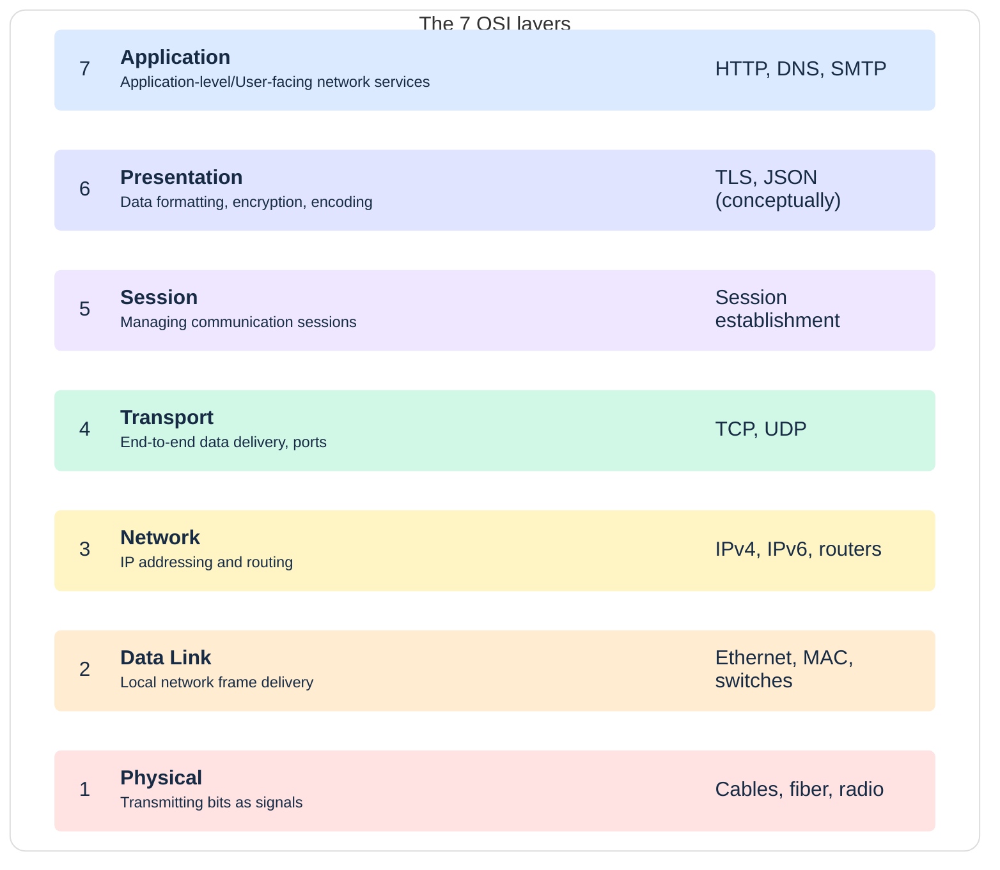
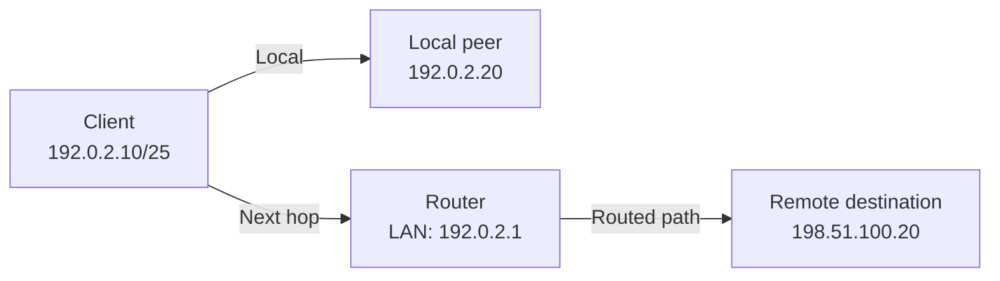
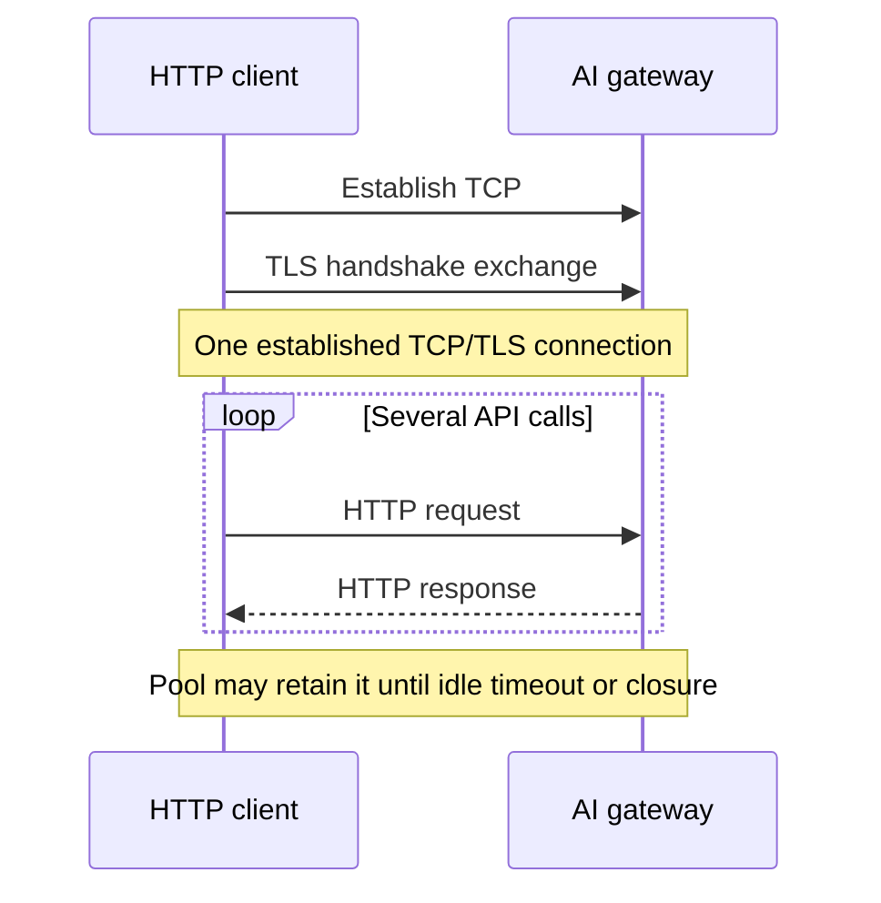

# Networking Fundamentals for System Design

## Table of Contents

- [Overview and Networking Mental Model](#overview-and-networking-mental-model)
- [OSI and TCP/IP Models](#osi-and-tcpip-models)
  - [The Seven OSI Layers](#the-seven-osi-layers)
  - [Mapping to TCP/IP](#mapping-to-tcpip)
  - [Worked Example: An HTTPS Request](#worked-example-an-https-request)
- [IPv4 Addresses, Subnet Masks, and CIDR](#ipv4-addresses-subnet-masks-and-cidr)
  - [Network Bits and Host Bits](#network-bits-and-host-bits)
  - [Counting Addresses](#counting-addresses)
  - [Worked Example: 192.0.2.0/25](#worked-example-19202025)
  - [Private and Public Addressing](#private-and-public-addressing)
- [Local Delivery, Routing, and Broadcasting](#local-delivery-routing-and-broadcasting)
  - [Local Peer or Next-Hop Router](#local-peer-or-next-hop-router)
  - [ARP and Broadcast Boundaries](#arp-and-broadcast-boundaries)
- [TCP, UDP, and the UDP Header](#tcp-udp-and-the-udp-header)
  - [Choosing Transport Behavior](#choosing-transport-behavior)
  - [The Eight-Byte UDP Base Header](#the-eight-byte-udp-base-header)
  - [Worked Example: A Sensor Sends a Temperature Reading](#worked-example-a-sensor-sends-a-temperature-reading)
- [HTTP Connection Reuse and the AI Gateway Example](#http-connection-reuse-and-the-ai-gateway-example)
  - [Connections, Requests, Sessions, and Conversations](#connections-requests-sessions-and-conversations)
  - [Reusing a Connection](#reusing-a-connection)
  - [Comparing a Chatbot with a Load Test](#comparing-a-chatbot-with-a-load-test)
- [Firewalls](#firewalls)
  - [Location and Inspection Capabilities](#location-and-inspection-capabilities)
  - [Firewalls, Proxies, and Application Permissions](#firewalls-proxies-and-application-permissions)
- [Practical Connectivity Checks with Netcat](#practical-connectivity-checks-with-netcat)
  - [Basic TCP Check](#basic-tcp-check)
  - [Interpreting Success, Refusal, and Timeout](#interpreting-success-refusal-and-timeout)
  - [Useful Netcat Variations](#useful-netcat-variations)
  - [Linux, macOS, and Windows Comparison](#linux-macos-and-windows-comparison)
  - [Using Telnet from Windows](#using-telnet-from-windows)
  - [Why UDP Checks Need Different Interpretation](#why-udp-checks-need-different-interpretation)
- [Study Order](#study-order)
- [Recall Summary](#recall-summary)
- [Related Notes](#related-notes)
- [References](#references)

## Overview and Networking Mental Model

Networking makes communication possible; system design decides **which components communicate, what they exchange, and how the application handles delay or failure**. A small application and a large distributed platform both rely on these foundations.

The two transport protocols compared here are **TCP (Transmission Control Protocol)** and **UDP (User Datagram Protocol)**.

| Concept | Simple meaning | Why it matters in system design |
| --- | --- | --- |
| **IP address** | A network-layer address assigned to an interface; virtual service addresses also exist. | Identify a destination and route packets toward it. An address is not a permanent identity for a person or service. |
| **Subnet prefix** | The leading address bits identifying an IP network range. | Plan address space and routes between application tiers. |
| **MAC address** | A link-layer address used on links such as Ethernet and Wi-Fi. | Deliver a frame to the local peer or next-hop router; a remote server's MAC is not used across the internet. |
| **Port** | A transport-level number used to identify a communication endpoint on a host. | Distinguish services and client connections; TCP port 443 commonly serves HTTPS. |
| **Router / gateway** | A component that forwards IP packets between networks according to routes. | Connect networks and determine the next hop. This network gateway differs from an API gateway. |
| **Transport protocol** | Rules such as TCP or UDP for communication between endpoints. | Choose stream or datagram behavior and understand which reliability mechanisms are provided. |

For example, an API service may have a route to a database yet still be blocked by a firewall. If communication is allowed, it also needs the correct transport, service port, credentials, and application permissions. **Reachability is only one part of a successful request.**

> **Mental model:** An IP address helps route to an endpoint; a MAC address supports the next local delivery; a port identifies a transport endpoint. Application protocols define the meaning of the exchange.

All concrete network examples below use **documentation addresses**, including `192.0.2.0/24` and `198.51.100.0/24`. These are illustrative, not real public deployment addresses. [RFC 5737](https://datatracker.ietf.org/doc/html/rfc5737)

## OSI and TCP/IP Models

### The Seven OSI Layers

The **OSI model** separates communication responsibilities into seven conceptual layers. It helps explain a problem's location; it does not require seven separate programs or devices. [ITU-T X.200](https://www.itu.int/rec/T-REC-X.200-199407-I/en)

| Layer | Responsibility | Illustrative examples |
| --- | --- | --- |
| **7 — Application** | Protocols used by communicating applications. | HTTP, DNS, SMTP. “Application” here means protocol services, not just the user interface. |
| **6 — Presentation** | Representation, encoding, and transformation of information. | JSON encoding and TLS encryption illustrate related responsibilities conceptually. |
| **5 — Session** | Establishing and managing an application's dialogue. | Coordinating an exchange and its continuation; not identical to a website's login cookie. |
| **4 — Transport** | Communication between transport endpoints. | TCP, UDP, ports. |
| **3 — Network** | Addressing and routing across networks. | IPv4, IPv6, routers. |
| **2 — Data Link** | Frame delivery over a link. | Ethernet/Wi-Fi frames, MAC addresses, switches. |
| **1 — Physical** | Transmission of bits as signals. | Copper, fiber, radio. |



The rows run from **Layer 7 at the top to Layer 1 at the bottom**. Sending conceptually moves down the stack; receiving reverses the process. TLS and JSON do not implement an independent OSI presentation layer in every system; real protocol stacks combine and overlap these responsibilities.

### Mapping to TCP/IP

The internet's TCP/IP model is commonly taught using four layers. The correspondence is approximate:

| TCP/IP layer | Approximate OSI correspondence | Examples |
| --- | --- | --- |
| **Application** | Layers 5–7 | HTTP, DNS, application encodings, TLS-related functions. |
| **Transport** | Layer 4 | TCP, UDP. |
| **Internet** | Layer 3 | IP routing and addressing. |
| **Link** | Layers 1–2 | Ethernet/Wi-Fi and their physical transmission. |

This explains the language used in [L4 versus L7 load balancing](Distributed-Systems-Building-Blocks.md#layer-4-vs-layer-7): L4 selection uses transport information, while L7 selection can use application information such as HTTP paths.

### Worked Example: An HTTPS Request

Consider **HTTP/1.1 or HTTP/2 over TCP**, with no existing connection:

1. The client resolves the website name if necessary. See [DNS resolution](Distributed-Systems-Building-Blocks.md#exploring-dns).
2. Its routing table determines how to reach the address: directly on a link or through a next hop.
3. The endpoints establish TCP communication and perform a TLS handshake. The client validates the server's certificate and identity.
4. The application sends HTTP data through TLS. TCP carries the resulting bytes; IP packets carry TCP segments; link frames carry packets over each link.
5. Routers forward packets along the path, using the appropriate link delivery at each hop.
6. The destination processes the received data through the stack and handles the HTTP request. The response travels back through the network.

An HTTP request can span multiple TCP segments; an IP packet is not the same thing as a complete request. **HTTP/3 uses QUIC over UDP**, so its transport establishment differs from this TCP example. [HTTP/2, RFC 9113](https://datatracker.ietf.org/doc/html/rfc9113), [HTTP/3, RFC 9114](https://datatracker.ietf.org/doc/html/rfc9114)

## IPv4 Addresses, Subnet Masks, and CIDR

### Network Bits and Host Bits

An **IPv4 address has 32 bits**, written as four eight-bit **octets**. Each octet ranges from 0 to 255.

In `192.0.2.0/25`, **`/25` means the first 25 bits are the network prefix**. The remaining `32 − 25 = 7` bits vary within that address block. CIDR expresses the prefix length directly. [RFC 4632](https://datatracker.ietf.org/doc/html/rfc4632)

A subnet mask marks prefix bits with `1` and the remaining bits with `0`. Valid CIDR masks have contiguous ones followed by zeros.

```text
Last mask octet:
128 = 10000000   -> 1 prefix bit, 7 host bits in this octet
192 = 11000000   -> 2 prefix bits, 6 host bits in this octet
240 = 11110000   -> 4 prefix bits, 4 host bits in this octet
```

Here the first three mask octets are `255.255.255`, contributing 24 prefix bits. Consequently, these final octets produce `/25`, `/26`, and `/28`, respectively. A subnet mask is **not** a count of available devices.

### Counting Addresses

For an IPv4 prefix of length **p**:

```text
Host bits = 32 − p
Total addresses = 2^(32 − p)
```

| Prefix | Mask | Host bits | Total addresses | Ordinary usable host addresses |
| --- | --- | --- | --- | --- |
| **/25** | `255.255.255.128` | 7 | 128 | 126 |
| **/26** | `255.255.255.192` | 6 | 64 | 62 |
| **/28** | `255.255.255.240` | 4 | 16 | 14 |

**Why count zero?** Seven varying bits represent values **0 through 127**, inclusive: `127 − 0 + 1 = 128` combinations. In an ordinary IPv4 subnet, the all-zero host portion identifies the network, and the all-one host portion identifies its broadcast address. Excluding those two leaves 126 ordinary host addresses for `/25`.

For **these last-octet examples only**, the block size is also `255 − last mask octet + 1`: `256 − 128 = 128`, `256 − 192 = 64`, and `256 − 240 = 16`. This shortcut does not calculate an arbitrary prefix's full address count; use the general formula above.

**“Subtract two” is not universal:**

- **/31 on point-to-point links:** Both addresses can identify endpoints; the usual network/broadcast exclusions do not apply. [RFC 3021](https://datatracker.ietf.org/doc/html/rfc3021)
- **/32:** Identifies one address, often used as a host route. It is not a two-address subnet with addresses removed.
- **Cloud subnets:** Provider rules may reserve additional addresses or use different link behavior. Check the platform's documentation before estimating deployable capacity. [AWS VPC subnet sizing](https://docs.aws.amazon.com/vpc/latest/userguide/subnet-sizing.html)

### Worked Example: 192.0.2.0/25

| Item | Value |
| --- | --- |
| Network prefix | `192.0.2.0/25` |
| Mask | `255.255.255.128` |
| Entire block | `192.0.2.0` through `192.0.2.127` |
| Network address | `192.0.2.0` |
| Ordinary host range | `192.0.2.1` through `192.0.2.126` |
| Subnet broadcast address | `192.0.2.127` |
| Address count | 128 total; 126 ordinary host addresses |

The other `/25` within `192.0.2.0/24` is **`192.0.2.128/25`**, covering `.128` through `.255`. Its network address is `.128`, not `.0`.

> **Recall:** The prefix defines the block. Count every address first; then apply the assignment rules for that kind of network.

### Private and Public Addressing

**Private IPv4 ranges** are `10.0.0.0/8`, `172.16.0.0/12`, and `192.168.0.0/16`. Separate organizations can reuse these addresses; they are not intended for routing over the public internet. They still need routing inside a private network. [RFC 1918](https://datatracker.ietf.org/doc/html/rfc1918)

Public addressing supports global routing when properly allocated and advertised. A public address does not guarantee reachability: routes, firewalls, and a listening service still matter. Conversely, a private address does not provide authentication or make a service secure. Some other ranges, including the documentation blocks used here, have special purposes and are not ordinary public deployment space.

## Local Delivery, Routing, and Broadcasting

### Local Peer or Next-Hop Router

Consider a simple Ethernet LAN with no overriding routes:



1. **Local destination:** The client recognizes `192.0.2.20` as on its connected `/25` network. It delivers the frame to the peer's MAC address.
2. **Remote destination:** The client uses a route through `192.0.2.1`. The first frame is addressed to the **router's MAC**, while the IP packet identifies the remote IP destination.
3. **Further hops:** The router forwards the packet according to its own routing table. Link headers change as packets cross links. The IP destination normally remains the remote endpoint, although NAT or other intermediaries can translate addresses.

In general, hosts consult their **routing tables**; the local-versus-default-gateway example is a common simple case, not the only possible routing arrangement. A default gateway is used when no more specific matching route applies.

### ARP and Broadcast Boundaries

For IPv4 over Ethernet, **ARP** discovers the MAC address associated with a local next-hop IP when it is not already known. For a remote destination, that next hop is commonly the router—not the remote server. [RFC 826](https://datatracker.ietf.org/doc/html/rfc826)

| Mechanism | What it addresses | Simple example |
| --- | --- | --- |
| **Ethernet broadcast** | All recipients in the local Layer 2 broadcast domain, using MAC `ff:ff:ff:ff:ff:ff`. | An ARP request asks which device has the next-hop IPv4 address. |
| **IPv4 subnet broadcast** | The subnet's broadcast IP address. | `192.0.2.127` for the ordinary `/25` example. |

**An ARP request is not an IPv4 packet sent to `192.0.2.127`.** It is its own link-carried protocol message, commonly transmitted in an Ethernet broadcast frame. The owner can then reply with its MAC address.

Broadcast normally remains within its broadcast domain; routers do not ordinarily forward Layer 2 broadcasts between networks. It does not guarantee that every device receives a message, receives it simultaneously, or processes it. VLANs and filtering can further define boundaries.

**IPv6 has no broadcast addresses.** It uses multicast for relevant discovery functions; IPv6 neighbor discovery replaces the ARP role rather than using IPv4 ARP. [RFC 4291](https://datatracker.ietf.org/doc/html/rfc4291)

## TCP, UDP, and the UDP Header

### Choosing Transport Behavior

| Property | TCP | UDP |
| --- | --- | --- |
| **Data model** | Ordered byte stream. Application message boundaries require application framing. | Independent datagrams with message boundaries. |
| **Setup** | Establishes a connection before ordinary application data exchange. | No UDP-level connection handshake; a protocol above UDP may add one. |
| **Ordering and delivery** | Detects missing bytes, retransmits, and exposes an ordered stream while communication can make progress. | Does not itself guarantee delivery, ordering, or duplicate suppression. |
| **Flow and congestion control** | Built into TCP. | Not provided by UDP itself; applications or higher protocols must provide appropriate mechanisms. |
| **Header overhead** | TCP header is ordinarily 20–60 bytes, before payload and IP/link overhead. | UDP base header is 8 bytes, before payload and IP/link overhead. |
| **Example use** | HTTP/1.1 and HTTP/2 web traffic; many database connections. | Some DNS exchanges, real-time media protocols, and QUIC. |

TCP semantics are defined in [RFC 9293](https://datatracker.ietf.org/doc/html/rfc9293). UDP applications still need to address congestion and any reliability their workload requires. [UDP usage guidelines, RFC 8085](https://datatracker.ietf.org/doc/html/rfc8085)

**UDP is not automatically faster.** Avoiding a transport handshake or accepting losses can help particular workloads; packet loss, application recovery, security handshakes, congestion, and implementation choices still affect latency. QUIC adds reliable streams and congestion control above UDP, demonstrating that “uses UDP” does not mean “unreliable application.” [RFC 9114](https://datatracker.ietf.org/doc/html/rfc9114)

**TCP cannot guarantee progress through a permanent failure.** A connection can time out or break, and a TCP acknowledgment does not prove that a business operation committed. Applications still need deadlines and appropriate retry/idempotency rules. Also, **DNS can use both UDP and TCP**; protocol choices are more specific than “DNS equals UDP.” See [DNS reliability](Distributed-Systems-Building-Blocks.md#reliability).

The existing notes cover the details without repeating them here:

- [TCP connection: a simple mental model](Distributed-Systems-Building-Blocks.md#tcp-connection-a-simple-mental-model).
- [TCP header: what each segment carries](Distributed-Systems-Building-Blocks.md#tcp-header-what-each-segment-carries).
- [Inspecting TCP connections and headers](Distributed-Systems-Building-Blocks.md#inspecting-tcp-connections-and-headers).
- [Why one TCP connection stays on one backend](Distributed-Systems-Building-Blocks.md#why-one-tcp-connection-stays-on-one-backend).

### The Eight-Byte UDP Base Header

Each row below represents **32 bits**. Each field occupies **16 bits**, for a total of `4 × 16 = 64 bits = 8 bytes`. Payload follows the header and is not included in those eight bytes. [RFC 768](https://datatracker.ietf.org/doc/html/rfc768)

```text
UDP header: 8 bytes (64 bits)
 0                       15 16                      31
+--------------------------+--------------------------+
|       Source port        |     Destination port     |
|    2 bytes (16 bits)     |    2 bytes (16 bits)     |
+--------------------------+--------------------------+
|          Length          |         Checksum         |
|    2 bytes (16 bits)     |    2 bytes (16 bits)     |
+--------------------------+--------------------------+

+-----------------------------------------------------+
|             Application Data (Payload)              |
|        Variable size; outside the UDP header        |
+-----------------------------------------------------+
```

**What do 0, 15, 16, and 31 mean?** They label **bit positions across a 32-bit row**, counting from zero:

- **0–15:** The first 16-bit field, from its first bit to its last.
- **16–31:** The second 16-bit field, from its first bit to its last.
- The same column positions apply to the next row: **Length** occupies its first 16 bits, and **Checksum** its last 16 bits.

These numbers are **positions, not port values or byte counts**. Each row contains 32 bits (4 bytes), so the two header rows total **64 bits (8 bytes)**. The drawing is schematic; one text character does not represent one bit.

**Application Data (Payload)** follows the header and can vary in size. It contains what UDP carries for the application or a higher-level protocol, such as QUIC. It is **not part of the eight-byte UDP header**, but it is included in the UDP datagram's length.

| Field | Meaning |
| --- | --- |
| **Source port** | Sending endpoint's port; can be zero when unused under the UDP specification. |
| **Destination port** | Receiving endpoint's service port. |
| **Length** | In ordinary UDP, the datagram length in bytes, including its header and data; minimum 8. |
| **Checksum** | Detects certain corruptions using the UDP header, data, and an IP pseudo-header. It is not authentication or encryption. |

For example, **12 bytes of application data produce a UDP length of 20**: 8 header bytes plus 12 data bytes. The IP header and link framing add separate overhead. A checksum cannot establish that a sender is trusted or that a command is authorized.

### Worked Example: A Sensor Sends a Temperature Reading

Suppose a sensor reports its temperature to a monitoring application using UDP. These ports are illustrative; the receiving application is configured to listen on UDP port `9000`.

```text
Sensor -> Monitoring server

Source port:      50000
Destination port: 9000
Payload:          "temp=23.5"
Payload size:     9 bytes (UTF-8)
UDP length:       17 bytes = 8-byte header + 9-byte payload
Checksum:         Calculated by the networking stack
```

The quotation marks identify the text; they are not transmitted. This example includes no trailing newline or string terminator. IP headers and link framing add separate overhead beyond the 17-byte UDP datagram.

1. **Send:** The sensor's application supplies the nine-byte message and the server's destination address and port. Its networking stack sends one UDP datagram using source port `50000`.
2. **Receive:** If the datagram arrives and is accepted, the server's networking stack delivers its payload to the application listening on UDP port `9000`. The application interprets `temp=23.5` as a temperature reading.
3. **No automatic confirmation:** UDP itself sends no delivery acknowledgment and performs no automatic retransmission. The receiving application could send a reply, but that would be an additional application-defined message.
4. **Handle loss according to the task:** If periodic readings are sufficient, the application may tolerate a missing reading and use the next one. It should track freshness rather than assuming a new reading will arrive. Applications requiring confirmed delivery need appropriate reliability mechanisms or a suitable higher-level protocol. [UDP usage guidelines, RFC 8085](https://datatracker.ietf.org/doc/html/rfc8085)

> **One UDP datagram carries one message. Successful sending does not prove successful receipt.**

## HTTP Connection Reuse and the AI Gateway Example

### Connections, Requests, Sessions, and Conversations

| Concept | Meaning | Lifetime relationship |
| --- | --- | --- |
| **TCP connection** | A transport association carrying bytes between endpoints. | Can carry many HTTP exchanges; eventually closes or fails. |
| **HTTP request** | One application-level operation, such as an API call. | Multiple requests can use one connection. |
| **Application session** | Application state associating interactions with a user or client. | Can survive connection changes, commonly through cookies or tokens. |
| **LLM conversation** | Message history or state used for model interactions. | Can span many API calls and connections; it is not a TCP session. |

A chatbot does not need to keep one TCP connection alive for its entire conversation. Conversely, a connection pool can reuse a connection across separate API calls whose application context is unrelated.

### Reusing a Connection

**HTTP/1.1 uses persistent connections by default**, subject to message framing, connection-close rules, and endpoint behavior. Clients often use a pool of connections for concurrent work. **HTTP/2 multiplexes streams**, allowing multiple exchanges to proceed over one connection. [RFC 9112, persistence](https://datatracker.ietf.org/doc/html/rfc9112#section-9.3), [RFC 9113](https://datatracker.ietf.org/doc/html/rfc9113)



This illustrates sequential reuse; HTTP/2 can also have overlapping streams. **WebSockets are unnecessary for ordinary HTTP connection reuse.** They provide different application communication semantics.

Reuse depends on client configuration, fully consuming or properly closing responses, and server/proxy limits. Pools may open additional connections; idle timeouts, maximum lifetimes, deployments, or failures eventually require new ones. Reuse saves repeated setup work, but it does not remove request processing or model inference time.

The **gateway's upstream connections are separate**. A client-to-gateway connection can be reused while the gateway uses a different pool to contact model providers. See [TLS termination](Distributed-Systems-Building-Blocks.md#tls-termination) for how intermediaries create separate security connections.

### Comparing a Chatbot with a Load Test

A simulated chatbot and a load test can **both reuse connections or create fresh ones**. Their names do not determine transport behavior. Check client configuration and measure the same timing boundaries before comparing results.

| Measure | What to separate | Example interpretation |
| --- | --- | --- |
| **Connection establishment** | DNS, TCP, and TLS setup when required; report whether setup is included. | The first request may include setup while later requests reuse a warm connection. |
| **Client-observed TTFT** | Time to the first generated token reaching the client; state whether timing starts before setup or when the request is sent. | Includes request transfer, gateway queuing, model prefill, and delivery; TTFT is not merely TCP setup or time to the first HTTP header byte. |
| **Total response latency** | Time until the complete response arrives, using the same starting boundary. | Depends on both time to first token and subsequent generation/transfer. |

For example, a chatbot making one request at a time may see low queueing, while a load test sending many concurrent requests can increase gateway or model queues—even when both use warm connections. Longer prompt/history, output length, connection-pool limits, caching, and model warm-up can also change results.

> **Recall:** Reusing a connection reduces repeated transport setup. It does not imply reused conversation state, cached answers, or instant model responses.

See [AI latency and throughput](AI-Systems-Design.md#latency-and-throughput) and [streaming work](AI-Systems-Design.md#synchronous-asynchronous-and-streaming-work) for the application-level design.

## Firewalls

A **firewall controls traffic according to a policy**. It can permit a public application entry point while restricting access to internal services. [NIST SP 800-41 Rev. 1](https://csrc.nist.gov/pubs/sp/800/41/r1/final)

Consider this conceptual policy for an HTTPS-over-TCP application; it is **not a configuration**:

| Path | Intended policy | Reason |
| --- | --- | --- |
| Public clients → web entry point, **TCP 443** | Permit expected HTTPS traffic. | Users need access to the application. |
| Approved application tier → database, **TCP 5432** | Permit the required database connections. | Only authorized application infrastructure needs this network path. |
| Public clients → database, **TCP 5432** | Block direct access. | Public use of the application does not require public database exposure. |

These ports illustrate a common deployment, not universal values. HTTP/3 would additionally require considering QUIC/UDP, rather than assuming every HTTPS exchange uses TCP.

### Location and Inspection Capabilities

Two different classification questions are useful:

| Classification | Examples | What it describes |
| --- | --- | --- |
| **Deployment location** | Host firewall, network appliance, cloud network control. | Where traffic policy is enforced. |
| **Inspection capability** | Packet filtering, stateful connection tracking, application-aware inspection, web application firewall (WAF). | Which information is examined and how decisions are made. |

These categories **overlap**: a host firewall can be stateful; a cloud service can provide network filtering or WAF capabilities. Stateful filtering tracks traffic state to evaluate packets and replies. A WAF evaluates web requests using application-specific rules. Product capabilities and policy semantics vary.

Encrypted content is not automatically visible to every firewall. HTTP inspection generally needs access to decrypted HTTP at a suitable termination point or another supported inspection arrangement.

### Firewalls, Proxies, and Application Permissions

| Component or control | Main responsibility | Example |
| --- | --- | --- |
| **Network firewall** | Permit or block network traffic. | Restrict which application nodes can reach a database port. |
| **Reverse proxy / gateway** | Receive and forward requests, optionally applying shared policies. | Terminate TLS and route `/api` to a backend. |
| **Application authentication and authorization** | Establish identity and enforce permitted actions on resources. | An authenticated analyst may view only records within an authorized tenant. |

One product may perform several roles. A permitted TCP connection does not authorize every database query; a WAF does not know every business rule. **Firewall policy complements TLS, authentication, and application permissions.** See [reverse proxies](Distributed-Systems-Building-Blocks.md#reverse-proxy-vs-load-balancer) and [authorization in practice](Identity-and-Access-Management.md#authorization-in-practice).

## Practical Connectivity Checks with Netcat

**Netcat (`nc`) is a command-line networking utility**, commonly used on Linux and macOS. It can test TCP connection establishment, exchange data, and listen for connections. Windows does not include `nc` by default; Windows PowerShell provides `Test-NetConnection`, and separately installed **Nmap Ncat (`ncat`)** offers a Netcat-style tool.

All remote addresses and names below are **documentation placeholders**, not reachable test services. Replace them with the intended endpoint when using the commands. These examples do not configure networking or run database queries.

### Basic TCP Check

```bash
nc -vz 192.0.2.77 1521
```

| Component | Meaning |
| --- | --- |
| `nc` | Run Netcat. |
| `-v` | Show verbose diagnostic output. |
| `-z` | Check connection status without sending an application payload; do not start an interactive data session. |
| `192.0.2.77` | Destination IPv4 address. |
| `1521` | Destination port; TCP is the default transport for this command. |

**No application payload does not mean no network traffic.** A TCP connection check still exchanges handshake packets and then closes. It does not perform a database login, a TLS handshake, or a query. See the [TCP connection explanation](Distributed-Systems-Building-Blocks.md#tcp-connection-a-simple-mental-model).

TCP port **1521** is the default Oracle Net listener port, but deployments can use another port. An accepting listener is not proof that a requested database service is available or that credentials will work. A service name printed beside a port is not, by itself, verified identification of the software. [Oracle listener overview](https://docs.oracle.com/en/database/oracle/oracle-database/26/netag/overview-oracle-net-listener.html)

### Interpreting Success, Refusal, and Timeout

Output wording varies by implementation. Interpret these as **connection-test outcomes**, not complete application-health diagnoses.

| Typical result | What it establishes | What it does not establish |
| --- | --- | --- |
| **Succeeded** | This client established a TCP connection to the endpoint at that time. | The database is usable, authentication succeeds, or no firewall exists. A proxy or other intermediary may accept the connection. |
| **Connection refused** | The attempt was actively rejected. Often no service is listening; a firewall can also reject it. | That the database process itself was necessarily the source of the rejection. |
| **Connection timed out** | No connection completed before the applicable timeout. | One definite cause: filtering, routing problems, packet loss, or an unavailable host are possibilities. |

A successful test from your laptop does not prove the application server has the same connectivity. Source address, network path, policy, destination, and time can differ.

### Useful Netcat Variations

| Purpose | Example | Implementation note |
| --- | --- | --- |
| Basic TCP test | `nc -vz 192.0.2.77 1521` | Common Netcat syntax. |
| Numeric addressing and a three-second connection timeout | `nc -nvz -w 3 192.0.2.77 1521` | OpenBSD-style `nc`: `-n` avoids name/service lookups; `-w` sets the timeout. |
| macOS TCP connection timeout | `nc -nvz -G 3 192.0.2.77 1521` | Apple's supplied `nc` uses `-G` for this timeout; do not assume the flag has the same meaning in another implementation. |
| Include hostname resolution | `nc -vz db.example.com 1521` | A name-resolution failure is different from a resolved endpoint refusing the connection. |
| Force IPv4 | `nc -4 -vz 192.0.2.77 1521` | Useful when separating IPv4 from IPv6 behavior. |

Netcat implementations differ. Check the installed tool with `nc -h` or `man nc`; flags and timeout behavior are not universally interchangeable. See the [OpenBSD manual](https://man.openbsd.org/nc) and [Apple's Netcat source](https://github.com/apple-oss-distributions/netcat/blob/main/netcat.c).

### Linux, macOS, and Windows Comparison

The **operating system and installed tools** determine availability; PowerShell and Command Prompt (CMD) are shells in which commands run. Netcat is not inherently restricted to Linux/macOS, but installing Ncat on Windows does not automatically create a command named `nc`.

| Operating system | Shell / tool | Equivalent TCP check | Availability |
| --- | --- | --- | --- |
| **Linux** | Terminal, Netcat | `nc -vz 192.0.2.77 1521` | Requires a Netcat implementation; not installed in every distribution/image. |
| **macOS** | Terminal, Netcat | `nc -vz 192.0.2.77 1521` | Commonly supplied by macOS; consult the local manual for its options. |
| **Windows** | Windows PowerShell | `Test-NetConnection -ComputerName 192.0.2.77 -Port 1521` | Uses the Windows `NetTCPIP` module. |
| **Windows** | CMD invoking Windows PowerShell | `powershell.exe -NoProfile -Command "Test-NetConnection -ComputerName 192.0.2.77 -Port 1521"` | CMD launches PowerShell to perform the test; this is not a native CMD cmdlet. |
| **Windows** | PowerShell or CMD, Ncat | `ncat -vz -w 3 192.0.2.77 1521` | Requires Nmap's Ncat to be installed and available on the executable search path. |
| **Windows** | CMD or PowerShell, Telnet Client | `telnet 192.0.2.77 1521` | Requires the optional Telnet Client; opens an interactive TCP session rather than a zero-I/O check. |

**In Windows PowerShell:**

```powershell
Test-NetConnection -ComputerName 192.0.2.77 -Port 1521
```

For a successful TCP test, the relevant output field is:

```text
TcpTestSucceeded : True
```

`False` means the TCP connection test did not succeed; inspect other diagnostics rather than assuming one cause. A ping failure does not necessarily mean the TCP test fails, because the two use different protocols and may face different policies.

**From CMD:**

```cmd
powershell.exe -NoProfile -Command "Test-NetConnection -ComputerName 192.0.2.77 -Port 1521"
```

Typing `Test-NetConnection` directly into CMD does not invoke a PowerShell cmdlet. The command above starts Windows PowerShell without loading profile scripts. `Test-NetConnection` is not a general UDP probe or a database-authentication check. See [Microsoft's TCP-test documentation](https://learn.microsoft.com/en-us/powershell/module/nettcpip/test-netconnection) and [PowerShell executable arguments](https://learn.microsoft.com/en-us/powershell/module/microsoft.powershell.core/about/about_powershell_exe?view=powershell-5.1).

If Ncat is installed, the following executable command works from either Windows shell:

```text
ncat -vz -w 3 192.0.2.77 1521
```

This selects TCP by default and sets a three-second connection timeout. Ncat is a separate implementation; consult its own options rather than assuming every `nc` flag matches. [Ncat reference](https://nmap.org/book/ncat-man.html)

### Using Telnet from Windows

The optional **Windows Telnet Client** can run from CMD or PowerShell when installed/enabled:

```cmd
telnet 192.0.2.77 1521
```

Here Telnet is used to attempt a TCP connection to the specified port. The Oracle listener does not need to be a Telnet server for this initial connection test, but it will not understand an interactive Telnet session as a database login. If the port is omitted, Telnet defaults to TCP port 23. [Microsoft Telnet documentation](https://learn.microsoft.com/en-us/windows-server/administration/windows-commands/telnet)

| What you see | Interpretation |
| --- | --- |
| A blank screen after connecting | Can indicate an established TCP connection with no displayed application response; it does not establish database health. |
| The connection closes immediately | The endpoint may have accepted TCP and then closed it; that alone does not prove why. |
| “Could not open connection” | The connection attempt failed; investigate the endpoint, route, and filtering. |
| “telnet is not recognized” | The client may not be installed/enabled or available on the executable search path. |

**Unlike `nc -z`, Telnet opens an interactive session and may exchange Telnet negotiation data.** It does not validate Oracle credentials, perform a database query, or establish a TLS connection through this command.

To exit using the usual escape key, press **Ctrl+]** to reach the Telnet client prompt, type **`quit`**, then press **Enter**. If the server has already closed the session, you may already be back at the shell. [Telnet quit command](https://learn.microsoft.com/en-us/windows-server/administration/windows-commands/telnet-quit)

For a simple Windows TCP diagnostic with explicit success/failure output, use the `Test-NetConnection` example above; Telnet is an additional option, not a prerequisite for it.


### Why UDP Checks Need Different Interpretation

A command using `nc -uvz` selects UDP, but UDP has **no TCP-style connection handshake**. Its apparent success is not reliable evidence that the remote application received or processed anything. OpenBSD explicitly notes that its `-uz` scanning combination reports success irrespective of the target's state. Other implementations may behave differently. [OpenBSD UDP caveat](https://man.openbsd.org/nc#CAVEATS)

A meaningful UDP test generally needs an appropriate application-level response or other supporting evidence. Relate this to the [sensor example](#worked-example-a-sensor-sends-a-temperature-reading): successful sending does not establish receipt.

> **A reachable port is the first checkpoint. A working application requires successful protocol negotiation, authentication, authorization, and the intended operation, as applicable to that application.**


## Study Order

1. Learn addresses, ports, and the OSI/TCP/IP responsibilities.
2. Work through prefix lengths and subnet address counts.
3. Follow a local frame and then a routed packet; distinguish ARP and broadcasts.
4. Compare TCP/UDP behavior, then study the linked TCP connection and header notes.
5. Follow HTTP/TLS connection reuse and measure request latency with explicit boundaries.
6. Connect routing and firewalls to DNS, load balancing, gateways, and application authorization.

## Recall Summary

- **Addresses and prefixes** identify endpoints and network ranges; routing chooses next hops.
- **MAC addresses** support local-link delivery; ARP discovers an IPv4 next hop's MAC.
- **TCP** provides a controlled, ordered byte stream; **UDP** provides datagrams with fewer built-in mechanisms.
- **HTTP reuse** lets multiple requests share transport setup; sessions and conversations remain separate concepts.
- **Firewalls** restrict communication paths; they do not establish every application's permissions or correctness.

> **System design connects the layers:** choose the communication path and protocol, define deadlines and access rules, and handle failures at the application level.

## Related Notes

- [Understanding System Design — System Design vs. Network Engineering](Understanding-System-Design.md#system-design-vs-network-engineering).
- [Distributed Systems Building Blocks](Distributed-Systems-Building-Blocks.md) — DNS, TCP, L4/L7 balancing, reverse proxies, TLS, and gateways.
- [Distributed System Attributes](Distributed-System-Attributes.md) — performance, availability, and other system qualities.
- [Identity and Access Management](Identity-and-Access-Management.md) — authentication and authorization.
- [AI Systems Design](AI-Systems-Design.md#latency-and-throughput) — latency, streaming, and throughput.

## References

- [ITU-T X.200 — OSI Basic Reference Model](https://www.itu.int/rec/T-REC-X.200-199407-I/en).
- [RFC 4632 — CIDR](https://datatracker.ietf.org/doc/html/rfc4632); [RFC 3021 — 31-Bit Prefixes on IPv4 Point-to-Point Links](https://datatracker.ietf.org/doc/html/rfc3021).
- [RFC 1918 — Private Address Space](https://datatracker.ietf.org/doc/html/rfc1918); [RFC 5737 — Documentation Address Blocks](https://datatracker.ietf.org/doc/html/rfc5737).
- [RFC 826 — ARP](https://datatracker.ietf.org/doc/html/rfc826); [RFC 4291 — IPv6 Addressing Architecture](https://datatracker.ietf.org/doc/html/rfc4291).
- [RFC 768 — UDP](https://datatracker.ietf.org/doc/html/rfc768); [RFC 8085 — UDP Usage Guidelines](https://datatracker.ietf.org/doc/html/rfc8085); [RFC 9293 — TCP](https://datatracker.ietf.org/doc/html/rfc9293).
- [RFC 9112 — HTTP/1.1](https://datatracker.ietf.org/doc/html/rfc9112); [RFC 9113 — HTTP/2](https://datatracker.ietf.org/doc/html/rfc9113); [RFC 9114 — HTTP/3](https://datatracker.ietf.org/doc/html/rfc9114).
- [NIST SP 800-41 Rev. 1 — Guidelines on Firewalls and Firewall Policy](https://csrc.nist.gov/pubs/sp/800/41/r1/final).
- [AWS VPC — Subnet CIDR Blocks](https://docs.aws.amazon.com/vpc/latest/userguide/subnet-sizing.html) — an example of platform-specific assignment rules.
- [OpenBSD: Netcat Manual](https://man.openbsd.org/nc).
- [Apple: Netcat Source and Platform Options](https://github.com/apple-oss-distributions/netcat/blob/main/netcat.c).
- [Nmap: Ncat Reference Guide](https://nmap.org/book/ncat-man.html).
- [Microsoft: Test-NetConnection](https://learn.microsoft.com/en-us/powershell/module/nettcpip/test-netconnection).
- [Microsoft: Windows PowerShell Executable Arguments](https://learn.microsoft.com/en-us/powershell/module/microsoft.powershell.core/about/about_powershell_exe?view=powershell-5.1).
- [Oracle: Oracle Net Listener Overview](https://docs.oracle.com/en/database/oracle/oracle-database/26/netag/overview-oracle-net-listener.html).
- [Microsoft: Telnet Client Syntax](https://learn.microsoft.com/en-us/windows-server/administration/windows-commands/telnet).
- [Microsoft: Telnet Quit Command](https://learn.microsoft.com/en-us/windows-server/administration/windows-commands/telnet-quit).
