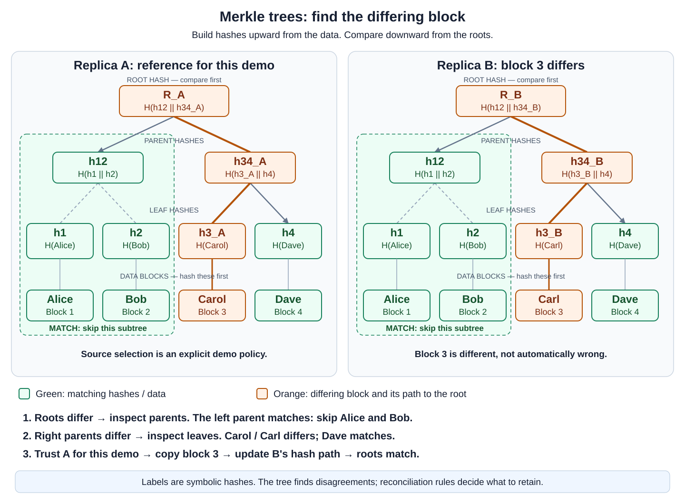

# DSA-Style Merkle Tree in C++17

Find **which blocks differ between two replicas** by comparing hashes and skipping matching branches.

> [merkle_tree_dsa.cpp](merkle_tree_dsa.cpp) implements **Build**, **Update**, and **FindDifferences**. Its fixed 64-bit FNV-1a hash is **not cryptographic**. This example teaches the tree algorithm; it is not a security verifier or a production repair protocol.

## Table of Contents

- [Core State and Hash Encoding](#core-state-and-hash-encoding)
- [Language-Neutral Pseudocode](#language-neutral-pseudocode)
- [Worked Tree and Repair Policy](#worked-tree-and-repair-policy)
- [Build and Run](#build-and-run)
- [Illustrated Input and Output](#illustrated-input-and-output)
- [Complexity Breakdown](#complexity-breakdown)
- [Assumptions and Limits](#assumptions-and-limits)
- [References](#references)

## Core State and Hash Encoding

| State | Meaning |
| --- | --- |
| `count` | Actual number of ordered data blocks. The caller keeps their string payloads. |
| `base` | Smallest power of two at least `count`; use 1 for an empty dataset. |
| `nodes` | Array of `2 * base` fixed-size hashes. Index 0 is unused; root is at 1. |
| Leaf slots | Start at `nodes[base]`. Slots after the actual blocks contain padding hashes. |
| Children | Node `i` has children `2*i` and `2*i+1`. |

For four blocks, `base = 4`: leaves are at indexes 4–7, their parents at 2–3, and the root at 1. With three blocks, slot 7 is padding. That padding is not a fourth real block.

**Hashing rules:** The helper uses 64-bit FNV-1a with offset `14695981039346656037` and multiplier `1099511628211`. For each byte, XOR it into the hash, then multiply with unsigned 64-bit wraparound.

| Kind | Exact input bytes to the hash |
| --- | --- |
| Real leaf | One byte `0x00`, followed by all block bytes |
| Parent | One byte `0x01`, followed by the left and right child hashes, each encoded as eight big-endian bytes |
| Padding | One byte `0x02` |

Prefixes distinguish different kinds of input. For example, a real empty string hashes `0x00`, while padding hashes `0x02`. This is **not** protection against collisions: FNV-1a remains non-cryptographic.

Parent hashing uses the raw fixed-width hash bytes, **not their hexadecimal display strings**. Children are ordered: left then right. These choices make output deterministic across machines with 64-bit `std::uint64_t`.

The empty tree has `count = 0`, `base = 1`, and a padding hash at its root. Comparisons require equal logical block counts, even when two trees have the same padded capacity. Roots alone must not be interpreted without the agreed count, ordering, and construction rules.

## Language-Neutral Pseudocode

```text
BUILD(blocks):
    base = 1
    while base < length(blocks):
        double base, rejecting an unrepresentable tree size

    reject if 2 * base cannot fit the hash array
    nodes = array of 2 * base padding hashes
    for index = 0 to length(blocks) - 1:
        nodes[base + index] = LEAF_HASH(blocks[index])

    for node = base - 1 down to 1:
        nodes[node] = PARENT_HASH(nodes[2*node], nodes[2*node+1])

    return tree(length(blocks), base, nodes)

UPDATE(tree, index, newBlock):
    if index < 0 or index >= tree.count:
        error "Block index out of range"

    node = tree.base + index
    nodes[node] = LEAF_HASH(newBlock)
    while node > 1:
        node = floor(node / 2)
        nodes[node] = PARENT_HASH(nodes[2*node], nodes[2*node+1])

FIND_DIFFERENCES(a, b):
    if a.count != b.count:
        error "Block counts must match"
    result = empty list
    COMPARE(a, b, node = 1, result)
    return result

COMPARE(a, b, node, result):
    if a.nodes[node] == b.nodes[node]:
        return                       // Skip the entire matching subtree.
    if node >= a.base:
        index = node - a.base
        if index < a.count:
            append index to result
        return
    COMPARE(a, b, 2*node, result)
    COMPARE(a, b, 2*node+1, result)
```

`LEAF_HASH`, `PARENT_HASH`, and the padding hash use the encoding table above. In C++, indexes are unsigned; a negative integer converted to an index is out of range and rejected. An invalid index leaves the tree unchanged.

**Update changes hashes, not the caller's payload array.** The demonstration explicitly updates both. It returns no repaired data and changes no replica automatically. `FindDifferences` returns zero-based indexes in ascending order; it compares only hashes, so a collision can hide a real difference.

## Worked Tree and Repair Policy

Start both replicas with `["Alice", "Bob", "Carol", "Dave"]`. Change B's **third block**, which is **index 2**, to `"Carl"`.



- The left parent covering Alice and Bob matches, so its children need not be compared.
- The right parent differs. Comparing its children finds Carol/Carl; Dave matches.
- Rehashing one changed block updates that leaf and its ancestors only.
- Here, **A is explicitly trusted for repair**. Copy block 3 from A to B and update B's hashes.

**A hash mismatch does not say which replica is correct.** A real database needs version/conflict rules and suitable snapshot coordination. Copying from A is a demonstration choice, not a rule of Merkle trees.

The diagram uses symbolic labels rather than the program's FNV-1a outputs. In a real key-value store, block content must include relevant keys, values, versions, and deletion markers. See the [replica-repair notes](../../Databases-and-Storage.md#replica-repair-and-merkle-trees).

## Build and Run

From the **System-Design directory**, use **Windows CMD**:

```bat
examples\merkle_tree\build.cmd
examples\merkle_tree\merkle_tree_dsa.exe
```

The build script creates `merkle_tree_dsa.exe` beside its source regardless of working directory and rejects arguments. The executable also takes no arguments. Generated Windows and Unix executables are ignored by Git.

Direct compilation:

```bat
g++ -std=c++17 -Wall -Wextra -Wpedantic examples/merkle_tree/merkle_tree_dsa.cpp -o examples/merkle_tree/merkle_tree_dsa.exe
examples\merkle_tree\merkle_tree_dsa.exe
```

PowerShell, if executable launching is permitted in your environment:

```powershell
.\examples\merkle_tree\build.cmd
.\examples\merkle_tree\merkle_tree_dsa.exe
```

Linux/macOS with a C++17 compiler:

```sh
g++ -std=c++17 -Wall -Wextra -Wpedantic examples/merkle_tree/merkle_tree_dsa.cpp -o examples/merkle_tree/merkle_tree_dsa
./examples/merkle_tree/merkle_tree_dsa
```

## Illustrated Input and Output

**Input:** No CLI arguments; the demonstration uses the four fixed blocks above and changes B's index 2.

**Exact output:**

```text
HASH: 64-bit FNV-1a (teaching only; not cryptographic)
BLOCKS: 1=Alice, 2=Bob, 3=Carol, 4=Dave
INITIAL
  A root: 0f1d8679ce0a3f4d
  B root: 0f1d8679ce0a3f4d
  Roots match: yes

CHANGE B: block 3 (index 2), Carol -> Carl
  A root: 0f1d8679ce0a3f4d
  B root: 2c700b99f732ef7a
DIFFERENCES: 1
  Block 3 (index 2): A="Carol", B="Carl"
REPAIR POLICY: trust A; copy only differing blocks to B
  Copy block 3: Carol
AFTER REPAIR
  A root: 0f1d8679ce0a3f4d
  B root: 0f1d8679ce0a3f4d
  Roots match: yes
```

For this four-block mismatch, comparison examines **five hash pairs**: root, left parent, right parent, block 3, and block 4. It skips the two matching left leaves. The console reports the resulting differing block; the core does not print a message for every comparison.

## Complexity Breakdown

Let **N** be the real block count, **K** the number of differing blocks, and **B** the total input bytes. Assume compatible trees, fixed-size hashes, and no collisions hiding the differences.

| Measure | Bound | Explanation |
| --- | --- | --- |
| Build, constant-size blocks | O(N) time and hash storage | Each leaf and parent is hashed once. |
| Build, variable-size blocks | O(B + N) time | Read all payload bytes and compute parents. |
| Compare compatible root hashes | O(1) | Both roots are already built. |
| Update one block | O(log N), or O(block bytes + log N) | Rehash one leaf and its ancestors. |
| Locate one difference | O(log N) hash comparisons | Inspect the differing path and matching sibling subtrees. |
| Locate K differences | O(min(N, 1 + K log N)) | Shared paths reduce repeated work; identical roots take O(1). |
| Comparison auxiliary space | O(log N) stack plus O(K) results | The existing trees are separate O(N) storage. |

Interpret logarithms as `log2(max(2, N))`; empty-tree operations take constant work. Build and Update use O(1) auxiliary space beyond the stored tree, with hashing done byte by byte.

With leaf capacity **P**, the tree contains `2P - 1` used hashes plus one unused array slot. For N > 0, `N <= P < 2N`. Payloads remain outside the tree. Hash overhead therefore depends on block size, digest size, and padding; it does not necessarily double the dataset's storage.

**Network comparison is conceptual here:** a real exchange sends hashes for inspected branches, then the differing payload bytes and metadata. O(K log N) is a loose bound on hash-exchange work for sparse differences, not a universal bound on the bytes of actual data copied. If many blocks differ, comparison can become O(N), and repair may transfer most of the data.

An inclusion proof is a different operation and is not implemented here. Merkle trees are not the only way to avoid full-payload transfer; a flat list of per-block checksums can also locate differences, with different comparison costs.

## Assumptions and Limits

- **Compatible snapshots:** Both inputs represent the same ordered block positions and use this same tree construction. Different block counts throw `std::invalid_argument`; insertion/deletion alignment is outside this example.
- **Valid state:** Use trees produced by Build and maintained by Update. Do not edit `count`, `base`, or `nodes` directly.
- **Explicit errors:** Invalid update indexes throw `std::out_of_range`. Unrepresentable tree sizes throw `std::length_error`; memory allocation can still fail normally.
- **Teaching hash:** FNV-1a is deterministic but non-cryptographic. Matching hashes are not proof that bytes match, and this is not suitable for adversarial integrity verification.
- **No automatic repair policy:** Comparing hashes does not select the authoritative version, validate business meaning, or recover data whose every copy is lost.
- **Memory only:** No networking, concurrency, persistence, replica membership changes, snapshots, automatic conflict resolution, or inclusion proofs.
- **Not protocol-compatible:** This hash, padding, and tree layout do not reproduce Cassandra, Bitcoin, BitTorrent v2, or Certificate Transparency.

> **Recall:** Build upward. Compare downward. Skip matches. Repair only after choosing which state to retain.

## References

- [Apache Cassandra: Repair and Merkle Trees](https://cassandra.apache.org/doc/latest/cassandra/managing/operating/repair.html)
- [RFC 9162: Cryptographic Merkle-Tree Construction](https://www.rfc-editor.org/rfc/rfc9162.html#section-2.1)
- [Bitcoin Developer Guide: Merkle Trees](https://developer.bitcoin.org/devguide/block_chain.html#merkle-trees)
- [BitTorrent BEP 52: Protocol v2 Merkle Trees](https://www.bittorrent.org/beps/bep_0052.html)
